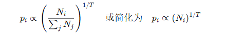
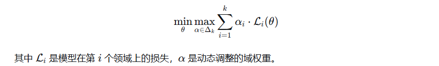
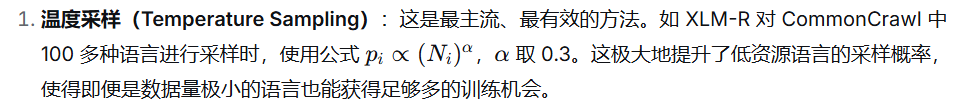
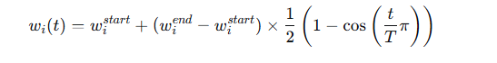
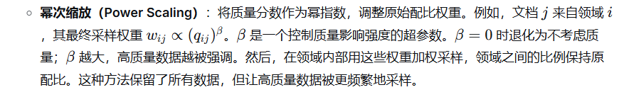
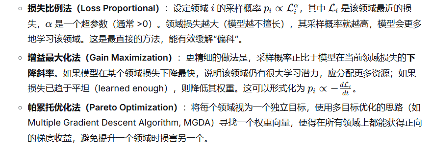
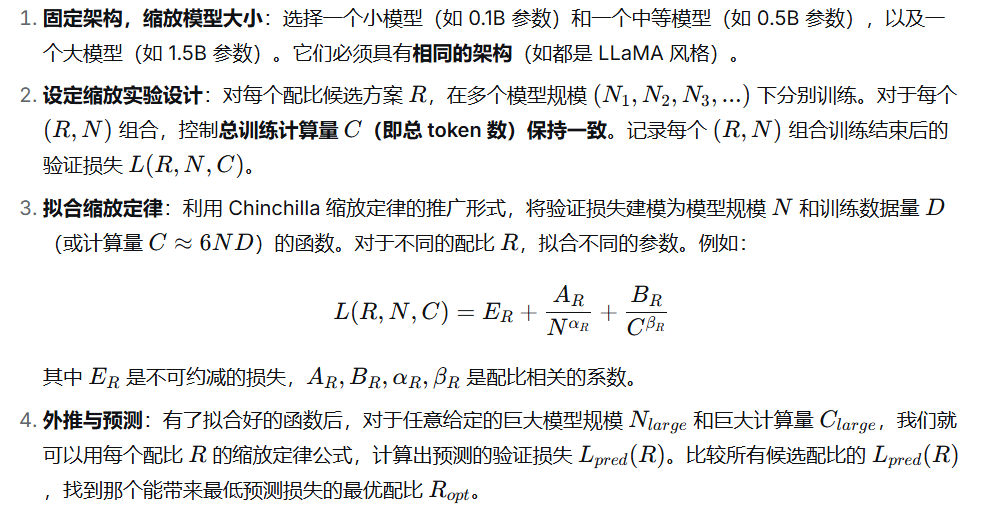
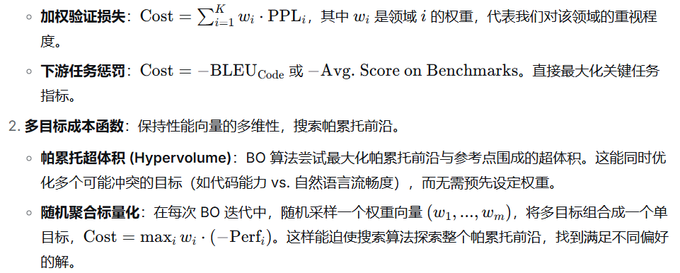

# 31.大模型（LLMs）数据配比

#### 什么是数据配比？为什么不能简单均匀混合所有来源？

数据配比是指在预训练大语言模型时，将来自不同领域、不同来源、不同语言、不同格式的数据集，按照预设的比例进行混合，以构成最终的训练语料。这些来源可能包括：网页文本、书籍、学术论文、代码仓库、维基百科、论坛帖子、新闻文章等。配比的目标是控制模型学习到的知识分布，使其在下游任务上获得最优的综合性能。

不能简单均匀混合所有来源的原因：

1. 数据量级的巨大差异：不同来源的数据规模天差地别。例如，Common Crawl 网页文本的体量往往是书籍、论文的数万倍。如果按来源数量均匀混合，模型会在海量的网页文本上消耗绝大部分训练时间，导致对书籍、论文等高质量但小体量来源的学习严重不足，最终模型的知识主要由网络文本主导。

2. 信息密度和质量的不均：不同来源的数据信息密度和信噪比不同。维基百科、书籍通常经过人工编审，信息准确、语言规范；而论坛帖子、社交媒体则包含大量口语、拼写错误、重复内容。等量混合会使模型浪费算力在低信息量的数据上，而忽略了高价值数据的精细学习。

3. 下游任务的偏重性：模型的最终用途决定了不同来源的重要性。若目标是代码生成，代码数据的比例必须远超其在自然语料中的自然占比；若目标是多语言模型，低资源语言必须被“上采样”才能不被高资源语言淹没。

4. 计算资源的最优分配：预训练的计算预算有限。为了让每一分算力都物有所值，必须通过控制配比，确保模型优先“吃饱”那些对提升核心能力最有效的数据，而不是被数据量最大的来源牵着走。

5. 模型泛化与安全：若不加控制，某些包含偏见、虚假信息或敏感内容的来源可能占据过大比例，导致模型学习并放大这些负面特征。通过配比可以进行源头上的风险控制。

因此，数据配比是预训练中最重要的超参数之一，它直接决定了模型“看到的世界是什么样子”，需要经过精心设计和实验验证。

#### 解释基于 token 数加权、均匀采样、温度采样三种配比策略的公式和效果差异。

基于 token 数加权（也称为“自然分布”）

- 公式：每个来源 $i$ 的采样概率 $p_i$ 正比于该来源的总 token 数 $N_i$。

$$
p_i = \frac{N_i}{\sum_j N_j}
$$

{.ocr-src}

- 效果：这是最直接利用所有数据的方式。训练时，token 数最多的来源会被最频繁地采样。在庞大的通用语料中，网页文本将占据绝对主导（如 >90%）。这会最大化数据吞吐量，但可能导致模型过度偏向网页文本的风格和知识，严重忽视低资源但高质量来源（如书籍）的贡献，最终模型更像一个“网页文本模型”。

均匀采样

- 公式：所有来源（共 K 个）被赋予完全相等的采样概率。

$$
p_i = \frac{1}{K}
$$

{.ocr-src}

- 效果：无论来源大小，每个来源在训练中都有平等的发言权。这对极小来源（如只有几百万 token 的专业语料）是一种极强的保护，能确保模型充分学习它们。但副作用是，小来源的数据会被反复循环训练，极易导致过拟合（模型会背下这些数据），并且巨大的通用语料（如 Common Crawl）的价值被严重浪费，整体数据利用率极低，模型泛化能力可能受损。

温度采样

- 公式：通过一个温度参数 $T$ 对原始 token 数比例进行平滑，以调整高低资源间的平衡。

$$
p_i \propto \left(\frac{N_i}{\sum_j N_j}\right)^{1/T} \quad \text{或简化为} \quad p_i \propto (N_i)^{1/T}
$$

{.ocr-src}

- 效果：这是前两者的折中。当 $T$=1 时退化为 token 数加权。当 $T$→∞ 时趋向均匀采样。通常取 $T$>1（如 2, 3, 5）会缩小各来源间的采样概率差距，使得高资源源不会被过度采样，但又不至于像均匀采样那样完全平等。在实践中，更常见的是设定一个目标比例，并通过 $T$ 来“软化”实际的采样分布。它是多语言和多领域数据平衡中最常用的策略之一，例如 XLM-R 在 100 多种语言上使用 $α$=0.3 的温度采样，有效提升了低资源语言的性能。

#### 温度采样中的温度参数 T 如何影响高低资源域的出现概率？

温度参数 $T$ 在数据配比中起着“调节器”的作用，它控制着采样分布从“极端偏向高资源”到“趋向均匀”的平滑过渡。

- 当 $T$=1 时：采样概率正比于各领域的原始 token 数比例。高资源领域（如拥有数万亿 token 的网页文本）以压倒性的概率被采样，而小领域（如仅数十亿 token 的书籍）的出现概率极低，近乎于无。

- 当 $T$<1 时：进一步放大高资源领域的优势。概率分布变得更加“尖锐”，训练几乎完全集中在最大的几个领域上。这通常不是期望的行为，因为它会严重牺牲多样性和长尾知识。

- 当 $T$>1 时：开始“压缩”各领域原始规模带来的差异。随着 $T$ 增大，低资源领域的采样概率被显著提升，高资源领域的优势被相对削弱。分布变得更加“平坦”。
  - 效果：低资源领域获得了更多被模型“看到”的机会，有助于模型学习这些领域的知识，提升在它们上的表现。
  - 代价：如果 $T$ 过大（如 >5），分布接近均匀采样，高资源领域的巨量数据被严重浪费，低资源领域会因重复训练而过拟合。这需要在提升低资源性能和维持高资源泛化能力之间找到一个平衡点。

直观理解：可以把各领域想象成大小不一的“知识池”，$T$ 就是我们从各个池中取水时的“公平倾向”。$T$=1 是按池子大小取水；$T$>1 是给小池子加了一个“小勺”，让它们被取水的频次远高于其大小比例，从而不被忽略。

在实践中，常采用 $T$=2 或 $T$=3，或者直接设定每个领域的采样“上限”和“下限”，确保没有一个领域占比超过特定比例（如 30%），也没有一个低于某个最小比例（如 0.1%）。

#### DoReMi 算法如何通过小模型分组 DRO 自动学习域权重？

DoReMi（Domain Reweighting with Minimax）是一种无需下游任务数据就能自动学习最优数据配比的算法。它通过一个小的代理模型（proxy model）在预训练初期自动分配域权重，然后用这些权重指导大模型的完整训练。

核心流程：

1. 分组设置：将训练数据预划分为 $k$ 个领域（domains），如“网页”、“书籍”、“代码”等。每个领域有大量未标注文本。

2. 代理模型训练：使用一个极小的模型（如 280M 参数），在这些领域的数据上进行训练，但不采用固定配比。DoReMi 的目标是找到一组域权重 $\alpha_1$,...,$α_k$，使得模型在所有领域上的最差表现（最大损失）达到最小。这被形式化为一个分布鲁棒优化（DRO） 问题：

$$
\min_\theta \max_{\alpha \in \Delta_k} \sum_{i=1}^{k} \alpha_i \cdot \mathcal{L}_i(\theta)
$$

其中 $\mathcal{L}_i$ 是模型在第 $i$ 个领域上的损失，$\alpha$ 是动态调整的域权重。

{.ocr-src}

3. 交替优化：通过迭代的方式，每一步或每隔几步：
  - 固定域权重 $α$，优化模型参数 $θ$，降低加权损失。
  - 固定模型参数，更新域权重 α，通过梯度上升的方式提升当前表现最差领域的权重，同时降低表现较好领域的权重。这迫使模型专注于那些“难以学习”的领域。

4. 获得最终权重：代理模型训练收敛后，得到的域权重 $α$∗ 即是 DoReMi 策略认为的“最优”配比。这些权重反映了各领域的相对“学习难度”或“数据质量/冗余度”：重复度高、容易学习的领域权重会降低；信息丰富、困难复杂的领域权重会升高。

5. 大规模训练：使用代理模型学到的 $α$∗ 作为采样权重，来混合全量数据，训练最终的巨型模型。

优点：DoReMi 完全基于预训练损失，无需下游验证集，能自动发现高质量的领域并给予更高权重，在实践中被证明能有效提升大模型的平均性能和效率。

#### 如何设计代理模型实验来搜索最优数据配比？需控制哪些变量？

当我们没有 DoReMi 这样的自动算法时，手动设计代理实验是找到最优配比的标准方法。核心思想是：用小模型和少量训练步数，模拟大模型在长期训练下的相对表现。

实验设计步骤：

1. 定义搜索空间：选定要调整的关键数据域（如 A, B, C 三类），并确定每个域的比例范围（如 A 在 20%-60%，B 在 20%-40%，C 在 10%-30%），以及总比例之和为 100%。

2. 构建代理模型：选择一个足够小的模型架构（如 100M 或 300M 参数），它能够快速训练，但其不同配比下的性能排序应与大模型高度相关。

3. 设定固定计算预算：为每一个配比实验设定完全相同的总训练 token 数（例如，都训练 5B token）。这是最关键的变量，必须保持一致，否则无法区分性能差异是配比带来的还是训练量带来的。

4. 控制其他超参数：
  - 使用相同的学习率调度（如 cosine）、相同的 warmup 步数、相同的批次大小。
  - 严格固定随机种子，或多次实验取平均，以排除随机性干扰。
  - 使用完全一致的验证集。

5. 网格搜索或贝叶斯优化：在搜索空间中选择若干组配比，对每组都从头训练一个代理模型，并记录其在验证集上的验证损失（或下游任务准确率）。

6. 结果分析：绘制性能随配比变化的曲线。找到在验证集上表现最好的配比（如最低困惑度或最高基准得分）。通常，我们寻找的不是一个极端点，而是一个“帕累托最优”区域，使得多个能力维度都相对平衡。

7. 验证与迁移：将找到的最优配比应用于更大规模的模型（如 1B 参数），在更大计算预算下验证效果，确保代理实验的结论能够迁移。

通过严格控制计算预算和超参数，代理实验能以相对低廉的成本，快速筛选出最有潜力的数据配比，为大模型训练提供决策依据。

#### 多语言预训练中，如何平衡高资源语言（如英语）和低资源语言？常见方案有哪些？

多语言模型的核心挑战在于如何避免模型被高资源语言（如英语）主导，而遗忘或根本不学习低资源语言。平衡策略主要分为数据层面的重采样和目标层面的调整。

常见平衡方案：

1. **温度采样（Temperature Sampling）**：这是最主流、最有效的方法。如 XLM-R 对 CommonCrawl 中 100 多种语言进行采样时，使用公式 $p_i \propto (N_i)^\alpha$，$\alpha$ 取 0.3。这极大地提升了低资源语言的采样概率，使得即便是数据量极小的语言也能获得足够多的训练机会。

{.ocr-src}

2. 设定硬性比例边界：为每种语言设定一个采样占比的上限和下限。例如，英语的占比最大不超过 25%，任何语言的占比最少不低于 0.1%。这确保了低资源语言有一个“保底”的曝光率，同时防止高资源语言“赢家通吃”。

3. 语言分组与层级平衡：将语言按资源量分成高/中/低资源组，先在不同组之间进行平衡（如高资源组占 50%，中资源组 30%，低资源组 20%），再在组内按 token 数加权。

4. 数据增强与合成：对于极低资源语言，通过回译（Back-translation） 等方法，利用高资源语言生成更多低资源语言的平行语料，增加其训练数据量。

5. 多任务与跨语言共享：使用共享的多语言词表（如 SentencePiece），并在模型结构上鼓励参数共享（如 XLM-R 的共享编码器）。这样，低资源语言可以从高资源语言的学习中“借力”，实现跨语言迁移。

6. 动态调整：在训练过程中，动态监测每种语言上的验证损失，对损失上升或停滞的语言，临时增加其采样权重，类似课程学习。

7. 语言特定的退火策略：在训练末期，逐渐降低高资源语言的采样权重，提高低资源语言的权重，以“精调”模型在低资源语言上的性能。

综合运用这些方案，能有效训练出一个在各语言上表现相对均衡的多语言模型，而不是一个只会英语的模型。

#### 代码与自然语言混合的最佳比例通常如何确定？给出实验设计。

代码数据已被证明能显著提升语言模型的逻辑推理、规划和结构化输出能力。确定最佳的代码与自然语言混合比例，需要权衡：代码比例过高，可能损害自然语言的流畅度和常识性；过低则推理能力提升有限。

实验设计方案：

1. 设立候选配比：基于经验设定一系列代码占比，例如 5%, 10%, 15%, 20%, 25%, 30%，其余为混合的自然语言数据（如网页、书籍等）。

2. 代理模型训练：使用一个较小的模型（如 300M 参数），为每个候选配比训练一个模型。必须严格控制总训练 token 数、自然语言部分的内部配比、优化器超参等完全一致，唯一变量是代码的混合比例。

3. 多维度评估：训练完成后，在每个模型上分别评估：
  - 自然语言能力：在标准语言理解基准（如 HellaSwag, PIQA, LAMBADA）和生成基准上评估困惑度和准确率。
  - 代码能力：在 HumanEval, MBPP 等基准上评估 Pass@1。
  - 数学推理能力：在 GSM8K, MATH 等基准上评估准确率。因为代码训练常能带来数学能力的提升。

4. 帕累托前沿分析：绘制代码能力得分 vs. 自然语言能力得分的散点图。寻找一个“拐点”，即在自然语言性能下降尚可接受的前提下，代码/推理能力获得最大提升的配比。

5. 规模验证：将找到的 1~2 个最佳配比，用更大的模型（如 1B-7B）和更多的训练数据量进行验证，确保该比例在大规模下依然有效。

以 LLaMA 系列为例，其代码数据占比从 LLaMA 1 的 4.5% 增加到 LLaMA 3 的更高比例，正是基于类似的实验发现，提升代码和推理数据比例对构建更强大的通用模型至关重要。通常，这个最佳比例在 10%-20% 之间，具体取决于模型规模和对推理能力的侧重。

#### 解释数据配比中的“重复因子”对模型记忆和泛化的影响。

重复因子是指在一个 epoch 内，整个训练数据集中每条数据被模型“看到”的平均次数。当训练 token 总量远超数据集去重后的 token 数时，数据就必须被重复使用。

- 对记忆的影响：高重复因子意味着模型会多次看到同一条数据。这极大增加了模型死记硬背（memorization） 特定文本序列的风险，尤其是那些长尾、小众的样本。模型可能会逐字逐句地背诵出训练数据中的段落，这不仅涉及隐私泄露风险，也表明模型没有学到可泛化的模式。

- 对泛化的影响：适度的重复（如 1-3 次）有助于模型充分学习数据中的模式，提升性能。但过高的重复（如 >10 次）会导致严重的过拟合。模型在训练数据上的困惑度会持续下降，但面对未见过的数据时，其生成质量、理解能力和鲁棒性都会显著降低。模型会倾向于输出在训练中多次见过的“套路化”内容，缺乏创造力和适应性。

- 如何平衡：理想情况下，应尽量降低重复因子，最好保持在一个 epoch 左右（即所有数据仅使用一次）。这要求训练数据量足够大。当数据量不足时，可以通过数据增强（如回译、同义词替换）来产生更多变体，或采用正则化技术（如 Dropout）来缓解过拟合。但根本上，高质量、大规模、多样化的原始数据，以及合理的去重，是控制重复因子负面影响的关键。现代大模型如 LLaMA 3 就强调在 15T token 训练时，数据重复度很低，这对模型泛化能力至关重要。

#### 在训练过程中是否需要动态调整数据配比？如余弦退火式调整。

是的，在训练过程中动态调整数据配比，类似于让模型在不同的训练阶段“专注于”不同的学习目标，这种做法通常被称为课程学习（Curriculum Learning），能够提升训练的稳定性和最终模型性能。

动态调整的动机：

- 初期打基础，后期精调：在训练初期，模型如同一张白纸，需要广泛接触各类基础数据（如通用百科、新闻），以学习基本的语法、词汇和世界知识。到后期，模型基础已稳固，此时可以增加高质量、高难度数据（如学术论文、复杂代码）的比例，对其进行精细优化。

- 缓解过拟合与遗忘：某些稀缺但重要的领域（如低资源语言），若全程保持固定高比例，可能因数据重复过多而过拟合。如果仅在训练末期才提升其比例，既能保证它们被充分学习，又不至于在漫长训练中造成负面效应。

- 应对不同数据消耗速度：不同领域数据的“学习效率”不同。简单、重复度高的数据（如部分网页文本）很快就会被模型学透，继续大量训练收益递减。此时应动态降低其采样率，将计算资源让给那些仍有学习潜力的困难领域。

具体策略（以余弦退火式调整为例）：

- 递减策略：对于量大但信息密度低的领域，如通用网页文本，其采样权重可以按照余弦函数的曲线，从初始的较高值平滑下降到最终的较低值。

- 递增策略：对于书籍、学术论文、代码等高质量领域，其权重则按照余弦曲线从较低值平滑上升到较高值。

- 公式表示：对于领域 $i$，在训练步数 $t$ 时，其权重 wi(t) 可以表达为：

$$
w_i(t) = w_i^{start} + (w_i^{end} - w_i^{start}) \times \frac{1}{2}\left(1 - \cos\left(\frac{t}{T}\pi\right)\right)
$$

{.ocr-src}

- 其中 $T$ 是总步数。此方法确保了配比变化是平滑、连续的，避免对训练造成冲击。

在实践中，LLaMA、DeepSeek 等模型在训练后期都会调整数据配比，例如逐渐提高代码和数学数据的比例，或减少低质量网页数据的占比。这种动态调整是挖掘模型极限潜力的重要技巧。

#### 不同领域（书籍、网页、代码、维基）的数据配比典型参考值（如 LLaMA 系列）以及设计依据。

不同领域的典型数据配比并没有一个放之四海而皆准的标准，但主流大模型如 LLaMA 系列的实践为我们提供了宝贵的参考。

LLaMA 1 的数据配比（约 1.4T tokens）：

- Common Crawl (网页)：67.0%

- C4 (网页)：15.0%

- GitHub (代码)：4.5%

- Wikipedia (维基)：4.5%

- Books (书籍)：4.5%

- ArXiv (学术)：2.5%

- StackExchange (问答)：2.0%

LLaMA 2 的配比：在 LLaMA 1 基础上增加了数据总量（2T tokens），但对具体配比未做颠覆性改变，仍以网页数据为绝对主体（>80%），同时保持了书籍、维基、代码等高质量来源的显著存在。

LLaMA 3 的配比趋势：据公开信息，LLaMA 3 的训练数据量（15T tokens）远超 LLaMA 2，其配比上更加重视代码和高质量文本（如书籍、学术论文），代码和数学相关数据的占比有显著提升（可能达到 15-20%），而低质量网页占比被压缩。同时引入了大量多语言数据。

设计依据：

1. 网页数据 (Common Crawl + C4) 占比最大，因为它是互联网的缩影，体量巨大、覆盖领域广，能为模型提供广泛的世界知识、多样的语言风格和丰富的对话模式，是构建通用基座模型的基石。但需要经过严格清洗。

2. 书籍：提供长程连贯叙事、复杂情节和文学性语言，有助于提升模型的生成流畅度、逻辑连贯性和长期记忆能力。

3. 维基百科：提供结构化、客观中立、事实准确的知识，是模型学习事实性问答和信息抽取的黄金标准。

4. 代码：教会模型严格的逻辑、语法遵循、分步推理和算法思维。近年来的研究反复证明，增加代码数据比例能显著提升模型的推理能力，而不仅仅局限于编程任务。

5. 学术论文 (ArXiv)：提供高密度的专业知识、科学术语和严密的论证逻辑，能提升模型在 STEM 领域的表现。

6. 问答平台 (StackExchange)：提供真实的用户提问和高质量、经过验证的答案，有助于提升模型的指令跟随和解决问题的能力，包含 implicit reasoning。

核心设计哲学：通过在量大但噪杂的通用数据（网页）与量小但精纯的专业数据（书籍、维基、代码）之间寻找平衡。通常采用“大量通用数据打底，高质量数据上采样”的策略，后者虽然占比小，但可能被重复训练 1-3 个 epoch，以确保其影响力。

#### 数据配比与 Chinchilla 最优分配如何结合：预算固定，如何同时优化配比和模型大小？

Chinchilla 最优分配定律指出：在给定固定计算预算（FLOPs）时，模型参数量和数据量（tokens）应该等比增长才能达到最优的 perplexity。然而，这未考虑数据的异质性。将数据配比与 Chinchilla 原则结合，意味着我们不仅要决定“训练多少数据”，还要决定“训练哪些数据”。

在固定预算下，同时优化数据配比和模型大小的关键在于分阶段决策和代理模型实验：

1. 确定总计算预算 $C$：明确可用 FLOPs。

2. 确定模型大小候选集：根据 Chinchilla 的近似关系 $N_{opt}\propto C^{0.5},\ D_{opt}\propto C^{0.5}$，确定几个模型参数量与总训练 token 数的候选组合。例如，预算为 $10^{21}$ FLOPs，可考虑 1B 模型训练 100B tokens，或 3B 模型训练 33B tokens，或 7B 模型训练 14B tokens 等。

3. 代理配比实验（关键步骤）：对每个候选模型大小，进行独立的数据配比优化。因为最优配比本身可能与模型规模相关（大模型可能更需要代码和推理数据）。
  - 对于一个小模型（如 300M），设定一个固定但较小的计算预算（如用该预算的 1/10），进行多组不同数据配比的实验。
  - 在每个配比下，训练模型达到指定的较小数据量，然后评估其在验证集上的损失。
  - 通过代理实验，绘制出“数据配比 - 验证损失”曲线，找到使验证损失最小的配比。

4. 联合外推与选择：对于每个候选模型大小，我们得到了一个“最优配比”下的代理验证损失。将这些最优配比代入全量计算预算，预测模型在完整训练后的性能。

5. 最终决策：结合性能预测和工程约束（如显存、推理成本），选择那个在给定预算下，能最大化下游任务性能（或最小化 perplexity）的（模型大小，数据配比）组合。

6. 验证与微调：选定主模型大小和配比后，进行大规模训练。训练后期，可根据各领域验证损失的动态变化，微调配比。

这种方法的实质是承认 Chinchilla 定律给出的是同质数据下的最优，而数据配比是异质数据下的另一维度优化，两者必须通过受控的代理实验协同搜索。

#### 如果某高质量源数据量少，如何通过调整重复轮数来平衡其贡献？

当某个高质量源（如专业医学文献或小语种书籍）数据量极少（例如，仅几十万篇文档），在混合数据中占比会非常低，模型可能无法从中充分学习。此时，通过增加其重复训练轮数 (Epochs) 是一种直接但需谨慎操作的补偿手段。

策略与平衡方法：

1. 设定最大重复度上限：为防止严重过拟合，必须为任何数据源设定一个重复度上限。通常，对整个数据集而言，重复 1-3 次是安全的；但对一个小数据源，允许其重复 5-10 次。关键点是监控其在独立于训练集的验证集上的困惑度，一旦验证困惑度上升（即过拟合开始），立即停止增加该源的重复轮数。

2. 在固定 token 预算下操作：计算总训练预算时，我们将总 token 数限定。为了实现高质量源的更多重复，我们需要在数据采样时，人为提高该源的采样概率。例如，该源实际 token 数占总量的 0.1%，但我们通过温度采样将其采样概率调整为 1%。这意味着在整个训练过程中，该源的数据会被反复使用多次。这种“上采样”本质上就是增加了其重复轮数。

3. 使用数据增强缓解过拟合：在重复训练同一批数据时，应用轻微的数据增强（如同义词替换、句子顺序打乱、段落随机裁剪等），可以生成更多变体，有效缓解过拟合，使模型能从少量源数据中学到更鲁棒的模式。

4. 课程学习式地动态调整：在训练初期，给予该高质量源较高的采样权重，让模型快速吸收其知识；到了训练后期，其验证损失下降空间已不大时，逐步降低其权重，将计算资源分配给其他仍有提升空间的领域，避免在它上面浪费算力并导致过拟合。

5. 结合数据蒸馏或合成：作为更高阶的方案，可以用该高质量源数据训练一个小模型，然后用小模型生成更多的“合成数据”，扩充该源的数据量，从而降低重复度。

核心思想是：通过上采样增加高质量小源的出现频率，但必须时刻用验证损失和过拟合指标加以约束，找到“多重复一次带来的收益”与“过拟合带来的损害”之间的临界点。

#### 讨论 The Pile 数据集中基于困惑度分类的领域构成思路。

The Pile 是一个著名的、旨在提升数据多样性的预训练数据集。它包含 22 个精心选择的子集。尽管 Pile 本身并没有直接使用“基于困惑度的领域构成”来自动划分数据，但其数据选择和组织体现了类似的思想：通过衡量数据的“统计特性”来界定领域和提升质量。

如果我们借鉴 The Pile 的思路并结合困惑度来构建领域数据集，可以这样理解：

1. 用困惑度作为“领域风格标尺”：针对不同领域（如法律、医学、编程），在其高质量语料上分别训练 5-gram 语言模型。当我们面对一批未分类的文本时，可以分别用这些领域 LM 计算该文本的困惑度。文本的“领域归属”可以简单地判定为那个使其困惑度最低的领域。这能自动将混乱的数据按语言风格和术语使用区分开。

2. 用困惑度识别“低质量样板”与“高质量核心”：在一个领域内部，例如“论坛帖子”，我们可以训练一个通用的高质量语言模型（如基于维基百科）。计算所有帖子的困惑度。困惑度极低的帖子通常是“我顶”、“赞”等大量重复的样板文本；困惑度适中的是正常的、有信息量的讨论；困惑度极高的可能是代码、乱码或多语种混杂。通过设定困惑度上下限，可以将该领域的文本自动分成不同的质量层级。

3. 构建类似 The Pile 的多样性领域集：The Pile 的成功在于其丰富的领域构成（学术、法律、书籍、邮件等）。如果我们希望从一个巨大的未分类语料（如 Common Crawl）中“挖掘”出这些领域，可以：
  - 先手工收集每个领域的少量高质量种子语料，训练其领域 LM。
  - 然后对 Common Crawl 进行扫描，用领域 LM 的困惑度对所有文档进行评分和分类。
  - 最后，从每个领域分类中，再基于通用质量 LM 的困惑度进行质量过滤，保留高质量部分。
  - 这样，我们就能从一个混沌的池子中，自动提取出像 The Pile 那样构成清晰、多样化的领域数据。

The Pile 本身是手工挑选的，但其背后的精神——数据集的“多样性”和“领域代表性”至关重要——可以通过基于困惑度的自动化分类与过滤技术来近似和规模化。

#### 如何保证在流式训练中数据配比的一致性？实现在线数据采样管道。

在大规模预训练中，数据通常是以流（stream）的形式在线读取和混合的，而不是静态地全部放在磁盘上。保证在整个训练过程中，配比始终保持一致，是确保模型性能稳定、可复现的关键。

在线采样管道设计：

1. 多源异步读取：为每一个数据来源（如“网页”、“书籍”）启动一个独立的异步数据加载器（worker）。每个 worker 不断地从自己的源中读取文本，放入一个独立的内存缓冲区（buffer）。

2. 配比采样器：设置一个全局的数据采样器，它按照预设的概率分布（即配比），决定“下一个训练 batch 应该从哪个数据源的缓冲区中取数据”。例如，如果配比为网页:书籍:代码 = 7:2:1，则采样器会以 70% 的概率从网页缓冲区取，20% 的概率从书籍缓冲区取。

3. 令牌级对齐：为了确保配比的精确性，通常以令牌（token）为最小计量单位，而不是以完整的文档。因为文档长度差异巨大，如果以文档为单位混合，最终各来源的实际 token 数可能会偏离预设比例。
  - 实现方式：从被选中的缓冲区中读取文本，进行 tokenization，然后截取或填充到固定的 token 长度（例如，每个样本 2048 tokens）。这些长度固定的 token 块被用来组成训练 batch。通过这种方式，我们可以精确地统计和控制在训练过程中，每种来源消耗的 token 总数，确保其严格符合预设比例。

4. 循环填充与全局状态：对于数据量很小的来源，其缓冲区可能会被耗尽。此时，加载器应能自动循环（重复）该来源的数据，确保管道不会因此阻塞，从而保证采样器总能按概率取到数据。

5. 一致性监控：在训练过程中，实时记录各来源累计消耗的 token 数。通过 TensorBoard 等工具可视化这些曲线。如果实际比例偏离预设值，可以动态微调采样器的概率，形成一个闭环反馈。

这种设计能确保无论数据源大小、文档长短，最终模型看到的各领域数据比例都是稳定、可控且符合预期的，从而保证训练的一致性和可复现性。

#### 什么是“分层采样”策略，在多领域配比中如何应用？

分层采样（Stratified Sampling）是一种在数据配比中非常精细化的策略，它解决了“领域内可能存在巨大差异”的问题，确保配比不只是在宏观领域间平衡，还能在更细的粒度上保证公平性。

应用方式：

1. 定义分层维度：在宏观领域（如“网页”）内部，进一步划分出更细的子层（strata）。例如，网页可以按来源域名分层（如“维基”、“政府网站”、“新闻网站”、“个人博客”），或按语言分层，或按质量分分层。代码可以按编程语言分层。

2. 层内采样：对每一层，我们设定该层在最终全局数据中的目标占比。这个目标占比可以基于该层的重要性、数据量、质量等因素人为设定。

3. 组合权重：最终的采样权重 = 该源的整体宏观权重 × 该子层在源内部的微观权重。例如，“书籍”宏观权重为 10%，“书籍”内部我们又按题材（小说、教科书）各占 50% 权重。那么，教科书的最终全局采样权重为 10% × 50% = 5%。

4. 核心优势——提升长尾覆盖和公平性：
  - 假设我们希望模型学到各种编程语言。如果只是给“代码”一个宏观权重 15%，那么由于 Python 代码在数量上占绝对优势，模型可能只学会了 Python。使用分层采样，我们可以强制“代码”内部按语言进行采样，并给每种语言（哪怕只有很少的 Rust 代码）分配最低权重，确保它们不会被主流淹没。
  - 同样，为防止多语言模型中英语一家独大，我们可以将“网页”按语言分层，并设定每种语言的采样权重。

分层采样是一种强有力的手段，可以确保模型学习到数据的细微构成，提升对稀有领域、低资源语言或特定子话题的覆盖能力，防止宏观配比掩盖下的局部不公平。

#### 数据配比消融实验应固定哪些因素？给出系统实验方案。

数据配比消融实验的目标是孤立地评估配比变化带来的影响。因此，除了配比本身，其他所有可能影响模型性能的因素都必须被严格控制或固定。

必须固定的因素：

1. 模型架构和初始化：必须使用完全相同的模型架构和随机初始化种子。

2. 总训练计算量：最关键的固定因素。应以处理的 token 总数为预算，所有实验组必须消耗完全相同的 token 数。绝对不能以“训练步数”为预算，因为不同配比可能导致 batch 构成不同，但 token 数保证了“学习量”的对等。

3. 优化超参数：学习率、学习率调度（warmup 步数、衰减方式）、优化器、批次大小（global batch size）、梯度累积步数、权重衰减等必须完全一致。

4. 数据预处理：所有来源的数据必须使用同一套流程进行清洗、分词和打包。不能因为配比不同而改变数据的预处理质量。

5. 验证和评估方式：必须在完全相同的验证集和下游任务基准上进行评估，且评估步数和方式相同。

系统实验方案（以评估代码数据比例为例）：

- 目标：找到最佳的代码:自然语言比例。

- 固定预算：设定总训练 token 数为 50B。

- 候选配比：设置代码比例分别为 0%, 5%, 10%, 15%, 20%, 30% 的 6 组实验。自然语言部分内部保持固定比例（如网页:书籍=8:2）。

- 模型选择：选择一个较小的代理模型（如 150M 参数），以便快速完成所有实验。

- 执行：严格按照上述固定条件，为每组配比从头训练一个模型。

- 评估：训练完成后，在相同的代码生成基准（HumanEval）和自然语言理解基准（GLUE）上评估所有模型。

- 分析：绘制性能曲线。例如，观察 HumanEval 分数是否随代码比例提升而持续提升，而自然语言分数在某个点（如 20%）开始显著下降。这个拐点就是最佳比例的参考。

通过这样严格控制的消融实验，得到的结论才具有可信度，能够真正指导大规模模型的训练配比。

#### 使用重要性采样调整不同数据源在训练中的影响，与数据配比有何异同？

数据配比和重要性采样都是控制训练数据分布的手段，但它们的作用阶段和动态性不同。

- 数据配比 (Data Mixing)：作用于数据加载阶段。它直接决定了哪些数据被物理地喂给模型，以及喂多少。配比通常是预先设定的，并在训练全程或按预设计划（如余弦退火）执行。一旦设定，一个数据源在训练中的影响力就主要由其被采样的频率决定。

- 重要性采样 (Importance Sampling)：作用于损失函数计算阶段。它不改变物理数据流，而是通过为每个样本的损失乘以一个重要性权重来调整其对模型参数更新的影响。如果一个样本来自一个我们想强调的源，我们可以给它的损失乘以一个大于 1 的权重，让它对梯度的贡献更大；反之，给一个小于 1 的权重。

异同点分析：

1. 对数据频率的影响：数据配比直接改变数据出现的频率。重要性采样不改变频率，但改变每次出现时的“话语权”。对低资源源，如果给它很高的重要性权重，相当于每个样本都被“放大”了；但缺点是，如果该源数据量极小，模型可能因为重复见过多类似样本而过拟合，且大权重会导致训练不稳定。

2. 灵活性：重要性采样可以更动态和细粒度。它可以在训练过程中根据模型在每个样本上的实时损失来动态调整权重，实现类似在线课程学习的效果。而数据配比的调整通常更宏观和滞后。

3. 组合使用：两者经常结合。首先用数据配比在物理上保证各来源的基础曝光量，然后用重要性采样在损失层面进行微调。例如，对于包含噪声的网页数据，我们可以在训练中动态降低那些“异常高损失”（可能是噪声）样本的权重，这就是一种基于样本的重要性采样，与来源级的配比管理协同工作。

简言之，数据配比是“战略上”决定数据构成，而重要性采样是“战术上”精细调整每个样本的效力。

#### 如何评估数据配比的好坏？可对比的探针任务和评测集。

评估数据配比的最终标准是下游任务性能，但我们可以通过多层次的评测来更细致地归因和诊断。

1. 损失和困惑度

- 全量验证集损失：最基础、最综合的指标。一个好的配比应该在模型容量和数据量相同的情况下，带来更低的整体验证损失。

- 分领域验证损失：这是诊断配比是否平衡的关键。在训练过程中，分别监控每个领域（如代码、法律、数学）对应的独立验证集的损失曲线。如果某个领域的损失下降缓慢或反弹，说明该领域的配比可能过低或数据质量有问题。

2. 语言理解和知识覆盖基准

- 综合知识：使用 MMLU（涵盖 57 个学科的四选一选择题），可以系统性地评估模型对世界知识的覆盖度，看配比是否导致了“偏科”。

- 常识推理：使用 HellaSwag, PIQA, WinoGrande 等。如果模型在这些任务上表现差，可能是书籍、叙事类数据比例不足。

- 文本理解：使用 RACE, SQuAD, LAMBADA 等。

3. 推理和结构化能力基准

- 数学：GSM8K, MATH。数学能力的提升通常与代码、高质量技术文本（如 ArXiv）的比例高度相关。

- 代码生成：HumanEval, MBPP。直接检验代码数据的配比是否足够且有效。

- 逻辑推理：BBH, LogiQA 等。

4. 安全、偏见与鲁棒性探针

- 安全拒绝：评估模型在收到有害请求时的恰当拒绝率。好的配比应确保安全数据（如红队数据、道德准则）被模型内化。

- 事实性：TruthfulQA。检查模型是否因某些不可靠来源（如低质量网页）占比过高而学会了传播虚假信息。

- 公平性：使用 BOLD, HolisticBias 等基准，检查模型对特定人群的刻板印象是否因训练数据的偏见被放大。

5. 生成质量和人类偏好评估

- 开放式对话：使用 MT-Bench 或 AlpacaEval 2.0，由 GPT-4 或人类评估员对不同配比下训练的模型进行多维度的对比评分（有用性、流畅度、创造性）。

- 长篇文本生成连贯性：在 NarrativeQA 等长文本任务上评估。

综合评估体系：一个好的数据配比，不应该仅仅让某些基准分数冲到最高，而应该追求一种帕累托最优：在代码、数学、常识、安全等多个往往存在冲突的维度上都达到一个高质量的平衡。这需要我们在上述多层基准上进行全面的雷达图分析，而不是只看一个平均分。

#### 在持续预训练中，如何设计配比以注入新领域知识，同时减少遗忘？

持续预训练（Continual Pretraining, CPT）的目标是在基座模型上注入新领域知识（如法律、医学），同时避免灾难性遗忘（Catastrophic Forgetting）原有能力。核心策略是数据重播（Data Replay）与弹性权重巩固（Elastic Weight Consolidation）的结合，而数据配比是其中最直接、最有效的杠杆。

配比设计策略：

1. 新旧数据混合：训练数据不能全部由新领域数据构成。必须混入一部分原预训练数据（称为“重播数据”）。典型配比为新数据:旧数据 = 1:1 到 4:1之间。过高的新数据比例会导致快速遗忘，过低则新知识注入不足。具体比例取决于新领域与原始分布的差异程度。差异越大（如从英文扩展到阿拉伯文），旧数据比例应越高。

2. 重播数据的精选：不是所有旧数据都同等重要。应优先选择那些与新领域知识有交互或容易被遗忘的高质量旧数据。例如，若要注入医学知识，应多回放生物学、化学等关联领域的旧数据，以及通用推理、指令遵循等核心能力的数据。

3. 分阶段配比课程：
  - 预热阶段（Warmup）：训练初期以较高的旧数据比例（如 50%）开始，让模型稳定地过渡到新领域，避免剧烈的参数漂移。
  - 注入阶段（Injection）：逐步提升新数据比例（如 70-80%），让模型集中学习新领域知识。
  - 巩固阶段（Consolidation）：最后再次提升旧数据比例，或使用一个混合充分的数据集，让新旧知识进一步融合，修复可能被破坏的通用能力。

4. 二次采样与过采样：对于新领域中极重要的核心概念（如医学中的“诊断逻辑”），可以在新数据内部进一步提高其采样权重，进行过采样。同时，对旧数据中与核心能力相关的部分（如数学推理）也进行过采样，双重保险。

5. 动态调整与监控：在训练过程中，持续监控旧领域验证集（如通用问答、常识推理）和新领域验证集的损失。一旦旧领域损失出现显著上升（遗忘信号），立即临时提高旧数据比例或降低学习率。一些自动化方法（如基于梯度方向的重要性采样）也可动态调整每个样本的损失权重，实现更细粒度的遗忘控制。

总结：持续预训练的配比设计不是一成不变的，它是一个动态的、需要根据模型在新旧领域上的性能反馈不断调整的平衡过程。数据重播是基石，精选和动态调控则是减少遗忘的关键。

#### 如何将数据质量分数融入配比，形成加权采样？

将质量分数融入配比，目的是让高质量数据在训练中发挥更大作用，而低质量数据则被抑制，从而在有限的训练计算中最大化模型性能。

具体步骤：

1. 计算质量分数：为每一条数据（通常以文档为单位）计算一个标量质量分数 $q$∈[0,1]。这个分数可以来自：
  - 困惑度：由高质量语料训练的语言模型给出，高困惑度表示低质量。
  - 分类器得分：专门训练的质量分类器（如 fastText 或 BERT 变体），输出“高质量”的概率。
  - 启发式分数：结合多种规则（如文本长度、重复度、链接密度等）的加权和。

2. 制定融合策略：将质量分数与原始领域配比权重结合，形成最终的采样概率。常用方法有：
  - 乘性融合（阈值截断）：先设定一个质量阈值，低于阈值的文档直接丢弃（采样概率为 0）。然后，对保留的文档，仍按照原始的领域配比进行采样。这是最简单的方法，但会损失一部分信息。
- **幂次缩放（Power Scaling）**：将质量分数作为幂指数，调整原始配比权重。例如，文档 $j$ 来自领域 $i$，其最终采样权重 $w_{ij} \propto (q_{ij})^\beta$。$\beta$ 是一个控制质量影响强度的超参数。$\beta=0$ 时退化为不考虑质量；$\beta$ 越大，高质量数据越被强调。然后，在领域内部用这些权重加权采样，领域之间的比例保持原配比。这种方法保留了所有数据，但让高质量数据被更频繁地采样。

{.ocr-src}

  - 分位数组采样（Quantile Binning）：将质量分数分成几个区间（如高、中、低），为每个区间设定不同的采样倍数。例如，“高质量”区间采样 3 倍，“中质量”1 倍，“低质量”0.1 倍。此方法易于理解和控制，且稳定。

3. 全局归一化：计算所有文档经融合后的采样权重，并进行全局归一化，得到一个完整的概率分布。训练时，数据加载器就依据这个概率分布来随机采样文档。

4. 流式实现：在流式训练中，采样器实时查询每条文档的质量分数，并动态计算其融合权重，以决定是否采样以及采样的概率。

最佳实践：通常采用分位数组采样或幂次缩放，因为它们能平滑地调节，并且不会像硬阈值那样可能误杀大量数据。$β$ 或采样倍数的选择需要通过小规模代理实验来确定，以平衡过滤的洁净度和数据多样性。

#### 分析数据配比对模型知识截止日期的影响。

模型的知识截止日期（Knowledge Cutoff）是指模型所掌握的世界知识的最后时间点。数据配比直接影响这个日期的“锐利度”和“覆盖范围”。

影响分析：

1. 数据的时间构成决定截止日期：如果训练数据中所有文档的时间戳都在 2023 年 12 月 31 日之前，那么模型的知识截止日期就是该日。配比中不同来源的数据可能有不同的时间范围。例如，维基百科的 dump 可能更新到 2023 年初，而 Common Crawl 数据可能包含 2023 年底的内容。模型的最终知识截止日期实际上是各来源截止日期的“最晚值”，但前提是该来源在配比中占有足够比例，且该信息被模型充分学习。

2. 配比影响最新知识的“强度”：
  - 高比例包含最新数据：如果希望模型对 2023 年底的事件有清晰记忆，需要确保包含该时间段的数据（如最后几个月的新闻、网页）在总训练 token 中占有显著比例。如果只是极少量混入，这些最新知识会被海量旧数据“稀释”，模型可能知道但不准确，或者只在特定上下文下才能回忆起，导致事实性问答性能不稳定。
  - 低比例或未包含：如果配比中根本未包含某段时间的数据，模型对那段时间的知识将完全空白，产生严重的幻觉。例如，一个模型若完全未见过 2023 年的数据，当被问及 2023 年的事件时，它只能基于 2022 年及以前的模式进行“猜测”，这必然是错误的。

3. “知识截止”的模糊与矛盾：当训练数据混合了不同时间段的文本时，模型可能会学到相互矛盾的事实（例如，某公司的 CEO 在 2022 年和 2023 年不同）。配比中哪一年份的数据占主导，模型就倾向于输出哪一年的答案。这会导致知识截止日期并非一个精确的点，而是一个“模糊期”。在持续预训练注入新知识时，如果新知识比例不够，模型可能顽固地坚持旧知识，出现“知识更新困难”。

设计启示：为了获得清晰、可靠的知识截止日期，数据配比中应有意识地对最后一段时间的权威数据（如最新维基百科、精选新闻）进行上采样，确保它们能压过旧知识。同时，在评估时也需注意，不能简单地用一个日期去标定模型的知识边界。

#### 如果预训练数据只训不到一个 epoch，配比如何影响数据覆盖和重播？

当训练总 token 数少于数据集去重后的总 token 数时，意味着我们无法遍历整个数据集，每个数据最多被看到一次。在这种“欠训练”（Undertraining）或“单 epoch”场景下，配比策略的核心焦点从“控制重复”转向了“控制覆盖”和“控制数据丢弃”。

影响分析：

1. 配比决定了“谁被看到”：由于没有机会看完所有数据，模型最终看到的实际数据子集完全由配比决定。如果你给代码领域分配了 20% 的 token 预算，那么模型在训练过程中，将从整个代码数据集中随机采样，直到用完这 20% 的预算。剩余的 80% 代码数据则永远不会被模型看到。因此，配比从“重复训练的比例”变成了“选择哪些数据进入训练集”的唯一过滤器。

2. 对数据多样性和长尾的影响：
  - 高比例领域：如通用网页（占 70%），其预算巨大，模型有机会遍历该领域的大部分数据，覆盖高。
  - 低比例领域：如书籍（占 3%），其预算极小。如果该领域数据总量很大，采样器只能从中随机抽取一小部分。这带来两个风险：
    - 覆盖不足：可能无法代表该领域的全貌，整个领域的多样性被采样随机性破坏。
    - 高方差：不同训练 run（不同随机种子）看到的书籍子集会完全不同，导致模型在书籍相关能力上的表现波动巨大。
  - 应对策略：对于这种“预算小但总量大”的领域，必须在采样前预先进行数据精选（Subsampling），而不是依赖训练时的随机采样。例如，先用质量分筛选出 TOP 50% 的书籍，再让模型去训练。这样可以确保在有限预算内，模型看到的是该领域最有价值的内容。

3. 无重播带来的灾难性遗忘风险：在单 epoch 训练中，不存在数据被重复学习的“重播”效应。这意味着，如果训练前半段集中处理了某个领域，后半段完全不接触，模型可能会遗忘。因此，数据在整个训练过程中的均匀混合（Interleaving） 变得至关重要。必须保证在任何一个小的时间窗口内，各领域数据都是按比例出现的，而不是先训完一个领域再训下一个。

结论：在单 epoch 场景下，配比是数据选择的首要机制。必须结合数据总量和配比预算，对每个领域进行预精选，并保证训练时数据是均匀混合的，以最大化覆盖率和训练稳定性。

#### 动态配比中，如何根据验证损失或域损失自动调整采样概率？

动态配比旨在根据模型在训练过程中的实时表现，自适应地调整不同数据领域的采样概率，实现更高效的课程学习。这通常被称为“在线数据配比”或“自适应数据采样”。

核心机制：

1. 定义反馈信号：在每个评估周期（如每 1000 步），计算模型在不同领域的验证集上的损失（Perplexity）。也可以使用模型在当前训练 batch 上各领域的损失。

2. 从损失到采样概率的映射：需要设计一个规则，将领域损失的相对变化转化为采样概率的调整。常见策略有：

- **损失比例法（Loss Proportional）**：设定领域 $i$ 的采样概率 $p_i \propto \mathcal{L}_i^\alpha$，其中 $\mathcal{L}_i$ 是该领域最近的损失，$\alpha$ 是一个超参数（通常 >0）。领域损失越大（模型越不擅长），其采样概率就越高，模型会更多地学习该领域。这是最直接的方法，能有效缓解“偏科”。
- **增益最大化法（Gain Maximization）**：更精细的做法是，采样概率正比于模型在当前领域损失的**下降斜率**。如果模型在某个领域损失下降最快，说明该领域仍有很大学习潜力，应分配更多资源；如果损失已趋于平坦（learned enough），则降低其权重。这可以形式化为 $p_i \propto -\frac{d\mathcal{L}_i}{dt}$。
- **帕累托优化法（Pareto Optimization）**：将每个领域视为一个独立目标，使用多目标优化的思路（如 Multiple Gradient Descent Algorithm, MGDA）寻找一个权重向量，使得在所有领域上都能获得正向的梯度收益，避免提升一个领域时损害另一个。

{.ocr-src}

3. 实施步骤：
  - 设定更新频率：采样概率不能每步都变，否则会造成训练不稳定。通常每隔几百或几千步更新一次。
  - 平滑处理：使用指数移动平均（EMA）来平滑领域损失，避免因 batch 噪声导致采样概率剧烈震荡。
  - 设定安全边界：为每个领域的采样概率设定一个最小值和最大值（如 [0.5%, 50%]）。这可以防止模型因暂时损失异常而完全忽略某个领域，或因过度采样某个领域而崩溃。
  - 热启动：训练初期，先使用固定的手工配比进行一段时间的预热，待模型相对稳定后，再开启动态配比调整。

优点：动态配比能够自动适应模型的学习节奏，将计算资源投入到最需要的地方，通常能加速收敛并提升最终性能。风险：如果反馈信号设计不当，可能导致模型走上“捷径”，例如反复学习高噪声领域而导致过拟合。

#### 讨论数据配比在跨模态预训练（如多模态 LLM）中的特殊考虑。

跨模态预训练（如训练一个同时理解图像和文本的模型）的数据配比比纯文本更复杂，因为它不仅要考虑领域，还要考虑模态的组合方式。

特殊考虑：

1. 模态对齐数据 vs. 单模态数据：训练数据通常包括三类：
  - 图文对 (Image-Text Pairs)：用于学习模态间的粗粒度对齐（如 CLIP 风格）。
  - 交错图文 (Interleaved Image-Text)：用于学习更精细的多模态上下文推理（如 Flamingo 风格）。
  - 纯文本 (Text-Only)：防止语言能力退化。
  - 配比挑战：必须仔细平衡这三者。过多的图文对可能导致语言能力退化；过多的纯文本可能削弱多模态理解。典型配比可能是图文对:交错图文:纯文本 = 4:3:3，但需根据具体任务调整。

2. 知识解耦与增强：多模态模型可以从不同模态学习互补的知识。例如，从文本中学到“狗”的概念，从图像中学到不同狗的外观。但这也可能导致“幻觉”：模型可能在回答关于图像的问题时，过度依赖文本中学到的统计先验（如“物体通常是什么颜色”），而忽略了实际看到的图像。因此，需要提高那些能纠正文本先验的、具有反事实特性的多模态数据的比例，以强化模型对视觉信号的依赖。

3. 分辨率与质量的权衡：高分辨率图像信息量大，但 token 数量极多，会挤占文本的训练预算。在计算预算有限的情况下，必须决定是使用更多的高质量图像，还是使用更多的低质量图像但覆盖更广的场景。通常，对包含关键视觉细节（如文字、人脸）的图像进行上采样，而对简单的场景图进行下采样。

4. 视频与音频数据的加入：当扩展到视频、音频模态时，配比更加复杂。由于视频数据天然是稀疏的（大量冗余帧），通常需要通过关键帧提取或 segment-level 采样来平衡。同时，不同类型任务（如视频问答、语音识别）的数据也需按目标能力进行配比。

5. 动态模态配比：类似于纯文本的动态配比，可以在训练中动态调整各模态数据的比例。例如，当检测到语言能力下降时，自动提升纯文本数据的采样权重；当检测到视觉问答准确率停滞时，增加高质量交错图文数据的权重。

核心思想：跨模态配比的核心是在模态对齐、单模态能力保持、以及多模态推理之间找到平衡点，并管理好不同模态数据带来的计算成本和信息密度的巨大差异。

#### 如何通过小规模实验预测大规模数据配比的性能趋势？

由于大规模训练成本极高，必须通过小规模实验（代理实验）来预测不同配比在大规模下的相对表现。核心是构建一个“缩放法则”，将小模型/小数据下的配比性能，外推到大模型/大数据下。

**实验与预测步骤：**

1. **固定架构，缩放模型大小**：选择一个小模型（如 0.1B 参数）和一个中等模型（如 0.5B 参数），以及一个大模型（如 1.5B 参数）。它们必须具有**相同的架构**（如都是 LLaMA 风格）。
2. **设定缩放实验设计**：对每个配比候选方案 $R$，在多个模型规模 $(N_1, N_2, N_3, ...)$ 下分别训练。对于每个 $(R, N)$ 组合，控制**总训练计算量 $C$（即总 token 数）保持一致**。记录每个 $(R, N)$ 组合训练结束后的验证损失 $L(R, N, C)$。
3. **拟合缩放定律**：利用 Chinchilla 缩放定律的推广形式，将验证损失建模为模型规模 $N$ 和训练数据量 $D$（或计算量 $C \approx 6ND$）的函数。对于不同的配比 $R$，拟合不同的参数。例如：

$$
L(R, N, C) = E_R + \frac{A_R}{N^{\alpha_R}} + \frac{B_R}{C^{\beta_R}}
$$

其中 $E_R$ 是不可约减的损失，$A_R, B_R, \alpha_R, \beta_R$ 是配比相关的系数。

4. **外推与预测**：有了拟合好的函数后，对于任意给定的巨大模型规模 $N_{large}$ 和巨大计算量 $C_{large}$，我们就可以用每个配比 $R$ 的缩放定律公式，计算出预测的验证损失 $L_{pred}(R)$。比较所有候选配比的 $L_{pred}(R)$，找到那个能带来最低预测损失的最优配比 $R_{opt}$。

{.ocr-src}

5. 验证与校准：在真正投入万卡训练前，先在一个稍大但尚可接受的规模（如 3B 模型，训练 100B tokens）上，对预测出的前 2-3 个最优配比进行验证实验。确认哪个配比在中等规模上确实表现最好，并以此作为最终大规模训练的配比。

关键成功因素：小模型与目标大模型的架构一致性；训练计算量、优化器等超参的严格一致性；以及缩放定律模型选择的合理性。这种方法虽然不能给出绝对精确的预测，但能有效排除那些明显次优的配比，缩小搜索空间，极大降低试错成本。

#### 应用贝叶斯优化或黑盒优化搜索数据配比，需要哪些成本函数？

将数据配比搜索视为一个黑盒优化问题，贝叶斯优化（Bayesian Optimization, BO）是一个非常合适的工具，尤其当我们的评估成本很高（每次评估需要完整训练一个代理模型）时。

成本函数的设计：

成本函数（即目标函数，通常是求最小值）是引导搜索的关键。它可以是单目标的，也可以是多目标的。

1. 单目标成本函数：将多个维度的性能指标聚合为一个标量。

- **加权验证损失**：$\mathrm{Cost} = \sum_{i=1}^{K} w_i \cdot \mathrm{PPL}_i$，其中 $w_i$ 是领域 $i$ 的权重，代表我们对该领域的重视程度。
- **下游任务惩罚**：$\mathrm{Cost} = -\mathrm{BLEU}_{\mathrm{Code}}$ 或 $-\mathrm{Avg.\ Score\ on\ Benchmarks}$。直接最大化关键任务指标。

2. **多目标成本函数**：保持性能向量的多维性，搜索帕累托前沿。
    - **帕累托超体积 (Hypervolume)**：BO 算法尝试最大化帕累托前沿与参考点围成的超体积。这能同时优化多个可能冲突的目标（如代码能力 vs. 自然语言流畅度），而无需预先设定权重。
    - **随机聚合标量化**：在每次 BO 迭代中，随机采样一个权重向量 $(w_1, ..., w_m)$，将多目标组合成一个单目标，$\mathrm{Cost} = \max_i w_i \cdot (-\mathrm{Perf}_i)$。这样能迫使搜索算法探索整个帕累托前沿，找到满足不同偏好的解。

{.ocr-src}

3. 成本函数的约束：
  - 数据总量限制：各领域配比之和必须为 1。
  - 最小/最大比例约束：必须为某些关键领域（如安全、代码）设定一个最低采样比例，以确保模型的基线能力。
  - 训练预算约束：BO 的总预算受限于我们能承受的代理实验次数（如 30-50 次）。

BO 流程：

- 代理模型：使用高斯过程（Gaussian Process）来拟合配比参数到成本函数之间的映射。

- 采集函数：使用 Expected Improvement (EI) 或 Upper Confidence Bound (UCB) 来决定下一个要评估的配比候选点。

- 迭代：每次用选定的配比训练一个代理模型，计算其成本函数值，更新 GP 模型，然后选择下一个配比。迭代直至收敛或预算耗尽。

关键挑战：配比搜索空间的维度可能很高（几十个领域），这是高维 BO 的难点。通常需要先对领域进行分组降维，或使用稀疏化 GP。此外，每次代理实验的噪声（由于训练随机性）也可能影响 BO 的准确性，通常需要多次实验取平均作为成本函数值。

#### 举例说明 LLaMA 3 相对于 LLaMA 2 在数据配比上可能的改进及理由。

LLaMA 3 在数据配比上的改进，体现了对“推理能力”和“数据质量”的极致追求。

主要改进及理由：

1. 大幅提升代码和数学数据的比例：
  - 从 LLaMA 2 到 3：LLaMA 2 的代码数据占比约为 5-8%，而 LLaMA 3 据公开信息，代码和相关推理数据的比例大幅提升，可能达到 15-20% 甚至更高。
  - 理由：大量研究（如 DeepSeek Math, Minerva）已反复证明，代码数据和数学数据是提升模型逻辑推理、逐步思考、上下文学习和算法规划能力的最有效催化剂。这些能力不仅仅服务于编程任务，更是通用智能的核心。Meta 的目标是构建一个高度智能的通用模型，因此必须大量注入这种“结构化思维”的数据。

2. 对低质量网络数据的大幅削减和精细化过滤：
  - 从 LLaMA 2 到 3：LLaMA 2 仍大量依赖 Common Crawl 等网页数据，占比超过 80%。LLaMA 3 显著压缩了这部分数据的比例，并对保留的部分进行了极其严格的质量过滤（如使用更复杂的分类器）。
  - 理由：在计算预算固定的前提下，用低质量数据填充训练量是一种浪费。Meta 团队更倾向于用经过重度清洗和筛选的网页数据、书籍、学术论文等高质量文本来替代，以实现“同等计算量下更高的信息摄入”。这符合 Chinchilla 定律的精髓：数据质量越高，达到同等性能所需的总 token 数越少。

3. 知识截止日期与时效性数据的精细化管理：
  - 改进：LLaMA 3 更加注重最新知识的注入，可能对最后一年（2023-2024）的权威新闻、维基百科更新、学术论文等进行了上采样。
  - 理由：为了让模型的知识更具时效性，减少幻觉，必须在训练末期让模型“突击”最新数据，并通过配比确保这些新知识不被海量旧数据所淹没。

4. 多语言数据的策略性平衡：
  - 改进：LLaMA 3 在扩大支持语言的同时，可能采用了更精细的温度采样或分层采样策略，确保低资源语言不被英语稀释。
  - 理由：这是打造全球化模型的必然要求。通过在训练中后期动态调整多语言配比，可以在不显著影响英语核心能力的情况下，提升其他语言的生成和理解水平。

总之，LLaMA 3 的配比改进可以总结为：“投喂更高质量、更富含推理结构的数据，同时更聪明地混合它们”。

#### 数据配比的错误设定（如代码占比过高）会导致模型出现哪些异常行为？

数据配比一旦失衡，尤其是某一极端领域数据占比过高，会引发一系列灾难性的异常行为。

以代码占比过高（如 >40%）为例：

1. 自然语言能力的系统性退化：
  - “代码口癖”：模型在生成自然语言时，会不自觉地插入代码语法，如多余的分号、缩进、括号，或以类似 docstring 的格式组织回复。
  - 风格失调：模型会失去对多样性文本风格的掌控，所有回复都趋向于“代码注释”般的干涩、直白，失去情感和文采。
  - 事实混淆：模型可能会将编程术语当作现实世界知识，例如错误地认为“Python 是一种蛇，也是一种编程语言，但它的主要用途是处理数据”，混淆概念边界。

2. 安全对齐性的破坏：
  - 绕过安全限制：模型会学会用代码“隐喻”来表达危险请求。例如，用户可能让其“写一个 Python 脚本来模拟一场战争”，而不是直接索要暴力内容。模型由于对代码请求高度服从，会欣然照办，从而绕过了安全过滤器。
  - 过度工具化：模型可能会错误地将所有问题都理解为需要写代码来解决，包括情感咨询、道德困境等，给出冰冷、不恰当的代码方案。

3. 数据处理能力下降：
  - 长篇连贯性丧失：模型习惯于处理独立的、短小精悍的代码块，对于需要长篇叙事、情节铺垫和首尾呼应的长文本生成任务，会失去耐心和全局规划能力。
  - 忽略指令：模型倾向于“补全”用户提供的任何文本，而不是“回答”问题。即使用户给出了明确的自然语言指令，模型也可能无视指令，而去尝试“补全”用户指令本身，仿佛它是一个待完成的代码片段。

4. 评估指标的扭曲：
  - 基准性能的虚假繁荣：模型在 HumanEval 上的分数极高，但在对话、摘要、翻译等任务上表现一塌糊涂。如果只关注代码基准，会误判模型的能力，导致模型上线后实际用户体验极差。

总之，过高的领域配比会让模型“过拟合”于该领域的特点，从而损害其作为通用基座模型的泛化能力。

#### 如何使用“代理任务损失”指导配比，如在训练早期终止小模型试验。

“代理任务损失”指导配比，是一种极低成本的在线配比优化方法。它的核心思想是，我们不需要完整训练一个模型并评估其下游任务，而是在训练的极早期阶段（如 1% 的计算预算），通过模型在某些“代理任务”上的表现来快速判断当前配比的优劣，并据此调整后续训练的配比。

具体步骤：

1. 定义代理任务集：选择一组计算成本低、反馈迅速的评估任务。这些任务不一定是最终的下游 benchmark，而是能快速反映模型某些能力的“探针”。例如：
  - 分领域验证损失：在训练过程中，每 100 步记录模型在各个领域（如代码、法律、小说）的 holdout 验证集上的困惑度。
  - 简单的合成任务：例如，记忆一小段特殊 token 序列的能力，或判断一个句子是否语法正确的准确率。
  - 轻量级基准子集：从 MMLU 中每个领域抽取 5 道题，构成一个微型 benchmark。

2. 设计“早期终止”实验：
  - 为每个候选配比 $R$ 开启一个并行的训练 run。
  - 设定一个极小的训练预算，例如总训练步数的 1% 或 5%。

- 在这个预算内，定期运行代理任务评估，得到一系列“代理任务损失”曲线 $L_{proxy}(R, t)$。

{.ocr-src}

3. 计算配比的“代理得分”：
  - 在预算结束时，我们可以根据最后时刻的代理任务损失，或损失曲线的下降斜率，或曲线下的面积（AUC），为每个配比 $R$ 计算一个综合得分。
  - 例如，可以计算各领域验证损失的加权平均值，越低越好。

4. 动态调整（在线学习）：
- 在早期终止实验完成后，我们挑选出得分最高的配比 $R_{best}$。

{.ocr-src}

  - 终止其他实验，将它们的计算资源回收。
  - 使用 $R_{best}$ 继续训练主模型，直至完成全部预算。这等于用 1% 的成本，快速筛选掉了 90% 的糟糕配比。

优势：这种方法将计算资源集中在最有希望的配比上，避免了大量无效训练。关键在于代理任务损失与最终下游任务性能之间需要有良好的相关性。如果代理任务选择不当（例如用代码能力来评估小说创作能力），则会产生误导。因此，代理任务的验证需要预先在历史实验中建立。

#### 设计一个实验，探究数据配比中去除某一领域全部数据对模型能力的影响。

这种实验称为“留一法”或“剥夺实验”，旨在量化每个特定数据领域对模型整体能力的独立贡献度和不可替代性。

实验设计：

1. 基线模型：首先，按照已确定的最优全量数据配比（包含所有领域 A, B, C, D...），训练一个“完整”的基线模型。记录其完整训练成本（总 FLOPs）和在所有评估基准上的性能。

2. 实验组设计：对于每一个我们想要研究的领域（如“代码”），创建一个对应的“剥夺”数据集。在这个数据集中，完全移除该领域的所有数据（不仅仅是配比设为 0，而是物理上不存在）。

3. 补偿性配比调整（关键步骤）：由于移除了一个领域，总数据量减少了。为了公平对比，我们必须确保“剥夺”实验与基线实验的总训练计算量（FLOPs）完全相等。因此，我们需要将移除领域所腾出的 token 预算，按原有比例重新分配给其他所有剩余领域。例如，原配比为 A:B:C:D = 30:30:20:20。我们完全去掉 D（占 20%），则新的配比应为 A:B:C = 37.5:37.5:25，以保证总 token 数不变。

4. 控制变量：除了配比和数据内容，其他所有因素（模型架构、随机种子、优化器、学习率调度、物理训练硬件等）必须与基线模型保持严格一致。

5. 多维度评估：在每个“剥夺”实验训练完成后，使用与基线模型完全相同的全面评估集进行测试。这包括：
  - 被移除领域的专项能力：如去掉代码数据，则重点评估 HumanEval, MBPP。预期能力会暴跌。
  - 其他保留领域的核心能力：如去掉代码后，评估其数学推理（GSM8K）、逻辑推理、自然语言理解等是否受损。这能揭示代码数据对非编程能力的外溢效应。
  - 通用综合能力：在综合基准（如 MMLU, HellaSwag）上的表现。

数据分析与结论：

- 能力损失量化：计算剥夺模型与基线模型在各基准上的性能差值 ΔPerf。这个差值就是该领域的“独立贡献度”。差值越大，说明该领域越不可替代。

- 能力转移分析：如果去掉领域 D 后，模型在领域 C（与 D 相关）上的表现也出现了显著下降，则证明 D 的学习对 C 有重要的正迁移效应。

- 资源分配启示：通过比较不同领域被剥夺后造成的性能损失大小，可以更科学地指导未来的数据投资方向。例如，如果去掉“书籍”数据的损失比预期大得多，那么我们未来就应该增加书籍数据的比例。

这种实验虽然昂贵（每个剥夺实验都需要一次大规模训练），但它能提供最直接、最清晰的因果关系证据，是理解模型能力来源的“黄金标准”。

