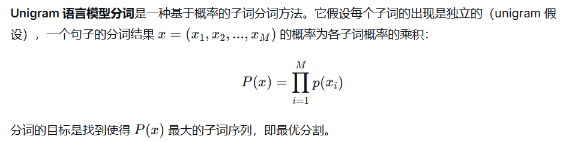
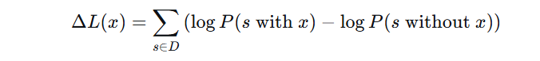

# 33.大模型（LLMs）分词器（BPE、WordPiece、SentencePiece）

#### 简述 BPE 的合并过程，并用伪代码或例子说明训练阶段如何构建合并规则

BPE（Byte Pair Encoding）是一种自底向上的子词分词算法，其核心思想是通过迭代地合并高频相邻符号对来学习文本中的常见子词单元。训练阶段的目标是构建一个合并规则表（merges），推理时则应用这些规则对文本进行分词。

训练阶段的完整流程（伪代码）：

```plain text
输入: 训练语料文本, 期望词表大小 vocab_size (例如 32000)
输出: 有序的合并规则列表 merges, 以及最终词表 vocabulary

1. 预处理：
   a. 将语料中的每个单词以空格分隔，并在每个单词末尾添加特殊结束符（如 </w>）。
   b. 统计所有单词的频率，得到词频字典 word_freq。
      例如：word_freq = {"l o w </w>": 5, "l o w e r </w>": 2, ...}
   c. 初始化符号表：所有在语料中出现过的唯一字符（包括 </w>）。
   d. 为每个单词建立一个字符列表表示（splits），例如 "l o w </w>" 变成 ['l','o','w','</w>']。

2. 构建合并规则：
   while len(符号表) < vocab_size:
       a. 统计所有相邻符号对 (symbol_pair) 在整个语料中的总频率。
          频率计算：对于每个单词及其字符列表，遍历所有相邻位置，将符号对出现次数累加（乘以单词频率）。
       b. 如果没有任何符号对（即所有单词都已被合并成单个符号），则退出循环。
       c. 找出频率最高的符号对 (A, B)。
       d. 将合并规则 (A, B) -> AB 添加到 merges 列表中（保持顺序）。
       e. 将新符号 AB 添加到符号表中。
       f. 更新所有单词的字符列表：在每个单词的 splits 中，将连续的 A 和 B 合并为 AB。
       g. 更新词频字典中的单词拼写（将 A B 替换为 AB 后的字符串），用于后续的符号对统计。

3. 构建最终词表：
   最终词表 = 基础字符表 + 所有合并产生的新符号（以及特殊 token 如 <unk>, <s>, </s> 等）。
```

伪代码关键部分（统计最高频符号对）：

```python
def get_stats(word_freq, splits):
    pairs = defaultdict(int)
    for word, freq in word_freq.items():
        symbols = splits[word]
        for i in range(len(symbols)-1):
            pairs[(symbols[i], symbols[i+1])] += freq
    return pairs

# 主循环
merges = []
vocab = set(all_characters)
while len(vocab) < vocab_size:
    stats = get_stats(word_freq, splits)
    if not stats:
        break
    best_pair = max(stats, key=stats.get)
    merges.append(best_pair)
    vocab.add(''.join(best_pair))
    # 更新 splits
    for word in word_freq:
        symbols = splits[word]
        new_symbols = []
        i = 0
        while i < len(symbols):
            if i < len(symbols)-1 and symbols[i] == best_pair[0] and symbols[i+1] == best_pair[1]:
                new_symbols.append(''.join(best_pair))
                i += 2
            else:
                new_symbols.append(symbols[i])
                i += 1
        splits[word] = new_symbols
```

简单例子：

假设训练语料只有两个单词："low"（频率5）和 "lower"（频率2）。初始拆分为：

- low: l o w </w>

- lower: l o w e r </w>

词频字典：{"l o w </w>": 5, "l o w e r </w>": 2}

初始符号对统计（部分）：

- (l, o): 5+2=7

- (o, w): 7

- (w, </w>): 5

- (w, e): 2

- (e, r): 2

- (r, </w>): 2

假设 (l, o) 频率最高（7次），第一次合并得到 "lo"。更新 splits 后将所有 "l o" 合并为 "lo"。符号表增加 "lo"。下一次统计时，(lo, w) 的频率为 7，可能成为最高频对。如此迭代，逐渐合并出 "low", "er", "lower" 等子词。

推理时应用合并规则：对输入文本，先拆分为字符序列，然后按训练得到的 merges 顺序，逐个尝试应用合并规则，直到无法合并。例如输入 "lowest"，拆成 l o w e s t，依次检查：若 (l,o) 在 merges 中，则合并为 lo；然后检查 (lo,w) 是否可合并... 最终得到子词序列。

#### WordPiece 与 BPE 在选取合并对时的准则有何本质不同？写出其合并分数公式

本质不同：

- BPE 的合并准则是频率：选择在训练语料中出现次数最多的相邻符号对。其背后思想是数据压缩，频繁出现的组合应该合并为一个单元以减少序列长度。

- WordPiece 的合并准则是语言模型概率/互信息：选择能最大程度提高训练数据似然（likelihood）的符号对。它从概率角度出发，衡量合并后的子词是否比拆分开更有“意义”。

具体而言，WordPiece 通过计算合并后与合并前的语言模型概率比值来决定合并哪个对。该比值越大，说明两个符号结合成一体比它们独立出现的概率更高，即它们更可能是一个有意义的单元。

WordPiece 的合并分数公式：

假设当前符号表中有符号 A 和 B，它们在训练语料中的出现次数分别为 count(A) 和 count(B)，它们连续出现的次数为 count(AB)。WordPiece 选择使以下分数最大化的对：

$$
\mathrm{score}(A, B) = \frac{\mathrm{count}(AB)}{\mathrm{count}(A) \times \mathrm{count}(B)}
$$

{.ocr-src}

在实践中，为了避免分母过小导致数值不稳定，通常取对数并转化为等价形式，或者直接计算互信息。原始论文《Japanese and Korean Voice Search》给出的公式为：

$$
\mathrm{score} = \frac{P(AB)}{P(A)P(B)} \propto \frac{\mathrm{freq}(AB) \cdot N}{\mathrm{freq}(A) \cdot \mathrm{freq}(B)}
$$

{.ocr-src}

其中 N 是总符号出现次数。分数越高，表示 A 和 B 的共现远超随机独立的期望，即它们是一个搭配或语素。

例子：假设语料中 "th" 出现很多，但 "t" 和 "h" 单独出现也极多，那么 count(th) / (count(t) * count(h)) 可能并不高，WordPiece 可能不会急于合并 "th"。而如果 "ing" 常常作为一个整体出现，且单独的 "i", "n", "g" 组合成 "ing" 的统计相关性远高于其他组合，则分数会很高，优先合并。

BPE 与 WordPiece 直观对比：BPE 会合并任何高频对，即使它们在一起并没有特别的语义（如 "a" 和 "n" 在英语中经常相邻，但合并 "an" 只是因为频率）；WordPiece 更注重“结合的可信度”，倾向于产生更有意义的子词单元。因此 WordPiece 通常产生更少的 but 更好的子词，但训练计算成本更高。

#### SentencePiece 如何实现与语言无关的分词？它的“规范化”与 BPE/WordPiece 的区别

语言无关性：

SentencePiece 是一种通用的分词/去分词框架，它的核心思想是将输入文本视为Unicode 字符序列，并且不进行预分词（pre-tokenization）。具体体现：

- 将空格（U+0020）也视为一个普通字符，并用一个显式的元字符 `▁` (U+2581) 来替代单词边界处的空格，这样模型就能学习到空格如何参与子词构建。

- 对中文、日文等没有自然空格分隔的语言，SentencePiece 直接在字符序列上训练，不需要事先通过词典或规则分词。

- 训练 BPE 或 Unigram 模型时，所有字符（包括空格、标点）都是平等对待，合并完全是数据驱动的，不依赖于任何语言特定的规则。

这种设计使得 SentencePiece 能够用一种统一的方法处理多语言文本，无论是空格分隔的语言还是无空格语言，都能得到一致的分词结果。

规范化（Normalization）的区别：

- 传统的 BPE/WordPiece 实现（如早期的 GPT、BERT 分词器）通常需要单独的文本规范化预处理，例如：小写化、Unicode 规范化（NFKC 或 NFKD）、标点分离（将标点前后加空格）。这些步骤是不可逆的，会导致分词后的文本无法完全还原为原始文本。

- SentencePiece 则将规范化集成到模型训练和推理中，它可以执行以下操作：
  - 可选的 Unicode 规范化（默认使用 NFKC）。
  - 将字符数统一处理，不进行显式的标点分离。
  - 关键：SentencePiece 的分词模型保留了完整的信息，可以实现可逆分词：即将分词后的 token 序列直接拼接起来，然后替换元字符 `▁` 为空格，就能完全还原原始文本，不需要额外的后处理。

- 这种设计对于生成式模型（如语言模型）特别重要，因为模型输出的 token 序列可以直接被解码为原始格式的文本，无需猜测空格应该插在哪里。

#### 什么是 Unigram 语言模型分词？训练时如何剪枝 token 达到指定词汇量？

**Unigram 语言模型分词**是一种基于概率的子词分词方法。它假设每个子词的出现是独立的（unigram 假设），一个句子的分词结果 $x = (x_1, x_2, ..., x_M)$ 的概率为各子词概率的乘积：

$$
P(x) = \prod_{i=1}^{M} p(x_i)
$$

分词的目标是找到使得 $P(x)$ 最大的子词序列，即最优分割。

{.ocr-src}

训练过程：

1. 初始化种子词表：从一个较大的初始词表开始。可以取训练语料中所有长度不超过某个阈值的子串，或者所有字符，以及它们的常见组合。

2. EM 算法估计概率：固定词表，通过 EM 算法在训练数据上估计每个子词的概率 p(xi)，使得数据对数似然最大化。E 步：计算每个句子所有可能分词的概率（使用动态规划）；M 步：根据所有分词的计数重新估计 p(xi)。

3. 剪枝 token：在每次迭代后，对于词表中的每个 token，计算如果将它移除，训练数据总对数似然的减少量（loss reduction）。这个值越小，说明该 token 对整体似然的贡献越小。根据 loss reduction 排序，保留最重要的 K 个 token（K 为目标词汇量），剪掉其余。

4. 重复 EM 和剪枝：重新估计剩余 token 的概率，再次剪枝，直到词表大小稳定在目标值。

剪枝公式：对于一个 token $x$，其 loss reduction 可以通过以下近似公式快速计算：

$$
\Delta L(x) = \sum_{s \in D} \left(\log P(s \text{ with } x) - \log P(s \text{ without } x)\right)
$$

{.ocr-src}

或者更高效地，利用统计量估算其影响力。实际 SentencePiece 实现中，采用了一种基于 marginal probability 的启发式方法。

推理阶段：使用训练好的 Unigram 模型和子词概率，对输入句子通过 Viterbi 算法找到最高概率的子词序列。

优势：Unigram 模型天然支持概率性分词（subword regularization），可以通过采样不同分词来增强模型鲁棒性。

#### 字节级 BPE 相比字符级 BPE 的优势与代价，为什么 GPT 系列普遍使用字节级 BPE？

字节级 BPE (Byte-level BPE)：直接以字节（0-255）作为基础符号进行 BPE 合并，而不是以 Unicode 字符。

优势：

1. 完全避免未知词（UNK）：词表包含所有 256 个字节，任何 Unicode 字符都可以用其 UTF-8 字节序列表示，因此不会有任何字符无法编码，彻底消除了 `<UNK>` token。

2. 语言无关性：不需要处理不同语言的特殊字符集，对中文、日文、阿拉伯文等均可统一处理，甚至对代码、符号、表情符号都有效。

3. 高度鲁棒：即使输入中有拼写错误、罕见字、生僻词，也能通过字节组合表示，模型不会因此“失明”。

4. 可逆性：生成的字节序列可以无损还原为原始文本，适合生成模型。

代价：

1. 序列长度显著增加：一个汉字在 UTF-8 中通常占用 3 字节，如果词表较小，合并后仍可能被切成多个 token，导致总 token 数增加，增大了注意力计算的负担（复杂度 O(n²)）。

2. 语义碎片化：字节本身没有语义，模型需要依赖更深的网络去理解单词和概念，可能降低信息密度。

3. 词表大小的压力：为了控制序列长度，往往需要较大的词表（如 50K 甚至 100K），但这会增加嵌入矩阵参数量和 softmax 计算成本。

GPT 系列采用字节级 BPE 的原因：

- GPT-2 首次使用字节级 BPE，目的是实现一个通用的、无需预处理即可处理任何文本的模型。他们发现，在 WebText 这样包含多种语言、代码和杂乱文本的数据集上，字节级 BPE 能够有效避免 `<UNK>` 问题，并且在与模型其他部分配合下，性能与字符级 BPE 相当。

- 对于 GPT-3 及后续模型，由于模型参数巨大，可以通过增加词表大小（如 GPT-3 的词汇量约为 50257）来弥补序列长度的增加，同时享受其带来的鲁棒性和通用性。

- 字节级 BPE 与语言模型的生成目标天然契合：模型生成的 token 序列可以直接解码为字节，无需复杂的后处理。

#### 词汇表大小通常如何决定？过大或过小对模型训练和推理带来哪些影响？

词汇表大小的决定因素：

1. 训练语料的规模和多样性：多语言、多领域（代码、数学、自然语言）数据需要更大的词表来覆盖足够的子词，避免过多 OOV 或过度碎片化。

2. 模型计算预算：词表大小直接影响嵌入矩阵的参数规模（`vocab_size × hidden_dim`）和最后的 softmax 层计算量。大型模型可以承受较大的词表（如 128K），小型模型则需限制。

3. 压缩率与序列长度的权衡：更大的词表能产生更紧凑的 token 序列（每个 token 平均覆盖更多字符），缩短序列长度，降低注意力计算的负担；但代价是参数增加。需要在两者间找到最优平衡。

4. 经验与惯例：常见设置包括 32K（SentencePiece 的默认值），50K（多语言模型），128K（Qwen2.5 等超多语言模型），甚至更大（如 GPT-4 可能使用约 100K）。

过大词表的影响：

- 参数浪费：嵌入矩阵占用大量 GPU 显存，且许多长尾 token 可能很少被训练到，导致欠拟合，浪费参数。

- 推理延迟：softmax 层计算量随词表大小线性增长，成为生成时的瓶颈（虽然可通过采样或自适应 softmax 优化）。

- 过拟合风险：稀有 token 的训练样本不足，其嵌入向量质量差，影响模型理解。

过小词表的影响：

- 序列长度过长：一个常见词可能被切成多个 token，导致总步数增加，注意力计算复杂度和显存占用上升。

- 语义碎片化：模型需要处理更多 token 来构建一个单词的表示，增大了理解难度，可能降低模型性能。

- 信息密度低：每个 token 包含的语义信息少，迫使模型使用更深层来捕获长程依赖。

实践中的平衡：通常通过实验确定，在验证集上监控困惑度（PPL）和训练/推理效率。现代 LLM 倾向于使用较大的词表（如 32K-128K），尤其是在多语言和代码场景中，通过模型并行和高效的 softmax 实现来缓解计算压力。

#### 在 BPE 训练中，如何处理数字、标点和特殊符号？常见预处理策略有哪些？

处理策略：

1. 标点符号：
  - 英文等空格分隔的语言：传统做法是在分词前将标点与单词分开，如 "hello!" 变成 "hello !"，以便 BPE 能自然地将标点作为独立 token 或与字母合并。这可以通过简单的正则替换实现。
  - 无空格语言（中文）：标点通常已经与文字分开，无需特殊处理。
  - SentencePiece：不显式分离标点，而是通过数据驱动学习。由于空格也被编码为元字符，标点前后的空格差异足以让模型学会适当地拆分标点。例如 "world." 可能被分成 "world" 和 "."。

2. 数字：
  - 将所有数字替换为占位符：例如 `[NUM]`，或者用零宽字符连接。这可以大幅减少词表中的数字 token 数量，但会丢失数字的具体值，不适合需要数值理解的任务。
  - 数字规范化：将数字字符保留，但通过预处理将所有数字序列拆分为单个数字（0-9），让 BPE 自行学习合并常见的数字组合（如年份、电话号码片段）。GPT 系列通常采用这种方式，因为它需要处理代码和数学。
  - 基于规则的分词：使用正则匹配数字、日期、电话号码等，将其作为一个整体 token 保留（或拆分为子词）。

3. 特殊符号：
  - HTML 标签、URL、Emoji：对于网页文本，通常可以将这些实体替换为特殊占位符（如 `[URL]` 或 `[EMOJI]`），或者将它们作为普通 Unicode 字符交给字节级 BPE 处理。后者是当前大模型的主流选择，因为字节级 BPE 天生支持任何符号。
  - 不可见字符（如零宽连接符）：通常保留，或通过 Unicode 规范化处理。

常见预处理策略总结：

- 最简预处理（现代 LLM 偏好）：直接使用字节级 BPE，几乎不做任何文本规范化，仅进行必要的解码（如 HTML 实体转换）或移除明显有害内容。

- 传统 BERT/GPT-1 风格：进行小写化（可选）、标点分离、Unicode 规范化（NFC/NFKC）、特殊实体替换。这种方法可控性强，但会损失原始信息。

选择依据：如果需要模型理解原始文本格式（如代码、标记语言），或生成精确文本，则尽量保留原始字符。如果任务专注于自然语言理解，适度的规范化可以提高数据效率。

#### 解释 subword 正则化：训练时动态分词对模型鲁棒性的作用

Subword 正则化（Subword Regularization）是一种训练技巧，通过在训练过程中对同一个句子进行概率性的、多样化的分词，而不是固定的一种分词方式，来提升模型对分词边界的鲁棒性和泛化能力。

原理：

在标准子词分词中，训练好的分词模型对每个句子产生唯一确定的分词结果。这可能导致模型过度依赖特定的分词边界，对拼写错误、罕见词或不同分词器输出的差异敏感。Subword 正则化在训练时，每次处理一个句子时，会从所有可能的分词候选集中按概率采样一种分词结果（或使用 BPE-dropout 方法）。这样，同一个句子在训练的不同轮次或不同 batch 中会被表示成不同的子词序列。

实现方法：

- 基于 Unigram 模型的分词采样：因为 Unigram 语言模型天然给出每个子词的概率，可以按照概率分布对分词进行采样。SentencePiece 支持 `--subword_regularization_sampling_rate` 参数。

- BPE-dropout：在训练期间，随机丢弃一部分 BPE 合并规则（以一定概率忽略某些合并），使得模型看到更多样的子词组合。

作用：

1. 增强模型鲁棒性：模型学会不依赖单一的、脆弱的子词切分。即使测试时遇到少许不同的分词结果（例如拼写错误导致的异常切分），模型仍能正确理解。

2. 提高泛化性能：尤其在低资源语言和多语言场景中，模型通过看到更多的子词组合，能够更好地处理稀有词和 out-of-vocabulary 现象。

3. 正则化效应：类似于 dropout，子词正则化增加了训练噪声，防止模型对分词模式过拟合。

4. 提升生成多样性：在文本生成任务中，训练时的动态分词可能使得模型在推理时也能产生更自然的文本。

注意：通常只在训练时使用，推理时仍采用确定性的最佳分词（如 Viterbi 解码），以保证一致性和效率。

#### SentencePiece 的 byte fallback 机制是如何工作的？其解决了什么问题？

Byte fallback 机制：当 SentencePiece 模型遇到一个无法在词表中找到的字符（即真·未知字符），传统的分词器会输出一个 `<unk>` token。Byte fallback 机制则不同：它将这个未知字符的 UTF-8 字节表示拆分，并用词表中专门代表各个字节的特殊 token 来表示。例如，词表中包含 `<0x00>` 到 `<0xFF>` 共 256 个 token，每个代表一个字节。如果遇到一个罕见汉字“𠮷”（UTF-8 编码为 F0 A0 AE B7），模型会将其分解为四个字节 token：`<0xF0> <0xA0> <0xAE> <0xB7>`。

工作流程：

1. 训练 SentencePiece 模型时，可以启用 `--byte_fallback` 选项。

2. 模型会保留 256 个字节 token。在分词时，如果当前子词不是词表中的 token，则退回到字节表示。

3. 对于正常的、词表中存在的字符，仍然使用正常的子词 token。

4. 这种机制使得词表可以很小（例如 1000），但仍能无损表示任何文本，只是序列会变得非常长。

解决的问题：

1. 彻底消除 `<unk>` token：这是最关键的优势。无论输入包含多么罕见的字符、emoji、特殊符号，都能被编码成 token 序列，模型不会丢失任何信息。

2. 增强多语言和代码处理能力：对于多语言混合文本和代码，特别是那些充满稀有标识符的场景，byte fallback 确保了所有内容都能被模型理解。

3. 可逆性：生成的字节 token 序列可以被完全还原为原始 Unicode 文本，实现无损编码。

4. 词表规模的灵活性：即使在资源受限的情况下（需要极小的词表），也能保证基本的分词功能，虽然序列会变长，但模型依然能够工作。

应用：现代大模型如 ByT5、某些多语言 T5 变体，以及推荐使用 SentencePiece 的新一代 LLM 都利用了这种机制，以提高模型的通用性和鲁棒性。

#### 多语言模型中如何设计共享词表，同时保留语言特有 token？

多语言模型（如 mBERT、XLM-R、mT5）需要用一个统一的词表处理数十甚至上百种语言。设计目标是：既能高效共享跨语言的公共子词（如数字、标点、拉丁字母词根），又能充分覆盖各语言的特有字符和构词单元。

核心设计方法：

1. 联合语料训练：将所有目标语言的文本混合，直接在一个统一的语料库上训练一个 BPE 或 Unigram 分词器。这是最直接、最有效的方法。训练过程中，算法会自动学习到高频的、跨语言通用的子词（例如 "tion", "ing", "年", "月"），同时也会保留每种语言特有的字符组合（如中文汉字、日文假名、韩文音节）。这个过程无需人工干预，完全由数据驱动。

2. 语料采样与平衡：直接将所有语言等量混合会导致高频语言（如英语）主导词表，低资源语言的文字可能被过度碎片化。因此，必须采用采样策略来平衡各语言的影响力。常见方法有：

- **温度采样 (Temperature Sampling)**：对各语言的语料进行上采样或下采样。根据每个语言数据量的比例 $p_i$，计算采样概率 $p_i^\alpha / \sum_j p_j^\alpha$，其中 $\alpha$ 为温度系数（通常 0.3~0.7）。这样可以提升低资源语言的采样概率，抑制高资源语言。
- **固定配额**：保证每种语言在训练数据中有最低数量的字符或句子。

{.ocr-src}

3. 语言标识符：可以在每个序列的开头添加一个语言标识 token，如 `[en]`, `[zh]`, `[ja]`。这些 token 会像普通字符一样参与 BPE 合并，但通常不会被拆分，最终会作为独立 token 保留在词表中。模型通过这个 token 了解当前输入的语言，有助于激活语言特定的表示。但这并不是“保留语言特有 token”的主要方式，因为词表中的其他 token 是跨语言共享的，特有性是通过子词本身的分布自然体现的。

4. 保留原始字符集：字节级 BPE（Byte-level BPE）天然支持所有语言，因为它以字节为基础，覆盖了 Unicode 的全部可能。这意味着即使某种语言只有极少量语料，其文字也能通过字节序列唯一表示。这种方式从底层保证了语言无关性，同时共享词表本质上就是所有语言共享 256 个字节及它们的合并单元。

5. 超大词表：为了容纳多语言的特有字符，多语言模型通常使用超大的词表。例如，XLM-R 的词表大小为 250k，mT5 为 250k，而 Qwen 为 152k。大词表允许将常见的、语言特有的子词（如中文常见字、日文常用词）整体保留，避免过度拆分。

总结：共享词表是通过在混合语料上联合训练实现的，语言特有 token 的保留依赖于大词表、采样平衡和字节级回退机制。没有人为强制分隔，而是让数据自己决定哪些子词共享、哪些独有。

---

#### 什么是 OOV 问题？subword 分词如何根本上缓解该问题？

OOV（Out-of-Vocabulary）问题：指分词器在处理文本时，遇到了一个在词表中完全不存在的词（或字符），无法将其映射为任何有效的 token。传统词级分词器（如基于词典的）只能输出一个特殊的 `<UNK>` token 来代替所有未知词，导致大量语义信息彻底丢失。这在新词涌现、专有名词、拼写错误和多语言场景下尤为严重。

Subword 分词的根本性缓解：

Subword 分词（子词分词）通过将文本拆分成比单词更小的单元，从根本上解决了 OOV 问题。其原理如下：

1. 以字符为最小单元：任何子词词表都必然包含所有基础字符（或字节），因为它们是训练语料中不可再分的原子符号。这意味着，任何一个未知单词，都可以被递归地拆分成这些基础字符的组合。例如，即使词表中没有单词 "unfriendliness"，也可以按照学到的合并规则，将其切成 `["un", "friend", "li", "ness"]`，或者最坏情况下，切成单个字母序列。这样，任何输入都能被词表中的 token 序列唯一表示。

2. 学习有意义的子词单元：BPE、WordPiece 等算法并非简单随机切分，而是从训练语料中学习高频的、有意义的子词组合。这些子词（如 "un-", "-ing", "friend"）具有构词法上的意义，使得切分后的序列既紧凑又能保留语义。这使得模型能够利用已知子词的语义来推断整个词的含义，实现开放词汇的理解。

3. 平衡词表大小与序列长度：词表大小的选择决定了 OOV 处理的效率。小词表会将更多词切分成短子词甚至字符，序列变长但覆盖所有词；大词表则保留更多完整词，序列更短但可能遇到罕见词的 OOV（其实不是 OOV，而是被切得更碎）。Subword 分词总能在词表大小和序列长度之间找到平衡，保证零 OOV。

因此，Subword 分词从根本上将“未知词”的概念从“完全不可表示”转化为“由已知子词拼接表示”，是现代 NLP 系统能够处理开放文本的基石。

---

#### 如何评估分词器的好坏？列举至少 3 个量化指标或评估方法。

评估分词器不能仅看单一指标，需要从压缩效率、语义合理性、模型性能等多个维度综合衡量。

1. 压缩率 / 平均序列长度

- 定义：分词后文本的 token 数量除以原始文本的字符数（或单词数）。该指标衡量分词器将文本转化为 token 序列的效率。压缩率越高，每个 token 覆盖的信息越多，模型处理相同内容所需的步数越少，训练和推理越快。

- 计算：在代表性语料上计算平均 `序列长度 / 字符数`。例如，GPT-2 的字节级 BPE 词表（50k）在英文上的平均每个 token 约覆盖 3~4 个字符。

- 注意：不能单一追求高压缩率，否则会退化为词级分词，失去泛化能力。

2. 词汇覆盖率 / 未登录词率

- 定义：在测试集上，有多少比例的 token 是 `<UNK>`（如果词表包含该符号）。理想值为 0。

- 对于 subword 分词器：由于通常不存在真正的 UNK（字符级保障），该指标可转化为 词汇碎片化指数：平均每个单词被切分成多少个 token。越接近 1 越好。高碎片化会导致语义信息稀释。

3. 下游任务性能

- 最根本的评估：在相同模型架构下，分别使用不同的分词器进行预训练或微调，比较其在目标任务（如机器翻译、文本分类、语言建模）上的最终指标（如 BLEU、准确率、困惑度）。

- 例如：用 PPL 来衡量，使用分词器 A 的语言模型在验证集上 PPL 更低，则 A 更好。这直接反映了分词器对模型学习难度的影响。

4. 训练稳定性与词表利用率

- 词表利用率：统计训练语料中，实际被使用过的 token 数量占词表总大小的比例。大量从未出现的 token 意味着词表过大，浪费了嵌入参数。

- 频率分布均衡性：绘制 token 频率的 Zipf 图，观察是否平滑。极少数高频 token 占据绝大部分概率质量，而大多数 token 极低频，意味着词表设计可能不是最优。

5. 分词一致性 / 鲁棒性

- 测试同一单词的不同形态（如复数、时态）是否被一致地切分（如 "walk" 和 "walks" 可能切为 `walk` + `s`，保留词干一致性）。

- 测试对拼写错误的鲁棒性：在单词中插入、删除或替换一个字符后，分词结果是否剧烈变化。理想情况下应平滑变化。

---

#### 预训练分词器训练语料与下游任务数据分布不一致时，可能引发哪些问题？

分词器是模型接触数据的第一道关口。如果预训练分词器的训练语料与下游任务的数据分布存在显著差异（领域漂移），会产生一连串负面效应。

1. 词汇覆盖不足与碎片化

下游任务中的高频术语、专有名词如果在预训练语料中从未出现或频率极低，就不会被 BPE 合并为紧凑的 token，而是被切分成非常碎的字符序列。例如，医疗领域术语 "pneumonoultramicroscopicsilicovolcanoconiosis" 可能被切成数十个无意义的子词。这导致：

- 序列长度显著增加，超出模型的最大上下文限制，或增加计算成本。

- 语义信息稀释，模型需要更多的层和注意力来整合这些碎片，理解难度加大。

2. 合并规则不合理

BPE 的合并规则是基于预训练语料的统计频率。在下游代码数据中，"model" 和 "train" 可能经常相邻出现，如果预训练语料将它们合并为 "modeltrain" token，那么在代码任务中这个 token 就是有害的，因为它将两个应独立的词素粘合在一起。模型将难以学习到 "model" 和 "train" 各自的语义。

3. 表示质量退化

模型在预训练阶段学到的子词嵌入（Embedding）是针对源分布的。当分布漂移时，那些在下游数据中频繁出现但预训练中极少出现的长尾子词，其嵌入向量训练不充分，质量很差，成为模型理解的瓶颈。即使下游任务微调，由于这些 token 缺乏良好的初始化，也很难学到高质量表示。

4. 鲁棒性下降\
   如果下游数据包含新的特殊符号（如编程语言中的 `=>`, `!=`）、不同风格的空白字符、或新语言文字，而分词器没有经过这些数据的训练，可能将其处理为 `<UNK>` 或产生不可预测的切分，导致模型行为异常。

缓解措施：

- 继续训练分词器：在下游任务数据上继续运行 BPE 的合并过程（增量训练），或者重新训练一个分词器，然后调整模型嵌入矩阵大小并继续预训练（Domain-adaptive Pretraining）。

- 使用子词正则化（BPE-Dropout）：训练时引入随机性，增强模型对多种分词结果的鲁棒性。

- 采用字节级 BPE：因其基础字符集固定，不会出现 UNK，对所有符号都有基本表示，但碎片化问题依然存在。

---

#### 简述“词汇碎片化”问题，并给出可能的缓解策略。

词汇碎片化（Vocabulary Fragmentation） 是指一个在语言学上完整、有明确语义的单词或概念，被分词器切分成过多细碎的、无独立意义的子词单元。例如，单词 "unhappiness" 被分成 `["un", "hap", "pi", "ness"]` 甚至更碎 `["u","n","h","a","p","p","i","n","e","s","s"]`。这种过度拆分会导致：

- 信息密度低：每个 token 携带的语义极少，模型必须通过更深层的注意力来聚合信息，降低了计算效率。

- 注意力分散：模型需要将注意力分散在多个碎片 token 上才能理解一个词，增加了捕获长程依赖的难度。

- 生成质量差：在生成任务中，模型可能很难流畅地生成完整单词，容易出现子词拼写错误或奇怪的组合。

缓解策略：

1. 增大词表规模：这是最直接的方法。更大的词表能容纳更多的完整高频词，从而减少拆分。例如，多语言模型通常使用 50k~250k 的词表，有效减少了常见词的碎片化。

2. 使用更合理的分词算法：WordPiece 基于似然的合并原则往往比纯频率驱动的 BPE 产生更合理的子词单元，因为它更倾向于合并那些“在一起就不可分割”的符号对，避免产生无意义的组合。

3. 确保训练语料与目标领域匹配：分词器的训练数据应尽可能覆盖下游任务的高频词汇。让分词器“见过”这些词，它们就有更高概率被整体保留。

4. 引入整词掩码（Whole Word Masking）：在预训练任务中，将属于同一个单词的所有子词 token 一起 Mask，强制模型学习完整的单词表示，部分弥补了碎片化带来的影响。

5. 使用词汇增强技术：在模型输入中增加词汇级别的特征（如词边界嵌入），或使用混合分词（对常见词整体编码，罕见词用子词），但会增加系统复杂度。

---

#### 解释 GPT 系列分词器与 BERT 分词器在设计上的具体差异（标记化方式、特殊 token）。

GPT 和 BERT 的分词器代表了两种不同的子词分词哲学，差异体现在底层算法、预分词、特殊标记和字符覆盖上。

| 特性 | BERT (WordPiece) | GPT-2/3/4 (Byte-level BPE) |
| --- | --- | --- |
| 核心算法 | WordPiece（基于似然合并） | 字节级 BPE（Byte-level BPE） |
| 预分词 | 是。先按空格和标点将文本切分成单词块，然后对每个单词进行子词切分。标点通常被分离。 | 否。直接在原始文本（字节序列）上操作，没有单词边界的概念。空格和其他字符一样被处理。 |
| 基础符号 | Unicode 字符。未知字符会被替换为 [UNK]。 | 字节（0-255）。通过一个映射表将字节转换成对应的 Unicode 私有区字符，使得它们“可见”且可打印，然后在这些字符上训练 BPE。本质是字节级的，因此不会有 UNK。 |
| 子词标记 | 单词的延续部分用 ## 前缀标识。例如 "playing" 可能被分为 ["play", "##ing"]。这样做是为了在解码时能无损恢复单词边界（通过移除 ## 并直接拼接）。 | 没有延续标记。空间信息通过 token 本身来表示（例如，" world" 是一个以空格开头的 token）。解码时直接将 token 序列拼接起来就是原始文本。 |
| 特殊 Token | [CLS] (用于分类), [SEP] (分隔句子), [MASK], [PAD], [UNK] 等。这些是预定义的特殊 token，有专门的 ID。 | 通常只有一个分隔符 <\|endoftext\|>，用于标记文档边界。序列开始和分隔没有额外 token。通过注意力掩码区分不同序列。 |
| 词汇量 | 约 30,000 | 约 50,257（GPT-2）; 100,000+（GPT-3/4） |
| 解码方式 | 需要处理 ## 前缀，移除后拼接。 | 直接拼接所有 token 字符串。 |

差异根源：BERT 作为编码器，主要用于理解任务，需要明确区分句子，通过 `[CLS]` 聚合整句信息。它的预分词和 `##` 延续标记是为了更好地保留单词边界，便于在完形填空（MLM）中预测完整的词。GPT 作为生成式解码器，目标是流畅地生成任意文本，因此需要绝对的开放词汇能力（无 UNK）和简单的解码（生成即所得），字节级 BPE 完美满足这些需求。

---

#### 训练大规模 BPE 时，如何控制内存消耗？给出工程优化思路。

训练 BPE 时，核心内存消耗在于存储所有单词及其频率、对应的符号序列。当语料扩大到数百 GB 级别，单词种类可能达到数千万甚至上亿，直接加载到内存中完全不现实。必须采用流式和分布式策略。

工程优化思路：

1. 增量式/分批训练（Mini-batch BPE）：\
   这是最常用的技巧。不一次性学习所有合并规则。首先在语料的一个足够大的随机子集（如 10GB）上训练一个 BPE 分词器，获得前几万条最重要的合并规则。然后，用这个初步的分词器去处理整个语料，此时大量常见子词已被合并，单词被“预分词”成了更长的子词序列。再在这个预分词语料的基础上，统计新的符号对频率，继续进行后面的合并。由于每次处理的单词种类和序列长度都大幅减少，内存占用可以控制。

2. 外部排序与磁盘存储：\
   如果单词数量实在太大，可以将单词-频率-符号序列以文件形式存储在磁盘上。使用 MapReduce 或类似的分布式计算框架，将单词按哈希分桶到多个文件中。每个桶单独统计局部符号对频率，然后由主节点汇总所有桶的频率，选出全局最高频对。之后，主节点广播这个合并规则，各个桶再独立更新自己桶内的单词符号序列。这相当于将内存压力分摊到集群。

3. 限制词汇长度和频率阈值：\
   在训练初期，过滤掉出现次数极低的单词（如频率 < 5）和超长的单词（如字符数 > 100）。这些单词对合并规则的贡献很小，却消耗了大量内存。

4. 使用更高效的数据结构：\
   对于符号对频率的统计，使用前缀树（Trie）或者哈希表。对于单词的符号序列，用整型 ID 代替字符串进行存储，可以显著减少内存占用并加速合并过程。

5. 采用 Unigram 模型替代 BPE：\
   Unigram 语言模型的训练天然更适合大规模数据。它的 EM 算法和剪枝过程不需要复杂的全量符号对更新，而是通过动态规划和概率统计，内存占用更可控，SentencePiece 对大规模 Unigram 训练有很好的优化。

---

#### 代码大模型的分词器需要针对哪些特殊符号、缩进、换行做处理？举例说明。

代码与自然语言有显著不同的结构，分词器必须妥善处理这些特性，否则会破坏代码语法，导致模型性能骤降。

1. 缩进（Indentation）：

在 Python、YAML 等语言中，缩进定义了代码块。如果分词器将缩进随意拆分，模型将无法理解代码的层级结构。

- 处理策略：通常保留原始的空格和制表符。字节级 BPE 会自然学习到空格组合。例如，连续的四个空格可能被合并成一个 token（因为它在代码中频繁出现）。这无需人工干预，模型从数据中自行学会将缩进作为有意义的单元。一些专用分词器会显式地将缩进转换为特殊 token，如 `<INDENT>` 和 `<DEDENT>`，但这较为少见，主流大模型（如 Codex, CodeLlama）均使用通用分词器处理。

2. 换行符（Newline）：\
   换行是语句结束的标志，必须保留。通常将 `\n`（LF）或 `\r\n`（CRLF）作为普通字符，它会被 BPE 训练为一个独立的 token（因为无法与其他字母合并），这样模型就能明确感知到行的边界。

3. 特殊符号和运算符：\
   代码中的 `{`, `}`, `(`, `)`, `[`, `]`, `:`, `+`, `-`, `*`, `/`, `=`, `==`, `!=` 等是语法核心。它们必须被完整且独立地识别。

- 处理策略：在通用分词器中，这些符号由于周围通常是空格或字母，BPE 会自然地将它们作为独立 token 合并（例如，`=` 本身频率极高，会保留为单独 token；`==` 两个等号频繁相邻，也会合并成一个 token）。因此，无需特殊规则，大数据驱动即可。

4. 标识符和驼峰命名：\
   变量名和函数名如 `myVariableName`, `get_user_by_id` 常被连字符或驼峰式命名分隔。

- 处理：分词器通常会将其切分成子词。例如 `myVariable` 可能被切为 `["my", "Variable"]` 或更碎。为了保持语义，一些代码分词器会加入启发式规则，在大小写切换处或下划线处强制分词，但这并非标准做法。现代代码大模型往往拥有超大词表（50k+），常见的代码词汇片段能被整体保留的概率更高。

举例（Python 代码片段）：

```python
def factorial(n):
    if n <= 1:
        return 1
    return n * factorial(n-1)
```

使用 CodeLlama 分词器可能得到如下 token 序列（简化）：\
`["def", " factorial", "(", "n", "):", "\n", " ", "if", " n", " <=", " 1", ":", "\n", " ", "return", " 1", "\n", " ", "return", " n", " *", " factorial", "(", "n", "-", "1", ")"]`

可以看到，缩进 `" "` 成为独立 token，运算符 `"<="` 被整体保留，换行符独立。这些都是数据驱动的结果。

---

#### 什么是“分词不变性”问题？在中文或形态丰富语言中如何体现？

分词不变性是指：对于一个给定的输入文本，其语义不应因为分词方式的不同而发生改变。理想情况下，无论采用何种分词规则，模型应当能够提取出相同的含义。然而，现实中的模型对分词结果往往是敏感的，分词方式的微小扰动可能导致模型输出的显著变化，这就产生了分词不变性问题。

在中文中的体现：

中文文本没有天然的空格分隔，词汇边界模糊。同一个句子可以有不同的切分方式。例如：“南京市长江大桥”可以切为：

- `["南京市", "长江", "大桥"]`（意为“南京的长江大桥”）

- `["南京", "市长", "江大桥"]`（意为“南京的市长江大桥”）\
  不同的分词结果直接导致完全不同的语义理解。如果模型的分词器固定采用某一种切分，而实际文本的上下文本应支持另一种理解，则模型可能出错。此外，即使使用 subword 分词（如按字切分），虽然消除了歧义切分，但序列变长且语义单元被打散，模型需要自行学习组合，这对模型的容量和训练数据提出了更高要求。

在形态丰富语言（如土耳其语、芬兰语）中的体现：\
这些语言的一个单词可能由多个语素（词干+多个后缀）拼接而成，表达丰富的语法意义。例如，土耳其语单词 `"evlerinizden"`（从你们的房子）可拆分为 `["ev", "ler", "iniz", "den"]`。分词器可能将这个词切分成不同粒度的子词组合。如果训练和测试的分词风格不一致，或者某些语素被过度拆分，模型可能难以学到稳定的语法规律，导致性能下降。

缓解方法：

- 子词正则化：在训练时引入动态分词（如 BPE-Dropout 或 Unigram 采样），让模型看到同一个句子的多种切分，从而学习分词不变的鲁棒性。

- 增大词表：减少碎片化，使得常见语素组合尽可能被整体保留。

- 使用字符级或字节级模型：彻底绕过显式分词，但计算成本极高。

- 预训练+微调：在下游任务数据上进行领域适应的继续训练，使模型适应该领域的切分风格。

---

#### 如果词汇表存在大量从未被使用的 token，如何安全修剪？修剪后如何继续训练？

词表过大或语料分布变化（如从通用转向垂直领域）都会导致大量 token 成为“死词”。它们不仅浪费参数和显存，还会增大 softmax 计算量。安全修剪词表的步骤如下：

1. 统计活跃 token：

在新的目标语料（如微调数据）上运行分词器，统计每个 token ID 被使用的次数。所有出现次数为 0 的普通 token（非特殊 token）均可标记为“待修剪”。

2. 强制保留的 Token：

以下 token 绝不能移除：

- 特殊控制 token：`[UNK]`, `[PAD]`, `[BOS]`, `[EOS]`, `[CLS]`, `[SEP]`, `[MASK]` 等。

- 字节级 BPE 中的 256 个字节基础 token（如果存在）。

- 可能的话，保留一些常用的单字符 token，以确保任何文本都能被表示（但如果字节 token 保留，单字符并非绝对必要）。

3. 构建新词表并调整模型权重：

- 创建一个新的词表，仅包含上述保留 token 和活跃 token。新词表大小为 $V_{new}$。
- 对于模型的输入嵌入矩阵 $W_{emb} \in \mathbb{R}^{V_{old} \times d}$ 和输出投影矩阵 $W_{out} \in \mathbb{R}^{d \times V_{old}}$，需要移除与被修剪 token 对应的行/列。如果原模型共享输入输出权重，也需同步调整。

{.ocr-src}

- 继承权重：对于在新词表中保留的 token，直接从原模型权重中复制对应的向量。对于新词表中的新 token（如果有，比如新增了领域术语），则进行随机初始化（如用正态分布 N(0,0.02)）。

继续训练：

- 加载修剪后的模型，在新的目标语料上继续训练。由于模型结构已改变（词表大小不同），必须进行训练，不能直接推理。

- 设置较低的学习率，并辅以 warm-up，防止剧烈更新破坏原有知识。

- 监控模型在验证集上的损失和困惑度，直到收敛。

额外注意事项：

- 如果原分词器中有 token 是通过 BPE 合并生成的，修剪后可能导致某些合并规则链断裂。但这是可接受的，因为模型会通过继续训练，利用新词表中的 token 重新学习子词组合方式。

- 修剪后，模型的推理速度会略有提升，因为 softmax 的计算量从 $V_{old}$ 降到了 $V_{new}$。

{.ocr-src}

#### 对比 HuggingFace Tokenizers 库与 SentencePiece 的实现方式和性能特点

HuggingFace Tokenizers 库和 SentencePiece 是当前 NLP 领域最主流的两个分词工具库。它们在设计哲学、实现方式和性能特点上有显著差异。

实现方式：

- HuggingFace Tokenizers：核心使用 Rust 语言实现，通过 PyO3 提供 Python 绑定。它采用了极致的性能优化策略，包括多线程并行处理、零拷贝字符串操作和高度优化的数据结构。库本身提供了 BPE、WordPiece、Unigram 等多种算法的完整实现，并且将分词流水线分解为可组合的模块：Normalizer（规范化）、PreTokenizer（预分词）、Model（子词模型）和 PostProcessor（后处理）。这种模块化设计使得用户可以灵活定制分词器的每一个环节。它的训练算法经过特别优化，能在几分钟内处理数十 GB 的文本。

- SentencePiece：由 Google 开发，使用 C++ 实现，提供 Python 和命令行接口。它是一个自包含的、端到端的分词/去分词系统，强调“语言无关性”和“可逆分词”。它将文本视为 Unicode 字符序列，用元字符 `▁`（U+2581）显式表示空格，因此不需要依赖语言特定的预分词规则。SentencePiece 主要支持 BPE 和 Unigram 两种模型，并将规范化（如 NFKC）内置到训练和推理流程中。其训练算法是单进程的，但效率依然很高。

性能特点对比：

| 维度 | HuggingFace Tokenizers | SentencePiece |
| --- | --- | --- |
| 分词速度 | 极快，得益于 Rust 和多线程支持，可并行处理多个文本，吞吐量通常更高。 | 很快，但单次调用通常为单线程。批量处理时可通过 Python 并行弥补。 |
| 训练速度 | 非常快，通过优化的数据结构实现单遍 BPE 训练，WordPiece 和 Unigram 也高效。 | 高效，但对极大语料（100GB+）可能需要较长时间，且不支持原生的分布式训练。 |
| 灵活性 | 极高。算法、预处理、后处理均可插拔组合，能模拟几乎所有分词器行为。 | 中等。主要提供 BPE 和 Unigram，规范化选项固定，但足够满足大多数需求。 |
| 生态集成 | HuggingFace 生态的一等公民，与 Transformers、Datasets、Tokenizers 库无缝连接。 | 独立库，被 T5、LLaMA 等模型使用，兼容性广泛但需要额外转换。 |
| 内存占用 | 训练时内存占用控制良好，通过流式处理避免一次性加载全部语料。 | 训练时需要在内存中维护所有单词及其频率，对超大语料可能内存不足。 |
| 可逆性 | 可通过自定义 decoder 实现，但不是默认行为。 | 原生支持完全可逆分词，因为空格被编码为显式 token。 |

总结：HuggingFace Tokenizers 更适合需要高度定制和极致性能的场景，尤其是与 HuggingFace 生态深度集成时。SentencePiece 则以其简单、鲁棒和语言无关的特性，成为许多大规模语言模型（如 T5、LLaMA、Qwen 系列）的首选。

#### 在推理中，如何高效实现 padding、truncation 以及生成 attention_mask？

在 LLM 推理中，处理变长序列的批处理需要统一序列长度，同时避免浪费计算资源。

Padding 策略：

- 动态 padding（Dynamic Padding）：不在整个数据集上统一到最大长度，而是在每个 batch 内部，将序列填充到该 batch 中最长序列的长度。这可以大幅减少填充 token 的数量，提高有效计算比例。

- 左填充 vs 右填充：对于自回归生成任务，通常采用左填充（将 `PAD` token 放在序列左边）。因为生成是从右端最后一个有效 token 开始，左填充可以确保生成的起始位置不受填充影响。对于编码器模型（如 BERT），则使用右填充。

- padding token ID：通常使用 `0` 或词表中的特殊 token（如 `<pad>`）的 ID。需要保证模型在初始化时正确设置 `pad_token_id`。

Truncation 策略：

- 最大长度限制：根据模型支持的上下文窗口（如 4096），对超长序列进行截断。

- 保留关键信息：对于对话历史，通常只保留最近的几轮（`truncation='longest_first'` 或自定义函数保留最近轮次）。对于长文档，可以保留开头和结尾。

- 步进截断：对极长文本，可采用滑动窗口，分段处理。

生成 attention_mask：

- attention_mask 是一个与输入序列等长的二进制张量，1 表示有效 token，0 表示填充 token。

- 在自注意力计算中，将 attention_mask 广播到注意力分数矩阵，对填充位置施加一个极大的负数（如 `-inf`），使 softmax 后的权重为 0。

- 现代推理框架（如 vLLM）能自动处理变长序列的注意力掩码，甚至无需显式填充（通过连续批处理和分页注意力）。

高效实现：

- 使用 `tokenizer.pad()` 方法或 DataCollator 自动完成。

- 对于大批量在线服务，连续批处理技术（Continuous Batching）允许动态插入新请求，不需要提前统一长度，框架内部通过 CUDA 内核处理掩码。

#### 如何处理分词器中的特殊 token（如 [CLS], [SEP], <|endoftext|>）？它们需要纳入词汇表吗？

特殊 token 是人为预定义的、用于控制序列结构和模型行为的符号，它们必须被显式地添加到词表中，并分配固定的 token ID。

处理方式：

1. 定义与添加：在训练分词器时，通过 `special_tokens` 参数传入这些 token 列表。例如，BERT 需要 `[CLS]`, `[SEP]`, `[PAD]`, `[MASK]`, `[UNK]`；GPT 需要 `<|endoftext|>`。分词器会为它们保留固定的 ID，且这些 token 永远不会被 BPE/WordPiece 等算法拆分。

2. 固定 ID 的好处：模型可以为这些 token 学习专门的嵌入向量（Embedding），从而在不同上下文中一致地理解它们的特殊含义。例如，`[CLS]` 的表示在预训练后会被用来聚合整个句子的信息。

3. 编码时的自动添加：使用 `tokenizer.encode()` 或 `tokenizer.call()` 时，设置 `add_special_tokens=True`，分词器会自动在序列开头和结尾添加所需的特殊 token（如 BERT 的 `[CLS]` 和 `[SEP]`）。

4. 解码时的自动过滤：在将 token ID 序列解码回文本时，设置 `skip_special_tokens=True` 可以自动移除这些控制 token，只输出有意义的文本内容。

为什么必须纳入词表：如果不在词表中，特殊 token 会被拆分成子词或视为 `<UNK>`，这会导致模型无法可靠地识别句子边界、分隔符等关键结构信息，严重影响下游任务性能。因此，它们是模型词汇表中不可或缺的、具有明确语义的组成部分。

#### 介绍一种不需要显式分词器的文本建模方法（如 ByT5, CANINE），并与 subword 方法比较优劣。

以 ByT5 为代表的无分词器方法，直接使用原始的 UTF-8 字节序列 作为模型输入，彻底抛弃了显式的 tokenizer 和词表。

ByT5 的核心思想：

- 将输入文本的每个字符转换为它的 UTF-8 字节表示（0~255），得到一个字节序列。

- 模型直接在字节序列上进行操作，包括嵌入（一个 256 行的嵌入矩阵）和注意力计算。

- 输出时，模型逐个生成字节，再由解码器将这些字节实时组合成 Unicode 字符。

与 Subword 方法的优劣比较：

| 维度 | Subword 方法 (BPE/WordPiece) | 无分词器方法 (ByT5) |
| --- | --- | --- |
| 泛化能力 | 依赖词表覆盖，对噪声和稀有语言可能产生 OOV 或碎片化。 | 完全语言无关，无 OOV，天然支持任何语言甚至混合语言。 |
| 序列长度 | 短，压缩率高（一个 token 可覆盖多个字符），计算效率高。 | 极长（一个中文字符可能占 3 个字节），注意力的 O(n²) 成本剧增。 |
| 信息密度 | 每个 token 携带较丰富的语义信息，模型训练更快。 | 每个字节信息量极低，模型需要更多层和参数才能提取语义。 |
| 鲁棒性 | 对拼写错误、不规范文本敏感，可能产生不合预期的切分。 | 天然鲁棒，任何字符都能被字节表示，不会引入切分偏差。 |
| 实现复杂度 | 需要训练分词器、管理词表、处理特殊 token。 | 极其简单，无需任何预处理，代码量极少。 |
| 性能（同等计算量） | 通常更优，因为序列短，模型可将计算力用于语义建模。 | 在相同计算预算下，由于序列过长，性能往往不如 subword 模型。 |
| 适用场景 | 主流大规模语言模型，追求高效与性能。 | 极小模型、低资源语言、对噪声容忍度要求极高的任务。 |

总结：Subword 方法在当前追求性能和效率的 LLM 中是主流选择；无分词器方法则代表了一种更优雅、更鲁棒的理想范式，随着硬件和稀疏注意力技术的发展，未来可能在特定场景下逐渐展露优势。

#### 简述 SentencePiece 的 character_coverage 参数含义，及其对不同语言的影响。

`character_coverage` 是 SentencePiece 训练时的一个重要参数，它控制训练语料中需要被词表覆盖的字符比例。其值介于 0 和 1 之间，通常为 0.995 到 1.0。

工作原理：

- 在训练开始前，SentencePiece 会统计语料中所有出现过的唯一字符，并按照频率降序排列。

- `character_coverage` 参数指定了一个覆盖率阈值，算法会保留频率累加和刚好超过该阈值的最常用字符集合。例如，覆盖率为 0.995 表示保留能覆盖 99.5% 文本的最小字符集合。其余长尾字符（极低频字符）将不会出现在基础字符表中。

- 在后续的 BPE 或 Unigram 训练中，只有这些被保留下来的字符才能作为子词的基本组成单元。没有被覆盖的字符在训练时会被忽略，在推理时则会被映射为 `<UNK>`（如果没有开启 byte fallback）。

对不同语言的影响：

- 字符集庞大的语言（中文、日文、韩文）：汉字和假名数量巨大，如果 `character_coverage` 设置过低（如 0.99），可能会丢弃数百个仍有一定出现频率的合法字符。这些字符在推理时就会变成 `<UNK>`，导致严重的信息丢失。因此，对于 CJK 语言，通常建议将该值设置为 0.9995 甚至 1.0，以确保几乎所有常用及次常用字都被覆盖。

- 字符集小的拼音文字（英语、法语等）：因为基础字符数量很少（几十个大小写字母加标点），即使设置覆盖率 1.0 也完全无压力。覆盖率的高低对它们影响不大，通常采用默认值 0.9995 已足够。

- 多语言混合模型：训练数据包含数十种语言时，总字符集非常庞大。此时需要权衡：覆盖率太低会导致许多低资源语言的文字被丢弃；覆盖率太高（如 1.0）会导致初始字符表巨大，增加内存和训练时间。通常使用 0.9995 并配合 Byte Fallback 机制来达到平衡。

最佳实践：对于中文或日文等模型，强烈建议设置 `character_coverage = 1.0` 或 `0.99999`，以确保不丢失关键文字信息。

#### 在领域适应中，如何高效微调或扩展已有分词器的词汇表？

当通用 LLM 被应用到特定垂直领域（如法律、医疗）时，大量领域专有名词可能被 BPE 切分得过碎，影响模型理解效率。此时需要扩展词表，同时避免重新预训练。

高效扩展步骤：

1. 收集领域语料：获取足够规模（通常数百万至数千万 token）的领域纯文本数据。

2. 高频子词提取：
  - 使用原分词器对领域语料进行分词。
  - 统计分词结果中，那些频繁连续出现但未被合并成单个 token 的子词序列（例如，在医疗文本中，“心肌梗死”可能被切成 `["心肌", "梗死"]`，如果它们总是一起出现，就是一个理想的扩展候选）。
  - 通过设定频率阈值（例如，共同出现 > 1000 次），筛选出最有价值的领域新 token。

3. 构建新词表并调整模型权重：

- 在原词表的基础上，追加这些新 token。新词表大小 $V_{new} = V_{old} + N_{new}$。
- 将模型输入嵌入矩阵 $W_{emb}$ 从 $(V_{old}, d)$ 扩展到 $(V_{new}, d)$。新增部分的权重通过以下方式初始化：

{.ocr-src}

- 最佳方案：如果有对应子词的嵌入，则将这些子词嵌入的平均值或加权和作为新 token 的初始嵌入。例如，新 token “心肌梗死” 的嵌入 = `(emb("心肌") + emb("梗死")) / 2`。这使得新 token 从一开始就拥有合理的语义。

- 次选方案：用正态分布 N(0,0.02) 随机初始化。虽然简单，但需要更多训练步才能收敛。

- 对输出投影矩阵（LM Head）也做同样的扩展和初始化。

1. 领域继续训练（Domain-Adaptive Pretraining）：
  - 加载扩展后的模型，使用领域语料进行继续训练。
  - 关键技巧：冻结模型除新增 token 嵌入之外的所有参数，先用较小的学习率（如 1e-4）训练新增的嵌入向量若干步，让它们快速适应。然后再解冻全部参数，使用更小的学习率（如 2e-5）进行全局微调。
  - 如果领域数据有限，可以使用 LoRA 等参数高效方法进行微调，避免灾难性遗忘。

替代方案：重新在领域+通用混合语料上训练一个全新的分词器，并用它初始化模型，但这通常需要从零开始或大规模的继续预训练，成本更高。因此，上述扩展方法在工业界更受青睐。

#### 为什么 BPE 合并规则是确定性的，而 Unigram 分词是概率性的？这如何影响下游任务？

BPE 的确定性：

- BPE 在训练阶段生成一个有序的合并规则列表。这个列表是确定性的，因为每次迭代都是选择全局频率最高的符号对，且合并后立即更新语料，规则顺序由频率从高到低固定。

- 推理时，给定一个输入文本，算法严格按照这个顺序依次尝试应用合并规则，直到没有规则可以再被应用。整个过程完全确定，相同的输入总是产生相同的 token 序列。

- 对下游任务的影响：确定性意味着模型行为完全可预测，易于调试和复现。但缺点是，模型对分词边界非常敏感，一个字符的变化可能产生完全不同的切分，导致对噪声和领域漂移的鲁棒性不足。

Unigram 的概率性：

- Unigram 语言模型为词表中的每个 token 分配了一个独立的概率 p(xi)$p$($x_i$)。分词时，一个句子可以有多种合法的切分方式，每种切分对应一个概率（所有 token 概率的乘积）。模型通过 EM 算法学习出这些概率。

- 推理时，通常选择概率最大的切分（Viterbi 解码），这是确定性的。但其概率特性允许我们按概率分布采样多种切分，从而实现“子词正则化”。

- 对下游任务的影响：训练时可以动态采样不同的分词，使得模型对分词边界鲁棒。同时，概率提供了不确定性度量：如果一个词有多种高频切分，说明它的边界模糊，模型可以据此调整。此外，概率也使得评估不同分词的可能性成为可能。

总结：BPE 是数据压缩视角的产物，追求稳定和简洁；Unigram 是生成模型视角的产物，追求概率上的完备性和灵活性。

#### 如何解决 BPE 训练中因语料巨大导致合并步骤缓慢的问题？

训练 BPE 时，每一步合并都需要重新统计所有符号对的频率，当语料达到百 GB 级别时，内存和计算开销极大。以下是关键的优化思路：

1. 增量 BPE（Incremental BPE）：
  - 不对全量数据执行所有合并步骤。首先在一个足够大的子集（例如随机采样 10GB）上训练 BPE，得到前几万条合并规则。
  - 用这个初步的模型对整个语料进行预分词（Pre-tokenize）。此时，语料中的常见组合已经被合并为更长的子词，单词种类和序列长度都大幅减少。
  - 然后，在这个“预分词语料”上继续统计符号对频率，执行剩余的合并步骤。由于基础单元变大了，需要合并的次数显著减少，内存和计算量都大幅下降。

2. 分布式/外部内存训练：
  - 使用 MapReduce 框架。将语料分成多个分片，每个分片独立统计局部符号对频率，然后由主节点汇总，找出全局最高频对。主节点广播合并规则，各分片独立更新本地的单词符号序列。这种方法将内存和计算分散到多台机器。
  - 对于单机，使用磁盘文件代替内存：将单词和频率存储为排序的文件，通过归并排序等外部排序算法进行处理。

3. 限制词汇量和频率阈值：
  - 在训练初期，过滤掉出现次数极低的单词（如频率 < 5），它们对 BPE 合并规则贡献极小，却消耗大量资源。
  - 提前终止合并：设定一个合理的最大词汇量（如 32K），当达到目标时停止。大多数有益合并发生在前几万步，之后的收益递减。

4. 更高效的数据结构：
  - 使用 `Counter` 和哈希表加速符号对统计。
  - 存储单词的符号序列时，使用整型 ID 代替字符串，减少内存占用和比较开销。

通过上述方法，即使语料达到数百 GB，也能在单机或小型集群上在合理时间内完成 BPE 训练。

#### 写出一个句子经 BPE 分词后，将 token id 再转回原始文本的 detokenization 过程需要解决的问题。

将 token ID 序列还原为可读的原始文本，并非简单的拼接，需要处理以下几个关键问题：

1. 空格与单词边界恢复：

- BPE with `</w>` 后缀（如 GPT-2）：每个单词的最后一个子词会带有一个特殊结束符 `</w>`。解码时，需要将所有 token 直接拼接，然后将 `</w>` 替换为空格。例如，`["Hello", "</w>", "world", "</w>"]` → `"Hello</w>world</w>"` → 将 `</w>` 换为空格 → `"Hello world"`。

- SentencePiece 的 `▁` 元字符：`▁` 代表一个空格。解码时，直接拼接所有 token，然后将 `▁` 替换为普通空格即可完美还原。这是最优雅的可逆方案。

- WordPiece 的 `##` 前缀：如果一个 token 以 `##` 开头，表示它紧跟前一个 token，中间没有空格。解码时，移除所有 `##`，并将 token 直接连接。第一个 token 和去掉 `##` 的 token 之间不加空格。例如，`["play", "##ing"]` → 移除 `##` → `["play", "ing"]` → 拼接为 `"playing"`。

2. 特殊控制 Token 的过滤：

- 像 `[CLS]`, `[SEP]`, `[MASK]`, `[UNK]`, `<|endoftext|>` 等特殊 token 必须被识别并从最终文本中移除，否则会污染输出。

3. 字节级 BPE 的转换：

- GPT-2 等使用的字节级 BPE，其词表中的 token 并不是直接可读的字符，而是字节到 Unicode 字符的映射。解码时，需要先将 token ID 转换为对应的字节序列，然后将这些字节序列按 UTF-8 解码回 Unicode 字符。这个过程还需要处理单个多字节字符被切分成多个字节 token 的情况，确保字符的完整性。

4. 后处理规范化：

- 在某些情况下，文本中可能会残留多余空格（如标点前的空格）。理想的解码器会根据标点规则（如英文中句号前不应有空格）进行微调。但对于现代分词器，由于其训练数据驱动，通常无需额外规则，直接拼接即可。

- 对于中文等无空格语言，SentencePiece 的元字符方案同样能完美还原，因为汉字之间原本就没有空格。

#### 什么是“word boundary”标记（如 ## 前缀），WordPiece 如何利用它们？

“word boundary”标记是 WordPiece 分词器用来显式标识单词边界的一种机制。在 BERT 使用的 WordPiece 中，所有属于同一个原始单词的 token，除了第一个之外，其余 token 的文本前都会被加上 `##` 前缀。

工作原理：

- 预分词阶段：WordPiece 首先将文本按空格和标点分割成独立的“单词块”。例如，句子 `"the quick brown fox"` 会被分成 `["the", "quick", "brown", "fox"]`。

- 子词切分：对每个单词块，在其内部应用学到的 WordPiece 合并规则。如果单词需要被切分，则第一个子词保持原样，后续的每个子词前面加上 `##`。例如，`"unaffable"` 可能被切分为 `["un", "##aff", "##able"]`。

- 意义：`##` 前缀明确地告诉模型：“我不是一个新单词的开始，我是紧跟在前面 token 之后的延续部分”。这使得模型在预训练时可以轻松地专注于单词内部的构成。

利用方式：

- 解码：解码时，只需移除所有 `##` 前缀，然后将 token 直接拼接，就能恢复出原始单词。同时，解码器可以根据 `##` 的存在与否决定是否在单词间添加空格。

- 掩码语言模型（MLM）：BERT 的 MLM 任务经常会掩盖整个单词（Whole Word Masking）。通过 `##` 标记，可以轻松识别哪些 token 属于同一个单词，从而将它们作为一个整体进行掩码，提升训练效率。

- 嵌入层：带有 `##` 的 token 和不带 `##` 的相同文本 token 会拥有独立的嵌入向量。例如，“aff” 和 “##aff” 是两个不同的 token。这允许模型区分作为独立单词和作为单词后缀的同一字符串，捕捉更精细的语义。

这种设计是 WordPiece 区别于 BPE 的显著特征之一，它在保留子词分词泛化能力的同时，尽可能保留了单词的结构完整性。

#### 分析分词器在 LLM 推理流水线中的性能瓶颈及优化方向。

虽然 LLM 的计算核心在 Transformer，但分词器也可能成为高并发推理时的性能瓶颈。

性能瓶颈：

- CPU 密集型操作：分词（Tokenization）和去分词（Detokenization）通常在 CPU 上执行（虽然也可以 GPU，但性价比低）。当面对大量并发请求，每个请求的文本又较长（如 10K+ token）时，CPU 的分词处理会严重阻塞推理管线，导致 GPU 等待数据。

- Python 与 C++ 间的开销：一些分词器包装了 Python 接口，在处理长文本时，Python 字符串操作和类型转换会引入额外延迟。

- 逐 token 解码：在流式生成中，模型每生成一个新 token，就需要实时解码并发送给用户。如果解码逻辑复杂（如字节级 BPE 需要处理跨 token 的字符边界），频繁的调用会造成 CPU 负载过高。

- 特殊 token 的增删：每次编码/解码都需要处理特殊 token 的添加和过滤，涉及字符串查找和替换。

优化方向：

1. 使用更快的分词库：例如，将默认的分词器替换为 HuggingFace Tokenizers（Rust 实现），其在多线程下性能远超纯 Python 版本。许多推理框架（如 vLLM）已经内置了高效的分词实现。

2. 批处理与异步：将多个请求的文本集中进行批量编码/解码，利用 Rust 的分词器的并行能力。使用异步 IO 避免单个请求阻塞。

3. 缓存常用 token 映射：对于高频的特殊字符串（如 system prompt 的固定开头），可以预先将其 token ID 序列缓存起来，避免重复分词。

4. 增量解码（Incremental Detokenization）：在流式生成中，不重新解码整个序列，而是维护一个解码状态和缓冲区。只对新生成的一个或几个 token 进行增量解码，大幅降低 CPU 计算量。

5. 将分词器部署为独立微服务：使用 C++/Rust 编写专用的分词服务，通过高性能 RPC（如 gRPC）通信，与推理引擎解耦，水平扩展。

6. 硬件加速探索：虽然还不是主流，但将分词器的一些简单操作移植到 GPU 或专用加速卡上，可以从根本上消除 CPU 瓶颈。

通过上述优化，可以确保在极限吞吐下，分词器不会成为系统的短板，让昂贵的 GPU 算力得到充分利用。

