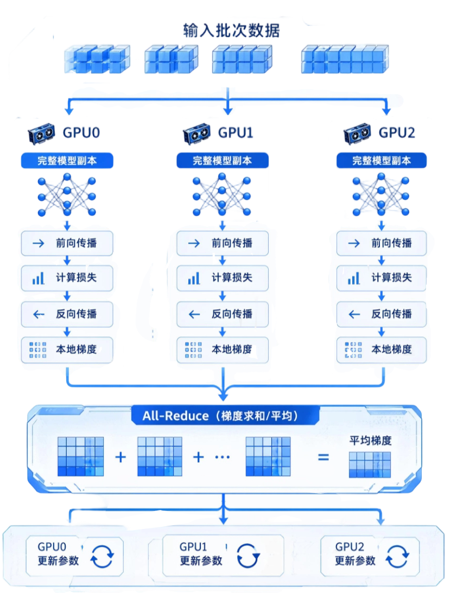
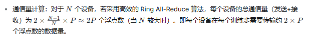
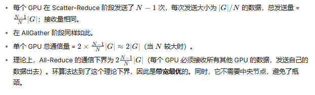
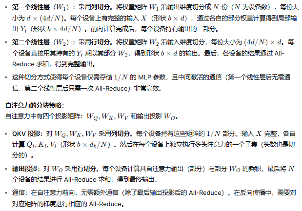
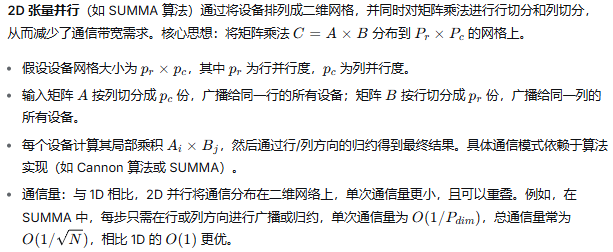
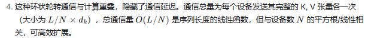
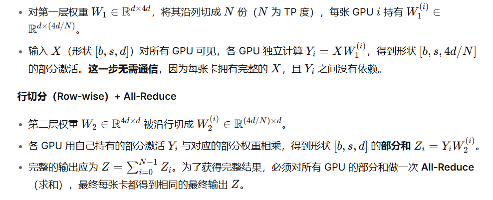
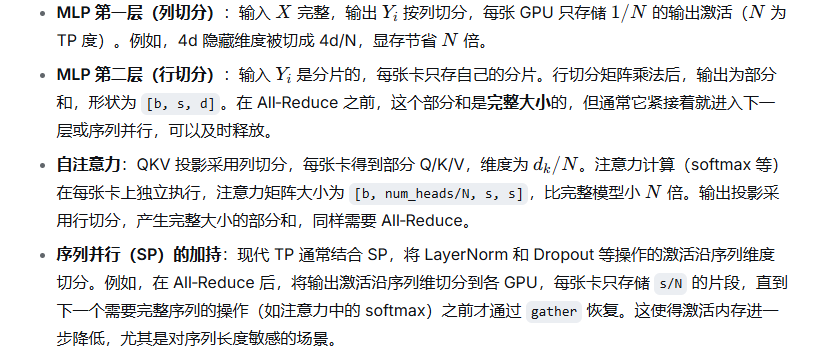

# 34大模型（LLMs）分布式训练（数据并行、模型并行、流水线并行、张量并行）

## 大模型（LLMs）分布式训练面

#### 画出数据并行（DP）的工作原理，并写出同步梯度时的 All-Reduce 通信量。

数据并行（Data Parallelism, DP） 是最基础的**分布式训练策略**。其核心思想是将一个批次的训练数据均匀切分到多个设备（如 GPU）上，每个设备持有模型的完整副本，独立进行前向和反向传播计算出本地梯度，然后通过通信操作将所有设备的梯度进行平均，最后使用平均梯度统一更新模型参数，保持各设备上的模型始终一致。

**工作原理图：**



**同步梯度时的 All-Reduce 通信量：**

假设模型参数总量为 $P$ 个浮点数（即参数量），每个参数梯度也同为 $P$ 个浮点数。在一次 All-Reduce 操作中，每个设备需要将本地的梯度张量发送给其他所有设备，并接收其他设备的梯度。

- 通信量计算：对于 $N$ 个设备，若采用高效的 Ring All-Reduce 算法，每个设备的总通信量（发送+接收）为 $2 \times \frac{N-1}{N} \times P \approx 2P$ 个浮点数（当 $N$ 较大时）。即每个设备在每个训练步需要传输约 $2 \times P$ 个浮点数的数据量。

{.ocr-src}

- 若使用朴素的 All-Reduce（如先收集再广播），通信量将是 2($N$−1)$P$。因此，现代框架均采用优化的 All-Reduce 算法（Ring 或 Tree）来最小化通信开销。

数据并行是扩展训练批量大小、加速收敛的基础，但通信开销随模型参数量线性增长，对于超大模型可能成为瓶颈。

---

#### PyTorch DDP 与 DP 的区别是什么？DDP 如何实现多进程并行梯度同步？

DP (DataParallel) 是 PyTorch 早期提供的单机多卡数据并行方案，通过 Python 多线程实现。

- 工作原理：一个主 GPU（通常为 GPU0）持有模型，每个前向传播时，主 GPU 将输入数据分片并广播给其他 GPU；每个 GPU 独立完成前向计算；所有 GPU 的输出被收集回主 GPU 计算损失；反向传播时，主 GPU 广播梯度到所有 GPU，各 GPU 并行计算本地梯度，最后在主 GPU 上求和并更新参数。

- 缺点：主 GPU 承担了大量的数据分发和梯度汇聚工作，容易成为瓶颈；Python 线程受 GIL（全局解释器锁）限制，无法真正利用多核并行；通信效率低，且在反向传播过程中梯度聚合会产生额外同步开销。

DDP (DistributedDataParallel) 是 PyTorch 推荐的分布式训练接口，基于多进程实现，性能远优于 DP。

- 多进程架构：每个 GPU 由独立进程控制，每个进程都拥有模型的完整副本，没有主从关系。数据通过 DistributedSampler 自动分配给各进程，各进程独立进行前向和反向传播。

- 梯度同步——All-Reduce：反向传播过程中，DDP 会自动将梯度计算与梯度同步重叠。具体而言，DDP 会在每个层的本地梯度计算完成后，立即启动一个异步的 All-Reduce 操作，将所有进程的该层梯度求和平均。这个 All-Reduce 过程与后续层的反向传播计算并行，从而隐藏了大部分通信延迟。

- 无需主 GPU：所有进程平等地参与 All-Reduce，没有单点瓶颈。梯度同步完成后，每个进程独立使用平均梯度更新本地参数，确保模型一致性。

核心区别总结：

| 特性 | DP | DDP |
| --- | --- | --- |
| 实现方式 | 多线程 (Python) | 多进程 |
| GIL 限制 | 受限 | 无限制（独立进程） |
| 主节点瓶颈 | 有（GPU0） | 无（对等通信） |
| 通信重叠 | 无 | 支持（反向传播与All-Reduce并行） |
| 扩展性 | 仅限单机 | 单机及多机多卡 |

DDP 利用高效的 Ring All-Reduce 和计算-通信重叠，是现代分布式训练的基石。

---

#### 详细描述环形 All-Reduce 的步骤，及其通信带宽最优性。

环形 All-Reduce (Ring All-Reduce) 是一种去中心化的、通信最优的聚合算法。它将所有参与设备（如 $N$ 个 GPU）逻辑上排列成一个环，每个 GPU 只与其左右邻居通信。

步骤（分为两个阶段：Scatter-Reduce 和 AllGather）：

1. Scatter-Reduce（分散-规约）：
  - 将每个 GPU 上的完整梯度张量 $G$ 切分成 $N$ 个大小相等的块 $g_0,g_1,\dots,g_{N-1}$。
  - 算法总共执行 $N$−1 步。在第 k 步（从 0 开始），每个 GPU 将自己负责聚合的某个块的当前部分和发送给下一个 GPU，并从上个 GPU 接收对应块的部分和，然后与自己对应的块相加（规约）。
  - 经过 $N$−1 步后，每个 GPU 上都将拥有某个特定块的完整规约结果（即所有 GPU 在该块上的梯度和）。例如，GPU0 拥有 $g_0$ 的完整和，GPU1 拥有 $g_1$ 的完整和，以此类推。

2. AllGather（全收集）：
  - 现在，每个 GPU 持有最终结果的 1/$N$ 部分。需要在所有 GPU 之间共享这些完整块，使得每个 GPU 都拥有完整的规约结果 $G$。
  - 再次执行 $N$−1 步：每个 GPU 将自己持有的完整块发送给下一个 GPU，并从上一个 GPU 接收对方持有的完整块，并将其存储。经过 $N$−1 步后，所有 GPU 都将拥有全部 $N$ 个块的完整和，即完整的规约梯度。

通信带宽最优性分析：

- 每个 GPU 在 Scatter-Reduce 阶段发送了 $N-1$ 次，每次发送大小为 $|G|/N$ 的数据，总发送量 = $\frac{N-1}{N}|G|$；接收量相同。
- 在 AllGather 阶段同样如此。
- 单个 GPU 总通信量 = $2 \times \frac{N-1}{N}|G| \approx 2|G|$（当 $N$ 较大时）。
- 理论上，All-Reduce 的通信下界为 $2\frac{N-1}{N}|G|$（每个 GPU 必须接收所有其他 GPU 的数据，发送自己的数据出去）。环算法达到了这个理论下界，因此是**带宽最优的**。同时，它不需要中央节点，避免了瓶颈。

{.ocr-src}

---

#### 模型并行（层间模型并行）如何将不同层放在不同设备？前向反向如何传递激活和梯度？

模型并行（Model Parallelism），特指层间模型并行（或称流水线并行），将模型的不同层分布到不同的设备上，每个设备只负责一部分层。

- 放置方式：例如一个 12 层的 Transformer，将第 1-3 层放在 GPU0，第 4-6 层放在 GPU1，第 7-9 层放在 GPU2，第 10-12 层放在 GPU3。

- 前向传播：输入数据首先进入 GPU0，经过第 1-3 层计算后，将输出激活（中间张量）传递给 GPU1；GPU1 继续计算其持有的层，再将激活传给 GPU2……以此类推，直到最后一个 GPU 计算损失。数据像流水线一样依次通过各个设备。

- 反向传播：损失计算完毕后，梯度从最后一个 GPU 开始，沿相反方向传播。每个设备在计算自己负责的层的梯度时，需要从下一个设备接收该层的输出梯度（即前一层的输入梯度）。计算得到的输入梯度再继续向前一个设备传递。同时，每个设备会计算出负责层的参数梯度，用于本地更新（或在数据并行框架下进一步同步）。

激活和梯度的传递：

- 激活：前向传播中，每个设备输出其最后一层的激活张量，并通过通信（如 Send/Recv）传给下一个设备。

- 梯度：反向传播中，每个设备接收来自后一个设备传来的该层输出处的梯度，结合本地缓存的前向激活计算输入梯度和参数梯度。输入梯度再传给前一个设备。

- 流水线并行的一个核心问题是设备的空闲时间（bubble），因为设备在处理完自己的任务后需要等待前后设备的传递，无法完全并行。

---

#### 流水线并行的微批次划分与 GPipe 调度算法，解释“bubble”概念及其计算公式。

微批次划分：为了减少流水线中设备的空闲等待时间，流水线并行会将一个 mini-batch 进一步切分为多个更小的微批次（micro-batches）。这样，设备在处理完一个微批次后可以立即开始下一个，而不用等待整个批次完成。

GPipe 调度算法：

- 在一个训练步中，首先将 mini-batch 切分成 $M$ 个微批次。

- 前向传播：第 1 个微批次依次通过所有设备，完成后，第 2 个微批次开始进入设备 0，依次类推。所有微批次按顺序“流”过设备，如同一串连续的流水线。

- 反向传播：在所有微批次的前向传播全部完成后，才开始反向传播。反向传播也按微批次顺序和与正向相反的方向流动。

- GPipe 的特点是一次刷新：全部正向完成后才全部反向。这使得需要在前向阶段缓存所有微批次产生的中间激活，导致峰值显存较高。

Bubble（气泡）：由于流水线各阶段的计算时间不完全重叠，设备的空闲等待时间被称为气泡。在 GPipe 中，流水线启动和结束的“填充”和“排空”阶段，设备存在空闲。

Bubble 比例的计算公式：\
设设备数量为 $P$，微批次数量为 $M$。在 GPipe 调度下，总的计算步数为 $P$+$M$−1（前向的填满流水线所需步数）。每个微批次在每个设备上的计算量相同，为 $t$。整个流水线的有效计算时间为 $P$×$M$×$t$，但实际由于气泡，总耗时相当于 ($P$+$M$−1)×$M$×$t$ 的某个比例。更直观的，气泡时间占比（即空闲时间与总时间之比）可近似为：

$$
\text{Bubble ratio} = \frac{P-1}{P+M-1}
$$

{.ocr-src}

当 $M$≫$P$ 时，气泡比例趋近于 0。因此增大微批次数量能有效减少气泡，但会增大激活显存。

---

#### 如何减少流水线气泡？介绍 1F1B 调度和交错式调度。

减少气泡的核心理念是：让前向和反向传播交错执行，而不是完全串行，以填充设备空闲时间。

1F1B 调度（One Forward, One Backward）：

- 不等到所有微批次的前向都完成才开始反向。在完成足够微批次的前向后，立即开始相应微批次的反向传播。常见的“预热”阶段：先进行 $P$ 个微批次的前向（注满流水线），然后每个设备交替执行一个前向和一个反向。即“一个前向，一个反向”的模式。

- 这样，反向传播的计算与后续微批次的前向传播在时间上重叠，大大压缩了气泡。1F1B 能够将气泡降低到与微批次数量无关的理想水平，且不增加激活存储量（因为可以及时释放已反向微批次的激活）。

- 典型实现：PyTorch 的 `torch.distributed.pipeline.sync` 中的 `Pipe` 采用 GPipe 或 1F1B 模式。

交错式调度（Interleaved Scheduling）：

- 在 1F1B 的基础上，不是每个设备按顺序固定持有模型的连续几层，而是让每个设备负责多个不连续的层块（模型块被循环分配到设备上）。例如，设备 0 持有层 0-1，设备 1 持有层 2-3，但交错式可能让设备 0 持有层 0-1 和 6-7，设备 1 持有层 2-3 和 4-5 等。这样，每个微批次可以在多个设备上更细粒度地交替执行。

- 更进一步地，这种调度可以减少流水线深度增加带来的气泡。交错调度的微批次可以更灵活地填充空闲时间，从而将气泡压缩到几乎为零。

效果：通过 1F1B 和交错式调度，即使在设备数很多、微批次有限的条件下，也能保持较高的设备利用率，显著降低气泡开销。

---

#### 什么是张量并行？用 Megatron 的 1D 张量并行举例说明 MLP 和自注意力的分块策略。

张量并行（Tensor Parallelism） 是将单个层的大参数矩阵切分到多个设备上并行计算，从而突破单设备显存和算力限制。它由 Megatron-LM 针对 Transformer 架构高效实现。

Megatron 的 1D 张量并行（按行或列切分矩阵）：

MLP 层的分块策略：\
MLP 由两个全连接层组成：第一层将隐藏维度 $d$ 映射到 $4d$，第二层从 $4d$ 映射回 $d$。

- **第一个线性层（$W_1$）**：采用**列切分**。将权重矩阵 $W_1$ 沿输出维度切分成 $N$ 份（$N$ 为设备数），每份大小为 $d \times (4d/N)$。每个设备上有完整的输入 $X$（形状 $b \times d$），通过各自的部分权重计算得到局部输出 $Y_i$（形状 $b \times 4d/N$）。前向计算完成后，每个设备持有输出的一部分。
- **第二个线性层（$W_2$）**：采用**行切分**。将权重矩阵 $W_2$ 沿输入维度切分，每份大小为 $(4d/N) \times d$。每个设备直接用其持有的 $Y_i$ 乘以其部分 $W_2$，得到形状 $b \times d$ 的输出。最后，各设备的结果通过 All-Reduce 求和，得到完整输出。
- 这种切分方式使得每个设备仅需存储 $1/N$ 的 MLP 参数，且中间激活的通信（第一个线性层后无需通信，第二个线性层后只需一次 All-Reduce）非常高效。

**自注意力的分块策略**：

自注意力中有四个投影矩阵：$W_Q, W_K, W_V$ 和输出投影 $W_O$。

- **QKV 投影**：对 $W_Q, W_K, W_V$ 采用**列切分**。每个设备持有这些矩阵的 $1/N$ 部分。输入 $X$ 完整，各自计算 $Q_i, K_i, V_i$（形状 $b \times d_k/N$）。然后在每个设备上独立执行多头注意力的一个子集（头数也是切分的）。
- **输出投影**：对 $W_O$ 采用**行切分**。每个设备计算其自注意力输出（部分）与部分 $W_O$ 的乘积，最后将 $N$ 个设备的结果进行 All-Reduce 求和，得到最终输出。
- 通信：在自注意力前向，无需额外通信（除了最后输出投影后的 All-Reduce）。在反向传播中，需要对对应矩阵的梯度进行相应的 All-Reduce。

{.ocr-src}

通过 1D 张量并行，每个 Transformer 层的内存占用和计算量都被均匀分摊到 $N$ 个设备，实现了接近线性的显存和算力扩展。

---

#### 2D 张量并行（如 SUMMA）如何减少通信？与 1D 比较。

1D 张量并行（如前题 Megatron 方式）在输出端需要 All-Reduce 来汇总部分结果，其通信量随设备数 $N$ 呈 O(N)增长。当 $N$ 很大时，All-Reduce 延迟可能成为瓶颈

**2D 张量并行**（如 SUMMA 算法）通过将设备排列成二维网格，并同时对矩阵乘法进行切分和列切分，从而减少了通信带宽需求。核心思想：将矩阵乘法 $C = A \times B$ 分布到 $P_r \times P_c$ 的网格上。

- 假设设备网格大小为 $p_r \times p_c$，其中 $p_r$ 为行并行度，$p_c$ 为列并行度。
- 输入矩阵 $A$ 按行切分成 $p_c$ 份，广播给同一行的所有设备；矩阵 $B$ 按行切分成 $p_r$ 份，广播给同一列的所有设备。
- 每个设备计算其局部乘积 $A_i \times B_j$，然后通过行/列方向的归约得到最终结果。具体通信模式依赖于算法实现（如 Cannon 算法或 SUMMA）。
- 通信量：与 1D 相比，2D 并行将通信分布在二维网络上，单次通信量更小，且可以重叠。例如，在 SUMMA 中，每步只需在行或列方向进行广播或归约，单次通信量为 $O(1/P_{dim})$，总通信量常为 $O(1/\sqrt{N})$，相比 1D 的 $O(1)$ 更优。

{.ocr-src}

- 减少通信的原理：通过引入二维拓扑，将原本需要全局 All-Reduce 的操作分解为多个局部集合通信（如行/列广播+归约），从而减少每个设备对带宽的竞争，提升可扩展性。

与 1D 比较：

- 1D 张量并行实现简单，对于中等规模的设备数（如 4-8）效率很高。

- 当扩展至数十甚至上百个设备时，1D 的 All-Reduce 通信成为瓶颈，2D 张量并行因通信拓扑更优而表现更好。

- 2D 张量并行通常与 1D、流水线、数据并行等混合使用，构建 3D 并行体系以训练超大模型。

---

#### 序列并行：如何将长序列切分到多个设备并结合 Ring Attention 计算？

序列并行（Sequence Parallelism） 旨在处理极长序列，将 Transformer 层的输入序列沿序列维度切分到多个设备，每个设备仅处理一个子序列。但由于自注意力需要全局交互，序列并行必须与特定的注意力算法结合。

切分方式：

- 在 Transformer 的非注意力部分（如 LayerNorm、Dropout、MLP），序列并行可以直接独立计算，因为这些操作对每个 token 是独立的。将序列 $L$ 切分成 $N$ 段，每个设备处理 $L$/$N$ 个 token。

- 对于自注意力，需要跨设备通信来计算全局注意力。

Ring Attention（环形注意力） 结合序列并行的机制：

Ring Attention 是一种将自注意力计算分布到序列维度的算法，非常适合结合序列并行。

步骤：

1. 每个设备持有输入序列的一个块（chunk），以及对应的 Q, K, V 投影结果（局部块）。

2. 为了计算全局自注意力，每个设备的 Q 需要和所有其他设备的 K, V 进行交互。Ring Attention 将设备组织成环。

3. 分块计算与通信轮换：
  - 在每一步迭代中，每个设备使用当前本地存储的 K, V 块，与自身的 Q 计算局部注意力，并累积 softmax 归一化统计量（用于在线 rescale）。
  - 然后，每个设备将自己的 K, V 块发送给环中的下一个设备，并从上个设备接收新的 K, V 块。
  - 重复此过程，直到所有设备的 K, V 块都遍历一圈。
  - 最终，每个设备都计算出了其局部 Q 对应的完整全局自注意力输出。

4. 这种环状轮转通信与计算重叠，隐藏了通信延迟。通信总量为每个设备发送其完整的 K, V 张量各一次（大小为 $L/N \times d_k$），总通信量 $O(L/N)$ 是序列长度的线性函数，但与设备数 $N$ 的平方根/线性相关，可高效扩展。

{.ocr-src}

序列并行的整体方案：

- 将 Ring Attention 与前后的线性层（如 QKV 投影、输出投影）的序列并行结合。在投影阶段，各设备独立对本地 chunk 做线性变换（因为权重共享）。序列并行使显存占用与序列长度线性缩放，极大提升长序列训练能力。

- 在 Megatron-LM 等框架中，序列并行与张量并行结合：张量并行负责切分模型权重，序列并行负责切分激活的序列维，共同降低激活显存。例如，在 LayerNorm 和 Dropout 上使用序列并行，而在注意力矩阵上使用张量并行。通信方面，序列并行在 LayerNorm 前需要 All-Gather（恢复完整序列），在 MLP 后需要 Reduce-Scatter（重新切分序列）。Ring Attention 本身需要的 P2P 通信也可融入这一框架。

通过序列并行 + Ring Attention，训练数十万长度序列成为可能。

---

#### 数据、张量、流水线三种并行各自的通信量和显存节省程度

数据并行 (Data Parallelism)

- 原理：每张GPU上保有完整的模型副本，数据被切分成多个micro-batch，各GPU独立前向和反向计算本地梯度，然后通过All-Reduce操作同步梯度，确保所有GPU上的模型参数在更新时保持一致。

- 通信量：在每次迭代（或梯度累积步）结束时，进行一次All-Reduce通信，通信量与模型参数量成正比，大小为 `2 * (N-1)/N * P ≈ 2P` (P为模型参数总量)，当GPU数量N较大时接近常数。通信频率较低，通常每个训练step一次。

- 显存节省：完全没有节省。每张GPU仍需存储完整模型参数、梯度、优化器状态和中间激活，因此单卡显存限制了模型大小。仅适用于单卡能容纳模型的情况。

张量并行 (Tensor Parallelism)

- 原理：将单层内的参数矩阵（如注意力中的QKV投影、FFN中的全连接层）切分到多张GPU上，每张卡只计算一部分，然后通过集合通信交换结果。

- 通信量：通信量巨大且极为频繁。每个Transformer层的前向和反向都需要通信。例如，Megatron的1D张量并行中，每个注意力层和FFN层都需要一次All-Reduce。总通信量与 `层数 × 序列长度 × 隐藏维度` 成正比。由于通信与计算强耦合，需要极高带宽。

- 显存节省：显著。每张卡只存储 `1/N` 的参数、梯度和优化器状态（N为张量并行度）。同时，激活也被分片存储，极大缓解了单卡显存压力。这是其核心优势。

流水线并行 (Pipeline Parallelism)

- 原理：将模型按层切分到多张GPU上，每张卡负责连续的若干层。数据像流水线一样依次通过各GPU，采用micro-batch来减少GPU空闲气泡。

- 通信量：通信量较小，仅在相邻阶段之间传递中间激活（前向）和梯度（反向）。通信频率等于micro-batch的数量，通信量与 `micro-batch数 × 序列长度 × 隐藏维度` 成正比。由于只在层边界通信，对带宽要求远低于张量并行，适合跨节点。

- 显存节省：显著。每张卡只存储部分层的参数、梯度和优化器状态。但激活显存可能因为需要保存多个micro-batch的中间状态而增大（取决于调度算法），不过可通过重计算等技术缓解。

总结：数据并行通信量中等但频率低，不省显存；张量并行通信量极大且频繁，但显存节省最高，需极高带宽；流水线并行通信量较小，适合跨机，显存节省良好。

#### 典型3D并行架构如何组合（如Megatron-Turing NLG）？画图示意。

3D并行是数据、张量、流水线三种并行的有机组合，旨在训练超大规模稠密模型时最大化硬件利用率。

典型分层架构（以Megatron-Turing NLG 530B为例）：

- 最内层：张量并行 (TP)
  - 用于单机内部的8张GPU之间。
  - 将每个Transformer层的矩阵乘法切分，利用机内NVLink/NVSwitch超高带宽（>900 GB/s）来承载频繁且大通信量的All-Reduce/Reduce-Scatter。
  - TP度通常较小（如2,4,8），因为通信开销随TP度增加而激增。

- 中间层：流水线并行 (PP)
  - 用于同一流水线组内的多个节点之间。
  - 将模型的不同层组分配给不同节点，节点间通过InfiniBand (IB) 网络连接（如200~400 GB/s）。
  - 通信在层边界以点对点（Send/Recv）方式传递激活和梯度，对带宽要求适中。
  - PP度决定了模型可被切分的深度，可以根据需要设置较大（如16,32）。

- 最外层：数据并行 (DP)
  - 将上述完整的（TP×PP）流水线复制多份，形成多个数据并行组。
  - 每个数据并行组处理不同的micro-batch，组间通过All-Reduce同步梯度。
  - DP通信量固定（梯度大小），频率为每步一次，利用节点间IB网络完成。

示意图（文字描述）：

```plain text
数据并行组 1:  [GPU 0,1,...,7] (TP组1) ---> [GPU 8,...,15] (TP组2) ---> ... (流水线)
数据并行组 2:  [GPU 16,...,23] ---> [GPU 24,...,31] ---> ...
...
```

- 同一机柜内的GPU通过NVSwitch组成TP组，不同机柜的TP组通过IB网络形成PP流水线，最后复制多份形成DP。这种分层设计让通信发生在最合适的物理链路层，最大化效率。

#### 如何选择并行策略的组合？给出决策树。

选择并行策略需根据模型大小（参数量）、单卡显存、节点内/节点间带宽、模型架构特点等因素。以下是一个决策树框架：

1. 能否单卡容纳？
  - 是 → 纯数据并行（DP）即可。若需更大batch size，可结合梯度累积。
  - 否 → 进入下一步。

2. 单机（8卡）能否容纳？
  - 是 → 优先使用张量并行（TP） + 数据并行（DP）。TP利用机内NVLink切分模型，DP扩展到多机。
  - 否 → 模型太大，单机显存不足，必须使用流水线并行（PP）将模型切分到多个节点。此时通常采用DP+PP+TP的3D并行。

3. 节点间带宽如何？
  - 节点间有高速互联（如HDR InfiniBand 200Gbps+）：可适度使用跨节点的张量并行（TP），但通常仍建议将TP限制在单机内，PP跨节点。
  - 节点间带宽较低（如以太网 <100 Gbps）：尽量避免跨节点TP。优先使用PP来跨节点，TP严格限制在单机内。必要时可降低TP度，提高PP度或DP度。

4. 模型是否有特殊结构？
  - 模型极为深（如数百层）：优先增大流水线并行度（PP），减少TP度以降低通信占比。
  - 模型层数少但宽（如超大FFN）：适合增大张量并行度（TP），有效切分巨型矩阵乘法。

5. 训练数据量和序列长度？
  - 序列极长（如128k）：可能引发激活显存爆炸，需结合序列并行（SP），常与TP结合使用（如Megatron的Sequence Parallelism）。
  - 海量数据，但模型不算特别大：可以仅用ZeRO-3（FSDP）这种数据并行+分片方案，避免复杂的PP和TP，编程更简单。

经验法则：通常先确定TP=2或4（利用NVLink），再用PP将模型扩展到单机无法容纳的规模，最后用DP扩展到整个集群，并填充剩余显存以增大batch size。

#### 通信原语：Reduce-Scatter、All-Gather在张量并行的前向和反向中如何使用？

在张量并行（以Megatron 1D张量并行为例）中，不同的模型部分采用不同的切分和通信策略。我们以MLP块和自注意力块为例说明。

MLP块（前向）：

- 第一层线性层 `h = xW_1` 通常采用列切分 (Column-wise)。输入 `x` 完整，权重 `W_1` 按列切分到各GPU，计算后每张GPU得到部分输出 `Y_i`。此时不需要通信。

- 第二层线性层 `Y W_2` 采用行切分 (Row-wise)。权重 `W_2` 按行切分，每张GPU用自己的 `Y_i` 与部分 `W_2` 相乘，得到形状为 `[b, s, d]` 的输出，但这是部分和。最后，需要对所有GPU的输出进行All-Reduce（求和），得到完整的输出。

- 反向：All-Reduce的反向操作就是Identity（因为All-Reduce梯度本身就是求和），但在更细粒度的实现中，为优化通信，常将All-Reduce分解为Reduce-Scatter（前向）和All-Gather（反向）的对称形式。

自注意力块（前向）：

- QKV投影采用列切分，各自计算后得到分片的Q, K, V。

- 注意力计算（`softmax(QK^T/√d)V`）在每张GPU上独立进行（因为头维度也已切分），不需要通信。

- 最后的输出线性层 `W_O` 采用行切分，每张GPU输出部分和，最后需要All-Reduce汇总。

- 反向同理。

在更优化的通信方案中（如采用Reduce-Scatter），前向时，行切分层后执行Reduce-Scatter将部分和归约并分散到各GPU（每张卡得到最终完整输出的一部分），反向时对应执行All-Gather来收集梯度。这种对称模式能更好地隐藏延迟并与计算重叠。

#### 梯度累积如何与流水线并行协同工作？避免死锁。

梯度累积是指模型在多个micro-batch上计算梯度并求和，然后一次性更新参数，从而模拟更大的global batch size。在流水线并行中，梯度累积是天然存在的，因为流水线本身就是将mini-batch切分为多个micro-batch来处理。两者协同工作的关键在于调度算法和死锁避免。

协同机制：

- 在流水线并行中，一个mini-batch被切分成 `M` 个micro-batch。流水线按某种调度（如GPipe或1F1B）依次处理这些micro-batch。

- 所有micro-batch的前向和反向都完成后，我们得到的是整个mini-batch的平均梯度（或总和），然后优化器更新一次参数。

- 这 `M` 次前向-反向就是天然的梯度累积步骤，无需额外实现。

避免死锁：

死锁最可能发生在1F1B（One Forward, One Backward）调度中，若实现不当，前向和反向的通信顺序可能导致循环等待。避免方法：

- 确定性的发送/接收顺序：确保每个micro-batch的前向发送与反向接收严格按micro-batch索引顺序进行，形成流水线。例如，在1F1B中，一个stage先完成若干前向预热，然后交替执行前向和反向。必须保证反向传播的梯度能正确地与对应micro-batch的前向激活匹配。

- 使用异步通信和缓冲区管理：PyTorch的 `torch.distributed.pipeline.sync` 通过为每个micro-batch分配唯一的标识，利用“任务队列”和“梯度锁”机制，自动管理依赖关系，保证前向和反向不会因数据依赖而死锁。开发者只需确保micro-batch的切分和调度配置正确。

- 确保梯度的正确累积：每个micro-batch的反向计算完成后，梯度会累积到模型参数的 `.grad` 中。在所有 `M` 个micro-batch完成后，优化器才进行step和zero_grad。这个累积过程是自动的，只要不提前调用zero_grad。

因此，梯度累积是流水线并行的内置特性，而死锁问题则由成熟的流水线库（如FairScale/PyTorch）通过精确的控制流和依赖管理解决。

#### 简述PyTorch的FSDP以及如何将其看作一种数据并行+模型分片。

FSDP (Fully Sharded Data Parallel) 是PyTorch 1.11+ 原生支持的一种数据并行策略，其核心思想与微软的ZeRO-3等价。它将模型参数、梯度、优化器状态分片（shard）到数据并行组内的所有GPU上，而非每张卡持有完整副本。

如何工作：

- 参数分片：在FSDP中，一个完整的模型参数矩阵被展平并按 GPU 数量平均切分。每张GPU只拥有并维护自己的一小片参数，显著降低每卡显存占用。

- 前向/反向时的通信：当某一层计算需要完整参数时，FSDP通过 All-Gather 从所有GPU收集该层的完整参数，计算完成后立即释放非本地分片。反向传播时，同样需要All-Gather参数来计算梯度。梯度计算完成后，通过 Reduce-Scatter 将各GPU上的分片梯度归约并分散到对应分片的所有者上。优化器状态同样被分片存储，仅在参数更新时由本地所有者应用。

为何是“数据并行+模型分片”：

- 数据并行性：FSDP构建在标准DDP之上，每个数据并行组处理不同的mini-batch数据，具备数据并行的所有特征（如分布式采样器）。

- 模型分片：它通过ZeRO-3技术，将模型状态（参数、梯度、优化器）按DP组切分，使得单卡所需显存与模型总大小除以GPU数成正比，极大突破了单卡显存限制。

- 与标准DP的对比：标准DDP中每卡需存完整模型，无法训练大模型。FSDP将DDP的显存瓶颈从“单卡模型大小”转变为“单卡模型分片+激活大小”，使得在同样的硬件上训练百亿甚至千亿参数模型成为可能，且编程接口相对简单，无需复杂的模型并行改造。

#### ZeRO与上述并行策略的关系，尤其是与数据并行、模型并行的异同。

ZeRO (Zero Redundancy Optimizer) 是微软提出的一种显存优化技术，它不是一种独立的并行范式，而是对数据并行（DP）的一种极致显存优化。它通过在数据并行组内分片模型状态（参数、梯度、优化器），消除了DP中跨GPU的冗余存储。

关系与异同：

- 与数据并行 (DP) 的关系：ZeRO是DP的增强。传统的DP中每张卡存储完整模型，显存无法支持大模型。ZeRO-DP通过三个阶段的优化，逐步将优化器状态（Stage 1）、梯度（Stage 2）、参数（Stage 3）分片到DP组内，使得在相同DP规模下，可训练的模型大小成倍增加。它保持了DP的简洁性和高计算效率。

- 与模型并行 (MP) 的关系：两者在水平和垂直切分上不同。
  - 模型并行（张量并行/流水线并行） 是垂直地将模型的计算图切分到不同设备，每张卡负责模型的一部分层或一层内部分运算。这需要修改模型结构，引入复杂的通信模式（如All-Reduce、P2P）。
  - ZeRO 是水平地切分模型状态，但每张卡仍然负责完整的模型计算图，只是每次需要时通过All-Gather收集参数。因此它不需要改变模型结构。

- 异同总结：
  - 相同点：都是为了解决大模型无法装入单卡的问题，都会引入额外通信。
  - 不同点：ZeRO-DP本质上是数据并行+状态分片，计算图保持完整，通信集中在参数收集和梯度分发。模型并行是将计算图切分，通信发生在层内或层间。两者常结合使用：例如，在3D并行中，先用张量并行和流水线并行将模型切分到可接受的单卡显存，然后在此基础上使用ZeRO-1（仅分片优化器状态）进一步降低显存，以增大batch size或序列长度。

#### 跨节点通信带宽如何制约并行策略？设计时的经验法则。

通信带宽是分布式训练中最稀缺的资源，直接决定了何种并行策略可行。

- 张量并行 (TP)：每个Transformer层都需要通信，通信量极大，延迟极其敏感。因此，TP必须限制在单机内部，利用高带宽的NVLink（900 GB/s+） 或NVSwitch。跨节点的TP（即使有IB）也会因带宽骤降（如200-400 GB/s）和延迟增加，导致通信时间远超计算时间，GPU大量空闲，性能急剧恶化。经验法则：绝对不要跨节点做TP。

- 流水线并行 (PP)：通信只在层边界，且是顺序的点对点传输，通信量相对较小，对带宽要求较低。因此，PP非常适合跨节点扩展。利用InfiniBand网络即可高效运行。经验法则：当模型单机放不下时，优先使用PP跨节点，单机内用TP。

- 数据并行 (DP)：通信是一次性的梯度All-Reduce，通信量与模型大小成正比。在模型规模固定时，DP的通信带宽需求随GPU数增加而增加。当节点数非常多（如数百个），All-Reduce可能成为瓶颈。经验法则：DP可以跨节点，但需注意使用分层All-Reduce（节点内NVLink+节点间IB）来优化。如果模型太大导致TP/PP后每卡剩余显存仍不足，则引入ZeRO-DP来分摊。

- ZeRO：通信量大于标准DP，因为需要频繁的All-Gather/Reduce-Scatter参数。这种通信对带宽压力很大，通常限制在单机内或高速互联的少量节点内。DeepSpeed ZeRO-3的论文建议，ZeRO-3最适宜在单机或少数高速节点内使用，超大规模跨节点仍需结合PP和TP。

经验法则决策：设计时，画一个“带宽需求金字塔”，最底层是单机高速NVLink（供TP），中间是节点间IB（供PP和分层DP），最上层是跨机架/跨集群的低带宽网络。将高通信强度、低延迟需求的操作放在高速层，将低通信强度或能容忍延迟的操作放在低速层。

#### 通信与计算重叠：在流水线并行中，如何隐藏通信延迟？

在流水线并行中，通过1F1B调度（One Forward, One Backward）和异步通信，可以有效地将激活/梯度的传输与计算重叠，从而隐藏通信延迟。

重叠原理：

- 在1F1B调度中，设备完成一个micro-batch的前向或反向计算后，会立即将结果发送给下一阶段（前向）或上一阶段（反向），同时不等待发送完成，马上开始执行下一个micro-batch的计算。

- 例如，设备1完成micro-batch 1的前向计算后，立即发起异步Send将激活传给设备2，然后马上开始micro-batch 2的前向计算。此时，micro-batch 1的激活正在网络上传输，而设备1的计算单元在处理micro-batch 2，实现了通信与计算的重叠。

- 同理，在反向传播中，设备2计算完micro-batch 1的梯度后，异步Send给设备1，然后立即开始micro-batch 2的反向计算。

实现要点：

- 使用CUDA流：PyTorch的流水线库默认利用多个CUDA流，使计算核和通信核可以并行执行。

- 预分配缓冲区：提前为待发送/接收的激活和梯度分配固定大小的缓冲区，避免动态内存分配开销。

- 数据依赖管理：必须确保接收方在需要使用数据时，数据已经到达。1F1B调度本身通过固定数量的预热micro-batch，保证了在反向开始前，所需的前向激活已就绪，或采用了重计算（rematerialization）来释放激活显存，此时通信与计算的重叠同样适用。

- 在GPipe调度中，因为所有前向完成后才统一反向，通信完全暴露在气泡中，难以重叠。1F1B因其交替特性，天然适合隐藏通信。

通过这种精细的调度，流水线并行中的通信延迟几乎可以被完全隐藏，使得总体训练时间更接近纯计算时间，极大提升了硬件效率。

#### 如何使用PyTorch的Pipeline实现1F1B，并处理梯度的微批次累积？

PyTorch从1.8版本开始，通过 `torch.distributed.pipeline.sync` 提供了原生的流水线并行支持。它内置了1F1B调度和梯度累积管理。

实现1F1B的步骤：

1. 模型序列化 (nn.Sequential)：将你的模型按层切分成多个连续的 `nn.Module`，并用 `nn.Sequential` 包裹。例如 `model = nn.Sequential(Embedding(), TransformerLayer1(), ..., TransformerLayerN(), OutputHead())`。

2. 使用 `torch.distributed.pipeline.sync.Pipe`：这是核心包装器。

```python
from torch.distributed.pipeline.sync import Pipe
pipeline = Pipe(model, chunks=8) # chunks 就是 micro-batch 的数量 M
```

这行代码将模型按 `Sequential` 的顺序自动分配到可用的GPU上（每张GPU一个stage），并设置了micro-batch数为8。

3. 设置流水线模式：PyTorch的 `Pipe` 默认使用GPipe调度。要启用1F1B，需在 `Pipe` 构造时传入 `checkpoint='except_last'` 或 `checkpoint='never'`，并依赖其内部实现。实际上，PyTorch 的 `Pipe` 接口通过 `torch.distributed.pipeline.sync.Pipe` 默认就支持1F1B（在后来的版本中，`checkpoint`参数控制激活检查点，调度模式是自适应的）。准确地说，PyTorch的流水线库使用了一种动态调度，只要 `chunks` 设置 >1，就会自动采用类似1F1B的调度来减少气泡。

处理梯度的微批次累积：

- `Pipe` 的 `forward` 函数返回的是最后一个micro-batch的输出。但梯度的累积和参数更新完全由 `Pipe` 内部自动处理。

- 在 `Pipe` 内部，它会为每个micro-batch执行前向和反向，并将梯度累积到各stage的模型参数中。当所有 `chunks` 个micro-batch都处理完毕后，`Pipe` 自动对累积的梯度求平均（或求和，取决于实现），然后可以调用 `optimizer.step()`。

- 你的训练循环只需如下：

```python
pipeline = Pipe(model, chunks=8)
optimizer = torch.optim.Adam(pipeline.parameters(), lr=...)

for data, target in dataloader:
    output = pipeline(data)  # 内部完成1F1B调度、前向、反向、梯度累积
    loss = loss_fn(output, target)  # 损失在最后一个stage上计算，这里的output是最后一个micro-batch的
    optimizer.step()
    optimizer.zero_grad()
```

- 注意：loss的计算需要在模型定义中集成到最后一个stage（OutputHead），这样 `Pipe` 内部能自动完成反向传播。`Pipe` 会追踪计算图，并在所有micro-batch的反向结束后，将梯度留在参数上。

PyTorch的 `Pipe` 封装了复杂的1F1B调度和梯度累积，用户只需关注模型切分和训练循环，大大降低了实现门槛。

#### 张量并行中列/行切分后 all-reduce 的缘由及 MLP 通信示意

张量并行（Tensor Parallelism, TP）通过将单层参数矩阵切分到多张 GPU 上并行计算，以突破单卡显存和算力瓶颈。在 Transformer 的 MLP 块中，通常包含两个全连接层：第一个将隐藏维度映射到 4 倍维度，第二个映射回来。TP 通过列切分和行切分组合，并在必要时插入 All‑Reduce 通信来保证数学等价性。

列切分（Column‑wise）

- 对第一层权重 $W_1 \in \mathbb{R}^{d \times 4d}$，将其沿列切成 $N$ 份（$N$ 为 TP 度），每张 GPU $i$ 持有 $W_1^{(i)} \in \mathbb{R}^{d \times (4d/N)}$。
- 输入 $X$（形状 $[b, s, d]$）对所有 GPU 可见，各 GPU 独立计算 $Y_i = XW_1^{(i)}$，得到形状 $[b, s, 4d/N]$ 的部分激活。**这一步无需通信**，因为每张卡拥有完整的 $X$，且 $Y_i$ 之间没有依赖。

**行切分（Row-wise）+ All-Reduce**

- 第二层权重 $W_2 \in \mathbb{R}^{4d \times d}$ 被行切成 $W_2^{(i)} \in \mathbb{R}^{(4d/N) \times d}$。
- 各 GPU 用自己持有的部分激活 $Y_i$ 与对应的部分权重相乘，得到形状 $[b, s, d]$ 的**部分和** $Z_i = Y_i W_2^{(i)}$。
- 完整的输出应为 $Z = \sum_{i=0}^{N-1} Z_i$。为了获得完整结果，必须对所有 GPU 的部分和做一次 **All-Reduce**（求和），最终每张卡都得到相同的最终输出 $Z$。

{.ocr-src}

**MLP 切分与通信流程图（文字描述）：**

```plain text
输入 X (完整)  →  列切分 W₁: 各GPU独立计算 Yᵢ
                  ↓
各GPU拥有部分激活 Yᵢ (形状 [b,s,4d/N])
                  ↓
行切分 W₂: 各GPU计算部分和 Zᵢ = Yᵢ W₂⁽ⁱ⁾  (形状 [b,s,d])
                  ↓
             All‑Reduce (求和)
                  ↓
            各GPU得到完整输出 Z
```

在反向传播中，All‑Reduce 的前向对应反向的 Identity（梯度直接分发），但实践中常将 All‑Reduce 分解为 Reduce‑Scatter（前向，每个 GPU 最终得到完整输出的一个分片）与 All‑Gather（反向，收集梯度），以便更好地与序列并行或流水线重叠通信。

---

#### 流水线并行的异步性会加剧训练不稳定吗？如何缓解？

流水线并行（PP）通过 1F1B 等调度交错执行多个 micro‑batch 的前向和反向，这天然引入了执行顺序上的异步性——不同 micro‑batch 的计算在时间上是交错的，且不同 stage 处理的 micro‑batch 序号也不一致。这种异步性本身通常不直接破坏数值稳定性，但可能间接导致以下问题，从而加剧不稳定：

- 梯度累积的延迟与方差：在 1F1B 中，同一个 mini‑batch 的梯度要等到所有 micro‑batch 反向结束才完成累积。如果某些 micro‑batch 的反向特别慢（例如序列长度不均），会延长梯度等待时间，而优化器可能因使用过时的梯度估计（若配合异步更新）而变得不稳定。

- 激活内存的复杂管理：不同 micro‑batch 的生命周期相互重叠，增大了激活内存峰值。如果内存管理不当（如显存溢出或频繁换入换出），可能引发数值错误或训练中断。

- 层间梯度不平衡的放大：流水线将模型切分为不同 stage，各 stage 的层类型和深度可能不同，导致梯度范数天然存在差异。异步执行可能使这些差异在累积过程中被放大，造成某些层更新过大或过小。

缓解手段：

1. 同步梯度更新：确保在所有 micro‑batch 的梯度全部累积并完成 All‑Reduce（若跨 DP）后，才调用 `optimizer.step()`。PyTorch 的 `Pipe` 库已内置该同步。

2. 梯度裁剪：对全局梯度范数进行裁剪，防止因延迟或累积导致的异常大梯度。

3. 学习率预热与衰减：训练初期使用小学习率，配合余弦退火，避免因网络尚未收敛而对异步性敏感。

4. 激活重计算（Activation Checkpointing）：显式控制激活内存，减少因内存抖动引起的隐式不稳定。

5. 均衡 micro‑batch 长度：通过分桶让每个 mini‑batch 内的序列长度尽量一致，减少计算时间差异，从而减小气泡和执行不一致性。

6. 监控与分层学习率：实时监控各 stage 的梯度范数，若发现某 stage 异常，可针对性地降低该 stage 的学习率或使用分层学习率缩放。

---

#### 如何使用 Nsight 定位并行训练的通信瓶颈？

NVIDIA Nsight Systems（nsys）是分析分布式训练性能的核心工具。定位通信瓶颈的关键在于观察计算流与通信流的时间线，找出 GPU 等待通信的空间。

步骤：

1. 捕获 trace：`nsys profile -o output_name --trace=cuda,nvtx,osrt,cudnn,cublas` 启动训练脚本，记录 1‑2 个训练步。

2. 在 Nsight Systems GUI 中打开，聚焦 Timeline View。

3. 识别通信瓶颈：
  - 放大时间线，观察 Compute Stream（默认流）和 Communication Stream（NCCL 流）。若计算流上出现长时间空白（GPU Idle），而通信流正在执行 `ncclAllReduce` 等操作，说明 GPU 在等待通信，这就是通信瓶颈。
  - 测量 NCCL 操作的持续时间。如果某次 All‑Reduce 耗时占比超过单步总时间的 20%，需要优化。

4. 定位到具体层/操作：
  - 在 Timeline 中，NCCL 操作通常与 PyTorch 的 autograd 节点关联。通过 NVTX 标记 或自动生成的名称，可识别出是哪个 Transformer 层的 Attention 或 MLP 的 All‑Reduce 最耗时。
  - 例如，“`layer12_attn_output_AllReduce`” 时间明显长于其他层，可能该层的通信量或调度存在问题。

5. 分析通信效率：
  - 查看每次通信的 Payload Size 和 Bandwidth Utilization。若数据传输量小但延迟高（latency‑bound），应考虑合并小通信；若带宽利用率低，可能是网络拓扑或拥塞问题。
  - 对比 计算与通信的重叠：理想情况是计算与通信同时进行，Timeline 上计算流和通信流应同时有密集活动。若它们交替出现，说明重叠不足，需调整并行策略或通信调度。

6. 对比实验：分别捕获纯 DP、DP+PP、3D 并行等不同配置的 trace，量化各策略的通信开销和 GPU 利用率，指导策略选择。

---

#### 动态 batching 在流水线并行下的挑战及解决方法

在训练中，“动态 batching” 通常指处理变长序列时，一个 mini‑batch 内不同 micro‑batch 的序列长度可能存在差异。在流水线并行下，这会带来计算负载不均衡的挑战。

- 挑战：流水线调度（如 1F1B）假设每个 micro‑batch 的计算时间大致相等。若某个 micro‑batch 的序列特别长，其计算时间将显著增加，导致下游 stage 等待该 micro‑batch 的激活，而上游 stage 可能因后续 micro‑batch 积压而停滞。这会扩大流水线气泡，降低整体吞吐。

- 解决方法：
  1. 分桶（Bucketing）与长度均衡：在数据加载时，根据序列长度将样本分到不同的桶，每个桶内长度相近。训练时从同一桶抽取样本构成 mini‑batch，再切分为 micro‑batch，可保证各 micro‑batch 计算量基本均匀。这是最有效且最通用的方法。
  2. 序列并行（Sequence Parallelism, SP）：对于极长序列，使用 SP 将序列切分到多个 GPU，降低单 GPU 的计算和显存压力，同时也使得各 micro‑batch 的计算时间更均衡。
  3. 动态 micro‑batch 划分：根据序列实际长度动态调整每个 micro‑batch 包含的 token 数，使每个 micro‑batch 的总计算量保持恒定。这增加了数据加载和调度逻辑的复杂度。
  4. 混合精度训练：FP16/BF16 可大幅减少计算时间，从而在相同绝对差异下，相对波动更小。
  5. 采用更灵活的调度算法：如使用动态规划或 lookahead 调度，预先根据 micro‑batch 的计算量规划顺序，使气泡最小化。这类方法在学术研究中被探索，但工程落地较复杂。

实践中，分桶 + 序列并行 的组合足以应对大多数变长序列场景。

---

#### 全局批次大小如何分解到微批次和并行维度？

在超大模型训练中，全局批次大小（Global Batch Size, GBS）通常以token数计量。其分解公式为：

$$
\text{GBS} = \text{DP\_groups} \times M \times \text{micro\_batch\_size}
$$

{.ocr-src}

- micro_batch_size：单张 GPU 在一次前向‑反向中能处理的最大样本数（或 token 数），受限于单卡显存。例如，对于序列长度 2048，单卡可能仅能容纳 1 条样本。

- $M$：流水线并行中的 micro‑batch 数量，也是梯度累积步数。M≥PP_degree（通常取 PP 的 2~4 倍以减少气泡）。

- DP_groups：数据并行组数。每组 DP 负责处理不同的 mini‑batch，并贡献 1 份梯度。

分解流程：

1. 根据单卡显存和模型大小，确定 `micro_batch_size`（例如每卡每次处理 2 条 2048 的序列）。

2. 设定合理的 $M$，确保流水线效率。例如 $M$=32。

3. 计算一个流水线组处理的总 batch：`pipeline_batch = M × micro_batch_size`。

4. 根据目标 GBS，计算所需数据并行组数：`DP_groups = GBS / pipeline_batch`。例如 GBS=16384，pipeline_batch=64，则 DP_groups=256。

5. 总 GPU 数 = DP_groups × PP_degree × TP_degree。

示例：GBS=8192 tokens? 实际上 GBS 是样本数。我们以样本数为例：GBS=4096 个样本，micro_batch_size=1，M=32，则 DP_groups=4096/(32*1)=128。若 PP=8，TP=4，总 GPU=128×8×4=4096。

---

#### PTD‑P（PyTorch）中三种并行的混合编程模型

PTD‑P 指 Pipeline, Tensor, Data parallelism 的组合，是 PyTorch 训练超大模型的标准范式。其编程模型通过分层通信组和模块封装实现。

张量并行 (TP)：

- 通常采用 Megatron 风格，手动修改 `nn.Linear` 等层，替换为列切分/行切分版本，并在前向和反向中插入 `all_reduce` 或 `reduce_scatter`。

- 新版 PyTorch 提供 `torch.distributed.tensor.parallel` API，可以自动将模型转换为 TP 模式。

- TP 通信组一般为单机内所有 GPU（利用 NVLink），在初始化时创建子通信组。

流水线并行 (PP)：

- 使用 `torch.distributed.pipeline.sync.Pipe`，将模型按 `nn.Sequential` 包装，并指定 `chunks`（micro‑batch 数）和 `checkpoint` 策略。

- `Pipe` 会自动将 `Sequential` 的各个子模块分配到不同的 GPU（stage），并实现 1F1B 调度和梯度累积。

- PP 通信组是跨节点的，通过 P2P 通信传递激活和梯度。

数据并行 (DP)：

- 在最外层使用 `DistributedDataParallel` (DDP) 或 `FullyShardedDataParallel` (FSDP)。

- DP 通信组包含所有参与数据并行的 GPU，负责梯度 All‑Reduce 或参数分片同步。

混合编程模型（嵌套通信组）：

1. 初始化全局分布式环境，获取 rank 和 world_size。

2. 根据 TP、PP、DP 的配置，创建子通信组：首先创建 TP 组（如每 8 个 rank 一组），再在剩余维度上创建 PP 组和 DP 组。

3. 构建模型时，先应用 TP 封装（或直接使用 TP 层），然后将整个模型用 `Pipe` 包装（指定 PP 组的 ranks）。

4. 将 `Pipe` 包装后的模型传入 DDP/FSDP，DDP 会在每个 DP 进程组内复制该流水线。

5. 训练循环中，数据加载器会根据 DP rank 分发数据；`Pipe` 自动处理 micro‑batch 切割和调度；优化器更新需在所有并行维度同步后执行。

PyTorch 2.0+ 的 `torch.distributed.tensor` 等新 API 正朝更自动化、更声明式的方向演进，但上述混合模型仍是当前工业界的基石。

---

#### 梯度后置同步或异步更新在数据并行中的潜在风险

梯度后置同步（Asynchronous Update）指各 GPU 在梯度尚未与其他 GPU 完全同步时，就使用本地梯度或过时的全局梯度进行参数更新。虽然这可以隐藏通信延迟，但引入了严重风险：

- 模型不一致（梯度过时）：不同 GPU 上的模型参数版本出现差异，导致计算的梯度基于不同的参数状态，相当于使用了“噪声”梯度。这会减缓收敛速度，甚至在恶劣情况下导致不收敛或收敛到次优点。

- 精度损失与训练震荡：异步更新引入了额外的随机噪声，尤其在训练后期模型对学习率敏感时，可能引发损失函数剧烈震荡，难以精细调优，甚至发散。

- 对优化器假设的违背：Adam、LAMB 等自适应优化器依赖于准确的梯度估计和全局一致的参数更新。异步更新破坏了这些假设，可能导致优化器内部状态（如一阶、二阶矩）的估计出现偏差，影响更新质量。

- 难以复现和调试：由于更新是非确定性的，每次运行的 loss 曲线都会不同，使得比较不同超参数或修改的效果变得几乎不可能。

- 在混合并行中的风险放大：在 3D 并行（TP+PP+DP）中，DP 是外层。若 DP 的梯度异步，它与 TP/PP 内部严格的同步机制会产生复杂交互，可能导致死锁、数值错误或梯度污染。

缓解：现代大模型训练几乎全部采用同步更新（All‑Reduce 完成后统一更新），并依赖高速互联（如 NVLink、InfiniBand）和通信优化（如梯度分桶、融合通信）来降低通信延迟，而非冒险使用异步方法。

---

#### 针对数百 B 参数模型，设计一种混合并行配置并估算每卡显存

以训练一个 530B 参数的稠密 Transformer 模型为例（类似 Megatron‑Turing NLG）。

混合并行配置：

- 张量并行度 (TP) = 8：利用单机 8 卡 NVLink，切分每个 Transformer 层的注意力和 MLP。每张卡仅持有一层内 1/8 的参数和激活。

- 流水线并行度 (PP) = 40：将模型按层切分为 40 个 stage，每个 stage 负责约 105/40 ≈ 2‑3 个 Transformer 层。跨节点使用 InfiniBand 连接。

- 数据并行度 (DP)：受全局 batch size 决定。设全局 batch size = 16384 个样本，micro_batch_size = 2（每卡每次处理 2 条序列），流水线内 micro‑batch 数 M = 32。则一个流水线组处理的 batch = 32×2 = 64。所需 DP 组数 = 16384/64 = 256。总 GPU 数 = 256 × 40 × 8 = 81920。

单卡显存估算（以 FP16 混合精度、Adam 优化器为例）：

- 模型参数：530B × 2 字节 = 1060 GB。经 TP=8 和 PP=40 切分，每卡参数 = 1060/(8×40) ≈ 3.3 GB。

- 梯度：同样大小，约 3.3 GB。

- 优化器状态（Adam）：参数、动量、方差，FP32 存储，每个参数 12 字节。530B × 12 = 6360 GB。切分后每卡 = 6360/(8×40) ≈ 19.9 GB。

- 激活值（主要开销）：使用激活重计算后，每层激活主要来自 micro‑batch 的输入/输出。假设序列长度 2048，隐藏维度 20480，每 micro‑batch 的激活大小约 `2 × 2048 × 20480 × 2字节 ≈ 0.16 GB`。每个 stage 的 2‑3 层累计约 0.5 GB。但 1F1B 调度需保存多个 micro‑batch 的激活用于反向，按 M=32，最坏情况需保存约 8‑10 个 micro‑batch 的中间激活，约 5‑8 GB。

- 通信缓冲区/临时内存：约 2‑5 GB。

- 总计：3.3 + 3.3 + 19.9 + 8 + 5 ≈ 40 GB。若使用 ZeRO‑1 将优化器状态也分片到 DP 组，每卡优化器状态可降为约 20GB/256 ≈ 0.08 GB（但会引入额外通信）。此时单卡显存可控制在 30 GB 左右。80GB A100 绰绰有余。

---

#### 流水线并行中嵌入层和输出层的切分

嵌入层（Embedding）和输出层（LM Head）通常参数量巨大（词表大小 × 隐藏维度），且位于模型的首尾。在流水线并行中：

- 嵌入层：通常放置在第一个 stage（PP Stage 0）。输入 token 序列首先进入该 stage，转换为词向量后，依次流经后续 stage。若词表巨大，可在 Stage 0 内部对嵌入层进行张量并行（列切分），将词表维度切分到多张 GPU，各 GPU 生成部分词向量，再通过 All‑Reduce 得到完整词向量，或者直接使用部分和（如果后续操作兼容）。由于 Stage 0 只处理嵌入，通信量相对可控。

- 输出层：通常放置在最后一个 stage（PP Stage Last）。它将最后一个 Transformer 层的隐藏状态映射为 logits，并计算交叉熵损失。同样，可在 Stage Last 内部对输出层进行张量并行（行切分），然后通过 All‑Reduce 或 Reduce‑Scatter 获取完整 logits。损失计算后，反向传播从该 stage 开始。

- 权重共享：如果嵌入层和输出层共享权重（如 GPT 系列），则必须确保它们在切分策略上一致。通常将二者放在同一个 TP 通信组内，且切分方式相同（例如都采用列切分）。在 PP 中，它们可能被放置在不同的 stage，但通过通信组保持梯度同步。

- 序列长度的影响：在流水线中，嵌入层和输出层需要处理整个序列，因此它们的计算量与序列长度成正比。对于极长序列，可结合序列并行，将序列切分到多个 GPU，进一步降低单卡显存和计算时间。

---

#### 张量并行对激活内存的影响：每个 rank 存储的激活片段

张量并行不仅切分模型参数，也显著切分了中间激活，从而大幅降低每张 GPU 的激活内存占用。

以 Megatron 1D TP 为例，分析 MLP 和自注意力：

- **MLP 第一层（列切分）**：输入 $X$ 完整，输出 $Y_i$ 按列切分，每张 GPU 只存储 $1/N$ 的输出激活（$N$ 为 TP 度）。例如，4d 隐藏维度被切成 4d/N，显存节省 $N$ 倍。
- **MLP 第二层（行切分）**：输入 $Y_i$ 是分片的，每张卡只存自己的分片。行切分矩阵乘法后，输出为部分和，形状为 `[b, s, d]`。在 All-Reduce 之前，这个部分和是**完整大小**的，但通常它紧接着就进入下一层或序列并行，可以及时释放。
- **自注意力**：QKV 投影采用列切分，每张卡得到部分 Q/K/V，维度为 $d_k/N$。注意力计算（softmax 等）在每张卡上独立执行，注意力矩阵大小为 `[b, num_heads/N, s, s]`，比完整模型小 $N$ 倍。输出投影采用行切分，产生完整大小的部分和，同样需要 All-Reduce。
- **序列并行 (SP) 的加持**：现代 TP 通常结合 SP，将 LayerNorm 和 Dropout 等操作的激活沿序列维度切分。例如，在 All-Reduce 后，将输出激活沿序列维切分到各 GPU，每张卡只存储 `s/N` 的片段，直到下一个需要完整序列的操作（如注意力中的 softmax）之前才通过 `gather` 恢复。这使得激活内存进一步降低，尤其是对序列长度敏感的场景。

{.ocr-src}

因此，TP（+SP）使得每张 GPU 存储的激活片段仅为完整激活的 1/$N$（大部分情况），大大缓解了显存瓶颈，让训练更大模型或更长序列成为可能。

---

#### 30. 总结大模型训练从单卡到数千卡的并行策略演进路径

1. 单卡时代：早期模型小，单 GPU 足以容纳参数和激活，无并行。

2. 数据并行（DP）：模型增大，单卡显存不足，引入多卡 DP（PyTorch DDP）。每卡保有完整副本，显存瓶颈仍制约模型规模。

3. 朴素模型并行：手动将模型不同层放到不同 GPU（流水线雏形），或手写矩阵切分（张量雏形），效率低下。

4. 张量并行（TP）与流水线并行（PP）系统化：Megatron‑LM 提出高效 1D TP，在单机 NVLink 内切分层内矩阵；GPipe/PipeDream 等标准化 PP 调度（微批次、1F1B），使跨节点层切分可行。

5. 3D 并行融合（TP+PP+DP）：Megatron‑Turing NLG 等千亿模型将三者结合，分层通信：TP 在机内 NVLink，PP 跨节点 IB，DP 在最外层扩展 batch size。这是训练百亿至千亿参数稠密模型的标准范式。

6. ZeRO 优化：DeepSpeed 提出 ZeRO‑DP，在数据并行内分片模型状态（参数、梯度、优化器），极大降低单卡显存，使纯 DP 也能训练中等规模大模型，并与 3D 并行混合以进一步榨取硬件潜力。

7. MoE 与专家并行（EP）：稀疏 MoE 架构兴起，引入专家并行（Expert Parallelism），将不同专家分布到多 GPU。训练范式变为 DP+TP+PP+EP+ZeRO 的五维混合，支持万亿参数模型。

8. 自动化与编译优化：当前趋势是通过编译器（如 TorchDynamo、Alpa）自动搜索最优并行策略，减轻人工设计负担，同时结合通信融合、异步调度等更精细的优化，在数千卡集群上追求极致效率。

