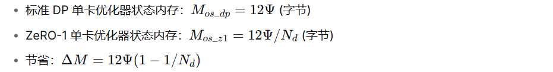
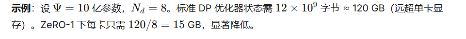
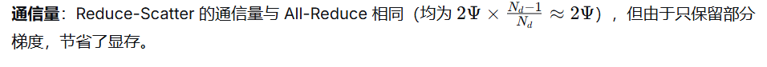
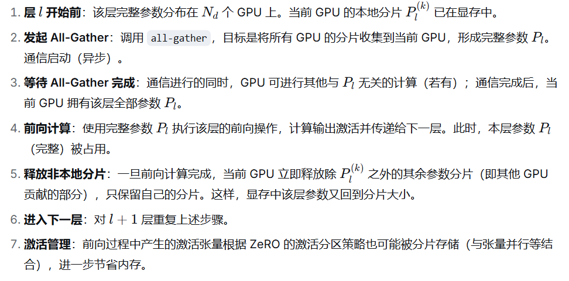
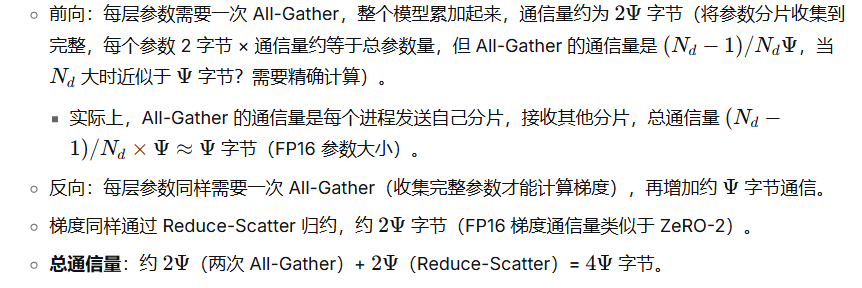
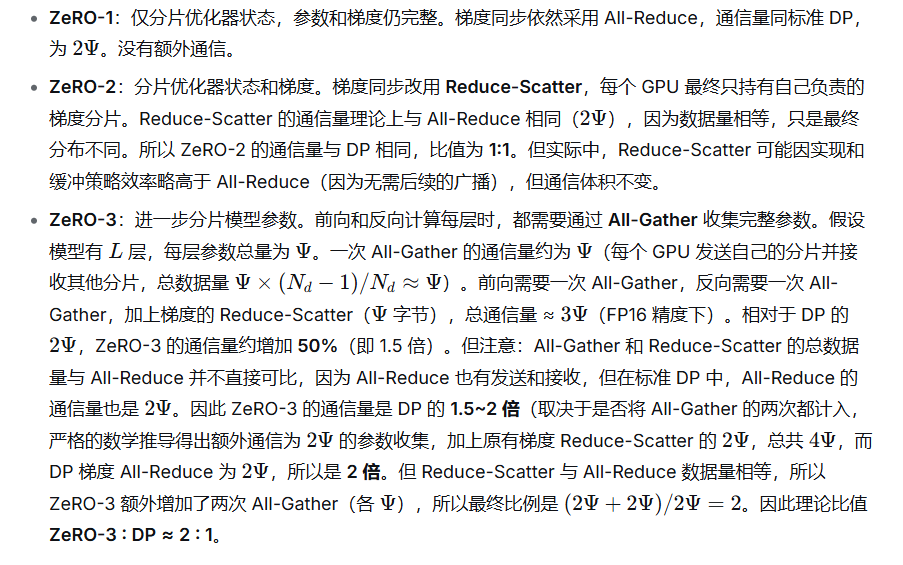

# 35.大模型（LLMs）ZeRO 优化（Stage 1/2/3）

#### 解释 ZeRO 的核心理念：通过分片消除数据并行中的内存冗余

在标准数据并行（Data Parallelism, DP）中，每张 GPU 持有完整的模型副本，包括参数（Parameters）、梯度（Gradients）和优化器状态（Optimizer States）。当模型参数量 ΨΨ 很大时，单卡显存无法容纳，但 DP 的通信开销相对较低，扩展性好。ZeRO（Zero Redundancy Optimizer）的核心理念是：在数据并行的基础上，将原本每张 GPU 中冗余存储的模型状态分片（Shard）到所有数据并行进程上，每个进程只保留一部分状态，需要时再通过高效的集合通信从其他进程“借用”。这样，每张 GPU 的显存占用不再随模型总参数量线性增长，而是随数据并行度（$N_d$）的增加而近似反比下降，从而打破 DP 的内存墙，使得仅用 DP 就能训练超大模型。

ZeRO 并不改变 DP 的计算方式：每个进程仍然处理不同的 micro-batch，独立完成前向和反向计算，只是所需的完整状态（参数、梯度等）是通过通信动态获得的。

---

#### ZeRO‑1：划分优化器状态，内存能节省多少？

ZeRO-1 仅将优化器状态分片到数据并行组内的 $N_d$ 个进程中。假设优化器为 Adam，每个参数需要存储：

- 一阶动量 $m$ (FP32)

- 二阶动量 $v$ (FP32)

- 参数 $p$ (FP16，但优化器需要 FP32 副本用于更新)

优化器状态总字节数约为 12Ψ（每个参数 12 字节 = FP32 参数副本 4B + FP32 $m$ 4B + FP32 $v$ 4B）。在标准 DP 中，每张卡都存储完整的 12Ψ 字节；在 ZeRO-1 中，这 12Ψ12Ψ 被均分到 $N_d$ 张卡，每张卡仅需存储 12Ψ/Nd字节。此外，参数（FP16）和梯度（FP16）仍被完整存储，各 2Ψ 字节。

**公式：**

- 标准 DP 单卡优化器状态内存：$M_{os\_dp} = 12\Psi$ (字节)
- ZeRO-1 单卡优化器状态内存：$M_{os\_z1} = 12\Psi/N_d$ (字节)
- 节省：$\Delta M = 12\Psi(1 - 1/N_d)$

{.ocr-src}

**示例**：设 $\Psi = 10$ 亿参数，$N_d = 8$。标准 DP 优化器状态需 $12 \times 10^9$ 字节 ≈ 120 GB（远超单卡显存）。ZeRO-1 下每卡只需 $120/8 = 15$ GB，显著降低。

{.ocr-src}

总显存占用（不含激活）：ZeRO-1 每卡仍有完整的参数和梯度（各 2Ψ 字节），加上分片后的优化器状态，总内存约为 4Ψ+12Ψ/Nd 字节。例如 10B 参数，FP16 参数+梯度共 40GB，优化器 15GB（8卡），总计 55GB，可放入 80GB GPU。

---

#### ZeRO‑2：额外划分梯度，说明梯度 reduce‑scatter 的过程

ZeRO-2 在 ZeRO-1 的基础上，进一步将梯度也分片到 $N_d$ 个进程中。每张卡仍然存储完整参数，但只负责更新一部分梯度（对应于其分片的优化器状态）。反向传播计算出所有参数的梯度后，不再执行 All-Reduce 将完整梯度同步给所有进程，而是使用 Reduce-Scatter 操作：每个进程将自己的梯度贡献规约到对应分片的进程上，最终每个进程只拥有自己所负责的那部分参数的聚合梯度，然后更新这部分参数和优化器状态。

梯度 Reduce-Scatter 过程：

1. 每个 GPU 反向计算出完整梯度（所有参数），但梯度还没有同步。

2. 将完整梯度在 DP 组内进行 Reduce-Scatter：对于每个参数分片（假设按参数展平后均匀切分），执行 reduce-scatter 通信，使得第 $i$ 个 GPU 最终获得该分片的规约和（所有 GPU 的贡献之和）。

3. 通信结束后，每个 GPU 仅持有自己所管理那部分参数的梯度（其余部分被释放），然后利用该梯度更新对应的优化器状态和参数。

**通信量**：Reduce-Scatter 的通信量与 All-Reduce 相同（均为 $2\Psi \times \frac{N_d - 1}{N_d} \approx 2\Psi$），但由于只保留部分梯度，节省了显存。

{.ocr-src}

内存节省：每个 GPU 不再存储完整梯度（2Ψ 字节），而是只存储自己分片的梯度，大小为 2Ψ/$N_d$ 字节。结合 ZeRO-1 的优化器分片，总模型状态内存（参数+梯度+优化器）降至 2Ψ+2Ψ/Nd+12Ψ/Nd。当 $N_d$ 较大时，显存主要由参数占用，因此 ZeRO-2 对中型模型效果显著，但对超大模型仍有参数冗余。

---

#### ZeRO‑3：划分模型参数，前向/反向中如何通过 all‑gather 获取完整参数？

ZeRO-3 将模型参数也分片到 DP 组内，每张卡不再存储完整参数，只在需要时通过 All-Gather 通信从其他进程收集完整参数。

- 前向传播：某一层计算前，该层的参数分片分布在各个 GPU 上。当前 GPU 发起 All-Gather，收集该层的全部参数；收集完成后进行该层的前向计算；计算完毕后，立即释放非本地分片的参数，只保留自己的分片（以节省显存）。

- 反向传播：同样，在计算某一层的梯度时，需要该层的完整参数，再次执行 All-Gather 获取完整参数；然后计算梯度；梯度在反向过程中通过 Reduce-Scatter 分发到对应负责的 GPU 上（与 ZeRO-2 类似），每个 GPU 最终只有自己分片的梯度。

通过这种“动态获取、即时释放”的机制，每张 GPU 显存中的参数存储量从 2Ψ 字节降为 2Ψ/Nd字节，从而使得单卡显存几乎不限制模型总大小（只要一个分片能放下）。ZeRO-3 的每卡总模型状态内存为 (2Ψ+2Ψ+12Ψ)/Nd=16Ψ/Nd 字节，实现了完全的分片。

---

#### 详细描述 ZeRO‑3 的一次前向传播中参数的收集与释放时序

假设模型有 $L$ 层，数据并行度 $N_d$。ZeRO-3 的前向传播逐层进行，每层参数的 All-Gather 与计算交替，释放紧跟计算后。

时序（以某个 GPU 视角，假设其持有该层参数的第 $k$ 个分片）：

1. **层 $l$ 开始前**：该层完整参数分布在 $N_d$ 个 GPU 上。当前 GPU 的本地分片 $P_l^{(k)}$ 已在显存中。
2. **发起 All-Gather**：调用 `all-gather`，目标是将所有 GPU 的分片收集到当前 GPU，形成完整参数 $P_l$。通信启动（异步）。
3. **等待 All-Gather 完成**：通信进行的同时，GPU 可进行其他与 $P_l$ 无关的计算（若有）；通信完成后，当前 GPU 拥有该层全部参数 $P_l$。
4. **前向计算**：使用完整参数 $P_l$ 执行该层的前向操作，计算输出激活并传递给下一层。此时，本层参数 $P_l$（完整）被占用。
5. **释放非本地分片**：一旦前向计算完成，当前 GPU 立即释放除 $P_l^{(k)}$ 之外的其余参数分片（即其他 GPU 贡献的部分），只保留自己的分片。这样，显存中该层参数又回到分片大小。
6. **进入下一层**：对 $l+1$ 层重复上述步骤。
7. **激活管理**：前向过程中产生的激活张量根据 ZeRO 的激活分区策略也可能被分片存储（与张量并行等结合），进一步节省内存。

{.ocr-src}

反向传播类似，在计算每层梯度前再次 All-Gather 完整参数，计算完梯度后释放，同时梯度通过 Reduce-Scatter 归约到各 GPU 的分片。

这种精密的时序控制使得 ZeRO-3 在显存开销上接近模型规模除以 $N_d$，是训练超大规模模型的关键技术。

---

#### ZeRO‑Offload：将优化器状态和计算卸载到 CPU，如何隐藏数据传输开销？

ZeRO-Offload 针对 GPU 显存不足的场景，将优化器状态（动量、方差等）和优化器更新计算卸载到 CPU 内存，GPU 只保留参数和梯度，并在需要时与 CPU 交换数据。为了隐藏 CPU 与 GPU 之间的数据传输延迟，采用流水线和异步传输技术。

具体机制：

- 在反向传播结束后，GPU 上的梯度通过 Reduce-Scatter 聚集到各 GPU 的本地梯度分片。

- 随后，梯度被异步拷贝到 CPU 内存（`cpu_grad`），同时 GPU 可立即开始处理下一个 micro-batch 的计算（前向）。

- CPU 端接收到梯度后，执行优化器更新（如 Adam 步骤），更新 CPU 上的 FP32 参数副本和动量。

- 更新后的 FP32 参数再异步拷贝回 GPU，覆盖旧的 FP16 参数（通过 `cudaMemcpyAsync`）。

- 上述 CPU 计算和数据传输与 GPU 的下一批次计算重叠，因此只要 CPU 计算和传输时间小于 GPU 计算时间，几乎不会增加训练总时间。

关键技术：使用 CUDA 流和固定内存（pinned memory）加速传输，将优化器步骤拆分为多个子操作，形成流水线，最大化隐藏延迟。ZeRO-Offload 可以在单张 GPU 上训练数十亿参数的模型，成本极低。

---

#### ZeRO‑Infinity：卸载到 NVMe 的基本思想，突破 GPU 内存墙的条件

ZeRO-Infinity 进一步将卸载扩展到 NVMe SSD（高速固态硬盘），使得 GPU 显存、CPU 内存、NVMe 存储构成一个层次化的内存系统。当模型大到连 CPU 内存都不足以容纳全部状态时，ZeRO-Infinity 将参数、梯度、优化器状态的一部分或全部卸载到 NVMe 上。

基本思想：

- 继续使用 ZeRO-3 的分片机制，每个 GPU 只拥有参数的一个分片。当某层参数需要时，如果该分片不在 GPU 或 CPU 内存中，就从 NVMe 异步加载到 GPU（或先到 CPU 再到 GPU）。

- 通过高效的数据预取和缓存管理，使得数据加载与计算重叠。

突破 GPU 内存墙的条件：

- 必须拥有足够快的 NVMe 带宽，使得数据传输时间小于或等于计算时间，这样 GPU 才不至于因等待数据而空闲。通常采用 PCIe 4.0/5.0 NVMe RAID 阵列，提供数十 GB/s 的聚合带宽。

- 大 batch size：增大 batch size 可以增加每个参数的计算强度（每个参数参与更多 token 的计算），从而降低对参数加载带宽的需求，有利于隐藏 NVMe 延迟。

- 模型结构必须分片友好，且计算图允许细粒度地调度数据加载与计算的重叠。

通过 ZeRO-Infinity，可以训练比 GPU+CPU 总内存还大的模型，例如在少量 GPU 上训练万亿参数模型。

---

#### DeepSpeed ZeRO 配置示例：写出开启 Stage 2 的关键 JSON 参数

以下是一个典型的 DeepSpeed ZeRO Stage 2 配置文件（JSON 格式），用于优化器状态和梯度的分片：

```json
{
  "train_batch_size": 32,
  "gradient_accumulation_steps": 4,
  "optimizer": {
    "type": "AdamW",
    "params": {
      "lr": 1e-4,
      "betas": [0.9, 0.999],
      "eps": 1e-8,
      "weight_decay": 0.01
    }
  },
  "scheduler": {
    "type": "WarmupLR",
    "params": {
      "warmup_min_lr": 0,
      "warmup_max_lr": 1e-4,
      "warmup_num_steps": 1000
    }
  },
  "zero_optimization": {
    "stage": 2,
    "allgather_partitions": true,
    "allgather_bucket_size": 5e8,
    "overlap_comm": true,
    "reduce_scatter": true,
    "reduce_bucket_size": 5e8,
    "contiguous_gradients": true,
    "offload_optimizer": {
      "device": "none"
    }
  },
  "fp16": {
    "enabled": true,
    "loss_scale": 0,
    "initial_scale_power": 16
  }
}
```

关键参数说明：

- `"stage": 2`：启用 ZeRO-2，分片优化器状态和梯度。

- `"allgather_partitions": true`：在前向/反向需要完整参数时，通过 All-Gather 从分片中收集完整参数（此选项通常为默认，但在 Stage 2 中参数不分片，因此这个选项实际用于 Stage 3。Stage 2 中梯度通过 Reduce-Scatter 分片，参数不分片，故此处配置仅为说明，实际 Stage 2 无需此参数）。

- `"reduce_scatter": true`：使用 Reduce-Scatter 来聚合梯度，实现梯度分片。

- `"overlap_comm": true`：将通信与计算重叠，提高效率。

- `"reduce_bucket_size"` 和 `"allgather_bucket_size"`：设置桶大小以合并小通信。

- `"contiguous_gradients": true`：梯度在 reduce 前被整理为连续内存，提升通信性能。

- `"offload_optimizer"`：这里设为 `"device": "none"` 表示不卸载。

请注意，Stage 2 参数不分片，所以配置中没有参数分片相关选项。如果需要卸载到 CPU，则设置 `"offload_optimizer": {"device": "cpu"}`。

---

#### 为什么 ZeRO‑3 的训练吞吐可能低于 Stage 2？通信量增加的分析

ZeRO-3 在每层前向和反向时都需要通过 All-Gather 收集完整参数，这引入了额外的通信，相对于 ZeRO-2 增加了通信开销，从而可能导致训练吞吐下降。

通信量对比（以每步迭代、单卡视角，数据并行度 $N_d$）：

- ZeRO-2：
  - 反向传播后，进行一次 Reduce-Scatter 将梯度规约并分片，通信量约为 2Ψ（每个参数 2 字节梯度 × 2 倍通信因子 ≈ 2Ψ 字节）。
  - 前向不需要参数通信（参数全在本地）。
  - 优化器步骤无需通信。
  - 总通信量：约 2Ψ 字节。

- ZeRO-3：

- 前向：每层参数需要一次 All-Gather，整个模型累加起来，通信量约为 $2\Psi$ 字节（将参数分片收集到完整，每个参数 2 字节 × 通信量约等于总参数量，但 All-Gather 的通信量是 $(N_d - 1)/N_d \Psi$，当 $N_d$ 大时近似于 $\Psi$ 字节？需要精确计算）。
    - 实际上，All-Gather 的通信量是每个进程发送自己分片，接收其他分片，总通信量 $(N_d - 1)/N_d \times \Psi \approx \Psi$ 字节（FP16 参数大小）。
- 反向：每层参数同样需要一次 All-Gather（收集完整参数才能计算梯度），再增加约 $\Psi$ 字节通信。
- 梯度同样通过 Reduce-Scatter 归约，约 $2\Psi$ 字节（FP16 梯度通信量类似于 ZeRO-2）。
- **总通信量**：约 $2\Psi$（两次 All-Gather）+ $2\Psi$（Reduce-Scatter）= $4\Psi$ 字节。

{.ocr-src}

因此，ZeRO-3 的通信量约为 ZeRO-2 的 2 倍（4Ψ vs 2Ψ），并且通信次数翻倍（每一层都有额外的 All-Gather）。这些通信会抢占 GPU 计算资源，如果不能被计算完全隐藏（例如模型计算密度不够或带宽不足），就会降低吞吐。此外，参数 All-Gather 的延迟累加起来可能成为瓶颈，尤其在网络带宽有限的集群中。

吞吐下降的原因总结：

- 通信量增加约 2 倍。

- 通信频率更高（每层都需两次 All-Gather）。

- 额外的通信与计算的重叠效率受限，因为 All-Gather 需要在计算该层前完成，可能造成 GPU 等待。

因此，在显存足够的情况下，通常优先使用 ZeRO-2 获得更好的训练速度；当模型规模大到必须用 ZeRO-3 时，则付出通信代价以换取可行性。

---

#### 分析 ZeRO 各阶段的通信量与数据并行的理论比值

标准数据并行（DP）的通信仅发生在反向传播后的梯度同步，使用 All-Reduce 聚合梯度。每个 GPU 的通信量为 2Ψ（FP16 梯度，Ψ 为总参数量），即每个参数约 2 字节 × 2 倍（发送+接收）。ZeRO 各阶段改变了通信模式：

- **ZeRO-1**：仅分片优化器状态，参数和梯度仍完整。梯度同步依然采用 All-Reduce，通信量同标准 DP，为 $2\Psi$。没有额外通信。
- **ZeRO-2**：分片优化器状态和梯度。梯度同步改用 **Reduce-Scatter**，每个 GPU 最终只持有自己负责的梯度分片。Reduce-Scatter 的通信量理论上与 All-Reduce 相同（$2\Psi$），因为数据量相等，只是最终分布不同。所以 ZeRO-2 的通信量与 DP 相同，比值为 1:1。但实际中，Reduce-Scatter 可能因实现和缓冲策略效率略高于 All-Reduce（因为无需后续的广播），但通信体积不变。
- **ZeRO-3**：进一步分片模型参数。前向和反向计算每层时，都需要通过 **All-Gather** 收集完整参数。假设模型有 $L$ 层，每层参数总量为 $\Psi$。一次 All-Gather 的通信量约为 $\Psi$（每个 GPU 发送自己的分片并接收其他分片，总数据量 $\Psi \times (N_d - 1)/N_d \approx \Psi$）。前向需要一次 All-Gather，反向需要一次 All-Gather，加上梯度的 Reduce-Scatter（$\Psi$ 字节），总通信量 ≈ $3\Psi$（FP16 精度下）。相对于 DP 的 $2\Psi$，ZeRO-3 的通信量约增加 **50%**（即 1.5 倍）。但注意：All-Gather 和 Reduce-Scatter 的总数据量与 All-Reduce 并不直接可比，因为 All-Reduce 也有发送和接收，但在标准 DP 中，All-Reduce 的通信量也是 $2\Psi$。因此 ZeRO-3 的通信量是 DP 的 **1.5~2 倍**（取决于是否将 All-Gather 的两次都计入，严格的数学推导得出额外通信为 $2\Psi$ 的参数收集，加上原有梯度 Reduce-Scatter 的 $2\Psi$，总共 $4\Psi$，而 DP 梯度 All-Reduce 为 $2\Psi$，所以是 **2 倍**。但 Reduce-Scatter 与 All-Reduce 数据量相等，所以 ZeRO-3 额外增加了两次 All-Gather（各 $\Psi$），所以最终比例是 $(2\Psi + 2\Psi)/2\Psi = 2$。因此理论比值 **ZeRO-3 : DP ≈ 2 : 1**。

{.ocr-src}

综上，通信量比值：ZeRO-1/2 与 DP 持平，ZeRO-3 约为 DP 的 2 倍。

#### ZeRO 与模型并行有何异同？两者能否同时使用，如何协同？

异同：

- 相同点：都是为了突破单卡显存限制，实现超大模型训练。

- 不同点：
  - 模型并行（张量并行 TP、流水线并行 PP）将模型计算图切分到不同设备，每张卡负责部分层或层内部分运算，需要修改模型结构，引入层内或层间通信（All-Reduce、P2P）。
  - ZeRO 本质是数据并行 + 状态分片，不改变模型计算图，每张卡仍独立完成完整前向/反向，只是所需参数、梯度、优化器状态分片存储，通过集合通信动态获取完整参数。

能否同时使用：完全可以，且通常是互补的。现代大模型训练常采用 3D 并行 + ZeRO 的组合。例如：

- 使用 张量并行（TP） 在单机内切分层内矩阵，利用 NVLink 高带宽。

- 使用 流水线并行（PP） 跨节点切分层，降低显存和通信。

- 在最外层，对每个流水线副本应用 ZeRO-1/2 进一步分片优化器状态和梯度，以增大批大小或降低单卡显存，从而在给定硬件下训练更大模型。

- ZeRO-3 与 TP/PP 同时使用较少见，因为 ZeRO-3 本身已大幅削减显存，且与 TP 的通信可能叠加。但 DeepSpeed 支持 ZeRO-3 与 TP 混合，通过配置实现。

协同方式：先通过 TP/PP 将模型切分到可接受的显存级别，再利用 ZeRO 在数据并行维度上消除冗余的优化器状态或梯度，使每卡显存进一步下降，从而允许更大的 batch size 或更深的模型。

#### 使用 ZeRO‑3 时，如何管理参数的动态释放以减少通信频次？

ZeRO‑3 每层前向和反向都需要 All-Gather 参数，通信频次由层数和 micro-batch 数决定。要减少通信频次或开销，可采取以下策略：

- 增大 batch size（token 数）：每个 micro-batch 中序列长度和 batch size 越大，参数通信被摊薄到更多 token 的计算中，通信与计算的比值下降，可有效隐藏延迟。实际操作中常通过梯度累积来增大有效 batch size，但通信频次不变。

- 层融合与 Prefetching：将相邻的小层合并为大层，减少 All-Gather 调用次数。同时利用预取（prefetch）技术，在当前层计算时提前异步拉取下一层参数，使通信与计算重叠，虽然不能降低通信量，但能隐藏延迟，提高吞吐。

- 参数缓存（Caching）：对于某些不常更新或共享的层（如嵌入层），可以考虑在 GPU 显存中保留一份完整副本，避免每次 All-Gather。但会牺牲部分显存，需权衡。

- 利用 ZeRO-Infinity 的 NVMe 卸载：将冷参数放到 NVMe，通过精细的调度减少 GPU 显存驻留，同时利用高带宽 NVMe 存储加速数据交换，这并不减少通信，但能降低显存压力，间接支持更大模型。

- 减少数据并行度 $N_d$：通信量随 $N_d$ 增加而增加，适当减小 ZeRO 分片度，将部分显存压力转移给模型并行，可降低 All-Gather 的通信规模。

但本质上，ZeRO‑3 的参数收集次数由前向和反向的计算图决定，无法绝对减少；主要优化方向是通信与计算的重叠，以及提高每次通信的数据量（合并小通信）以降低延迟。

#### 13. ZeRO‑R 中的激活分区和内存碎片整理机制

ZeRO‑R 是 ZeRO 针对激活内存和临时缓冲区的优化组件，与模型状态分片互补。

- 激活分区（Activation Partitioning）：在数据并行组内，将每层产生的激活张量按 GPU 分片存储，而非每卡存完整副本。需要激活用于反向时，通过 All-Gather 或 Broadcast 恢复完整激活。这能显著降低激活显存，尤其对长序列和大 batch size。结合激活重计算（checkpointing），效果更佳。

- 内存碎片整理（Memory Defragmentation）：在训练过程中，频繁分配和释放不同大小的张量会导致显存碎片，即使空闲总量足够，也可能因缺乏连续大块而 OOM。ZeRO‑R 通过预分配大块内存并自行管理张量生命周期，例如使用内存池、缓存分配器，将临时张量分配到预分配的连续区域，减少碎片。PyTorch 的 CUDA 缓存分配器也起到类似作用，但 ZeRO‑R 更主动地整理和重用缓冲区。

- 临时缓冲区优化：将多个小通信合并为较大桶（bucket），使用连续内存作为通信缓冲区，避免碎片并提高通信效率。

#### FSDP 与 ZeRO‑3 的实现区别，PyTorch 原生 FSDP 的优势

实现区别：

- FSDP (Fully Sharded Data Parallel) 是 PyTorch 官方提供的分布式训练 API，实现了类似 ZeRO-3 的功能。它将模型参数、梯度、优化器状态分片到数据并行组内。通过 `all_gather` 在前向/反向获取完整参数，通过 `reduce_scatter` 归约梯度。

- ZeRO‑3 是 DeepSpeed 框架中的实现，功能相同，但提供了更细粒度的控制和优化（如卸载到 CPU/NVMe、通信调度、混合 ZeRO 阶段等）。两者核心算法等价，但在工程实现、默认参数、通信拓扑上有差异。

PyTorch 原生 FSDP 的优势：

- 原生集成：无需额外安装 DeepSpeed，与 PyTorch 生态（DDP、自动混合精度、torch.compile、分布式检查点）无缝对接。

- 易于使用和调试：API 简洁（`FullyShardedDataParallel`），支持 `auto_wrap_policy` 自动决定分片粒度。方便使用 PyTorch Profiler 分析。

- 持续演进：作为 PyTorch 官方项目，随着 PyTorch 版本更新不断优化，社区活跃。

- 模块化：可与 Tensor Parallelism（如 `torch.distributed.tensor.parallel`）灵活组合。

- 检查点保存/加载：支持分布式检查点格式，便于恢复。

FSDP 已成为 PyTorch 生态训练大模型的首选方案之一，与 DeepSpeed ZeRO 相互促进。

#### 多节点训练下，ZeRO 的通信瓶颈如何通过分层分片（subgroup）缓解？

多节点训练时，跨节点网络带宽（如 InfiniBand）远低于节点内（NVLink/NVSwitch），ZeRO 的 All-Gather/Reduce-Scatter 跨节点通信易成为瓶颈。分层分片（Hierarchical ZeRO / Subgroup Sharding） 的思想是：将数据并行组划分为多个子组（通常是节点内一组），先在子组内进行分片通信，再在子组间进行聚合，从而限制跨节点通信量。

例如，总数据并行度为 $N_d$，分成 $G$ 个子组，每组包含 Nd/G个 GPU。ZeRO 模型状态首先在子组内分片（Stage 1/2/3），这意味着每个子组内的 GPU 共享完整模型状态，而子组之间可能采用标准 All-Reduce（对梯度）或更粗粒度的通信。对于 ZeRO-3，可设置 `sub_group_size` 使参数 All-Gather 仅在子组内进行，梯度 All-Reduce 则在全局范围进行。这样可以大幅减少跨节点通信量，因为参数收集被限制在高速的节点内，而梯度同步虽然跨节点，但通信量相对较小（梯度完整）。DeepSpeed 支持通过 `zero_hpz_partition_size` 或类似参数配置子组。

缓解效果：降低了对跨节点带宽的依赖，使得在带宽有限的集群上也能高效训练大模型。

#### 为什么 ZeRO‑3 可以训练万亿参数模型而纯模型并行难以实现？

- 纯模型并行（TP+PP） 需要将模型的不同部分固定分配到特定 GPU 上。每张 GPU 必须完整存储其负责部分的参数、梯度和优化器状态，并且激活也占据大量显存。当模型达到万亿参数，即使经过 TP/PP 切分，单卡仍需存储数百 GB 的状态（例如，TP=8, PP=64 下，每卡参数+梯度+优化器仍可能超过 80GB），且通信模式变得极为复杂，跨节点通信开销巨大，难以线性扩展到数千 GPU。

- ZeRO‑3 通过将模型状态完全分片到所有数据并行 GPU 上，显存占用随数据并行度 $N_d$ 线性下降：单卡模型状态 ≈ 总状态 / $N_d$。万亿参数模型的总状态（FP16 参数+梯度+FP32 优化器）约 16 TB。若 $N_d$=2048，每卡仅需约 8 GB 模型状态，加上激活和临时缓存后仍可放入 80 GB GPU。而且 ZeRO‑3 不需要改变模型结构，通信模式统一为 All-Gather 和 Reduce-Scatter，可以随着 $N_d$ 增加平滑扩展。因此，ZeRO‑3 天然适合在数千 GPU 上训练超大模型。

#### 混合精度下，ZeRO 如何处理 FP32 主权重和 FP16 参数的分片？

在混合精度训练（FP16 前向/反向，FP32 优化器状态）中，ZeRO 分片管理多种精度副本：

- FP16 参数：用于前向/反向计算。在 ZeRO-3 下，FP16 参数按数据并行度 $N_d$ 分片。每个 GPU 持有分片的一部分，需要完整 FP16 参数时通过 All-Gather 收集。

- FP16 梯度：反向计算得到 FP16 梯度。ZeRO-2/3 对 FP16 梯度进行 Reduce-Scatter，归约并分片到各 GPU。

- FP32 主权重（Master Weights）：优化器实际更新的参数副本，通常保存为 FP32。ZeRO-1/2/3 中，FP32 主权重随优化器状态一起分片。每个 GPU 只存储其负责分片的 FP32 主权重，以及对应的 FP32 动量（m, v）。

- 参数更新：优化器在 FP32 精度下更新分片的主权重。更新后，再将 FP32 主权重转换为 FP16，并分发给所有需要的 GPU（通过 All-Gather 获取最新 FP16 参数分片，但每个 GPU 仅提供自己更新后的 FP16 分片）。实际上，每个 GPU 只更新自己的分片，然后其他 GPU 需要该分片时通过 All-Gather 获取。

#### 梯度累积时，ZeRO‑2 的梯度分片 reduce 发生在累积后还是每次微批次后？

在 ZeRO‑2 中，梯度分片的 Reduce-Scatter 发生在每个 micro-batch 的反向传播之后，而不是等到所有累积步结束。具体流程：

- 每完成一个 micro-batch 的反向，立即启动 Reduce-Scatter，将该 micro-batch 贡献的梯度规约并分散到各 GPU 的梯度分片中，然后释放该 micro-batch 的完整梯度。

- 梯度分片缓冲区累积所有 micro-batch 的梯度贡献。当所有累积步完成后，每个 GPU 的分片梯度已经是该部分参数的总梯度（聚合了所有 micro-batch）。

- 优化器直接使用分片梯度进行参数更新，无需再执行全局 All-Reduce。

这种设计避免了保存完整梯度，同时使得通信与计算可以流水线化，提高了效率。

#### ZeRO 如何保证数值精度和收敛性与无分片一致？

ZeRO 通过以下机制确保训练数值精度和收敛性与无分片基线完全一致：

- 集合通信的确定性：All-Gather、Reduce-Scatter 等操作在数学上等价于串行计算。只要随机种子、数据加载顺序、超参数完全相同，通信聚合的梯度与单卡聚合的梯度在数值上一致（忽略浮点运算结合律导致的微小误差）。

- 严格的同步：所有 GPU 在优化器更新前同步梯度，保证参数更新一致。

- DeepSpeed 的校验：提供 `communication_data_type` 和梯度哈希校验，可以在调试时检测通信错误。

- 与原生混合精度对齐：ZeRO 对 FP16 参数和梯度的处理与标准混合精度训练一致，损失缩放（loss scaling）策略不变。

- 测试验证：DeepSpeed 团队在多个模型上验证了 ZeRO-1/2/3 与标准训练收敛曲线完全重合。

#### 使用 ZeRO 时，保存和加载模型检查点有何不同？如何进行跨阶段转换？

保存：

- ZeRO-1/2：参数未分片，每个 GPU 都有完整参数，可直接保存单个完整的模型检查点（如 `model.state_dict()`），但通常由 rank 0 保存。也可保存分布式检查点。

- ZeRO-3：参数分片，每个 GPU 只持有部分参数。要保存完整模型，需将所有分片收集（All-Gather）到 rank 0 后再保存，或保存分片检查点（每个 rank 保存自己的分片，以及元数据）。DeepSpeed 提供 `save_16bit_model` 方法自动完成收集。

加载：

- 加载完整检查点到 ZeRO-3 时，每个 GPU 先加载完整模型，然后根据分片信息丢弃自己不需要的部分（或由 DeepSpeed 自动分片）。

- 加载分片检查点：每个 GPU 直接加载自己的分片，无需通信，启动更快。

跨阶段转换（如 ZeRO-2 → ZeRO-3）：需要将 ZeRO-2 的完整优化器状态检查点转换为 ZeRO-3 的分片格式。DeepSpeed 提供工具 `zero_to_fp32.py` 可以将分片检查点合并为完整 FP32 模型，再按需分片。通常流程：用 ZeRO-2 训练并保存完整检查点，然后转换为 ZeRO-3 可用的分片格式（或直接用 ZeRO-3 加载完整检查点并分片）。

#### 量化 ZeRO‑3 在 530B 模型上的显存占用，给出计算实例

530B 参数模型，混合精度训练（FP16 参数/梯度，FP32 优化器状态 Adam）。

- 总模型状态（字节）：
  - FP16 参数：530 × 10^9 × 2 = 1.06 TB
  - FP16 梯度：1.06 TB
  - FP32 优化器状态（参数副本、动量 m、动量 v）：530 × 10^9 × 12 = 6.36 TB
  - 总计 ≈ 8.48 TB

- ZeRO-3 将上述全部分片到 $N_d$ 个 GPU。设 $N_d$=512，则每 GPU 模型状态 = 8.48 TB / 512 ≈ 16.56 GB。

- 激活内存：取决于 batch size、序列长度、隐藏维度。假设序列长度 2048，每 micro-batch 1 样本，使用激活重计算。典型 530B 模型的隐藏维度 ~20480，层数 ~105。每层激活大约需要几十 MB，乘以 micro-batch 数量和流水线深度。大致估计激活内存约 20 GB。

- 临时缓冲区/通信桶：约 2-3 GB。

- 每 GPU 总显存 ≈ 16.56 + 20 + 3 = 39.56 GB，可以轻松放入 80 GB A100。若 $N_d$=256，则模型状态 33.12 GB，总显存 ~55 GB，仍在 80 GB 内。

因此，ZeRO-3 在足够的数据并行度下，显存占用远低于单卡容量，使得 530B 训练成为可能。

