# 36.大模型（LLMs）重计算与显存占用分析

#### LLM 训练时显存占用类别及大致占比

大模型训练时，GPU 显存主要由以下几部分构成：

- 模型参数 (Parameters)：存储模型权重，通常使用 FP16/BF16（2 字节）或 FP32（4 字节）。

- 梯度 (Gradients)：反向传播产生的梯度，精度通常与参数相同（FP16/BF16）。

- 优化器状态 (Optimizer States)：如 Adam 的一阶动量 $m$、二阶动量 $v$，通常保持 FP32；通常还会保留一份 FP32 的主权重副本。

- 激活值 (Activations)：前向传播产生的中间张量，用于反向传播时计算梯度。

- 临时缓冲区 (Temporary Buffers)：如通信操作的缓冲区、工作区等。

大致占比（以未优化、FP16 混合精度、Adam 优化器、序列长度中等为例）：

- 参数：约占 15~20%

- 梯度：约占 10~15%

- 优化器状态：约占 40~50%（因为 FP32 存储，且每参数含 $m$,$v$ 以及主权重）

- 激活值：约占 20~35%（取决于 batch size、序列长度）

- 临时缓冲区：约占 5~10%

当序列长度或 batch size 很大时，激活值占比可飙升至 60% 以上，成为绝对瓶颈。

---

#### 参数、梯度、优化器状态显存公式（FP16/FP32）

设模型参数量为 Ψ。

- 参数显存 (FP16/BF16 存储)：2Ψ 字节

- 参数显存 (FP32 存储)：4Ψ 字节

- 梯度显存 (FP16/BF16 存储)：2Ψ 字节

- 梯度显存 (FP32 存储)：4Ψ 字节

- 优化器状态显存（Adam，混合精度训练，FP32 主权重 + FP32 动量 $m$,$v$）：
  - FP32 主权重副本：4Ψ 字节
  - 一阶动量 $m$：4Ψ 字节
  - 二阶动量 $v$：4Ψ 字节
  - 合计：12Ψ 字节

若使用纯 FP32 训练，参数和梯度为 4Ψ，优化器状态仍为 12Ψ，总基础显存 20Ψ 字节。

常用混合精度配置：参数 FP16 (2Ψ)，梯度 FP16 (2Ψ)，优化器 FP32 (12Ψ)，共 16Ψ 字节。若使用 BF16 同样如此。这是计算总模型状态占用的常用基准。

---

#### 激活内存与 batch size、序列长度、隐藏维度、层数的关系

激活内存与这些因素密切相关。以一个 Transformer 层为例，其主要中间激活包括：

- Q, K, V 矩阵：每个形状 $(B, S, H)$，FP16 下共 $3 \times 2BSH$ 字节。
- 注意力分数矩阵（softmax 前）：$(B, h, S, S)$，FP16 下 $2BhS^2$ 字节，这是最大头。
- Softmax 后的注意力权重矩阵：同分数矩阵大小，或为节省内存不存储（通过重计算）。
- FFN 中间激活：第一层升维输出形状 $(B, S, 4H)$，以及激活后的输出；第二层降维输出 $(B, S, H)$。

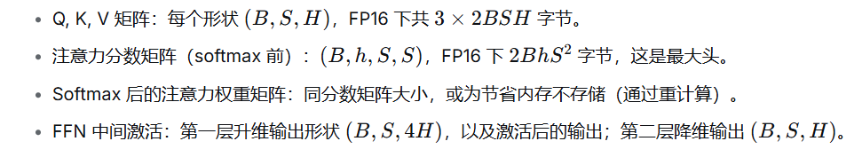{.ocr-src}

简化后，每层激活总字节近似为：

$$
A_{\text{layer}} \approx 2 \times (\text{线性层输入输出} + \text{注意力矩阵})
$$

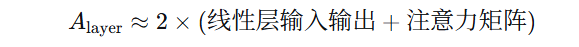{.ocr-src}

更详细的估算公式（FP16）：

$$
A_{\mathrm{layer}} \approx 2BSH \times 10 + 2BhS^2 \quad \text{字节}
$$

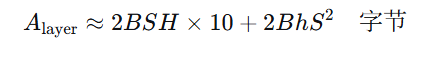{.ocr-src}

其中 10 是经验系数，涵盖了多个激活。

对于 $L$ 层模型，**无检查点**时总激活约为 $L \times A_{\mathrm{layer}}$。

**主导项**：当序列长度 $S$ 较大时，注意力矩阵的 $O(S^2)$ 项绝对主导。

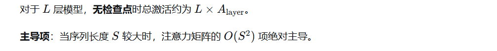{.ocr-src}

---

#### 激活重计算（梯度检查点）如何改变激活内存公式？给出缩放因子。

梯度检查点 通过丢弃部分层的中间激活，反向时再重计算来节省内存。若对每个 Transformer 层应用检查点（即每层作为一段）：

- 前向：不保留该层内部的中间激活，仅保存该层的输入张量（形状 ($B$,$S$,$H$)）。

- 反向：重新执行该层的前向，暂时产生该层的完整激活，计算梯度后立即释放。

激活内存公式变为：

$$
\text{Peak Activation} \approx L \times \text{size\_of\_input\_tensor} + A_{\mathrm{layer}}
$$

其中输入张量大小为 $2BSH$ 字节 (FP16)，远比层内部激活小。原无检查点激活为 $L \times A_{\mathrm{layer}}$，所以**缩放因子**近似为：

$$
\frac{\text{Peak with checkpoint}}{\text{Original}} \approx \frac{2BSH + A_{\mathrm{layer}}/L}{A_{\mathrm{layer}}} \approx \frac{1}{L} \quad (\text{当 } A_{\mathrm{layer}} \gg 2BSH)
$$

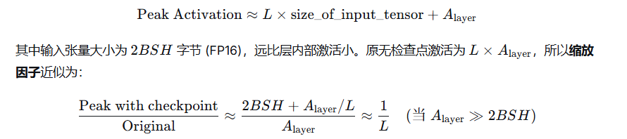{.ocr-src}

即激活内存可节省约 $L$ 倍，比如 100 层模型激活内存可降至原来的约 1%。在实践中，检查点通常可使激活内存降低一个数量级以上。

---

#### 以一个 7B 模型为例，估算不带任何优化时训练所需的最小显存。

以 LLaMA-7B 为例，参数量 $\Psi = 7 \times 10^9$。假设：

- 混合精度训练：参数 FP16，梯度 FP16，优化器 FP32 (Adam)。
- 无任何并行、无检查点、无卸载、无 FlashAttention。
- 序列长度 $S = 2048$，batch size $B = 1$，隐藏维度 $H = 4096$，层数 $L = 32$，头数 $h = 32$。

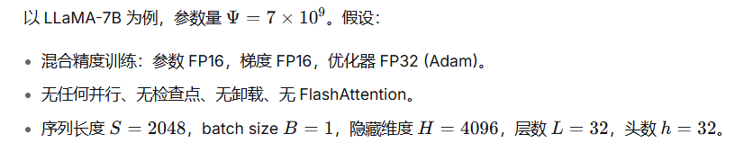{.ocr-src}

1. 模型状态显存：

$$
\text{Params} = 2 \times 7 \times 10^9 = 14\ \text{GB}
$$

$$
\text{Grads} = 14\ \text{GB}
$$

$$
\text{Optimizer} = 12 \times 7 \times 10^9 = 84\ \text{GB}
$$

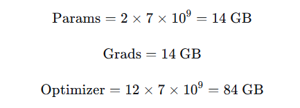{.ocr-src}

模型状态合计：14+14+84=112 GB。

2. 激活内存估算（无任何优化）：

- 注意力矩阵：$B \times h \times S \times S = 1 \times 32 \times 2048 \times 2048 \approx 1.34 \times 10^8$ 元素，FP16 约为 0.268 GB。但通常要存储注意力分数和权重两个矩阵，且中间 Q, K, V 等，实际注意力部分约需 1~2 GB/层。

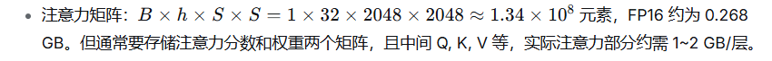{.ocr-src}

- FFN 及其他：激活函数前后等，大约每层 0.5~1 GB。

- 粗略估算每层激活约 2~3 GB，32 层总激活约 64~96 GB。取中间值 80 GB。

总显存 ≈ 模型状态 112 GB + 激活 80 GB ≈ 192 GB。

加上临时缓冲区，可能超过 200 GB。单张 80GB A100 远远不够，需要 3~4 张。

由此可见，不使用任何优化，7B 模型已极难训练。实际上必须依赖并行、检查点、FlashAttention 等。

---

#### ZeRO-1 优化器状态分片后，每卡优化器内存如何计算？

ZeRO-1 将优化器状态（FP32 主权重、动量 $m, v$）分片到数据并行组内的 $N_d$ 个 GPU 上，每卡仅持有 $1/N_d$ 的优化器状态。

**计算公式**：

- 总优化器状态字节 = $12\Psi$
- 每卡优化器状态 = $\frac{12\Psi}{N_d}$ 字节

**参数和梯度** 仍完整保存在每卡（各 $2\Psi$ 字节）。

**示例**：$\Psi = 7\mathrm{B}$，$N_d = 8$，原优化器状态 84 GB，分片后每卡仅 10.5 GB。每卡总模型状态 = 参数 14 GB + 梯度 14 GB + 优化器 10.5 GB ≈ 38.5 GB，大幅降低。

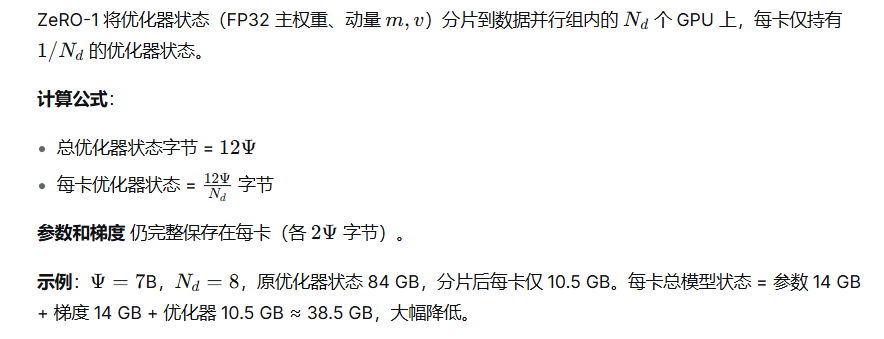{.ocr-src}

---

**7. 3D 并行下每卡显存的计算方法**

3D 并行是数据并行 (DP)、张量并行 (TP)、流水线并行 (PP) 的组合。设数据并行度 $N_{DP}$，张量并行度 $N_{TP}$，流水线并行度 $N_{PP}$，总 GPU 数 $N = N_{DP} \times N_{TP} \times N_{PP}$。

**参数、梯度、优化器状态** 被 TP 和 PP 切分（ZeRO 还可进一步分片）：

- 张量并行将每层的参数矩阵切分到 $N_{TP}$ 个 GPU，因此每卡参数 = $\frac{2\Psi}{N_{TP} \times N_{PP}}$（假设 PP 均分层）。
- 梯度类似：每卡梯度 = $\frac{2\Psi}{N_{TP} \times N_{PP}}$。
- 优化器状态：每卡 = $\frac{12\Psi}{N_{TP} \times N_{PP}}$（若未用 ZeRO 进一步分片）。若再叠加 ZeRO-1/2/3，可在 DP 维度进一步分片。

**激活内存**：受 TP、PP 影响：

- 张量并行：每个 GPU 只存储部分激活（列/行切分），每卡激活约为原始激活的 $1/N_{TP}$（对大多数操作）。
- 流水线并行：每卡只负责部分层，因此每卡层数 ≈ $L/N_{PP}$。激活内存降低为约 $1/N_{PP}$。
- 数据并行不影响单卡激活（每卡独立），因此每卡激活 = $\frac{A_{\mathrm{total}}}{N_{TP} \times N_{PP}}$。

**总显存** = 参数 + 梯度 + 优化器 + 激活 + 临时缓冲区。通过 3D 并行，可以灵活调配以平衡显存和通信。

---

**8. FlashAttention 如何减少注意力矩阵的显存？节省的理论显存量。**

FlashAttention 通过**分块 (Tiling)** 和**重计算**避免存储完整的注意力矩阵 $S$（QK^T）和注意力权重 $P$（softmax 后）。标准注意力需存储两个 $n \times n$ 矩阵（FP16 下各 $2BhS^2$ 字节）。FlashAttention 在前向时不存储这些大矩阵，只在反向时重新计算。

**节省的显存**：原本注意力部分激活 ≈ $4BhS^2$ 字节（分数和权重）。使用 FlashAttention 后，这部分内存基本降为 0，仅需存一些统计量（如 softmax 的归一化因子），大小为 $O(BhS)$，可忽略。例如，$S = 2048, h = 32, B = 1$，原注意力矩阵约 1 GB，FlashAttention 下这部分仅需几 MB。

**理论节省**：对于长序列，注意力矩阵曾是激活内存的最大来源，FlashAttention 直接将其消除，这是其巨大贡献。

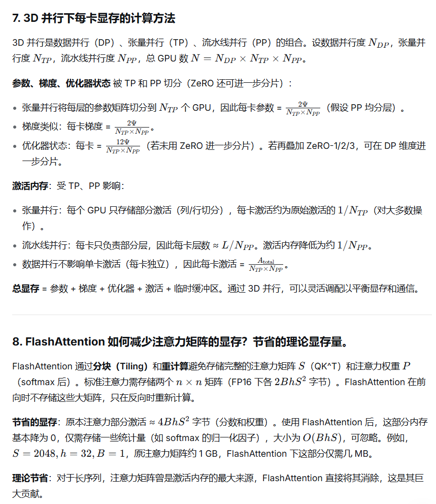{.ocr-src}

**9. 什么情况下激活显存会远超参数显存？举例长序列训练。**

激活显存超过参数显存常见于：

- **长序列**：注意力矩阵为 $O(S^2)$。当 $S$ 较大（如 8192 或更长），注意力矩阵大小迅速增长。例如，7B 模型，$S = 8192, h = 32$，注意力矩阵 $1 \times 32 \times 8192 \times 8192 \times 2$ 字节 ≈ 4 GB 每层，32 层仅注意力矩阵就 128 GB，远超参数 14 GB。
- **大 batch**：激活与 batch size 成正比。
- **深层模型**：层数多，累积激活大。
- **不使用检查点**：所有层激活均存储。

因此，在长序列训练中，激活显存往往成为主要瓶颈，必须采用 FlashAttention、梯度检查点、序列并行等技术来解决。

---

**10. 为什么序列长度对激活显存影响极大，而模型并行对激活影响较小？**

**序列长度影响**：

- 注意力矩阵大小是 $O(S^2)$，序列长度加倍，注意力矩阵增大四倍。这是激活的最主要组成部分。
- 此外，线性层产生的激活（如 Q、K、V、FFN 中间输出）大小是 $O(S)$，序列长度加倍，它们也加倍。
- 因此总激活内存随序列长度呈二次方或线性增长，影响极其显著。

**模型并行影响**：

- 张量并行 (TP)：切分参数矩阵，同时也会切分部分激活（如 MLP 的第一层列切分后激活被切分；但注意力矩阵的切分与头数相关）。对于注意力矩阵，张量并行通常切分的是头维度，如果 TP 度 ≤ 头数，每卡上的注意力矩阵大小为 $B \times (h/N_{TP}) \times S \times S$，所以激活随 TP 线性下降。但如果 TP 度大于头数，则无法进一步切分注意力矩阵，激活内存不再下降。因此 TP 对激活的节省是有限的。
- 流水线并行 (PP)：将层分配到不同设备，每卡层数减少，激活总内存近似随 PP 度线性下降。但 PP 度一般较小（数到数十），且受通信限制，不能无限增大。

综上，序列长度在根本上决定了激活的量级，而模型并行只能在并行度范围内线性降低单卡激活，无法改变全局激活的二次方增长特性。因此，优化激活内存的核心是减少每卡需要存储的激活量，方法包括 FlashAttention、梯度检查点和序列并行。

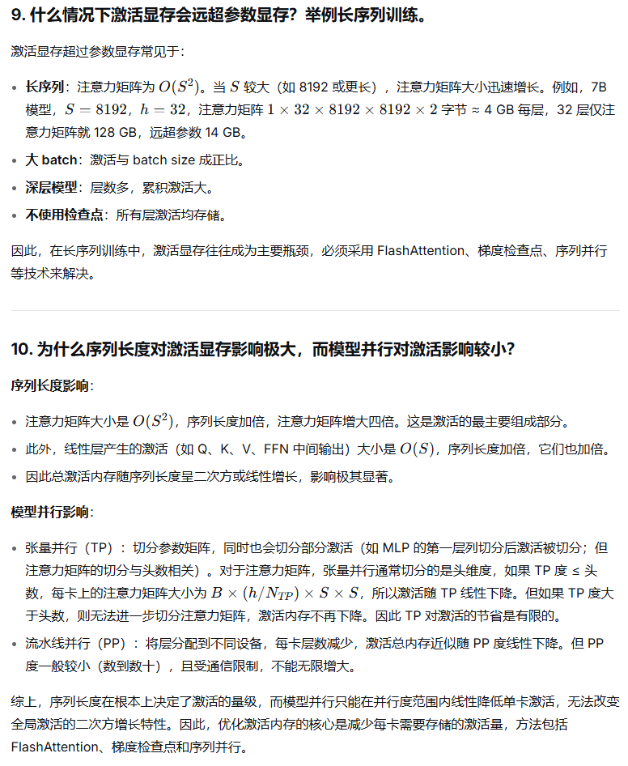{.ocr-src}

#### 编写一个简单的 Python 函数，根据配置估算模型内存占用（参数+优化器）

训练大模型时，通常需要快速估算模型状态（参数、梯度、优化器）的显存占用。以下函数支持 FP16/BF16 混合精度训练、Adam 优化器、以及 ZeRO‑1 优化器状态分片。

```python
def estimate_model_state_memory(num_params: int,
                                use_fp16: bool = True,
                                optimizer: str = "adam",
                                use_zero1: bool = False,
                                dp_world_size: int = 1) -> dict:
    """
    估算模型状态（参数、梯度、优化器）的显存占用（字节）。
    num_params: 模型参数量
    use_fp16: 是否使用 FP16 参数和梯度
    optimizer: 优化器类型，目前仅支持 "adam"
    use_zero1: 是否使用 ZeRO-1 优化器状态分片
    dp_world_size: ZeRO-1 对应的数据并行度
    返回：各部分字节数及总和
    """
    # 参数和梯度字节
    if use_fp16:
        param_bytes = 2 * num_params
        grad_bytes = 2 * num_params
    else:
        param_bytes = 4 * num_params
        grad_bytes = 4 * num_params

    # 优化器状态 (Adam)
    if optimizer.lower() == "adam":
        # FP32 主权重 (4) + 动量 m (4) + 动量 v (4)
        opt_bytes = 12 * num_params
    else:
        opt_bytes = 0

    # ZeRO‑1 分片优化器状态
    if use_zero1 and dp_world_size > 1:
        opt_bytes = opt_bytes // dp_world_size

    total = param_bytes + grad_bytes + opt_bytes
    return {
        "fp16_params": param_bytes,
        "fp16_grads": grad_bytes,
        "optimizer_states": opt_bytes,
        "total": total
    }

# 示例：7B 模型，8 卡数据并行，启用 ZeRO‑1
mem = estimate_model_state_memory(7_000_000_000,
                                  use_fp16=True,
                                  optimizer="adam",
                                  use_zero1=True,
                                  dp_world_size=8)
for k, v in mem.items():
    print(f"{k}: {v / 1e9:.2f} GB")
```

输出示例：

```plain text
fp16_params: 14.00 GB
fp16_grads: 14.00 GB
optimizer_states: 10.50 GB
total: 38.50 GB
```

注意：该函数仅估算模型状态，未包括激活内存、临时缓冲区和通信开销。激活内存需单独根据 batch size、序列长度、隐藏维度等计算（见第3题）。

---

#### 如何精确测算 PyTorch 训练中的显存分配和缓存？torch.cuda.memory_stats

PyTorch 提供了一套显存监控 API，位于 `torch.cuda` 模块。最常用的是：

- `torch.cuda.memory_allocated(device=None)`：返回当前被张量占用的显存字节数。

- `torch.cuda.max_memory_allocated(device=None)`：返回程序启动以来张量分配峰值的字节数。

- `torch.cuda.memory_reserved(device=None)`：返回 PyTorch 缓存分配器向 CUDA 申请的显存总量。由于缓存机制，此值通常 ≥ allocated。

- `torch.cuda.reset_peak_memory_stats(device=None)`：重置峰值统计。

- `torch.cuda.memory_stats(device=None)`：返回详细的显存使用字典，包括分配次数、释放次数、碎片信息等。

- `torch.cuda.memory_summary(device=None)`：以表格形式打印显存使用概览，包含各部件占用。

实际监控示例：在训练循环中插入显存监控，定位瓶颈。

```python
import torch

for step, batch in enumerate(train_loader):
    optimizer.zero_grad()
    loss = model(batch).loss
    loss.backward()
    optimizer.step()

    if step % 100 == 0:
        alloc = torch.cuda.memory_allocated() / 1e9
        reserv = torch.cuda.memory_reserved() / 1e9
        peak = torch.cuda.max_memory_allocated() / 1e9
        print(f"Step {step}: Allocated={alloc:.2f}GB, Reserved={reserv:.2f}GB, Peak={peak:.2f}GB")
        torch.cuda.reset_peak_memory_stats()  # 每100步重置峰值，观察短期波动
```

若要进一步细分显存来源（参数、梯度、激活等），可结合 PyTorch Profiler 或 Nsight Systems。`torch.profiler.profile` 可以记录每个算子的内存分配和释放时间线。

缓存分配器：PyTorch 使用 `caching_allocator`，它管理一个内存池，避免频繁调用 `cudaFree` 和 `cudaMalloc`。因此，即使张量被释放，`memory_reserved` 可能不会立即下降，但会被后续分配复用。这就是为什么 `empty_cache()` 可以强制清理缓存以释放显存到系统，但通常不需要手动调用。

**13. 说明 “memory fragmentation” 问题，以及 PyTorch 缓存分配器如何缓解**

**显存碎片化** 指显存中存在大量不连续的空闲小块，即使总空闲量足够，也无法分配出一个大的连续显存块。大模型训练中，张量尺寸差异大，频繁分配和释放容易导致碎片。

**PyTorch 缓存分配器** 通过以下机制缓解碎片：

1. **缓存池**：释放的张量显存不会立即归还给 CUDA，而是由分配器保留在内存池中，划分为不同大小的 block。后续申请显存时，优先从池中匹配。
2. **分割与合并**：当找不到完全匹配的 block 时，大 block 可以分割；当相邻 block 都空闲时，可以合并为大 block。分配器通过隐式链表管理这些 block。
3. **固定分配策略**：PyTorch 使用 `round_robin` 分配器，尽量减少外部碎片。但长期训练仍可能出现碎片，此时可通过 `torch.cuda.empty_cache()` 强制将所有缓存归还 CUDA，促使驱动层整理显存。
4. **张量生命周期管理**：及时释放不再需要的张量（例如用 `del tensor` 并调用 `empty_cache`）可以减少碎片。

**碎片对训练的影响**：当出现 OOM 但实际空闲显存够用时，往往是碎片导致。解决方法：减小 micro batch size、启用梯度检查点（降低激活内存）、使用更规整的张量形状、定期调用 `empty_cache()`。

**监控碎片**：`torch.cuda.memory_stats()` 返回的 `"active_bytes"` 和 `"reserved_bytes"` 可帮助判断。如果 reserved 远大于 active，且分配大张量失败，很可能是碎片。

---

**14. 通信缓冲区（如 All-Reduce 缓冲）对峰值显存的影响及估算**

分布式训练中，集合通信操作（如 All-Reduce、All-Gather、Reduce-Scatter）需要临时缓冲区来存储发送/接收的数据。这部分显存占用称为**通信缓冲区**。

**影响来源**：

- **数据并行梯度同步**：PyTorch DDP 将梯度分成多个桶 (bucket)，每次对一个桶进行 All-Reduce。桶的大小可通过 `bucket_cap_mb` 设置（默认 25MB）。因此，单个梯度桶的缓冲区通常为几十 MB。所有桶的通信串行进行，峰值缓冲区约为**最大桶大小**，而非全部梯度总和。
- **ZeRO-3 参数收集**：前向/反向时需要 All-Gather 完整参数，每个参数的 All-Gather 也需要缓冲区。通常通过设置 `allgather_bucket_size` 控制。若桶大小设为 500MB，则参数收集峰值缓冲约 500MB。
- **张量并行**：每个 Transformer 层的 All-Reduce 或 Reduce-Scatter 也会产生临时缓冲区。这部分通常与计算重叠，大小类似层内激活。

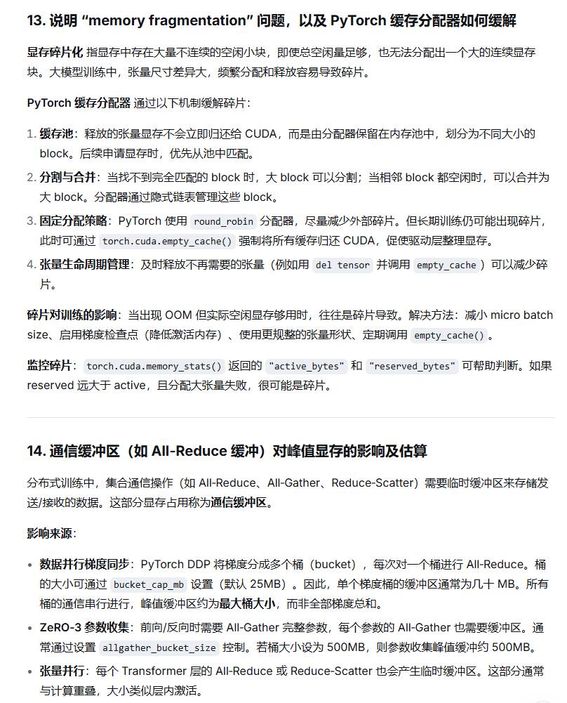{.ocr-src}

**估算公式**：

$$
M_{\mathrm{comm}} \approx \max(\text{gradient\_bucket\_size}, \text{param\_allgather\_bucket\_size}) + \text{其他小缓冲}
$$

**示例**：7B 模型，FP16 梯度总大小约 14GB。使用 DDP，桶大小设为 100MB，则梯度通信峰值缓冲约 100MB。若同时启用 ZeRO-3，参数 All-Gather 桶大小设为 200MB，则通信缓冲峰值约为 200MB。总体通信缓冲通常 **0.5~2 GB**，相对于上百 GB 的总显存占比很小，但在极限显存场景下仍需纳入考虑。

**减少通信缓冲的方法**：减小桶大小（增加通信次数但降低峰值）、使用通信与计算重叠、使用梯度压缩（如 PowerSGD）等。

---

**15. 混合精度下，显存占用的详细分解：fp16 param, fp16 grad, fp32 master param, fp32 opt states**

在标准的混合精度训练 (AMP) 中，显存占用主要包括以下四部分：

| 组件 | 精度 | 字节/参数 | 说明 |
| --- | --- | --- | --- |
| **FP16 参数** | FP16/BF16 | 2 | 用于前向和反向计算 |
| **FP16 梯度** | FP16/BF16 | 2 | 反向传播产生的梯度 |
| **FP32 主权重** | FP32 | 4 | 优化器更新所需的 FP32 参数副本 |
| **FP32 优化器状态** | FP32 | 8 | Adam 的一阶动量 $m$ (4) 和二阶动量 $v$ (4) |

**总模型状态字节**：$2 + 2 + 4 + 8 = 16$ 字节/参数。即模型状态 = $16 \times \Psi$ 字节，其中 $\Psi$ 为参数量。

**示例**：对于 1B 参数模型，模型状态 = $16 \times 10^9 = 16$ GB。对于 175B 模型，模型状态 = $16 \times 175 \times 10^9 = 2800$ GB，必须依赖并行和分片。

**额外说明**：

- 若使用纯 BF16 训练且优化器状态也采用 BF16（不推荐），可降至 $2 + 2 + 2 + 4 = 10$ 字节/参数，但收敛风险大。
- 混合精度训练中的 FP16 参数是通过 `autocast` 自动产生的，FP32 主权重通常不直接参与前向，而是在优化器步骤中更新后转换为 FP16。

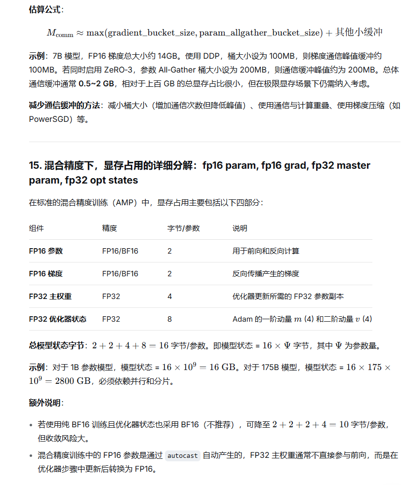{.ocr-src}

