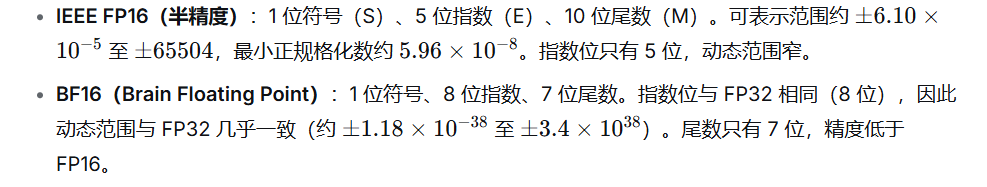
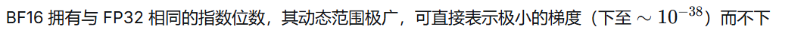
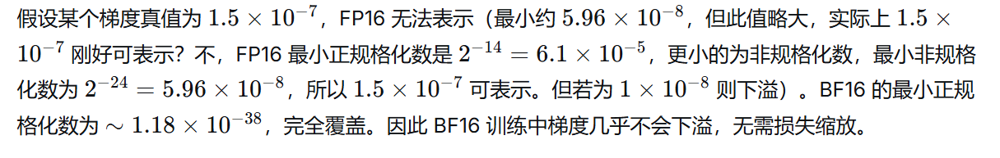
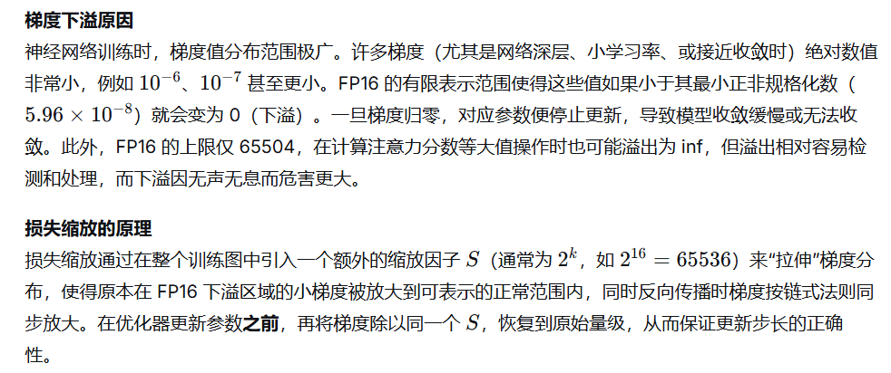
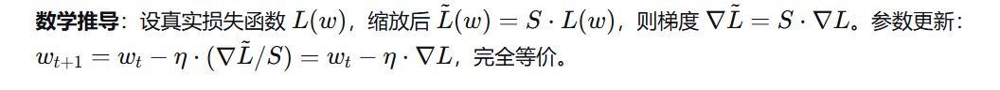
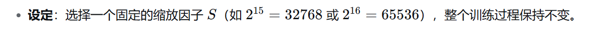
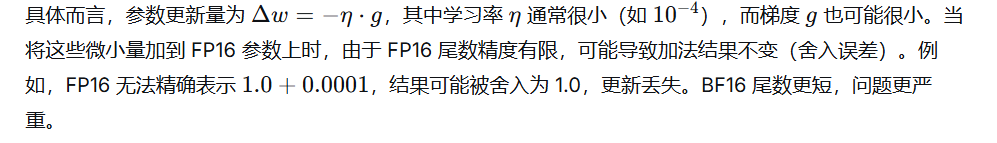
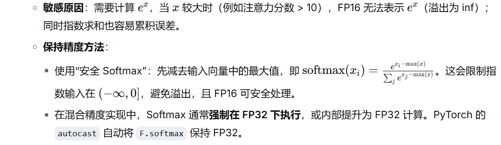
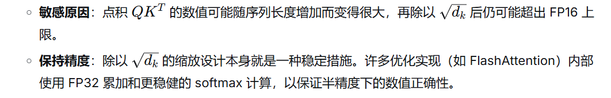
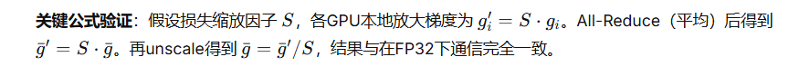

# 39.大模型（LLMs）混合精度训练（FP16/BF16, Loss Scaling）

#### 混合精度训练的核心动机：哪些部分低精度，哪些保持 FP32，为什么？

核心动机

混合精度训练（Mixed Precision Training）旨在在不降低模型最终准确率和收敛性的前提下，通过使用半精度浮点数（FP16 或 BF16）大幅减少显存占用、加速训练过程，并降低分布式训练中的通信带宽需求。现代 GPU（如 NVIDIA Volta、Ampere、Hopper 架构）配备了专门为半精度矩阵运算设计的 Tensor Cores，可在 FP16 或 BF16 下提供数倍于 FP32 的吞吐量。显存和通信带宽通常是训练大模型的瓶颈，因此混合精度是扩展模型规模的必备技术。

低精度部分（FP16 或 BF16）

1. 模型参数（Weights）：以半精度存储，用于前向和反向传播中的矩阵乘法。参数量大的模型（数十亿参数）显存减半收益巨大。

2. 激活值（Activations）：前向传播产生的中间张量以半精度存储和传递。激活通常占据训练显存的大部分（尤其长序列、大 batch），减半能显著降低显存压力，允许更大的 batch size 或更长的序列。

3. 梯度（Gradients）：反向传播计算的梯度同样以半精度存储。在数据并行训练中，梯度需要跨 GPU 进行 All-Reduce，通信量减半直接加速同步过程。

保持 FP32 的部分

1. 主权重副本（Master Weights）：优化器在更新参数时需要累加微小更新量（学习率 × 梯度）。FP16 的尾数精度（10 位）和 BF16 的尾数（7 位）对于累加小量时可能产生严重舍入误差，导致更新丢失。因此需保留一份 FP32 权重副本，优化器在 FP32 下更新，前向时再转换为半精度。

2. 优化器状态（Optimizer States）：如 Adam 的一阶动量 $m$、二阶动量 $v$ 等，这些状态需要高精度来稳定收敛，通常保持 FP32。

3. 精度敏感的算子：某些计算（如 softmax、LayerNorm、交叉熵损失）对数值范围或精度要求高，在半精度下容易溢出/下溢或产生较大偏差，因此通常在 FP32 下执行，或内部提升到 FP32 再输出半精度。

为什么这样设计

半精度带来的高速度和低内存是主要收益，但其有限的动态范围和精度需要 FP32 作为“安全网”。现代混合精度策略本质是“存算用半精度，关键状态和敏感计算用单精度”，通过精细管理二者，达到效率与准确性的平衡。

---

#### 对比 IEEE FP16 与 BF16 的存储格式，说明为何 BF16 无需损失缩放。

存储格式对比

- **IEEE FP16（半精度）**：1 位符号（S）、5 位指数（E）、10 位尾数（M）。可表示范围约 $\pm 6.10 \times 10^{-5}$ 至 $\pm 65504$，最小正规格化数约 $5.96 \times 10^{-8}$。指数位只有 5 位，动态范围窄。
- **BF16 (Brain Floating Point)**：1 位符号、8 位指数、7 位尾数。指数位与 FP32 相同（8 位），因此动态范围与 FP32 几乎一致（约 $\pm 1.18 \times 10^{-38}$ 至 $\pm 3.4 \times 10^{38}$）。尾数只有 7 位，精度低于 FP16。

{.ocr-src}

**为何 BF16 无需损失缩放**

FP16 训练中，很多梯度值（例如在 $10^{-6}$ 或更小）会低于其最小可表示正数，从而变为 0（下溢），导致

{.ocr-src}

参数无法更新。损失缩放通过将损失放大 S 倍，使得梯度同步放大，从而落入 FP16 可表示范围，更新前再除以 S 恢复。

BF16 拥有与 FP32 相同的指数位数，其动态范围极广，可直接表示极小的梯度（下至 $\sim 10^{-38}$）而不下

{.ocr-src}

溢，也能表示极大的值而不溢出。因此无需放大梯度，损失缩放成为多余。这不仅简化了训练代码，也消除了缩放因子选择不当带来的不稳定问题。

**数值示例**

假设某个梯度真值为 $1.5 \times 10^{-7}$，FP16 无法表示（最小约 $5.96 \times 10^{-8}$，但此值略大，实际上 $1.5 \times 10^{-7}$ 刚好可表示？不，FP16 最小正规格化数是 $2^{-14} = 6.1 \times 10^{-5}$，更小的为非规格数，最小非规格化数为 $2^{-24} = 5.96 \times 10^{-8}$，所以 $1.5 \times 10^{-7}$ 可表示。但若为 $1 \times 10^{-8}$ 则下溢）。BF16 的最小正规格化数为 $\sim 1.18 \times 10^{-38}$，完全覆盖。因此 BF16 训练中梯度几乎不会下溢，无需损失缩放。

{.ocr-src}

---

#### FP16 训练中梯度下溢问题产生的原因，以及损失缩放解决它的原理。

**梯度下溢原因**\
神经网络训练时，梯度值分布范围极广。许多梯度（尤其是网络深层、小学习率、或接近收敛时）绝对数值非常小，例如 $10^{-6}$、$10^{-7}$ 甚至更小。FP16 的有限表示范围使得这些值如果小于其最小正非规格化数（$5.96 \times 10^{-8}$）就会变为 0（下溢）。一旦梯度归零，对应参数便停止更新，导致模型收敛缓慢或无法收敛。此外，FP16 的上限仅 65504，在计算注意力分数等大值操作时也可能溢出为 inf，但溢出相对容易检测和处理，而下溢因无声无息而危害更大。

**损失缩放的原理**\
损失缩放通过在整个训练图中引入一个额外的缩放因子 $S$（通常为 $2^k$，如 $2^{16} = 65536$）来“拉伸”梯度分布，使得原本在 FP16 下溢区域的小梯度被放大到可表示的正常范围内，同时反向传播时梯度按链式法则同步放大。在优化器更新参数**之前**，再将梯度除以同一个 $S$，恢复到原始量级，从而保证更新步长的正确性。

{.ocr-src}

具体步骤：

1. 前向计算得到损失 $L$，计算缩放损失 L′=L×S。

2. 反向传播计算梯度 ∇′=∂L′/∂w，由于 $L$′ 放大了 S 倍，梯度也放大了 $S$ 倍。

3. 在 `optimizer.step()` 前，执行 `unscale`：∇=∇′/S，得到真实梯度的近似。

4. 用恢复的梯度更新参数。

通过这种方式，FP16 训练既能享受半精度的高效，又能避免梯度下溢。

**数学推导**：设真实损失函数 $L(w)$，缩放后 $\tilde{L}(w) = S \cdot L(w)$，则梯度 $\nabla \tilde{L} = S \cdot \nabla L$。参数更新：$w_{t+1} = w_t - \eta \cdot (\nabla \tilde{L}/S) = w_t - \eta \cdot \nabla L$，完全等价。

{.ocr-src}

---

#### 静态损失缩放与动态损失缩放的算法细节及自动调节策略。

静态损失缩放

- **设定**：选择一个固定的缩放因子 $S$（如 $2^{15} = 32768$ 或 $2^{16} = 65536$），整个训练过程保持不变。

{.ocr-src}

- 优点：实现简单，无额外开销。

- 缺点：$S$ 难以选取。太小可能无法充分防止下溢；太大则可能在网络某些阶段（如早期、大梯度处）导致梯度溢出为 inf/NaN，使训练失败。由于不同模型和训练阶段梯度分布变化很大，静态缩放通常不够鲁棒。

动态损失缩放\
动态缩放算法自动在训练过程中调整 $S$，以平衡下溢和溢出风险。核心机制是监控梯度是否出现 inf/NaN，并据此增大或减小缩放因子。\
算法细节（PyTorch GradScaler 默认）：

- 初始缩放因子：$S_0 = 2^{16}$。

{.ocr-src}

- 增长因子 α（growth_factor）：2.0。

- 回退因子 $β$（backoff_factor）：0.5。

- 增长间隔 $T$（growth_interval）：连续无溢出步数阈值，如 2000。

每步操作：

1. 前向：`with autocast(): loss = ...`

2. 反向：`scaler.scale(loss).backward()`

3. `scaler.step(optimizer)` 内部：
  - 检查梯度是否包含 inf/NaN。
  - 若无溢出：unscale 梯度，调用 `optimizer.step()`。
  - 若有溢出：跳过参数更新，并将当前步标记为溢出。

4. `scaler.update()`：
  - 如果本次 step 被跳过（溢出），则 S←max⁡(S×β,1)，并重置连续无溢出计数。
  - 如果没有溢出：连续无溢出计数 += 1。当计数达到 $T$ 时，S←S×α。

调节逻辑图解：

```plain text
if overflow:
    S *= backoff_factor (减小 S，避免再次溢出)
    skip update
else:
    update parameters
    consecutive_success += 1
    if consecutive_success >= growth_interval:
        S *= growth_factor (增大 S，尝试减少下溢)
        consecutive_success = 0
```

动态缩放能自动寻找一个安全的、尽可能大的缩放因子，从而最大化梯度保留，同时最小化溢出风险。

---

#### 在 PyTorch 中，如何使用 autocast 和 GradScaler 完成混合精度训练？

PyTorch 的 `torch.cuda.amp` 模块提供了开箱即用的混合精度训练支持。核心组件是 `autocast` 和 `GradScaler`。

完整代码示例：

```python
import torch
from torch.cuda.amp import autocast, GradScaler

model = MyModel().cuda()
optimizer = torch.optim.AdamW(model.parameters(), lr=1e-4)
scaler = GradScaler()  # 动态损失缩放

for batch_data, batch_target in dataloader:
    optimizer.zero_grad()

    # 1. 前向传播：autocast 自动选择精度
    with autocast():
        output = model(batch_data)
        loss = loss_fn(output, batch_target)

    # 2. 反向传播：损失缩放
    scaler.scale(loss).backward()

    # 3. 可选：梯度裁剪（需先 unscale）
    scaler.unscale_(optimizer)
    torch.nn.utils.clip_grad_norm_(model.parameters(), max_norm=1.0)

    # 4. 参数更新：自动检查 inf/NaN，unscale 并 step
    scaler.step(optimizer)

    # 5. 更新缩放因子
    scaler.update()
```

工作原理详解：

- `autocast()`：上下文管理器，在进入时将 CUDA 前向传播中的适用算子（如 `nn.Linear`, `nn.Conv2d`, `torch.matmul` 等）自动转换为 FP16 执行，同时将数值敏感算子（如 `softmax`, `layer_norm`, `cross_entropy` 等）保持为 FP32。用户无需手动修改模型代码。

- `GradScaler`：
  - `scale(loss).backward()`：将损失乘以当前缩放因子，产生放大梯度。
  - `unscale_(optimizer)`：将优化器状态中存储的放大梯度除以缩放因子，恢复真实尺度。
  - `step(optimizer)`：检查所有参数的梯度是否包含 inf/NaN。若无，则调用 `optimizer.step()`；若有，跳过更新。
  - `update()`：根据本次是否发生溢出，按前述规则调整缩放因子。

关键注意事项：

- 梯度裁剪必须在 `unscale_` 之后进行，否则裁剪的是放大后的梯度，导致裁剪阈值失效。

- 如果有多个优化器，需要分别创建 `GradScaler`（通常一个足够）或为每个优化器单独管理。

- BF16 训练可直接使用 `autocast(dtype=torch.bfloat16)` 而不需要 `GradScaler`。

---

#### 混合精度下，为什么需要保留 FP32 的主权重副本？更新过程图示。

原因

模型参数存储为半精度（FP16/BF16）以节省显存和加速计算，但优化器更新时的数值累加需要高精度来避免舍入误差。

具体而言，参数更新量为 $\Delta w = -\eta \cdot g$，其中学习率 $\eta$ 通常很小（如 $10^{-4}$），而梯度 $g$ 也可能很小。当将这些微小量加到 FP16 参数上时，由于 FP16 尾数精度有限，可能导致加法结果不变（舍入误差）。例如，FP16 无法精确表示 $1.0 + 0.0001$，结果可能被舍入为 1.0，更新丢失。BF16 尾数更短，问题更严重。

{.ocr-src}

因此，训练时额外保留一份 FP32 主权重副本（Master Weights）。优化器在 FP32 精度下累积梯度、更新主权重，前向传播前再将主权重转换为半精度。这样既保证了更新准确性，又维持了前向/反向的效率。

更新过程图示：

```plain text
初始：FP32 Master Weight (W_master)
         │
         │ (cast to FP16)
         ↓
      FP16 Weight (W_fp16)  ←── 用于前向/反向计算
         │
         ↓
      计算 Loss，反向传播得到 FP16 梯度 (g_fp16)
         │
         ↓ (GradScaler.unscale，若使用)
      FP32 梯度 (g_fp32) = g_fp16 / scale
         │
         ↓
更新 W_master:  W_master ← W_master - η * g_fp32   (FP32 运算)
         │
         ↓ (cast to FP16 for next iteration)
      FP16 Weight = W_master (截断)
```

对 BF16 训练：同样需要 FP32 主权重，因为 BF16 尾数精度低，小更新累积同样会丢失。所以 FP32 主权重是混合精度训练的标配。

---

#### 动态损失缩放检测到梯度溢出（inf/NaN）后如何处理？缩放因子调整逻辑。

当 `GradScaler` 在 `step(optimizer)` 时检测到任何参数的 `.grad` 中包含 inf 或 NaN 时，表明本次迭代的缩放因子过大，导致梯度被放大后超出了 FP16 的表示上限（溢出）。

处理流程：

1. 跳过本次参数更新：`scaler.step(optimizer)` 内部不执行 `optimizer.step()`，模型参数保持不变。这防止了无效梯度对模型的破坏。

2. 降低缩放因子：调用 `scaler.update()` 时，将缩放因子乘以回退因子（默认 0.5），使其减小。新的缩放因子用于下一次迭代，以减少溢出概率。

3. 重置连续成功计数：将无溢出步数计数器清零，避免立即又增大缩放因子。

4. 梯度不会被 unscale 也不会用于更新：被污染的梯度直接丢弃，确保不会影响模型状态。

缩放因子调整逻辑（PyTorch 默认）：

- 初始 $S = 2^{16}$。

{.ocr-src}

- 每次 `update()`：
  - 若本次 step 被跳过（溢出），S←max⁡(S×0.5,1)，连续成功计数 = 0。
  - 若未跳过，连续成功计数 += 1。当计数达到 `growth_interval`（默认 2000）时，S←S×2.0，连续成功计数 = 0。

溢出检测机制：`GradScaler` 通过检查每个参数梯度的 `torch.isnan(grad).any()` 或 `torch.isinf(grad).any()` 来判定溢出。如果任一张量存在 inf/NaN，则整体视为溢出。

工程实践：

- 若频繁溢出，说明初始缩放因子或增长因子过大，可适当降低初始 S 或减小增长因子，或延长增长间隔。

- 损失缩放因子通常保持在 $10^3 \sim 10^5$ 之间。对于某些非常深的网络，溢出可能集中在特定层，此时可以考虑分层损失缩放（不常用）。

{.ocr-src}

---

#### BF16 训练相对于 FP32 减少的显存和带宽，理论计算。

显存占用分析\
假设模型参数量为 Ψ，不使用混合精度时，FP32 训练存储：参数（FP32）、梯度（FP32）、优化器状态（FP32）。Adam 优化器状态包括一阶动量 $m$、二阶动量 $v$，各 Ψ 个 FP32 数字。总显存 ≈ 4Ψ+4Ψ+4Ψ×2=16Ψ 字节（忽略激活）。

BF16 混合精度训练（含 FP32 主权重）：

- 模型参数：BF16 存储，2Ψ 字节。

- FP32 主权重（优化器更新用）：4Ψ 字节。

- 梯度：BF16 存储，2Ψ 字节。

- 优化器状态（动量 m, v）：保持 FP32，各 4Ψ 字节，共 8Ψ 字节。\
  总显存 ≈ 2Ψ+4Ψ+2Ψ+8Ψ=16Ψ字节。咦，这似乎与 FP32 相同？实际上，上述计算中，主权重和优化器状态占了 12Ψ 字节，参数和梯度节省的 4Ψ 字节被主权重抵消了一部分。然而，关键节省在于激活显存。激活通常存储为 BF16，减半。假设激活内存占总显存的很大比例（如 50%），则总节省仍相当可观。若模型不使用 FP32 主权重（即直接 BF16 更新，但这通常会导致收敛问题，实际很少这样做），则总显存可降至 2Ψ+2Ψ+8Ψ=12Ψ 字节，节省 25%。实际上，更常见的配置是使用 ZeRO 分片优化器状态，进一步降低显存。

带宽节省：

- 通信：梯度 All-Reduce 的数据量从 FP32 的 4Ψ 字节降为 BF16 的 2Ψ 字节，通信时间减半。

- 内存带宽：参数和激活的读写量减半，对带宽受限的矩阵乘法等算子，吞吐量可提升至接近 2 倍。

理论加速比：假设计算强度足够，BF16 Tensor Core 的吞吐通常是 FP32 的 2~8 倍。因此端到端训练速度可提升 30%~100%，具体取决于模型和硬件。

注意：BF16 训练通常无需损失缩放，也免去了动态调整的额外开销。

---

#### 在 Transformer 中，哪些算子对精度敏感（如 softmax, layer norm），通常如何保持精度？

Transformer 模型中，以下算子对数值精度非常敏感，若在半精度下简单执行，容易导致训练不稳定或精度损失：

1. Softmax

- **敏感原因**：需要计算 $e^x$，当 $x$ 较大时（例如注意力分数 > 10），FP16 无法表示 $e^x$（溢出为 inf）；同时指数求和也容易累积误差。
- **保持精度方法**：
  - 使用“安全 Softmax”：先减去输入向量中的最大值，即 $\mathrm{softmax}(x_i) = \frac{e^{x_i - \max(x)}}{\sum_j e^{x_j - \max(x)}}$。这会限制指数输入在 $(-\infty, 0]$，避免溢出，且 FP16 可安全处理。
  - 在混合精度实现中，Softmax 通常**强制在 FP32 下执行**，或内部提升为 FP32 计算。PyTorch 的 `autocast` 自动将 `F.softmax` 保持 FP32。

{.ocr-src}

2. Layer Normalization / RMSNorm
  - 敏感原因：需要计算均值和方差（或均方根）。在 FP16 下，平方和容易溢出，且减去均值时的对齐操作可能丢失精度，导致归一化效果变差。
  - 保持精度：通常 LayerNorm 内部计算全部使用 FP32，输入和输出可以是 FP16。`autocast` 也会自动处理，将 `nn.LayerNorm` 强制以 FP32 运行。

3. 注意力分数计算

- **敏感原因**：点积 $QK^T$ 的数值可能随序列长度增加而变得很大，再除以 $\sqrt{d_k}$ 后仍可能超出 FP16 上限。
- **保持精度**：除以 $\sqrt{d_k}$ 的缩放设计本身就是一种稳定措施。许多优化实现（如 FlashAttention）内部使用 FP32 累加和更稳健的 softmax 计算，以保证半精度下的数值正确性。

{.ocr-src}

4. 损失函数（CrossEntropy）
  - 敏感原因：交叉熵涉及 log 计算，对预测概率的微小变化敏感，FP16 下概率可能因舍入而失真，导致梯度不准确。
  - 保持精度：损失函数通常在 FP32 下计算。`autocast` 默认将 `nn.CrossEntropyLoss` 保持 FP32。

5. 累计操作
  - 如梯度累积、动量更新等，这些操作需要高精度以防止累积误差，均在 FP32 下进行。

PyTorch autocast 的自动策略：`torch.cuda.amp` 维护了一个自动提升列表，包含上述敏感算子，在 `autocast` 上下文中自动将它们提升到 FP32。对于自定义算子，可以通过 `torch.cuda.amp.custom_fwd` 等装饰器控制精度。开发者通常无需手动修改，但若遇到数值不稳定（如 loss NaN），应检查是否有未覆盖的自定义操作，或尝试强制某些层使用 FP32。

---

#### 混合精度训练对收敛的影响：实证上是否与全精度一致？有何反例？

实证一致性

在主流视觉模型（ResNet、ViT）和语言模型（BERT、GPT）中，FP16混合精度训练（含损失缩放和FP32主权重） 的收敛曲线和最终准确率与 FP32全精度基线几乎完全重合。这是经过NVIDIA论文（Mixed Precision Training, ICLR 2018）以及工业界大规模实践反复验证的结论。混合精度不仅不损害收敛性，甚至因为能使用更大的batch size或加速训练，有时会略微提升最终泛化能力。

反例与风险场景

并非所有情况都绝对安全，以下场景可能出问题：

- 极小学习率或极深网络：梯度绝对值极小（如 10−810−8 量级），即使损失缩放也可能无法完全避免下溢，导致某些层更新停滞，收敛变慢。

- 对梯度尺度敏感的算法：例如强化学习中的策略梯度，其梯度分布高度动态且噪声大，固定的缩放因子可能导致部分梯度溢出、部分下溢，破坏信噪比。

- 自定义操作未适配：用户实现的CUDA内核、复杂损失函数如果未正确处理半精度，可能产生数值错误，导致发散。

- 需要高精度的物理仿真：如PINN（物理信息神经网络），高阶导数的精度损失可能导致物理约束失效。

- FP16下某些操作的不稳定性：如 `torch.rsqrt`、`torch.pow` 等，在FP16下容易产生较大相对误差，累积后可能影响收敛。

缓解措施：动态损失缩放、将敏感操作强制FP32、使用BF16替代FP16（动态范围大）、启用梯度检查点时的精度验证，均可将不一致风险降至极低。总体而言，反例多为特定领域或配置不当所致，常规任务中混合精度收敛性与全精度一致是常态。

---

#### 分布式环境下，损失缩放梯度如何同步？应在 unscaling 前还是后 all‑reduce？

正确顺序：在 unscaling 前进行 all‑reduce，在 all‑reduce 后再 unscaling。

原因在于FP16的有限动态范围。如果先unscale，梯度值恢复到真实尺度（往往很小），在跨GPU做All-Reduce时，这些小值在FP16通信中容易下溢为0，丢失信息。损失缩放正是为了解决这个问题：将梯度放大到安全范围后再进行通信，从而保留梯度精度。因此，All-Reduce必须在放大后的梯度上进行。

在PyTorch的DDP（DistributedDataParallel）中，`backward()` 调用之后，DDP会自动触发All-Reduce，同步所有GPU的 `.grad` 字段。当与 `GradScaler` 配合时，`scaler.scale(loss).backward()` 产生的梯度已经是放大后的，DDP在此时进行All-Reduce，通信完毕后再由 `scaler.unscale_(optimizer)` 恢复。整个过程自然满足正确顺序，无需手动干预。

如果自行实现通信（例如使用 `torch.distributed.all_reduce`），必须在 `unscale` 之前调用 `all_reduce`，并确保通信数据类型能容纳放大后的数值。

**关键公式验证**：假设损失缩放因子 $S$，各GPU本地放大梯度为 $g_i' = S \cdot g_i$。All-Reduce（平均）后得到 $\bar{g}' = S \cdot \bar{g}$。再unscale得到 $\bar{g} = \bar{g}'/S$，结果与在FP32下通信完全一致。

{.ocr-src}

---

#### 使用梯度累积时，损失缩放应如何在微批次中应用？

梯度累积通过多个micro-batch的前向/反向累积梯度，模拟大batch效果。在混合精度下，关键在于：

- 缩放因子在一个mini-batch内保持不变：所有micro-batch的反向均使用同一个当前缩放因子 $S$。每个micro-batch的损失都经过 `scaler.scale(loss)` 放大，然后 `backward()` 累积放大后的梯度。

- 仅在所有micro-batch完成后更新参数：不能在每个micro-batch后调用 `scaler.step(optimizer)`，那会导致多次更新，违背梯度累积的初衷。正确的流程是：累积所有micro-batch的放大梯度后，调用 `scaler.unscale_(optimizer)` 恢复真实梯度，再执行 `scaler.step(optimizer)`，最后 `scaler.update()` 调整缩放因子。

- 损失需要按累积步数缩放：通常我们会将每个micro-batch的损失除以累积步数，以保持数学等价。由于损失被除以累积步数，其放大后的梯度也会相应缩小，但这不影响缩放因子的有效性——只要统一操作即可。

代码示例：

```python
scaler = GradScaler()
for micro in data:
    with autocast():
        loss = model(micro) / accum_steps
    scaler.scale(loss).backward()   # 累积放大梯度
scaler.unscale_(optimizer)
scaler.step(optimizer)
scaler.update()
optimizer.zero_grad()
```

注意不要在每个micro-batch后调用 `scaler.update()`，否则缩放因子会在同一个mini-batch内变化，破坏一致性。

---

#### NVIDIA apex 中的混合精度实现与 PyTorch amp 的区别。

apex (NVIDIA) 是早期的混合精度训练库，提供了多级优化选项 (opt_level)：

- O0: 纯FP32。

- O1: 自动混合精度，自动将大部分计算转为FP16，仅少数敏感操作保持FP32。

- O2: 更激进的FP16，甚至BatchNorm等也转为FP16，需要更精细的损失缩放。

- O3: 纯FP16，极易不稳定。

apex 会直接修改模型和优化器（`amp.initialize`），对训练代码侵入性较强。其优点是性能优化较极致，但维护已停滞，且不原生支持BF16。

PyTorch AMP (torch.cuda.amp) 是官方集成方案，通过 `autocast` 上下文和 `GradScaler` 实现非侵入式混合精度。模型和优化器无需修改，仅需包裹训练代码。其算子覆盖全面，自动提升敏感操作，并且良好支持BF16（只需 `dtype=torch.bfloat16`）。PyTorch AMP 已成为目前主流，生态集成度更高（DDP、FSDP、DeepSpeed等均原生配合）。

核心区别：apex 需要初始化并替代模型/优化器，PyTorch AMP 只影响前向和反向的局部作用域。开发新项目应优先选用PyTorch AMP。

---

#### BF16 训练需要修改模型代码吗？哪些硬件支持 BF16？

代码修改：几乎不需要。只需在训练循环中使用 `torch.cuda.amp.autocast(dtype=torch.bfloat16)` 包裹前向传播即可。大部分PyTorch算子已原生支持BF16，敏感操作（如Softmax、LayerNorm）会自动提升到FP32。无需 `GradScaler`，因为BF16动态范围极大，基本不溢出/下溢。但需注意：自定义CUDA内核需要显式添加BF16支持，否则会报错；一些旧代码可能使用了仅支持FP32/FP16的操作。

硬件支持：

- NVIDIA GPU：Ampere架构及以后（A100, A6000, RTX 3090, H100）支持BF16 Tensor Core加速。

- Intel：Sapphire Rapids Xeon (第四代至强) 通过AVX-512_BF16和AMX支持BF16；Habana Gaudi系列也支持。

- AMD：Instinct MI250等CDNA2架构GPU支持BF16。

- Google TPU：v2/v3/v4/v5，BF16是其原生精度。

- 因此，BF16已成为跨平台低精度训练的通用格式。

---

#### 为什么纯 BF16 训练（包括优化器状态）逐渐成为趋势？分析数值稳定性。

传统混合精度训练即使使用BF16，仍保留FP32的主权重和优化器状态（动量、方差）。纯BF16训练 则将所有状态也存储为BF16，包括参数、梯度、Adam的 $m$ 和 $v$。

趋势原因：

- 极致显存节省：优化器状态通常占模型总显存的很大比例（Adam: 8字节/参数），转为BF16后减半，可大幅降低显存需求，支持更大模型或batch。

- 简化实现：无需维护FP32副本，减少内存复制和计算开销。

- 硬件友好：统一低精度减少类型转换，提高Tensor Core利用率。

数值稳定性分析：

BF16的7位尾数精度较低，直接用于累积动量可能导致更新丢失。为保持稳定性，业界提出了几种技术：

- 更新缩放（Update Scaling）：类似损失缩放，将参数更新量放大后再累加到BF16参数上，最后在读取时缩放回来。

- 随机舍入：累加时采用随机舍入而不是截断，无偏地保留小量信息。

- 自适应优化器：如AdaFactor、LAMB等对精度不那么敏感。一些工作表明，即使标准Adam，在适当缩放和随机舍入下，纯BF16训练也能达到与混合精度一致的收敛性。

因此，纯BF16训练正在被更广泛地探索和采用，特别是在需要极致内存节省的超大模型训练中。

---

#### 如何监控训练过程中的梯度下溢/溢出？PyTorch 提供哪些日志工具？

监控方法：

- GradScaler内置日志：创建 `GradScaler(verbose=True)`，会在每次因溢出跳过更新时打印警告，包括缩放因子的变化。

- 手动检测：在 `scaler.unscale_(optimizer)` 之后，遍历参数梯度，用 `torch.isnan(grad).any()` 和 `torch.isinf(grad).any()` 统计溢出比例，记录到TensorBoard等监控平台。

- 梯度范数：记录每个step的全局梯度范数（unscale后），如果突然飙升或归零，可能指示溢出/下溢。

- 钩子：注册 `backward_hook` 来捕获每层的梯度，检测异常。

PyTorch 日志工具：

- `torch.autograd.set_detect_anomaly(True)`：当反向传播产生NaN时，会抛出异常并打印堆栈，但性能开销大，仅调试用。

- `torch.cuda.memory_stats()` 等不直接监控梯度，但可辅助分析。

- TensorBoard `SummaryWriter`：可记录 `scaler.get_scale()`、损失、梯度范数等时序数据，便于可视化追踪。

- 结合 `torch.profiler` 可以观察各算子的数值行为。

实践建议：通常依赖 `GradScaler` 的自动处理，同时用TensorBoard绘制缩放因子曲线。若缩放因子频繁被回退，说明溢出严重，需调整初始缩放因子或增长间隔。

---

#### 跨加速器（GPU、TPU）的混合精度特性差异及注意事项。

GPU (NVIDIA CUDA)：

- 支持FP16和BF16（Ampere+）。

- FP16需配合损失缩放；BF16一般不需要。

- Tensor Cores提供半精度吞吐加速。

- PyTorch AMP、apex、DeepSpeed等多种实现可选。

- 注意：某些操作（如 `torch.sqrt`、`torch.exp`）在FP16下精度有限，autocast通常会自动提升到FP32，但自定义操作需手动验证。

TPU (Google)：

- 以BF16为默认低精度格式，MXU（矩阵乘法单元）专为BF16优化。

- 基本不需要损失缩放（BF16动态范围大）。

- 使用 `tf.keras.mixed_precision`（TensorFlow）或 `jax.lax` 的相关API。

- TPU对动态形状和张量维度限制较严格；部分激活函数在BF16下精度不足时，TPU可能有内置的高精度实现。

- 通信：TPU pod 之间的梯度同步也以BF16进行，高效且稳定。

注意事项：

- 跨平台迁移时，首选BF16以减少精度差异。

- 训练脚本中与精度相关的超参（如损失缩放、初始值）可能需要调整。

- 检查模型中的自定义层是否在目标硬件上支持低精度。

---

#### 混合精度结合梯度检查点时，激活存储精度如何影响内存和计算。

梯度检查点通过仅保存部分层的激活，在反向时重计算其余激活，来减少显存占用。在混合精度下：

- 激活存储精度：通常与计算精度一致，即FP16或BF16。因此，每个被保存的检查点张量，其内存占用是FP32的一半。这进一步降低了显存峰值，使得在同样内存预算下可以保存更多检查点（从而减少重计算量）或支持更大batch。

- 重计算的计算精度：重计算时，前向使用半精度权重和半精度输入，计算速度比FP32快（Tensor Cores加速）。虽然重计算增加了FLOPs，但减少的显存允许更大的并行度，总体上往往能提升吞吐量。

- 数值影响：重计算在半精度下进行，由于舍入误差，重计算出的激活可能与原始前向的激活有微小差异，但实际训练中这种差异几乎不影响收敛。若需严格一致，可以强制重计算部分使用FP32，但会增加开销，不推荐。

配置建议：通常在Transformer中，对每个Transformer块应用检查点，存储其输入（半精度），重计算时利用高效注意力（如FlashAttention）进一步提升速度。

---

#### 在 ZeRO 或 FSDP 中使用混合精度，有哪些额外配置？

DeepSpeed ZeRO：

- 配置文件：设置 `"fp16": {"enabled": true, "loss_scale": 0, "initial_scale_power": 16}` 来启用FP16混合精度，并配置动态损失缩放。

- BF16：设置 `"bf16": {"enabled": true}`。

- 通信：ZeRO自动处理梯度分片和All-Reduce，与损失缩放配合。缩放因子在所有数据并行rank间自动同步（通常通过all-reduce维持一致）。

- 卸载（Offload）：若使用ZeRO-Offload，优化器状态在CPU上通常以FP32存储，GPU端参数/梯度可以是半精度。

- 注意：混合精度下的梯度裁剪必须在unscale之后进行，ZeRO的优化器step已经内部处理。

PyTorch FSDP：

- 通过 `MixedPrecision` 类指定参数、梯度、通信的精度，例如 `MixedPrecision(param_dtype=torch.float16, reduce_dtype=torch.float16)`。

- 前向时使用 `autocast`，损失缩放用 `GradScaler`（与DDP类似）。

- FSDP的 `no_sync()` 上下文管理器用于梯度累积，与 `GradScaler` 配合无误。

- 保存检查点：需要保存FP32主权重，以便恢复训练。可使用 `FullyShardedDataParallel.state_dict()` 配合分布式检查点。

共同原则：确保通信发生在放大梯度上，参数更新在unscale后，缩放因子全局同步。

---

#### 从硬件 Tensor Core 角度解释 FP16/BF16 的吞吐提升机制。

NVIDIA Volta 及后续架构引入了 Tensor Cores，专为矩阵乘加运算设计。单个 Tensor Core 每时钟周期可执行 D=A×B+C运算，其中 $A$ 和 B 是半精度矩阵（FP16 或 BF16），$C$ 和 $D$ 可以是半精度或单精度。

吞吐提升机制：

- 并行度：Tensor Core 在一个时钟内处理 4x4 小块矩阵，同时进行数十次乘加运算。FP16/BF16 数据位宽仅为 FP32 的一半，因此在相同的寄存器和带宽资源下，可以打包更多数据，大幅提高计算密度。例如 A100 的 FP16 Tensor Core 吞吐为 312 TFLOPS，而 FP32 仅为 19.5 TFLOPS（标准核心），差距达 16 倍。

- 混合精度累加：矩阵乘法内部结果通常以 FP32 累加，避免精度损失，输出再转为半精度。这样既获得了半精度的高吞吐，又保持了关键计算的精度。

- BF16 的特殊性：BF16 与 FP32 指数位宽相同，两者转换极为简单（直接截断或填充尾数），硬件实现成本低。Tensor Core 在处理 BF16 时同样高效。

- 内存带宽节省：半精度张量占用更少的显存带宽，减少了数据搬运时间，使得计算单元更少闲置，进一步提升实际吞吐。

因此，混合精度训练能充分利用 Tensor Core，实现数倍于 FP32 的浮点运算速度，这是其加速的最根本硬件基础。

---

#### 损失缩放因子过大导致大量梯度溢出的表现及调整方法。

表现：

- 训练日志中频繁出现 `GradScaler` 的跳过更新（skip update）警告。

- 缩放因子曲线呈现“锯齿状”：每次增大后立即因溢出被砍半，无法稳定增长。

- 损失值出现突刺或变为 NaN。

- 梯度范数在溢出步变为 NaN 或无穷大。

- 模型参数可能因部分更新被跳过而无法有效学习，收敛停滞。

调整方法：

- **减小初始缩放因子**：例如从 $2^{16}$ 降低到 $2^{12}$ 或 $2^{10}$。

{.ocr-src}

- 降低增长因子：将 `growth_factor` 从 2.0 减小到 1.5 或 1.2，使得缩放因子更缓慢地增大，减少溢出风险。

- 延长增长间隔：增加 `growth_interval`，例如从 2000 步增加到 5000 步，让模型在更稳定的阶段才尝试增大缩放因子。

- 手动设置静态缩放：如果动态调整仍不稳定，可通过实验找到一个固定的安全缩放因子，切换为静态缩放。

- 检查模型初始化：过大的权重初始化可能导致前向激活和梯度异常大，改善初始化可降低溢出频率。

- 使用 BF16：如果硬件支持，切换到 BF16 可从根源消除损失缩放的需求，彻底避免此类问题。

- 调整学习率：过大的学习率会导致参数更新剧烈，间接增大梯度，适当降低学习率可缓解。

最佳实践：在训练初期密切监控缩放因子和溢出频率，通过调整上述参数，使得缩放因子能够在一定步数后稳定在一个较高水平，且溢出步数占比低于 1%。这通常是训练健康的重要标志。

