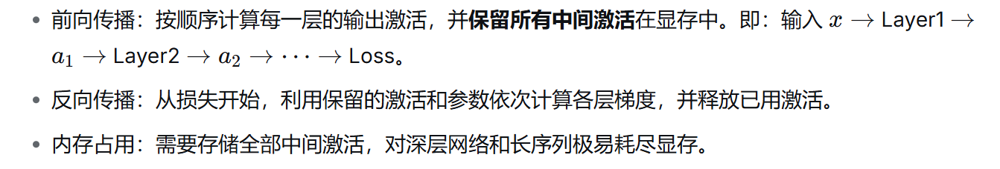
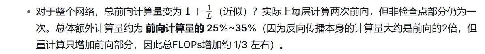
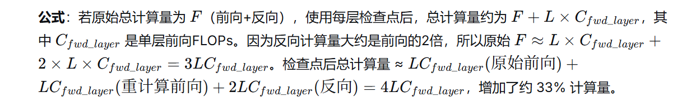
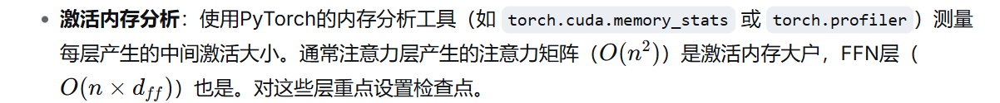
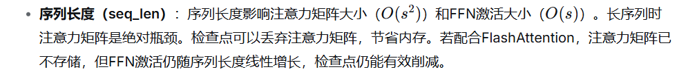
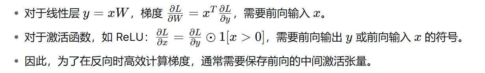
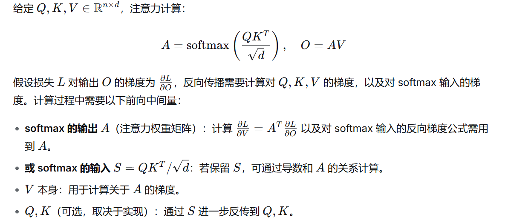
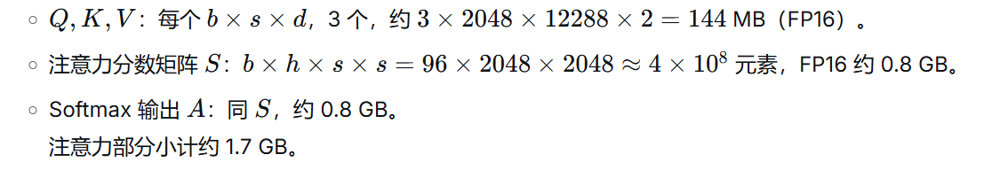
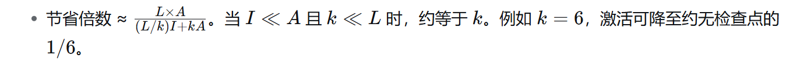
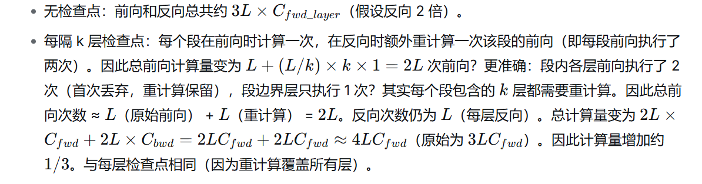

# 40.大模型（LLMs）梯度检查点（Gradient Checkpointing）

#### 画出正常反向传播和梯度检查点模式下前向/反向执行图，说明重计算机制。

**正常反向传播模式**

- 前向传播：按顺序计算每一层的输出激活，并**保留所有中间激活**在显存中。即：输入 $x$ → Layer1 → $a_1$ → Layer2 → $a_2$ → $\cdots$ → Loss。
- 反向传播：从损失开始，利用保留的激活和参数依次计算各层梯度，并释放已用激活。
- 内存占用：需要存储全部中间激活，对深层网络和长序列极易耗尽显存。

{.ocr-src}

梯度检查点模式

- 将网络划分为若干段（checkpoint segments）。在标准实现中，每个段作为检查点运行。

- 前向传播：
  1. 对于检查点段，正常计算该段输出，但不保存该段内部各层的中间激活（即不保留计算图中间张量）。仅保存该段的输入张量（即从此段开始的输入）以及与该段无关的其他状态。
  2. 对于非检查点段（通常是将整个模型划分为多个段，每个段可以是单个Transformer层或多层），则按正常模式保留中间激活。

- 反向传播：
  1. 当反向传播到达一个检查点段的输出时，由于该段内部的中间激活未被保存，需要重新计算该段的前向传播来获得所需的中间激活。
  2. 使用保存的该段输入，重新执行该段的前向计算（这次需要保留中间激活），然后再执行反向传播计算该段的参数梯度。
  3. 之后，即可丢弃这些重新计算的激活，继续反向到前一个检查点段。

- 执行图示意（以两个检查点段为例）：

```plain text
Forward:
  x -> [Segment 1] -> a1 (只保存a1, 内部不保留) -> [Segment 2] -> loss
Backward:
  loss grad -> Segment 2: 需要内部激活 -> 用保存的a1重计算Segment 2前向，保留中间，然后反向传播得梯度，释放
            -> Segment 1: 用输入x重计算Segment 1前向，保留中间，反向传播得梯度，释放
```

- 重计算机制实质是“牺牲计算，节省内存”。每个检查点段被计算两次：一次在前向（不保留中间），一次在反向时重计算（保留中间用于梯度计算）。

---

#### 使用 torch.utils.checkpoint 实现梯度检查点的基本代码模式。

PyTorch提供了 `torch.utils.checkpoint.checkpoint` 函数来实现检查点功能。基本模式：

```python
import torch
from torch.utils.checkpoint import checkpoint

class TransformerBlock(nn.Module):
    def __init__(self, ...):
        # 定义注意力层、FFN等
        ...

    def forward(self, x):
        # x: 输入张量
        # 使用checkpoint包裹需要重计算的部分
        # 注意：checkpoint内不能有需要保存状态的dropout等（或需设置preserve_rng_state=False）
        return checkpoint(self._forward_impl, x, use_reentrant=False)

    def _forward_impl(self, x):
        # 实际的前向计算：注意力、残差、FFN等
        attn_out = self.attn(self.ln1(x))
        x = x + attn_out
        ffn_out = self.ffn(self.ln2(x))
        x = x + ffn_out
        return x
```

关键点：

- `checkpoint(func, *args, use_reentrant=False)` 会将func和args打包。前向时，func被执行，但中间激活不被保留（通过torch.no_grad？实际上内部使用了自定义autograd函数，前向时不保存中间结果，反向时重新运行func）。

- 使用 `use_reentrant=False` 是推荐的新版本用法，更安全且支持更多场景。

- 若模块内有Dropout等非确定性操作，需要设置 `preserve_rng_state=True`（默认）以便重计算时恢复相同的随机状态，保证两次前向结果一致。但注意，开启此选项会增加少量显存和时间开销。如果不需要精确一致（如推理时），可设为False。

- 检查点可以嵌套在多个层级，但通常每个Transformer块作为一个检查点单位。

完整训练循环示例：

```python
model = MyTransformer()
optimizer = torch.optim.Adam(model.parameters())
for data, target in dataloader:
    optimizer.zero_grad()
    output = model(data)
    loss = criterion(output, target)
    loss.backward()
    optimizer.step()
```

模型内部的Transformer块已经通过checkpoint封装，自动实现重计算。

---

#### 设置检查点段：通常在哪些模块边界设置？为什么推荐在每个 Transformer 层？

设置位置：

- 检查点段通常设置在模块边界，最常见的粒度是每个Transformer层（即包含一个自注意力子层和一个FFN子层的完整块）。

- 也可以更大粒度，例如每两层或每个stage。但粒度太大效果减弱：因为需要在反向时重计算整个大块，计算开销大，且内存节省比例降低。过小的粒度（如只对注意力算子）可能没必要，且实现复杂。

为什么推荐在每个 Transformer 层设置检查点：

- 显存节省最大化：Transformer层内部产生大量激活，包括注意力矩阵（$n$×$n$）、FFN的中间激活（通常4倍隐藏维度）。每层设置检查点，可以丢弃所有这些内部激活，仅保留层输入，内存节省效果显著。对于N层模型，激活内存由O(N)降为O(1)。

- 计算开销可控：重计算时只需重新运行这一层的计算。一层的前向计算量与整个网络相比很小，因此额外计算开销通常控制在20%~30%左右。

- 易于实现：每个Transformer块是独立模块，直接作为检查点单元，代码改动小。

- 灵活性：可以方便地选择性地对某些层开启检查点（如仅对深层开启），实现选择性检查点。

实践中，几乎所有大模型（如GPT、BERT、ViT）的训练都默认在每层Transformer使用梯度检查点。

---

#### 梯度检查点节省的显存与引入的计算开销如何定量估算？

假设模型有 $L$ 层Transformer，每层内部激活大小为 $A$（字节），包括注意力矩阵、FFN中间激活等。没有检查点时，整个模型需存储 L×A 的激活。使用每层检查点后，只需同时保留当前正在重计算的这一层的激活，以及前面各层的检查点输入（张量大小远小于A）。因此激活内存近似降为 A+L×(输入张量大小)，通常节省倍数接近 $L$。

定量示例：

- 假设一层Transformer的激活总大小为 100 MB，模型12层。无检查点：激活内存 ≈ 1.2 GB。有检查点：仅保留当前层激活（100 MB）和每层输入（每层输入大小约 10 MB，12层共120 MB），总计约 220 MB，节省约 80%。

- 序列长度、隐藏维度越大，A越大，节省越显著。对于长序列（如2k、8k），注意力矩阵占主导，激活内存可轻易超过参数内存，检查点成为必需。

引入的计算开销：

- 每个检查点段在前向时计算一次，在反向时再重计算一次。因此，该段的前向计算量变为原来的2倍。

- 对于整个网络，总前向计算量变为 $1 + \frac{1}{L}$（近似）？实际上每层计算两次前向，但非检查点部分仍为一次。总体额外计算量约为**前向计算量的 25%~35%**（因为反向传播本身的计算量大约是前向的2倍，但重计算只增加前向部分，因此总FLOPs增加约 1/3 左右）。

{.ocr-src}

- 实测中，训练速度下降约 20%~30%，但换来了成倍的内存节省，使得更大batch或更长序列训练成为可能，总体效率往往更高。

**公式**：若原始总计算量为 $F$（前向+反向），使用每层检查点后，总计算量约为 $F + L \times C_{fwd\_layer}$，其中 $C_{fwd\_layer}$ 是单层前向FLOPs。因为反向计算量大约是前向的2倍，所以原始 $F \approx L \times C_{fwd\_layer} + 2 \times L \times C_{fwd\_layer} = 3LC_{fwd\_layer}$。检查点后总计算量 ≈ $LC_{fwd\_layer}$(原始前向) + $LC_{fwd\_layer}$(重计算前向) + $2LC_{fwd\_layer}$(反向) = $4LC_{fwd\_layer}$，增加了约 33% 计算量。

{.ocr-src}

---

#### 什么是“选择性检查点”，只对内存瓶颈层进行重计算，如何决定哪些层？

选择性检查点（Selective Checkpointing）指并非对全部层都应用检查点，而是只对内存占用高或重计算代价小的层启用，以在节省内存和增加计算之间取得更好平衡。

决定哪些层：

- **激活内存分析**：使用PyTorch的内存分析工具（如 `torch.cuda.memory_stats` 或 `torch.profiler`）测量每层产生的中间激活大小。通常注意力层产生的注意力矩阵（$O(n^2)$）是激活内存大户，FFN层（$O(n \times d_{ff})$）也是。对这些层重点设置检查点。

{.ocr-src}

- 计算/内存比：如果一个层的计算量相对较小，但激活很大（如注意力矩阵存储），那么该层是检查点的理想候选，因为重计算代价小，节省内存多。反之，如果某层计算量极大（如大卷积核），而激活不大，可能不值得重计算。

- 经验规则：在Transformer中，注意力矩阵是激活瓶颈，因此通常对包含注意力的整个Transformer块应用检查点。若需更精细，可只对注意力子层应用，而FFN子层保留激活（FFN激活相对较小且计算量较大）。不过实践中，统一对Transformer块使用检查点已经足够高效。

- 自动化搜索：可以预先通过分析每层的内存占用和计算代价，设定一个“成本-收益”比阈值，自动选择检查点层。这在学术研究中有探索，工业界多用固定策略。

实现：PyTorch的checkpoint可以灵活嵌套。例如，只在注意力模块调用 `checkpoint`，而FFN正常计算。或者将模型中的特定层替换为检查点封装版本。

---

#### 检查点与混合精度训练结合：重计算时的精度和 rng state 处理。

在混合精度训练中，前向传播通常在 `autocast` 上下文中，某些操作使用半精度，某些保持FP32。当结合梯度检查点时，需要注意：

- 重计算时的精度：重计算发生在反向传播期间，此时是否还在 `autocast` 上下文中？取决于代码结构。一般 `autocast` 只包裹前向传播，反向传播时不会自动启用。因此，在 `checkpoint` 内部的 `_forward_impl` 需要再次显式进入 `autocast` 吗？通常不需要，因为重计算时PyTorch会重放原始的前向代码，而原始前向代码中已经包含了 `autocast` 上下文。但必须确保 `autocast` 状态在重计算时得到恢复。使用 `use_reentrant=False` 的新版checkpoint能更好地处理 autocast。

- rng state（随机数状态）：如果网络中有Dropout等非确定性操作，重计算时必须保证随机掩码与首次前向一致，否则两次前向输出不同，导致梯度错误。PyTorch checkpoint 默认 `preserve_rng_state=True`，会在前向时保存RNG状态，并在重计算时恢复。这增加了少量CPU开销。如果网络中没有Dropout（或使用确定性模式），可以设置 `preserve_rng_state=False` 来提升性能。

- FP16损失缩放：GradScaler的 `scale(loss).backward()` 流程正常，重计算不受影响。但注意，重计算前向时，参数仍然是半精度，主权重副本（FP32）仅用于更新，不影响重计算。

最佳实践：在混合精度训练中，开启 `torch.cuda.amp.autocast` 包裹整个前向传播，模型内部使用 `checkpoint` 且 `preserve_rng_state=True`（若含Dropout）。若使用BF16，同样适用。

---

#### 在使用 FlashAttention 等高效注意力时，检查点是否仍然必要？分析激活内存。

FlashAttention 通过分块计算和重计算（在反向时重计算注意力矩阵），避免了存储完整的 $n\times n$ 注意力矩阵，极大降低了注意力的激活内存。然而，检查点仍然必要，原因如下：

- FlashAttention 只优化了注意力机制内部的激活存储（即QK^T和softmax后的权重矩阵）。但Transformer层中还有其他激活，例如线性投影前后的输入输出、FFN层的中间激活等，这些仍然占用大量内存。

- 对于长序列，注意力激活虽被压缩，但FFN的激活（如隐藏维度扩展为4倍）仍然与序列长度成正比，可能成为内存瓶颈。

- 使用检查点后，可以进一步丢弃这些FFN和残差连接的中间激活，仅保留层输入。结合FlashAttention，激活内存可以降至极低水平，允许训练更长序列或更大batch。

分析激活内存（以GPT层为例）：

- 无检查点+标准注意力：激活包括 Q, K, V, attention matrix ($n$×$n$), softmax输出, FFN中间激活 (batch, seq, 4d)。总激活 ≈ O(b×s×d+b×s×s+b×s×4d)。

- 无检查点+FlashAttention：attention matrix不再存储，激活 ≈ O(b×s×d+b×s×4d)（QKV仍需要？FlashAttention前向仍需存储某些统计量，但内存下降明显）。

- 有检查点+FlashAttention：激活 ≈ O(b×s×d)（仅保留每层输入张量），因为内部FFN激活也被丢弃。内存节省更为显著。

因此，即使在FlashAttention时代，梯度检查点仍是大模型训练的标配。

---

#### 检查点对微批次大小、序列长度和网络宽度的敏感度分析。

检查点的效果与张量大小直接相关，其节省的内存量取决于被丢弃的激活大小，额外计算量取决于重计算的层数。

- 微批次大小（batch size）：激活内存与batch size成正比。batch越大，每层激活越大，检查点节省的内存绝对值越大，相对节省比例不变（仍近似为L倍）。因此，大batch时检查点更为关键，否则显存无法容纳。

- **序列长度（seq_len）**：序列长度影响注意力矩阵大小（$O(s^2)$）和FFN激活大小（$O(s)$）。长序列时注意力矩阵是绝对瓶颈。检查点可以丢弃注意力矩阵，节省内存。若配合FlashAttention，注意力矩阵已不存储，但FFN激活仍随序列长度线性增长，检查点仍能有效削减。

{.ocr-src}

- 网络宽度（hidden_dim）：隐藏维度增大，每层的参数和激活都增大。激活中线性投影的输出、FFN中间层大小与 $d$ 成正比。检查点对这些激活的节省同样显著。

敏感度总结：检查点的内存节省倍数与网络深度 $L$ 相关，与batch size、序列长度、宽度独立（节省比例不变）。但其节省的绝对内存量随上述三者增大而线性或平方增大，使得大模型训练离不开检查点。计算开销（重计算时间）也随模型大小增加，但因为重计算仅增加前向计算，时间增长与模型计算量成正比，整体训练时间增加比例相对固定（约20-30%）。

---

#### 分布式训练中检查点的特殊要求，如在模型并行和序列并行下如何工作。

在分布式环境下，梯度检查点需要与并行策略协同。

- 张量并行（TP）：模型被切分到多GPU，每张卡只持有部分参数。检查点通常在每个设备的模型部分独立应用。重计算时，各卡只需重新计算自己负责的前向部分，通信（如All-Reduce）也会被重新执行。由于检查点保存的是段输入（即TP通信前的张量？），需要注意通信边界。在Megatron-LM等实现中，检查点通常包裹整个Transformer块，该块内部包含TP的通信操作。重计算时通信也将重放。这增加了额外的通信开销，但总体仍可接受。

- 流水线并行（PP）：模型按层分配到不同设备。每个设备上的若干层形成一个流水线stage。检查点通常在每个stage内部应用（例如每个Transformer层）。因为流水线本身使用微批次调度，检查点不会干扰跨stage的通信。但重计算增加了stage的计算量，可能导致气泡增大。可以通过调度优化（如1F1B）来缓解。

- 序列并行（SP）：结合张量并行，将序列切分，进一步减少激活内存。检查点可以与序列并行同时使用，此时每卡保存的输入也是序列并行分片。重计算时同样进行序列并行计算。

- ZeRO/FSDP：这些分片数据并行策略将参数和梯度分片。检查点在前向时保存的输入可能是完整张量（由All-Gather恢复），重计算时需再次收集参数分片。这在实现上已由框架处理（如DeepSpeed ZeRO全面支持检查点）。

- 特殊要求：随机数状态同步：在模型并行组内需要确保重计算时随机性一致。通常框架（如Megatron）会统一管理RNG，确保检查点恢复时确定性。

实现要点：使用 `torch.utils.checkpoint` 时，需要确保通信操作（如 `all_reduce`）能够正确重放且不产生死锁。新版PyTorch的 `use_reentrant=False` 更好地支持了通信操作。在实际大模型代码（如Megatron-LM、HuggingFace Transformers）中，梯度检查点已经与3D并行无缝集成。

---

#### 非可重入（non‑reentrant）检查点与可重入检查点的区别，PyTorch 新版本中的变更。

可重入（reentrant）模式

- 这是旧版 PyTorch（`use_reentrant=True`，曾是默认）的实现方式。

- 前向传播时，检查点段正常执行但不保留中间张量的计算图。反向传播到达该段时，再次调用该段的前向函数，并且这次在 `torch.enable_grad()` 环境下执行，从而构建出用于梯度的计算图。

- 因为是“重入”前向函数，其内部的 autograd 逻辑会再次被触发，产生新的计算图节点。这种方式简单，但存在以下问题：
  - 可能触发 autograd 的递归限制，对于极深网络或复杂控制流容易出错。
  - 与某些需要保存状态的上下文（如 `autocast`、`torch.no_grad`）交互时行为复杂，需要额外处理。
  - 不支持在检查点段内包含需要梯度的通信操作（如 all‑reduce），因为这些操作在重入时可能被错误地再次执行。

非可重入（non‑reentrant）模式

- PyTorch 1.11 引入 `use_reentrant=False`，并通过自定义 autograd Function 实现。

- 其核心是将前向和重计算分离。前向阶段保存该段的输入（和必要的状态），并返回输出，但不保留中间计算图。反向阶段利用保存的输入，重新运行一次前向（这次在 `torch.no_grad()` 下，? 实际是重新构建计算图但不记录梯度），然后再运行反向传播。

- 优势：
  - 没有递归限制，更稳定。
  - 天然支持段内的分布式通信操作，因为在反向重计算时，通信可以正常执行。
  - 与 autocast 等上下文更好兼容，因为重计算时可以完全恢复前向时的精度环境。
  - 允许段内使用需要梯度的操作（虽然不常用）。

- PyTorch 新版本（≥1.11）已将 `use_reentrant=False` 设为推荐方式，并在后续版本中可能废弃 reentrant 模式。

代码示例：

```python
from torch.utils.checkpoint import checkpoint
# 推荐的非可重入调用
out = checkpoint(my_block, x, use_reentrant=False)
```

如果模块内有 dropout 等需要保持随机一致性的操作，还需设置 `preserve_rng_state=True`（默认）。

---

#### 检查点如何影响随机操作（如 dropout）？如何保证前向重计算获得相同 mask？

- 问题：Dropout 在每次前向传播时生成随机掩码，随机性来自随机数生成器（RNG）。如果训练时使用梯度检查点，前向和重计算阶段需要完全相同的 dropout mask，否则两次前向输出不一致，导致反向计算出的梯度错误。

- PyTorch 的解决方案：`checkpoint` 默认 `preserve_rng_state=True`。其机制是：
  1. 在首次前向传播之前，保存当前的 RNG 状态。
  2. 执行前向，dropout 使用 RNG 生成 mask。
  3. 输出计算完毕，释放中间激活，同时恢复 RNG 到前向前的状态（这样主训练循环的随机性不受影响）。
  4. 反向重计算时，再次恢复 RNG 到首次前向前的状态，然后重新执行前向。因此，dropout 会生成完全相同的 mask，保证梯度正确性。

- 性能影响：保存和恢复 RNG 状态会增加少量 CPU 开销，通常可忽略。如果模型中没有任何非确定性操作（例如使用全连接的 deterministic 模式，或 eval 阶段），可以设置 `preserve_rng_state=False` 以提速。

- 注意：若使用了混合精度或自定义 CUDA 核，需确保这些操作在重计算时的随机性也受 RNG 控制。

---

#### 为什么反向传播需要前向的中间激活？写出自注意力反向对激活的依赖。

反向传播通过链式法则计算损失对模型参数的梯度，许多梯度公式中需要用到前向传播的中间激活值。

一般规则：

- 对于线性层 $y = xW$，梯度 $\frac{\partial L}{\partial W} = x^T \frac{\partial L}{\partial y}$，需要前向输入 $x$。
- 对于激活函数，如 ReLU：$\frac{\partial L}{\partial x} = \frac{\partial L}{\partial y} \odot \mathbf{1}[x > 0]$，需要前向输出 $y$ 或前向输入 $x$ 的符号。
- 因此，为了在反向时高效计算梯度，通常需要保存前向的中间激活张量。

{.ocr-src}

**自注意力机制反向对激活的依赖：**

给定 $Q, K, V \in \mathbb{R}^{n \times d}$，注意力计算：

$$
A = \mathrm{softmax}\left(\frac{QK^T}{\sqrt{d}}\right), \quad O = AV
$$

假设损失 $L$ 对输出 $O$ 的梯度为 $\frac{\partial L}{\partial O}$，反向传播需要计算对 $Q, K, V$ 的梯度，以及对 softmax 输入的梯度。计算过程中需要以下前向中间量：

- **softmax 的输出** $A$（注意力权重矩阵）：计算 $\frac{\partial L}{\partial V} = A^T \frac{\partial L}{\partial O}$ 以及对 softmax 输入的反向梯度公式需用到 $A$。
- **或 softmax 的输入** $S = QK^T/\sqrt{d}$：若保留 $S$，可通过导数和 $A$ 的关系计算。
- $V$ 本身：用于计算关于 $A$ 的梯度。
- $Q, K$（可选，取决于实现）：通过 $S$ 进一步反传到 $Q, K$。

{.ocr-src}

通常实现会保存 S 或 A，以在反向时计算。这些矩阵大小均为 $n$×$n$，在长序列时成为内存瓶颈。

梯度检查点正是通过丢弃这些中间激活，在反向时重新计算它们，从而节省内存。

---

#### 利用检查点训练 175B 模型，激活显存峰值降低至原来的多少？给出估算。

以 GPT‑3 175B 模型为例，参考配置：

- 层数 L=96，隐藏维度 d=12288，头数 h=96，序列长度 s=2048，batch size b=1（假设），精度 FP16（2 字节）。

无检查点的激活内存估算（每层主要中间张量）：

1. 注意力部分：

- $Q, K, V$：每个 $b \times s \times d$，3 个，约 $3 \times 2048 \times 12288 \times 2 = 144$ MB（FP16）。
- 注意力分数矩阵 $S$：$b \times h \times s \times s = 96 \times 2048 \times 2048 \approx 4 \times 10^8$ 元素，FP16 约 0.8 GB。
- Softmax 输出 $A$：同 $S$，约 0.8 GB。

注意力部分小计约 1.7 GB。

{.ocr-src}

2. FFN 部分：
  - 第一层线性输出（升维到 $4d$）：b×s×4d=2048×49152×2≈192MB。
  - 激活函数输出：同上 192 MB。
  - 第二层线性输出：b×s×d=48 MB。\
    FFN 小计约 430 MB。

3. 每层总激活 ≈ 1.7 GB + 0.43 GB ≈ 2.1 GB。加上其他（残差、LayerNorm 等），取约 2.5 GB/层。

96 层总激活 ≈ 96×2.5=240 GB（假设全部保留）。实际上还有嵌入层等，但已可见巨大。

使用每层检查点后：

- 前向不保留每层内部激活，仅保留每层输入张量（形状 b×s×d），大小约 2048×12288×2=48 MB。96 层输入共约 96×48=4.6 GB。

- 反向重计算时，仅当前正在计算的一层需要展开其完整的中间激活（约 2.5 GB）。其他层的内部激活不在内存中。

- 峰值显存 ≈ 保留的输入 (4.6 GB) + 重计算一层的激活 (2.5 GB) + 模型参数/梯度/优化器状态（约占 数百 GB，但不在“激活”范畴）。仅就激活部分，峰值约 7 GB 左右，而原来为 240 GB。

降低倍数 ≈ 240/7≈34 倍。与层数 L=96 相近。因此激活峰值可降至原来的约 1%～3%。

实际中，结合 FlashAttention（进一步降低注意力矩阵内存）和选择性检查点，效果更佳。这是 175B 模型能在数百 GB 显存上训练的关键。

---

#### 是否可以对特定操作（如激活函数）实施更细粒度的检查点？

可以。PyTorch 的 `checkpoint` 本质上是一个函数包装器，可作用于任意大小的代码段。因此可以实现细粒度（operation‑level）检查点，即仅对某些算子（如注意力、特定 FFN 层）应用重计算，而不是整个 Transformer 层。

例子：

```python
def forward_block(x):
    # 仅对注意力子层使用检查点
    x = checkpoint(self_attention, x)
    x = x + self.ffn(self.ln2(x))
    return x
```

或者更细：

```python
x = x + checkpoint(self.ffn, self.ln2(x))
```

但实际中，注意力和 FFN 各自的计算量不同，且内部也有激活。可权衡：注意力计算量较小但激活内存大，适合检查点；FFN 计算量大但激活内存相对较小，可能不值得重计算。因此“选择性检查点”常选择只对注意力部分应用。

注意事项：

- 细粒度检查点会增加 `checkpoint` 调用次数，每次调用有少量开销（保存输入、管理 RNG）。因此不宜对过多的小操作各自独立应用，否则开销累积。

- 检查点段太短，重计算时的输入/输出张量本身可能占据一定内存，节省效果下降。

- 通常推荐至少以一个 Transformer 层为单位，或注意力子层为单位，既简单又高效。

---

#### 检查点与激活卸载（Activation Offloading）的优劣对比，什么场景结合使用？

梯度检查点：用计算换内存。反向时重计算丢弃的激活，无需存储。优点是不占用额外硬件，仅增加前向计算时间（约 20‑30%）。缺点是引入了额外计算，当模型计算量已经极大时可能减慢训练。

激活卸载（Activation Offloading）：将中间激活从 GPU 显存移动到 CPU 内存，需要时再异步拷贝回来。优点是可以极大扩展可用“显存”（利用 CPU 内存），不增加计算；缺点是受限于 PCIe 带宽（数十 GB/s vs GPU HBM 带宽 >1 TB/s），数据传输可能成为瓶颈，导致训练显著变慢（尤其在激活很大的场景）。典型实现如 DeepSpeed 的 ZeRO‑Infinity 或 Megatron 的激活卸载。

优劣对比：

| 方案 | 额外开销 | 适用场景 |
| --- | --- | --- |
| 检查点 | 重计算（~30% 更多 FLOPS） | 计算相对充足、内存极度紧张；几乎成为大模型标配 |
| 激活卸载 | 数据搬运（带宽敏感） | CPU 内存远大于 GPU，且计算负载不极致时；常用于微调或推理 |
| 两者结合 | 重计算+搬运 | 模型极大，即使检查点后激活仍超出显存，可进一步卸载到 CPU |

结合使用：在训练超大规模模型（如数百 B 参数）时，可同时开启检查点和激活卸载。检查点将激活降到合理大小，然后再将重计算生成的激活或部分层输入卸载到 CPU，以支持更大的 batch size 或序列长度。DeepSpeed 的 ZeRO‑3 可配合 `offload_activations` 实现此功能。

---

#### 流水线并行下，1F1B 调度与检查点如何交互？画出执行时间线。

1F1B（One Forward One Backward）调度是将 micro‑batch 前向和反向交错执行，以减少流水线气泡。结合检查点时，每个 micro‑batch 在前向时只保留段输入，反向时需要重计算该段前向。

交互过程（以单个 stage 为例）：

1. 前向阶段：micro‑batch 1 进入，执行其检查点段（如一个 Transformer 层）的前向，不保留内部激活，只保存该段输入。然后 micro‑batch 2 进入… 直至前向完成若干 micro‑batch 预热。

2. 反向阶段：当某一 micro‑batch 的反向传播到达该段时，使用保存的输入重计算该段的前向，得到内部激活，然后计算反向梯度。重计算可能与其他 micro‑batch 的前向在时间上重叠（需要异步和并行）。

3. 因为重计算相当于额外的前向计算，它会占用计算资源，可能延长每个 micro‑batch 的处理时间，导致气泡略微增大。但整体影响可控。

执行时间线示意（横轴时间，纵轴 micro‑batch）：

```plain text
Time ->
MB1:  F1  F2  F3  ...  (预热)  B1  B2  B3 ...
MB2:       F1  F2  F3  ...      B1  B2 ...
MB3:            F1  F2  F3  ...
```

其中 F* 表示前向各阶段（包含检查点的前向），B* 表示反向。当需要重计算时，某个 B 步骤之前会插入一个额外的 F（重计算），这可能会增加该步的执行时间，但通过良好的并行，可以与其它 micro‑batch 的计算重叠。Megatron‑LM 等框架已高效实现这种交互。

关键点：检查点不影响 1F1B 调度的正确性，但会增加计算量，需要适当调整 micro‑batch 数量和 chunk 大小以维持流水线平衡。

---

#### 如何通过 profile 工具决定开启检查点的层数和位置？

步骤：

1. 内存分析：使用 `torch.cuda.memory_stats()` 或 Nsight Systems 捕获训练过程的显存分配记录，找出各层产生的中间激活张量大小。重点关注注意力矩阵、FFN 升维输出等大张量。

2. 计算量分析：使用 PyTorch Profiler 或 `torch.cuda.Event` 测量每层前向和反向的执行时间（FLOPs 或耗时）。计算量小但激活大的层是检查点的理想候选（收益高，代价小）。

3. 构建成本模型：对于每一层 $i$，定义激活内存 $M_i$ 和重计算代价 $C_i$。选择一组层开启检查点，最大化节省的内存 ∑$M_i$，同时约束增加的计算时间不超过某预算（例如整体训练时间增加 < 20%）。

4. 贪心或整数规划：按 $M_i$/$C_i$ 比降序排列，依次开启检查点，直到达到内存节省目标或计算开销上限。通常注意力层比值高，FFN 比值低。

5. 实验验证：在实际训练中对比不同配置的内存使用和迭代时间，微调。

工具：

- `torch.profiler.profile` 可统计各算子内存占用和耗时。

- `pyinstrument` 或 `memory_profiler` 辅助分析。

- Nsight Systems 可视化 CUDA 内存分配。

在实践中，绝大多数情况直接对每个 Transformer 层开启检查点即可，无需精细调优，因为这是最佳平衡点。

---

#### 设置每隔 k 层检查点的策略，理论内存节省和计算开销公式。

假设模型有 $L$ 层，每隔 $k$ 层设置一个检查点段（即每 $k$ 层构成一个段，段内不保留中间激活）。为简化，假设每层激活大小相同，均为 $A$，段输入大小均为 $I$（通常 $I$≪$A$）。

内存占用：

- 无检查点：需保存所有层的内部激活，内存 ≈ $L$×$A$（忽略输入）。

- 每隔 k 层检查点：模型被分为 $L$/$k$ 个段，每个段内不保留中间激活，但需要保留该段的输入。反向时一次只重计算一个段，段内的中间激活会展开。因此峰值激活 ≈ 保留的所有段输入 + 当前重计算段的内部激活 = (L/k)×I+k×A。

- 节省倍数 ≈ $\frac{L \times A}{(L/k)I + kA}$。当 $I \ll A$ 且 $k \ll L$ 时，约等于 $k$。例如 $k = 6$，激活可降至约无检查点的 $1/6$。

{.ocr-src}

**计算开销：**

- 无检查点：前向和反向总共约 $3L \times C_{fwd\_layer}$（假设反向 2 倍）。
- 每隔 k 层检查点：每个段在前向时计算一次，在反向时额外重计算一次该段的前向（即每段前向执行了两次）。因此总前向计算量变为 $L + (L/k) \times k \times 1 = 2L$ 次前向？更准确：段内各层前向执行了 2 次（首次丢弃，重计算保留），段边界层只执行 1 次？其实每个段包含的 $k$ 层都需要重计算。因此总前向次数 ≈ $L$（原始前向） + $L$（重计算） = $2L$。反向次数仍为 $L$（每层反向）。总计算量变为 $2L \times C_{fwd} + 2L \times C_{bwd} = 2LC_{fwd} + 2LC_{fwd} \approx 4LC_{fwd}$（原始为 $3LC_{fwd}$）。因此计算量增加约 1/3。与每层检查点相同（因为重计算覆盖所有层）。

{.ocr-src}

结论：无论 $k$ 多少，只要每个层都参与至少一个检查点段（即全部层被重计算），总计算开销是一样的（约为原训练时间的 1.33 倍）。k 主要影响内存：$k$ 越小，内存节省越多；$k$=1 即每层检查点，内存节省最显著。因此通常采用 $k$=1。

---

#### 在 Hugging Face Transformers 中，如何开启梯度检查点？gradient_checkpointing_enable()。

对于 Hugging Face 的预训练模型（如 BERT, GPT‑2, T5, LLaMA 等），开启梯度检查点非常简单：

方法一：使用 `gradient_checkpointing_enable()` 方法

```python
from transformers import AutoModel

model = AutoModel.from_pretrained("model_name")
model.gradient_checkpointing_enable()
```

这个方法会遍历模型的所有子模块，对于支持检查点的模块（通常是 Transformer 层），自动将它们包装成检查点模式。内部实现调用了 `torch.utils.checkpoint.checkpoint`，并使用 `use_reentrant=False`（从较新版本开始）。

**方法二：在 Trainer 中通过训练参数启用**

```python
from transformers import Trainer, TrainingArguments

args = TrainingArguments(
    gradient_checkpointing=True,   # 开启检查点
    ...
)
trainer = Trainer(model=model, args=args, ...)
trainer.train()
```

**方法三：手动设置**\
对于自定义模型，可以手动将需要重计算的部分用 `checkpoint` 包装，如前面代码所示。

注意事项：

- 开启检查点后，显存使用会显著下降，但训练速度会降低约 20‑30%。

- 如果使用了混合精度（FP16/BF16），检查点与 `autocast` 配合良好，无需额外修改。

- 对于某些模型（如 T5），检查点可能已经在 `generate()` 时自动禁用（因为推理不需要），但在训练时启用。

- 当模型非常大时，建议结合 `--gradient_checkpointing` 和其他显存优化（如 ZeRO）一起使用。

通过这些简单的 API，用户可以几乎零成本地启用梯度检查点，训练原本无法装入显存的大模型。

---

#### 错误使用检查点导致梯度错误的场景：不恰当地跳过随机状态保存。

梯度检查点的正确性依赖于重计算时的前向传播与首次前向完全一致。如果模型包含非确定性操作（如 dropout、random data augmentation 等），且检查点未保存和恢复随机数生成器（RNG）状态，则两次前向的随机掩码不同，导致重计算产生的激活与首次前向不同。此时反向传播计算的梯度会错误，模型收敛可能出现偏差或不稳定。

典型错误场景：

- 设置 `preserve_rng_state=False`：在包含 dropout 的 Transformer 中，为了提升性能而关闭 RNG 保存，导致每次重计算 dropout mask 不同，梯度估计有偏。

- 自定义操作使用了独立 RNG：某些用户自己编写的 CUDA 核或扩展使用了独立的随机数源（如 `torch.cuda.random` 的单独状态），`checkpoint` 无法自动追踪，导致重计算时这部分随机性不一致。

- 检查点段内使用了多线程或异步操作改变了 RNG 顺序：重计算时的执行顺序可能与首次不同，使得 RNG 的消耗序列错位。

后果：梯度不正确，模型收敛速度下降，最终精度受损，甚至训练发散。

解决方法：

- 默认情况下，PyTorch 的 `checkpoint` 会保存和恢复 RNG 状态（`preserve_rng_state=True`），这通常能保证 dropout 等 PyTorch 内置操作的确定性。

- 对于自定义操作，需要确保它们也尊重全局 RNG，或在检查点段内显式地保存/恢复自己的随机状态。

- 验证方法：在训练初期，分别用 `preserve_rng_state=True` 和 `False` 运行少量步骤，比较梯度范数和损失曲线，若差异显著，则必须保留 RNG 保存。

---

#### 分析检查点对训练吞吐的影响因素：重计算时间、通信等待等。

梯度检查点会增加额外的计算，从而降低训练吞吐。影响因素包括：

- 重计算时间（主要因素）：每个检查点段在反向时需要重新执行前向计算，导致模型的总前向计算量翻倍（每层计算两次）。这直接增加了约 20‑35% 的 FLOPs。由于前向传播在现代 GPU 上通常受限于计算吞吐，这会将迭代时间拉长。

- 额外通信：在分布式训练中，重计算会触发额外的通信。例如，张量并行中的 All-Reduce 或流水线并行中的 P2P 传递，这些通信在重计算时也会重复执行，可能加剧通信瓶颈。

- 内存带宽：重计算时需要重新读取模型参数（除非缓存在寄存器/SRAM），这增加了内存带宽压力。如果参数是分片存储的（如 ZeRO-3），重计算还可能引发额外的 All-Gather。

- 气泡放大：在流水线并行中，重计算增加了某些 micro-batch 的处理时间，可能导致流水线气泡略微增大。

- RNG 保存/恢复开销：`preserve_rng_state` 会增加少量的 CPU 时间，但通常可忽略。

优化吞吐的方法：

- 使用 `use_reentrant=False`（non-reentrant）模式，它在重计算时可以更好地与通信重叠，减少同步等待。

- 与混合精度训练结合：半精度计算使得重计算更快，减轻吞吐损失。

- 选择性检查点：只对激活内存占比大、计算量较小的层（如注意力子层）应用检查点，避免重计算计算量巨大的 FFN。

- 利用编译器优化（如 `torch.compile`）融合操作，降低重计算开销。

总体而言，检查点的吞吐损失通常可接受，因其带来的 batch size 或序列长度提升往往能弥补速度损失。

---

#### PyTorch 的 checkpoint 中 use_reentrant 参数的含义，推荐用什么模式？

`use_reentrant` 控制检查点的内部实现模式。

- `use_reentrant=True`（旧版默认）：可重入模式。反向时“重入”前向函数，即在 `enable_grad()` 环境下重新执行该段前向，生成计算图。这种方法简单，但存在递归深度限制、与某些 autograd 特性（如 `no_grad`、通信操作）兼容性差。已被弃用。

- `use_reentrant=False`（新版推荐）：非可重入模式。通过自定义 autograd Function 实现。前向时将段输入和必要的状态保存，但不保留中间图。反向时重新执行前向（在 `no_grad` 或恢复的 grad 模式下），然后进行反向传播。它支持任意深度的网络，兼容通信操作（如 `all_reduce`），且更好地与 `autocast` 等上下文配合。

推荐模式：`use_reentrant=False`。从 PyTorch 1.11 起，它是更稳定、更高效、更全能的实现。官方文档也建议使用 non-reentrant 模式。在绝大多数大模型训练代码（如 Megatron、Hugging Face）中已默认采用此模式。

---

#### 检查点是否会影响模型收敛？理论上不影响，实践中需注意什么。

理论上：梯度检查点只是用重计算替代了中间激活的存储，计算出的梯度应与无检查点时完全相同（在浮点运算确定性条件下）。因此理论上不影响收敛。

实践中：可能出现微小差异，原因：

- 浮点运算的非结合性：重计算时的计算顺序（如哪些元素先相加）可能与首次前向略有不同（例如，在多 GPU 上通信重放时），导致梯度有舍入误差。这种差异在 FP16/BF16 下可能更显著，但通常不影响最终损失。

- 随机状态处理不当：如前述 dropout 问题，若随机性未正确恢复，则收敛会受严重影响。

- 混合精度下的 autocast：重计算时需要正确恢复前向时的精度上下文。使用 `use_reentrant=False` 和正确的 RNG 保存可确保一致性。

- 通信重叠：在分布式训练中，重计算时的通信可能以不同顺序发生，导致微小误差。

注意事项：

- 开启 `preserve_rng_state=True`。

- 使用 non-reentrant 模式。

- 在分布式训练初期验证梯度在无检查点和有检查点时的一致性（例如，通过比较梯度范数）。

- 监控训练损失曲线，确保开启检查点后没有出现突增或异常震荡。

---

#### 针对编码器‑解码器架构，应用检查点的策略与仅解码器模型有何不同？

共同点：均可在 Transformer 层级别应用检查点，核心思想相同。

差异点：

- 编码器‑解码器有交叉注意力：解码器的交叉注意力层需要编码器的输出作为键和值。检查点若应用于解码器，其重计算时需要重新访问编码器输出。如果编码器输出也因检查点被丢弃，则需要级联重计算，增加额外开销。因此，通常会对编码器输出进行保留（不作为检查点丢弃），因为编码器输出通常较小（`seq_len × d`），而解码器侧应用检查点。

- 编码器可能不需要检查点：在翻译、摘要等任务中，源序列通常较短（几百 token），激活内存较小，可能无需检查点；而解码器生成目标序列可能很长，因此仅在解码器侧应用检查点。

- 流水线并行：如果使用流水线并行，编码器和解码器可能被分配到不同的流水线阶段。检查点策略需要与流水线调度配合，避免跨阶段的重计算依赖导致的通信阻塞。

典型策略：在 T5、BART 等模型中，通常对解码器的每个 Transformer 层应用检查点，编码器层不使用（或选择性使用）。这样做既能大幅降低解码器侧的激活内存，又不引入级联重计算的复杂性。

---

#### 如何利用深度学习编译器（如 torch.compile）自动插入检查点？

PyTorch 2.0 的 `torch.compile` 可以通过图优化自动识别可重计算的子图，并应用自动激活检查点（Automatic Activation Checkpointing）。但默认并不开启。可以通过以下方式实现：

- `torch._dynamo.config` 设置：`torch._dynamo.config.activation_checkpoint = True` 会尝试自动为模型插入检查点。但这属于实验性功能，可能不稳定。

- `torch.compile` 结合自定义的 `Partitioner`：高级用法，编写自定义的图分区器，决定哪些子图重计算。

- 使用第三方库：如 `AOTAutograd` 的 min-cut 算法，基于内存预算自动决定重计算策略，但这需要复杂的集成。

当前现状：自动插入检查点并不成熟，主流做法仍是手动通过 `torch.utils.checkpoint` 包裹特定模块。`torch.compile` 可以优化已手动插入的检查点段（如融合算子），减少重计算开销，但不会自动添加新的检查点边界。

最佳实践：手动在模型代码中标识检查点段，然后使用 `torch.compile` 加速这些段的执行。这是最稳定、可控的方案。

---

#### 解释重新计算过程中 RNG state 的保存/恢复原理。

PyTorch 使用全局随机数生成器（RNG）来产生随机数。Dropout 等操作依赖此 RNG。为了确保重计算时 dropout mask 一致，checkpoint 机制需保存和恢复 RNG 状态。

原理步骤：

1. 首次前向开始前：获取当前 CUDA RNG 状态（通过 `torch.cuda.get_rng_state()` 或类似的底层接口），保存为 `rng_state_before`。

2. 执行首次前向：模型内部正常调用 dropout，消耗 RNG，产生 mask。

3. 首次前向结束后：立即恢复 RNG 状态到 `rng_state_before`。这确保了主训练循环的 RNG 序列不受检查点段内 dropout 的影响（即检查点段的 dropout 对后续其他操作的随机性不可见）。

4. 重计算时：再次恢复 RNG 状态到 `rng_state_before`，然后重新执行前向。由于 RNG 回退到相同起点，dropout 会生成与首次完全相同的 mask，保证重计算出的激活一致。

关键点：

- 每个检查点段独立管理自己的 RNG 恢复，互不干扰。

- 需要保存和恢复的不仅是 CUDA RNG 状态，还包括 CPU RNG 状态（如果 CPU 上有随机操作），以及可能存在的其他 RNG（如 `torch.Generator`）。

- 这种机制保证了重计算与首次前向的确定性，是检查点训练正确性的基石。

- `preserve_rng_state=True` 启用此功能，带来少量 CPU 开销（保存/恢复 RNG 状态），对于深层网络这个开销累积可能明显，但通常可接受。

---

#### 检查点与混合精度 loss scaling 结合时，梯度溢出的处理方法。

混合精度训练使用 `GradScaler` 动态调整损失缩放因子。梯度检查点不影响缩放因子的基本逻辑，但两者结合时需注意：

- 溢出检测：`scaler.step(optimizer)` 检查所有参数的梯度是否包含 inf/NaN。重计算产生的梯度同样受缩放因子影响，若缩放因子过大，重计算后的梯度也可能溢出。检测到溢出后，`scaler` 会跳过本次更新并减小缩放因子。

- 缩放因子的更新：`scaler.update()` 应该在完成整个 mini-batch 的反向（包括所有重计算）之后调用。由于检查点可能增加计算时间，缩放因子的更新频率不变。

- 重计算中的数值稳定性：重计算前向时，同样在 `autocast` 环境下进行。因此首次前向和重计算前向的数值行为一致。溢出风险主要源于原始梯度大小，检查点本身不增加溢出概率。

处理溢出：如果频繁溢出，应降低初始缩放因子、减小增长因子或延长增长间隔，而不是调整检查点配置。因为检查点只影响计算图，不影响梯度大小。溢出问题属于损失缩放的固有挑战。

最佳实践：监控缩放因子曲线。若开启检查点后溢出率明显上升（极少见），可能是由于重计算引入的数值差异（如计算顺序变化）导致部分层梯度稍大，此时可适当降低缩放因子。

---

#### 如何通过实验确定开启检查点后最大可提升的 batch size？

核心思路是：开启检查点会释放大量显存，这些节省的显存可用于增大 micro-batch size（或序列长度）。需要逐步增加 batch 并观测显存使用和吞吐，找到 OOM 边界。

实验步骤：

1. 基线测量：关闭检查点，调整 batch size 至刚好不 OOM，记录此时 batch size $B_0$ 和峰值显存 $M_0$。

2. 开启检查点，逐步增加 micro-batch size，每次训练几步记录显存峰值，直到再次 OOM，记下最大 batch size $B_1$。

3. 计算提升倍数：$B_1/B_0$。通常可提升 2‑5 倍，具体取决于模型深度和原激活内存占比。

4. 评估吞吐：增大 batch size 后，因并行度提高，GPU 利用率可能上升，吞吐可能不降反升（即使有重计算开销）。绘制 batch size vs throughput 曲线，找到最优 batch size（吞吐最高点）。

5. 考虑全局 batch size：如果受限于梯度噪声，可能需要保持相同的全局 batch size，此时可减少梯度累积步数，从而加速训练（减少了 optimizer step 的等待时间）。这也是检查点的间接收益。

关键监控指标：`torch.cuda.max_memory_allocated()`，以及训练日志中的 `tokens/sec`。

---

#### 讨论未来梯度检查点的可能演进：持续检查点、异步重计算。

持续检查点（Persistent Checkpointing）：不是完全丢弃所有中间激活，而是有选择地保留一些层的激活（例如每隔几层保留一个“快照”），使得重计算不必从最前面开始。这样可以减少重计算深度，降低延迟。更像是“检查点缓存”策略。

异步重计算：在反向传播的同时，提前异步地重计算即将需要用到的激活。利用 GPU 的多流并发，将重计算与当前层的梯度计算重叠，从而隐藏重计算延迟，提升吞吐。这需要精细的调度和预取机制。

细粒度、自适应检查点：根据运行时的显存压力动态决定哪些层丢弃、哪些保留。在显存充足时保留更多激活以减少重计算，接近 OOM 时自动丢弃一些。类似操作系统内存管理。

编译器驱动的自动优化：未来的深度学习编译器可能通过分析计算图，自动决定最优的检查点插入点和重计算策略，并生成高效的融合内核，最大化性能。

与硬件趋势结合：随着 GPU 内存容量增大和带宽提升，以及非易失性存储（如 CXL）的发展，激活卸载可能成为更灵活的选择。检查点与卸载的混合方案将被更智能地调度。

这些演进旨在进一步提升内存效率与训练速度的帕累托前沿。

---

#### 在不使用检查点的情况下，还有哪些降低激活内存的技术？比较其效果。

除了梯度检查点，还有以下主流技术：

| 技术 | 原理 | 内存节省 | 计算开销 | 适用场景 |
| --- | --- | --- | --- | --- |
| 激活卸载 (Activation Offloading) | 将中间激活拷贝到 CPU 内存，需要时再拷回 | 极大，可突破 GPU 显存限制 | CPU↔GPU 数据传输延迟，可能成为瓶颈 | GPU 内存极度不足，CPU 内存充裕时 |
| 混合精度训练 | 激活存储为 FP16/BF16 而非 FP32 | 约 50% | 可忽略（半精度计算更快） | 几乎所有训练，默认启用 |
| FlashAttention | 分块计算注意力，不存储完整注意力矩阵 | 显著，尤其长序列（注意力矩阵从 O(n²) 降为 O(n)） | 略增重计算，但总体快于标准注意力 | 所有 Transformer，必选项 |
| 序列并行 (Sequence Parallelism) | 将激活沿序列维度分片到多 GPU，通过通信交换 | 随并行度线性下降 | 引入额外通信（All-Gather/Reduce-Scatter） | 长序列训练，常与张量并行结合 |
| 选择性重计算（检查点的特例） | 只对激活内存大的特定算子重计算 | 中等 | 较低 | 微调，或配合上述技术 |
| 参数高效微调 (LoRA等) | 冻结预训练参数，只训练少量新增参数，减少大部分激活 | 极大（仅需存储适配器激活） | 可忽略 | 微调阶段，可大幅节省内存 |
| ZeRO‑R 激活分区 | 在数据并行组内分片存储激活 | 随 DP 度线性下降 | 引入额外通信 | 大规模分布式训练 |

效果对比：

- 对于长序列，FlashAttention 是第一优先级，可将注意力激活几乎降为零。

- 对于模型训练本身，混合精度 是基础。

- 当上述两项仍不够时，梯度检查点 是最普遍的进一步手段。

- 如果还超显存，可叠加 激活卸载 或 序列并行。

综合运用多种技术是现代大模型训练的常态。例如，DeepSpeed 和 Megatron 通常同时使用混合精度、FlashAttention、梯度检查点和序列并行，以达到最高的内存效率。

