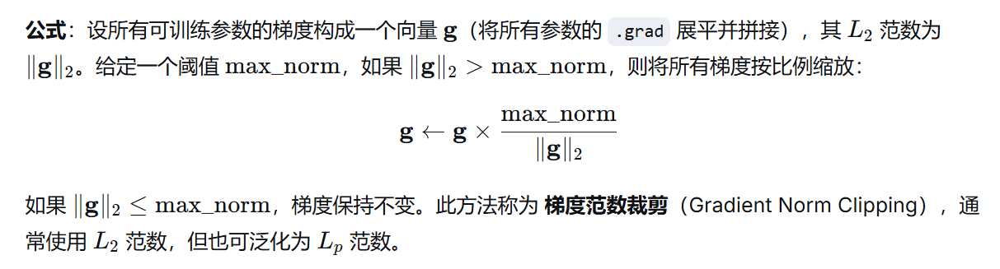
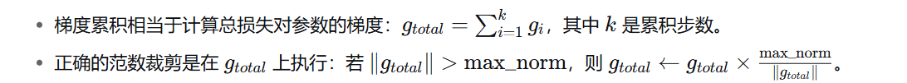
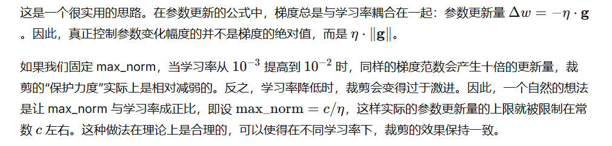

# 41.大模型（LLMs）梯度裁剪

#### 写出梯度范数裁剪的公式，并解释其如何防止梯度爆炸。

**公式**：设所有可训练参数的梯度构成一个向量 $\mathbf{g}$（将所有参数的 `.grad` 展平并拼接），其 $L_2$ 范数为 $\|\mathbf{g}\|_2$。给定一个阈值 max_norm，如果 $\|\mathbf{g}\|_2 > \text{max\_norm}$，则将所有梯度按比例缩放：

$$
\mathbf{g} \leftarrow \mathbf{g} \times \frac{\text{max\_norm}}{\|\mathbf{g}\|_2}
$$

如果 $\|\mathbf{g}\|_2 \leq \text{max\_norm}$，梯度保持不变。此方法称为**梯度范数裁剪**（Gradient Norm Clipping），通常使用 $L_2$ 范数，但也可泛化为 $L_p$ 范数。

{.ocr-src}

防止梯度爆炸的原理：

深度网络训练中，损失曲面可能存在陡峭的“悬崖”，特定参数更新方向上的梯度模长会异常大。如果直接应用这些巨大的梯度，参数更新步长 −*η***g** 可能将模型参数推到非常远的区域，导致损失急剧上升甚至产生 NaN，造成训练崩溃。

梯度范数裁剪通过限制参数更新向量的最大范数，在不改变梯度方向的前提下强行压缩步长。由于参数更新量为 −*η *⋅ **g**，裁剪后实际更新的范数被限制在 $η$⋅max_norm 以内。这相当于在参数空间中设置了一个“安全球”，防止单步更新跨越过远。它不像值裁剪那样扭曲梯度方向，因此对优化过程的负面影响更小。

在 Transformer 训练中，梯度范数裁剪几乎是必选项。它可以显著缓解训练初期（尤其是 warmup 阶段）的梯度爆炸，使损失曲线平稳下降，避免 loss spike。

---

#### 值裁剪与范数裁剪的实现区别，各自适用哪种异常梯度模式？

值裁剪（Value Clipping）：直接对梯度张量中的每个标量元素进行独立截断，将其限制在 [−v,v]区间内。

$$
g_i \leftarrow \mathrm{clamp}(g_i, -v, v)
$$

{.ocr-src}

实现简单，但会改变梯度的方向和相对大小，可能引入偏差。

范数裁剪（Norm Clipping）：保持梯度向量的方向不变，仅按其整体 L2 范数进行等比缩放，如第1题所述。

区别：

- 值裁剪是元素级操作，范数裁剪是向量级操作。

- 值裁剪可能扭曲梯度方向，而范数裁剪保留方向。

- 值裁剪计算成本更低（无需计算全局范数），但效果通常不如范数裁剪。

适用场景：

- 值裁剪：适合梯度中偶尔出现个别极端值（尖峰）且需要硬性限制每个参数更新量的场景，例如某些强化学习算法（如 DQN）中常使用值裁剪来限制 TD 误差的梯度。对抗训练中有时也用值裁剪。

- 范数裁剪：适合深层网络（尤其是 RNN、Transformer）中整体梯度爆炸的情况。由于它保留梯度方向，更契合 SGD 类优化器的性质，因此在大模型训练中是标准做法。

最佳实践：在预训练 Transformer 时，几乎都使用范数裁剪（max_norm 通常设为 1.0）；仅当遇到特殊的异常梯度模式（如极少数参数梯度尖峰，而整体范数正常）时，才考虑值裁剪或两者结合。

---

#### PyTorch 中 clip_grad_norm_ 的参数含义，并给出使用示例。

`torch.nn.utils.clip_grad_norm_` 是 PyTorch 提供的梯度范数裁剪函数。

参数：

- `parameters`：一个可迭代的参数张量集合（通常来自 `model.parameters()`），且每个参数应具有 `.grad` 属性。

- `max_norm`：允许的最大梯度范数（正浮点数）。

- `norm_type`：范数类型，默认为 2（即 $L_2$ 范数）；也可设为 1（$L_1$ 范数）、inf（无穷范数）等。

- `error_if_nonfinite`：若为 `True`，当任何梯度包含 `inf` 或 `NaN` 时抛出异常；默认为 `False`。

- `foreach`：是否使用多张量实现以加快速度（PyTorch 1.12+）。默认 `None` 由系统选择。

返回值：裁剪前的梯度总范数（一个 Python 浮点数），可用于日志记录。

使用示例（普通 FP32 训练）：

```python
import torch
import torch.nn as nn

model = nn.Linear(10, 1)
loss = model(torch.randn(5, 10)).sum()
loss.backward()

# 梯度裁剪
max_norm = 1.0
total_norm = torch.nn.utils.clip_grad_norm_(model.parameters(), max_norm)
print(f"Gradient norm before clipping: {total_norm:.4f}")
optimizer.step()
```

关键注意：

- 必须在 `optimizer.step()` 之前调用，通常在 `loss.backward()` 之后。

- 若使用混合精度与 `GradScaler`，必须在 `scaler.unscale_(optimizer)` 之后、`scaler.step()` 之前调用（详见第6题）。

- 该函数在分布式训练（DDP）下会自动通过 `all_reduce` 收集各设备的梯度范数，计算全局范数后进行裁剪，无需手动同步。

---

#### max_norm 的典型取值范围是多少？过大或过小会导致什么？

典型取值：

- Transformer 类模型（BERT, GPT, ViT 等）：`max_norm` 通常设为 1.0。这是一个经过大量实验验证的稳健值。某些情况下也会用 0.5、2.0 或 5.0，但 1.0 是绝大多数公开实现（如 HuggingFace、Megatron）的默认值。

- CNN（如 ResNet）：梯度通常更稳定，裁剪值可设得更高，如 10 或 100。

- RNN/LSTM：对梯度爆炸非常敏感，常设 1.0 或更小（0.5）。

- 混合精度训练：由于 FP16 动态范围窄，裁剪尤为重要，建议从 1.0 开始调优。

过大导致的问题：

- 裁剪形同虚设，不能有效防止梯度爆炸，训练可能出现 loss spike 或 NaN。

- 在混合精度下，过大的梯度即使被裁剪也可能已在 FP16 下溢出，`GradScaler` 频繁跳过更新。

过小导致的问题：

- 严重限制每次参数更新的幅度，收敛极慢，甚至无法逃离初始点。

- 可能因更新量不足而使模型停留在尖锐的局部极小值，泛化性能下降。

- 在训练初期尤其有害，因为此时需要较大的探索步长来逃离随机初始化区域。

调优建议：在训练初期监控梯度范数的分布（通过日志或 TensorBoard）。通常梯度范数在训练中会有一个自然的分布范围，可将 `max_norm` 设置在其 90~95 百分位附近。此外，可观察 `GradScaler` 的缩放因子是否频繁被砍半；若是，可能说明裁剪阈值过高或过低，需配合调整。

---

#### 梯度裁剪在训练早期为何尤为重要？结合损失曲线分析。

训练早期的特点：

- 模型参数随机初始化，网络各层的输出统计量尚未收敛，前向传播的激活和梯度分布极不稳定。

- 学习率通常从很小开始（warmup），逐渐增大到目标值。在 warmup 初期，模型极易因一次大的梯度更新而偏离正常轨迹。

- 注意力机制的点积计算在初始化时可能产生非常大的值，导致 softmax 输出接近 one-hot，反向梯度尖锐且量级很大。

损失曲线的表现：

- 无裁剪：训练早期可能频繁出现“loss spike”——损失值在某一两步内突然飙升（例如从 10 跳到 1000），然后缓慢回落，甚至直接变为 NaN 导致训练中断。这是因为某个 mini-batch 触发了极端梯度，参数被抛出合理区域。即使没有完全发散，这些尖峰也会显著拉长训练收敛时间。

- 有裁剪：损失曲线平滑下降，几乎看不到突刺。梯度范数被限制在 `max_norm` 以内，即使遇到异常数据，参数更新也被约束在安全范围内。这保证了模型在 warmup 阶段平稳过渡，学习率可以安全地增长到目标值。

因此，梯度裁剪在训练早期的核心价值是 “削峰填谷”——作为一道安全屏障，吸收初始化的噪声和不稳定，让优化器稳定地进入良好的优化状态。

---

#### 混合精度下，梯度裁剪的正确顺序：unscale → clip → step。

混合精度训练中，`GradScaler` 为了保留小梯度会放大损失，导致反向传播得到的梯度是放大后的梯度（scaled gradients）。在裁剪之前，必须先将梯度还原为真实尺度，否则裁剪阈值失效，且可能误判梯度溢出。

正确步骤：

1. `scaler.unscale_(optimizer)`：将优化器中累积的缩放梯度除以缩放因子，恢复真实梯度。

2. 梯度裁剪：调用 `torch.nn.utils.clip_grad_norm_` 对真实梯度进行裁剪。

3. `scaler.step(optimizer)`：内部检查梯度是否含 `inf`/`NaN`；若无，则执行参数更新；若有，跳过更新。

4. `scaler.update()`：根据是否溢出调整缩放因子。

完整代码示例（Automatic Mixed Precision）：

```python
scaler = torch.cuda.amp.GradScaler()

for data in dataloader:
    optimizer.zero_grad()
    with torch.cuda.amp.autocast():
        loss = model(data)
    scaler.scale(loss).backward()          # 反向传播，梯度被放大
    scaler.unscale_(optimizer)            # 1. 恢复真实梯度
    torch.nn.utils.clip_grad_norm_(model.parameters(), max_norm=1.0)  # 2. 裁剪
    scaler.step(optimizer)                # 3. 更新参数
    scaler.update()                       # 4. 调整缩放因子
```

错误顺序的后果：

- 若在 `unscale` 前裁剪：裁剪的是放大后的梯度，实际裁剪强度严重过度，会阻碍训练。

- 若裁剪后没有 `unscale` 而直接 step：`GradScaler.step` 会再次 unscale 并误判溢出状态。

因此，严格遵循 unscale → clip → step 的顺序是混合精度训练中梯度裁剪的强制要求。

---

#### 如何在分布式训练中计算全局梯度范数以实现正确裁剪？写出步骤。

在数据并行（DDP）或模型并行中，每个设备只持有部分参数的梯度，必须通过通信获得全局所有参数的梯度总范数，才能进行统一的缩放裁剪。步骤：

1. 本地计算平方范数：对于本设备上的每个参数（或梯度分片），计算 `grad.detach().norm(2).pow(2)`，将所有参数的平方范数累加得到一个标量 `local_norm_sq`。

2. 跨设备求和（All-Reduce）：对 `local_norm_sq` 执行 `all_reduce` 操作（求和 SUM），得到全局平方范数 `global_norm_sq`。这个通信数据量极小（每个设备只传一个浮点数）。

3. 计算全局范数：`global_norm = global_norm_sq.sqrt()`。

4. 裁剪：如果 `global_norm > max_norm`，则计算缩放因子 `scale = max_norm / global_norm`，并将本设备上所有参数的梯度乘以 `scale`。

PyTorch 的 `clip_grad_norm_` 在分布式环境下已经内部处理了上述逻辑，因此用户通常只需直接调用该函数，无需手动通信。但对于自定义并行模式（如模型并行未使用 PyTorch 包装），需自行实现类似过程。

完整步骤（手动实现思路，理解用）：

```python
total_norm_sq = torch.tensor([0.0], device=device)
for p in model.parameters():
    if p.grad is not None:
        total_norm_sq += p.grad.detach().pow(2).sum()
torch.distributed.all_reduce(total_norm_sq, op=torch.distributed.ReduceOp.SUM)
global_norm = torch.sqrt(total_norm_sq)
if global_norm > max_norm:
    scale = max_norm / global_norm
    for p in model.parameters():
        if p.grad is not None:
            p.grad.detach().mul_(scale)
```

#### 在 ZeRO 优化中，参数分片后如何高效计算全局梯度范数？

ZeRO 将参数、梯度和优化器状态分片到数据并行组内的多个 GPU 上。每个 GPU 只持有部分参数及其梯度。要计算全局梯度范数，同样采用分布式平方和归约。由于每个 GPU 只管理一个分片，它只需计算自己分片内梯度的平方和，然后通过 `all_reduce`（SUM）得到全局平方和，最后开方。

高效实现：

- 每个 GPU 遍历自己负责的参数分片，计算 `local_norm_sq`（每个参数的 `.grad` 的平方和）。

- 调用 `torch.distributed.all_reduce(local_norm_sq, op=SUM)`，得到 `global_norm_sq`。

- 全局范数 = `global_norm_sq.sqrt()`。

因为只传输一个标量，通信开销极低。DeepSpeed 的 ZeRO-1/2/3 在实现 `clip_grad_norm_` 时，自动完成了上述分布式范数计算。用户只需在配置中设置 `"gradient_clipping": 1.0` 即可。

注意事项：在 ZeRO-3 中，某些参数可能在前向/反向过程中被动态收集并释放，其梯度可能分散在不同设备上。但最终每个参数的梯度在反向结束时都存储在拥有该参数分片的设备上，因此上述方法仍然有效。DeepSpeed 已内建处理这些细节，确保正确性。

---

#### DeepSpeed 的梯度裁剪配置和实现特点。

DeepSpeed 通过配置文件启用梯度裁剪，无需在训练脚本中手动调用 PyTorch 的裁剪函数。典型配置：

```json
{
  "gradient_clipping": 1.0
}
```

实现特点：

1. 自动全局范数裁剪：DeepSpeed 内部会在优化器 step 之前自动计算所有参数梯度的全局 $L_2$ 范数，并按阈值 1.0 进行缩放裁剪。这与手动调用 `clip_grad_norm_` 效果一致。

2. 完美适配 ZeRO 各阶段：在 ZeRO-1/2/3 下，DeepSpeed 正确处理参数、梯度的分片和收集，内部采用 all-reduce 标量的方式计算全局范数，通信开销极小。

3. 支持梯度累积：当使用梯度累积时，DeepSpeed 确保裁剪发生在所有 micro-batch 的梯度累积完成之后，即真正的优化步之前，避免在中间 micro-batch 误裁剪。

4. 混合精度友好：自动处理 FP16 的 loss scaling。DeepSpeed 在 unscale 之后、step 之前进行裁剪，与 PyTorch 官方推荐顺序一致。

5. 灵活配置：除了设置阈值，还可通过 `gradient_clipping` 微调。若设置为 `"auto"` 或未设置，则不裁剪。此外，DeepSpeed 允许同时使用值裁剪（通过配置 `gradient_value_clipping`），以满足特殊需求。

使用示例：只需在 DeepSpeed 配置 JSON 中加入 `"gradient_clipping": 1.0`，即可全自动享受分布式梯度裁剪，无需在训练循环中额外编码。

核心优势：DeepSpeed 的梯度裁剪将复杂的分片通信和混合精度细节封装起来，让用户能够以几近零成本的方式获得稳定训练的保护，这是其在大模型社区广泛流行的原因之一。

---

#### 梯度累积时，应在所有微批次梯度合并后进行一次裁剪，为什么？

原因：梯度裁剪的目的是限制最终用于参数更新的梯度更新步长。在梯度累积中，我们将一个大批次拆分成多个微批次，每次微批次反向计算出的梯度会累加到参数的 `.grad` 字段中。最终的参数更新是在所有微批次完成后，使用累加后的总梯度进行优化器步骤。因此，裁剪必须基于这个总梯度，而非中间某个微批次的局部梯度。

如果在每个微批次后都裁剪一次，会破坏累加效果，产生严重的数学偏差：

- 梯度累积相当于计算总损失对参数的梯度：$g_{total} = \sum_{i=1}^{k} g_i$，其中 $k$ 是累积步数。
- 正确的范数裁剪是在 $g_{total}$ 上执行：若 $\|g_{total}\| > \text{max\_norm}$，则 $g_{total} \leftarrow g_{total} \times \frac{\text{max\_norm}}{\|g_{total}\|}$。

{.ocr-src}

- 若在每个微批次后都裁剪，相当于先对每个 $g_i$ 独立裁剪，再求和。但由于裁剪是按范数缩放，各微批次的梯度方向不变但模长被分别截断，求和后的总梯度方向将与正确值不同，且总模长也被错误地限制。这等价于在优化过程中引入了扭曲的梯度信号，会损害收敛性能，甚至导致无法收敛。

正确实现：在所有微批次的 `loss.backward()` 完成后，调用一次 `clip_grad_norm_`，然后再执行 `optimizer.step()`。PyTorch 的 `GradScaler` 和 DeepSpeed 的梯度累积均遵循此原则，用户无需干预。

---

#### 如果 max_norm 设置太小，除了收敛变慢，还会出现什么副作用？

当 `max_norm` 过小，参数更新的步长被严重压缩，不仅收敛变慢，还会带来以下副作用：

1. 训练早期完全停滞：在 warmup 阶段，学习率本身就很低，若梯度再被大幅裁剪，有效更新量可能趋近于零，模型长时间无法逃离初始随机状态，损失几乎不下降。

2. 陷入尖锐的局部极小值：小步长使优化器缺乏跳出尖锐极小值的能力，模型可能在低洼但泛化性能很差的区域过早停止，导致测试集表现不佳。

3. 优化器状态扭曲：Adam 等自适应优化器的一阶动量和二阶动量依赖于历史梯度的大小。持续的极低梯度会导致动量累积过小，二阶矩估计也偏低，使得学习率被“错误地放大”（因为二阶矩在分母上），但在小步长下这种放大效应有限，整体优化器内部状态失真。

4. 模型容量浪费：由于梯度更新被压制，许多参数长期停留在接近初始化的状态，模型无法充分利用其表示能力，等效容量降低。

5. 无法学习到长距离依赖：在 Transformer 中，某些关键层可能需要较大的梯度来建立正确的注意力模式。过小的裁剪会限制这些层的更新，导致模型难以捕捉长序列中的依赖关系，影响语言建模和推理能力。

6. 损失函数出现“平台期”假象：损失看似收敛，实则因为步长太小，模型被困于一个宽阔的次优解，而正常裁剪本可帮助找到更深的损失谷底。

调优建议：若发现训练损失下降非常缓慢，且梯度范数频繁触碰阈值而被裁剪，且阈值远低于历史梯度范数的平均水平，很可能 `max_norm` 太小。应适当增大阈值，让模型有足够的探索步长。

---

#### 如何通过监控梯度范数日志来调整裁剪阈值？

监控指标：在训练过程中，定期记录 `clip_grad_norm_` 返回的裁剪前的全局梯度范数，以及裁剪发生的比例。

调整策略：

1. 观察分布与趋势：将梯度范数随时间的变化绘制成曲线。一个健康的训练过程，梯度范数会在 warmup 结束后逐渐上升，然后缓慢下降直至收敛。阈值应处于范数分布曲线的“安全区”之内。

2. 目标裁剪率：理想情况下，不应有超过 1%~5% 的训练步发生裁剪。如果裁剪率过高（例如 >10%），说明阈值设得太低，抑制了正常更新；如果裁剪率几乎为零，而训练稳定，则阈值可能太宽松，但通常无需调整，除非观察到 loss spike。

3. 结合 loss spike：若训练中频繁出现损失突刺，并且这些突刺往往伴随着极高的梯度范数，则应将阈值设在突刺范数的下方，以削平这些尖峰。可以计算最近 N 步梯度范数的移动平均和标准差，将阈值设为 `mean + 3*std` 作为动态参考，但实践中常通过手动调整固定值。

4. 不同训练阶段的适配：训练早期梯度范数波动大，可能需要稍紧的阈值（如 1.0）；后期梯度变小，可保持阈值不变或略微下调。有些研究采用 cosine 衰减阈值，但主流仍用固定值。

5. 阈值实验：若不确定，可在小规模实验中尝试几个候选阈值（如 0.5, 1.0, 2.0, 5.0），比较最终验证损失和收敛速度，选择最优。

工具：使用 TensorBoard 或 Weights & Biases 记录 `total_norm` 和 `loss`，观察两者关系。例如，发现梯度范数突然从 0.5 跃升到 10 时，loss 也大幅波动，此时将阈值设为 1.0 可有效抑制。

---

#### 梯度裁剪与损失缩放交互：如果缩放后梯度超过阈值，如何处理？

在混合精度训练中，损失缩放和梯度裁剪必须正确协同。

关键点：梯度裁剪必须应用于未缩放的原始梯度。而损失缩放产生的梯度是放大的。`GradScaler` 的 `unscale` 步骤将梯度还原为真实尺度，因此裁剪应在 `unscale` 之后进行。

流程：`backward()` → `unscale` → `clip` → `step`。

如果缩放后梯度超过阈值怎么办？

- `unscale` 之后，梯度恢复到原始大小。如果原始梯度的范数超过了 `max_norm`，`clip_grad_norm_` 将正常地进行缩放裁剪。

- 值得注意：在 `unscale` 之前，放大的梯度可能已经溢出为 `inf/NaN`。此时 `unscale` 后仍为 `inf/NaN`，`clip_grad_norm_` 不会修改它们（因为包含 `inf` 的范数计算会得到 `inf`），但后续 `scaler.step` 会检测到溢出并跳过更新。这是正确的行为：溢出意味着缩放因子过大，需要减小缩放因子，而不是通过裁剪来挽救。

- 如果放大的梯度没有溢出，但数值极大，`unscale` 后真实梯度可能极大，裁剪会将其缩小到 `max_norm`。这通常表明该步的损失曲面异常陡峭，裁剪起到了保护作用。

实践：PyTorch 的 `GradScaler` 配合 `clip_grad_norm_` 会按上述逻辑自动工作。开发者只需确保调用顺序：`scaler.unscale_(optimizer)` → `clip` → `scaler.step`。

---

#### 解释 adaptive gradient clipping：根据历史梯度范数自动调整阈值的思想。

自适应梯度裁剪（AGC） 由 Brock 等人在训练大规模 GAN 时提出，后被 NFNet 等采用。其核心思想是：不设定一个固定的全局 `max_norm`，而是根据参数的范数动态计算每个参数允许的最大梯度范数。

公式（以每层参数为单位）：

对于第 $l$ 层的参数 $W^l$，设其梯度为 $G^l$。首先计算该层的**参数范数** $\|W^l\|_F$（Frobenius 范数）和**梯度范数** $\|G^l\|_F$。然后定义一个裁剪因子 $\lambda$（如 0.1）。如果：

$$
\|G^l\|_F > \lambda \cdot \|W^l\|_F
$$

则对该层梯度进行裁剪：

$$
G^l \leftarrow G^l \times \frac{\lambda \cdot \|W^l\|_F}{\|G^l\|_F}
$$

{.ocr-src}

这保证了梯度的相对更新量不超过 $λ$ 倍的参数范数，相当于限制了每步参数的变化比例。

为什么是“自适应”：

- 它利用当前参数的大小作为参考。当参数已很大时，允许较大的梯度；当参数较小时，梯度也被相应限制。这样避免了固定阈值对不同层、不同阶段的粗暴一刀切。

- 无需根据历史梯度范数手动调整，适应训练过程的动态变化。

效果：AGC 在训练极深网络时非常有效，可以防止某些层的梯度过早爆炸，同时允许其他层正常更新。在 Transformer 中通常未采用，因为固定 `max_norm=1.0` 已足够稳健，但 AGC 提供了一种更精细的无调参思路。

---

#### 为什么 RNN 中梯度裁剪曾是必需品，而 Transformer 也需要？探讨深度网络梯度流动。

RNN 的梯度问题：RNN 通过共享权重矩阵沿时间步递归。反向传播时，梯度需连乘相同的矩阵多次，这极易导致梯度爆炸或梯度消失。即使使用 LSTM/GRU，长序列仍然可能在某些步出现范数突然飙升。梯度裁剪成为 RNN 训练的必需品，因为一旦爆炸，整个序列的隐藏状态都会被破坏，损失立即发散。裁剪几乎是训练 RNN 的强制安全措施。

Transformer 的梯度问题：Transformer 虽然通过自注意力和残差连接解决了长距离梯度消失，但其训练同样面临梯度爆炸风险，尤其是在以下方面：

- 深层堆叠：现代 LLM 动辄数十上百层，残差连接虽然提供梯度高速公路，但不同层的梯度量级仍可能差异巨大。

- 注意力分数：点积注意力在训练初期可能产生极大的值，导致 softmax 输出接近 one-hot，反向传播时梯度极为尖锐。

- 大学习率：在大 batch 训练或 warmup 阶段，学习率调整与梯度范数的交互可能造成不稳定。

- 模型并行/混合精度：分布式和低精度训练放大了数值不稳定风险。

因此，Transformer 训练几乎必带梯度裁剪。它与残差连接、LayerNorm 共同作用，保证深层网络的梯度流动健康。

核心：无论是 RNN 还是 Transformer，只要网络足够深、序列足够长，梯度爆炸的物理风险就存在。梯度裁剪是一种低成本且极其有效的“安全阀”。

---

#### 梯度裁剪与梯度归一化（gradient normalization）有何异同？

- 梯度裁剪：仅当梯度范数超过阈值时，才等比缩放；否则保持原样。目的是防止过大更新，允许小梯度正常通过。

- 梯度归一化：无论梯度范数大小，都将其缩放为单位范数（或固定范数）。此时梯度方向不变，但每次更新的步长被标准化为固定大小。

异同：

- 相同：都是对梯度向量进行缩放，保留方向，改变大小。

- 不同：裁剪是“有条件的”，只压制极端值；归一化是“无条件的”，强制统一更新步长。

适用场景：

- 梯度裁剪适用于绝大多数有监督学习，保留了对不同样本/参数的自然更新幅度差异，收敛性好。

- 梯度归一化常见于某些强化学习算法（如 PPO 中有时使用），或需要严格控制更新步长的场景。但在标准预训练中，强制归一化会抹杀梯度大小的信息，通常导致收敛变慢或无法收敛。

总结：梯度裁剪是“防止超速的限速器”，梯度归一化是“强制定速巡航”。大模型训练几乎只使用前者。

---

#### 梯度裁剪对优化器动量状态的影响分析。

梯度裁剪直接影响参数更新量，进而影响优化器（如 Adam）的动量（一阶矩 $m$）和二阶矩（$v$）的更新。

- 动量（$m$）：Adam 的动量是历史梯度的指数移动平均。裁剪后，实际传入的梯度模长可能变小，因此累积的动量幅度也相应减小。这有助于防止动量因少数巨大梯度而过度累积，从而在后续步中造成持续的大幅更新（即使当前步梯度已恢复正常）。裁剪可以看作是净化动量信号的手段。

- 二阶矩（$v$）：与动量类似，极端的梯度值会显著拉高二阶矩，导致优化器“认为”这些参数具有高方差，从而降低其有效学习率（因为更新要除以 $v$）。裁剪限制了极端值，使二阶矩估计更平滑，避免某些参数因一次异常而被长期抑制。

- 偏差校正不受影响：Adam 的偏差校正仅依赖于步数，裁剪不影响。

注意：如果裁剪阈值过小，长期的低梯度会导致动量增长缓慢，模型可能“动力不足”。合理的阈值应让绝大多数正常梯度通过，仅过滤异常尖峰，从而保持动量状态健康。

---

#### 说明在一些模型中（如 ResNet）梯度裁剪不常用，但 LLM 训练必需的深层原因。

ResNet 时代为何不需裁剪：

- ResNet 等经典 CNN 通常深度在 152 层以下，使用 Batch Normalization 能有效控制层间激活的尺度，使得梯度传播相对稳定。

- 训练时使用较小学习率、较保守的初始化，且网络结构相对简单，没有复杂的注意力交互。

- 因此梯度爆炸的风险较低，模型即使不裁剪也能顺利训练。

LLM 必须裁剪的深层原因：

- 极深架构（>100 层）：深度每增加一层，梯度传播的潜在不稳定性累积。残差连接虽然保护了梯度，但不同分支的梯度量级差异依然存在，个别层可能突然产生巨大梯度。

- 自注意力的数值脆弱性：注意力分数的指数运算对数值极为敏感，训练初期极易产生极端值，且序列长度越长，这种效应越显著。

- 超大数据与超大 batch：现代 LLM 在海量文本上以极高 batch size 训练，这种设置会降低梯度噪声但也可能在某一步骤中集中暴露数据中的“毒样本”或异常模式，导致梯度爆炸。

- 混合精度与并行：FP16 的窄动态范围使梯度爆炸一旦发生就几乎必然溢出。裁剪与损失缩放协同，是混合精度训练的基本保障。

- 高昂的训练成本：LLM 训练需要持续数周甚至数月，任何一次因梯度爆炸导致的中断或 NaN 都可能浪费大量算力。裁剪是投入产出比极高的保险。

因此，随着模型规模和数据量的指数级增长，梯度裁剪从“可选”升级为“必选”，是深度网络训练理论的必然演进。

---

#### 流水线并行中，梯度裁剪的同步时机与数据并行的区别

流水线并行（Pipeline Parallelism）和数据并行（Data Parallelism）对梯度裁剪的同步时机要求截然不同，根源在于两种并行策略对梯度的产生和消费方式有本质区别。

在数据并行中，每个设备都有一个完整的模型副本，处理不同的micro-batch。反向传播结束时，每张卡都拥有自己那份数据的梯度。此时，我们需要把所有设备的梯度做All-Reduce，算出全局平均梯度。梯度裁剪必须发生在这个All-Reduce之后，优化器step之前。因为我们要裁剪的是“最终用于更新参数的那个梯度”，也就是经过所有设备协商后的全局梯度。如果在All-Reduce之前就各自裁剪，那么相当于每个设备的梯度方向都被不同程度地扭曲，然后再平均，得到的既不是原始平均梯度的方向，也不是某个单一设备的方向，数学上完全错了。

流水线并行的情况要复杂得多。在PP中，模型被切成多个stage，每个stage只负责一部分层。一个micro-batch的前向和反向是交错进行的（比如1F1B调度）。因此，一个stage的梯度并不是一次性全部算完的，而是随着不同micro-batch的反向逐步累积的。同时，在PP中，参数更新通常发生在所有micro-batch的反向都完成之后，而且只有每个stage的第一张卡（或者最后一张，取决于实现）持有完整的该stage的梯度（其他卡可能通过张量并行持有部分梯度）。

这就引出了关键问题：在PP中，梯度裁剪必须在“全局”意义上进行，但这个“全局”并不是整个模型的所有参数，而是每个stage内的所有参数。实际上，DeepSpeed等框架的做法是：每个PP stage独立计算本stage内所有参数的全局梯度范数（通过本stage内的TP group做All-Reduce），然后对本stage的梯度进行裁剪。不同stage之间不需要同步这个范数，因为不同stage的参数更新本来就是独立的。所以PP中裁剪的同步时机是：每个stage在自己的梯度全部累积完毕（所有micro-batch处理完），且在本stage内部做了必要的TP通信之后，再进行裁剪，然后执行优化器step。

这和数据并行的“全局统一裁剪”完全不同。如果在PP中错误地试图跨所有stage计算一个全局范数，就会引入巨大的通信开销，而且毫无必要。因此，理解并行策略的拓扑结构，是正确实施梯度裁剪的前提。

---

#### 在混合精度 BF16 训练中，是否仍可能遇到需要裁剪的极大梯度？

答案是：不仅可能，而且概率并不低。

BF16的优势是它和FP32共享8位指数位，因此动态范围极大，理论上能表示的数值上限和FP32一样（约3.4×10^38）。所以很多人认为BF16训练不会出现梯度溢出，也不需要损失缩放，因此对梯度裁剪的需求会降低。但这个想法过于乐观了。

首先，梯度的爆炸不一定非要达到浮点数上限。即使BF16可以表示一个非常大的梯度值，如果这个梯度的范数达到了1000甚至10000，那么一步更新就会把参数推到完全未知的区域。虽然不会像FP16那样直接变成NaN，但模型性能会在这一瞬间严重受损，后续可能需要几百甚至上千步才能恢复，甚至永远无法恢复到这个尖峰之前的损失水平。所以，梯度裁剪是为了控制更新步长的合理性，而不仅仅是为了防止数值溢出。

其次，BF16的尾数只有7位，精度很低。在深度网络的某些层，尤其是注意力矩阵计算过程中，由于低精度累积误差，可能导致某些参数的梯度估计出现严重偏差，产生尖峰。这种尖峰在数值上可能远远超过正常梯度的量级，但由于BF16范围大，它不会饱和或溢出，而是以巨大的数值存在。此时，如果不裁剪，Adam的动量和二阶矩会被这个巨大值严重污染，优化器状态需要很长时间才能恢复。

我个人的经验是，即使在纯BF16训练中，仍然保持max_grad_norm=1.0或者稍微宽松一点（比如2.0）是明智的。它能起到稳定训练的作用，而且代价几乎为零。不要因为BF16动态范围大就放弃裁剪，这两者解决的是不同层面的问题。

---

#### 梯度裁剪对权重更新方向的影响：是否等价于信任域方法？

这个问题触及了优化理论的深层面。从形式上看，梯度范数裁剪非常像一种信任域方法（Trust Region Method）的近似。信任域方法的核心思想是：在当前参数的一个邻域内，用一个简单的模型（通常是二次模型）来近似真实的损失函数，然后在这个邻域内找到最优的更新方向，从而保证每一步的更新都不会过于激进。

当我们使用梯度裁剪时，如果原始梯度的范数大于阈值，我们实际上是把更新向量 −*η***g** 的模长限制在了 η⋅max_norm 以内。如果我们忽略学习率 $η$ 的影响，这就相当于在参数空间中定义了一个球形信任域，半径就是 max_norm，而梯度本身的方向就近似了信任域内的最优方向。

但这里有一个重要的区别：真正的信任域方法会求解一个约束优化问题，最优更新方向并不一定和梯度方向重合，尤其是当损失曲面的曲率很大时。梯度裁剪简单粗暴地保持梯度方向不变，这只有在信任域足够小、损失曲面接近线性时才成立。换句话说，梯度裁剪是信任域方法在“极小信任域”下的一个廉价近似。它的有效性依赖于这个球形信任域的半径足够小，从而线性近似足够好。

这也可以解释为什么max_norm通常设得很小（比如1.0）：只有在这个量级下，梯度方向才足够可信。如果max_norm设得过大，裁剪就不经常触发，那么它也就失去了信任域的保护作用；设得过小，则会过度限制更新，如同信任域半径太小，导致无法在一步内充分利用可用信息。

所以，梯度裁剪确实蕴含着信任域的思想，但它是极度简化后的工程实现，用廉价的计算换取了可观的稳定性。

---

#### 如何设置与学习率成比例的 max_norm，以提高鲁棒性？

这是一个很实用的思路。在参数更新的公式中，梯度总是与学习率耦合在一起：参数更新量 $\Delta w = -\eta \cdot \mathbf{g}$。因此，真正控制参数变化幅度的并不是梯度的绝对值，而是 $\eta \cdot \|\mathbf{g}\|$。

如果我们固定 max_norm，当学习率从 $10^{-3}$ 提高到 $10^{-2}$ 时，同样的梯度范数会产生十倍的更新量，裁剪的“保护力度”实际上是相对减弱的。反之，学习率降低时，裁剪会变得过于激进。因此，一个自然的想法是让 max_norm 与学习率成反比，即设 $\text{max\_norm} = c/\eta$，这样实际的参数更新量的上限就被限制在常数 $c$ 左右。这种做法在理论上是合理的，可以使得在不同学习率下，裁剪的效果保持一致。

{.ocr-src}

不过，在实践中，我们往往并不这样精细地调节，原因有几个：第一，学习率通常不是固定的，有warmup和衰减，如果max_norm也跟着变，就会引入另一个动态变量，使得调参和Debug变得困难。第二，大多数大模型训练中，学习率的变化范围其实不大（比如从3e-4到3e-5），max_norm固定为1.0已经可以适应这个范围。第三，优化器（如Adam）内部的自适应机制部分承担了按参数维度调整更新幅度的角色，降低了对全局max_norm精细度调节的需求。

我的建议是：如果你的训练中学习率需要跨越多个数量级（比如从一个很大的初始学习率退火到一个极小的最终学习率），那么考虑让max_norm与学习率成比例是值得的，可以防止后期过度裁剪导致收敛停滞。但在绝大多数标准场景下，固定max_norm=1.0已经足够鲁棒，且调参更简单。

---

#### 在 RLHF 的 PPO 训练中，梯度裁剪的特殊之处（多损失项）

RLHF（Reinforcement Learning from Human Feedback）中的PPO训练阶段，通常会有多个损失项加在一起：策略损失（policy loss）、价值损失（value loss）、以及可能的KL散度惩罚项。这些损失项对应的梯度在量级上可能差异极大。例如，策略损失可能产生较大的梯度，而价值损失和KL惩罚的梯度可能相对较小。如果我们在所有梯度合并之后再进行一次全局的梯度裁剪，那么裁剪的阈值就需要同时照顾到这三个非常不同的信号。这就可能带来问题：阈值设得高，策略梯度可能爆炸；阈值设得低，价值网络的梯度可能被过度压缩，导致Critic学不好，进而使得Advantage估计偏差增大，破坏整个PPO训练的稳定性。

解决这个问题的常见做法是分层裁剪或分损失裁剪。具体来说，在计算完每个损失项的梯度之后，先对该项的梯度单独进行裁剪，然后再把裁剪后的梯度累加起来，用于最终的更新。这样，每个损失项的梯度都被限制在合理的范围内，互不干扰。另一种做法是对策略网络和价值网络使用不同的max_norm阈值，因为它们的参数是完全独立的。PPO训练中，价值网络的更新幅度通常需要更谨慎，可以设一个更小的max_norm。

另外，RLHF训练中经常还会用到“early stopping”或者“KL target”机制，这些机制也会和梯度裁剪相互作用。如果KL惩罚力度不够，策略可能偏离太远，此时梯度裁剪是兜底的安全网，防止策略网络在一步中剧烈改变。因此，在RLHF的PPO训练中，梯度裁剪不仅是常规的防爆炸手段，更是维持PPO算法本身稳定性的重要组成部分。

---

#### 研究论文中常提到 max_grad_norm=1.0 或 0.5，这些值如何来的？可迁移吗？

这个数字1.0（或0.5）已经成为一种“业界共识”，它的来源并不是某个理论的严格推导，而是大量实验中的经验结晶。

在Transformer早期（比如Vaswani等人2017年那篇经典论文），训练Transformer-base（约65M参数）时，他们使用了0.5。后来，在BERT、GPT-2等模型中，训练者发现1.0工作得也很好。随着模型规模从几百万膨胀到几千亿，人们发现这个值仍然很管用。这并非偶然。它恰好落在了一个“甜蜜点”上：对于大多数Transformer模型，在典型的学习率（如1e-4到5e-4）和典型的参数初始化（Xavier或Kaiming）下，训练初期梯度的范数自然分布大约在0.1到10之间波动，偶尔会有尖峰冲到几百甚至上千。将max_norm设在1.0左右，可以有效地削去那些极端尖峰，同时让绝大多数正常梯度的更新几乎不受影响（因为它们的范数本身就在1.0以下）。换句话说，1.0是一个能“只杀毒，不伤民”的阈值。

这个值可迁移吗？在很大程度上是可以直接迁移的。因为无论模型多大，只要架构是Transformer变体，我们仍然在使用类似的自注意力、前馈网络、LayerNorm以及残差连接，这些结构对梯度的尺度和分布有着相似的塑造作用。所以，从BERT到LLaMA，从7B到70B，max_norm=1.0一直是安全且高效的默认选择。当然，如果你使用了一种非常不同的架构（比如非Transformer），或者极其极端的学习率，可能需要重新调优。但大多数情况下，遵循1.0这个约定是很好的起点。

---

#### 实现一个简单的梯度范数监控回调，记录 per‑layer 范数

在生产环境的训练中，全局梯度范数只是汇总信息，要排查哪个层出了问题，需要更细粒度的监控。以下是一个PyTorch风格的简单回调，可以插入到训练循环中，记录每一层的梯度范数。

```python
import torch
import torch.nn as nn

class LayerGradientMonitor:
    def __init__(self, model, log_every_n_steps=100):
        self.model = model
        self.log_every_n_steps = log_every_n_steps
        self.step_counter = 0

    def log(self, step, writer=None):
        """在反向传播后、optimizer.step前调用"""
        self.step_counter += 1
        if self.step_counter % self.log_every_n_steps == 0:
            layer_norms = {}
            total_norm = 0.0
            for name, param in self.model.named_parameters():
                if param.grad is not None:
                    norm = param.grad.data.norm(2).item()
                    layer_norms[name] = norm
                    total_norm += norm ** 2
            total_norm = total_norm ** 0.5
            print(f"Step {step}: Global gradient norm = {total_norm:.4f}")
            for name, norm in layer_norms.items():
                print(f"  {name}: {norm:.4f}")
            # 如果有TensorBoard等writer，可以记录histogram
            if writer:
                writer.add_scalar("Gradient/Global_Norm", total_norm, step)
                for name, norm in layer_norms.items():
                    writer.add_scalar(f"Gradient/Layer/{name}", norm, step)
```

用法：

```python
monitor = LayerGradientMonitor(model)
for step, batch in enumerate(dataloader):
    loss = model(batch).loss
    loss.backward()
    monitor.log(step)  # 在clip之前或之后均可，看你想记录裁剪前还是裁剪后
    torch.nn.utils.clip_grad_norm_(model.parameters(), max_norm=1.0)
    optimizer.step()
    optimizer.zero_grad()
```

这个监控工具帮助我们发现，例如，是不是所有层的梯度范数都正常，唯独某一层的某个参数梯度过小或过大，从而快速定位问题。

---

#### 梯度裁剪是否影响 batch normalization？但 Transformer 不含 BN，讨论无影响。

梯度裁剪理论上对含有Batch Normalization的模型有间接影响，因为BN层内部有可学习参数（$γ$,$β$）以及基于批次统计量的标准化操作。裁剪会改变这些参数的更新速度，从而影响BN层的统计量估计。但在实践中，这种影响通常很小，因为BN本身就有很强的正则化效果。

不过对于Transformer，这个问题基本不存在。Transformer使用的是Layer Normalization（或者RMSNorm），它的归一化是在每个token的特征维度上独立进行的，没有跨批次的统计量。因此，梯度裁剪对LN的影响可以忽略不计。因为LN的统计量是在前向传播中动态计算的，与梯度更新无关，而$γ$,$β$参数的梯度也会和其他参数一样被裁剪，这属于正常的行为。

所以，在Transformer训练中，我们完全不需要担心梯度裁剪和归一化层之间的相互作用。这是一个纯粹的优势，让Transformer的训练更加模块化和鲁棒。

---

#### 如果训练出现 NaN 损失，梯度裁剪是否是第一道防线？排查流程。

当训练中出现NaN损失时，有经验的工程师的第一反应不是立刻调整梯度裁剪，而是先去检查数据。梯度裁剪是防止梯度爆炸的最后一道防线，而不是万能的护身符。NaN的根源往往在更上游。

我的排查流程通常是这样的：

1. 检查输入数据：最近的几个batch中是否含有NaN、Inf或者极端异常值（比如文本里出现了乱码字符导致token ID异常，或者归一化后的特征值超出范围）。这是最常见的NaN来源，而且一出现就是灾难性的。

2. 检查前向传播数值：在怀疑的层（比如softmax之前、LayerNorm之后）插入hook，打印激活值的统计信息（min, max, mean）。特别关注softmax的输入，如果里面有非常大的正值（比如超过80），就会产生无穷大的指数输出，导致NaN。这通常发生在注意力分数计算中。

3. 检查损失函数：确认损失函数的输入是否合理。例如，交叉熵损失的输入logits是否都变成了NaN，或者目标标签是否在有效范围内。

4. 检查学习率和梯度裁剪：如果数据和前向都正常，那么问题可能出在反向传播。此时，检查当前步的梯度范数。如果梯度范数极大，说明发生了爆炸，那么当前梯度裁剪的max_norm是否设置得当？是不是太小导致没触发？或者混合精度下GradScaler的缩放因子是否过大导致梯度溢出？此时可以临时调低学习率，或者收紧max_norm来观察。

5. 检查模型初始化：如果训练刚开始几步就NaN，可能是某些层的初始化不当，导致输出方差过大。

梯度裁剪是防线的一部分，但它只能处理“梯度爆炸”，不能处理数据本身的NaN。所以，永远不要在没排查数据的情况下，只是简单地调整max_norm，那样做只会掩盖问题。

---

#### 解释为什么有些情况下梯度裁剪反而可能导致收敛变差（阈值过紧）。

梯度裁剪是一把双刃剑。阈值设得太紧，虽然能防止爆炸，但也会压制正常的、有益的梯度更新，导致收敛变慢甚至变差。原因可以从以下几个角度理解：

首先，当阈值过紧时，绝大多数训练步的梯度都会被缩放。这意味着模型每一步的实际更新量远小于优化器根据真实梯度所建议的步长。这相当于给优化器装了一个“限速器”，而且这个限速器设得过低。模型虽然有明确的方向（梯度方向），却只能龟速前进。收敛自然变慢。

其次，Adam等自适应优化器依赖于梯度的历史统计量。如果梯度总是被裁减，那么传入优化器的梯度序列的方差被人为降低。这会导致优化器的二阶矩估计偏小，从而使得自适应的学习率（除以 $\sqrt{v}$）偏大。虽然这在一定程度上补偿了裁剪带来的步长缩小，但补偿是不精确的，且可能引入新的不稳定性。

{.ocr-src}

更糟糕的是，过紧的裁剪会改变梯度的有效信号，尤其是在模型接近收敛时。在训练的后期，模型需要精细的、小步长的调整来找到更平坦的极小值。如果此时裁剪仍然频繁触发，它会错误地放大某些噪声梯度的相对重要性（因为所有梯度都被等比缩小，但原本很小的噪声梯度可能并没有被完全压垮，而是和真正的信号梯度一起被保留了下来，导致信噪比下降）。这种效应会使模型难以精确收敛到最优解，最终损害泛化性能。

在实践中，若发现训练损失下降非常缓慢，且监控显示有很高比例的梯度步被裁剪，这就是阈值过紧的典型信号。这时应该适当增大max_norm，让优化器有更大的自由空间。

---

