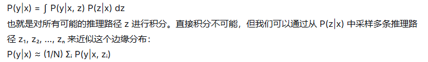

# 79.大模型（LLMs）自洽性（Self-Consistency）

#### 什么是自洽性方法？它如何改进链式思维推理的结果？

自洽性（Self-Consistency）是一种在推理阶段提升大语言模型思维链（Chain-of-Thought, CoT）准确率的解码策略。它的核心思想很朴素：对于同一个问题，让模型多思考几次，然后看看这几次思考得出的最终答案中，哪个答案出现得最频繁，就选哪个。它不改变模型本身，只在推理时多做几次生成，然后用一个简单的“多数投票”机制来决定最终输出。

为什么这能改进链式思维推理的结果？这得从 CoT 的弱点说起。CoT 让模型把推理过程一步步写出来，这确实大幅提升了复杂推理的正确率，但它有一个根本性的问题：单次生成具有随机性。模型在每一步都可能出现小偏差——算术算错、逻辑跳了一步、引用了一个错误的事实，一旦一个步骤出错，后面就会沿着错误方向越走越远。这就好比让一个人做一道复杂的数学题，他可能在一个小地方粗心算错，后面全错，但这不代表他不会做这道题。

自洽性的改进逻辑就在这里：它承认单次推理可能出错，但它不把希望全押在一次上。它让模型独立地生成多条推理路径（通常通过提高解码温度来引入随机性），然后观察这些路径最终指向的答案。如果大多数路径都收敛到同一个答案，那么这个答案很可能是正确的，因为不同的“粗心错误”不太可能都巧合地导向同一个错误结果。错误往往是发散的，而正确推理则会汇聚。所以，自洽性本质上是用“思考的广度”来弥补单次“思考的深度”可能出现的随机失误，通过集成多条路径的结果来提升鲁棒性和准确率。

在实际效果上，自洽性对数学推理、符号推理、常识推理等多步推理任务的提升非常显著。例如在 GSM8K 数学题上，单次 CoT 可能只有 60% 的准确率，加上自洽性（采样 10 条路径）可以提升到 75% 甚至更高。这种提升几乎不需要任何额外训练或标注，只是增加了一些推理计算量。

---

#### 自洽性的基本流程是什么？为什么多次采样后取“多数答案”能提高准确率？

自洽性的基本流程可以概括为三个步骤：采样、提取、聚合。

第一步，采样。对于给定的问题，我们不满足于只让模型生成一条推理链。我们设置一个高于平时解码时的温度参数（比如 0.7 或 0.8），然后让模型独立地从同一个 prompt 出发，生成 N 条不同的推理链。高温度意味着模型在每一步选择下一个 token 时，概率分布变得更平坦，不那么倾向于只选概率最高的那个，而是有更大的机会选到次高、再次高的 token。这样，不同的采样路径会在措辞、推理顺序、甚至某些中间计算上产生差异，从而形成多样化的“思路”。

第二步，提取。每条推理链的末尾通常有一个明确的“最终答案”。我们需要从生成的文本中把这个答案提取出来。对于数学题，答案通常是数字；对于分类题，答案是类别标签；对于选择题，答案是选项。提取可以用正则表达式，也可以用简单的规则（比如找“答案是：”后面的内容）。

第三步，聚合。统计这些答案出现的频次，选出出现次数最多的那个作为最终答案。这就是“多数投票”。如果有多个答案并列最高，可以随机选一个，或者保守一点，直接返回不确定。

为什么多数投票能提高准确率？这个问题的答案需要从直觉和理论两个层面来理解。

直觉层面：想象你有一道难题，你去问同一个人十次，每次他都可能因为不同的随机小错误而给出不同的答案。如果他完全不会，十次回答可能随机分布在各个错误选项上；但如果他其实会做，只是偶尔粗心，那么十次中大部分时候他会做对，正确答案就会出现得更频繁。多数投票就是把这种“大部分时候的正确”给挑出来。

理论层面：自洽性可以看作一种模型集成（ensemble）的近似。标准的集成学习需要训练多个不同的模型然后投票，而自洽性利用的是同一个模型在解码时引入的随机性，让模型在不同采样路径中展现出不同的“人格”。这些路径虽然都来自同一个模型，但由于生成过程中的分支选择不同，它们的思考轨迹和最终的确定性不一样。研究指出，模型的输出分布可以被边缘化：如果我们把推理过程看作隐变量，那么最终答案的边缘概率是各条推理路径下答案概率的加权和。自洽性通过采样来近似这个边缘化过程，选择边缘概率最高的答案。

更重要的是，错误往往是多样化的，而正确往往是收敛的。对于一个需要多步推理的问题，可能的错误路径有很多条——可能在第一步错，可能在第二步错，可能算错数字，可能理解反了逻辑。这些错误不太可能巧合地同时指向同一个错误答案。而正确推理的路径，尽管中间的措辞和具体表述可能不同，但最终都会收敛到同一个结果。因此，正确答案在采样中天然具有更高的出现频率。多数投票正是捕捉了这一特性。

---

#### 自洽性与简单的重采样（reranking）有何区别？它依赖什么样的解码设置？

自洽性和重采样（reranking）虽然都涉及生成多个候选结果，但它们的核心逻辑和使用场景有本质区别。

重采样通常是这样做的：先用某种方法（比如集束搜索、或者高温度采样）生成 N 个候选输出，然后设计一个评分函数对这 N 个结果打分排序，选出得分最高的那个。这个评分函数可以是模型自身的 log probability（序列的平均对数似然），也可以是另一个专门训练的奖励模型，甚至是人工设计的规则。重采样的目标是“从多个候选中挑出最好的那个”，它依赖一个显式的“质量标准”。

自洽性则完全不同。自洽性不做打分，不评估哪条推理链“写得好”或者“看起来更合理”。它只做一件事：看最终答案是什么，然后数数。它的核心假设是：正确答案会以更高频率出现，而不需要去评判推理链本身的质量。这种“只看结果，不看过程”的做法看似粗暴，但在推理任务中被证明极其有效。

为什么自洽性不依赖推理链的评分？因为推理链的语言质量和它的逻辑正确性之间并不完全对应。一条推理链可能写得非常流畅、自信、引经据典，但中间藏着一个致命的逻辑错误；另一条推理链可能写得磕磕巴巴、语言简朴，但逻辑严谨、答案正确。如果用序列概率或者其他质量指标去评分，往往会被表面流畅但实质错误的文本所迷惑。自洽性巧妙地绕开了这个陷阱，它不评判过程，只看最终答案在多次独立采样中是否“站得住脚”。

在解码设置上，自洽性有明确的依赖性：

- 它必须使用较高温度的采样解码（如 temperature ≥ 0.5），而不是贪心解码（temperature=0）。贪心解码每次都会生成完全相同的输出，采样 N 次得到 N 条一模一样的路径，自洽性就退化成了单次推理，没有任何意义。

- 它需要关闭或降低 top-p 和 top-k 的过度约束，保证足够的 token 选择空间，否则生成的路径多样性不足，投票的意义也会打折扣。

- 它通常不需要 beam search，因为 beam search 倾向于选出模型自己认为“最好”的几条路径，这些路径可能高度相似，缺乏真正的多样性，而自洽性需要的是“独立的多角度思考”。

总结：重采样是“裁判打分选最优”，自洽性是“民主投票看共识”。自洽性依赖采样多样性，因此必须在解码时引入足够的随机性。

---

#### 自洽性要求生成多条推理路径，如何设置采样温度、top-p 等参数以产生多样化路径？

自洽性的效果直接取决于生成的推理路径是否真正“多样”。如果 N 条路径大同小异，投票的意义就很小。参数设置的核心目标就是在不严重破坏单条推理质量的前提下，最大化路径之间的多样性。

首先是采样温度（temperature）。温度控制的是模型输出概率分布的“锐度”。温度越低，分布越尖锐，模型几乎只选概率最高的那个 token，导致生成结果确定性强、多样性差；温度越高，分布越平坦，低概率 token 被选中的机会增大，生成内容的随机性增强，多样性也随之提升。对于自洽性，通常推荐的温度范围是 0.5 到 0.9。具体选择跟模型能力相关：强模型（如 GPT-4）即便在较高温度下仍能保持较好的推理质量，可以使用 0.7 甚至 0.8；较弱的模型或者容易发散的小模型，温度过高会导致推理链本身质量严重下降（语句不通、逻辑断裂），此时应适当降低到 0.5 左右。经验法则是：在验证集上测试不同温度，找到让单条推理平均质量开始明显下降的临界点，然后将温度设在该临界点之前。

其次是 top-p（核采样）和 top-k。这两个参数都是为了在高温下“去芜存菁”，剔除那些概率极低、显然不合理的 token，防止生成内容跑偏。对于自洽性，建议不要设置得过紧。top-p 可以设在 0.9 到 1.0 之间，top-k 可以设在 50 或更高。如果设得太低（比如 top-p=0.6），每步只从少数几个高概率 token 里选，路径之间的差异就会很小，产生“表面多样但实为同质”的路径，降低投票价值。但也有研究认为，不设置 top-p 而仅靠温度控制，让概率分布自然发挥，往往能获得最佳的多样性-质量平衡。实际操作中可以通过观察生成路径中答案的分布来判断：如果 N 条路径总是给出完全相同的答案，说明多样性不足，应提高温度或放宽 top-p。

还有一个重要但常被忽略的参数：采样独立性。自洽性的理论基础要求这些路径是条件独立于彼此的（在给定 prompt 的条件下）。因此，每次采样都应该是独立的，不应该使用上一轮的信息来影响下一轮。所有路径从同一个 prompt 开始，各自生成到底，彼此之间没有任何交互。

此外，如果有足够的计算资源，可以结合 dropout 和 perturb 等更深层的多样性增强技术，但单纯调整解码参数已经能取得很好效果。在工程中，通常会提供一个预设的“高多样性解码配置”（如 temperature=0.7, top-p=0.95）供自洽性使用。

---

#### 在自洽性中，如何从多个生成结果中选出“最一致”的答案？除了多数投票还有哪些聚合方法？

多数投票（Majority Voting）是最基本、最常用的聚合方法。直接从每条路径提取最终答案，然后统计频次，选出现次数最多的那个。它有简单、直观、无需额外模型的优点，在答案空间是离散的（类别、数字、选项）任务中表现很好。但它不是唯一的方法，在某些场景下，其他聚合方式可能更合适。

1. 加权多数投票

普通多数投票给每条路径的权重是一样的，但现实中，不同的推理路径质量可能不同。我们可以给每条路径赋予一个权重，然后加权统计。权重可以是什么？

- 路径的对数概率（平均 log probability）：模型生成这条路径时的概率越高，说明模型自己对这条推理越“自信”，可以给更高的权重。

- 推理链长度：有些研究发现过长或过短的推理链可能质量偏低，可以对长度适中的路径给予稍高权重。但这与任务高度相关，需验证。

- 答案本身的置信度：如果模型在输出答案时表达了不确定性（如“可能是 42”），可以降低该票的权重。

加权投票的问题是，权重的设计引入了额外的假设和参数，可能不鲁棒。有时加权反而会引入偏差，比如流畅但错误的推理往往有较高的模型概率，加权反而放大了错误。

2. 基于答案聚类的聚合

当答案空间不是严格的离散标签，而是自由文本时（比如生成式问答），多个路径的答案可能在表述上不同但语义相同。此时需要先对答案进行语义聚类，将意思相同的答案归为一类，然后选最大聚类中的“代表”答案。聚类可以用句子嵌入的余弦相似度、或者用自然语言推理模型判断两个答案是否等价。这种方法在开放式生成中特别有用。

3. 归一化概率聚合

如果模型底层能够输出每个候选答案的归一化概率（比如通过计算不同路径下最终答案 token 的条件概率的边际和），可以直接选择概率最高的答案。这本质上是把自洽性看作对模型输出分布的蒙特卡洛近似。但实际中精确计算所有路径的边际概率成本太高，用采样近似是更可行的选择。

4. 一致性分数过滤

不是简单投票，而是设定一个“一致性阈值”。例如，如果没有任何答案获得超过 30% 的票数，说明这次推理很不可靠，系统可以选择不输出答案，转而请求用户提供更多信息，或者标记为低置信度。这种方法在需要高可靠性的场景（如医疗、法律）很有价值。

实际中哪种最好？

对于绝大多数推理任务，朴素多数投票已经足够好，而且最稳定、最容易实现。加权投票等方法在特定条件下可能略微提升，但也可能因为权重设计不当而变差。在没有充分验证前，坚持多数投票是明智的选择。

---

#### 如果答案空间是连续的或生成式文本（而非离散标签），自洽性如何应用？

自洽性起源于离散答案（分类、数学计算）任务，但其思想可以推广到更复杂的生成场景，只是聚合方式需要调整。

对于连续数值答案（如“预测明天的气温是 23.5 度”），多数投票失效，因为每次生成的数字可能略有不同。此时可以用以下方法：

- 取平均值或中位数：采样 N 次，把所有数值答案取平均。平均值容易受极端值影响，中位数更鲁棒。如果分布呈现多峰（说明模型对答案不确定），可以先聚类再取主要聚类的中心。

- 置信区间：不输出单一数值，而是给出一个区间，如“22.8-24.1 度”，并附上置信度。这更诚实地反映了模型的不确定性。

对于生成式文本答案（如摘要、翻译、开放性问答），每条路径生成的文本字面可能都不同，但核心信息相似。聚合策略包括：

- 语义聚类后选代表：用句子嵌入模型（如 all-MiniLM-L6-v2）将所有答案向量化，然后用聚类算法（如 DBSCAN 或层次聚类）将语义相同的答案归为一组。选择最大聚类中“最靠近聚类中心”的那条文本作为输出。也可以对最大聚类内的文本做多文档摘要，融合生成一个最终答案。

- 基于一致性的信息提取：如果任务是抽取式（如从文章中找答案），可以统计不同路径中抽取的片段，保留被多条路径共同抽取的内容，丢弃只出现一次的孤立片段。

- 成对比较与投票：用 LLM 或 NLI 模型判断两个答案是否语义等价，构建等价关系图，找出最大连通子图，从中挑出一个代表。

关键挑战在于计算成本和语义等价的判断准确性。对每对答案做比较的复杂度是 O(N²)，当 N 较大时成本很高。此时可以先用聚类缩减候选数，或者限制 N 不要过大。

一个重要的思想转变：在生成式文本任务中应用自洽性，我们追求的不再是“完全相同的字词”，而是“语义一致的信息内核”。这就要求聚合方法具备一定的语义理解能力，通常需要借助另一个语言模型或嵌入模型来完成，从而形成了一个“模型生成—模型聚合”的多智能体流水线。

---

#### 自洽性的计算开销与采样次数 N 的关系。如何选择 N？经验法则是什么？

自洽性的计算开销与采样次数 N 几乎成正比。每次采样就是一次完整的自回归生成，包含一条推理链的全部 token。如果一次推理的成本是 C，那么自洽性的成本就是 N×C（加上微不足道的聚合开销）。因此 N 的选择直接决定了精度提升与成本增加之间的权衡。

收益随 N 的边际变化规律

大量实验表明，自洽性的边际收益随 N 增大而递减。从 1 到 3 或 5 的收益非常显著；从 5 到 10 依然有可观的提升；10 到 20 提升减小；超过 20 后，大多数任务的准确率提升已经微乎其微，开始进入平台期。原因在于：当 N 足够大时，正确答案已经被充分采样到，且其相对多数地位已经稳固，再增加采样只是进一步加强这个多数，但很少能改变最终投票结果。

经验法则

- 快速原型验证：N=3 或 5，可快速看到自洽性是否有效。

- 标准实验设置：N=10 是很多研究论文的常用值，能在成本和收益间取得良好平衡。

- 追求最高准确率（离线评估）：N=20 到 40，几乎榨干该方法的潜力。

- 成本敏感的生产环境：N=5 到 10，或者采用自适应策略：先用 N=5，如果这 5 条路径的答案高度一致（如最高票超过 4），就停止；如果分歧较大，再追加采样。

如何根据任务和模型具体决定 N？

- 任务难度：对于困难任务，单次正确率低，需要更多采样才能让正确答案成为多数；简单任务则不需要。

- 模型能力：越强的模型，单次正确率越高，较小的 N 就能让正确答案显现；弱模型可能需要更大的 N，但如果弱到单次正确率接近随机，自洽性也无能为力。

- 答案空间大小：如果是二分类，N 很小就可能决出多数；如果是一万类的开放分类，需要更多采样才能让多数具有统计意义。

- 延迟预算：实时应用中，N 条路径可以并行生成（在 batch 中同时推理），总延迟约等于最长那条路径的时间（因为并行）。如果支持 batch，N 对延迟的影响可以大大缓解，但仍会占用更多显存和计算资源。

自适应 N 的策略

近年来有一些工作探索动态决定 N：先采样少量路径，根据答案分布的熵或最高票比例判断是否需要更多采样。如果分布已经很集中，就停止；如果很均匀，则继续加采。这可以在不牺牲太多准确率的前提下节省大量计算。

---

#### 为什么自洽性能改善推理？它与贝叶斯推理或模型平均有何联系？

自洽性之所以有效，不仅仅是一个工程技巧，背后有概率推理和模型集成的理论基础。

概率视角：边缘化隐变量

我们可以把 CoT 推理看作是这样一种过程：给定问题 x，模型首先生成一个隐式的推理路径 z（在 CoT 中，z 被显式化为自然语言序列），然后基于 z 得出最终答案 y。从概率角度看，模型对答案 y 的预测概率可以写成边缘概率：

P(y|x) = ∫ P(y|x, z) P(z|x) dz\
也就是对所有可能的推理路径 z 进行积分。直接积分不可能，但我们可以通过从 P(z|x) 中采样多条推理路径 z₁, z₂, ..., zₙ 来近似这个边缘分布:\
P(y|x) ≈ (1/N) Σᵢ P(y|x, zᵢ)

{.ocr-src}

在 CoT 中，模型从推理路径到答案的映射通常是确定性的（路径最后明确写出答案），所以 P(y|x, zᵢ) 在 y 等于该路径的答案时为 1，否则为 0。这样，边缘概率 P(y|x) 的近似值就是答案 y 在 N 条路径中出现的频率。多数投票实际上就是选择了近似边缘概率最大的那个答案。这就是自洽性的概率解释：它通过对隐式推理路径进行蒙特卡洛积分，来近似模型对答案的真实边缘概率，从而做出更稳健的预测。

与贝叶斯模型平均的联系

贝叶斯模型平均（BMA）是在模型参数存在不确定性时，通过对不同参数的后验分布进行积分，来获得更稳健的预测。自洽性可以看作 BMA 的一种特殊形式：这里的“模型”不是指不同的参数集，而是指同一条 prompt 下由解码随机性产生的不同推理路径。每条路径都是模型在给定输入下的一种可能“思考方式”，它代表了模型内部计算的一种可能轨迹。自洽性通过对这些轨迹进行平均，实质上是在对“推理方式”的后验分布进行积分，从而得到更鲁棒的预测。

与集成学习的联系

经典的集成学习训练多个独立模型然后投票，以减少方差。自洽性虽然没有训练多个模型，但它通过采样产生了多样化的预测路径，这些路径在功能上相当于一个“伪集成”。每条路径都源自同一个模型，但由于采样的随机性和路径的自回归生成特性，它们在错误模式上部分解耦，因而集成后可以降低方差。研究表明，自洽性主要降低的是模型预测中的“偶然不确定性”或者说“采样噪声”，而非“认知不确定性”。

总结来说，自洽性之所以能改善推理，是因为它通过采样近似了边缘分布，实现了对推理路径的隐式集成，从而抑制了单次推理中的随机错误，提升了预测的稳定性和正确率。

---

#### 如果多次采样的答案分歧极大（如无多数），自洽性是否还可靠？这说明了什么？

当多次采样后答案非常分散，没有哪个答案获得明显多数时，自洽性的可靠性就大打折扣。这时候强行选一个“票数最多”的答案（可能只有 25% 的票），出错的风险很高。

这种情况说明什么？

1. 模型对这道题没有稳定的认知。如果模型真正“会做”这道题，正确答案应该在不同采样中稳定出现。如果答案高度分散，意味着模型没有学到这道题的正确推理模式，每次都在“瞎蒙”，不同的随机扰动导致它蒙出了不同的错误答案。这是一种认知不确定性的信号。

2. 问题可能本身存在歧义或超出模型能力范围。问题描述不清晰、或者需要模型不具备的专业知识、或者涉及极长的推理链，都可能导致模型无法形成一致的推理路径。

3. 解码参数过于激进。如果温度设得过高（比如 1.5），模型生成的内容可能已经陷入混乱，推理链本身质量极差，答案自然五花八门。此时的问题不是“模型不确定”，而是“生成过程失控了”。

如何应对？

- 保守策略：返回不确定。如果最高票比例低于某个阈值（如 40%），系统可以直接告诉用户“我无法确定答案”，或者给出几个可能的候选并附上各自的得票比例，让用户自己判断。这在需要高可靠性的应用中是负责任的做法。

- 观察答案分布的形状。如果答案呈现多峰分布（两个答案各得 30%，其他零星），可能意味着问题有两种合理解读或两种正确解法。此时可以输出所有主要候选，并给出解释。

- 调整解码设置重新采样。如果怀疑是温度过高导致发散，可以适当降低温度后重新执行自洽性，看看分布是否变得更加集中。

- 改进 prompt。如果对多个问题都观察到高分歧，可能说明 prompt 设计不够好，没有为模型提供足够的约束或明确的任务定义。可以尝试优化指令、加入更多示例，或者调整 CoT 推理格式。

自洽性的可靠性本质：它建立在“正确答案采样频率更高”这个前提上。如果这个前提不成立（因为模型本身就不稳定或者根本不会），自洽性就无法发挥作用。因此，分歧度本身是一个非常有价值的模型置信度指标。高分歧意味着低置信度，应触发规避动作。

---

#### 自洽性能否与零样本 CoT 结合？效果如何？

完全可以，而且效果很好。这是自洽性在实际应用中最常见的组合形式之一。

零样本 CoT 不需要手工编写少样本示例，只需要在 prompt 末尾加上一句“让我们一步一步思考”或者类似的触发语，模型就会自发地生成推理链并给出答案。它的优点是使用门槛极低，不需要为每个任务专门设计示例集，泛化性好。

将自洽性应用到零样本 CoT 上的做法非常简单：

1. 构造零样本 CoT prompt（指令 + 问题 + “让我们一步一步思考”）。

2. 用这个 prompt，在高温度下采样 N 条不同的推理链。

3. 提取每条链的最终答案，进行多数投票（或其他聚合方式）。

效果如何？

大量实验（包括最初提出自洽性的论文）表明，零样本 CoT + 自洽性 比单次零样本 CoT 有显著提升，提升幅度与少样本 CoT + 自洽性相似甚至在某些任务上更优。例如，在 GSM8K 上，零样本 CoT 的准确率可能只有 40%-50%，加上自洽性（10 条路径）可以提升到 60%-70%。在 StrategyQA、SVAMP 等推理任务上也观察到类似的显著增益。

一个有趣的发现：零样本 CoT + 自洽性的表现在某些情况下甚至可以媲美甚至超过少样本 CoT 而不加自洽性。这说明自洽性带来的收益，有时能弥补少样本示例缺失带来的性能损失。这个发现极大降低了在实际系统中部署高质量推理的成本——我们不再需要为每个新任务精心设计示例，只需写一条清晰的指令，然后靠多次采样投票来提升可靠性。

注意事项：

- 零样本 CoT 对指令的措辞比较敏感。“让我们一步一步思考”虽然经典，但并非普适最优。不同的任务可能需要不同的触发语（如“请逐步推理”、“先分析再回答”），可以与自洽性结合并做简单调优。

- 零样本 CoT 单次推理的质量可能不如精心设计的少样本 CoT，因此需要稍大的 N 来补偿。经验上，零样本 CoT + 自洽性 的 N 可以比少样本 CoT 时稍大一些（如 15-20），以更充分地捕捉正确答案。

总之，零样本 CoT 与自洽性的结合，是一种“轻量级 prompt + 重采样计算”的范式。它用计算资源换取了 prompt 设计的简便性，特别适合需要快速部署、覆盖多种任务、且对准确率有一定要求的场景。

---

#### 如何在自洽性中检测并剔除低质量的推理链（如包含错误逻辑的）？

自洽性的核心优势在于不依赖对推理链本身质量的判断，而仅统计最终答案。但如果你有能力识别出那些逻辑混乱、明显跑题的“坏链”，把它们剔除出去，理论上能让投票更干净、更准确。不过，这件事情的风险和难度都不小。

为什么要谨慎剔除？

自洽性的一个隐含假设是：正确答案之所以会脱颖而出，是因为它在统计上更频繁，而错误则是随机分散的。这不需要我们当裁判。一旦我们开始主动剔除某些路径，我们就引入了一个外部质量评判标准，而这个标准本身可能是有偏的。最危险的陷阱是，那些表面上看起来逻辑混乱、语言不通的推理链，有时候恰恰得出了正确答案；而那些读起来无比流畅、结构严谨的链，可能隐藏着致命的逻辑谬误。如果我们用一个“语言流畅度”或者“是否符合某种模板”的指标来过滤，很可能会系统性地误杀那些“不善言辞但内心明白”的路径，反而保留了“花言巧语但本质错误”的路径，从而削弱自洽性的效果。

如果确实要过滤，有哪些可行方案？

在某些应用场景下，我们可能确实需要保证输出的推理链本身也是可读的、符合规范的（比如要展示给用户）。这时可以采用相对保守的过滤策略：

1. 基于表层一致性的过滤：检查推理链是否完整包含了问题中的关键数字或实体。如果一条数学推理从头到尾都没有出现过题目给的任何数字，或者讨论了一个完全不相关的主题，那它很可能跑偏了，可以认为这条路径是“离题”的。这种规则不评判逻辑对错，只看基本相关性，相对安全。

2. 基于答案一致性的自过滤：这是自洽性内部自然产生的一种过滤。我们可以先不做外部过滤，正常进行多数投票。然后把那些最终答案与多数答案不一致的路径标记为“可能错误”，在后续分析或展示中降权。但这已经是在投票之后了。

3. 使用强模型进行质量评判：用一个比生成模型更强的模型（或者同一个模型但用更审慎的提示）来对每条推理链进行打分，比如“这条推理是否自洽？是否存在明显逻辑跳跃？”然后剔除得分极低的路径。这个方法成本高，而且裁判模型自身也会有偏见和错误，但它能过滤掉明显的垃圾输出（如重复循环、不完整句子）。

4. 基于外部知识的验证：对于有标准答案或可通过外部工具验证的任务，我们可以直接用工具检查推理链中的关键断言。例如涉及计算的步骤可以用计算器复核，若中间结果错误，则可认为该链质量低。这种做法客观可靠，但适用范围有限。

一个更安全、更符合自洽性哲学的做法：不主动剔除，而是利用“多数”本身就具有的噪声过滤能力。真正需要警惕的是，如果某个任务中低质量路径的比例非常高（比如超过一半），自洽性就可能失效。这种情况下，与其花精力去设计复杂的过滤规则，不如回溯到源头——改进 prompt 设计、降低解码温度，或者换一个更强的模型，从根本上减少坏链的产生。

总之，检测并剔除低质量推理链是双刃剑。在用之前必须确认你的过滤标准不会引入新的偏差。在绝大多数情况下，相信多数投票本身的鲁棒性，是更稳妥的选择。

---

#### 自洽性对幻觉的抑制作用如何？能否减少事实性错误？

幻觉（hallucination）指的是模型生成的内容包含与事实不符、或无法从上下文验证的信息。自洽性对幻觉有一定的抑制作用，但不能根除，尤其对某些类型的幻觉效果有限。

自洽性如何抑制部分幻觉？

幻觉的产生具有随机性。同一问题，不同采样路径中模型可能“编造”不同的虚假事实、不同的错误数字、不同的虚构人名。自洽性通过多次采样并投票，实际上是在寻找那些在多次随机生成中都稳定出现的“不变信息”。如果某个事实是模型瞎编的，它在不同路径中很可能是变化的：第一次可能说“爱因斯坦在1920年发表了相对论”，第二次可能说“1915年”，第三次又换了一个年份。这些互相矛盾的幻觉在投票时无法形成多数，因此会被自然淘汰。而真实的知识或者正确的推理逻辑，因为模型已经将其内化为较强的先验，在不同采样中出现的概率更高，会在投票中胜出。

所以，自洽性对那种随机性强的、每次都不一样的事实幻觉有很好的抑制作用，原理与它对推理错误的抑制类似。

自洽性无法解决什么类型的幻觉？

如果模型对某个错误事实有系统性的错误认知，也就是说，模型在预训练时就被灌输了错误的信息，或者模型对某类问题形成了顽固的错误模式，那无论采样多少次，它都会稳定地输出同一个错误答案。比如，如果模型错误地“深信”地球到月球的距离是 50 万公里，那几乎每条路径都会这么说，自洽性会坚定地选出这个错误答案，并且因为投票高度一致，还会显得非常“自信”。这种幻觉正是最危险的一类——它不会被自洽性纠正，反而会被自洽性“认证”。

此外，对于需要实时信息或外部知识的问题，如果模型本身就不具备该知识，自洽性也无法凭空创造出正确答案。它只能聚合模型已有的知识和推理能力，不能引入新知识。

能否减少事实性错误？

能，但有前提。对于那些模型知识库中存在、但偶尔因为随机采样失误而被扭曲的事实，自洽性可以减少错误。对于那些模型普遍不知道、或者普遍学错了的事实，自洽性无能为力。因此，自洽性更多是在“减少随机性错误”，而非“修正系统性无知”。要对抗系统性幻觉，必须借助检索增强（RAG）、外部知识库验证、或者针对性的微调，自洽性可以作为辅助，但不是主药。

---

#### 在代码生成任务中，自洽性如何工作？通过测试用例过滤吗？

代码生成任务（如根据自然语言描述生成函数）与数学推理、常识问答有着不同的特点：答案不是单一的标签或数值，而是一段完整的程序，正确与否取决于它能否通过测试用例。

自洽性在代码生成中的标准流程：

1. 对同一个编程问题，用高温度采样生成 N 个不同的代码片段。

2. 对每一个生成的代码，将其送入解释器（或编译器），用预先设计好的或自动生成的测试用例进行测试。

3. 根据测试结果进行过滤和投票：
  - 最简单的方式：选择第一个通过所有测试用例的代码作为输出。
  - 如果有多份代码都通过了所有测试，可以随机选一个，或者选最短、最简洁的那个。
  - 如果没有代码完全通过测试，可以取那些“通过用例数最多”的代码，或者对未通过的代码尝试人工修复，但这一步较复杂。

为什么测试用例过滤比多数投票更根本？

在代码生成中，代码的“答案”就是它的执行结果，而不同代码可能实现相同功能但写法完全不同，字面上无法投票。最终的正确性标准是执行结果，不是文本的多数意见。所以，自洽性在代码生成中的形式变成了“采样-执行-筛选”，其核心不再是统计答案频次，而是利用外部执行器作为绝对真值判断器。这比单纯的文本投票要可靠得多，因为执行器不会骗人。

测试用例的来源：

- 如果任务本身就提供了测试用例（如 HumanEval），直接使用。

- 如果没有，可以让模型在生成代码的同时生成测试用例，然后用这些自生成的用例去测。但自生成的用例也可能有误，需谨慎。

- 更先进的做法是使用自动化测试生成工具，或者通过变异测试来评估代码质量。

另一个维度：利用多数投票选择“最佳实现”

在没有测试用例，或者测试用例不足以区分质量时，仍可以使用传统自洽性的思想：对不同代码片段进行某种形式的语义聚类（如基于抽象语法树的相似度），选出最具代表性的实现。或者统计不同代码片段中共同出现的核心算法思路，作为“共识方案”。

总之，代码生成中的自洽性通常与测试用例过滤深度绑定，这是由代码的可执行性和正确性标准决定的。测试用例充当了“真理仲裁者”，使得自洽性在这个领域比单纯投票更强大、更可靠。

---

#### 讨论加权自洽性：根据推理链的某种置信度（如平均对数概率）加权投票。

普通自洽性给每条路径的投票权相同，加权自洽性则想给那些“看起来更靠谱”的路径更高的权重，以期得到更准的聚合结果。

可行的权重类型：

1. 平均对数概率（Average Log Probability）：这是最常用的置信度指标。模型生成一段文本时，可以计算每个生成 token 的对数概率，取整个序列的平均值。直觉上，模型对自己说出来的话“越确定”，平均对数概率越高。加权时，每条路径的投票权可以设为 exp(平均对数概率) 或者直接使用归一化后的概率和。

2. 答案条件概率：如果模型不仅输出推理链，还单独给答案标了概率，那么可以直接用 P(answer | prompt, reasoning) 作为权重，这更直接地表达了模型对答案的把握。

3. 推理长度或复杂度：过于简短或过于冗长的推理可能质量不高，可以给中等长度的推理更高权重。但这是一个很强的假设，不一定普适。

4. 基于外部验证的置信度：如第 12 问所说，如果能用计算器验证中间步骤，验证结果的一致性可以作为权重因子。

加权投票的潜在问题：

- 流畅性偏差：模型生成的平均对数概率往往更青睐那些语言流畅、常见的路径。但流畅≠正确。一个包含致命逻辑错误但语言顺滑的推理链，其平均对数概率可能比一条正确但语言简朴的推理链更高。如果按照这个指标加权，反而可能放大错误。

- 过拟合模型的“自信”：模型对错误答案也可能极度自信。平均对数概率反映的是模型对自身输出的内部确信度，而非客观正确性。错误认知下，确信度可能极高。加权投票在这种情况下会帮倒忙。

- 额外计算开销：计算每条路径的对数概率需要模型输出 logprobs，这会增加计算量和显存占用，对于大批量生成不利。

- 实际提升有限：在多项研究中，加权自洽性相比简单多数投票，准确率提升微乎其微，有时甚至因为引入上述偏差而略微下降。多数投票的“简单粗暴”反而让它对各种偏差更加鲁棒。

实用建议：

除非在特定任务上经过严格实验验证加权确实能带来明确且稳定的提升，否则不要轻易用加权投票替代简单多数投票。多数投票的简洁性本身就是一种优势——它没有引入任何可能出错的中间评判机制。如果模型对多个路径的置信度差异非常大，加权可能有用，但这种情况在实际中并不普遍。

---

#### 自洽性与束搜索的区别：束搜索是寻求高概率路径，自洽性是寻求一致答案，对比分析。

束搜索（Beam Search）和自洽性代表了两种截然不同的解码哲学，它们从不同角度尝试提升生成质量。

束搜索：

- 目标：在解码的每一步保留累积概率最高的 B 条候选序列，试图找到整个序列中概率最高的那条路径。它追求的是“模型认为最有可能的完整序列”。

- 机制：通过维护一个固定大小的候选集（beam），在每步扩展后裁剪，只留下概率和最高的 B 条。它是确定性的（在给定模型和参数下），通常与较低温度或贪心策略搭配，旨在产生单一的高质量输出。

- 缺点：在推理任务中，模型认为概率最高的路径并不一定是正确的推理路径。模型可能会给一个看似流畅、常见但逻辑有瑕疵的推理链分配高概率。束搜索还容易导致“多样性缺乏”——beam 内的多条路径往往在后期趋同，几乎变成同一条链，失去了集成的意义。此外，束搜索会导致“长度偏差”，倾向选择较短的序列，在需要长篇推理时不利。

自洽性：

- 目标：不关心哪条路径“看起来最好”，而是寻找在多次独立采样中“答案最一致”的那个。它追求的是“答案的稳定性”。

- 机制：通过高温度独立采样产生多条差异化的路径，然后只看最终答案，投票。它利用的是“正确答案在不同路径中更常见”这一统计规律。

- 优势：它绕过了对路径质量的显式评判，因此不受流畅性偏差的误导。它本质上是在对“推理方式”进行集成，降低了单次推理的随机错误。同时，由于每条路径是独立生成的，多样性天然优于束搜索。

对比分析：

- 对待不确定性的方式不同：束搜索试图消除不确定性，选出模型最自信的一条路；自洽性承认不确定性，并通过聚合多路径来降低不确定性带来的风险。

- 对错误的容忍度不同：束搜索一旦在早期选错了分支，后面就全错，没有回头路；自洽性中某条路径的早期错误只影响它自己，其他路径不受牵连，最终投票仍可能得出正确结果。

- 适用场景：束搜索更适合对流畅性和局部连贯性要求极高的生成任务（如翻译、文案写作），而自洽性更适合有明确最终答案且需要多步推理的任务（如数学、逻辑、问答）。

- 互补性：两者可以结合。例如，先用高温度采样产生 N 条路径，然后对每条路径计算序列概率，以此作为权重进行加权投票。但这又回到了第 14 问讨论的风险。

总结来说，束搜索是“精英选拔”，自洽性是“民主投票”。在复杂推理中，精英常常不可靠，民主的集体智慧反而更胜一筹。

---

#### 在多标签或结构化输出任务中，如何定义“答案一致性”？

自洽性最原始的形态是为单标签分类或单值输出设计的，但当输出变成多个标签的集合、JSON 结构、或者关系三元组时，“一致性”的定义就需要重新设计。

多标签任务：比如一篇文章同时属于“科技”和“教育”两个类别。不同路径可能预测出不同的标签集合。如何定义两个集合的“一致性”？

- 完全匹配：只有两条路径的标签集合完全一样，才算它们答案相同。这非常严格，可能导致极少有完全相同的结果，投票失效。

- Jaccard 相似度：将标签集合视为集合，用交集大小除以并集大小来衡量相似度。然后可以根据相似度进行聚类，找出核心标签。

- 基于标签级别的投票：不投票选出一个完整集合，而是对每个候选标签单独投票。统计每个标签在 N 条路径中被提及的频率，设定一个阈值，高于阈值的标签都输出。这样可以产生一个“共识标签集”，而不是强制选出一个完整集合。这是多标签场景下最自然、最常用的方法。

结构化输出任务：比如生成一个 JSON，包含多个字段。

- 字段级投票：把 JSON 打散成一个个字段，对每个字段的值单独进行投票。例如 `{"name": "Alice", "age": 30}` 和 `{"name": "Alice", "age": 31}`，在 `name` 字段上完全一致，在 `age` 字段上有分歧。最终可以选 `name` 多数为 Alice，`age` 多数为 30（如果30出现更多）。

- 结构化相似度：设计针对该结构的专门相似度度量（如树编辑距离）。相似度高的可以被归为同一簇，然后从最大簇中选一个代表。

- 约束满足：如果结构化输出有严格的模式约束，可以先过滤掉不符合模式的结果，然后在合法结果中投票。

- 生成而非投票：另一种思路是不做硬投票，而是把所有路径的 JSON 输出作为参考，让模型自己“总结”出一个最一致的结构。例如，把 N 个 JSON 喂给同一个模型，请它“根据这些样例，给出一个最能代表共识的 JSON”。这是一种基于模型能力的聚合，更灵活但计算成本更高。

关键难点：结构化输出中，两个语义等价但字面不同的答案可能被误判为不一致。例如 `{"age": 30}` 和 `{"age": "30"}` 类型不同但值相同。因此，在定义一致性之前，通常需要一个“规范化”步骤，把所有答案转换到统一格式。

在实践中，大多数结构化输出任务采用“字段级投票”或“先过滤无效结构，再对合法结构的整体做完全匹配/相似度聚类”的策略。选择哪种取决于对输出一致性的严格要求和可容忍的格式差异程度。

---

#### 自洽性是否可能放大模型中存在的系统性偏差？

自洽性不仅可能放大系统性偏差，在某些情况下，它确实会这么做。理解这一点对于在高风险场景（如招聘、信贷、法律）中使用自洽性至关重要。

自洽性如何放大偏差？

自洽性的核心机制是“多数投票”。它假设正确的知识会在多次采样中更频繁地出现，但如果某个偏差本身就是系统性的——也就是说，模型在绝大多数采样中都会稳定地输出那个带有偏差的答案——那么自洽性就会忠实地把这个偏差选出来，并且因为投票一致，还会赋予它一个“高置信度”的假象。

举个例子：如果模型因为训练数据的偏见，错误地认为“护士”这一职业与女性强关联，那么当被问到“一个护士走进病房，他是谁？”时，模型在大多数采样路径中可能都会输出“她”。自洽性会把“她”当作共识，进一步加强这个刻板印象，甚至抹掉少数路径中可能输出的“他”这一正确选项（如果问题中明确用了“他”）。

为什么系统性偏差会被稳定采样？

系统性偏差不是随机噪声，而是深深烙印在模型参数中的统计倾向。它不会因为解码温度的升高而消失——高温只是让模型有概率选择不那么可能的 token，但如果偏差强到足以支配那个位置的概率分布，无论怎么随机采样，偏差方向上的输出频率依然会远高于其他方向。自洽性的“多数”正好捕捉到了这个高频率，从而强化了偏差。

与随机错误的关键区别：

- 随机错误：在不同采样中表现形式各异，不会集中在同一个错误答案上。自洽性能有效抑制它。

- 系统性偏差：在不同采样中稳定地指向同一个错误答案。自洽性会忠实地将它“选举”出来，成为一种“暴民政治”。

如何缓解自洽性对偏差的放大？

- 源头治理：偏差根植于模型，终极解决方案是改进预训练数据、进行去偏微调，或使用人类反馈强化学习（RLHF）来减少模型本身的有害偏差。自洽性无力纠正模型本身的错误信念。

- 校准与后处理：在使用自洽性投票得出结果后，可以设置一个偏差检测层。例如，如果模型在某个社会属性相关的问题上表现出统计上的不平衡，可以进行重加权或主动引入反事实修正。但这需要非常精心的设计，且容易矫枉过正。

- 提供多样性提示：在 prompt 中明确要求模型“考虑不同群体的视角”、“避免刻板印象”，可以在一定程度上降低系统性偏差在所有采样中同时出现的概率。

- 不盲目信任投票一致性：当看到自洽性产生了一个高度一致的答案时，要警惕它可能是因为偏差而不是因为真知。可以用外部知识库或人工审查来验证这类“高共识”问题。

总而言之，自洽性是一把双刃剑：它抑制随机噪声，却可能放大系统偏见。在使用中必须结合具体任务和社会伦理来评估其风险。

---

#### 有没有办法在不增加太多采样次数的情况下获得自洽性的收益？如 early stopping。

自洽性的计算成本与采样次数成正比。为了在成本和收益之间取得更好的平衡，研究者们探索了多种减少有效采样次数的方法。

1. 自适应早停

这是最直观的方法。不预先设定 N=10 或 20，而是动态决定采多少。流程如下：

- 先采样较少的路径，比如 3 条或 5 条。

- 统计当前答案的分布。如果已经出现了一个非常占优势的答案（比如得票率超过 60%，或者与第二名的票差大于 2），那么就提前停止，直接输出这个答案。

- 如果票数非常分散，没有明显赢家，就继续追加采样，直到达到预设的最大采样数 N_max，或者某一答案获得了足够优势。\
  这种方法可以在简单问题或模型很确定时节省大量计算，而把计算留给真正困难、需要更多思考的问题。根据已有研究，在数学推理等任务上，自适应早停可以在平均采样次数减少 30%~50% 的情况下，保持接近全采样的准确率。

2. 基于一致性的置信度过滤

类似的思想，但不一定完全停止，而是根据早期采样的“一致程度”来决定最终是否需要更多采样。如果早期采样高度一致，答案的可信度已经很高，即使再加采样也不会改变结果，就可以停止。

3. 并行采样与部分投票

如果系统支持批量并行生成（batch inference），同时生成 N 条路径在延迟上与生成一条路径相差无几（只增加显存和算力）。那么，通过高效的批量推理，N 次采样的墙钟时间几乎等于一次，这时“减少采样次数”的动机就弱化了。但在显存有限或按 token 收费的 API 调用中，减少 N 仍有直接的经济意义。

4. 使用更小、更快的模型进行初筛

先让一个小模型生成多条推理路径，只保留那些答案在小模型投票中进入前几名的候选路径，然后用大模型对这些候选路径进行重验证或重新推理。这可以大大减少昂贵的大模型调用次数。

5. 贪心一致性

它利用模型的自注意力或隐层状态来推断，如果进行多次采样，哪个答案更可能胜出，而不实际执行多次生成。这类方法仍处于研究阶段，尚未成熟。

实用经验：自适应早停是目前最实用、最容易部署的降本方案。在很多推理框架中，可以通过简单包装一个循环来实现：设置最小采样数 min_N 和最大采样数 max_N，并在每轮采样后检查投票的熵或最高票比例。当满足停止条件或达到 max_N 时输出结果。

---

#### 自洽性与集成学习（ensemble）的异同：都是聚合多个输出，本质区别在哪？

自洽性和传统的集成学习（如 bagging、boosting、多模型投票）在表面形式上很相似，都是产生多个预测然后聚合，但本质差异很大。

相同点：

- 都通过聚合来降低方差、提高预测稳定性。

- 最终输出都是由多个“子预测器”的集体决策形成。

- 都能在一定程度上缓解单个预测器的随机失误。

本质区别：

1. “子预测器”的来源：
  - 集成学习需要训练多个不同的模型（或者同一模型在不同数据子集上训练）。这些模型拥有不同的参数，是真正独立或弱相关的“专家”。
  - 自洽性只有一个模型，没有多个训练好的参数集。它的“多样性”来自解码阶段的随机采样。所有路径都来自完全相同的参数空间，只是由于采样随机性而走上不同的生成轨迹。

2. 多样性的性质和可靠性：
  - 集成学习的多样性是结构性的，来源于不同的训练数据、不同的初始化、不同的模型架构等。这种多样性更可靠，能够真正降低模型的认知不确定性。
  - 自洽性的多样性是表面的、依赖于采样的。它并不能创造出模型原本不知道的知识。如果模型对某个问题完全不懂，自洽性产生的多条路径只是“不同方式的胡言乱语”，无法提供真正独立的多角度判断。

3. 对系统偏差的处理：
  - 如果集成中的每个模型都带有同样的系统性偏差，集成后偏差不会消失，但可以通过引入异构模型来稀释偏差。
  - 自洽性只有一个模型，如果这个模型有系统性偏差，所有路径都共享这个偏差，自洽性无法消除，甚至可能放大它。

4. 聚合的对象不同：
  - 集成学习通常直接聚合预测概率或类别标签，不关心预测过程的文本形态。
  - 自洽性直接聚合的是“显式生成的推理链所推导出的最终答案”，中间隔着一条自然语言推理路径。这个过程引入了语言生成的不确定性，但也使得推理过程可解释、可检查。

总结：集成学习是不同模型之间的“民主”，自洽性是同一模型不同思路之间的“民主”。前者降低的是模型不确定性，后者降低的主要是采样不确定性。因此，自洽性可以作为集成学习的廉价替代品，在算力有限或无法训练多模型时发挥价值，但它无法取代真正多模型集成的鲁棒性。

---

#### 如何在生产环境中部署自洽性推理？延迟和成本的考量。

将自洽性从研究原型落地到生产系统，核心挑战是平衡准确率提升与延迟、成本的增长。

架构设计：

通常采用异步批量推理架构。用户请求到达后，系统立即将该请求的 prompt 复制 N 份，形成一个 batch，一次性提交给推理引擎（如 vLLM、TensorRT-LLM）。引擎利用连续批处理能力，并行或快速交错地生成这 N 条推理链。生成完毕后，聚合模块提取答案、进行投票，并将最终结果返回给用户。

延迟优化：

- 并行生成：最关键的一点。如果 N 条路径可以完全并行生成（在一个大 batch 内），那么总生成延迟约等于生成最长那条路径的时间，而不是 N 条路径的时间之和。在 GPU 显存允许的情况下，尽量增大 batch 并行度。

- 早停策略：如第 18 问所述，动态调整采样次数。对大多数简单问题，N=3 或 5 的并行生成延迟非常低，可以在给用户的第一响应中返回高置信度答案；对于复杂问题，可能需要更多采样，可以先用低采样快速给出一个初步答案，然后在后台继续采样，如果后续投票结果改变，再更新答案（适用于异步场景，如聊天中可以编辑消息）。

- 模型量化与加速：使用 INT8/INT4 量化、FlashAttention 等技术降低单次推理延迟，使 N 次并发生成的延迟在可接受范围内。

- 流式输出：可以先流式输出第一条推理链的过程（让用户看到模型在“思考”），在后台并行生成其他路径。最终答案在聚合后更新。这既保持了交互感，又不牺牲自洽性的增益。

成本控制：

- 按需启用：不是所有请求都需要自洽性。可以训练一个轻量级分类器判断问题是否属于复杂推理，只在必要时开启自洽性。

- N 的选择：通过离线实验确定满足业务准确率要求的最小 N。通常 N=5 已经能带来大部分收益，成本是普通推理的 5 倍。如果使用的是按 token 计费的 API，需要计算额外成本是否可接受。

- 缓存：对于高频问题，可以缓存自洽性投票后的最终答案以及置信度。相同问题再次出现时直接返回缓存，避免重复计算。

- 模型降级：对于低优先级或者成本敏感的用户，可以不给自洽性，或者只用较小的 N。

监控与降级：

线上需实时监控自洽性推理的延迟（P95、P99）和投票一致性指标。设置降级开关：如果系统负载过高，自动减小 N 或暂时关闭自洽性，退化为单次 CoT 或标准解码，确保核心服务可用性。

实践经验：许多部署了自洽性的系统实际上把它作为一种“离线批处理”或“异步后处理”手段。比如，用户提问后，系统快速返回一个单次推理结果作为“即时回答”，同时在后台用更大的 N 进行自洽性验证，如果结论不一致，则以“补充修正”的形式更新答案。这样做既保证了第一时间的响应速度，又享受了自洽性带来的准确率红利。

---

#### 在数学问题中，当数值答案有多种等价表示时，如何归一化后再进行自洽性投票？

数学答案的等价表示多种多样，如果不做归一化，自洽性的多数投票将完全失效，因为它会把“同一个答案的不同写法”当成不同答案，分散票数。例如，“0.5”、“1/2”、“50%”、“½”在数学上完全等价，但在文本上截然不同。必须进行答案归一化。

归一化的核心步骤：

1. 提取答案：首先从推理链末尾精确提取出模型给出的最终答案。这通常通过正则表达式完成（如匹配“答案是：...”、“结果为...”等模式）。提取过程要健壮，能应对格式偏差。

2. 统一数值表示：
  - 分数化：把所有数值转换为分数或小数。一种常用策略是全部转换为小数（浮点表示），但这可能引入精度问题（比如 1/3 变成 0.333...）。更好的做法是使用符号计算库（如 Python 的 `fractions.Fraction`）将数字解析为精确分数，然后比较分数是否相等。
  - 百分比转换：将“50%”转换为 0.5 或 1/2。
  - 科学计数法转换：将“1.2e3”转换为 1200。
  - 去除无关字符：去掉逗号、空格、单位（如果有明确约定），如“1,000”变成“1000”。

3. 处理符号和表达式：
  - 如果答案是表达式，可以尝试进行代数化简（如通过 SymPy），判断两个表达式是否等价。
  - 对于带根号、π 等的答案，可以计算高精度数值近似，然后比较近似值是否在极小误差内相同。但这只是近似等价，对于严格数学意义可能不完全准确。

4. 处理多选题或选项标签：如果题目是选择题，模型可能输出选项字母（A、B）或选项内容文本。归一化时应统一到选项字母或选项内容，这需要根据 prompt 和常见输出格式来制定规则。

5. 处理无答案或无效输出：如果某条路径没有给出任何可解析的答案，或者答案是“不知道”之类的文本，这些路径应被排除出投票，或者单独归类为“未给出答案”。

工程实现建议：

- 构建一个可扩展的答案规范化管道（pipeline），包含上述步骤。

- 对于特定领域的数学问题（如几何、概率），可能需要额外的领域相关规范化逻辑（如角度单位统一、事件表示统一）。

- 在研发阶段，利用标注数据验证规范化逻辑的准确性。因为规范化本身如果出错，会导致正确投票被错误地分散或错误答案被错误地合并，影响投票公正性。

案例：一道数学题，3 次采样的答案分别是“0.5”、“1/2”、“0.5”。规范化后都变成 `Fraction(1,2)`，投票结果为 3 票全部一致，答案 1/2 胜出。如果没有归一化，“0.5”和“1/2”会被当成不同答案，可能造成无多数。

归一化是自洽性在数学任务中有效工作不可或缺的基础设施。它的质量直接决定了自洽性投票的成败。因此，在工程中需要投入足够的精力打磨这套规则，并结合模型实际的输出风格不断迭代优化。

