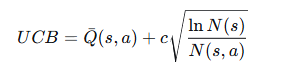
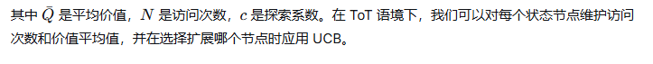
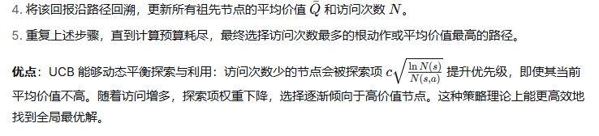

# 80.大模型（LLMs）思维树（Tree-of-Thought）

#### 解释思维树的基本框架：如何将问题求解构建为树搜索过程？

思维树（Tree of Thoughts, ToT）是一种用于增强大语言模型复杂推理能力的提示与解码框架。它的核心思想是：将一个问题求解过程构建成一棵树，其中每个节点代表一个“思维状态”（即当前的部分推理结果或中间想法），树枝代表从一个状态到下一个状态的推理步骤。模型在这棵树上进行搜索，以找到一条或多条通往最终答案的路径。

这与经典的AI问题求解范式（如A*搜索、AlphaGo的蒙特卡洛树搜索）一脉相承，ToT的创新之处在于利用LLM本身来生成和评估这些状态，而无需手工编写规则。

构建过程：

1. 根节点：将原始问题作为根状态。例如，“用数字4, 4, 6, 8通过加减乘除得到24”这个问题本身就是根。

2. 思维生成（Thought Generation）：对于当前节点（状态），利用LLM生成若干可能的“下一步思维”。这一步相当于探索当前状态下可以采取的动作或推理分支。LLM被提示生成多个不同的候选后继思维，每个后继思维代表一种可能的推理方向。例如，对于24点问题，可能的下一步思维是选择两个数字进行某种运算（比如“4+4=8”或“6*4=24”）。

3. 状态评估（State Evaluation）：对于每个生成的后继思维，利用LLM（或某种启发式函数）评估该状态的“前景”或“价值”。这决定了一个思维是否值得继续深入探索。评估可以是打分（如“肯定有希望”、“可能可行”、“不可能”），也可以是分类或比较。例如，对于中间状态“剩下数字4, 6, 8”，评估可能认为它仍然很有希望到达24。

4. 搜索与扩展（Search）：基于评估结果，选择最有价值的状态进行下一步扩展。可以使用经典的树搜索算法，如广度优先搜索（BFS）、深度优先搜索（DFS）、束搜索（Beam Search）等。通过不断迭代“生成-评估-选择-扩展”，模型逐步构建出一棵思维树，直到某个节点被评估为“最终答案”（如找到24），或到达预设的最大深度。

5. 回溯与备选：与链式思维（CoT）的单向前进不同，ToT允许在探索到死胡同时回退，尝试其他分支。这种全局搜索赋予了模型“三思而后行”的能力。

举例：在创意写作任务中，ToT可以先为段落生成几个不同的开头（多个分支），评估哪个开头最有潜力，然后基于选中的开头继续生成几个不同的发展方式，再评估，如此反复，最终形成一篇结构严谨、内容丰富的文章。整个流程就像一位作者在构思时草拟大纲、推敲不同情节走向、选择最佳方案的过程。

ToT通过显式树搜索将推理从“单线叙事”升级为“多线探索+择优前行”，极大地提升了LLM在需要规划、回溯和多步推理的任务上的表现。

---

#### ToT 与 CoT 的根本区别是什么？ToT 解决了 CoT 的什么局限？

根本区别：

CoT是线性链式推理，模型沿着单条路径从左到右生成一连串的推理步骤，直到得出最终答案。这条路径一旦生成，就无法更改；如果中途出现错误，后续推理将基于错误继续，没有回头路。CoT的搜索方式是隐式的、贪婪的，它仅依赖于模型在单次前向传播中的内部计算，没有显式的探索或回溯机制。

ToT是树状搜索式推理。它将问题分解为离散的“思维步骤”，允许模型在每个步骤同时生成多个候选思维，形成一棵思维树。然后，通过显式的评估和搜索策略，选择最有希望的分支继续探索，并保留回退到其他分支的可能性。ToT实现了显式的规划、回溯和全局择优。

ToT 解决了 CoT 的哪些局限？

1. 无法纠错与回溯：CoT最常见的失败模式是“一步错，步步错”。一旦某个中间步骤出现计算错误、逻辑跳跃或事实偏差，模型将沿着错误路径一路走到黑。ToT通过在每个节点生成多个备选方案并评估，可以在早期识别和放弃错误路径，回退到正确方向。它赋予了模型“反悔”和“尝试另一条路”的能力。

2. 缺乏全局探索：CoT只做单次深度优先的思考，没有考虑其他可能的思路。很多问题有多种解法或推理路径，CoT可能因为初始方向的选择失误而错过正确答案。ToT通过广度探索，同时考虑多个方向，然后选择最优的，这类似于从“赌一条路”变成“多路探查，择善而从”。

3. 难以处理复杂规划与约束满足：对于需要多步规划、满足复杂约束的问题（如24点游戏、填字游戏、旅行规划），CoT常常力不从心，因为它无法系统性地考虑不同步骤组合的可行性。ToT通过树搜索，本质上是在解空间中进行系统性的束搜索或DFS，能更好地处理组合爆炸问题，找到满足所有约束的序列。

4. 对“灵感”或“创造性”的挖掘不足：在创意任务中，CoT通常只产生一个连贯的序列，但人类创作时常需要推敲多个版本，比较优劣后选择最佳。ToT允许生成多个创意分支，然后评估并深化其中最出色的，这更贴近人类的创作过程，能产生更高质量的创意文本。

总结：ToT将LLM推理从“自动完成句子”提升为“带有评估和搜索的智能问题求解”。它弥补了CoT在探索性、纠错性和全局规划能力上的缺陷，是对LLM推理边界的重要拓展。

---

#### 在 ToT 中，如何定义“思维状态”？每一步的状态表示什么？

在ToT中，一个“思维状态”（Thought State）代表问题求解过程中的一个中间快照，它封装了到目前为止已完成的推理、计算或生成内容，以及剩余待解决的问题部分。状态是搜索树中的节点，连接状态的边是“思维”或“动作”。

状态的具体表示：

状态通常是文本形式的，因为LLM只能理解文本。一个状态描述通常包含以下信息：

1. 问题描述或目标：对原始问题的重述或当前子目标的说明。

2. 已经完成的步骤和结果：按顺序列出到目前为止已经采取的推理步骤、中间结论或计算结果。例如，在24点游戏中，可能记录“第一步：4+4=8，剩余数字：6,8,8”。

3. 当前上下文或约束：剩下的待处理元素、需要满足的条件、已有的部分解答等。

4. 历史思维轨迹（可选）：保留到达该状态的完整推理链，有助于后续评估和回溯。

举例：对于24点游戏（数字：4, 4, 6, 8），一个可能的思维状态表示为：

```plain text
当前状态：
- 已用运算：4 + 4 = 8
- 剩余数字：6, 8, 8
- 目标：用6, 8, 8通过加减乘除得到24
```

这个文本状态清晰地描绘了“我们目前在哪里”，并作为下一步思维生成的输入。

状态表示的要点：

- 自包含性：状态文本应包含足够的信息，使得LLM仅凭该状态就能理解当前进度并生成下一步，无需回顾全部历史。这有助于减少上下文长度和干扰。

- 结构化：使用清晰的分隔符、列表或标签（如“当前数字：”、“已用步骤：”）能让LLM更容易解析和生成一致的状态。

- 可变性：状态会随着搜索的进行而更新。当生成一个新的后继思维时，会基于当前状态创建一个新的状态文本（例如，将新运算加入已用步骤，更新剩余数字）。

在某些应用中，状态还可以包含非文本的结构化数据（如JSON），但前提是LLM能理解和生成该格式。大多数ToT实现使用纯自然语言描述状态，以保证灵活性和LLM的通用性。

状态的角色：状态是搜索树中的节点，是“生成”和“评估”的接口。生成模块根据当前状态提出候选的后继状态（即可能的下一步）；评估模块则判断一个状态（通常是新生成的后继状态）的优劣。因此，设计清晰、信息完整的状态表示，是ToT系统有效工作的基础。

---

#### ToT 的四个关键步骤是什么：分解、生成、评估、搜索，请详细解释。

ToT框架将复杂问题求解抽象为四个核心模块，这四个步骤在搜索过程中循环执行，直到找到满意的解或资源耗尽。

1. 分解（Decomposition）

分解是指将整个问题求解任务划分为若干个“思维步骤”。这一步通常由人工设计者根据问题特性预先定义，也可以在运行时由LLM动态确定。分解决定了思维树的深度，即从一个初始状态到最终答案需要经过多少步中间思维。例如：

- 24点游戏：每一步选择两个数字进行一次运算，最终经过3步得到24。深度固定为3。

- 创意写作：可以分解为“生成大纲 → 扩展每段要点 → 撰写段落细节”，每一步构成一层。

- 数学证明：每步应用一个定理或推理规则。

分解的关键在于确定合适的步长（granularity）。步长太小会导致树过深、搜索空间过大；步长太大会使单步推理过于复杂，丧失多分支探索的优势。通常选择“一次推理”的粒度，即LLM在一次提示中能可靠完成的最小推理单元。

2. 思维生成（Thought Generation）

对于给定的当前状态，生成多个可能的“下一步思维”。生成模块利用LLM，通过精心设计的提示词，要求模型提出几个不同方向的后继思维。这些后继思维应该是多样化的、有意义的，并且能推进问题解决。例如，提示词可以包含：“针对当前状态，提出3种可能的下一步操作，每种操作都应朝着目标前进。”

生成的候选思维可以是：

- 不同的动作选择（如24点中选择不同的数字对进行不同运算）。

- 不同的推理路径（如解题中采用归纳法还是反证法）。

- 不同的创意方向（如写作中设计不同的人物命运）。

生成时通常会使用带温度参数（如T=0.7）的采样解码，以产生多样性。同时可以设置top-p等方式控制质量与多样性的平衡。

3. 状态评估（State Evaluation）

评估模块对生成的后继思维（即新状态）进行价值判断，为搜索策略提供依据。评估可以有两种形式：

- 绝对评估（Value）：给状态打一个分数（如1-10），或分类为“sure/maybe/impossible”。例如，评估一个24点中间状态：“剩余数字2,3,4，目标是24”，LLM可能判断“很可能有解”。

- 相对评估（Comparison）：将几个候选状态进行比较，选出最有希望的一个或多个。例如，“下面哪个状态最有可能导致正确答案？”

评估模块同样由LLM扮演，但提示词侧重点不同。通常要求LLM扮演一个严格的评审者角色，考虑状态的可行性、进展度、潜在障碍等。评估结果可以用于剪枝（丢弃低分状态）、排序（优先扩展高分状态）或选择。

4. 搜索（Search）

搜索模块利用生成和评估的结果，控制思维树的扩展方式。它决定：

- 扩展顺序：下一步扩展哪个节点？（如选择评分最高的未扩展节点）

- 扩展范围：对选中的节点，保留多少个生成的后继状态？

- 何时停止：何时判断某个状态为最终答案，或树搜索达到资源上限？

常用的搜索算法包括BFS、DFS和束搜索（Beam Search）。束搜索最为常用：每层保留评分最高的K个状态，每状态生成M个后继，然后从所有K*M个后继中再次选出K个最高分的进入下一层。这平衡了探索广度和计算成本。

循环执行：这四个步骤构成一个循环。从初始状态开始，生成候选后继，评估它们，根据搜索策略选择下一步要扩展的节点，然后重复。整个过程就像一个迷你版的AlphaGo，LLM既是“策略网络”（生成）又是“价值网络”（评估）。

---

#### ToT 中的搜索算法有哪些？BFS、DFS 和束搜索在 ToT 中如何应用？

ToT中的搜索算法直接决定了探索的效率和效果。因为LLM的每次生成和评估都有金钱和时间成本，搜索算法必须在探索充分性与计算成本之间取得平衡。常用的算法有：

1. 广度优先搜索（BFS）

- 方式：逐层扩展。先为当前层的所有活跃节点生成后继状态，评估后保留所有的或部分最好的节点进入下一层，然后再同时扩展它们。

- 优点：系统性探索，不会陷入一条死路，能找到全局最优解（如果评估准确且资源无限）。

- 缺点：计算开销极大，因为每层都要保留多个节点，节点数呈指数增长。LLM的生成和评估成本高，BFS通常只适用于深度很浅（如2-3步）且广度受控的问题。

- 应用场景：当解空间较小、需要保证找到最优解，且可承受高成本时。例如，对于简单谜题，广度设为3，节点数有限。

2. 深度优先搜索（DFS）

- 方式：沿着一条最有希望的路径一直向下探索，直到找到答案或撞墙（无法继续或无希望），然后回溯到最近的未探索分支，继续深入。

- 优点：内存占用低，能快速深入找到一条可行解，不一定需要探索全部节点。

- 缺点：容易陷入局部最优或死胡同，如果初始选择错误，会浪费大量时间在无效路径上。评估不准确时，DFS风险高。

- 应用场景：当解路径可能很长，但存在相对明确的启发式（评估较可靠），且希望快速获得一个可行解时。例如，在创意写作中，可以沿一条最看好的大纲深入写下去，发现不行再回溯调整。

3. 束搜索（Beam Search）

这是ToT中最常用、最实用的算法。它结合了BFS的广度和DFS的成本控制。

- 方式：在每一层，只保留固定数量（束宽K） 的最佳状态。具体步骤：
  1. 从当前层的K个节点出发，对每个节点生成M个后继状态（共K*M个）。
  2. 用评估模块对这K*M个状态打分。
  3. 保留得分最高的K个状态进入下一层，其余丢弃。
  4. 重复，直到达到最大深度或找到终止状态。

- 束宽K控制了探索的广度和成本。K=1时退化为贪婪搜索（类似CoT但每步可选分支）；K越大，探索越充分，但成本也按比例增加。

- 优点：成本可控，效果显著。通过分层择优，既保持了多条有希望的路径，又避免了节点爆炸。

- 应用场景：大多数ToT应用。例如24点游戏（K=3~5），创意写作（K=2~3）。

其他搜索变体：

- 蒙特卡洛树搜索（MCTS）：更复杂的算法，结合随机模拟和选择策略（如UCB）。在AlphaGo中成功应用，也被尝试用于ToT。它通过采样来估计状态的价值，而不完全依赖LLM评估，但成本极高，目前在LLM推理中较少用。

- **A* 搜索**：需要定义从当前状态到目标的启发式估计代价，LLM可以提供这种估计，但不确定性大。

算法选择原则：取决于问题结构和成本预算。束搜索是默认首选，因为它简单、灵活，且能有效在LLM昂贵的评估预算内工作。DFS适合深度大但分支可靠性高的情况；BFS适合浅层且必须保证全局最优的场景。

---

#### 如何用 LLM 来生成下一步可能的思维？提示词如何设计？

在ToT中，生成模块负责“在给定当前状态下，提出几个可行的下一步行动或推理”。这本质上是一个条件生成任务：LLM需要理解当前状态，并产生符合问题目标、多样化的候选后继思维。

提示词设计原则：

1. 明确角色和任务：告诉LLM它正在解决一个什么问题，当前处于什么状态，需要它做什么。例如：“你正在解决一个24点游戏问题。当前剩余数字是...，目标是...。请提出3种不同的下一步运算。”

2. 提供当前状态描述：将状态以清晰、结构化的文本形式嵌入提示词。通常包括：
  - 原始问题或目标。
  - 到目前为止的推理步骤（历史轨迹）。
  - 当前剩余的选项、约束或数据。

3. 要求多个候选输出：明确要求LLM生成“N个不同的下一步”。使用措辞如“提出3个可能的下一步”、“列出5种不同的方法”。配合采样解码（temperature > 0）可以自然产生多样性。

4. 给出输出格式规范：规定每个候选的格式，便于程序解析。例如：

```plain text
请按以下格式输出：
选项1：[下一步操作描述]
选项2：...
选项3：...
```

或者要求用列表、JSON等。

5. 鼓励多样性和创造性：可加入指令“请从不同角度思考”、“尝试冒险或非直观的方案”，防止生成内容过于相似。

6. 少样本示例（可选）：提供一两个示例，展示在类似状态下如何生成多样化的下一步。

具体示例提示词（24点游戏）：

```plain text
你正在玩24点游戏。当前剩余的数字为：6, 8, 8。你可以使用加减乘除运算。请生成3个可能的下一步，每个下一步选择两个数字进行一次运算，并得出新的数字列表。
请按以下格式输出：
步骤1：[运算] -> 新数字列表 [列表]
步骤2：...
步骤3：...
```

LLM可能的输出：

```plain text
步骤1：6 + 8 = 14 -> 新数字列表 [14, 8]
步骤2：8 / 8 = 1 -> 新数字列表 [6, 1]
步骤3：8 - 6 = 2 -> 新数字列表 [8, 2]
```

生成参数设置：

- 温度（Temperature）：设为0.6~0.9，以保证足够的随机性和多样性。

- top-p：可设为0.9~1.0。

- 停止序列：定义每个候选的结束符，如换行+“步骤X”，防止生成内容溢出。

注意事项：

- 生成的思维必须是有效且可执行的（在问题上下文中）。有时LLM会生成违反规则的操作，后处理可能需要过滤无效输出。

- 如果生成过于发散，可以降低温度或加入更严格的格式指令。

- 对于需要领域知识的问题，提示中可以补充相关背景。

通过精心设计的提示词，LLM能够相当可靠地扮演“思维发散器”的角色，为树搜索提供丰富的候选分支。

---

#### 在 ToT 中，如何用 LLM 来评估一个思维状态的价值或前景？提示词和输出格式是怎样的？

评估模块（State Evaluator）是ToT中至关重要的部分，它决定了哪些分支值得继续投入计算资源。LLM在这里扮演“评判者”，需要根据当前状态和问题目标，判断该状态最终导向正确答案的可能性。

评估类型：

1. 绝对评分（Value）：直接给出一个分数，如1-10，或分类为“很有希望”、“可能有希望”、“无望”。

2. 比较排序（Comparison）：给出多个状态，让LLM比较并排序，选出最佳的一个或几个。

提示词设计要点：

1. 角色扮演：让LLM扮演一个严格的评估者或专家，例如“你是一个挑剔的数学老师，评估学生解题步骤的合理性”。

2. 提供评估标准：明确指出应该从哪些角度评估。例如：
  - 进展度：该状态是否显著推进了问题解决？
  - 可行性：剩下的步骤是否有可能达成最终目标？
  - 简洁性：路径是否过于复杂？是否有更简单的路？
  - 潜在障碍：当前状态下是否有明显的死胡同或违反约束？

3. 给出清晰的输出格式：要求输出一个分数和简短理由。例如：

```plain text
请对以下状态打分（1-10分），并给出理由。
状态：[状态描述]
评分：
理由：
```

4. 一致性要求：如果是对多个状态比较，可以要求LLM先分别评分，再排序，以确保内部一致性。

5. 利用思维链（可选）：可以要求LLM先分析状态的优缺点，再给出最终评分，以提高评估的可靠性。

评估提示词示例（24点游戏）：

```plain text
你是一个24点游戏专家，负责评估当前状态是否有希望最终得到24。
当前状态：已用运算：(4+4=8)；剩余数字：6, 8, 8；目标：24。
请评估该状态，给出一个信心分数（1-10分），并简短说明理由。
输出格式：
分数：<数字>
理由：<文本>
```

LLM输出：

```plain text
分数：8
理由：剩余数字6,8,8可以通过多种方式组合出24，例如(8-6)*8=16？实际上6*8/2? 目前有8+8+6=22，接近24，应该有解。
```

（注意：实际LLM评估可能不完美，但可作为启发式信号）

评估模块的挑战与增强：

- 单一评估可能噪声大：可以采样多次评估取平均，或使用自洽性增强可靠性。

- 成对比较更稳定：相对于绝对评分，让LLM比较两个状态“谁更好”往往更容易、更准确。提示词可设计为：“状态A和状态B哪个更可能达到目标？请选择A或B，并解释原因。”

- 结合规则或外部工具：对于某些任务，可以用外部验证器（如计算器模拟、逻辑检查器）辅助评估，提高准确性。

在搜索流程中的应用：

评估结果被搜索算法使用。在束搜索中，每层的所有候选状态按评分排序，保留前K个。在DFS中，评估帮助选择首先深入哪个分支，并决定何时放弃当前分支（评分低于阈值则剪枝）。

LLM评估虽不完美，但在树搜索中提供了极为重要的启发式指导，其价值在于将计算资源集中投入到有希望的方向上，远比随机或盲目搜索高效。

---

#### 思维树的深度和广度如何决定？与问题复杂度的关系。

思维树的深度（层数）和广度（每层保留或生成的节点数）是ToT框架的关键超参数，它们直接影响了搜索的空间大小、计算成本和解的质量。这些参数通常由问题特性驱动，并在人工分析后设定。

深度（Depth）的决定因素：

- 问题的自然步骤数：许多问题可以被自然地分解为固定数量的步骤。例如，24点游戏（4个数字，每次选2个运算一次）总是需要恰好3步。深度因此固定为3。

- 推理链的粒度：用户可以选择将推理分解得多细。较细的粒度会导致深度增加，但每步推理更简单；较粗的粒度让深度减小，但每步需要更强的推理能力。例如，数学证明可以每步只应用一条定理（深度大），也可以每步完成一个子目标（深度小）。深度由“单次思维生成”的复杂度上限决定。

- 最大深度限制：为防止无限搜索，需要预设最大深度。一旦到达最大深度，节点要么被强制评估为最终答案（或失败），要么停止扩展。这相当于搜索的“地平线”。

广度（Branching Factor/Beam Width）的决定因素：

- 分支因子（生成候选数M）：即每个节点生成多少个后继思维。M决定了局部探索的多样性。M太小会错过优质分支；M太大会增加评估负担，且很多候选相似，浪费计算。通常设M=3~5。

- 束宽（Beam Width K）：即每层保留多少个节点。K控制了全局探索的广度和成本。K=1退化为贪婪搜索，K越大则探索越充分但成本越高。K的设定受成本预算和问题分支可靠性影响。如果评估器质量高且问题分支容易分辨，K可以较小；如果问题容易陷入局部最优（如创意写作），则需要较大的K来保持多样性。

- 问题的发散性：如果一个问题有很多种解法（如写作），需要较大的广度来捕捉创意；如果问题有唯一或很少的解法，广度可以缩小。

与问题复杂度的关系：

- 复杂度高的问题：通常需要更大的深度（更多推理步）和/或更大的广度（更多探索），因为解空间更大，更容易遇到死胡同，需要更多的搜索才能找到可行路径。但这也意味着计算成本急剧增加。

- 复杂度低的问题：深度和广度都可以较小，甚至退化为CoT（深度=步数，广度=1）。

- 实际资源约束：无论问题多复杂，计算预算都有限。因此，广度（尤其是束宽K）通常成为调节旋钮：在给定预算下，通过实验找到能取得最佳性能的K值。典型K为3~10。

动态调整：在一些高级ToT实现中，深度和广度可以动态变化。例如，如果当前层候选状态评分普遍很低，可以临时增大生成数M，寻找新的突破口；如果状态评分都很高且接近，可以减小K，深入发展。但动态调整会增加系统复杂度。

实验调优：实际部署中，通常在小规模验证集上对K和M进行网格搜索，权衡性能与成本，选择帕累托最优组合。经验表明，适度的广度（K=3~5）往往能带来显著的提升，而超过一定值后边际收益锐减。

---

#### ToT 的计算成本远高于 CoT，如何进行资源管理？例如设置最大步数、剪枝策略。

ToT 通过多次调用LLM进行生成和评估，计算和API成本通常是CoT的数十倍甚至上百倍。资源管理是ToT从研究走向实用的关键挑战。以下是常用的资源管理策略：

1. 限制搜索范围（硬约束）

- 最大步数（深度限制）：设定树的最大深度，到达该深度后强制停止扩展，直接选择最优节点作为答案（或判定失败）。这防止了无限递归。

- 最大节点数/调用次数：设置一个生成或评估调用的总数上限。一旦达到上限，无论搜索是否完成，都返回当前最佳结果。这是最直接的资源上限。

- 束宽（Beam Width K）：将每层保留的状态数严格限制为K。K是控制成本最有效的杠杆：线性增加K会线性增加每层的生成和评估成本（假设每状态生成M个候选，则每层生成次数≈K*M，评估次数≈K*M）。因此，K的选择极为关键。

- 每个节点的分支数（M）：限制每次生成的候选数量。M通常固定在3~5之间，平衡多样性与成本。

2. 剪枝策略（软约束与智能放弃）

- 基于评估分数的剪枝：设定一个分数阈值（如评分<3/10的状态直接被丢弃）。这需要评估模块给出相对可靠的分数。还可以使用Top-K剪枝（与束搜索结合），即每层只保留评分最高的K个状态。

- 置信度剪枝：如果LLM评估时还能输出“把握度”，可以结合分数和把握度共同决定是否剪枝。

- 规则剪枝：对于某些问题，可以用程序规则快速判断一个状态是否非法或必然无解。例如在24点中，如果剩余数字经所有可能运算都无法得到24（可通过穷举快速验证），则可以立即剪枝。这种外部工具剪枝比LLM评估更高效可靠。

- 早期停止：一旦发现某个状态被评估为“肯定正确”或“达到目标”，立即终止整个搜索，返回该解。这避免了不必要的额外探索。

3. 分层资源分配

- 对不同深度的层分配不同的资源。例如，在浅层（早期），可以允许较大的广度（K大一些），因为早期决策影响巨大；在深层，逐渐减小广度，因为路径已相对确定。

- 在创意写作中，可以先花较多资源探索多个大纲（第一层），然后对选中的大纲花费较少资源生成细节（更深层）。

4. 缓存与复用

- 相同或相似的状态可能出现多次（不同路径汇聚）。可以缓存已评估的状态及其评分，避免重复评估。

- 生成的后继思维如果与之前生成的完全相同，可以复用之前的评估结果。

5. 模型级优化

- 使用更轻量、快速的模型（如7B）进行初步的生成和评估，筛选出少量高质量候选，然后再用大模型做最终验证和深化。这可以大幅降低成本。

- 批量调用：如果搜索策略允许，可以将多个独立的生成或评估请求合并为一个batch，通过并行处理提升吞吐、降低平均延迟，但不减少总计算量。

6. 自适应资源分配

根据问题的难度动态调整资源。对于LLM评估认为“简单”的问题（如所有候选评分都很高），可以提前缩小搜索范围；对于“难”的问题，再分配更多资源。这可以通过元认知触发。

总结：有效的资源管理使得ToT在成本可控的前提下获得最大收益。束宽K的调节是最常用且最有效的成本控制手段。通过结合评估剪枝和外部规则验证，可以进一步降低不必要的LLM调用，让好钢用在刀刃上。

---

#### ToT 在哪些类型的问题上显著超越 CoT 和其他方法？举例（如 24 点游戏、创意写作）。

ToT特别擅长那些需要探索、规划、回溯或多步约束满足的任务，这些正是CoT的薄弱之处。以下是一些典型问题类别和具体表现：

1. 数学与逻辑谜题（如24点游戏）

- 24点游戏：给定4个数字，通过加减乘除得到24。CoT可能因为初始运算选择错误而失败，且无法尝试其他组合。ToT使用束搜索，每步考虑多种运算，并通过评估发现死胡同并放弃，系统地找到正确运算序列。在ToT原始论文中，24点游戏的成功率从CoT的7%左右飙升至74%（使用束宽5）。

- 填字游戏、数独：这些强约束满足问题需要尝试可能的字母/数字，并在发现冲突时回溯。CoT几乎无法处理，因为需要长距离的依赖和纠错。ToT可以在每个格子生成多个候选，然后通过约束传播剪枝，逐步缩小空间，表现出色。

2. 创意写作与长篇文本生成

- 创意写作：写作需要构思、推敲和修改。CoT只是线性生成文本，缺乏全局规划和比较。ToT可以先生成多个不同的大纲（第一层），然后评估哪个大纲最有趣、结构最合理，选择最佳大纲后，再为每个段落生成几种不同的展开方式，择优深化。这个过程模仿了人类作者的“草拟-评估-修订”循环。实验表明，ToT生成的文本在一致性、创意性和读者评分上显著优于CoT。

- 方案策划：比如为活动制定计划，需要考虑多种因素和备选方案。ToT可以探索不同的活动主题、场地、流程，评估可行性后细化，产出更周全的计划。

3. 优化问题与规划

- 旅行路线规划：给定多个目的地和时间约束，要求找到最优路线。CoT可能只给出一个次优路线。ToT可以生成不同的路线段，通过评估总耗时或总成本，用搜索找到近似最优解。

- 资源分配：如项目调度、背包问题变种。需要尝试不同的分配组合，ToT通过树搜索能有效探索组合空间。

4. 需要世界知识或常识的复杂问答

- 对于需要综合多个事实、进行多步推理的问题，如果推理链长且容易出错，ToT通过在关键节点探索不同推理路径并择优，可以提升答案的准确性。例如，“如果小明比小红大，小红比小刚大，小刚的年龄是小亮的两倍...问谁最大？”这种关系推理，ToT可以枚举关系链，验证不同假设。

5. 交互式决策与游戏

- 在基于文本的冒险游戏或模拟环境中，模型需要在每个步骤选择动作。CoT可能选择次优动作。ToT可以前瞻多步，生成可能的动作序列，评估每种序列的后果，然后选择最有希望的动作。这类似于经典的规划算法。

举例说明表现差异：

在原论文的“创意写作”任务中，给定一个主题句，要求生成一个连贯的段落。CoT会直接续写。ToT先生成5个不同的写作计划（例如：“先介绍背景，再冲突，最后解决”），评估选出2个最好的，然后对每个计划生成多个段落草案，再次评估选出最终的段落。在人工盲评中，ToT的段落被一致认为更连贯、更有趣。成功率（即被判定优于CoT的比例）达到60%以上。

总结：ToT超越CoT的场景具有共性——问题解空间大，需要探索多种可能，回溯不可避免，且存在可评估中间状态的启发式方法。当这些问题满足这些条件时，ToT通过系统化的树搜索，将LLM的推理能力推向了一个新的高度。

---

#### 如何在 ToT 中融入回溯：如果发现某条路径走入死胡同，如何回到之前的状态？

在 ToT 中，回溯是其区别于链式思维（CoT）的核心能力之一。CoT 一旦生成错误步骤，便无法回头，只能沿着错误方向继续。而 ToT 将推理过程组织成树状结构，天然支持在多条分支间跳转，当发现某个分支走入死胡同时，能够回退到之前的节点，尝试其他候选分支。

回溯的具体实现依赖于所采用的搜索策略。

- 深度优先搜索（DFS）中的回溯：DFS 本身便是一种深度优先、遇阻则退的搜索算法。在 ToT 中，若使用 DFS，流程是：从根节点开始，选择一个最有希望的子节点深入探索；在深入的过程中，不断生成和评估下一步状态；若某一节点被评估为“无望”（如评分低于预设阈值、违反规则或无法继续生成有效后继），则算法自动返回该节点的父节点，从父节点的其他未探索子节点中再选一个继续深入。这种回溯是 DFS 的内置机制，无需额外设计，只需在程序中维护一个栈结构来记录当前路径。当需要回溯时，弹出当前节点，回到栈顶的父节点，并尝试下一个候选。

- 束搜索（Beam Search）中的回溯：束搜索通常并不显式地回溯，因为它在每一层只保留固定数量（束宽 K）的最佳状态，其余被丢弃。但我们可以为束搜索增加回溯能力，使其成为束搜索 + 回溯的变体。方法如下：当束搜索进行到某一层后，发现所有保留的状态的评分都低于某个“可行阈值”，或者经过若干步后无法找到满意解，此时可以触发回溯。回溯的做法是返回到上一层的候选池（这个池通常已被丢弃，但我们可以选择性地保留更多候选，而不仅仅是束宽 K 个）。实现方式有：
  - 保存剪枝节点：在每层剪枝时，不仅保留 Top-K，还保留评分在“待定区”的次优节点（例如第 K+1 到 K+M 个），将它们存入备用池。当主线束搜索失败时，从备用池中取出节点重新探索。
  - 迭代加深束搜索：先从小的束宽或大的剪枝强度开始，如果未找到解，则重新开始搜索，但放宽束宽或降低剪枝阈值，从而探索之前被丢弃的分支。这种方法本质上是重复搜索，但每次探索得更广，回溯体现在“重新探索曾经被忽略的路径”上。
  - 在束搜索树中记录父节点：即使常规束搜索只保留 K 个节点，我们仍然可以记录每个节点的父节点指针。当在深层发现所有束内状态均无解时，可以沿父指针向上回溯，并在上层尝试当时未被选入束的其他兄弟节点。这需要我们在生成阶段为每个父节点生成多于最终保留数量的候选（例如生成 M 个，只选 K 个进束，但保留其余 M-K 个在“后备列表”中），以供回溯时使用。

- 基于评估的回溯触发条件：关键在于准确判断何时应该放弃当前分支。常用的触发条件包括：
  - 分数阈值：如果某节点评估分数低于阈值（如 1~3 分/10 分制），认为其无望，触发回溯。
  - 连续下降：如果沿某路径连续若干步分数持续下降或保持在低位，可能进入死胡同。
  - 规则失败：使用外部规则检查器发现状态不合法（如 24 点中数值超出范围或无法操作），立即回溯。
  - 资源耗尽：为每条路径设定最大探索深度或最多节点扩展数，超限后强制回溯。

回溯中的状态恢复：回溯时，不仅需要知道回到哪个节点，还需要能够正确地恢复该节点的完整上下文（即当时的“思维状态”文本）。因此，每个节点必须存储其完整的、自包含的状态描述。当回溯到某节点时，直接读取该节点的状态文本，即可从该点重新开始生成和评估，无需重放整条路径。

通过上述机制，ToT 实现了类似于人类在解题时的“试错-撤回-重试”循环，极大地增强了处理复杂问题的鲁棒性。

---

#### ToT 与 AlphaGo 式的蒙特卡洛树搜索有什么相似和不同？

思维树（ToT）与 AlphaGo 中的蒙特卡洛树搜索（MCTS）在核心思想上高度相似，都是通过构建搜索树并在树中进行前瞻探索来做出决策，但它们在实现细节和适用条件上有本质区别。

相似之处：

1. 树搜索框架：两者都将问题求解表示为从根状态（当前局面/问题）出发，通过采取动作（思维步骤/落子）转移到新状态，构建一棵搜索树，并在这棵树上进行搜索以寻找最优路径。

2. 四个核心环节：两者都可以抽象为选择（Selection）、扩展（Expansion）、评估（Evaluation/Simulation）和回溯（Backpropagation）的循环。在 ToT 中，“生成”对应扩展，“评估”对应评估，“搜索”包含了选择。MCTS 的选择使用 UCB 公式，扩展是添加新节点，评估通过随机模拟（蒙特卡洛）来估计价值，然后沿路径回传更新。

3. 平衡探索与利用：两者都需要在已知的好分支（利用）和未知的新分支（探索）之间取得平衡。MCTS 显式地通过 UCB 中的探索项来实现；ToT 则通常通过束搜索的剪枝和生成多个候选来隐式地平衡。

4. 在巨型搜索空间中的指导作用：两者的搜索空间都极其巨大，无法穷举，因此都依赖启发式评估来指导搜索方向，避免盲目搜索。

不同之处：

| 维度 | 思维树 (ToT) | 蒙特卡洛树搜索 (MCTS) |
| --- | --- | --- |
| 状态和动作的表示 | 以自然语言文本表示思维状态和推理步骤，完全依赖 LLM 理解。 | 状态和动作是定义明确的结构化数据（棋盘矩阵、坐标等），程序可精确处理。 |
| 扩展（生成）方式 | 用 LLM 通过提示词生成候选后继思维，是一次性的、条件性的文本生成，生成数量可控。 | 通常基于规则生成所有合法动作，或在大型动作空间时使用策略网络采样动作。 |
| 评估方式 | 直接使用 LLM 进行“价值判断”（打分或分类），可视为启发式评估，无随机模拟。成本高。 | 通过随机快速走子（Rollout）进行多次模拟来估计状态价值，成本相对较低且可并行。后期 AlphaGo 使用价值网络直接评估。 |
| 回溯与更新 | 通常不进行类似于 MCTS 的统计回传（如更新访问次数和总价值），而是直接依赖每层的独立评估。束搜索只保留 Top-K，无回溯更新。 | 核心环节：每次模拟后将结果沿路径回传，更新每个节点的平均价值 Q 和访问次数 N，用于后续选择。 |
| 搜索算法 | 主要使用 BFS、DFS、束搜索等经典树搜索算法。 | 独有的选择策略（UCB1 公式）驱动的不对称树扩展，优先探索高价值节点。 |
| 适用问题类型 | 适合可自然语言描述、每步有明确推理文本的任务，如数学推理、创意写作、规划。 | 适合状态和动作空间明确定义、可通过规则模拟的游戏或决策问题。 |
| 随机性来源 | 主要依赖 LLM 解码时的采样随机性。 | 依赖 Rollout 策略的随机性和动作采样的随机性。 |

能否将 MCTS 用于 ToT？

可以，而且已有相关研究。在 MCTS 版本的 ToT 中，每次扩展节点时，用 LLM 生成有限个候选动作；评估时，可以再次调用 LLM 进行价值判断，或者进行几次“思维模拟”（即快速生成一段推理直到结束看结果）来近似 Rollout。选择时采用 UCB 公式。然而，由于 LLM 调用成本极高，大量的 MCTS 迭代（往往需要成百上千次模拟）目前不太现实。因此，ToT 更倾向于使用评估器直接打分这种“低成本”启发式，而非模拟。但 MCTS 思想启发了更高效的搜索策略，如逐步扩展、优先扩展高价值节点等。

---

#### 能否将 ToT 与外部验证器（如执行代码或规则检查）结合，提高评估可靠性？

完全可以，而且这是提升 ToT 实用性和准确性的关键手段。LLM 的自我评估虽然灵活，但常常不可靠——可能过于自信、遗漏约束或产生幻觉。将外部验证器集成到 ToT 的评估环节中，相当于为搜索过程引入“硬事实”，能显著提高评估的可靠性。

结合方式：

1. 代码执行验证（适用于数学、逻辑、编程类任务）\
   对于数学计算或逻辑推理，可以让 LLM 生成的思维步骤中包含可执行代码（如 Python 表达式），然后通过外部解释器实际运行该代码，获取精确结果。验证器根据执行结果判断状态是否正确。
  - 例如，在 24 点游戏中，每个思维步骤会生成一个数学运算（如 6×4=24）。我们可以编写一个简单的函数，接收剩余数字和目标，穷举所有可能运算，来验证该步骤在数学上是否合法，以及是否真的能推进到目标。如果某思维步骤被验证器判定为“非法”或“必定无解”，则可直接剪枝，无需再消耗 LLM 进行评估。
  - 在代码生成任务中，ToT 生成的不同实现思路可以通过实际执行测试用例来评估，通过测试的路径获得最高评分。

2. 规则与约束检查器\
   对于需要满足严格约束的任务（如填字游戏、行程规划、调度问题），可以设计专门的约束检查器。每个思维状态被送入检查器，验证是否违反任何硬性约束（如时间冲突、资源超限）。违反约束的状态被直接标记为无效（评分归零），不再扩展。这比 LLM 凭记忆检查要可靠得多。
  - 例如，旅行规划 ToT 中，检查器可以验证所选的航班时间是否衔接、酒店是否在预算内等。

3. 知识库或数据库查询\
   对于需要事实知识的推理，可以在评估时调用外部知识库或搜索引擎。LLM 生成的思维步骤中如果包含事实性陈述（如“巴黎是法国的首都”），验证器自动查询 Wikidata 或搜索引擎进行核对。如果关键事实错误，状态被降级或剪枝。这能有效对抗幻觉。

4. 结合方式的工作流\
   典型流程为：LLM 生成候选后继思维 → 每个候选思维被送入外部验证器 → 验证器返回“通过/失败”或一个合规分数 → 将此结果与 LLM 自身的启发式评估结合（例如，合规的思维再用 LLM 打分，或直接赋予基础分）。这样，评估可靠性由外部验证器保证底线，LLM 评估提供更精细的前景判断。

挑战与注意：

- 外部验证器的开发成本：需要为每个任务定制验证器，这可能削弱 ToT 的通用性。但可以设计可复用的验证器组件。

- 验证器的完备性：验证器可能无法覆盖所有情况，只能检查部分约束。此时，仍需 LLM 评估作为补充。

- 执行效率：外部验证器调用也会增加延迟和计算开销，尤其当验证复杂时。但相比无休止的 LLM 评估，这通常更高效且更可靠。

总之，ToT + 外部验证器是一种“神经符号”混合系统：LLM 负责创造性生成和灵活评估，外部工具负责精确验证。这种结合使 ToT 在需要精确性的任务中具备了生产级的可靠性。

---

#### ToT 的“思维”粒度如何选择？是一个词、一个短语还是一个段落？有哪些考量？

思维粒度（granularity）是设计 ToT 系统时最关键的决策之一，它直接影响搜索树的深度、分支因子以及 LLM 生成和评估的可靠性。粒度选择没有普适标准，需根据任务特性、LLM 能力和计算预算来权衡。

常见粒度：

- 细粒度（如一个词、一个运算）：每个思维步骤仅包含极小的推理单元。例如，在 24 点中，一步可能只是“选择两个数并做一次运算”。这样深度大（需要多步），但每步生成和评估极为简单。适合具有明确原子操作的问题。

- 中粒度（如一个句子、一个完整推理步骤）：每个思维是一个相对完整的推理片段。例如，在数学问题中，一步可能完成一个方程变形并得出中间结果。这是最常用的粒度，因为大多数 LLM 擅长生成这类连贯的句子级推理，且评估也有足够的上下文。

- 粗粒度（如一个段落、一个子目标）：每个思维代表一个较大的子问题解决方案。例如，在创意写作中，一个思维可以是一个完整的段落草案，或一个故事大纲节点。深度较小，但每步生成内容多，评估更复杂。适合需要全局一致性但局部容错率较高的任务。

选择考量因素：

1. 任务的可分解性：问题本身是否能自然地拆分成小步骤。如果可以（如算术运算），则细粒度更合适；如果步骤间耦合紧密，粗粒度更自然。

2. LLM 的生成可靠性：LLM 在一次性生成较长、复杂的内容时，可能出错率增加。如果 LLM 对某类任务在短生成上表现稳定，而在长生成上容易出错，则细粒度能提高单步可靠性；反之，如果 LLM 能在一次生成中较好地处理复杂指令，可以适当加粗粒度以减少搜索深度。

3. 评估的可行性：评估一个非常小的步骤（如单个词的选择）可能缺乏足够的上下文，难以判断其价值。评估需要足够的语义信息。因此，粒度应该保证每个思维状态包含足够的信息，让 LLM 或外部验证器能做出有意义的判断。

4. 搜索效率：细粒度导致树深度增加，但每层节点状态空间可能较小；粗粒度深度浅，但每层可能面临巨大的分支因子（因为一段文本的变体远多于一个运算）。需要平衡深度和广度，使得搜索在有限的调用次数内能有效覆盖解空间。

5. 计算成本：每步生成和评估都调用 LLM。细粒度虽然单步成本低，但总步数多，总成本可能更高。粗粒度单步成本高，但总步数少。在 API 按 token 计费的情况下，总 token 消耗是重要考量。

6. 回溯的需求：细粒度允许更精细的回溯——可以只撤销一个很小的错误步骤；粗粒度一旦出错，可能需丢弃整个大段落，成本较高。

实践经验：

- 数学推理与谜题：倾向于中细粒度，每个思维为一次运算或一个推理句。

- 创意写作：中粗粒度，每个思维为一个句子或短段落，或者在大纲阶段用粗粒度（章节主题），写作阶段用中粒度（句子）。

- 规划任务：中粒度，每步为一个动作及其直接结果。

设计时可以先尝试一种粒度，在小规模实验上观察生成多样性和评估准确性，再进行调整。灵活定义“思维”是 ToT 适应不同任务的核心优势。

---

#### 如果状态空间巨大，ToT 如何扩展？是否可以层次化搜索？

面对巨大的状态空间，标准 ToT 的束搜索或 DFS 可能仍会因分支过多或深度过大而力不从心。此时，需要采用层次化搜索和模块化分解等策略来扩展 ToT 的能力。

层次化搜索（Hierarchical ToT）：

将问题求解分解为多个层次，高层进行粗粒度的规划，低层进行细粒度的执行。这类似于人类的“先规划后执行”或“先大纲后细节”。

- 实现方式：
  1. 定义高层思维：例如，在写一篇长文时，顶层 ToT 搜索不同的文章大纲（每个大纲是一个高层思维节点）。使用评估器选出最佳大纲。
  2. 在每个高层节点内部，再启动一个低层 ToT 来展开该部分的详细内容。例如，对于选定的大纲，对每个章节分别进行 ToT 搜索，生成具体段落。
  3. 层间可以通信：低层搜索的结果可能反馈到高层，促使高层调整规划（如发现某章节内容不足，回溯修改大纲）。

- 优势：每个层次的搜索空间被大大缩小，高层只需处理少量粗粒度选择，低层只需处理局部细节。这使得 ToT 能扩展到长篇创作、复杂项目规划等原本不可能的任务。

模块化分解与分治：

将大问题分解为多个相对独立的子问题，分别对每个子问题构建 ToT，最后合并结果。

- 例如，制定一个大型活动方案，可以分解为“场地选择”、“日程安排”、“预算分配”等子问题，各自进行 ToT 搜索，然后通过一个顶层协调器解决子问题间的冲突。

渐进式扩展（Progressive Widening）：

受 AlphaGo 启发，对于分支极多的节点，不必一次生成所有可能候选，而是逐步扩展。先采样少量候选，如果后续搜索发现这些候选都不够好（如评分普遍不高），再回到该节点生成更多候选。这类似于 MCTS 中的“首次访问时扩展一个子节点”，后续再逐渐添加。这种方式可以动态地将计算资源集中在最需要探索的节点上。

利用外部检索或知识压缩状态：

对于状态表示本身可能很庞大的问题，可以用外部数据库或嵌入检索来管理状态。例如，在对话系统中，长对话历史可能导致状态文本极长。可以采用摘要技术将历史压缩为简短表示，作为思维状态的一部分。或者将大量背景信息存储在外部，思维状态中只保留关键索引，需要时再检索。

使用 LLM 进行状态抽象：

可以让 LLM 自己学会将具体状态抽象为更高层次的概念。例如，在复杂的逻辑推理中，将一系列事实概括为一个“当前已知”的摘要，从而减少后续思考需要处理的细节量。这种抽象能力使得深层搜索成为可能。

通过层次化和分解，ToT 可以将指数级复杂度的搜索空间转化为多个多项式复杂度的子搜索空间之和，从而有效扩展到原本无法处理的任务规模。

---

#### ToT 中，如何平衡探索与利用？是否可以使用 UCB 进行选择？

探索（exploration）与利用（exploitation）的平衡是所有搜索算法的核心挑战。利用意味着继续深化当前看起来最有希望的分支，探索则意味着尝试那些目前评分不高但可能蕴藏惊喜的分支。在 ToT 中，如果只利用（如束搜索始终保留分数最高的 K 个），可能过早陷入局部最优，错过那些起步慢但后劲足的解法；如果过度探索，计算资源将分散在大量低质分支上，效率低下。

ToT 中现有的平衡手段：

- 束搜索的束宽 K：K 越大，探索越充分，因为保留了更多非最优节点。这是一种简单的平衡：利用通过选择 Top-K 体现，探索通过保留一定数量的次优节点来体现。

- 采样生成（带温度）：在生成候选思维时使用一定的温度，鼓励生成多样化的选项，本身就是一种探索。低温则更偏向利用（选最可能的）。

- 评估中的鼓励探索：在提示词中要求 LLM 评估时考虑“该状态虽然目前不突出，但可能开辟新路径”，给有探索价值的状态稍高的分数。但这较主观。

- 逐步增加束宽：如前一问所述，初始束宽小，若找不到解再增大束宽，相当于先利用后探索。

能否使用 UCB（Upper Confidence Bound）进行选择？

可以，这正是 MCTS 在 ToT 中的应用。UCB 公式为：

$$
UCB = \bar{Q}(s, a) + c\sqrt{\frac{\ln N(s)}{N(s, a)}}
$$

{.ocr-src}

其中 $\bar{Q}$ 是平均价值，$N$ 是访问次数，$c$ 是探索系数。在 ToT 语境下，我们可以对每个状态节点维护访问次数和价值平均值，并在选择扩展哪个节点时应用 UCB。

{.ocr-src}

应用 UCB 的 ToT 流程：

1. 初始化根节点，访问次数为 0。

2. 从根节点开始，递归地根据 UCB 选择子节点，直到到达未完全扩展的节点（即尚有未生成的候选思维）或叶节点。

3. 对于未完全扩展的节点，生成一个新的候选思维（扩展一个子节点），并用 LLM 评估该新状态的价值。将这个价值视为一次“模拟”的回报。

4. 将该回报沿路径回溯，更新所有祖先节点的平均价值 $\bar{Q}$ 和访问次数 $N$。
5. 重复上述步骤，直到计算预算耗尽，最终选择访问次数最多的根动作或平均价值最高的路径。

**优点**：UCB 能够动态平衡探索与利用：访问次数少的节点会被探索项 $c\sqrt{\frac{\ln N(s)}{N(s,a)}}$ 提升优先级，即使其当前平均价值不高。随着访问增多，探索项权重下降，选择逐渐倾向于高价值节点。这种策略理论上能更高效地找到全局最优解。

{.ocr-src}

实际挑战：

- LLM 调用成本：MCTS 通常需要成千上万次模拟，但每次模拟在 ToT 中都意味着一次 LLM 评估调用，成本极高。因此，纯粹的 MCTS 对 ToT 来说往往过于昂贵。

- 价值评估的稳定性：UCB 假设每次价值评估是带噪声的无偏估计。但 LLM 评估可能存在系统性偏差（如对某种格式的偏好），且同一条路径重复评估结果可能波动。

- 实现复杂度：需要为每个状态维护统计数据，并支持高效的回溯更新，工程上比束搜索复杂。

折中方案：可以将 UCB 用于选择“下一步扩展哪个节点”，但限制总模拟次数（如总共只进行 50 次扩展和评估）。每次扩展仍使用 LLM 生成一个候选和评估。这种轻量级 MCTS 在部分研究中已被采用，并显示出比固定束搜索更高效的计算分配。当计算预算非常有限时，UCB 可以帮助把钱花在刀刃上。

总的来说，是否使用 UCB 取决于你是否能承受较多的 LLM 调用，以及问题对探索的需求有多强。如果任务很容易陷入局部最优，且预算允许，采用 UCB 的变体能够显著提升 ToT 的鲁棒性和最终解的质量。

---

#### 是否可以用 ToT 进行多智能体协作？每个分支作为不同智能体的思路。

可以，这是一个极富想象力的扩展方向。ToT 的树结构天然映射到多智能体讨论的场景：每个分支可以视作一个独立智能体提出的思路，树搜索过程模拟了多个智能体之间的思想碰撞、论证和择优。

实现方式：

1. 分支即智能体：在 ToT 的每个节点，生成多个候选思维的过程，可以视为多个具有不同“性格”或“专业视角”的智能体分别对当前问题提出自己的下一步方案。例如，提示词中可以为每个候选指定一种角色，如“请提出一个创新但风险较高的方案”、“请提出一个保守且稳妥的方案”、“请从预算角度考虑并提出方案”。这样生成的分支天然具有多样性，模拟了多角色讨论。

2. 辩论与评估：评估模块可以被设计成一个“评委团”或“集体讨论”的过程。除了直接用 LLM 评分外，可以让代表不同分支的“智能体”互相评论对方的方案，指出优缺点。这类信息可以反馈回评估分数，或生成更高质量的融合方案。例如，分支 A 的思维状态被分支 B 评论后，可以产生改进版的状态 A'，作为新的候选。这实际上是一种基于 ToT 的协作进化。

3. 分布式搜索：可以将巨大搜索空间的不同子空间分配给不同的智能体（或 LLM 实例）并行探索。每个智能体独立进行 ToT 搜索，定期将各自发现的最佳路径或关键状态汇报给中央协调器。协调器整合信息，决定是否需要重新分配资源或终止某些方向的探索。这种模式类似于分布式 MCTS，能显著加速大规模问题的求解。

4. 角色化思维节点：每个节点不仅记录思维内容，还记录“提出者”的角色和置信度。在回溯和选择时，除了考虑状态价值，还可以考虑角色的可靠性（如果某些角色在历史上表现更优，可以给予更高权重）。这引入了多智能体信誉机制。

应用案例：

- 复杂方案设计：设计一个营销方案时，可以有“创意专家”、“财务专家”、“法律合规专家”三个智能体分别提出分支，然后由“项目经理”智能体进行评估和整合。

- 虚拟议会：在开放域问答或伦理决策中，ToT 可以模拟不同立场代表的发言，通过树搜索找到一个多方可接受的共识方案。

- 软件开发：不同智能体负责不同模块的设计，通过 ToT 协调接口和依赖关系。

挑战：协调开销随智能体数量增加而变大；如何设计有效的辩论提示词以产生建设性批评而非无效攻击；确保评估智能体本身没有偏见。尽管有这些挑战，ToT 为多智能体协作提供了一个系统化的协调框架，使得 LLM 能够以更结构化的方式进行“群体思考”，这是纯 CoT 或单智能体对话难以实现的。

---

#### 分析 ToT 与自我一致性（Self-Consistency）的关系：是否可以把 ToT 的叶子节点投票？

ToT 和自我一致性（SC）都是从多候选结果中择优的机制，但运作层面和哲学不同。两者可以结合，形成更强大的推理策略。

ToT 与 SC 的关系：

- SC：对同一问题，用同一 prompt 多次采样（通过高温度解码）生成多条完整的推理链，然后对最终答案进行多数投票。它没有中间状态的显式搜索或评估，是全路径级的集成。

- ToT：显式构建一棵搜索树，生成和评估中间状态，动态地选择有希望的分支进行扩展，最终得到一条或少量几条路径。它的择优发生在步骤级，通过逐层筛选来实现，而不是路径生成完后再投票。

相似点：都通过产生多个候选并聚合来提高准确率，都利用了采样的多样性。

不同点：SC 是“事后投票”，对完整路径的结果进行统计；ToT 是“事前与事中择优”，在路径形成过程中就不断筛选和引导。ToT 的资源分配更智能，因为它可以只深入探索少部分最有希望的节点，而 SC 对所有完整路径平均用力。

能否对 ToT 的叶子节点投票？

完全可以，这相当于将 SC 集成到 ToT 的末端，或者说是对 ToT 搜索树中所有到达叶子（或满足终止条件）的完整路径进行答案投票。具体做法：

1. 执行 ToT 搜索，当搜索到达一定深度或因资源耗尽而停止时，收集所有叶子节点（或所有曾被评估为“最终答案”的节点）的答案。

2. 对这些答案进行多数投票或加权投票（权重可以是节点评估分数、访问次数等）。

3. 选出投票最多的答案作为最终输出。

这种结合的优点：

- ToT 保证了候选路径的整体质量远高于 SC 中随机采样的路径，因为大量低质量分支在早期已被剪枝。因此，投票候选池的“纯度”更高，投票结果更可靠。

- 对于评估不确定的末端节点，投票可以弥补单一评估的偏差。

- 保留了 ToT 的探索广度，因为不同分支可能导向不同但都合理的答案，投票能整合多方意见。

实际案例：在数学推理中，先进行 ToT 搜索，保留所有达到最深层的 10 条完整推理路径（即使某些路径评分不高）。然后提取每条路径的最终答案，进行多数投票。实验表明，这种 ToT + SC 的组合能进一步将 GSM8K 准确率提升 2~5 个百分点，因为 ToT 有时会剪掉暂时低分但最终正确的路径，而 SC 可以将它们“捞回”。

注意事项：ToT 本身已经消耗大量资源，再对所有叶子节点投票会增加额外的提取和统计成本，但这些成本相较树搜索本身很小。因此，ToT + SC 是可行的低成本增益手段。

总结：ToT 与 SC 是互补的。ToT 负责高效地探索和筛选推理路径，SC 负责在最后阶段整合多路径结果，减少剪枝带来的误伤。两者结合比单独使用任何一种都更鲁棒。

---

#### 如何实现“自适应”ToT，根据当前状态动态调整搜索策略？

自适应 ToT 是指搜索策略（如束宽、评估深度、生成候选数、剪枝阈值等）不是全局固定的，而是根据当前节点的状态特征动态调整，以便在简单处节省资源，在困难处投入更多资源。

实现自适应的方法：

1. 基于评估置信度的动态束宽\
   如果某节点的多个候选思维评估分数非常接近（如都是 7-8 分，难以区分），说明不确定性高，此时应增加束宽（保留更多候选），以避免过早剪枝错过正确路径。相反，如果分数分布悬殊（一个 9 分，其余都在 3 分以下），则可以减小束宽，只保留最优秀的。这可以通过计算候选分数的方差或信息熵来实现：若熵值高，则扩大束宽。

2. 基于状态深度的动态生成数\
   在搜索初期（根节点附近），决策影响巨大，一旦选错后面全错，因此应该生成更多的候选思维（增大 M），更充分地探索。在深层，路径已基本确定，可以减小 M，集中资源完善当前路径。这类似于人类在开始时多思考几个方案，确定方向后则专注于执行。

3. 基于历史成功率的策略调整\
   如果某个分支在历史上（如其他类似问题或本问题其他路径）频繁失败，可以降低对该类状态的评估信心，或直接增加对该类节点的剪枝强度。反之，对“成功模式”给予更高信任，可以适当冒进。

4. 启发式评估引导的资源分配\
   在评估时，除了打分，让 LLM 输出“是否值得深入探索”的二元判断，或者“需要更多思考资源”的标记。例如，若状态评估为“复杂但可能”，则标记为“高资源需求”，对该节点分配更多扩展次数和更宽松的剪枝；若为“简单明了”，则快速定论。这样，LLM 自身参与了计算资源的调配。

5. 基于问题难度的全局自适应\
   在搜索开始前，先用少量样本（或零样本 CoT）试探问题难度。如果 CoT 的成功率高，说明问题简单，整个 ToT 可以采用较小的束宽和深度。如果 CoT 多次失败，则启动高资源模式，增大束宽和搜索深度。

6. 元认知触发\
   定期让 LLM“反思”当前搜索状态：评估当前搜索是否陷入困境（如连续若干层评分都低），如果是，则触发策略变更——例如回退到更高层、增大生成候选数、或切换生成提示词以产生不同风格的思维。这种元认知控制使搜索过程更像一个智能体自主调整策略。

实现框架：可以设计一个“搜索管理器”，在每个搜索步骤，根据预定义规则或学习到的策略，决定上述参数。这个管理器本身可以是代码规则，也可以是一个小型的强化学习策略，根据搜索效率的长期回报进行优化。

挑战：自适应增加了系统的复杂度和不稳定性，可能因为频繁调整参数而做出次优决策。但是，适度的自适应（如动态束宽和基于深度的 M 调整）已被证明能在不增加平均成本的情况下提高解的质量。

---

#### 在 ToT 中，如何避免模型在评估时过于自信或过于保守？

LLM 在做评估时，常见两种极端：过度自信（给某个错误状态打高分，且非常确信）或过度保守（对所有状态都打中间分，无法有效区分）。这两种情况都会严重损害搜索效率。避免这些问题需要从提示词、校准技术和评估机制多个层面入手。

避免过度自信：

1. 强制理由与不确定性表达：在提示词中要求 LLM 不仅给出分数，还要详细阐述评估理由，并明确表达不确定的方面。例如：“请列出这个状态的优势与潜在风险，然后给出一个信心分数（1-10）和你的把握度（低/中/高）”。这种输出迫使模型进行更审慎的思考，避免脱口而出一个高分数。

2. 使用比较评估而非绝对评分：绝对评分容易受模型内在偏见影响。让 LLM 对几个候选状态进行成对比较或排序，往往比单独打分更稳定、更少出现极端值。提示词：“请比较以下两个状态，哪个更有希望？为什么？”比较任务对 LLM 来说认知负担更小，且能自然产生相对区分。

3. 引入外部校准：如果拥有少量标注数据（例如已知某个状态的好坏），可以构建一个校准集。对 LLM 的评估分数进行 Platt scaling 或温度缩放等校准，使得输出的分数更接近于真实正确概率。这属于后处理校准，但需要额外数据。

4. 采样多次评估取平均：对同一个状态，用不同的提示词措辞或者不同的温度多次评估，取分数的平均值或中位数。单次评估可能极端，多次平均能抑制野点。这与自我一致性类似，但作用于评估阶段。

避免过度保守：

1. 鼓励区分度：在提示词中明确指出“请尽量给出有区分度的评分，不要所有状态都打相似分数。大胆使用低分和高分”。这直接引导模型的输出分布。

2. 设定评分锚点：在提示词中提供评分标准范例，例如：“1分：完全无望，违反基本约束；5分：不确定，需继续探索；10分：已经非常接近最终答案”。给出明确的锚定描述可以帮助模型建立内部一致的评分尺度，减少中间分集中。

3. 分解评估维度：将单一分数分解为多个维度，如“可行性”、“进展度”、“创新性”等，分别打分后再综合。这迫使模型从不同角度审视状态，往往能产生更有区分度的结果，因为不同维度上容易有不同表现。

4. 对比自信度：如果模型在评估时还输出“把握度”，可以结合分数和把握度：当一个状态分数中等但把握度很高，可能确实一般；如果分数中等但把握度低，可能是模型不确定，此时可以标记为需要更多探索。通过分析这种元信息，可以调整后续搜索，而不是单纯依赖原始分数。

根本性策略：

最终，评估的质量与模型本身能力高度相关。更强大的模型通常评估更准、区分度更好。在资源允许下，可以使用强模型专门做评估（即使生成使用较弱模型）。此外，对于关键任务，结合外部验证器是避免自信和保守的最可靠手段。

---

#### 讨论 ToT 与“逆向思维”（从目标反推）的结合。

逆向思维（backward reasoning）是从目标出发，反向推导出达成目标所需的前提条件或步骤，直到与当前状态连接。将逆向思维融入 ToT，可以产生“双向搜索”或“从目标反推的树”，这可以显著缩小搜索空间，尤其适用于目标状态明确但初始路径众多的任务。

结合方式：

1. 双向 ToT（Bidirectional Search）\
   同时维护两棵搜索树：一棵从初始状态正向扩展（前向树），另一棵从目标状态反向扩展（后向树）。后向树的思维状态是“要达成目标，上一步应该是什么状态”。例如，在数学证明中，前向是从已知条件推导，后向是从待证结论反推所需引理。当两棵树的某个节点在语义上匹配（即一个正向状态与一个反向状态等价或可连接），则找到一条完整路径。这种方法能指数级地减少搜索节点数（因为每边只需搜索一半深度）。

2. 目标分解（子目标反推）\
   对于复杂目标，先进行逆向思维将总目标分解为几个子目标，然后对每个子目标独立进行前向 ToT 搜索。例如，要写一篇论文，逆向思维分解出“确立论点”、“收集证据”、“撰写结论”等子目标。然后对“收集证据”这个子目标进行 ToT 搜索。反推在此扮演了高层规划的角色。

3. 逆向思维作为评估的一部分\
   在评估一个正向状态时，同时使用逆向思维来检查“从这个状态出发，是否可能达到目标”。具体做法是，对给定的正向状态，调用逆向思维模块（可以是同一 LLM 但不同提示词）从目标反推到当前状态，如果能顺利反推回来，说明该状态与目标之间存在可行路径，从而提高该状态的评估分数。这为评估增加了一个更客观的维度。

4. 交替前向与后向步骤\
   在单条推理路径中，可以交替使用前向和后向思维。例如，当前状态离目标很远，可以先向后跳一步：“为了达到目标，我需要先实现什么？”得到一个子目标，然后再前向探索如何达到该子目标。这种交替可以在 ToT 的节点扩展时实现：生成的候选思维不仅包括前向步骤，还可以包括后向步骤（即设定一个中间目标）。

示例：在“24 点游戏”中，逆向思维非常有效。正向搜索可能有很多组合；逆向思维则是从 24 出发，思考“24 可以由什么运算得到？”，例如 24 = 6×4，24 = 12+12 等。然后检查剩余数字是否包含这些因数。ToT 可以先生成这些逆向候选（24 的分解），然后评估哪个分解与当前剩余数字最匹配，优先探索。这样将巨大的正向空间缩小到少数几个高潜力分支。

实现要点：

- 提示词设计：逆向思维提示词需要明确指示 LLM“从目标反推可能的前一步状态”。例如：“给定最终目标：得到数字 24。请列出所有可能通过一次运算得到 24 的表达式及其所需的前一步数字。”

- 状态表示：逆向思维产生的状态需要与前向状态格式兼容，以便匹配。通常逆向状态也表示为“已用运算、当前剩余数字”等，只是方向相反。

- 匹配准则：可以由 LLM 判断两个状态是否等价，或使用规则（如剩余数字集合相同）。

收益与局限：逆向思维能大幅提升目标导向性，减少无效探索。但其有效性取决于目标能否被有效分解，以及 LLM 的逆向推理能力。对于许多现实问题，从目标反推可能并不直观，此时双向搜索可能引入额外复杂度。因此，是否需要逆向结合需根据任务特性决定。在数学、规划和谜题类任务中，ToT 与逆向思维的结合已被证明是强有力的技术，能在相同计算预算下找到更优的解。

---

#### 如果 LLM 生成的思维状态质量不高，ToT 的性能是否会比 CoT 更差？如何缓解？

是的，当 LLM 生成的思维状态普遍质量不高时，ToT 的表现不仅不会优于 CoT，反而可能显著更差。这背后有多重原因。

为什么 ToT 可能更差：

- 错误放大的雪崩效应：在 ToT 中，搜索过程依赖 LLM 的自我评估来选择分支。如果生成的候选思维本身质量低，评估器也很难准确判断其优劣，因为“垃圾进，垃圾出”。一个错误却被打了高分的思维状态，会被束搜索优先保留和扩展，迅速将搜索资源浪费在错误路径上。

- 计算资源被大量无效调用稀释：ToT 的成本远高于 CoT。如果多数生成都是低质量的，那么这些昂贵的 LLM 调用不仅没有正向贡献，反而因为引入了噪声评估，可能导致模型放弃正确的思路（这些正确思路可能在少数高质量生成中，但被低质洪流淹没）。

- 过度自信的评估加剧错误：LLM 在评估时容易对看似合理但本质错误的状态表现出过度自信，尤其是在它自身生成的内容上。当生成质量整体偏低时，这种自我强化效应会使评估分数分布失真，高分状态往往是“精致的错误”，搜索算法会沿着这些方向深入，最终产出比单次 CoT 还差的答案。

缓解措施：

1. 提高单次生成质量的根本性改进：这是治本之策。具体方法包括：
  - 优化提示词：提供更清晰的生成指令、更严格的格式约束、更详尽的少样本示例。
  - 降低解码温度：对于需要严谨推理的任务，适当降低温度（如 0.3~0.5）以减少随机错误，虽然这会牺牲多样性，但可以在生成质量和多样性间重新平衡。
  - 使用更强的模型：如果当前模型对特定任务生成质量差，换用更大或领域微调过的模型是最直接的方法。

2. 外部验证器兜底：不依赖 LLM 自己评估自己，而是引入程序化的验证器（如数学计算检查、约束规则校验、测试用例执行）。只要生成的状态能被外部工具客观判定对错，即使生成质量普遍不高，正确的候选也能被准确识别，错误的会被立即剪除。这样，ToT 就从“内循环”变为了“外验证”驱动，鲁棒性大幅提升。

3. 多样性与质量过滤：生成远多于最终保留数量的候选，然后先用快速的规则（如长度、格式、关键信息完整性）过滤掉明显不合格的，只让剩下质量相对较高的进入评估环节。这可以减少低质状态对评估器的干扰。

4. 集成评估（陪审团模式）：对同一个状态，使用不同提示词或不同模型多次评估，取平均或投票。这降低了单一评估偶发错误的冲击，特别是当生成质量波动大时。

5. 动态降级为 CoT：如果 ToT 在早期阶段（如前两层）就发现生成的状态评估分数普遍很低，说明模型在当前问题上可能不适合使用 ToT（或参数设置不当）。此时可以自动回退到 CoT，将已生成的较高分状态直接作为上下文，进行线性推理。这避免了持续浪费计算资源。

6. 注入领域知识或约束：通过在提示词中明确定义可行规则、常见错误模式、或使用检索增强生成（RAG）提供相关背景，提升 LLM 生成的正确率和评估的准确度。

总之，ToT 是放大器：如果基础生成可靠，它能极大提升上限；如果基础生成有缺陷，它也会放大缺陷。因此，部署 ToT 前必须确保单步生成和评估的可靠性达到基本门槛。

---

#### ToT 的并行化：能否在同一层并行生成和评估多个思维节点？

能，并行化是 ToT 在实际部署中降低墙钟时间的关键优化。ToT 的多个步骤天然具备并行执行的条件，因为同一层的节点之间通常没有依赖关系。

并行化模式：

1. 层内并行生成（Intra-layer Generation Parallelism）\
   在束搜索的每一层，我们需要对当前保留的 K 个节点，为每个节点生成 M 个候选后继思维。这 K 个生成任务是完全独立的，可以同时进行。实现方式有：
  - 批量推理（Batching）：将这 K 个生成请求合并为一个 batch，一次性提交给推理引擎（如 vLLM、TensorRT-LLM）。推理引擎利用连续批处理能力，将它们并行处理，大幅减少总等待时间。需要注意的是，不同节点的 prompt 可能不同（因为状态描述不同），batch 中每个请求的 prompt 是独立的。
  - 异步并发调用：如果使用 API 调用，可以同时发出 K 个异步请求，等所有返回后再集中处理。

2. 层内并行评估（Intra-layer Evaluation Parallelism）\
   生成完 K*M 个候选状态后，需要对这些状态逐一评估。评估之间也是完全独立的，可以再次通过批量推理或异步并发来并行完成。对于评估，甚至可以将 K*M 个评估 prompt 打包成一个巨大的 batch，只要显存允许。

3. 层间流水线（Inter-layer Pipelining）\
   如果系统支持多流或异步执行，可以在对当前层进行评估的同时，预先为下一层准备生成上下文。不过由于 ToT 的层与层之间有严格的依赖（必须先评估完本层，确定哪些节点进入下一层，才能生成下一层），完全的流水线需要一些推测性的工作，例如基于当前评估分数的预估，提前为可能胜出的节点预热 KV Cache 或预加载模型，但这种方法复杂度较高。

并行化的挑战：

- 显存限制：巨大的 batch 会消耗大量显存用于存储 KV Cache。如果 K*M 很大，可能超出 GPU 显存，导致 OOM。此时需要将 batch 拆分为多个子批次，分批并行。

- KV Cache 复用：如果多个生成请求共享相同的前缀（如系统提示或问题描述），推理引擎可以复用前缀的 KV Cache，节省显存和计算。在 ToT 中，同一层不同节点的 prompt 前缀可能不同（因为历史状态不同），因此共享率可能有限。但在某些实现中，可以用结构化 prompt，使共享部分最大化。

- API 速率限制与成本：使用公共 API 时，大量并发调用可能触发速率限制。需要实现重试和退避机制。

最佳实践：

- 将 K*M 的生成与评估分别合并为批量请求，是现代推理引擎下的标准做法。

- 在束搜索中，每层生成和评估可以并行，然后同步等待结果，再进行剪枝。墙钟时间由单次批量推理的延迟主导，大幅缩短了整体搜索时间。

- 对于极大规模的搜索，可以采用分布式推理集群，将不同子树的探索任务分配到不同 GPU 节点，实现跨节点的并行。

ToT 的并行化为其在生产环境中的实时应用提供了可行性，否则串行生成和评估会导致延迟极高，难以满足交互式需求。

---

#### 在开放式文本生成中，如何用 ToT 进行规划和全局连贯性控制？

开放式文本生成（如故事创作、长文写作、方案策划）面临着保持长篇内容逻辑连贯、结构严谨的挑战。CoT 通常只产生线性文本，容易出现前后矛盾、跑题或结构松散的问题。ToT 可以通过分层规划和全局择优来解决这一问题。

具体应用方法：

1. 分层思维树（Hierarchical Planning）\
   将写作过程分为多个层次，每层使用 ToT 进行相应粒度的规划。
  - 顶层（大纲层）：将整篇文章的结构作为搜索对象。生成多种可能的大纲（如不同的叙事顺序、论证结构、章节划分），对每个大纲评估其逻辑性、吸引力和可行性。选择最优大纲后，将其固化为后续写作的约束。
  - 中层（段落/章节层）：对于每个章节，再次使用 ToT 生成该章节内部的多个段落规划（如开头、论据、例证、小结），评估后择优。
  - 底层（句子/细节层）：基于段落规划，生成具体文本。此时可以退化为 CoT 或较少分支的束搜索，因为细节的选择已受上层规划强力约束。

2. 全局连贯性评估器\
   在评估每个思维状态（无论是大纲节点还是段落规划）时，评估标准必须特别强调全局连贯性。具体评估维度可以包括：
  - 与已确定的上层规划的一致性。
  - 与之前已写内容的逻辑连贯性（是否前后矛盾）。
  - 对整体主题的贡献度。\
    提示词可以要求 LLM 扮演“挑剔的主编”，从这些维度严格打分。对于长篇，可以在评估时提供前文的摘要作为上下文，而不是全文，以节省 token 并聚焦关键信息。

3. 回溯与修改\
   如果在中层写作时发现某个章节的大纲前提难以实现，或发现与后文规划冲突，ToT 允许回溯到高层，修改或替换原有大纲节点。这种跨层回溯是保持全局一致性的关键。例如，写到第三章时发现与第一章设定的伏笔矛盾，ToT 可以回到第一章大纲的兄弟节点（当时被淘汰的备选大纲），评估替换后是否能解决矛盾，从而全局调整。

4. 保持不同情节线的束\
   在故事创作中，可以同时维护几条不同的情节发展线（束宽 K），每条线都是一个完整的“故事走向”。在关键情节点，评估各条线的戏剧张力、合理性，保留最好的 K 条继续发展。这类似于小说家同时构思多个剧情分支，最终选择最精彩的一个。

5. 一致性检查节点\
   可以专门设定一类思维状态为“一致性检查”。在关键节点，生成思维不是新的内容，而是“检查已写内容是否存在逻辑漏洞”，评估该检查的重要性，如果发现漏洞，再生成修复方案作为新的分支。

实际效果：这种基于 ToT 的写作助手，能够产生结构更清晰、前后呼应更强的长文。实验表明，在人类评判中，ToT 生成的文本在“整体结构”和“连贯性”维度上显著优于 CoT。缺点是成本较高，因此通常用于对质量要求极高的写作场景，如正式报告、小说章节、剧本创作等。

---

#### ToT 的提示模板设计有哪些技巧？如何让模型输出可解析的结构化思维？

ToT 高度依赖提示模板来引导 LLM 完成状态生成和评估。设计不佳的提示会直接导致输出混乱、不可解析，使搜索失败。以下是一些关键技巧：

1. 角色与目标明确化

开篇即用清晰的指令告知 LLM 它在解决什么问题、扮演什么角色。例如：“你是一个正在解决逻辑谜题的AI。你的任务是通过逐步推理找到答案。”

2. 状态上下文的清晰注入\
   使用明确的标记（如 `[当前状态]`, `[历史步骤]`, `[剩余目标]`）将当前状态信息结构化地嵌入提示中。这能让 LLM 准确理解“当前在哪”，避免混淆。

3. 输出格式的严格约束

要求 LLM 以固定格式输出，便于程序解析。常用方法：

- 列表格式：

```plain text
请提出3个可能的下一步操作，每个操作用一行表示，格式为：步骤N: [操作描述]
```

JSON 格式：强制输出 JSON，易于解析。但需注意 LLM 可能会输出无效 JSON（遗漏括号等），可以结合重试机制或使用约束解码（constrained decoding）来保证格式正确。例如：

```plain text
请以JSON格式输出：
{
  "candidates": [
    {"step": "操作1", "reasoning": "理由"},
    ...
  ]
}
```

- 特殊分隔符：使用 `---` 或 `###` 等特殊标记分隔不同的候选或不同的字段，减少解析歧义。

4. 利用 Few-Shot 示例固化格式

在提示词中提供 1~3 个完整的示例，展示从某种状态生成候选、评估候选的完整过程和输出格式。示例是让 LLM 遵循格式要求最有效的方式。示例必须格式绝对一致，且覆盖可能出现的边界情况（如状态无解时如何输出）。

5. 分离生成与评估的提示模板

生成和评估任务性质不同，应设计不同的模板。

- 生成模板侧重于开放性、创造性，指令中常有“请提出多样的、不寻常的方案”、“从不同角度思考”。温度通常较高。

- 评估模板侧重于批判性、分析性，指令中常有“请严格评估”、“指出潜在风险”、“给出一个1-10的分数并说明理由”。温度通常较低。

6. 引入思维链作为辅助

在要求评估输出分数前，让 LLM 先进行一段自由文本的分析（CoT），再给出结构化的评分。例如：“请先分析该状态的优缺点，然后给出最终评分：...”。这能提高评分的可靠性。

7. 错误处理与重试提示

如果 LLM 输出无法解析，系统应能捕获错误，并构造一个“修正提示”重新提交。修正提示包含原始提示、LLM的错误输出、以及明确的纠错指令，例如：“你的上一条输出格式不正确，请严格按照JSON格式重新输出。”

8. 使用更可靠的解码策略

对于结构化输出，可以开启 LLM 的 JSON mode（如 OpenAI 的 response_format）或使用 guidance、outlines 等库进行约束解码，从 token 级别保证输出符合预设的语法，根本上解决格式解析问题。

通过这些技巧，ToT 系统能够可靠地与 LLM 交互，将模型的不确定性输出转化为确定性的结构化数据，支撑起可靠的搜索过程。

---

#### 评估 ToT 方法的指标：除了任务成功率，还应考虑哪些？

评估 ToT 不能仅看最终准确率，因为它的成本远高于其他方法。多维度评估能揭示其效率、鲁棒性和实用性。

1. 效率与成本指标

- 平均调用次数：完成单个任务平均需要多少次 LLM 调用（生成+评估）。这是衡量计算成本的核心指标。应分别统计生成调用和评估调用。

- 总 Token 消耗量：所有调用消耗的总输入和输出 token 数。这直接关联 API 费用或计算资源。

- 墙钟时间：从开始搜索到得出答案的实际时间。并行化程度会显著影响此指标。

- 成本-收益比：以“每提升 1% 准确率所增加的调用次数/token 量”来衡量方法的效率。

2. 搜索质量与鲁棒性

- 成功率@K：在计算预算限制下（如最多调用 50 次）的成功率，反映在有限资源下的表现。

- 解的路径质量：不仅看答案对不对，还要看推理路径是否简洁、逻辑清晰。可以用路径长度（步数）、评估分数均值等来衡量。

- 方差与稳定性：多次运行同一问题的成功率的方差。低方差意味着方法对随机采样不敏感，更稳定。

- 对超参数的敏感性：调整束宽 K、生成候选数 M、温度等超参数时，性能的波动情况。理想的 ToT 应该对超参数具有一定鲁棒性。

3. 与基线的对比改进

- 相对 CoT 的提升率：ToT 成功率相对于 CoT 的绝对提升百分比。

- 突破点分析：在哪些类型的问题上 ToT 提升最大，哪些上提升有限甚至更差。这有助于了解 ToT 的适用边界。

4. 评估自身的可靠性

- 评估准确率：LLM 评估器给出的分数，与状态实际能否导向正确答案的一致性。可以事后分析：被评估为高分的状态最终成功了的比例（Precision），以及所有最终成功的状态中被评估过高分的比例（Recall）。

- 剪枝错误率：因为低评分而被错误丢弃，但本可导向正确答案的节点比例。这反映了搜索的保守程度。

5. 通用性与可扩展性

- 跨任务迁移能力：为某一任务设计的 ToT 提示和搜索策略，在未经调整的情况下，在另一相似任务上的表现。

- 随模型规模扩展的增益：在较小模型和较大模型上，ToT 相比 CoT 的额外收益是否增加。

综合评估框架：实践中，可以绘制“成功率-成本”帕累托前沿，比较不同方法（CoT, ToT with different K, SC）的曲线，选择在给定预算下成功率最高的配置。这比单看成功率更全面，也更贴近实际部署的决策需求。

---

#### ToT 是否可以与 RAG 结合，在搜索过程中获取外部知识？

可以，而且这种结合能显著增强 ToT 处理知识密集型任务的能力。ToT 的每一步生成和评估都可以从外部知识库中动态检索相关信息，使推理建立在实时、准确的事实基础上，减少幻觉。

结合模式：

1. 状态增强式检索\
   在生成下一步候选思维之前，将当前状态的关键信息作为查询，检索外部知识库（如 Wikipedia、企业内部文档）。将检索到的相关片段附加到生成提示中，为 LLM 提供额外的上下文。这样生成的思维不仅有模型内部知识，还融合了外部事实，更准确、更实时。例如，在历史问题推理中，每一步都可以查询相关历史事件细节，确保后续推理建立在正确史实上。

2. 评估增强式检索\
   在评估一个思维状态时，同样可以触发检索。评估提示中加入检索到的信息，让 LLM 基于外部事实判断该状态是否合理、是否符合已知数据。例如，一个行程规划状态提到“从 A 地到 B 地需 2 小时”，评估时检索实时交通数据，验证这个时间是否合理，从而给出更准确的可行性评分。

3. 知识驱动的剪枝与扩展\
   检索结果可以直接用于剪枝：如果检索到的权威信息明确否定了一个状态的某个关键假设，该状态可被直接剪枝，无需 LLM 评估。同样，检索可以启发新的分支：如果检索发现了 LLM 最初未想到的相关实体或关系，可以据此生成新的候选思维，拓展搜索方向。

4. 检索历史缓存\
   在搜索过程中，同一知识可能被多次需要。系统可以将已检索的信息缓存起来，避免重复请求。缓存可以按查询键组织，后续相同或相似查询直接返回缓存结果。

挑战与注意点：

- 检索延迟：每次检索都会增加数十到数百毫秒的延迟。在需要大量迭代的 ToT 中，检索次数需审慎控制，避免拖慢整体搜索。可以只在关键节点（如遇到不确定事实、高价值节点）才触发检索。

- 检索质量：低质量的检索结果会误导 LLM，反而降低推理质量。需要使用可靠的检索系统和相关性排序。

- 上下文窗口膨胀：注入检索片段会迅速消耗有限的上下文长度。需要精炼检索结果（如只取最相关的前 1-2 个片段，或对片段进行摘要），为真正关键的推理留出空间。

- 成本：知识库 API 调用也会产生额外费用。

应用实例：在医疗问诊 Agent 中，ToT 生成鉴别诊断的多个分支，每一步都检索医学知识库验证症状与疾病的匹配度，评估分支的可能性。这使得推理过程具有专业级别的准确性，并能够即时引用文献支持。

ToT + RAG 是构建“有根据的推理树”的核心技术，将 LLM 的灵活推理与外部知识的确定性结合，是未来智能 Agent 的重要方向。

---

#### 如何把 ToT 应用于代码生成，把程序结构作为树进行搜索？

代码生成天然适合 ToT，因为程序设计具有清晰的层次结构和可分解性。将 ToT 应用于代码生成，可以把求解过程变成对程序结构的系统化搜索。

核心思想：将代码生成视为一个逐步构建抽象语法树（AST）或程序框架的过程，每一步决定程序的一个结构元素（如函数、循环、条件分支、API 调用）。

具体应用模式：

1. 分层程序规划
  - 顶层（架构层）：思维状态是整个程序的高层结构，如“使用递归解决”、“采用 Map-Reduce 模式”、“先解析输入，再处理核心逻辑，最后格式化输出”。生成多个候选架构，评估其可行性、效率和可读性，选择最优架构。
  - 中层（模块/函数层）：在选定架构下，对每个模块或函数生成多种实现思路。例如，对于排序函数，思维可以是“使用快速排序”、“使用归并排序”、“调用内置 sort 函数”。每个思路作为一个状态，进一步分解。
  - 底层（代码块层）：在选定算法思路后，生成具体的代码块（伪代码或实际代码）。此时搜索可以退化为带有测试用例验证的简单择优。

2. 基于测试驱动的搜索\
   在代码生成中，测试用例是天然的评估器。ToT 与代码生成的结合通常紧密围绕测试：
  - 生成候选代码片段（思维状态）。
  - 对每个候选代码，立即执行测试用例（或部分测试用例）进行验证。
  - 根据测试通过率、执行结果和代码风格进行评分。通过测试越多的候选保留下来继续优化。\
    这种方法将 ToT 变成了一个自动化的调试与优化循环：如果某段代码没有通过全部测试，ToT 可以生成多个“修复候选”（针对失败用例修改代码），然后再次测试，择优。这就是程序合成中的“搜索正确实现”。

3. 程序分解与子任务树\
   对于复杂程序，可以将任务分解为子程序，每个子程序本身再用 ToT 实现。形成的树是“任务-子任务”树，叶节点是具体代码。这种层次化搜索能管理复杂度，让 LLM 每次只聚焦一个小问题。

4. 利用代码的结构化特性\
   在提示词中，可以要求 LLM 输出的思维状态本身包含可解析的代码结构，如带有特定注释标记的代码骨架：

```plain text
# [STEP] 实现输入解析
def parse_input(text):
    # TODO: 两种实现方案
```

1. 解析器可以提取这些标记，识别出未完成的占位符，并将其作为下一步生成的目标，从而实现增量式编程。

实例：实现一个“计算器”程序。ToT 顶层可能生成两种架构：A) 递归下降解析器，B) 调用 eval 的简易方案。测试驱动评估发现 A 更安全且可处理复杂表达式，因此保留 A。然后对 A 的“词法分析”子模块生成基于正则或状态机的不同实现，分别测试，最后选出最佳组合。

优点：这种 ToT 可以产生更健壮、更符合最佳实践的代码，因为它探索了多种实现策略并通过测试筛选，而不是局限在 LLM 最可能生成的一种解法上。

局限性：计算成本极高，因为编译、运行测试用例都非常耗时。通常用于对正确性要求极高的核心算法或库代码的自动生成，而非日常脚本。

---

#### 思维树的可视化和调试：如何让用户理解模型的决策过程？

让用户理解 ToT 的决策过程，不仅能增强对模型输出的信任，还能帮助开发者调试和优化 ToT 系统。需要设计直观的可视化和交互手段。

1. 树形结构的可视化呈现

- 交互式节点链接图：用树图展示整个搜索过程。根节点在最左边或顶部，每一层向右或向下展开。每个节点显示简化的状态文本摘要（如“剩余数字：6,8,8”），鼠标悬停或点击可查看完整状态。

- 节点颜色编码：用颜色表示节点的评估分数（如绿色代表高分，红色代表低分，灰色代表被剪枝）。用户可以一眼看出哪些分支被评估为有希望，哪些被放弃。

- 边标签：连接父子节点的边上显示所采取的动作或思维内容（如“6+8=14”）。

2. 路径高亮与对比

- 高亮最终被选中的答案路径，展示完整的推理链。同时，可以半透明显示其他被探索但最终未采纳的路径，让用户理解“为什么选择了这条路而不是另一条”。

- 提供分支对比面板：允许用户选择两个或多个分支节点，并列显示它们的完整状态、评估分数、以及后续发展，进行直接对比。这对于理解评估器的偏好特别有帮助。

3. 关键决策点的解释

- 在可视化界面中，对评估分数发生剧烈变化、或束搜索发生重要剪枝的节点进行特殊标记（如感叹号图标）。点击这些标记，弹出解释窗口，展示 LLM 当时的评估理由。

- 如果使用了外部验证器（如计算器），在相应节点显示验证结果（“计算验证：正确”或“规则检查：失败”）。

4. 统计与摘要面板

- 展示搜索总览：总节点数、成功路径数、平均评估分数分布直方图、每层节点数、剪枝节点数等。

- 资源消耗仪表盘：显示总 LLM 调用次数、token 消耗、墙钟时间，与 CoT 的消耗进行对比，让用户直观感受性能成本。

5. 调试回放与步进

- 可以记录整个搜索过程，允许用户像调试程序一样单步执行 ToT：从根节点开始，手动点击“生成下一步”，查看生成的候选；手动触发“评估”，查看评估结果；手动选择保留哪些节点。这让开发者能深入诊断是生成器的问题还是评估器的问题。

- 假设分析：允许用户回溯到某个节点，手动输入一个不同的候选思维，然后观察 ToT 如何从这个假想状态继续搜索。这有助于回答“如果当时选了另一个分支会怎样”。

6. 自然语言摘要

- 除了图形界面，还应提供一段自动生成的决策过程摘要：“本问题进行了 3 层搜索，共探索了 5 个主要方向。方向A因为评估分数较低（3分）被早期放弃；方向B在第二步时发现计算错误，被规则检查器剪枝；最终方向C以最高的综合评分（8分）被选中，并成功得出正确答案。”

通过这些可视化和交互，ToT 从一个黑箱变成了一个可解释、可调试的透明搜索系统。这在实际部署中对于获取用户信任、优化 prompt 和搜索参数至关重要。

---

#### 你认为 ToT 的未来会走向何方？它可能成为 Agent 的核心推理引擎吗？

ToT 代表了 LLM 推理从“直觉式”到“审慎式”的进化方向。展望未来，它极有可能成为复杂 Agent 的核心推理引擎之一，但不会是唯一引擎，更可能以混合架构的形式存在。

未来发展趋势：

1. 从静态搜索到动态自适应搜索\
   未来的 ToT 将不再是固定束宽、固定深度的简单搜索，而是能够根据问题难度和当前置信度动态调整搜索策略的自适应系统。它将融合元认知（自我评估当前思考的可靠性），在简单任务上退化到 CoT（零搜索成本），在复杂任务上自动扩展为深度树搜索，在极不确定时触发外部工具调用或向人类求助。

2. 与深度规划算法更紧密的融合\
   ToT 将更多地吸收经典 AI 规划中的技术，如分层任务网络（HTN）、偏序规划、MCTS 的变体等。LLM 将充当这些规划器中的启发式函数（生成器和评估器），而搜索框架本身由更高效、更可证明的算法提供。例如，在机器人任务规划中，ToT 风格的 LLM 将生成高层子目标，而低层运动规划由专门的算法完成。

3. 多模态和具身 ToT\
   随着多模态 LLM 的发展，思维状态将不仅包含文本，还可以包含图像、音频、3D 场景描述等。在具身智能中，机器人可以使用 ToT 在想象空间中搜索不同的动作序列，通过模拟环境的反馈（外部验证器）来评估，从而进行物理世界的问题求解。

4. 成为 Agent 的“前额叶皮层”\
   在复杂 Agent 系统中，ToT 可以承担“深思熟虑”的角色。类似于人类大脑的双系统模型，Agent 可以有 System 1（快速直觉式响应，如 CoT 或直接生成）和 System 2（慢速审慎式推理，如 ToT）。ToT 作为 System 2，处理需要规划、多步推理、复杂决策的任务，而 System 1 处理日常对话和简单指令。两者由中央控制器调度。

5. 分布式和协作式思维树\
   搜索树的扩展可以由多个专门化的模型或智能体完成。例如，一个创意生成智能体负责产生候选，一个批判性评估智能体负责打分，一个事实核查智能体负责外部验证。这种协作式 ToT 能结合不同专长，产生比单个通用模型更优的搜索效果。

6. 端到端学习与搜索的闭环\
   未来的 ToT 不仅用于推理时，还将用于训练时。可以将搜索过程产生的正确推理路径作为训练数据，微调 LLM，使其内化更好的推理策略，从而在推理时减少搜索开销。这形成了“搜索产生数据，数据改进模型，模型指导搜索”的正向循环。

可能成为核心推理引擎吗？

是的，但会是混合推理引擎的一部分。对于需要高可靠性、复杂规划、或高风险决策的 Agent 任务，ToT 或其变体极有可能成为核心的推理框架。但它不会完全取代轻量级推理，因为很多任务不需要、也负担不起树搜索的高成本。未来的 Agent 架构可能是一个分层的推理架构：顶层是 ToT 风格的慢思考，用于制定总体计划、处理意外异常和进行关键决策；底层是经过高度优化、甚至编译为状态机的快思考，用于执行常规子任务。

ToT 的未来在于将 LLM 的灵活性与经典搜索/规划的系统性深度融合，创造出既有创造性又有严谨性的新一代智能系统。这将是通往更通用、更可靠的人工智能的关键路径之一。

