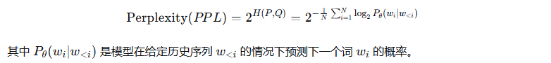
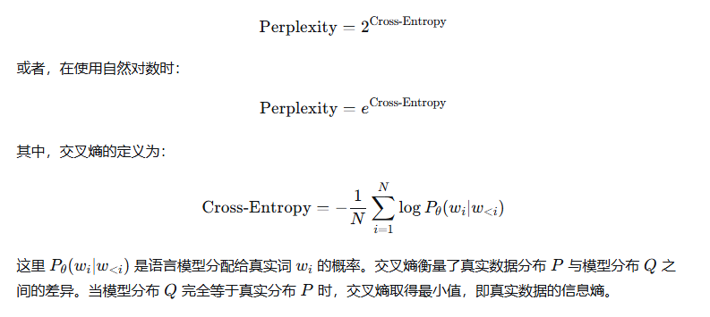
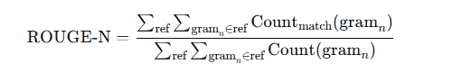

# 108.大模型（LLMs）自动评估指标（困惑度、BLEU、ROUGE、BERTScore）

#### 困惑度（Perplexity）的定义是什么？它在语言模型中衡量什么？

困惑度是评估语言模型性能最核心的指标之一。它的定义基于交叉熵。对于一个语言模型，给定一个测试文本序列 w1,w2,...,wN，模型的困惑度定义为其交叉熵的指数形式：

$$
\text{Perplexity}(PPL) = 2^{H(P,Q)} = 2^{-\frac{1}{N}\sum_{i=1}^{N} \log_2 P_\theta(w_i|w_{<i})}
$$

其中 $P_\theta(w_i|w_{<i})$ 是模型在给定历史序列 $w_{<i}$ 的情况下预测下一个词 $w_i$ 的概率。

{.ocr-src}

它衡量什么？

困惑度衡量的是语言模型对一段文本的预测能力。直观上，它等价于模型在每个预测位置上平均需要从多少个等概率的选项中进行选择。困惑度越低，意味着模型对测试文本的预测越“不困惑”，其预测概率越高，即模型越能准确地预测下一个词是什么。这反映了模型对语言统计规律的掌握程度。因此，困惑度是衡量语言模型内在拟合优度的核心指标。

关键点：困惑度是一种内在评估指标，它直接使用模型输出的概率分布与真实文本进行比对，不需要任何外部参考。这使得它的评估完全自动化和客观。

---

#### 写出困惑度与交叉熵之间的关系，并解释为什么困惑度越低越好。

与交叉熵的关系

困惑度（PPL）和交叉熵（Cross-Entropy, CE）之间存在着严格的数学等价关系：

$$
\text{Perplexity} = 2^{\text{Cross-Entropy}}
$$

或者，在使用自然对数时：

$$
\text{Perplexity} = e^{\text{Cross-Entropy}}
$$

其中，交叉熵的定义为：

$$
\text{Cross-Entropy} = -\frac{1}{N}\sum_{i=1}^{N} \log P_\theta(w_i|w_{<i})
$$

这里 $P_\theta(w_i|w_{<i})$ 是语言模型分配给真实词 $w_i$ 的概率。交叉熵衡量了真实数据分布 $P$ 与模型分布 $Q$ 之间的差异。当模型分布 $Q$ 完全等于真实分布 $P$ 时，交叉熵取得最小值，即真实数据的信息熵。

{.ocr-src}

为什么困惑度越低越好？

困惑度越低，意味着交叉熵越低。交叉熵越低，代表模型对测试文本的预测概率越高，模型越“确信”正确的下一个词是什么。换句话说，模型对真实语言的统计模式拟合得越好。

直观理解：如果一个语言模型的困惑度是 10，那么它在预测下一个词时，平均而言，其不确定度相当于从 10 个等概率的词中随机猜测一个。如果困惑度是 100，则相当于从 100 个词中猜测。显然，模型越“困惑”，其预测能力越差。因此，困惑度越低，模型的语言建模能力越强。

---

#### 困惑度在评估文本生成质量时有什么局限性？为什么不能单独作为评估标准？

尽管困惑度是语言模型训练中不可替代的损失函数和内在评估指标，但它在评估下游文本生成质量时存在显著的局限性，绝不能作为唯一的评估标准。

主要局限性

1. 无法衡量生成文本的语义质量：困惑度只能评估模型对给定文本的预测能力。它无法衡量模型自行生成的文本是否流畅、连贯、合乎逻辑。一个低困惑度的模型依然可能生成语法正确但内容荒谬的句子，因为它只是在统计上学会了排列组合高频词汇。

2. 对语义等价不敏感：困惑度是一种严格的逐词匹配评估。如果参考文本是“他跑得很快”，而模型生成了“他跑得飞快”，虽然语义几乎相同，但困惑度会因为词表不匹配而给出极低的分数（极高的困惑度）。它完全无法处理语言表达的多样性。

3. 任务无关性：困惑度衡量的是通用的语言建模能力，而不是执行特定任务（如翻译、摘要）的能力。一个在小说语料上困惑度很低的模型，可能完全无法遵循指令进行对话。

4. 对评估数据分布敏感：困惑度高度依赖于评估文本的领域和风格。如果测试集与训练集分布不一致，困惑度会剧烈升高，但这并不意味着模型的能力变差，只是领域不匹配。

为什么不能单独使用

因为文本生成的最终目标是产出对人类用户有价值、符合特定需求的文本。困惑度就像是一辆汽车的发动机热效率——它衡量了发动机自身的能量转换效率，但无法告诉你这辆车是否舒适、安全、漂亮。一个优秀的文本生成系统，除了内在的语言建模能力（低困惑度）外，还需要具备事实性、创造性、对话连贯性和风格适应性等能力。这些能力必须通过外在评估指标（如BLEU、ROUGE、BERTScore）和人类评估来综合衡量。

---

#### BLEU 指标的计算原理是什么？n-gram 精确度和简短惩罚（Brevity Penalty）各起什么作用？

BLEU 是最早被广泛使用的机器翻译自动评估指标。它的核心思想是：如果候选译文与一组人工参考译文在词汇和短语片段上越相似，那么它的质量就越高。

计算原理

1. n-gram 精确度：BLEU 首先计算候选译文与参考译文之间，从 1-gram 到 N-gram（通常 N=4）的精确度。但是，为了防止模型通过简单堆砌高频词来作弊，BLEU 采用了裁剪后的精确度。即，对于每个 n-gram，其在候选译文中的出现次数，会被裁剪为它在任何一条参考译文中出现的最大次数。

2. 简短惩罚（Brevity Penalty, BP）：n-gram 精确度天然倾向于奖励短句子，因为短句子更容易获得高分。为了惩罚这种“偷懒”行为，BLEU 引入了简短惩罚。如果候选译文的长度 $c$ 小于所有参考译文的有效长度 $r$（通常是与其最接近的参考译文的长度），就会施加惩罚。公式为：

$$
BP = \begin{cases} 1 & \text{if } c > r \\ e^{(1-r/c)} & \text{if } c \leq r \end{cases}
$$

{.ocr-src}

3. 最终得分：将不同 n-gram（如 N=4）的裁剪后精确度的几何平均数，乘以简短惩罚因子，就得到了最终的 BLEU 分数。

各组成的作用

- n-gram 精确度：衡量候选译文的充分性和忠实度。1-gram 衡量词汇选择的准确性，高阶 n-gram 衡量短语和语序的流畅性。

- 简短惩罚：衡量候选译文的完整性。它强制要求模型生成长度合理的译文，而不是只输出最有把握的片段。

---

#### 为什么 BLEU 通常适用于机器翻译，但在开放式文本生成中效果不佳？

这源于 BLEU 设计之初就内嵌的、对机器翻译任务的强假设，而这些假设在开放式文本生成（如对话、故事创作）中完全不成立。

BLEU 有效的前提（翻译场景）

1. 存在标准答案：翻译任务有明确、有限的参考译文，且“正确性”在很大程度上可以通过与这些参考译文的词汇重叠来衡量。

2. 语义匹配优先于创造性：翻译追求的是准确传达原文信息，对句法和词汇的变化容忍度较低。

在开放式文本生成中效果不佳的原因

1. 一对多的映射问题：对于一个开放式的提问（如“给我讲个笑话”），存在无数种完全正确、但用词和结构千差万别的回答。BLEU 只能检测到一个生成回答与某个特定参考回答的词汇重叠，而无法判断另一个用词完全不同的回答是否同样正确。这导致它的分数与人类判断的相关性极低。

2. 惩罚语言的丰富性：好的对话或故事创作往往需要多样化的语言表达。BLEU 的 n-gram 精确度机制会惩罚任何与参考文本不同的、但同样甚至更加优美的表达。它实际上是在鼓励模型去“背诵”参考文本的句式。

3. 不评估语义一致性：BLEU 完全基于表面词汇匹配。一个生成回答可能与参考回答在词汇上高度重叠，但语义完全相反（例如，“不是”和“是”只差一个词，但BLEU可能给高分）。它无法区分这种情况。

4. 简短惩罚的误用：在开放式生成中，一个精炼的回答可能比一个冗长的回答更好，但 BLEU 的简短惩罚可能会惩罚它。

因此，BLEU 在翻译领域依然有参考价值，但在评估对话、摘要、故事生成等开放式任务时，其分数与人类的质量判断几乎是脱节的。

---

#### ROUGE 系列指标（ROUGE-N, ROUGE-L）分别衡量什么？与 BLEU 的区别。

ROUGE 是另一组基于 n-gram 匹配的自动评估指标，最初为评估自动文本摘要而设计。它的哲学与 BLEU 相反：BLEU 关注精确度，而 ROUGE 关注召回率。

ROUGE-N

ROUGE-N 衡量候选文本与参考文本之间的 n-gram 召回率。计算公式为：

$$
\text{ROUGE-N} = \frac{\sum_{\text{ref}} \sum_{\text{gram}_n \in \text{ref}} \text{Count}_{\text{match}}(\text{gram}_n)}{\sum_{\text{ref}} \sum_{\text{gram}_n \in \text{ref}} \text{Count}(\text{gram}_n)}
$$

{.ocr-src}

它回答的问题是：“参考文本中有多少比例的 n-gram 出现在了候选文本中？” 这衡量了候选文本对参考文本的内容覆盖度。例如，ROUGE-1 衡量单个词汇的覆盖，ROUGE-2 衡量双词短语的覆盖。

ROUGE-L

ROUGE-L 基于最长公共子序列（Longest Common Subsequence, LCS） 来计算 F1 分数。它不再使用固定的 n-gram 长度，而是寻找两个文本之间顺序一致的最长匹配序列。这使得它能够自然地处理语序的局部变化。ROUGE-L 能更鲁棒地衡量句子级别的结构相似性。

与 BLEU 的区别

| 维度 | BLEU | ROUGE |
| --- | --- | --- |
| 核心指标 | 精确度 (Precision) | 召回率 (Recall) |
| 核心关注点 | 候选文本的“准确度”（少犯错） | 候选文本的“全面性”（少遗漏） |
| 适用场景 | 翻译评估（参考译文覆盖了大部分正确信息） | 摘要评估（总结文需覆盖原文的关键信息） |
| 简短处理 | 通过简短惩罚强制要求长度 | 通过计算F1分数（综合召回和精度）来平衡 |

简而言之，BLEU 像一个严格的考官，挑剔地回答“你生成的句子中有多少是真正对的？”。而 ROUGE 则像一个网，用来捕捞“原文中的关键信息点，你捞到了多少？”。它们的侧重点完全不同。

---

#### BERTScore 是如何利用预训练模型计算文本相似度的？它解决了 BLEU/ROUGE 的哪些问题？

BERTScore 是一种基于深度学习的文本生成评估指标，它利用预训练语言模型（如 BERT）的强大上下文表示能力，来计算候选文本和参考文本之间的语义相似度。

计算原理

1. 获取上下文嵌入：将候选文本和参考文本分别输入预训练模型（如 BERT），为每个词元（Token）获取一个包含丰富上下文信息的稠密向量表示。

2. 计算相似度矩阵：计算候选文本中每个词元的向量与参考文本中每个词元的向量之间的余弦相似度，形成一个相似度矩阵。

3. 贪心匹配与评分：
  - 召回率：对于参考文本中的每个词元，在候选文本中找到与其余弦相似度最高的词元，取该最大相似度。所有参考词元的平均最大相似度即为 `Recall_BERTScore`。它衡量了参考文本中的信息是否被候选文本所覆盖。
  - 精确率：反向操作，计算候选文本中的每个词元在参考文本中的最大匹配相似度。平均即为 `Precision_BERTScore`。
  - F1 分数：最终 BERTScore 通常是召回率和精确率的调和平均数。

它解决了 BLEU/ROUGE 的哪些问题？

1. 从“词汇匹配”到“语义匹配”：BLEU/ROUGE 只能匹配表面词汇。BERTScore 通过词向量，能识别出“跑得很快”和“跑得飞快”是高度相似的，即使它们没有共享任何一个词。这解决了同义词和释义的评估问题。

2. 处理语序变化：BLEU 的高阶 n-gram 对语序极其敏感。BERTScore 的匹配是基于语义的，对语序的合理变化更鲁棒。

3. 利用上下文信息：同一个词在不同语境下的含义不同。BERTScore 使用的词嵌入是上下文相关的，能更好地区分一词多义的情况。

4. 与人类评估的高度相关性：大量研究证明，BERTScore 在机器翻译、图像描述、文本摘要等多个任务上，与人类评估的相关性显著优于 BLEU 和 ROUGE。

---

#### BERTScore 中的“重要性加权”是如何实现的？为什么需要？

为什么需要重要性加权？

原始的 BERTScore 对所有词元一视同仁，给予相同的权重。但这与人类的评估直觉不符。在“一只狗坐在垫子上”这个句子中，“狗”和“垫子”远比“一只”、“在”等功能词更重要。如果评估时给予所有词相同的权重，那么功能词的匹配情况将对分数产生不成比例的影响，从而削弱内容词匹配的信号。

“重要性加权”的实现方式

BERTScore 通过引入逆文档频率（IDF） 来实现重要性加权。其逻辑是：一个词如果在整个文档集中越罕见，它携带的信息量就越大，在评估时就应该被赋予更高的权重。

在计算 BERTScore 的召回率和精确率时，每个词元的余弦相似度不再是简单平均，而是使用其预先计算好的 IDF 值进行加权平均。例如，`Recall_BERTScore = (Σ IDF_token * max_similarity) / Σ IDF_token`。

这种加权方式使得评估更加聚焦于“实词”，如名词、动词、形容词的匹配，而忽略“虚词”如冠词、介词的影响。这使得 BERTScore 的评分更加精细、合理，与人类对内容质量的感知更为一致。

---

#### 对比 BLEU、ROUGE 和 BERTScore 在摘要、翻译、对话评估中的表现，各自适用场景。

| 指标 | 核心机制 | 优势 | 劣势 | 适用场景 |
| --- | --- | --- | --- | --- |
| BLEU | n-gram 精确度 + 简短惩罚 | 计算快，与翻译质量的历史相关性高 | 对语义不敏感，惩罚同义词和语言变体 | 机器翻译（当有多参考译文时表现尚可） |
| ROUGE | n-gram 召回率（R-N），最长公共子序列（R-L） | 计算快，关注信息覆盖度 | 对语义不敏感，基于表面匹配 | 文本摘要（核心是衡量对原文信息的召回） |
| BERTScore | 预训练模型 + 上下文嵌入 + 贪心匹配 | 语义感知，与人类判断高度相关 | 计算慢（需模型推理），对罕见词可能不够鲁棒 | 几乎所有文本生成任务，尤其是开放式对话、创意写作、复杂摘要 |

在具体任务中的表现和选择

- 翻译：BLEU 仍然是行业标准，因为其评测的是对源语言信息的精确转换。但 BERTScore 正日益成为更可靠的补充或替代。

- 摘要：ROUGE 是历史标准，尤其 ROUGE-L 衡量句子结构的保持能力。BERTScore 在此任务上通常表现更优，尤其对于抽象式摘要。

- 对话/开放式生成：BLEU 和 ROUGE 几乎完全失效，因为它们的评估假设与对话的“一对多”特性相悖。BERTScore 是目前最适合这类任务的自动化指标，尽管它仍不能替代人工评估。

---

#### 什么是 METEOR 指标？它与 BLEU 的区别在哪里？

METEOR 是一个旨在改进 BLEU 缺点的自动评估指标，它在设计上更贴近人类的判断。

METEOR 的核心原理

METEOR 的计算不仅基于精确的词形匹配，还引入了更丰富的匹配类型：

1. 精确匹配：候选词和参考词完全相同。

2. 词干匹配：候选词和参考词的词干（stem）相同（如 "running" 和 "runs"）。

3. 同义词匹配：候选词和参考词是同义词（如 "good" 和 "well"）。

它首先基于这三种匹配计算出候选文本和参考文本之间的精确率和召回率，然后计算调和平均值（F-mean）。随后，它对句子中的碎片化程度进行惩罚。如果候选译文和参考译文的匹配词顺序非常混乱，导致出现了很多零碎的“块”，METEOR 就会施加一个碎片惩罚。

与 BLEU 的主要区别

1. 评估维度：BLEU 只关注精确度，而 METEOR 更注重召回率和整体 F 值，这与人类的直觉更一致。

2. 匹配粒度：BLEU 只依赖表面词汇匹配，而 METEOR 通过词干和同义词匹配，具备了初步的语义处理能力，不再仅仅局限于字面。

3. 语序惩罚：BLEU 通过高阶 n-gram 隐式地惩罚语序错误。METEOR 则显式地计算碎片惩罚，对语序混乱的惩罚更直接。

4. 与人类相关性：在句子级别上，METEOR 与人类判断的相关性通常优于 BLEU，尤其是在只有单条参考译文的情况下。

总结来说，METEOR 是介于传统 n-gram 指标和深度学习指标之间的一个过渡产品，它通过引入语言学知识（同义词、词干），在不依赖大型预训练模型的前提下，实现了比 BLEU 更智能的评估。

---

#### 在对话或开放式生成中，自动指标与人工评价的相关性如何？有哪些研究结论？

在对话和开放式生成这类“一对多”的任务中，自动指标与人工评价的相关性普遍较差，这是一个被广泛验证的共识。 不能仅凭自动指标的提升就断言模型质量的提升。

核心研究结论

1. BLEU/ROUGE 几乎完全失效：大量研究（如 Liu et al., 2016; Novikova et al., 2017）发现，在对话生成、故事创作等开放式任务中，BLEU 和 ROUGE 的分数与人类对质量（相关性、流畅性、趣味性）的判断之间，其皮尔逊或斯皮尔曼相关系数极低，有时甚至接近零或呈现负相关。原因在于，这些指标的设计哲学（追求与单一参考文本的词汇重叠）与开放式生成的本质（存在无数种正确表达）根本冲突。模型生成一个完全不同但同样优秀的回答，在 n-gram 指标下会被直接判为“垃圾”。

2. 基于嵌入的指标（如 BERTScore）显著改善但仍有差距：BERTScore 通过引入语义匹配，极大地提升了与人工评价的相关性。其系统级的相关性通常远优于 BLEU。然而，在细粒度的句子级或对话级评估中，它仍不能完全反映人类的全部偏好。例如，它可能无法准确评估回答的趣味性、同理心、安全性和创造性。

3. 基于 LLM 的评判（如 GPT-4 Eval）成为新范式：近期的研究表明，使用强大的 LLM（如 GPT-4）作为裁判进行评分或成对比较，其与人类专家判断的相关性达到了前所未有的高度，甚至超过了普通众包人员之间的一致性。这是当前评估开放式生成能力最可靠、最主流的自动化方案，尽管它仍存在自身偏见（如偏好长回答、位置偏差等）。

结论：对于开放式生成，BLEU/ROUGE 已被基本淘汰。BERTScore 可作为快速、低成本的参考。而基于 LLM 的自动化评判，结合定期的、小规模的人工抽检，是当前工业界的最佳实践。

---

#### 为什么 n-gram 重叠类的指标无法捕捉语义等价？举例说明。

n-gram 重叠类指标的阿喀琉斯之踵在于它们只进行字面上的字符匹配，完全无法理解语言背后的深层语义。它们就像一个只认字形、不识字义的学童，将语言简化为词汇片段的统计。

举例说明

考虑一个问答场景，用户的问题是：“如何让自己变得更开心？”

- 参考回答（Ref）：“提升个人幸福感的方法有很多，例如培养感恩的心态、进行规律的运动和保持充足的睡眠。”

- 生成回答A（GenA）：“开开心心地过好每一天，多锻炼，多睡觉。”

- 生成回答B（GenB）：“幸福感可以通过感恩练习和有氧运动来获得。”

n-gram 指标（如BLEU）的荒谬判断

- BLEU（GenA vs. Ref）：可能会得到较低的分数。因为“提升个人幸福感”、“规律的运动”、“充足的睡眠”等精确的 n-gram 词组在 GenA 中都没有出现。尽管 GenA 的语义和 Ref 高度相关，但它因为“用词不同”而被惩罚。

- BLEU（GenB vs. Ref）：可能会得到比 GenA 更高的分数。因为它包含了“幸福感”、“运动”等与 Ref 重叠的 n-gram。然而，仔细看会发现，Ref 提到的是“规律的运动”和“充足的睡眠”两个要素，而 GenB 只提到了“有氧运动”一个要素，并且遗漏了“睡眠”。GenB 的语义覆盖是不完整的，但因为词汇重叠更高，它却拿到了高分。

根本原因

1. 无法处理同义词和释义：“开心”和“幸福感”、“运动”和“锻炼”在语义上高度相关，但因为字面不同，被 n-gram 指标视为“不匹配”。这违反了人类评估的核心直觉。

2. 无法理解句子结构和逻辑关系：n-gram 指标对词序极其敏感，但无法理解“A 导致 B”和“B 是由 A 引起的”是同一个意思。它也无法区分“不是”和“是”这种由一个否定词带来的、天壤之别的语义差异。

3. 缺乏背景知识：它无法理解“培养感恩的心态”和“感恩练习”这两个不同短语在心理学语境下几乎等价的关系。

因此，n-gram 指标衡量的仅仅是“写的字一样不一样”，而不是“说的意思一样不一样”，这注定了它们无法胜任任何需要深层语言理解的评估任务。

---

#### BERTScore 的基线重采样（baseline rescaling）是如何让分数更可读的？

原始 BERTScore 的 F1 分数通常落在一个很窄且不直观的区间内（如 0.85 到 0.95 之间）。这使得分数变化看起来很小，难以直接理解模型质量的实际差异。基线重采样通过引入一个绝对的下界基准，将分数拉伸到类似人类的感知区间，从而极大地提升了分数的可读性和直观性。

工作原理

1. 构造下界基线：它不依赖任何特定参考文本，而是基于待评估的候选文本自身来构造一个“最差的匹配”作为基线。具体做法是：随机地将候选文本中的所有词元的嵌入向量，与对应参考文本中的所有词元的嵌入向量进行匹配。由于匹配是随机的，这种匹配代表了候选文本与参考文本之间语义相似度的最低水平。

2. 计算下界分数：计算这个随机配对下的 BERTScore 值，得到 `Baseline_BERTScore`。

3. 重缩放公式：使用以下公式将原始的 BERTScore 分数重新映射到一个更易读的 0 到 1 尺度上：

$$
\text{Rescaled\_BERTScore} = \frac{\text{Raw\_BERTScore} - \text{Baseline\_BERTScore}}{1 - \text{Baseline\_BERTScore}}
$$

{.ocr-src}

1. 这里的 `1` 代表理论上完美匹配的分数。

为什么这样更可读？

- 提供了绝对的“零分”参照系：重缩放后，分数 0 不再是一个无意义的点，而代表“随机匹配”的水平，即模型生成的文本与参考文本在语义上没有明显关联。

- 拉伸了有效分数区间：通过减去基线并除以最大值，原本被压缩在 0.85 到 0.95 区间的分数被拉伸到一个更宽的、类似百分制的区间。这使得模型间微小的质量差异能被更直观地感知。

- 增强了跨数据集可比性：基线是基于随机配对计算的，它是一个独立于具体数据集的绝对基准。这使得在不同数据集上评估出的重缩放 BERTScore 具有更强的可比性。

简而言之，基线重采样给 BERTScore 这个“温度计”标定了“零度”（随机水平）和“一百度”（完美匹配），使其读数不再是一串孤立的数字，而是有了清晰的含义和比较基准。

---

#### 如何利用困惑度监测语言模型训练过程中的过拟合或分布偏移？

困惑度是语言模型训练过程中的“心率监测仪”。虽然它不能直接评估生成质量，但在监测模型训练状态和数据漂移方面，具有不可替代的实时性和敏感性。

1. 监测过拟合

在微调一个预训练语言模型时，过拟合是一个主要风险，表现为模型在训练集上表现极好，但在未见过的测试集上性能崩溃。

- 监测方法：在训练过程中，同时计算并记录模型在训练集和一个固定的验证集上的困惑度。

- 过拟合的信号：如果训练集上的困惑度持续下降，而验证集上的困惑度在下降到某个最低点后，开始持续上升，这就是经典的过拟合信号。此时，模型不再学习通用的语言规律，而是在“背诵”训练集中的特定模式。

- 应对：这是实施早停策略的最佳时机——选择验证集困惑度最低的那个模型检查点作为最终模型。监控到的“U型”曲线是停止训练的最佳客观依据。

2. 监测分布偏移

当模型被部署到生产环境后，线上用户数据的分布可能与训练数据存在差异（例如，从通用对话转向了特定领域的医患咨询）。这种分布偏移会导致模型性能下降。

- 监测方法：在生产环境中，持续记录模型处理每一个请求的困惑度。汇总并绘制一个随时间变化的困惑度趋势图。

- 分布偏移的信号：如果模型的平均困惑度在某个时间点后开始持续、显著地升高，并且没有回落的趋势，这强烈地表明输入数据的分布发生了偏移。

- 应对：这是一个需要触发模型重训练或微调的警报。困惑度的异常升高是“模型正在变得过时”的直接量化证据，能够驱动自动化运维流程。

困惑度的价值在于，它是模型对自身“不确定性”的内部度量，能够比最终任务指标更早、更敏感地发现模型状态的异常。

---

#### 对于代码生成，BLEU 或 ROUGE 是否适用？应该用什么评估指标？

绝对不适用。 BLEU 和 ROUGE 对于代码生成任务来说，不仅是次优的，甚至是完全错误的评估指标。用它们来评估代码，就像用尺子去测量一首诗的音韵美。

为何不适用

代码的正确性是一种二元逻辑（能运行并通过测试 vs. 不能），而不是一段文本的词汇相似度。两个在 n-gram 指标上得分极高的代码片段，可能因为变量名的细微差异而导致完全不同的运行结果；反之，两个语义等价但风格迥异的代码（如递归实现 vs. 循环实现）在 n-gram 指标上可能得分极低。

应该使用的评估指标

1. 功能正确率：这是代码生成的“黄金标准”。与 HumanEval 一样，使用一系列单元测试，在沙箱环境中直接运行生成的代码。通过所有测试才算正确。衡量指标是 `Pass@k`。

2. 基于测试的自动化指标：这是对功能正确率的补充，计算生成的代码在给定测试用例上的测试覆盖率。它能评估模型生成的代码“离正确有多远”，而不仅仅是“是否正确”。

3. 结构相似性指标：
  - AST Match（抽象语法树匹配）：将代码解析为 AST，比较生成的 AST 与参考代码的 AST 在结构上的相似度。这比文本匹配更鲁棒，能忽略变量名差异。
  - CodeBLEU：这是专门为代码设计的 BLEU 变体。它将 n-gram 匹配与 AST 和 DFG 匹配结合起来，比传统 BLEU 与代码质量的相关性更高。

4. LLM-as-a-Judge：使用强大的 LLM 作为评判，从“正确性”、“效率”、“可读性”、“安全性”等多个维度对生成的代码进行综合评分。

结论：对于代码生成，功能正确率（Pass@k）是唯一可靠的最终裁判。其他指标只能作为辅助或参考，绝不能单独作为评估标准。

---

#### 自动评估指标之间的相关性分析：如何衡量不同指标对同一批生成结果排序的一致性？

当你有多个自动评估指标时，需要一种量化方法来检验它们是否对“哪些模型更好”达成了共识。这就是指标间的相关性分析。

衡量方法

1. 收集数据：准备一组模型（或同一模型的不同版本），让它们在一批测试用例上生成结果。然后，用这些模型生成的结果，分别计算它们在指标 A（如 BLEU）和指标 B（如 BERTScore）上的得分。

2. 计算系统级相关性：将每个模型在所有测试用例上的平均得分，作为该模型的系统级分数。然后，计算指标 A 的分数序列和指标 B 的分数序列之间的皮尔逊相关系数。如果相关系数高，说明这两个指标在判断“哪个模型整体更好”上是一致的。这是最重要的相关性，因为它直接影响模型排名。

3. 计算句子级相关性：对于每一个具体的生成样本，计算其在不同指标下的得分。然后，计算这些样本得分序列之间的肯德尔或斯皮尔曼秩相关系数。这衡量的是不同指标在判断“哪些具体句子更好”上的排序一致性。

如何解读结果

- 高相关性：指标 A 和 B 高度正相关，说明它们对质量的认知是相似的，在大多数场景下可以相互替代。

- 低相关性：指标 A 和 B 相关性低或负相关，说明它们侧重的质量维度完全不同。此时，必须引入人工评估或一个更权威的指标（如 GPT-4 Eval）作为“仲裁者”，来判断哪个指标更符合人类的真实偏好。不能简单地因为 A 常用就相信 A。

通过这种相关性分析，我们可以科学地判断哪些自动指标适合我们当前的任务，而不是盲目地堆砌指标。

---

#### 在少样本或零样本评估中，应优先选用哪些自动指标作为代理？

在少样本或零样本评估中，我们通常没有足够的标注数据来可靠地计算与人类评估的相关性。因此，选择的指标必须自身具有强大的语义感知能力，能作为人类评估的“下限代理”。

优先选用的指标

1. BERTScore：这是零样本评估的首选。因为它依赖于预训练的上下文嵌入，本身就具备了强大的零样本语义匹配能力。在没有任务特定数据时，它能提供一个与人类判断相关性显著高于 n-gram 指标的基线。由于其计算速度较慢，如果需要更快速的评估，BARTScore 是另一个出色的基于生成概率的零样本选择。

2. LLM-as-a-Judge（如 GPT-4 Eval）：这是目前能力最强的零样本评估器。通过精心设计的提示词，GPT-4 可以直接对生成结果进行多维度打分或成对比较，而无需任何人类标注数据。其评估结果在大多数开放域任务上，与人类判断的一致性已经超越了传统的自动指标，甚至达到了可以替代部分人工评估的水平。它的核心局限在于成本较高。

不优先选用的指标

- BLEU / ROUGE：这些指标的零样本能力极差。在没有领域特定参考译文和大量样本的情况下，它们的分数几乎毫无意义，与人类判断的相关性极低。

最佳实践

在零样本评估中，应首先使用 BERTScore 或 BARTScore 对模型进行一个快速、低成本的自动化扫描，得到一个基础的性能估计。然后，对关键样本或整体性能，使用 GPT-4 等 LLM 进行更权威的评判。两者结合，兼顾了成本和可靠性。

---

#### 解释“Reference-based” vs “Reference-free” 评估的差异，举例说明 ref-free 的方法。

核心差异

- Reference-based（基于参考文本）：评估必须依赖一条或多条人工编写的、被认为是“正确”的参考文本。评估的核心逻辑是：将模型生成的候选文本，与参考文本进行比较，相似度越高，质量越高。如 BLEU, ROUGE, BERTScore, METEOR。

- Reference-free（无参考文本）：评估不依赖任何外部的人工标注。它只基于模型自身的输出和输入进行评估。这更接近于人类评估者独立判断一个回答“好不好”的过程。

无参考文本的评估方法举例

1. LLM-as-a-Judge：这是当前最强大、最主流的 ref-free 方法。直接将“指令”、“用户问题”和“模型回答”一起提交给一个强大的 LLM（如 GPT-4），并指示它按照给定的维度（如准确性、流畅性、有用性）进行打分。它完全不需要参考答案，因为它依靠自身的知识和推理能力来评判。

2. 基于模型内部状态的指标：利用模型生成回答时的内部概率来评估。
  - 困惑度：衡量模型对自身生成文本的“确信度”。虽然不能直接衡量质量，但可以反映模型是否在“挣扎”。
  - 预测熵：模型在生成每个词元时的预测熵。高熵表示模型不确定，可能是在胡编；低熵则表示模型很自信。

3. 基于一致性/自洽性的指标：
  - SelfCheckGPT：用于检测幻觉。它让模型对同一个问题生成多次回答，然后衡量这些回答之间在事实层面的矛盾程度。如果多次回答的事实相互矛盾，说明模型很可能在编造信息。
  - 自洽性：通过多数投票来提升答案质量，其投票的一致性本身也可以作为模型对答案自信度的一种度量。

Reference-free 评估代表了评估技术的未来方向，因为它摆脱了对昂贵人工标注的依赖，使得大规模、高频次的自动化评估成为可能。

---

#### BARTScore 是如何以生成概率作为评估指标的？与 BERTScore 的区别。

BARTScore 是一种将文本生成任务统一为文本生成概率的评估框架，它的设计哲学独树一帜，为评估提供了全新的视角。

BARTScore 的核心原理

BARTScore 利用一个预训练的 Seq2Seq 模型（如 BART），通过计算给定输入时生成目标文本的概率（或条件概率）来评估质量。其计算有多种灵活的方式：

1. 无参考评估：评估模型回答 Y 与用户问题 X 的相关性。`BARTScore = P(Y|X)`。它衡量模型 Y 在给定 X 的条件下被生成出来的“自然程度”。

2. 基于参考的评估：评估候选文本 C 与参考文本 R 的相似度。`BARTScore = P(R|C)`。即，如果以候选文本 C 为条件，生成参考文本 R 的概率越高，说明 C 越全面地涵盖了 R 的信息（高召回率）。反之，`P(C|R)` 衡量精确率。

与 BERTScore 的核心区别

| 维度 | BERTScore | BARTScore |
| --- | --- | --- |
| 核心模型 | 基于BERT的编码器（Encoder） | 基于BART的序列到序列模型（Seq2Seq） |
| 核心机制 | 词元级的贪心语义匹配 | 生成式的概率评估 |
| 评估视角 | 相似度：模型输出和参考文本的语义距离 | 信息量/忠实度：一个文本能多大概率“生成”另一个文本 |
| 优势 | 语义匹配直接，计算快 | 更贴近生成过程，能够评估信息来源和事实支持 |

BARTScore 的精妙之处在于，它将对生成文本质量的评估，转化为对模型生成该文本的“确信度”的衡量。它特别适合评估生成文本的忠实度，在文本摘要等任务中表现优异。

---

#### 多语言场景下，自动评估指标（如 BLEU）的性能是否下降？如何缓解？

绝对会显著下降。 这是传统自动评估指标在多语言场景下最致命的弱点。

性能下降的原因

1. 分词与形态学差异：BLEU/ROUGE 依赖精确的 Token 匹配。对于中文、日文等没有天然空格分隔的语言，分词错误会直接导致匹配失败。对于芬兰语、土耳其语等形态丰富的语言，一个词根有几十种变化，BLEU 会将它们视为完全不同的词，极大地低估了真实的语义重叠。

2. 缺乏多语言语义理解：这些指标只在文字表面运作，完全没有多语言语义对齐的能力。即使将参考译文翻译成另一种语言，它们也无法处理翻译带来的词汇和句法上的巨大差异。

缓解策略

1. 使用基于嵌入的指标（首选）：BERTScore 和 BARTScore 是当前的最佳选择。只要使用多语言预训练模型（如 XLM-RoBERTa 或 mBART），这些指标就能天然地在一个共享的语义空间中处理多种语言，从根本上解决了词汇不匹配的问题。它们在多语言场景下的表现远超传统指标。

2. 对传统指标进行预处理优化：如果必须使用 BLEU，可以通过以下方式优化：
  - 使用针对目标语言的高质量分词器。
  - 应用词干提取或词形还原，将不同形态的词归一化。
  - 引入多语言同义词表进行匹配。

3. 采用 LLM-as-a-Judge：强大的多语言 LLM（如 GPT-4）可以直接作为裁判。它能理解不同语言的指令，并用对应的语言评估回答的质量，这是多语言评估的终极解决方案。

在多语言场景下，应优先放弃 BLEU/ROUGE，直接转向 BERTScore 或多语言 LLM 评判器。

---

#### 使用 BLEU 或 ROUGE 评估模型生成多样性时有什么问题？如何补充？

BLEU 和 ROUGE 不仅无法衡量多样性，而且它们的内在机制实际上是惩罚多样性的。这是因为它们的设计目标就是衡量一个输出与单一参考文本的“相似度”，而多样化的输出恰恰意味着与参考文本的“差异”。

问题所在

1. 鼓励“安全”的万能回答：如果一个对话模型对所有问题都回答同一个高频的、安全的句子（如“好的，我明白了”），它在与单一参考文本的词汇重叠上可能得分很高，但显然这是一个完全失败的、毫无多样性的模型。

2. 抑制创造性和丰富表达：模型使用不同的词汇、句式来表达相同的语义，是语言能力的体现。但 BLEU/ROUGE 会因为这些用法与参考文本不同而降低分数，从而变相地惩罚模型的创造性。

补充多样性的评估指标

为了全面评估模型，必须引入专门衡量多样性的指标。

1. 词汇多样性指标：
  - Distinct-n：计算模型生成的所有回答中，不重复的 n-gram 数量占总 n-gram 数量的比例。Distinct-1 衡量词汇丰富度，Distinct-2 衡量短语丰富度。这是最常用的多样性指标。
  - Type-Token Ratio (TTR)：文本中不重复词的数量除以总词数。在多个回答上取平均，可以衡量模型的词汇广度。

2. 语义多样性指标：
  - 自BLEU（Self-BLEU）：让模型对同一个提示生成多个回答，然后计算这些回答两两之间的 BLEU 分数。如果两两之间的 BLEU 分数都很高，说明模型在机械地重复自己，缺乏多样性。分数越低，多样性越高。

结论：一个全面的评估体系，必须将“质量导向”的指标（如BERTScore, GPT-4 Eval）与“多样性导向”的指标（如Distinct-n, Self-BLEU）结合使用。只关注质量会导致模型输出变得单一、无聊，而只关注多样性又可能导致模型胡说八道。一个优秀的模型，必须在质量和多样性之间取得绝佳的平衡。

