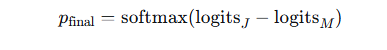
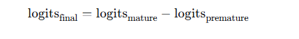
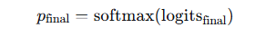
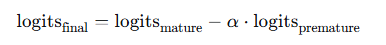

# 111.大模型（LLMs）DoLa 解码

#### DoLa 解码的全称和核心思想是什么？它如何在不进行额外训练的情况下减少幻觉？

全称

DoLa 的全称是 Decoding by Contrasting Layers（通过对比层进行解码）。

核心思想

DoLa 的核心思想是巧妙地利用了一个关键观察：在 Transformer 大语言模型中，不同层次（Layer）对事实性知识的编码程度是不同的。具体而言，模型的浅层（较低层）往往编码了更基础的语言模式和词汇共现关系，它们更容易被“误导”而产生常见的幻觉；而模型的深层（较高层）则通过多层抽象，对事实性知识有更准确的把握。模型最终输出的 logits 是这两种信息的混合。

DoLa 因此提出，在不进行任何额外训练或引入外部知识源的情况下，在解码阶段，通过实时地寻找并放大模型深层（成熟层）与浅层（早熟层）在预测上的差异，来抑制错误的、非事实性的输出，从而显著减少幻觉。这相当于在模型内部进行了一场“自我纠正”。

---

#### DoLa 基于什么观察来区分事实层和“幻觉”层？它如何利用 Transformer 的层间差异？

核心观察

DoLa 基于一个经大量实验验证的观察：在 Transformer 大语言模型中，知识是分层编码的。当模型要生成一个事实性知识时，其最终的、正确的预测往往在模型的后半部分（更深的层）才逐渐浮现并稳定下来，而在此之前的较早层（更浅的层）的预测则显得“摇摆不定”或倾向于产生错误的、高频的幻觉（如常见词或错误实体）。

换句话说，浅层更容易产生“幻觉”，而深层的预测更加“成熟”和可靠。这是因为浅层更多地承担了语法、局部连贯性的建模，而深层则在更全局、更抽象的语义和知识层面进行推理。

如何利用层间差异

DoLa 并没有直接使用模型的最终层输出，而是设计了一个巧妙的对比机制：

1. 选择一个“成熟层”：动态地选择一个相对靠后的层（例如，第 J 层）作为事实知识的主要来源。这个层的输出被认为是相对“成熟”和准确的。

2. 选择一个“早熟层”：动态地选择一个相对靠前的层（例如，第 J-d 层）。这个层的输出被认为是包含了大量“未成熟”和容易产生幻觉的信息。

3. 对比干预：在生成下一个词时，不是简单地使用最终的 logits，而是计算 最终 logits = logits (成熟层) - logits (早熟层)。这一操作的本质是，用成熟层的“知识”去减去早熟层中的“噪音”。那些在两个层中都高概率的、通用的、非特异性的词汇（如连接词）会被抑制，而那些在成熟层中被显著强调、但在早熟层中不被重视的事实性词汇（如正确的实体、特定时间）的概率则会得到放大。

通过这种方式，DoLa 就像在模型内部进行了一次“差分放大”，让事实性的信号从嘈杂的语言模式中凸显出来，从而减少了幻觉。

---

#### 解释 DoLa 中的“动态早期层选择”机制：如何选择 premature layer 和 mature layer？

DoLa 的一个关键创新点在于其层选择是动态的、自适应的，而非固定不变的。这是因为，不同的输入词元、不同的生成位置，其“事实性知识”在模型中成熟所需的层数可能是不同的。

动态选择机制的工作原理

DoLa 不需要预先训练一个层选择器，而是利用模型自身每一层的输出来进行实时判断。其核心假设是：当模型对某个事实性知识非常确定时，其深层（例如，高索引的层）对该词元的预测概率会超过浅层，形成一个“赢家通吃”的局面。

动态 premature layer 选择的算法流程

1. 计算每层的预测分布：在生成下一个词元时，DoLa 会计算并缓存所有层的输出 logits（或转换为概率分布）。这是一个计算开销的关键来源。

2. 寻找“赢家层”：对于待预测的下一个位置，遍历所有层（从第 1 层到最终层 L），计算每一层对该位置的预测概率分布。然后，寻找哪一层的预测概率分布具有最高的最大概率值，或者最高的预测置信度。这一层就被称为该位置当前的“赢家层”。

3. 确定 premature layer：找到赢家层后，DoLa 将赢家层的索引 M 减去一个固定的偏移量 d（超参数），所得到的层索引 `M - d` 就被动态地选作当前的 premature layer。偏移量 d 是根据经验或在验证集上调优的，例如 d=2, 4, 6 等。

4. 确定 mature layer：mature layer 则固定为模型的最终层 L 或赢家层 M 加上某个偏移量。一些实现中直接使用最终层作为 mature layer。

这种动态选择的优势

- 自适应性：对于简单的、模型非常确定的事实，其“赢家”可能在中层就已出现，此时选择的中层索引较小，premature layer 也会更浅。对于复杂的、需要深层推理的事实，其“赢家”在更深的层才出现，premature layer 也会相应更深。

- 效率：它避免了为每一个模型和每一个任务手动调优一个固定的层索引。

---

#### 在 DoLa 中，如何通过对比两个层的 logits 来获得下一个 token 的概率分布？

DoLa 的核心操作是在解码阶段，使用来自两个不同层（mature layer 和 premature layer）的输出 logits 进行相减，从而得到一个被“净化”后的最终 logits，并据此预测下一个词元。

操作流程

1. 前向传播与缓存：在生成当前词元时，输入序列会通过整个 Transformer 模型。DoLa 要求这一过程不仅输出最终层的 logits，还需要缓存并输出所有中间层的 logits。这是 DoLa 计算开销的主要来源。

2. 动态层选择：根据前面所述的“动态早期层选择”机制，实时地确定当前步骤应使用的 mature layer 索引 `J` 和 premature layer 索引 `M`。

3. 提取两个层的 logits：从缓存中提取第 `J` 层和第 `M` 层的预测 logits 向量。记 `l_J` 为成熟层的 logits，`l_M` 为早熟层的 logits。

4. 应用 Softmax：对这两个 logits 向量分别应用 Softmax 函数，将其转化为概率分布 `p_J` 和 `p_M`。这代表了该层对下一个词元的所有可能选项的预测概率。

5. 对比相减：计算最终的 logits 或概率分布。DoLa 在实践中通常对比的是 logits，并通过一个公式来计算最终的概率分布。一个常见的做法是：

$$
p_{\text{final}} = \text{softmax}(\text{logits}_J - \text{logits}_M)
$$

{.ocr-src}

1. 或者，有时会对相减后的结果除以一个温度系数，然后进行 softmax。

这样做的直观含义\
最终的预测概率分布 `p_final` 是通过 “用成熟层的知识减去早熟层的噪音” 得到的。在早熟层中普遍存在的、与当前语境关联不紧密的通用词（如“the”、“is”），由于在两个层中的 logits 都较高，相减后它们的 logits 会降低，从而在最终分布中受到抑制。相反，那些在成熟层中 logits 显著高于早熟层的词（往往是正确的事实性词汇、特定的实体），其 logits 差异会更大，从而在最终分布中被放大。

通过这种对比，模型从“可能会说出常见错误”的模式，被导向了“更确定、更事实性”的预测模式，从而减少了幻觉。

---

#### DoLa 解码中的对比目标是什么？最终的 logits 如何计算（公式）？

对比目标

DoLa 的对比目标非常清晰：它要最大化成熟层对事实性知识的响应，同时最小化早熟层中存在的、可能导致幻觉的通用性语言模式。本质上，它认为一个词的最终得分，应该由它在成熟层中的“相对突出程度”来决定，而不是其在任何单一层中的绝对概率。

最终 logits 的计算公式

DoLa 的核心计算公式相对简洁。在选定了 mature layer 和 premature layer 之后，最终的 logits 通过以下公式计算：

$$
\text{logits}_{\text{final}} = \text{logits}_{\text{mature}} - \text{logits}_{\text{premature}}
$$

{.ocr-src}

然后，将得到的 `logits_final` 通过 softmax 函数，转化为最终的概率分布：

$$
p_{\text{final}} = \text{softmax}(\text{logits}_{\text{final}})
$$

{.ocr-src}

在一些变体中，为了防止早熟层的 logits 过大而过度压制信号，会引入一个对比强度系数 α（alpha），公式变为：

$$
\text{logits}_{\text{final}} = \text{logits}_{\text{mature}} - \alpha \cdot \text{logits}_{\text{premature}}
$$

{.ocr-src}

其中 α 是一个正的超参数，通常小于 1。这样做的目的是为了控制“减除噪音”的力度，防止模型因过度依赖深层信号而输出不流畅的文本。

公式的直观理解

想象一个词，如果它在成熟层中被高度预测（logits = 5），而在早熟层中也较高（logits = 3），那么它可能是正确的，但可能也是一个通用词。如果另一个词，它在成熟层中预测值为 4，而在早熟层中仅为 1，那么它的“净得分”是 3，高于前者的 2。DoLa 正是通过这种比较，奖赏那些“在深层推理中涌现”的词，而惩罚那些“浅层就高频出现”的词，从而将生成引导向更可靠的方向。

---

#### DoLa 是否需要额外的模型或标注数据？完全基于什么实现？

完全不需要额外的模型或标注数据。 这正是 DoLa 方法最具吸引力的地方之一。

实现基础

DoLa 完全基于模型自身在推理过程中产生的内部信号实现。它不需要进行任何形式的微调或训练，也不需要访问任何外部知识库或标注数据集。其实现完全依赖以下两点：

1. 大语言模型本身的层叠结构：DoLa 的核心操作依赖于 Transformer 模型的天然特性——即其多层堆叠的结构，并且不同层编码了不同层次的信息。它只是利用了模型已经存在的能力，而没有改变模型本身。

2. 推理时的中间层输出缓存：在标准的模型推理中，用户通常只关心最终层的输出。DoLa 所做的唯一改变是，在执行一次前向传播时，要求模型不仅输出最后一层的 logits，还要缓存并输出中间指定层的 logits。这是一种推理时的工程操作，不涉及任何模型参数的改变。

因此，DoLa 是一个典型的 “免训练”和“免外部数据” 的解码策略。它的优势在于，可以直接作为一个即插即用的模块，加载到任何预训练好的 Transformer 大语言模型上，而无需进行昂贵的数据准备和训练过程。这使得它成为一种非常经济、高效的幻觉缓解手段。

---

#### 如何在自回归生成中实时地选择 premature layer？其层选择模块是如何工作的？

DoLa 的层选择模块是其性能的核心，它必须在自回归生成过程中的每一步都做出实时决策，为当前要预测的下一个词元选择最合适的 premature layer。

层选择模块的工作原理

层选择模块的工作流程可以分解为以下几步：

1. 全层前向传播与缓存：在预测当前词元时，输入序列通过模型的所有层。系统不仅获取最终层的 logits，还会获取并缓存每一层的输出 logits（或隐藏状态）。这是 DoLa 在推理时产生额外开销的来源。

2. 计算“赢家层”：对于词汇表中的每一个候选词，我们并不需要为它单独选择层。DoLa 采用一个更高效的全局策略。它遍历所有层（从第 1 层到最后一层 L），计算每一层预测的下一个词元的概率分布。然后，它计算每一层预测分布的最大概率值 `max(softmax(logits_layer))`。拥有最高最大概率值的那一层，被认为是该位置当前最“自信”、最“成熟”的预测来源。这一层就是“赢家层”，其索引记为 `M`。

3. 动态确定 premature layer：一旦找到了赢家层 `M`，系统就动态地将 premature layer 设置为 `M` 减去一个预先设定的超参数 `d`（例如 d=2）。即，`premature_layer_index = M - d`。`d` 的大小控制了“对比强度”——`d` 越大，被减去的层越浅，减去的“噪音”可能越多，但也可能过于激进；`d` 越小，对比越保守。

4. 确定 mature layer：mature layer 则通常被固定为模型的最终层 `L`。这是因为最终层代表了模型在经过最深层推理后的综合判断。

实时性保障

这个选择过程发生在每一次自回归步骤中，因此是完全实时和自适应的。它能够根据当前上下文的复杂度和模型对其预测的确定性，动态调整对比的强度。例如，当模型对一个常见词非常确定时，赢家层可能很早（中层）就出现了，此时 premature layer 会更浅；当模型需要进行复杂推理时，赢家层会在深层出现，premature layer 也会相应更深。

---

#### DoLa 对解码速度有何影响？与标准解码相比，额外的计算开销在哪里？

对解码速度的影响

DoLa 确实会显著增加解码的延迟，这是其主要的工程代价。与标准解码相比，其速度会成倍下降。具体的下降幅度取决于模型的大小、层数、以及是否进行了工程优化。

额外的计算开销来源

1. 中间层输出的缓存与传输（最主要开销）：在标准解码中，我们只需要模型最终层的输出 logits。而 DoLa 要求在一次前向传播中，提取并缓存所有（或几乎全部）中间 Transformer 层的输出 logits（或隐藏状态）。对于一个有 32 层或 80 层的模型来说，这会导致显存带宽和显存占用的大幅增加。尤其是 logits 的维度与词表大小（通常为 50k 到 200k）相关，缓存所有层的 logits 需要巨大的内存。

2. 赢家层的遍历与计算：在动态层选择阶段，DoLa 需要遍历所有层的预测分布，并计算每一层的最大概率值。这个过程包含多次 softmax 操作和比较，会引入额外的计算延迟。

3. 额外的 logits 运算：在得到成熟层和早熟层的 logits 后，需要进行一次相减和 softmax 操作。这部分开销相对较小，但也是额外增加的一步。

缓解开销的工程优化

尽管开销巨大，但可以通过一些工程手段来缓解：

- 只缓存关键层的 logits：不需要缓存所有层的 logits。可以只缓存后半部分（如第 16 层到第 32 层）的 logits，因为赢家层几乎不可能在前半部分出现。

- 只缓存 logits 的 Top-K 部分：为了减少内存，可以只保留每个层预测的 Top-K（如 Top-1000）logits，而不是整个词表的 logits。

- 模型量化与加速：结合模型 INT8/INT4 量化、FlashAttention 等技术，降低单层计算和显存开销。

总而言之，DoLa 是以计算延迟换取生成质量的典型策略。它最适合在对生成事实准确性有极高要求、但对延迟不那么敏感的离线或批处理场景下使用。

---

#### DoLa 与“对比层解码”的关系和区别。

DoLa 与对比层解码都利用了 Transformer 模型的层间信息差异来改善生成质量，它们同属“对比解码”这个大家族，但有着不同的侧重点和目标。

核心关系

两者都是免训练的、通过对比模型不同层输出来干预解码的方法。它们的基础数学形式非常相似，都是对比两个不同来源的 logits。

核心区别

| 维度 | DoLa (Decoding by Contrasting Layers) | Contrastive Decoding (CD) |
| --- | --- | --- |
| 核心目标 | 减少幻觉，提升事实性 | 提升生成文本的质量和多样性，使其更具“人性化” |
| 对比的双方 | 一个“成熟层” vs 一个动态选择的“早熟层”（两者都是同一模型的不同层） | 一个强大的“专家模型”（如大模型） vs 一个弱小的“业余模型”（如小模型） |
| 信号解读 | 大模型的深层是“专家”，其浅层是“业余者”。通过对比消除浅层的语言噪音 | 大型、强模型是“专家”，小型、弱模型是“业余者”。通过对比消除弱模型容易产生的平凡、重复、乏味的输出 |
| 层选择方式 | 动态、自适应。根据当前上下文的确定性实时选择对比的层 | 静态、固定。通常使用固定的专家模型和业余模型 |
| 主要应用 | 侧重于需要高事实准确度的任务，如QA、RAG | 侧重于开放式文本生成，如故事创作、对话生成 |

总结：DoLa 可以看作是对比层解码思想在“单一模型内部”和“减少幻觉”这一特定目标上的创造性应用。它不需要一个外部的、训练好的业余模型，而是巧妙地利用了模型自身的层间差异来充当这个“业余模型”，从而实现了成本更低、更自适应的对比解码。

---

#### DoLa 是否适用于所有模型架构？对于非 Transformer 或混合架构效果如何？

适用范围

DoLa 是专门为标准的、多层堆叠的 Transformer 架构设计的，特别是仅解码器的生成式预训练 Transformer（GPT 系列模型）。

对 Transformer 架构的依赖性

DoLa 的有效性根植于一个核心假设：知识在 Transformer 的层中是分层编码的，浅层到深层是一个从“不成熟”到“成熟”的渐进过程。这个假设在标准的 GPT 类模型中被广泛验证。因此，DoLa 在这些模型上表现出了稳定的效果。

对于非 Transformer 或混合架构的效果

1. 非 Transformer 架构：对于像 RWKV、Mamba、状态空间模型（SSM）或混合了这些机制的架构，DoLa 的有效性是不确定的，且很可能直接失效。因为这些模型没有像 Transformer 那样清晰、可分离的“层”概念，它们处理信息的方式是循环或卷积的，其“知识成熟度”不像在 Transformer 中那样随层数线性递增。强行使用 DoLa 可能找不到有意义的 premature layer。

2. 混合架构：如果一个模型主体仍然是 Transformer，只是在前端或后端接入了其他模块，那么 DoLa 在 Transformer 部分的层上可能仍然有效。

3. 编码器-解码器模型：对于 T5、BART 等模型，DoLa 的思想可以迁移，但实现需要适配。通常的对比会发生在解码器的不同层之间，或者对比解码器的深层与编码器的最终输出。其效果需要具体实验验证。

结论：DoLa 是一个非常精巧的、但也是架构绑定的技术。它的成功依赖于 Transformer 层叠结构带来的“知识层次化”这一特性。对于任何新的模型架构，在应用 DoLa 之前，都必须首先验证其“知识随层成熟”这一前提是否成立。

---

#### 在事实性问答任务上，DoLa 与标准解码相比性能提升有多大？有哪些关键实验结果？

DoLa 在多项事实性问答基准上表现出显著且一致的性能提升，尤其在 TruthfulQA 和 FACTOR 等专门评估幻觉的基准上，其提升幅度远超标准解码。

TruthfulQA 上的核心结果

TruthfulQA 是评估模型生成真实信息能力的标杆基准。在 TruthfulQA 的 MC1（单选题准确率）和 MC2（多选题准确率）指标上，DoLa 相较于标准解码（贪心或核采样）取得了显著增益。例如，在 LLaMA-7B 模型上，DoLa 将 MC1 准确率提升了约 5-8 个百分点，在 LLaMA-13B 上也有类似显著提升。这在模型规模增大时依然有效，表明它不只是对小模型有效，对大模型同样能进一步“榨取”事实性。

FACTOR 与 StrategyQA 上的表现

在 FACTOR（一个专门检测模型是否会被似是而非的虚假信息迷惑的基准）上，DoLa 同样明显优于标准解码。在需要多步推理的 StrategyQA 中，DoLa 在不牺牲推理能力的前提下减少了推理链中的事实错误。关键发现是，DoLa 能够有效抑制模型对“常见错误模式”的偏好，转而输出更正确的答案。

与其他免训练方法的对比

与对比解码、核采样等基线相比，DoLa 在大多数事实性任务上都取得了最佳或次佳成绩。更值得注意的是，DoLa 的性能提升通常不会以牺牲流畅度为代价，甚至在某些情况下还能略微提升生成文本的连贯性。这些实验结果表明，通过巧妙地对比模型内部的层次信息，可以在不增加外部知识的情况下，显著提升语言模型的事实可靠性。

---

#### DoLa 对开放式生成（如故事写作）的质量有何影响？是否会影响创意？

DoLa 的设计初衷是提升事实准确性，其对开放式生成的影响较为复杂，存在一个“忠实度-创造性”的权衡。

对创意性的潜在负面影响

开放式生成任务（如故事创作）的核心要求是多样性和想象力。DoLa 通过放大深层“成熟”预测、抑制浅层“早熟”预测，本质上是在奖励模型更“确定”和“收敛”的模式。这可能会压制那些在浅层出现概率较低、但具有新颖性和创意的词汇或情节转折。因此，使用 DoLa 后，生成的故事可能趋于“四平八稳”，使用更常见的情节和表达，其词汇多样性指标可能会下降，从而导致创意性受损。

对质量的其他影响

在需要保持世界观一致性和逻辑连贯性的长篇生成中，DoLa 可能带来一定好处。通过抑制浅层容易产生的逻辑跳跃或前后矛盾，DoLa 有助于维持故事内的事实一致性（例如人物设定不变）。同时，它能减少那些看似流畅但内容荒诞的叙述，使故事更加“合理”。但总体而言，对于纯粹追求创意、文采和惊喜感的开放式生成，DoLa 并不是一个推荐的选择，开发者应优先考虑如何保留多样性。

实践建议

如果必须在开放式生成中使用 DoLa，建议采用较小的对比强度（例如较小的偏移量 d）来减弱对创意的压制。或者，可以将 DoLa 局部应用于需要事实准确性的段落（如历史背景描述），而在需要创意的情节部分切换回标准解码。

---

#### 如何评估 DoLa 解码的忠实度？常用的评估指标是什么？

评估 DoLa 解码的忠实度，核心是衡量生成文本与“真相”或“源信息”的一致性。常用指标分为自动化指标和人工评估两大类。

自动化评估指标

1. TruthfulQA 指标：TruthfulQA 本身提供了两个自动化指标。MC1（多选题单项选择准确率）直接衡量模型对唯一正确答案的预测；MC2（多选题多选准确率）则衡量模型对多个正确答案的覆盖程度。这两个指标是评估 DoLa 事实性的首要标准。

2. 基于 NLI 的蕴含率：将生成的每个原子事实与已知事实源（如维基百科）进行对比，使用自然语言推理（NLI）模型判断其是“蕴含”、“矛盾”还是“中立”。最终的忠实度得分为“蕴含”事实的比例。这种方法在评估长篇生成的忠实度时非常有用。

3. SelfCheckGPT 等无源自检指标：如 SelfCheckGPT 通过多次采样的一致性来评估幻觉程度。DoLa 作为一个解码策略，也可以与这类指标结合，评估其输出在多次采样下的一致性是否提升。

4. FactScore：一种细粒度的事实验证指标，将生成文本中的原子事实与知识库进行比对，给出加权的事实正确率。

人工评估

对于开放式生成或需要深层语义判断的任务，人工评估仍然是金标准。可以设计量表，让人类评估员对生成文本的“事实准确性”、“是否有虚构信息”等维度进行打分。双盲评估、多人一致性校验是保证结果可靠性的关键。

---

#### DoLa 中的重复惩罚或温度参数如何与层对比结合？它们之间的交互。

DoLa 生成最终的 logits 后，仍然可以叠加传统的解码参数（温度、重复惩罚、top-p 等），但这些参数与层对比之间存在微妙的交互作用。

温度参数的影响

温度系数 T 控制概率分布的尖锐程度。在 DoLa 中，温度通常应用于对比后的 logits。较低的 T 会使模型更加聚焦于对比后得到的高分 Token，这可能会过度放大 DoLa 的选择，导致生成文本过于单调甚至不流畅。较高的 T 则会平化分布，可能部分稀释 DoLa 的对比效果。因此，需要调整 DoLa 的对比强度与温度之间的平衡。实验发现，使用略低于标准解码的温和温度（如 0.6-0.8）能更好地发挥 DoLa 的性能。

重复惩罚的交互

重复惩罚通过在 logits 中减去已生成 Token 的惩罚项来抑制重复。在 DoLa 中，重复惩罚同样作用于最终的 logits。由于 DoLa 本身会抑制一些浅层高频词，它实际上已经减少了部分不必要的重复。如果再叠加强烈的重复惩罚，可能导致生成文本变得生硬、不自然。建议将重复惩罚的强度设为比标准解码稍小的值。

调优建议

这些参数的设置高度依赖于模型和任务，需要通过小规模网格搜索来确定。通常的流程是：首先固定 DoLa 的层偏移量 d，然后对温度、重复惩罚等参数进行调优。值得强调的是，这些解码参数和 DoLa 是协同工作的关系，合理的组合能够实现事实性和流畅度的双重提升。

---

#### 分析 DoLa 可能存在的局限性：在哪些任务上可能无效或有害？

DoLa 虽然有效，但并非银弹，其局限性主要源于它对 Transformer 层间信号稳定性的依赖。

1. 对层数较浅或小模型的局限性

DoLa 依赖于“深层知识更成熟”这一假设。对于层数较少（如 12 层以下）或参数规模较小（如 1B 以下）的模型，深层和浅层的预测差异可能不够显著，导致对比信号微弱，甚至引入噪声。在这些模型上，DoLa 的性能提升非常有限，甚至可能因破坏原始分布而降低整体质量。

2. 损害多样性与创造力

如前所述，DoLa 倾向于选择模型更“确定”的预测，这在创意写作、头脑风暴等需要高度多样性的任务中会适得其反，生成结果可能变得千篇一律。

3. 对非事实性逻辑错误的无效性

DoLa 主要针对事实性幻觉。对于模型在逻辑推理链中出现的错误（例如，前提正确但结论错误），DoLa 难以有效纠正，因为这类错误不一定在浅层有高概率。

4. 计算与显存开销大

DoLa 需要缓存多层的 logits，显存占用和延迟成倍增加，这在资源受限或低延迟要求的在线服务中难以应用。

5. 动态层选择的鲁棒性不足

动态层选择依赖于“赢家层”的确定。对于极短或极长的 Prompt，以及高度风格化的输入，赢家层的定位可能出现偏差，导致选择不合适的 premature layer，从而降低效果。

---

#### 如何实现 DoLa 解码？需要修改模型推理代码吗？给出大致的实现步骤。

实现 DoLa 需要对模型推理代码进行深度修改，以便在自回归生成过程中访问和操作中间层的输出。

所需改动

1. 修改模型 forward 函数：在传统的推理中，`model.forward()` 只返回最后一层的 logits。为了实现 DoLa，需要修改 `forward` 方法，使其额外返回指定中间层（或全部层）的 logits 或隐藏状态。在 Hugging Face Transformers 中，可以通过设置 `output_hidden_states=True` 获取所有层的隐藏状态，再乘以词表嵌入矩阵得到 logits。

2. 实现动态层选择器：编写一个函数，接收所有层的 logits，计算每层预测的最大概率值，找到“赢家层”索引 M，然后返回 premature layer 索引（M - d）和 mature layer 索引（通常为最后一层 L）。

3. 修改生成循环：在自回归生成循环（如 `model.generate()` 内部）中，每一步均执行以下操作：
  - 调用修改后的 `forward` 获取所有层 logits。
  - 调用层选择器确定 premature 和 mature 层的索引。
  - 提取这两个层的 logits，计算 `logits_final = logits_mature - logits_premature`。
  - 对 `logits_final` 应用温度、重复惩罚等后续解码策略。
  - 采样产生下一个 Token，追加到输入序列，重复。

大致的伪代码实现

```python
def doLa_generate(model, input_ids, d=2, max_len=100):
    generated = []
    for step in range(max_len):
        # 1. 前向传播，获取所有层的 logits
        outputs = model(input_ids, output_hidden_states=True)
        all_hidden_states = outputs.hidden_states  # (num_layers, batch, seq_len, hidden_dim)
        # 将隐藏状态转换为 logits
        lm_head = model.get_output_embeddings()
        all_logits = [lm_head(h) for h in all_hidden_states]  # 每层 logits

        # 2. 动态层选择
        # 计算最后一层的 logits 用于比较
        last_logits = all_logits[-1][:, -1, :]
        # 计算每层对当前位置的最大概率
        max_probs = [F.softmax(l[:, -1, :], dim=-1).max().item() for l in all_logits]
        M = max_probs.index(max(max_probs))  # 赢家层索引
        mature_layer = len(all_logits) - 1  # 最后一层
        premature_layer = max(0, M - d)     # 早熟层

        # 3. 对比 logits
        logits_mature = all_logits[mature_layer][:, -1, :]
        logits_premature = all_logits[premature_layer][:, -1, :]
        logits_final = logits_mature - logits_premature

        # 4. 应用温度、重复惩罚等
        logits_final = logits_final / temperature
        # ... 可能添加重复惩罚

        # 5. 采样
        probs = F.softmax(logits_final, dim=-1)
        next_token = torch.multinomial(probs, 1)
        generated.append(next_token)
        input_ids = torch.cat([input_ids, next_token], dim=-1)
    return generated
```

在实际部署中，为了优化速度，可以只缓存后半部分层的 logits，并采用 Top-K 裁剪等策略减少内存传输。

---

#### DoLa 是否能够减少多模态模型中的幻觉？概念上是否可迁移？

概念上的可迁移性

DoLa 的核心思想——利用模型内部的层间差异来抑制浅层噪音、放大深层知识——对于多模态模型在概念上是完全可迁移的。在多模态模型中，无论是处理文本的 LLM 骨干，还是处理视觉的编码器，都存在类似的层次化表示。特别是在多模态生成模型（如 LLaVA 用于图文对话，或图像生成模型如 DALL-E）中，DoLa 有潜在的应用价值。

可迁移的路径

1. 在多模态 LLM 的文本生成阶段应用：对于 LLaVA 这类模型，其文本解码器本身就是一个 Transformer。可以在生成文本回复时，直接在文本 Transformer 上应用 DoLa，对比其成熟层和早熟层的 logits，以减少对话中的事实性幻觉（如错误描述图像内容）。

2. 在跨模态注意力中引入对比：多模态模型通常在生成文本时会通过交叉注意力机制融入视觉特征。可以将 DoLa 的思想拓展到对比“融入视觉信息后的深层预测”与“融入视觉信息较少的浅层预测”，从而放大与图像内容真正一致的回答，抑制与图像无关的“瞎说”。

挑战与现状

然而，多模态模型的结构更为复杂，哪些层应被视为“成熟”并不是一目了然的。图像编码器的层也可能需要对比。目前这方面的研究仍处于早期阶段，但理论上是富有前景的方向。

---

#### 将 DoLa 与 RAG 结合：两者是否互补？检索增强后 DoLa 还有额外收益吗？

高度互补，且能带来额外收益

DoLa 和 RAG 在减少幻觉的机制上是完全正交且互补的，结合使用可以构建多层防御体系。

- RAG 负责“源头治理”：RAG 通过检索外部知识库，为模型提供实时、权威的信息源。它主要解决因模型内部知识过时或缺失导致的事实性幻觉。

- DoLa 负责“过程把控”：即使有了正确的检索文档，模型在生成时仍可能出现“忠实性幻觉”——无视文档内容，或扭曲文档意思。DoLa 通过内部层对比，抑制模型自身倾向编造的“冲动”，鼓励其更忠实地基于上下文（包括检索文档）生成回答。这恰好能弥补 RAG 无法解决的“忠诚度偏离”问题。

额外收益的实验证据

有实验表明，在 RAG 的生成阶段叠加 DoLa，可以在已经提升的准确率基础上，进一步减少对检索文档的不忠实引用，提升生成答案的精确度。因此，将 DoLa 与 RAG 结合，相当于为 LLM 同时装上了“外部知识锚”和“内部自我纠偏器”，能够实现 1+1>2 的幻觉抑制效果。

---

#### 动态层选择策略的鲁棒性：如何应对不同 prompt 长度和类型的波动？

动态层选择策略在理论上很优雅，但面对多样化的 prompt 时，其鲁棒性确实会受到挑战。

波动来源

1. Prompt 长度：极短的 prompt（如一句简单提问）可能导致模型过早地“确定”答案，“赢家层”可能出现在较早的层，使得 premature layer 选择过浅，减去的噪音不足。极长的 prompt 则可能将关键信息的处理推后，使赢家层后移，导致过早层的对比信号失效。

2. Prompt 类型：对于高度专业化、模板化的 prompt，模型可能形成固定的预测模式，赢家层位置相对稳定；而对于开放式、创意性的 prompt，赢家层位置可能随机波动。

应对策略

1. 自适应偏移量 d：不采用固定的 d，而是根据 prompt 的某些特征（如长度、困惑度）动态调整 d。例如，长 prompt 可尝试稍大的 d，但需实验验证。

2. 多候选层融合：不只看赢家层的最大概率值，而是综合前几层的概率值趋势，采用更稳定的选择策略。或者，对多个候选 premature 层进行加权平均，平滑波动。

3. 设置安全阈值：在动态选择后，增加一个校验步骤：如果赢家层的最大概率值过低（表明模型不确定），则回退到不使用 DoLa 的标准解码，以避免在模型本身就不确定时引入额外噪音。

4. 离线超参数扫描：在目标数据集上，对不同 prompt 长度和类型进行分组调优，找到各组最优的固定 d 值，在线时根据分组选用。这种方式比全动态更稳定。

---

#### DoLa 中对比的“成熟层”通常是最后一层吗？是否可用多个层的平均？

成熟层的常见选择

在标准 DoLa 实现中，成熟层通常固定为模型的最后一层。这样做有几方面考量：最后一层代表了模型经过最深层次推理后的综合判断，包含最完整的语义和事实信息；且固定最后一层可以避免在选择 mature layer 时引入额外的计算开销和不确定性。

是否可用多个层的平均？

可以，并且有时能提升鲁棒性。 将多个较深层（例如最后 N 层）的 logits 进行平均作为成熟层，可以平滑单层的预测噪声，使信号更稳定。类似地，premature 层也可以使用多个浅层的平均。这种方法在处理长尾知识或模型本身层间不确定性较大时，可能带来微小但稳定的性能提升。

代价

使用多层平均会显著增加计算和存储开销，因为需要缓存和计算更多层的 logits。在需要极致推理效率的场景下，采用单层（最后一层）仍然是首选。如果追求更高的忠实度和稳定性，可以尝试使用最后 2-3 层的平均，但必须通过实验验证其在特定任务上的收益是否值得额外的计算成本。

---

#### DoLa 解码与上下文蒸馏（Context Distillation）有何潜在关联？

DoLa 与上下文蒸馏在思想上有深刻的共鸣，两者都涉及从“成熟”或“知识丰富”的表示中提取信号，并用于指导“较弱”或“噪音较大”的表示。但它们的应用场景和实现方式截然不同。

核心关联：知识传递的对比范式

上下文蒸馏是用一个已经阅读了完整上下文的强大模型（教师）的输出，去微调另一个模型（学生），使其在不阅读上下文的情况下也能生成相同的答案。这本质上是一种跨模型的知识迁移，教师模型的“成熟”回答被用来指导学生。

DoLa 则可以看作是一种模型内部的、免训练的自我蒸馏。它将模型自身的深层视为“教师”（成熟层），将其浅层视为“学生”（早熟层）。通过对比两者的 logits，DoLa 实际上是在用深层更准确的知识去“纠正”浅层的常见错误，从而在模型内部完成了一次即时的知识精炼。

潜在关联与未来方向

两者可以结合。例如，在上下文蒸馏的过程中，可以使用 DoLa 解码来生成教师模型的回答，使得蒸馏目标本身具有更高的事实准确性。或者在蒸馏后，对学生的生成过程应用 DoLa，进一步抑制学生模型可能放大的浅层错误。两者的融合是构建更高效、更可靠的语言模型的重要研究方向。

