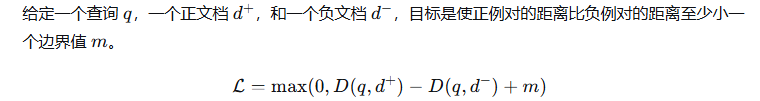
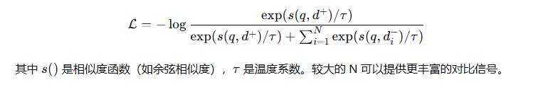

# 89.大模型（LLMs）稠密检索（Embedding）

#### 什么是稠密检索？它与稀疏检索的主要区别是什么？

稠密检索（Dense Retrieval）是一种基于深度学习的现代信息检索范式。它的核心思想是将查询和文档分别编码为固定维度的稠密向量（Dense Vectors），然后通过向量之间的相似度（如余弦相似度或内积）来衡量查询与文档的相关性。与传统的稀疏检索相比，稠密检索在语义理解、跨词汇匹配和泛化能力上具有显著优势，但也带来了新的技术挑战。

与稀疏检索的主要区别：

| 维度 | 稀疏检索 (Sparse Retrieval) | 稠密检索 (Dense Retrieval) |
| --- | --- | --- |
| 表示形式 | 高维稀疏向量，维度通常等于词表大小，绝大多数维度为零。每个维度对应一个词项的权重（如TF-IDF、BM25分数）。 | 低维稠密向量，维度通常为几百至几千，每个维度都是一个连续的浮点数，整体构成一个语义空间中的坐标。 |
| 匹配原理 | 字面精确匹配：查询词必须在文档中出现（或在同义词词表中）才能被命中。 | 语义软匹配：即使查询与文档使用完全不同的词汇，只要其语义相近，它们的向量在空间中就彼此接近。 |
| 核心优势 | 可解释性强，速度快，对专有名词、ID的精确匹配效果极佳，没有“词汇鸿沟”问题。 | 能够处理同义词、近义词和跨语言匹配；能捕捉复杂的语义关系和上下文；泛化能力更强，对未见过的查询表达方式更鲁棒。 |
| 主要挑战 | 无法处理词汇不匹配问题；需要复杂的文本预处理（分词、词干提取等）；对多语言和新兴词汇的适应能力弱。 | 需要大量的训练数据和计算资源来训练嵌入模型；可解释性差；对精确实体匹配（如“A100芯片”）可能不如关键词检索；模型可能存在训练数据偏差。 |

如何协同工作：

在实际的先进RAG系统中，两者常常不是对立的选择，而是协同互补的。混合检索（Hybrid Search）成为主流，它结合了稀疏检索（如BM25）的精确匹配能力和稠密检索的语义理解能力，通过融合两者的检索分数（如使用倒数排名融合RRF），在精确率和召回率上达到最佳平衡。

---

#### 稠密检索中，句子/文档被映射为稠密向量的过程：embedding 模型是如何工作的？

稠密检索的核心是将非结构化的文本转换为机器可计算的固定长度向量，这个转换过程由文本嵌入模型完成。一个现代文本嵌入模型的典型工作流程如下：

1. 分词与Token化：\
   输入文本（查询或文档）首先被切分为Token序列。这通常使用一个预训练好的Tokenizer（如WordPiece或BPE），将文本转换为词汇表中的ID。同时，会插入特殊的标记Token，如开头的`[CLS]`（用于分类任务的聚合表示）和结尾的`[SEP]`（用于分隔句子）。

2. 预训练语言模型编码：

Token ID序列被送入一个基于Transformer架构的预训练语言模型，如BERT或T5的编码器。模型通过多层自注意力机制和多层感知机，为每个输入Token计算一个上下文相关的隐藏状态向量。这个向量捕捉了该Token在特定上下文中的语义信息。训练得当的模型能够将“苹果很好吃”和“苹果发布了新手机”中的同一个词“苹果”编码为语义完全不同的向量。

3. 池化与向量生成：

编码器为每个Token输出了一个上下文表示，但我们需要一个单一的固定维度向量来表示整个输入文本。这就需要池化（Pooling）。常用的池化策略包括：

- `[CLS]` Token 池化：直接使用预训练语言模型在序列开头插入的`[CLS]` Token的最终隐藏状态向量作为整个序列的表示。这是BERT等模型最常见的做法。

- 平均池化：对所有输入Token的最终隐藏状态向量取平均值（通常不包含填充Token和特殊Token）。这种方法在许多现代嵌入模型中被证明效果更好、更鲁棒，因为它考虑了所有Token的信息。

- 注意力池化：使用一个可学习的注意力层，对所有Token的隐藏状态进行加权求和，让模型自己学习哪些Token对语义表示更重要。

4. 向量归一化：

生成的稠密向量通常会进行L2归一化，使其模长为1，映射到单位超球面上。这一步骤可以统一相似度计算的标准，使内积等价于余弦相似度，并在许多场景下提升检索的稳定性和效率。

通过这四步，任意长度的文本被压缩为一个包含其核心语义的稠密向量，这个向量可以在高维空间中与海量文档向量进行快速的近似最近邻搜索，从而实现高效的语义检索。

---

#### 常用的文本 embedding 模型有哪些？对比其架构、维度和训练方法。

文本嵌入模型是稠密检索的灵魂。近年来，该领域涌现出大量高质量模型，它们在架构、维度、训练数据和方法上各有千秋。

| 模型（系列） | 架构 | 输出维度 | 训练方法与关键数据 | 主要特点与适用场景 |
| --- | --- | --- | --- | --- |
| OpenAI text-embedding-3 | 未公开（推测为GPT系列解码器经改造） | 支持 512, 1536 等（可配置） | 在大规模内部数据上，结合对比学习和相邻文本预测进行训练。支持“维度选择”，可在几乎不损失性能的情况下截断向量。 | 强大的通用性能，尤其擅长复杂语义和长文本。API调用，成本较高，无法本地部署。 |
| E5 系列 (EmbEddings from bidirEctional Encoder rEpresentations) | 基于BERT的编码器（如BERT-base, RoBERTa） | 模型（系列） | 两阶段训练：首先在大规模弱监督的文本对数据集（如网页标题-正文、评论-回复）上进行对比预训练；然后在高质量标注的检索数据集（如MS MARCO）上进行微调。训练时使用了大量的难负样本。 | 学术界和工业界的经典基线，性能强大，支持多语言。适合微调和领域适配，开源友好。 |
| BGE 系列 (BAAI General Embedding) | 基于BERT的编码器 | 768 / 1024 / 1792 | 同样采用多阶段训练策略，特别引入了指令微调，使用仅有查询的对称/非对称任务数据。BGE-M3 支持超过100种语言和8192 Token的长度。 | 在中文和多语言场景下表现卓越，支持稠密和稀疏联合检索。BGE-M3是处理多语言长文本的首选之一。 |
| Sentence-BERT (SBERT) | 基于BERT/RoBERTa + 平均池化层 | 模型（系列） | 首次解决了BERT生成句向量效率低下的问题。使用孪生网络和三元组网络结构，在自然语言推理（NLI）和句子相似度数据集上进行微调。 | 主要用于短文本（句子级）的语义相似度计算和聚类。计算效率高，适用于需要离线批量生成句向量的场景。 |
| GTE 系列 (General Text Embeddings) | 基于BERT++ 或 T5 编码器 | 768 / 1024 | 在大规模社区数据上进行多阶段对比学习，并针对检索、聚类、分类等多种任务进行了优化。GTE-Qwen2-7B 等大模型变体使用了7B参数的LLM作为骨干。 | 阿里云推出的模型，在多个基准上表现出色，特别是其大模型版本（7B）在复杂指令跟随和语义理解上表现优异。 |
| Cohere Embed | 未公开（专有模型） | 架构 | 基于海量专有数据训练，支持多语言和特定压缩技术，可以在保持高精度的同时输出更小维度的向量。 | API服务，在商业应用和特定垂直领域表现优异，适合需要高性能且接受付费API的场景。 |

选型考量：没有“最好”的模型，只有最合适的模型。选型时需要权衡性能（在MTEB等基准上的分数）、推理成本与速度（维度、模型大小）、语言和领域（是否支持中文、是否需要领域微调）以及上下文窗口（处理长文档的能力）。

---

#### 双塔模型（dual encoder）在稠密检索中的角色：query encoder 和 document encoder 如何共享或独立？

双塔模型是稠密检索中最主流的模型架构。它的设计非常直观，包含两个独立的编码器：一个查询编码器和一个文档编码器。查询编码器负责将用户的查询问题压缩为一个稠密向量；文档编码器则负责将知识库中的每一篇文档也压缩为相同维度的稠密向量。在检索时，系统通过计算查询向量与海量文档向量之间的相似度，快速找到最相关的文档。

共享与独立：

在实际应用中，查询和文档编码器通常共享权重。这意味着它们使用同一个预训练模型，拥有相同的参数。这样做有几个关键好处：

- 语义空间一致性：共享权重的模型在处理查询和文档时，使用的是同一套语义理解机制，保证了它们生成的向量被映射到了完全相同的语义空间中。这是后续进行有效相似度计算的基础。

- 参数效率：只需训练和维护一个模型，节省了计算和存储成本。

- 对称性：在很多场景下，查询和文档在语言风格和长度上具有对称性（例如用问题去搜索相似问题），此时共享权重非常自然。

然而，在某些情况下，查询和文档的分布存在巨大差异（即非对称搜索）。比如，查询通常很短、是口语化的提问，而文档很长、是正式的书面文本。此时，强制它们共享同一个模型可能会限制性能。因此，一些先进的系统会采用参数独立但部分共享的策略：

- 独立的参数：查询编码器和文档编码器使用两个结构相同但参数独立的模型，或者使用同一个基础模型，但为查询和文档分别学习不同的适配层（Adapter）。

- 部分共享：底层Transformer层共享，顶层各自由不同的参数进行微调。底层共享是为了捕获通用的语言特征，顶层独立是为了适应各自不同的文本风格和任务目标。

在训练双塔模型时，核心是对比学习。系统会拉近查询与相关文档（正例）在向量空间中的距离，同时推远查询与不相关文档（负例）的距离。由于文档数量极其庞大，每次迭代不可能计算所有文档的向量，因此诞生了各种负采样策略和高效的近似训练算法。

---

#### 为什么 embedding 模型需要对比学习？常用的训练目标和难负样本挖掘策略是什么？

Embedding 模型需要对比学习，是因为其根本目标是学习一个语义空间，在这个空间中，“相似的文本彼此靠近，不相似的文本彼此远离”。简单的分类任务或语言模型预训练无法直接达成这个目标，而对比学习提供了最自然、最有效的训练框架。

核心原因：

- 相对位置 > 绝对位置：我们关心的不是文档向量在空间中的绝对坐标，而是查询与文档之间的相对距离。对比学习直接优化这种相对关系。

- 处理大规模类别：检索任务中，每篇文档可以看作一个独特的类别，类别数可达百万甚至亿级。传统的Softmax分类器无法处理这么大的输出层。对比学习绕过了这个问题，它只关心成对或成组样本之间的相似度。

- 弱监督信号：网络上存在大量天然的正例对，如问题-答案、标题-正文、评论-回复。对比学习可以高效利用这些弱监督数据。

常用训练目标：

1. Triplet Loss (三元组损失)：

给定一个查询 $q$，一个正文档 $d^+$，和一个负文档 $d^-$，目标是使正例对的距离比负例对的距离至少小一个边界值 $m$。

$$
\mathcal{L} = \max(0, D(q, d^+) - D(q, d^-) + m)
$$

{.ocr-src}

2. InfoNCE Loss (对比损失)：\
   这是目前最主流的训练目标。给定一个查询 $q$ 和一个包含 11 个正例和 $N$ 个负例的集合，它本质上是一个多分类任务，要求模型在一堆候选文档中识别出唯一正确的那个。

$$
\mathcal{L} = -\log \frac{\exp(s(q, d^+)/\tau)}{\exp(s(q, d^+)/\tau) + \sum_{i=1}^{N} \exp(s(q, d_i^-)/\tau)}
$$

其中 $s()$ 是相似度函数（如余弦相似度），$\tau$ 是温度系数。较大的 N 可以提供更丰富的对比信号。

{.ocr-src}

难负样本挖掘策略：

在检索中，海量文档中的绝大多数都是“简单负样本”，它们与查询差异巨大，模型很容易就能区分。但这些样本对模型的学习贡献甚微。真正的训练价值在于“难负样本”——那些与查询语义有些相关，但实际不正确的文档。挖掘难负样本的策略包括：

- 批量内负采样：在一个训练批次中，将其他查询的正文档作为当前查询的负样本。这是最简单高效的方法，但可能因为随机采样而包含假负样本。

- 基于 BM25 的负采样：使用稀疏检索模型（如 BM25）预先检索出与查询在字面上高度匹配、但不是正例的文档作为难负样本。

- 动态难负采样：在每一轮训练后，使用最新的模型参数对所有文档进行重新检索，将那些检索排名靠前但并非正例的文档作为当前模型的难负样本。这种方法最精准，但计算开销极大。

- 课程学习：先从简单负样本开始训练，待模型收敛后，逐步引入越来越难的负样本，让模型在不断“受挫”中学习更精细的语义区分能力。

---

#### 非对称 embedding：查询与文档使用不同维度的向量是否可行？有什么技巧？

非对称 embedding 指的是查询和文档在嵌入时使用不同维度的向量。这在理论上是可行的，但在标准的向量相似度计算（如内积或余弦相似度）中会遇到障碍，因为这些操作要求两个向量的维度必须相等。

为什么需要非对称 embedding？

这是由计算效率和成本驱动的现实需求。文档向量通常是离线生成并存储在向量数据库中的，我们希望它拥有较高的维度（如 1024 维）来保留丰富的语义信息，保证检索的精度。而查询向量需要在用户提问时实时生成，如果查询编码器很小、输出维度低（如 256 维），那么它的推理速度将极快，延迟和成本都会显著降低。这就构成了非对称结构：高维的文档向量 + 低维的查询向量。

实现技巧：

1. 线性映射/投影层：\
   这是最常用的方法。在两个编码器之后，各自增加一个可训练的线性投影层（全连接层），将它们的原始输出向量映射到一个统一的、相同的目标维度。例如，文档编码器原始输出 1024 维，通过一个线性层降维到 256 维；查询编码器原始输出 256 维，也通过一个线性层映射到 256 维。训练时，这两个 256 维的向量被要求进行对比学习。推理时，文档使用降维后的向量建库，查询则直接输出映射后的向量进行检索。这个方法本质上是通过投影统一了最终维度。

2. Matryoshka Representation Learning：\
   这是一种更高级的技术。它的核心思想是训练模型学习一个内在嵌套的表示结构：让向量的前 `d` 维（无论 `d` 取多少）自身就构成一个有效的语义表示。训练时，对向量的不同前缀长度（如 64, 128, 256, 512...）都施加对比损失。这样训练出的模型，其文档向量在离线时可以保留完整的 1024 维，但在实时检索时，只需取其前 256 维（或任意想要的低维）与同样被截断的查询向量进行匹配即可，几乎不损失精度。OpenAI 的 text-embedding-3 和 BGE-M3 都支持或借鉴了这种思想，它实现了在同一模型中灵活权衡成本和精度的能力。

3. 异步维度匹配：\
   另一种思路是，文档和查询使用完全独立的编码器，训练时通过一个可学习的“交互矩阵”将它们映射到可以比较的公共空间中。这种方法灵活性最高，但训练也更复杂，目前应用较少。

总的来说，非对称 embedding 是平衡精度与成本的关键技术。通过线性投影或 Matryoshka 学习，可以让轻量级的查询编码器快速检索由重量级编码器构建的高质量文档库。

---

#### 如何评估 embedding 模型的质量？MTEB 基准包含哪些任务？

评估 Embedding 模型质量不再仅仅看它在某个单一任务上的得分，而是需要全面衡量其在多种语义任务上的泛化能力。MTEB (Massive Text Embedding Benchmark) 是目前最权威、最全面的通用文本嵌入评估基准。

MTEB 基准包含的任务类别：

1. 分类 (Classification)：\
   评估 embedding 作为特征输入时，在文本分类任务上的表现。通常使用 embedding 作为特征，训练一个简单的逻辑回归分类器，并计算准确率（Accuracy）或 F1 分数。它衡量的是向量对文本主题或情感的线性可分性。

2. 聚类 (Clustering)：\
   评估 embedding 在无监督聚类任务上的表现。使用 K-Means 聚类算法对向量进行聚类，然后计算 V-Measure 分数。它衡量的是向量在语义空间中的聚集质量，即相似文本的向量是否真的彼此靠近。

3. 配对分类 (Pair Classification)：\
   判断一对文本是否是相似或重复的。计算两个文本向量的相似度，并与人工标注的标签对比，计算平均精度（AP）。这直接衡量模型对语义相似度的判断能力。

4. 重排序 (Reranking)：\
   给定一个查询和一组候选文档（例如由 BM25 粗筛召回），模型需要对候选文档进行重新排序。评估重排序后的 MRR (Mean Reciprocal Rank)。这衡量的是嵌入模型在“最后一公里”的精准区分能力。

5. 检索 (Retrieval)：\
   这是稠密检索的核心任务。在全量文档库中进行向量搜索，评估模型能否将正确答案排在前面。常用指标是 NDCG@10 或 Recall@K。MTEB 包含了从 StackExchange、SciFact 等多个领域的数据集。

6. 语义文本相似度 (STS)：\
   计算两个句子的向量余弦相似度，并与人工标注的相似度分数计算斯皮尔曼相关系数。这是评估模型“语义理解”能力的经典指标。

7. 摘要 (Summarization)：\
   评估模型生成的 embedding 与人工摘要的匹配程度。

评估方法：

一个高质量的 embedding 模型需要在上述所有任务中都表现优异，而不是仅在检索上出色。MTEB 提供了统一的 API 和排行榜，可以快速评估任何模型。对于生产环境，最好的评估方式是基于自身业务数据构建一个领域特定的黄金测试集，评估其在你的真实文档和查询上的 Recall@K 指标，因为通用基准的性能不一定能完全迁移到垂直领域。

---

#### embedding 模型的领域适应：如何微调通用 embedding 模型以适配专业领域（如医学、法律）？

通用 Embedding 模型在某些专业领域可能表现不佳，因为这些领域的术语、语言风格和语义关系在通用训练数据中很少见。因此，对模型进行领域适应微调是提升专业场景 RAG 性能的关键。

微调方法：

1. 准备领域特定的训练数据：\
   这是最重要的一步。需要构造查询-正文档-负文档的三元组或查询-正文档对。数据的构造途径包括：
  - 人工标注：请领域专家为样本查询标注相关文档。质量最高，但成本昂贵。
  - 用户行为挖掘：利用搜索引擎的点击日志。将用户的查询和被点击的文档作为正例对。
  - 大模型合成：使用 GPT-4 等强大模型，输入领域文档，让其生成可能的相关问题。这是目前成本效益最高的方法之一，可以快速生成大量合成数据。
  - 结构化数据转换：将领域数据库、知识图谱中的实体关系转换为自然语言问答对。

2. 选择微调策略：
  - 全参数微调：在领域数据上，使用与预训练相同的对比学习目标（如 InfoNCE Loss）对基座模型进行训练。这是最彻底的方式，但计算开销较大。
  - 参数高效微调 (PEFT)：使用 LoRA、Adapter 等技术，只训练极小部分参数，保持基座模型冻结。这是目前最常用的方法，训练速度快，成本低，且能避免灾难性遗忘（即模型在学会领域知识的同时，不会完全丧失原有的通用语义理解能力）。

3. 构造有效的负样本：\
   在领域内构造难负样本尤其重要。可以使用领域内的 BM25 先检索出一些字面相似但内容不相关的文档作为负样本，或者使用上述的“动态难负采样”策略。

4. 多任务学习与数据混合：\
   在微调时，不要只使用领域数据，最好将领域数据与通用数据（如 MS MARCO）按一定比例混合进行训练。这能让模型在适应新领域的同时，保持其强大的通用语义能力，避免过拟合。

5. 评估与迭代：\
   在训练完成后，必须在一个独立、真实的领域测试集上进行评估。评估指标应包括领域检索的 Recall@K 和 MRR，以及最终下游 RAG 任务的答案质量。根据评估结果，调整数据、负样本和微调策略，形成闭环迭代。

---

#### 多语言 embedding 模型如何训练？跨语言检索的对齐技巧。

多语言 Embedding 模型的目标是打破语言屏障，将不同语言的文本映射到一个统一的语义空间中，使得“dog”（英语）、“狗”（中文）和“perro”（西班牙语）的向量非常接近。这样，用中文查询就可以直接检索到英文的文档。

训练方法：

核心在于构建跨语言的平行语料或对齐信号。

- 平行语料训练：这是最理想的情况。使用大量的互译文本对（如WMT翻译数据、多语言圣经、联合国会议纪要），将互为翻译的句子作为正例对进行对比训练。模型被训练为将同一语义的不同语言表达映射到空间的同一位置。

- 机器翻译数据增强：如果只有单语的数据（如只有中文的问答对），可以使用机器翻译模型，将中文查询翻译成英文，与中文文档构成新的正例对，或者将英文文档翻译成中文，与中文查询构成正例对。这是一种成本较低且有效的数据增强方法，也被称为“翻译增强”。

- 多语言预训练模型 + 微调：使用像 XLM-RoBERTa 这样的多语言预训练模型作为基座。这类模型在超过 100 种语言的语料上进行了掩码语言模型预训练，已经具备跨语言的基本知识。然后，使用上述的跨语言对齐数据（平行语料或翻译数据）对其进行对比学习微调，就能让模型在特定检索任务上实现跨语言对齐。

跨语言检索的对齐技巧：

1. 共享编码器：最简单有效的方法是让所有语言共享同一个编码器。这在像 XLM-R 这样的模型中很自然，因为它的 Tokenizer 和 Transformer 层是为多语言设计的。

2. 知识蒸馏：使用一个强大的、支持多语言的教师模型（如 OpenAI 的 `text-embedding-3`），对支持的语言生成高质量的向量作为软标签，然后用这些标签训练一个学生模型，让它在更多语言上也能输出统一的向量表示。

3. 语言对抗训练：在训练时，可以加入一个语言判别器，通过对抗训练迫使编码器生成的向量无法被区分出是哪种语言，从而促进语言无关的语义特征的提取。

4. 一致性正则化：对一段文本及其翻译，施加额外的损失函数，要求它们的向量表示尽可能一致。

通过上述方法，现代多语言 Embedding 模型（如 BGE-M3、E5-multilingual）已经能够实现高质量的跨语言语义检索。

---

#### 长文档 embedding 的挑战：如何将长文本压缩为固定维度向量而不丢失关键信息？

将长文档压缩为固定维度的向量是一个经典的信息瓶颈问题。Embedding 模型的上下文窗口有限（通常为 512 或 8192 个 Token），且一个固定的向量维度（如 768）能承载的信息量也是有限的。长文档处理不当，会导致信息稀释和关键细节丢失。

主要挑战：

- 上下文窗口限制：模型无法一次性处理超出最大长度的文本。

- 信息压缩瓶颈：将数十页文档的全部信息强行压入一个 768 维的向量，必然导致大量信息丢失，尤其是关键的细粒度细节。

- 语义漂移与主题混杂：长文档通常涵盖多个主题和子话题，将其编码为一个向量会导致主题混杂、语义模糊，检索时难以精准匹配。

处理策略：

1. 分块-召回-重排序 (Chunking-Rerank)：\
   这是最经典、最有效的策略。在离线索引阶段，将长文档按照语义边界切分成多个较小的块（Chunk），每个块的长度在模型窗口之内。然后，为每个块单独生成一个稠密向量进行索引。在检索时，查询会与这些块向量进行匹配，从而能精准定位到文档中最相关的那个片段。这一策略解决了上下文窗口限制和语义漂移问题。

2. 多向量表示 (Multi-Vector Embedding)：\
   不将整个文档压缩为一个单一向量，而是用一个“矩阵”来表示，即文档中每个重要Token或每个段落都有一个独立的向量（如 ColBERT 模型）。检索时，查询向量与文档矩阵进行细粒度的交互计算（如 MaxSim），这种延迟交互机制能保留更丰富的语义信息，精度远高于单向量模型。

3. 分层与总结式嵌入 (Hierarchical & Summary Embedding)：\
   先使用 LLM 为长文档生成一个结构化的、精炼的摘要。将这个摘要作为一个独立的块进行向量化，用于宏观的、高召回的主题匹配。同时，底层依然使用分块策略进行细粒度的精准匹配。检索时，先通过摘要向量定位可能的文档，再在其内部进行分块检索，形成多级漏斗。

4. 利用长上下文模型：\
   如果条件允许，可以直接使用支持超长上下文窗口的嵌入模型（如 BGE-M3 支持 8192 Token），一次性处理较长的文档。但这仍然受限于固定维度的信息瓶颈，对于极长文档，分块策略依然必要。

5. 位置编码增强：\
   在进行分块时，为每个块注入其在整个文档中的位置信息和层级标题（如“第3章 > 3.1节”）。这样，即使长文档被物理拆散，其逻辑结构信息也能被保留，帮助 LLM 在生成时进行综合理解。

实际工程中，“分块-召回-重排序” 结合 “结构元数据注入” 是处理长文档的基石，而多向量模型和 LLM 摘要则是在高精度场景下的有力补充。

---

#### 任务感知 embedding：不同的下游任务（问答、摘要）是否需要不同的 embedding 表示？

是的，不同的下游任务对文本表示的侧重点有显著差异，因此最优的 Embedding 表示往往也是任务感知的。尽管通用 Embedding 模型力求在所有任务上都表现不错，但针对特定任务进行适配通常能带来明显的性能提升。

为什么不同任务需要不同的表示？

- 问答任务：核心是精准匹配查询与答案所在段落。Embedding 需要高度聚焦于事实、实体和特定细节。模型必须理解问题的意图，并能在文档中定位到包含确切答案的句子。因此，Embedding 对实体和数字的敏感性至关重要。

- 摘要任务：关注的是文本的核心主题和全局信息。Embedding 需要捕捉文档的中心思想，而不是细枝末节。它更侧重于宏观的语义相似度，对冗余信息和细节的容忍度较高。

- 语义文本相似度 (STS)：目标是精确判断两个句子的语义等价程度。Embedding 需要对细微的语义差异（如否定、程度副词）高度敏感。

- 聚类/分类：Embedding 需要良好的线性可分性，使得相同主题的文本在向量空间中自然聚集，不同主题的文本彼此远离。

如何实现任务感知？

1. 多任务微调：在训练通用 Embedding 模型时，混合来自多个任务的数据，并使用任务特定的指令前缀（如“为这个句子生成一个用于检索的表示：”）。这让模型学会根据指令调整其表示。

2. 任务特定适配器：在基座模型上，为不同的下游任务训练轻量级的适配层（如 LoRA 或 Adapter），而保持基座模型共享。推理时，根据任务类型激活相应的适配器，生成不同的向量表示。

3. 独立微调：为每个关键任务单独微调一个专用的 Embedding 模型。这种方法性能最好，但维护成本高。

4. 指令微调：利用指令微调的 Embedding 模型（如 `instructor-xl`），用户可以在查询时通过自然语言指令指定任务类型（例如：“Represent this sentence for finding supporting evidence in a document”），模型会根据指令动态调整生成的向量。

结论：虽然通用 Embedding 可以满足基本需求，但在生产级的 RAG 系统中，针对核心任务（如问答）进行任务感知的适配，是提升最终答案准确率的关键步骤。

---

#### 多向量表示（如 ColBERT）与单向量表示的优劣对比。

单向量表示（Single Vector）与多向量表示（Multi-Vector）是稠密检索中两种根本不同的表示哲学。

单向量表示：

- 原理：将整个查询或文档压缩为单个固定维度的稠密向量。检索时，直接计算两个向量的内积或余弦相似度。

- 优势：
  - 极高的计算效率：向量内积计算极快，可以轻松利用现代向量数据库的 ANN 索引实现毫秒级、亿级规模的检索。
  - 存储成本低：每篇文档只需存储一个向量，索引结构简单。
  - 与标准技术栈完美兼容：所有主流向量数据库（FAISS、Milvus、Pinecone 等）都为其进行了深度优化。

- 劣势：
  - 信息瓶颈：将任意长度的复杂文本强行压缩为一个固定维度的向量，不可避免地会丢失细节信息，尤其是精确的事实和数字。
  - 难以处理细粒度匹配：对于需要精准定位到某个句子的长文档检索，单向量模型往往力不从心。

多向量表示（以 ColBERT 为例）：

- 原理：为查询和文档分别生成一组向量。例如，ColBERT 为查询的每个 Token 生成一个向量，为文档的每个 Token 也生成一个向量。检索时，使用一种“延迟交互”机制，如计算查询的每个向量与文档中最相似向量的余弦相似度之和（MaxSim）。这种精细的 Token 级交互比单向量粗粒度的全文匹配要准确得多。

- 优势：
  - 表达能力极强：保留了大量 Token 级别的细节信息，能精确捕捉数字、实体和术语的匹配，检索精度远高于单向量模型。
  - 无需精确分块：文档可以很长，因为在交互阶段，查询会自然地聚焦到文档中最相关的部分，缓解了固定的分块切割问题。

- 劣势：
  - 计算与存储成本极高：需要存储和计算大量向量，无法直接利用标准的 ANN 索引，通常需要一个粗筛阶段（如单向量检索或 PLAID 索引）来减少候选文档数量。
  - 检索延迟较高：需要在候选文档上进行细粒度的重排序计算，延迟远高于单向量检索。
  - 生态支持有限：目前只有少数专门的系统（如 ColBERT 官方实现、PLAID）支持高效的端到端多向量检索。

对比总结：

| 维度 | 单向量表示 | 多向量表示 |
| --- | --- | --- |
| 索引结构 | 成熟的向量数据库 (FAISS, Milvus) | 专用索引 (PLAID) 或两级检索 |
| 检索速度 | 极快 | 较慢，需要重排序 |
| 存储成本 | 低 (N 个向量) | 高 (N * L 个向量，L为Token数) |
| 检索精度 | 良 | 优 |
| 适用场景 | 大规模、低延迟、成本敏感的通用检索 | 高精度、专业搜索、细节敏感的问答 |

在实际系统中，两者常常结合使用：用单向量模型进行粗筛，再用多向量模型（或其思想）对 Top-K 候选进行精排，在成本和精度间取得最佳平衡。

---

#### embedding 的维度如何选择？维度与性能、存储、检索速度的关系。

Embedding 的维度是模型设计中的核心超参数，它直接影响着模型的语义容量、检索精度、计算效率和存储成本。选择维度是一个典型的“性能 vs. 成本”的权衡。

维度与各因素的关系：

- 语义容量与性能：较高的维度理论上能编码更多、更精细的语义信息，提高复杂语义区分能力。在 MTEB 等基准上，1024 维或更高维度的模型通常比 768 维或更低的模型得分更高。但这种提升是边际递减的。当维度达到一定值后，再增加维度带来的性能提升微乎其微，而成本却线性增长。

- 存储成本：索引所需的存储空间与向量维度成正比。例如，100 万条 1024 维的 float32 向量需要约 4GB 存储空间，而 256 维只需 1GB。对于亿级数据，维度是决定硬件成本的关键。

- 检索速度：检索延迟主要取决于两个因素：距离计算的复杂度 O(d)，以及索引结构的搜索效率。较高的维度意味着每次内积/距离计算都需要更多浮点运算，导致延迟上升。同时，高维空间中的“维度灾难”现象也会影响 ANN 索引的效率。

选择策略：

1. 使用模型原生维度：大多数预训练 Embedding 模型都有其原生输出维度（如 `text-embedding-ada-002` 为 1536 维，BGE 为 768 维）。直接使用原生维度通常是最稳妥的选择，因为模型已为此优化。

2. 利用支持维度选择的模型：新一代模型如 OpenAI 的 `text-embedding-3` 和 BGE-M3 支持 Matryoshka 嵌入。它们在训练时就优化了不同维度下的表现。你可以先使用最高维度（如 1024）进行实验，然后在几乎不损失精度的前提下，将向量截断到 256 维或 512 维以节省成本。这是目前最推荐的方法。

3. 基于预算和性能目标的实验法：
  - 明确你的性能底线（如 Recall@10 必须 > 0.9）和成本上限（如服务器内存 < 64GB）。
  - 选取一个强大的基础模型，测试其在 256、512、768、1024 等不同维度下的检索 Recall 和 QPS。
  - 绘制“性能-成本”帕累托前沿曲线，选择在满足性能要求下成本最低的维度。

4. 后验降维 (PCA)：如果模型不支持原生维度选择，可以在模型产出高维向量后，使用 PCA 算法进行后处理降维。这种方法会损失一部分精度，但有时能以很小的精度代价换取显著的效率提升。

经验法则：对于大多数通用 RAG 场景，768 维是一个非常好的起点，它在性能和效率间取得了出色的平衡。对于追求极致精度的场景，可选择 1024 维或更高的模型。对于低资源、高吞吐场景，256 维经过优化的向量可能是最佳选择。

---

#### 为什么做 embedding 前通常要对文本进行规范化？有哪些必要的预处理步骤？

文本规范化是 Embedding 之前的一步关键预处理。它的核心目的是消除无意义的信号噪音，突出文本的核心语义，使 Embedding 模型能生成更鲁棒、更一致的向量表示，从而提升检索质量。

为什么需要规范化？

- 减少词汇差异：统一大小写、处理缩写等，避免模型将“Apple”和“apple”理解为两个完全不同的概念。

- 消除格式噪音：PDF 解析带来的多余空格、换行符、乱码，如果不清理，会干扰模型对文本语义的理解，导致生成的向量质量下降。

- 统一字符表示：全角、半角字符，不同语言的引号、破折号等，需要统一为标准形式，否则会导致词汇层面的不匹配。

- 提升领域内准确性：对于特定领域（如医学、法律），可能需要对数字、单位进行规范化，确保“5mg”和“5 毫克”具有相同的表示。

必要的预处理步骤（按推荐顺序）：

1. 基本清洗：移除或替换不可打印的Unicode字符、控制字符（如`\x00`）、BOM头等，但必须谨慎操作，避免误删关键符号（如数学符号）。

2. 格式规范化：统一将连续的空白字符（空格、制表符、换行符）压缩为单个空格，但要小心保留段落间的换行作为语义分隔信号。移除行首行尾的空格。

3. 字符标准化：使用 Unicode 标准化（如 NFC 或 NFKC 形式）来处理字符的等价表示，统一全角/半角字符。

4. 大小写处理：对于英文，通常转为小写；但对于大小写敏感的信息（如代码、公式、专有名词），应保留原样或使用领域特定的规则。

5. 文本提取与清洗：对于从富文本（HTML、Markdown）解析来的文本，移除标签但保留有意义的结构（如标题层级）。对于 Markdown 表格，保留为结构化文本。

6. 噪音移除：根据场景移除或替换 URL、邮箱地址、长数字序列等，或使用特殊 Token 替代，例如 `<URL>`。

7. （谨慎使用）词干提取与停用词移除：对于传统的稀疏检索，这一步很关键。但对于现代基于 Transformer 的稠密检索模型，它们通常能够自行处理词形变化和理解功能性词汇的语境，因此这步通常不再推荐，可能会损害语义完整性。

关键原则：预处理应该保守且一致。在设计清洗管道后，必须在验证集上严格测试，确保清洗不仅提升了检索指标，也没有误伤关键信息。

---

#### 在 RAG 系统中，是使用通用 embedding 还是为特定数据集微调 embedding？决策依据。

选择使用通用 Embedding 模型还是进行领域微调，是 RAG 系统设计初期的一个关键决策。这个选择取决于对性能的要求、可用的数据和计算资源，以及项目的长期演化方向。

通用 Embedding 的优势与适用场景：

- 即插即用，成本低：无需训练，可直接集成，快速搭建原型。

- 泛化能力好：在未见过的、多样化的查询上表现稳健。

- 易于维护和升级：可直接替换为更新的 SOTA 模型，无需重新训练。

- 适用场景：知识库领域广泛且与通用模型训练数据分布相近；对检索精度要求不是极高；项目处于早期验证阶段，快速迭代是首要目标；缺乏高质量的领域标注数据。

微调 Embedding 的优势与适用场景：

- 领域性能显著提升：能学习到专业术语、缩写、特定语境和特殊的相关性模式，检索召回率通常大幅优于通用模型。

- 定制化检索行为：可以针对特定业务需求（如更看重某类文档）进行优化。

- 适用场景：垂直领域（医疗、法律、金融）且通用模型表现明显不佳；拥有大量领域相关的弱监督或标注数据（如用户点击日志、内部问答对）；检索精度是核心业务指标，且愿意投入资源进行维护。

决策依据：

可以参考以下步骤进行决策：

1. 基线测试：首先使用 2-3 个顶级的通用 Embedding 模型（如 BGE、E5）在你的领域验证集上进行零样本检索测试，评估 Recall@K 和 MRR。

2. 判断性能差距：如果基线性能已经满足业务需求，那么通用模型就是最佳选择。如果存在明显的性能差距（例如，许多专业术语被漏检），则微调具有巨大潜力。

3. 评估数据可用性：你是否拥有或可以轻松构造出上千个高质量的“查询-正文档”对？如果完全没有，微调无从谈起；如果数据稀少，可以考虑使用 LLM 合成数据或参数高效微调。

4. 权衡工程成本：微调需要算力、数据管道和模型版本管理。评估你的团队是否具备这些工程能力，以及长期维护微调模型的意愿。

最佳实践：很多时候，一条中间路径是最优解：使用一个强大的开源模型作为基座，然后利用大量合成的领域查询-文档对，进行参数高效的微调（如 LoRA）。这通常能在成本和性能之间找到最佳平衡。

---

#### 比较基于 BERT 的 embedding 模型与基于 LLM 的 embedding 模型（如 E5、BGE）的差异。

近年来，Embedding 模型的基座已经从仅编码器的 BERT 系列，逐步演进到以解码器为主的 LLM 架构。两者在原理、能力和应用上存在显著差异。

| 维度 | 基于 BERT 的 Embedding 模型 | 基于 LLM 的 Embedding 模型 |
| --- | --- | --- |
| 典型代表 | Sentence-BERT, BGE-v1.5, E5-BERT-base | BGE-M3, E5-Mistral-7B, GTE-Qwen2-7B, text-embedding-3 |
| 架构 | 仅编码器。使用双向自注意力机制，对所有Token进行深度上下文交互。 | 仅解码器 (如 GPT 系列) 或 编码器-解码器 (如 T5)。解码器使用单向（因果）注意力。 |
| 参数量 | 通常较小，base版约1.1亿参数，large版约3.4亿参数。 | 可以很大，从7B到数十亿参数，但也有小参数版本。 |
| 上下文窗口 | 受限于BERT架构，通常为512 Token，少数模型如BGE-M3基于XLM-Roberta可扩展到8192。 | 天然支持极长的上下文窗口，如 4K、8K、32K 甚至更长。 |
| 训练数据与范式 | 主要在大规模文本对数据集上进行多阶段对比学习。 | 受益于LLM在海量数据上的预训练，然后在检索数据上进行对比微调，常结合指令微调。 |
| 语义理解能力 | 对短文本、实体识别和简单的语义匹配表现优异，但在复杂推理和长文本总结上能力受限。 | 能进行更深层的语义理解、推理和指令遵循。能更好地处理复杂、冗长和隐晦的查询。 |
| 性能与成本 | 推理速度快，显存占用低，易于本地部署和微调。性价比极高。 | 性能天花板极高，在多项基准上显著超越BERT模型。但推理慢，显存要求高，部署成本高昂。 |
| 最佳适用场景 | 对延迟和成本敏感的大规模检索；短文本的语义匹配；需要快速微调和迭代的场景。 | 对检索质量有极致要求；需要处理长文档或复杂查询；可以接受较高的推理成本；多语言和跨语言场景。 |

趋势与选择：

目前，BERT 系列的模型以其极高的性价比，依然是绝大多数 RAG 系统的首选基座。而 LLM 系列的模型，尤其是结合了 Matryoshka 嵌入和指令微调的模型，正在成为追求顶级性能和处理复杂长文本场景的新标准。一个常见的策略是使用 BERT 模型作为粗筛的第一层，用 LLM 模型作为第二层进行精排或处理困难的查询。

---

#### 增量更新：当文档集变化时，是否需要重新生成所有 embedding？能否局部更新？

当知识库中的文档发生增、删、改时，理想情况下我们希望对向量索引进行增量更新，而不是每次变动都重建整个索引。能否实现高效的增量更新，取决于索引类型、变动频率和数据一致性要求。

处理策略：

1. 支持增量更新的索引：
  - HNSW 等图索引天然支持高效的增量插入和删除（O(log N)）。当新文档到达时，只需用 Embedding 模型生成其向量，调用索引的 `insert` 接口即可。当文档更新时，可视为“删除旧向量+插入新向量”。当文档删除时，调用 `delete` 接口。这种方式最为直接，能实现准实时的搜索可见。
  - 挑战：频繁的增量更新可能导致索引碎片化和索引漂移，造成搜索精度缓慢下降。需要定期触发后台的全量索引重建或压缩操作。

2. 基于分片/分区的策略：
  - 时间分区：按时间（如按天）将文档和索引划分为不同的分区。新文档总是写入最新的分区。旧分区的数据如果不再变化，可以标记为只读，甚至进行更彻底的静态索引优化。
  - 逻辑分区：按文档来源、类别等逻辑属性分区。更新只发生在相应的分区内。
  - 这种策略将“增量更新”限制在一个小的、活跃的分区内，避免了在全量索引上进行频繁的随机写入，系统更稳定。

3. “墓碑”机制与延迟合并：
  - 对于删除操作，不是立即物理删除向量，而是在索引旁维护一个轻量级的“墓碑”列表（记录已删除的文档 ID）。
  - 检索时，先执行向量搜索得到候选结果，然后根据墓碑列表过滤掉已删除的文档。
  - 定期在后台进行 Compaction，将所有标记删除的向量物理移除并合并索引分段。

何时需要重新生成所有 Embedding？

- Embedding 模型升级或变更：换用新模型时，必须用新模型对所有文档重新生成向量，因为新旧模型的语义空间不对齐。

- 分块策略发生根本性改变：如果改变了分块大小、重叠度或分块方法，原有的向量块就失效了，需要全量重建。

- 全局索引性能严重退化：经过长期、频繁的增量更新后，索引的性能和精度下降到无法接受的程度，需要进行一次彻底的全量重建以恢复最佳状态。

在设计系统时，应优先选择支持增量更新的向量数据库，并结合分片策略，将变动隔离在局部，从而在大多数情况下避免代价高昂的全量重建。

---

#### 如何利用数据增强（如回译、同义词替换）来提高 embedding 模型的鲁棒性？

数据增强是通过对现有训练样本进行微小、有意义的变换，来人工扩充训练集的技术。它能显著提高 Embedding 模型的鲁棒性，使其在面对查询的多样化表述（如拼写错误、同义词替换、语序变化）时，依然能准确理解语义。

对于稠密检索，有效的数据增强方法：

1. 回译 (Back Translation)：\
   将原始中文查询翻译成英文，再翻译回中文。这通常会生成与原始文本语义相同但措辞不同的句子。
  - 应用：可以为每个训练对中的查询生成一个或多个回译版本，作为新的正例，与原始文档配对。这教会模型“意思相同，但说法不同”的文本应映射到接近的向量。

2. 基于大语言模型的改写 (Paraphrasing)：\
   使用 LLM（如 GPT-4）对查询和文档进行改写。指令可以为：“将以下句子用不同的措辞重写一遍，保持原意不变。” 可以要求生成特定风格的改写（如更正式、更口语化）。
  - 优势：LLM 改写比传统回译更灵活、更高质量，能产生训练数据中从未出现过的表达方式。

3. 同义词替换：\
   对句子中的关键词进行同义词替换，但需注意语境。对于专业性强的文本，需要使用领域词表进行替换，避免改变原意。
  - 增强点：让模型学会关注语义而非特定关键词，提升对同义词汇的泛化能力。

4. 随机噪声注入：\
   模拟现实世界中的输入噪音，如随机删除/插入/替换一些 Token、添加拼写错误、改变标点符号。
  - 增强点：使模型对用户可能的输入错误更加鲁棒。

5. 跨语言增强：\
   对于多语言 Embedding 模型，将其它语言的平行语料或翻译数据作为增强正例，是提升跨语言对齐性的关键。

实践注意事项：

- 保持语义不变是绝对前提：任何增强操作都不能改变文本的核心语义，否则就制造了“噪声标签”，会严重损害模型性能。

- 只增强查询端：在检索任务中，更常见的做法是增强查询的多样性，而保持文档不变。这模拟了用户可能以各种方式提问的现实。

- 混合训练：增强数据应与原始真实数据混合使用，而不是完全替代。保持一定比例的真实数据可以防止模型过度学习增强带来的某些非自然模式。

通过数据增强，模型能够接触到更广泛的语言表达空间，在未见过的查询上表现得更加稳健和准确。

---

#### embedding 的偏见问题：稠密检索是否可能放大训练数据中的偏见？如何检测和缓解？

稠密检索确实存在放大训练数据中偏见的风险。由于模型学习的是训练数据中的统计模式，如果数据中包含社会偏见（如性别、种族、职业刻板印象）或相关性偏见（如将特定查询过度关联到某些来源），Embedding 模型会忠实地编码这些偏见，并在检索过程中复现甚至放大它们。

偏见类型：

- 社会偏见：例如，对于“有同情心的护士”和“有领导力的 CEO”，模型可能因训练文本中的性别分布，生成与性别刻板印象相符的向量表示，导致检索结果体现出同样的偏见。

- 相关性偏见：如果训练时，某个查询总是和某一小撮文档配对，模型可能学到一种捷径，永远只返回那些文档，而忽略其他同样相关的信息，形成“信息茧房”。

如何检测？

1. 专用偏见测试基准：使用 WEAT (Word Embedding Association Test) 或 SEAT 等基准，通过计算目标概念（如“男性”、“女性”）与属性概念（如“职业”、“家庭”）在向量空间中的距离，来量化偏见程度。

2. 领域内测试集：针对你的业务，构造包含潜在偏见的查询对。例如，分别搜索“男性护士”和“女性护士”，检查返回文档的相关性和排序是否存在系统性差异。

3. 公平性指标：在检索评估中引入公平性指标，如 Skew@K（前K个结果中某类群体所占比例的偏差），衡量结果分布是否公平。

如何缓解？

1. 数据层面的去偏：在训练数据中对有偏见的样本进行过采样或欠采样，或使用反事实数据增强（如“他是一名护士”、“她是一名CEO”）来平衡数据集。

2. 模型训练中的正则化：在对比学习损失函数中加入一个正则化项，惩罚编码带有敏感属性信息（如性别、种族）的向量。这可以通过对抗训练来实现，迫使编码器生成的向量无法被一个对抗分类器区分出敏感属性。

3. 后处理校准：在模型生成向量后，使用一个校准矩阵对向量进行变换，以移除特定偏见方向。例如，可以找出代表“性别”的向量方向，然后将所有向量在该方向上投影并减去该分量。

4. 检索结果重排：在检索完成后，对结果列表应用一个多样性或公平性重排算法，确保来自不同群体或观点的文档都有机会被展示给用户。

处理 Embedding 模型的偏见是一个持续的过程，需要从数据、算法和系统设计多个层面进行综合治理。

---

#### 解释什么是指令微调（instruction-tuned）的 embedding 模型，其优势是什么？

指令微调 Embedding 模型是一类经过特殊训练的模型，它们能够像 LLM 一样接收自然语言指令，并根据该指令动态调整其生成的文本表示。

核心原理：\
传统的 Embedding 模型是一个“黑箱”，对于任何输入文本，总是生成一个固定的向量。而指令微调模型则在输入文本前附加一个任务指令，例如：“`为这个句子生成一个用于检索相似句子的表示`：” + `[输入文本]`。在训练时，模型被要求根据不同的指令，为同一个输入文本生成不同的向量表示。这种训练方式让模型学会了任务感知。

优势：

1. 任务感知与灵活性：一个模型可以服务多个下游任务。你可以通过指令指定当前任务是“问答检索”、“语义文本相似度计算”、“聚类”或“分类”。模型会根据指令激活不同的“模式”，优化当前任务的性能，而无需切换模型。

2. 增强泛化能力：指令微调强迫模型更深入地理解任务目标，因此在面对未见过的任务或查询时，能够表现出更好的泛化性。

3. 支持特定查询意图：可以编写非常具体的指令来引导检索。例如：“`请从医学文档中检索与以下症状相关的可能诊断`：” + `[患者主诉]`。这种机制使得检索不再只是被动的语义匹配，而可以主动地按照你的意图进行检索。

4. 构建更智能的检索系统：指令可以包含对文档类型、时间、语言的偏好，这些信息可以辅助模型生成更符合需求的查询向量。

5. 提升对称与非对称检索的表现：可以分别为查询和文档使用不同的指令，如对查询使用“Represent the query for retrieving supporting documents”，对文档使用“Represent the document for retrieval”，模型会根据角色生成最合适的表示。

如何使用：

在 RAG 索引构建阶段，为每一篇文档使用一个固定的文档端指令（如“Represent the document for retrieval”）。在实时查询时，为用户的查询使用一个查询端指令（如“Represent the query for retrieving relevant documents”）。生成的查询向量与文档库中的文档向量即可进行语义匹配。通过精心设计指令，可以极大地提升 RAG 系统的检索质量和灵活性，是先进 RAG 系统的关键技术之一。

