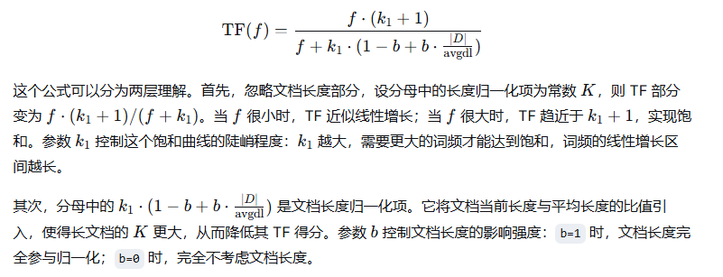

# 90.大模型（LLMs）稀疏检索（BM25）

#### 什么是稀疏检索？BM25 算法的基本原理和公式。

稀疏检索是一类基于词汇精确匹配的信息检索模型。它通过统计查询词在文档中的出现频率和分布情况，来计算文档与查询的相关性。其核心思想是：一个文档包含的查询词越多、越罕见，该文档与查询的相关性就越高。稀疏检索的“稀疏”体现在其文本表示上：每篇文档被表示为一个极高维度的向量，维度通常等于整个词表的大小，但绝大多数维度的值为零，因为一篇文档只包含词表中极小一部分词汇。

BM25（Best Match 25）是稀疏检索的巅峰之作，也是当今最经典、应用最广泛的概率检索模型。它在 TF-IDF 的基础上进行了改进，引入两个核心思想：词频饱和和文档长度归一化。

词频饱和：TF-IDF 假设一个词在文档中出现次数越多，相关性就线性增长。但现实中，一个词出现第 2 次的价值远大于出现第 100 次的价值。BM25 通过一个非线性函数对词频进行平滑，使其增益随词频增加而逐渐递减并趋于饱和。

文档长度归一化：长文档天然有更多词汇，因此包含查询词的几率也越大。BM25 通过一个参数对文档长度进行惩罚，避免长文档仅因为长度而获得虚高的分数。

BM25 评分公式如下：

$$
\text{Score}(D, Q) = \sum_{i=1}^{n} \text{IDF}(q_i) \cdot \frac{f(q_i, D) \cdot (k_1 + 1)}{f(q_i, D) + k_1 \cdot \left(1 - b + b \cdot \frac{|D|}{\text{avgdl}}\right)}
$$

{.ocr-src}

其中：

- *f *($q_i$,$D$)：词项 $q_i$ 在文档 $D$ 中出现的频率（TF）。

- ∣$D$∣：文档 $D$ 的长度（通常是词数）。

- avgdl：所有文档的平均长度。

- $k_1$：控制词频饱和度的参数，通常取 1.2 到 2.0。越大，词频对分数的影响越接近线性。

- $b$：控制文档长度归一化强度的参数，通常取 0.75。`b=1` 时完全归一化，`b=0` 时不考虑文档长度。

这个公式的精妙之处在于，通过 $k_1$ 和 $b$ 两个参数，将词频饱和和文档长度惩罚巧妙地融合在一起，使得 BM25 在各种场景下都能取得稳健且优异的性能。

---

#### BM25 中的 TF（词频）和 IDF（逆文档频率）如何计算？参数 k1 和 b 的作用是什么？

BM25 中的 TF 和 IDF 并非简单的原始统计，而是经过了精心设计的数学变换。

1. TF（词频）部分：

BM25 的 TF 部分不是直接使用原始词频 $f$，而是使用了一个饱和函数：

$$
\text{TF}(f) = \frac{f \cdot (k_1 + 1)}{f + k_1 \cdot \left(1 - b + b \cdot \frac{|D|}{\text{avgdl}}\right)}
$$

这个公式可以分为两层理解。首先，忽略文档长度部分，设分母中的长度归一化项为常数 $K$，则 TF 部分变为 $f \cdot (k_1 + 1)/(f + k_1)$。当 $f$ 很小时，TF 近似线性增长；当 $f$ 很大时，TF 趋近于 $k_1 + 1$，实现饱和。参数 $k_1$ 控制这个饱和曲线的陡峭程度：$k_1$ 越大，需要更大的词频才能达到饱和，词频的线性增长区间越长。

其次，分母中的 $k_1 \cdot (1 - b + b \cdot \frac{|D|}{\text{avgdl}})$ 是文档长度归一化项。它将文档当前长度与平均长度的比值引入，使得长文档的 $K$ 更大，从而降低其 TF 得分。参数 $b$ 控制文档长度的影响强度：`b=1` 时，文档长度完全参与归一化；`b=0` 时，完全不考虑文档长度。

{.ocr-src}

---

#### 为什么 BM25 在关键词匹配任务上仍然非常有效？它与稠密检索有何互补性？

尽管深度学习驱动的稠密检索近年来发展迅猛，BM25 在关键词匹配任务上依然具有不可替代的优势，其根本原因在于它解决的是“精确匹配”问题，而稠密检索解决的是“语义理解”问题。

BM25 的独特优势：

- 专有名词、ID 和术语的精确杀手：对于人名、地名、产品型号（如 `iPhone 15 Pro`）、合同编号、科学术语等，用户往往期望进行精确的字面匹配。BM25 对此天然擅长，不会像稠密检索那样可能被近似的语义所干扰。

- 极速且可解释：BM25 的索引和检索速度极快，延迟极低，且评分公式透明，可以精确解释为什么某篇文档排在了前面（“因为它包含了查询词 A、B、C”）。

- 零样本、无训练、无偏差：BM25 是一个纯统计模型，无需任何训练数据，因此不存在训练数据覆盖不足或偏见问题。它对任何新出现的词汇都有即时的索引和检索能力。

- 对生僻和新兴词汇友好：对于训练数据中未出现过的新词（如“新冠病毒”在 2019 年），稠密检索模型可能完全无法理解，而 BM25 只需该词在文档中出现即可立即匹配。

BM25 与稠密检索的互补性：

BM25 的短板在于无法处理“词汇鸿沟”问题。当用户查询“如何让自己变得更开心”时，文档中可能用的是“提升幸福感的方法”，BM25 无法将二者关联起来。而稠密检索恰好弥补了这一缺陷。

因此，两者构成了完美的互补关系：

- BM25 负责精确召回：召回所有字面包含查询关键词的文档，确保不会有遗漏。

- 稠密检索负责语义扩充：找回那些不包含查询词但语义高度相关的文档，提升召回的完整性。

- 混合检索 (Hybrid Search) 结合二者之长，成为现代 RAG 系统的标配：用 BM25 确保高精度，用稠密检索提升语义覆盖，再通过 RRF 等融合策略综合排序。

---

#### 建立 BM25 索引需要哪些步骤？如何用 Elasticsearch 或 Lucene 实现？

建立一个可供查询的 BM25 索引，是一个经典的离线数据处理管道，主要包含文本预处理、词项统计、倒排索引构建和索引优化四个阶段。

典型步骤：

1. 文档收集与解析：从各种数据源（数据库、文件系统等）读取原始文档，并解析为纯文本。

2. 文本预处理：这是决定检索质量的关键。
  - 分词：将连续文本切分为独立的词项。对于中文，通常需要专用的分词器（如 jieba、HanLP 或 IK 分词器）。
  - 字符过滤：移除 HTML 标签、特殊符号等噪音。
  - 词项标准化：进行小写转换、词干提取或词形还原等。这些步骤必须与查询时的处理完全一致。

3. 构建倒排索引：这是 BM25 的物理核心。倒排索引是一种从“词项”到“文档列表”的映射表。对于词表中的每一个词项，倒排索引记录了包含该词项的所有文档 ID，以及该词在每篇文档中的词频和位置信息。这个过程由索引引擎在后台自动完成。

4. 存储文档与统计信息：除了索引，引擎还会存储原始文档内容（用于结果展示）以及全局统计信息，如文档总数、每篇文档的长度、平均文档长度等，这些是 BM25 评分计算所必需的。

5. 索引优化与持久化：对索引进行合并分段、压缩等优化操作，最后持久化到磁盘供查询服务加载。

用 Elasticsearch / Lucene 实现：

在实际工程中，几乎不会从零手写索引。Elasticsearch 是对 Lucene 的分布式封装，是目前最主流的实现方式。

1. 定义索引映射 (Mapping)：\
   在创建索引时，通过 Mapping 定义文档的字段及其类型。对于需要 BM25 检索的文本字段，类型设置为 `text`。可以指定分词器、是否存储词项位置等。例如，为“标题”和“正文”使用不同的分析器或设置不同的权重。

```json
"mappings": {
  "properties": {
    "title": { "type": "text", "analyzer": "ik_max_word", "boost": 2.0 },
    "content": { "type": "text", "analyzer": "ik_smart" }
  }
}
```

2. 索引文档：\
   使用 Bulk API 批量导入文档。Elasticsearch 会自动对每个 `text` 字段调用指定的分析器，完成分词、过滤、统计，并构建倒排索引。

3. 执行 BM25 查询：\
   使用 `match` 或 `multi_match` 查询，Elasticsearch 内部默认的相似度算法就是 BM25。Lucene 已内置了 BM25 的实现，会自动根据倒排索引中的词频、文档长度和全局统计信息，实时计算每篇文档的得分并排序返回。

开发者只需要关注 Mapping 的设计、分词器的选择和索引数据的导入，底层的复杂统计和评分计算完全由引擎负责。

---

#### 文本预处理（分词、停用词、词干提取）对 BM25 检索效果的影响有多大？

文本预处理是 BM25 检索的“第一公里”，其质量直接影响着最终的检索效果。错误的预处理会导致“垃圾进，垃圾出”，而精心的预处理能显著提升召回率和精确率。

1. 分词：

这是影响最大的一步。分词的目的是将文本切分为有意义的词项。对于英文，空格分词可解决大部分问题，但复杂短语和连字符仍需处理。对于中文，分词是核心挑战。如果分词错误，BM25 索引的词项就是错的，查询时永远无法匹配。例如，“武汉市长江大桥”可能被错误切分为“武汉/市长/江大桥”。选择与领域文本匹配的分词器至关重要。垂直领域（如医学）可能需要自定义词典来确保专业术语被正确切分。分词粒度也直接影响检索行为：细粒度分词能提高召回率，但可能降低精确率；粗粒度则相反。

2. 停用词：

停用词是指“的”、“是”、“在”等高频功能词。传统观点认为应移除以节省索引空间并避免噪音。但对现代 BM25 而言，移除停用词需非常谨慎。IDF 机制已经自然地赋予这些高频词极低的权重，因此它们对评分的影响微乎其微。而强行移除会破坏短语的完整性，例如，将短语“to be or not to be”移除停用词后会变成“be not be”，完全丧失了原意。因此，通常建议不主动移除停用词，除非索引规模极大且可以验证移除后不会损害特定短语的检索。

3. 词干提取与词形还原：

这主要适用于英文等形态丰富的语言。目的是将“running”、“runs”、“ran”都归一化为“run”。这能极大地提高召回率。词干提取（如 Porter Stemmer）是粗暴的规则裁剪，速度快但可能过度提取。词形还原则更精准，会考虑词性和语境，但速度较慢。对于追求高召回率的通用搜索，建议使用轻量级词干提取；对于需要高精度的垂直搜索，词形还原是更好的选择。

影响总结：分词决定文本能被“理解”的程度，是最重要的一环。停用词处理在现代 BM25 中已不再是必须，错误移除的风险很高。词干提取是平衡召回与精度的有效杠杆。这些预处理必须在索引和查询时完全对称地应用，否则将导致灾难性的不匹配。

---

#### BM25 如何处理多词查询？默认的词袋模型假设有什么局限？

BM25 处理多词查询的方式非常直接，它遵循词袋模型假设。

处理方式：\
BM25 将查询视为一个“装着词的袋子”，词与词之间是相互独立的。它首先对查询进行分词，得到一组查询词项 $q_1,q_2,\dots,q_n$。然后，分别计算每个词项与文档的 BM25 分数，最后将这些分数直接相加，得到文档关于整个查询的最终得分。

词袋模型假设的局限：

这种处理方式虽然简单高效，但完全忽略了词序和词间关系，带来了几个明显的局限：

- 丧失词序与短语语义：“北京到上海的高铁”和“上海到北京的高铁”，对于 BM25 是完全相同的查询，因为查询词集合完全一样。它无法理解语序变化带来的语义差异。

- 无法处理否定和限定：“不是苹果的笔记本”这个查询，BM25 可能会返回大量关于“苹果笔记本”的结果，因为它无法理解“不是”这个否定词对“苹果”和“笔记本”之间关系的限定。

- 忽略局部上下文：BM25 不知道查询词在文档中是否相邻出现。而通常，查询词在文档中作为一个紧密的短语出现时，其相关性远高于它们分散在文档各处的情况。

- 缺失语义理解：它无法识别同义词、近义词或指代关系，完全依赖字面匹配。

现代系统的补偿方法：\
尽管有这些局限，BM25 的朴素性也是其鲁棒性的来源。在实际的混合检索系统中，BM25 的这些短板由稠密检索来弥补。同时，也可以为 BM25 增加一些简单的扩展，如短语查询（使用 `match_phrase` 要求查询词必须相邻出现），可以部分缓解词序问题。

---

#### 查询长度对 BM25 评分的影响：长查询和短查询在 BM25 下表现差异。

查询长度对 BM25 评分有着直接且深刻的影响。理解这一点对于诊断检索问题和设计混合检索系统至关重要。

短查询：

通常由 1-3 个词组成，是搜索引擎中最常见的查询类型。BM25 天然倾向于短查询，因为它就是为这种基于关键词的匹配而设计的。IDF 机制会对短查询中的罕见词赋予极高权重，使得检索结果非常聚焦和精确。短查询的挑战在于，用户意图可能模糊（如只搜一个“苹果”），BM25 无法自行消歧。

长查询：

通常包含一个完整的问句或一段描述性文本。长查询对 BM25 带来了几个严峻挑战：

1. 评分稀释：由于 BM25 将各词项分数直接相加，长查询中大量普通词汇的分数会累积起来，可能稀释掉少数关键实体的匹配贡献。一篇匹配了全部长查询词但无关的文档，得分可能反超一篇只精准匹配了核心关键短语的文档。

2. 词袋模型弊端被放大：长查询中包含了更多功能性词汇和复杂的句法结构。BM25 无视这些结构，将其视为一堆独立词汇，很容易被“词海战术”带偏。例如，“请告诉我苹果公司最新发布的那个不是手机的产品是什么”，BM25 可能只看到一堆词，然后匹配到包含这些词最多的文档。

3. 缺失重点：BM25 无法判断查询中哪些词是重点。在“我想了解关于糖尿病的最新治疗方法”中，“糖尿病”和“治疗方法”才是核心。

表现差异总结：

- BM25 是为短查询而生的利器，在实体搜索、明确术语查询上表现极佳。

- BM25 在处理长查询时性能会明显下降，它无法理解复杂的用户意图和语义。

这正是为什么需要稠密检索的原因。稠密检索模型（特别是经过指令微调的模型）能够很好地处理长查询，从中提取核心语义意图，并将其与相关文档进行匹配。在实际 RAG 中，通常用稠密检索处理用户的长对话和问题，而用 BM25 处理其中的实体和关键词，两者互补。

---

#### 如何在 BM25 中引入字段权重（如标题权重高于正文）？

在现实文档中，不同字段的重要性是不同的。标题、摘要、关键词通常比正文更能代表文档的主题。BM25 本身没有内置的字段加权机制，但可以通过扩展或在应用层实现。

实现方法：

应用层独立查询与加权融合 (Elasticsearch multi_match + boost)：\
这是最主流、最灵活的方法。不为整个文档建立一个全局索引，而是将不同字段视为独立的索引区域。查询时，分别对每个字段执行 BM25 查询，最后将各个字段的得分进行加权求和，得到文档的最终总得分。

例如，总得分可以定义为：

$$
\text{TotalScore} = w_{\text{title}} \cdot \text{BM25}_{\text{title}} + w_{\text{body}} \cdot \text{BM25}_{\text{body}}
$$

其中 $w_{\text{title}}$ 和 $w_{\text{body}}$ 是预设的权重，且 $w_{\text{title}} > w_{\text{body}}$。

{.ocr-src}

在 Elasticsearch 中，这可以通过 `multi_match` 查询的 `fields` 参数和 `boost` 语法直接实现：

```json
{
  "query": {
    "multi_match": {
      "query": "搜索关键词",
      "fields": ["title^5", "abstract^2", "body"]
    }
  }
}
```

`title^5` 表示标题字段的权重是正文字段的 5 倍。Elasticsearch 内部会分别计算每个字段的 BM25 分数，再乘以对应的 boost 值，然后求和。

2. 索引时字段增强 (Index-time Boosting)：\
   在文档索引阶段，将标题等关键字段的文本，按其权重大小，在文档的索引文本中物理地重复多次。例如，如果标题权重是 5，就将标题文本重复 5 次后再与正文拼接，建立一个统一的索引。这种方法实现简单，无需在查询时修改，但会导致索引膨胀，且无法灵活地动态调整权重。

最佳实践：推荐使用应用层独立查询与加权融合的方法。它权重调整灵活，不增加索引大小，且逻辑清晰，是工业界处理字段权重的标准方案。

---

#### BM25 的局限性：为什么它在语义相似性任务上不如稠密检索？举例说明。

BM25 的根本局限性在于它基于字面精确匹配，而无法理解语义。这使它在下述任务中远逊于稠密检索。

词汇鸿沟问题：这是 BM25 无法逾越的障碍。当查询和文档使用不同的词汇表达同一个意思时，BM25 的匹配度为零。

- 例子：查询 = “如何减重？”；文档 = “减肥的有效策略”。BM25 无法将“减重”和“减肥”关联起来，除非你配置了同义词词表。而稠密检索则因其训练数据，天然理解它们是同义表达。

复杂语义关系建模：BM25 无法建模词汇之间的关系，如类比、因果关系、上下位关系等。

- 例子：查询 = “乔布斯的继任者是谁？”；文档 = “蒂姆·库克在乔布斯去世后接任了苹果公司的CEO。” BM25 仅能命中“乔布斯”，但无法理解“继任者”和“接任”这种复杂关系。稠密检索则能从大量语料中学习到这种实体关系模式，并将其映射到向量空间中。

上下文相关的动态语义：同一个词在不同上下文中有不同含义，BM25 无法区分。

- 例子：查询 = “苹果最新季度的营收是多少？”；文档1 = “苹果公司财报显示...” 文档2 = “苹果这种水果营养价值高...” 尽管两篇文档都包含了查询词“苹果”和“季度”（或“最新”），但 BM25 无法辨别出文档1中的“苹果”是公司，而文档2中的是水果。而稠密检索通过 Transformer 的注意力机制，会根据“营收”、“财报”等上下文，动态生成一个排除了水果含义的“苹果公司”向量。

对长文档和长查询的理解：BM25 将文本视为词袋，长查询的噪音和长文档的稀释效应无法克服。稠密检索能更好地抓取核心意图。

结论：BM25 在“精确查找”上无与伦比，稠密检索在“语义理解”上具有压倒性优势。两者在 RAG 系统中共存互补，正是为了应对这个复杂世界的不同检索需求。

---

#### 如何对 BM25 检索结果进行评分归一化，以便与稠密检索分数融合？

BM25 的评分是基于词频和统计的任意值，其分值范围没有边界。而稠密检索的分数通常是经过归一化的相似度（如 0 到 1 之间的余弦相似度）。两者的分数完全不在一个尺度上，如果直接将它们加权求和，其中一路的分数很容易因为其数值范围更大而占据主导，导致另一路形同虚设。因此，分数归一化是融合前的必要步骤。

常用的归一化与融合方法：

1. 倒数排名融合 (Reciprocal Rank Fusion, RRF)：\
   这是目前最推荐、最鲁棒的方法。它完全抛弃了具体的分数值，只看结果在各自检索列表中的排名。其核心假设是：排名本身是跨检索器可比的、更稳定的信号。

对于文档 d，RRF 分数的计算公式为：

$$
\text{RRFscore}(d) = \sum_{r \in R} \frac{1}{k + \text{rank}_r(d)}
$$

{.ocr-src}

其中 $R$ 是参与的检索器集合（例如 {BM25, Dense}）$\mathrm{rank}_r(d)$ 是文档 $d$ 在检索器 $r$ 的返回列表中的排名。$k$ 是一个平滑常数，通常取 60，用于削弱排名靠后的文档的分数差异。

优点：无需任何训练，对分数分布不敏感，实现极其简单，效果稳定。

2. Min-Max 归一化：\
   如果业务场景要求必须保留原始分数信息，可以使用 Min-Max 归一化，将各自分数缩放到 `[0, 1]` 区间。对于每个检索器独立进行：

$$
\text{Score}_{\text{norm}} = \frac{\text{Score} - \text{Score}_{\min}}{\text{Score}_{\max} - \text{Score}_{\min}}
$$

{.ocr-src}

缺点：极易受到极端高分或低分值的异常值影响。且 BM25 的分数分布可能在一次查询中很集中，另一次很分散，导致归一化后的分数在不同查询间不可比。

3. 分布校准 (Distribution Calibration)：\
   一种更精细的方法。不使用单次查询的 min/max，而是通过离线采样的方式，预先学习 BM25 分数的整体分布，并将其映射到一个更稳定的概率分布或标准分布上。这需要额外的工程和数据工作，但效果更好。

实践建议：

在绝大多数 RAG 系统中，RRF 是首选方案。它简单、健壮、无需调参，能稳定地融合 BM25 和稠密检索的结果。只有在经过深入实验，确认 RRF 效果不足，且团队有能力维护更复杂的归一化管道时，才考虑其他方法。

---

#### 多语言环境下的 BM25：不同语言的分词器和停用词表如何配置？

多语言环境是 BM25 应用中的常见挑战。不同语言的词法、句法和书写系统差异巨大，无法用一套通用的预处理管道解决。配置的核心在于为每种语言选择和优化专属的分词器，并谨慎对待停用词和字符标准化。

分词器的选择与配置：\
分词是首要且影响最大的步骤。英文等西方语言可使用标准分词器，结合词干提取或词形还原来处理形态变化。中文则需要专门的分词器，因为词与词之间没有天然的空格分隔。常用的中文分词器包括 IK Analyzer、jieba 分词、HanLP 等。在 Elasticsearch 中，可以通过 `analysis` 配置定义不同语言的分析器，例如为中文安装 `ik` 插件并配置 `ik_smart` 或 `ik_max_word` 分词模式。对于包含多语言的文档，可以在索引映射中对不同字段指定不同的分析器，或者使用 `multi-fields` 为同一文本创建针对不同语言的分词索引。如果文档本身包含混合语言，更精细的做法是先进行语言检测，再按语言分段处理。

停用词表的配置：

现代 BM25 实践中，不建议主动移除停用词，尤其是对于多语言环境。IDF 机制已能自动为高频词赋予极低权重，移除它们反而可能破坏短语的完整性。例如，“to be or not to be” 若移除停用词将面目全非。如果确实需要，应为每种语言配置独立的停用词表，并定期评审，避免过度删除。

字符标准化：

多语言环境下，必须进行统一的字符标准化。这包括统一全角/半角字符、不同语言的引号和破折号，以及使用 Unicode 标准化形式（如 NFC）。这可以避免因字符表示差异而导致的匹配失败。

最佳实践：\
在 Elasticsearch 中，为每种语言定义一个专用的分析器，并使用 `multi_match` 查询跨语言字段。对于用户查询，可以通过语言识别自动选择对应的字段，或者同时查询多个语言字段并通过权重融合结果。有效的多语言 BM25 配置是“各司其职，统一协调”。

---

#### BM25 能否与神经网络结合？如 doc2query 技术使用生成模型扩展文档。

BM25 与神经网络的结合，是目前提升稀疏检索效果最重要的技术方向之一。它并非取代 BM25，而是通过神经网络来增强文本表示，弥补其词汇不匹配的缺陷。其中最经典的技术就是 doc2query。

Doc2query 的原理与实现：

Doc2query 使用一个序列到序列的生成模型（如 T5），为每一篇文档生成一组可能被用户用作查询的伪查询文本。例如，对于一篇关于“深度学习优化器”的文档，模型可能生成“如何选择Adam优化器”、“SGD的优缺点”等查询。这些生成的查询文本随后被附加到原始文档的索引文本中。这样，当用户实际搜索“Adam 优化器”时，BM25 就能通过文档中已添加的伪查询实现词汇匹配，从而被召回。

这种技术极大地扩展了文档的词汇覆盖范围，为 BM25 装上了“语义理解的引擎”。现代实现 DocT5Query 等可以高效地为海量文档生成查询。其优点在于完全兼容现有 BM25 索引和检索管道，无需修改查询端或评分算法。

其他结合方式：

- 神经增强的查询扩展：在查询端，使用语言模型或词嵌入为原始查询生成同义词、相关词或释义，扩展为更丰富的查询词集合。

- 术语权重学习：使用神经网络（如 DeepCT）为文档中的每个词项学习一个上下文相关的权重，替换 BM25 公式中固定的 TF 部分，实现更精准的术语重要性评估。

- 混合架构：BM25 作为第一阶段的粗筛器，快速召回候选文档，然后使用基于 BERT 的 Cross-Encoder 作为第二阶段的重排序器，进行精细的语义排序。这是当前工业界最主流的范式。

通过这些结合，BM25 不再是孤立的传统算法，而是可融入现代深度学习管道的重要组件。

---

#### 如何调整 BM25 参数以适应特定领域的数据（如短文本、推文）？

调整 BM25 的参数 $k_1$ 和 $b$ 是适应特定数据分布的关键。对于推文、商品标题等短文本，其数据特征与长文档显著不同，需要对参数进行针对性的调整。

参数 $b$ 的调整（文档长度归一化）：\
推文等短文本的长度分布非常集中，大多数都在几十个词以内，长度差异极小。此时，文档长度不应成为评分的重要影响因素。因此，应该显著降低 $b$ 的值，例如设置为 0.25 或更低。这样做可以放松对短文本的长度惩罚，让模型更专注于词项匹配本身，而不是去纠结细微的长度差别。

参数 $k_1$ 的调整（词频饱和度）：\
在短文本中，一个词很少会重复出现很多次。但某些特定领域（如推文中的话题标签或社交媒体中的@提及），关键术语可能会在同一文档中反复出现。如果希望这种高频词获得更高的权重，可以适当提高 $k_1$ 的值，使词频对分数的贡献在达到饱和之前有更长的线性增长区间。反之，如果词频的区分度不大，则使用默认值即可。

分词与停用词的领域定制：

比参数调整更重要的是文本预处理的定制。推文和短文本中包含大量特殊符号（如#标签、@提及、URL）。需要配置专门的分词器来保留这些 Token 的完整性，而不是将它们分割或丢弃。同时，领域特定的噪音（如“转发”、“http”）可能需要被加入停用词表，以防止它们干扰检索。

调优方法：\
不要凭直觉猜测参数。应该收集一个包含典型查询和相关文档标注的领域测试集。然后在这个测试集上，使用网格搜索的方法，系统地尝试不同的 $k_1$ 和 $b$ 组合，并使用 nDCG 或 Recall@K 等指标评估每种组合的性能。选择在测试集上表现最优的参数组合。

---

#### 在 RAG 中，BM25 适合作为初筛还是精细检索？典型使用模式。

在 RAG 系统中，BM25 既可以作为初筛器，也可以作为精细检索的一部分，但最常见的模式是将其作为混合检索中的并行召回组件。

作为初筛器（粗筛）：

BM25 的速度极快，非常适合从海量文档库中快速召回一个较大的候选集。例如，先从百万文档中用 BM25 召回 Top 1000，然后在这个缩小的候选集上，使用更昂贵、更精准的稠密检索模型或 Cross-Encoder 进行精细排序。这种“漏斗”模式兼顾了效率和精度。

作为精细检索器：

BM25 单独作为精细检索器的情况较少，因为它受限于词汇不匹配。但在专有名词、ID、精确术语匹配等场景下，BM25 的精度无可匹敌。在一些垂直领域，经过精心调优（如配置了高质量同义词表和领域分词器）的 BM25，甚至可以超越通用稠密检索模型。

典型混合使用模式：

现代 RAG 系统最经典的用法是并行混合召回 + 分数融合。用户查询同时被发送给 BM25 检索器和稠密向量检索器。BM25 负责精准的词汇匹配，稠密检索负责语义覆盖。两路各自返回 Top K 个结果（如 Top 20）。然后使用 RRF 等融合算法，对两路结果的排名进行加权合并，生成最终的 Top 10 或 Top 20 候选文档。这个融合后的候选集再被送入生成模型。

这种模式充分发挥了 BM25 的精确匹配能力和稠密检索的语义理解能力，是目前工业级 RAG 系统达到高召回率和高精度的基石。

---

#### 如何处理 BM25 中常见的“词汇不匹配”问题？查询扩展或同义词表有用吗？

“词汇不匹配”是 BM25 的阿喀琉斯之踵。当用户使用的词汇与文档作者使用的词汇不同，但语义相同时，BM25 的匹配度为零。查询扩展和同义词表是缓解此问题的经典方法，但需要谨慎使用。

查询扩展：

查询扩展在用户查询的基础上，自动添加相关的词汇，以增加命中相关文档的机会。方法包括：

- 基于同义词表/知识图谱的扩展：利用 WordNet、领域词表或手工构建的同义词映射表。例如，搜索“汽车”时，自动扩展为“汽车” OR “轿车” OR “机动车”。

- 基于词嵌入的扩展：使用 Word2Vec 等模型找到与查询词最相似的 K 个词进行扩展。这种方法可以捕获更深层的语义关联，但风险也更高，可能引入噪音。例如，与“苹果”（公司）最相似的词可能包括“微软”、“三星”，但如果用户本意是水果，这些扩展词就会误导检索。

- 基于生成模型的扩展：使用 LLM 将用户查询改写为多个不同措辞的版本，或者生成可能的文档侧表达方式。这种方法更智能，能更好地保持语义一致性。

文档端扩展（Doc2Query）：

这是目前更受推崇的方法。与其猜测用户会怎么问，不如在索引构建时就为文档生成可能的查询。通过神经生成模型为每篇文档添加伪查询，从根本上增加文档被命中的可能性，且不会在查询时引入延迟和噪音风险。

同义词表：

同义词表是查询扩展的基石。构建一个高质量的、领域相关的同义词表非常有效。但通用同义词表容易引入歧义，需要结合上下文使用。在实践中，往往需要同时使用多种方法，并利用 RAG 中的稠密检索来从根本上解决词汇不匹配问题。

---

#### 分布式 BM25 索引：大量文档下如何分片和负载均衡？

当文档规模达到数十亿级别时，单机显然无法承载。分布式 BM25 索引需要将数据和查询负载分散到集群中的多个节点上，核心机制是分片。

分片策略：

Elasticsearch 是目前最成熟的分布式 BM25 解决方案。它在创建索引时，允许指定主分片数。文档根据其 ID 进行哈希，然后被均匀地分配到各个主分片上。每个主分片本身就是一个完整的、独立的 Lucene BM25 索引。查询时，协调节点会将查询请求广播到所有相关分片，每个分片在本地执行查询并返回自己的 Top K 结果，再由协调节点进行全局排序和合并，返回最终的 Top K 文档。

负载均衡：

为了实现查询负载的均衡和系统的高可用，每个主分片可以配置零个或多个副本分片。副本分片是主分片的完整拷贝，可以分布在不同的节点上。这样，查询请求可以被路由到主分片或其任意一个副本上执行，从而分散单个节点的查询压力。分片的大小对性能影响巨大，通常建议单个分片大小在 10GB 到 50GB 之间。分片过小会导致元数据管理开销增大，分片过大则会使查询和恢复速度变慢。

自研系统的考量：

如果自研分布式索引，通常会采用基于一致性哈希的分片策略，它能在集群扩缩容时最小化数据迁移。每个分片独立构建和管理其 BM25 索引。查询时，由一个代理节点将查询广播到所有分片，收集结果后归并。这种架构的关键在于全局统计信息（如 IDF、平均文档长度）的同步，可以采用全局定期统计或分片本地统计后近似合并的方式。

---

#### 评估 BM25 检索的常用指标（nDCG, MAP, Recall@k）的含义和计算。

评估 BM25 检索质量需要综合使用多个指标，因为它们各自衡量的维度不同。

1. Recall@K：

召回率，衡量的是“所有相关的文档中，有多少被检索出来了”。它的计算非常简单：对于一个查询，标准答案中有 R 个相关文档，系统返回的前 K 个结果中包含了 r 个相关文档，则 Recall@K = r / R。Recall@K 是衡量检索系统查全率的核心指标，它只关心结果中有没有相关文档，不关心它们的具体排名。对于 RAG 系统，通常追求较高的 Recall@K，以确保不遗漏关键信息。

2. MAP (Mean Average Precision)：

平均精度均值，衡量的是检索结果的排序质量。它对每个相关文档出现的位置敏感。首先计算 Average Precision (AP)。对于单个查询，AP 的计算方式为：在结果列表中从上往下遍历，每遇到一个相关文档，就计算当前截止位置处的精确率（Precision），然后将所有这些精确率值相加，再除以相关文档总数。MAP 则是所有查询的 AP 值的平均数。MAP 值越高，说明相关文档在排序列表中越靠前。

3. nDCG (Normalized Discounted Cumulative Gain)：

归一化折损累计增益，是衡量排序质量和分级相关度最全面的指标。它假设文档的相关度可以是多级的（例如：0-不相关，1-有点相关，2-相关，3-非常相关），而不仅仅是二分。nDCG 的计算分为三步：

- CG (Cumulative Gain)：将前 K 个结果的相关度得分简单相加。

- DCG (Discounted Cumulative Gain)：对排名靠后的结果的相关度得分进行“折损”，因为用户更关注靠前的结果。通常是 `sum(rel_i / log2(i+1))`。

- nDCG：将 DCG 除以理想情况下的最大 DCG (IDCG)，进行归一化，使得分数在 0 到 1 之间，可以在不同查询间进行比较。

在评估 BM25 时，通常会同时报告 Recall@10, MAP, 和 nDCG@10，以全面衡量其查全能力和排序精度。

---

#### 在流式数据场景下，如何实时更新 BM25 索引？

在流式数据场景（如日志、社交媒体、新闻流）中，新文档必须尽快变为可搜索。这要求 BM25 索引支持近实时的更新。

近实时搜索与索引刷新：\
Elasticsearch 等引擎通过近实时机制实现此需求。新文档被索引时，首先写入内存缓冲区，同时写入事务日志以保证数据安全。默认情况下，每秒执行一次 `refresh` 操作，将内存缓冲区中的数据生成一个新的 Lucene 分段，并打开搜索，使新数据变为可见。这种机制使得新文档在 1 秒左右即可被检索到。

处理高吞吐写入：

对于每秒成千上万条的写入，单次请求的开销不可接受。必须使用批量索引 API，将数百甚至数千条文档合并为一个 HTTP 请求发送，大幅降低网络和 I/O 开销。同时，使用 Kafka 等消息队列作为缓冲，接收端进行削峰填谷。

分段合并的挑战：

频繁的刷新会产生大量小的 Lucene 分段，这会严重拖累查询性能和消耗文件句柄。因此，Elasticsearch 后台会持续进行分段合并，将多个小分段合并为一个大分段，并物理删除被标记为删除的文档。在流式写入的高峰期，合并压力巨大，需要合理调整合并策略和分配足够的 I/O 资源，避免因合并而影响写入和查询性能。

对一致性的权衡：\
实时更新在带来可见性优势的同时，也引入了对一致性的挑战。可以通过设置 `wait_for` 参数，要求在刷新或日志写入完成后再返回写入结果，来平衡实时性和数据可靠性。

---

#### BM25 对文档长度的偏置：参数 b 如何校正长度效应？

BM25 评分函数天然倾向于给短文档打更高的分，因为短文档的词项密度更高。参数 $b$ 正是用来校正这种长度偏置的。

参数 b 的作用机制：

回顾 BM25 公式的分母部分：$f(q_i, D) + k_1 \cdot (1 - b + b \cdot \frac{|D|}{\text{avgdl}})$。其中，`|D|/avgdl` 是当前文档长度与平均长度的比值。参数 `b` 控制了这个比值对最终评分的影响程度。

{.ocr-src}

- 当 b = 1 时：分母中包含完整的 `|D|/avgdl`。文档长度被完全考虑，长文档会受到最大程度的惩罚，得分被显著压低；短文档则得分被抬高。这适用于通常期望短文档更精炼的场景。

- 当 b = 0 时：`|D|/avgdl` 项被完全消除。此时，BM25 评分与文档长度无关，退化为不考虑长度归一化的形式。这适用于所有文档长度都差不多，或文档长度不应影响相关性的场景（如推文集合）。

- 当 b = 0.75 时：这是经典默认值，在大多数通用场景下取得了平衡。它对长文档进行了适度的惩罚，但又不像 `b=1` 那样严格。

如何根据文档类型调整：

- 长文档集合（如学术论文、合同）：应该适当增大 b，以抑制超长文档利用词海战术获得虚高分数。

- 短文本集合（如产品标题、推文）：应该适当减小 b，甚至设为 0，因为它们的长度差异微乎其微，不应该让长度成为区分因素。

- 混合长度集合：保留默认值或基于实验微调。

通过调整 $b$，可以让 BM25 更好地适配不同长度分布的数据集，做出更公允的相关性判断。

---

#### 如何利用 BM25 做负采样，为稠密检索提供难负例？

