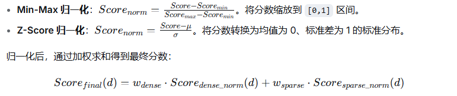
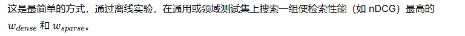
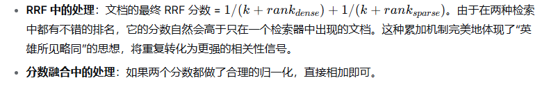

# 91.大模型（LLMs）混合检索

#### 混合检索的典型架构：如何并行执行稠密和稀疏检索并融合结果？

典型的混合检索架构是一个“并行查询-异步融合”的流程，通常包含三个核心组件：查询路由器、多个独立的检索后端、以及结果融合引擎。

1. 查询路由与分发：当用户查询到达时，查询路由器会同时将查询分发到两个（或多个）检索后端。对于稠密检索后端，查询会被实时编码为向量；对于稀疏检索后端，查询会经过同样的文本预处理（分词、标准化等）。

2. 并行检索：两个检索器独立并行工作。稠密检索器在向量索引中执行近似最近邻搜索，返回 Top K_d 个带有相似度分数的文档。稀疏检索器在倒排索引中执行 BM25 等算法，返回 Top K_s 个带有统计得分的文档。这一步可以通过多线程、异步 I/O 或直接利用检索服务的并发能力实现。

3. 结果融合：这是架构的核心。并行检索的结果被收集到融合引擎中。融合引擎不关心每条结果的原始分数，而是通过一种融合算法（如倒数排名融合 RRF 或归一化分数加权）对两个结果列表进行合并重排序，生成最终的统一 Top K 结果列表，返回给下游的生成模块。

这种架构的关键在于各检索器的独立性和可替换性。我们可以轻松地添加新的检索器（如多模态检索器），而无需修改其他部分。目前主流向量数据库（如 Milvus、Weaviate）和搜索引擎（如 Elasticsearch）大多支持或可集成混合检索能力。

---

#### 结果融合的主要方法有哪些？倒数排名融合（RRF）和分数融合的公式与优缺点。

融合多个检索器的结果，核心挑战在于它们的评分标准完全不同。BM25 的分数是统计值，没有固定区间；向量相似度分数通常是 0 到 1 之间的余弦相似度。直接比较分数毫无意义。因此，需要特定的融合算法。

1. 倒数排名融合 (Reciprocal Rank Fusion, RRF)

RRF 是目前最流行、最鲁棒的融合方法之一。它完全抛弃了原始的评分值，只依赖每个结果在其所属检索器返回列表中的排名。

公式：

$$
RRFscore(d) = \sum_{r \in R} \frac{1}{k + rank_r(d)}
$$

{.ocr-src}

其中，$R$ 是所有参与融合的检索器集合，$r_{ankr}$($d$) 是文档 d 在检索器 r 返回列表中的排名（从 1 开始）。常数 $k$ 是一个平滑参数，通常设为 60，用于降低排名靠后文档之间的分数差异。

优点：

- 无需归一化：完全绕开了分数不可比的问题。

- 简单鲁棒：对异常值和分数分布不敏感，在实践中效果非常稳定。

- 易于实现：计算逻辑清晰，不依赖历史数据。

缺点：

- 丢失分数信息：当一个检索器对某个结果有极高的置信度（分数极高）时，这种信息被忽略了。

- 受检索深度影响：如果一个相关文档恰好排在某个检索器返回的列表之外，它在该检索器中的 RRF 贡献为零，这可能不够公平。

2. 分数融合 (Score Fusion)

分数融合试图保留原始分数的信号。其前提是必须先将分数归一化到同一量级。

常用归一化：

- **Min-Max 归一化**：$Score_{norm} = \frac{Score - Score_{min}}{Score_{max} - Score_{min}}$。将分数缩放到 `[0,1]` 区间。
- **Z-Score 归一化**：$Score_{norm} = \frac{Score - \mu}{\sigma}$。将分数转换为均值为 0、标准差为 1 的标准分布。

归一化后，通过加权和得到最终分数：

$$
Score_{final}(d) = w_{dense} \cdot Score_{dense\_norm}(d) + w_{sparse} \cdot Score_{sparse\_norm}(d)
$$

{.ocr-src}

优点：

- 保留置信度：能够体现检索器对某个结果的“确信”程度。

缺点：

- 对异常值敏感：Min-Max 归一化极易受单次查询中的极端分数影响。

- 分布不稳定：不同查询的分数分布可能差异巨大，导致归一化效果不一致，模型调优困难。

总结：在大多数 RAG 系统中，RRF 是首选方案，因为它实现简单、效果稳定、无需调参。只有在特定场景且团队有能力维护复杂的归一化管道时，才会深入尝试分数加权融合。

---

#### 在分数融合中，如何对稠密分数和稀疏分数进行归一化，使其在同一量级？

如果选择分数融合而非 RRF，归一化是必不可少的预处理步骤。目标是将任意分布的原始分数，转换为具有可比性的标准分布。常见方法有三种，各有优劣。

1. Min-Max 归一化

它将每个检索器返回的分数独立地线性映射到 `[0, 1]` 区间。

公式：

$$
Score_{norm} = \frac{Score - Score_{min}}{Score_{max} - Score_{min}}
$$

其中 $Score_{min}$ 和 $Score_{max}$ 是**本次查询**中，该检索器返回的所有结果的分数最小值和最大值。

{.ocr-src}

优点：计算简单，保证了所有分数在 `[0,1]` 范围内。\
缺点：极度脆弱。如果一次查询中，某个检索器返回的结果分数都很接近，Min-Max 归一化后，这些原本微小的差异会被不成比例地放大；反之，一个异常的高分或低分会压缩其他所有结果的分数区间。

2. Z-Score 归一化

该方法假设分数呈正态分布，将其转换为均值为 0、标准差为 1 的标准正态分布。

公式：

$$
Score_{norm} = \frac{Score - \mu}{\sigma}
$$

{.ocr-src}

这里的 $μ$ 和 $σ$ 通常是该检索器在本次查询返回结果中的均值和标准差。

优点：对异常值的鲁棒性优于 Min-Max。\
缺点：如果分数分布严重偏离正态分布，效果会打折。此外，Z-Score 归一化后的分数可能为负数，且范围不确定，仍不宜直接做加权求和，有时需要后续再接一个 Sigmoid 函数映射到 `(0,1)`。

3. 基于历史分布的校准

这是最工程化的方法。不依赖单次查询的分数分布，而是通过离线采样，预先为该检索器学习一个固定的分数分布模型。在线查询时，使用该模型将原始分数转化为一个稳定的概率值或百分位数。例如，可以预先统计分数分布的累积分布函数，在线时将分数转换为该分布的百分位。这种方法最稳定，但需要预先建立和维护离线统计模型。

实践选择：

如果必须使用分数融合，Z-Score 归一化 + Sigmoid 是一个相对较好的折中。但再次强调，在大多数情况下，直接使用 RRF 能完全规避这些复杂的归一化问题，是更优的选择。

---

#### 权重融合：如何设置稠密和稀疏检索的权重？固定权重 vs 动态权重。

在分数融合中，权重的设定决定了两种检索器的话语权。这可以是固定的，也可以是根据查询动态调整的。

固定权重：

这是最简单的方式，通过离线实验，在通用或领域测试集上搜索一组使检索性能（如 nDCG）最高的 $w_{dense}$ 和 $w_{sparse}$。

{.ocr-src}

- 优点：实现简单，系统行为稳定可预测。

- 缺点：无法适应不同类型的查询。对有些查询，关键词匹配更重要；对另一些，语义理解更重要。固定权重无法做出区分。

动态权重：

这是更智能的方案。系统在收到查询后，首先分析查询的特征，然后根据预设的规则或模型动态决定融合权重。

- 基于规则的方法：
  - 如果查询中包含特定实体、数字、ID或引号括起来的精确短语，则大幅提高稀疏检索的权重。
  - 如果查询是一个完整的自然语言问句，长度较长，则提高稠密检索的权重。
  - 如果查询词很生僻，或不在任何已知词表中，则提高稀疏检索的权重。

- 基于模型的方法：
  - 查询意图分类器：离线训练一个轻量级的分类器，将查询分为“事实型查询”、“概念型查询”、“导航型查询”等，每种类别对应一套预定义的最优权重。
  - 学习型权重预测：训练一个小型神经网络，输入查询的特征（如长度、实体数量、困惑度），直接输出两个检索器的最佳融合权重。

动态权重的挑战在于分类器或规则本身可能出错，引入新的不确定性。因此，一个稳健的系统通常以经过充分验证的固定权重作为基线，再逐步引入简单的、基于规则的动态调整，并在上线前进行充分的A/B测试。

---

#### 混合检索中，如何确定两种检索的召回数量？各自取多少候选进行融合？

召回数量（Top-K）的选择直接影响融合效果。取太少会漏掉相关文档，取太多则会引入噪音并增加计算和延迟。

基本原则：

- 稀疏检索（如 BM25）：由于其精确性，Top-K 结果通常都非常相关。召回数量可以相对较少，例如 20-50 个。

- 稠密检索：其目标是语义覆盖，可能会召回一些字面不相关但语义相近的结果，这些结果对排序模型的价值可能排在较后。为了不错过长尾的相关文档，稠密检索的召回数量通常需要更大，例如 50-200 个。

- 最终融合数量：最终提供给下游（如 LLM）的结果数量通常较小，例如 Top 10 或 Top 20。

确定方法：

1. 基于预算的设定：根据系统的延迟和计算预算，先确定一个总召回上限（例如 100 个）。然后按经验比例分配，如稠密取 70，稀疏取 30。

2. 基于召回率饱和曲线的设定：这是最科学的方法。在离线评估集上，分别绘制稀疏检索和稠密检索的 Recall@K 曲线。K 值从 10 增加到 500，观察召回率的增长趋势。选择召回率接近饱和（即再增加 K 收益很小）的拐点作为该检索器的召回数量。

3. 自适应调整：对于不同复杂度的查询，可以动态调整。如果查询很短或很精确，可以调低稠密检索的召回数，节省资源。

经验法则：一个常见的起点是稠密检索召回 100 个，稀疏检索召回 30 个。通过离线实验和线上 A/B 测试，找到适合自身业务的最佳平衡点。

---

#### 混合检索是否能解决各自的盲区？请举例说明稠密检索捕获语义但漏掉精确关键词，稀疏反之。

混合检索的设计初衷就是为了相互解决盲区。它能让两种检索器形成完美的互补，覆盖彼此无法触及的角落。

盲区 1：稠密检索漏掉精确关键词，稀疏检索成功补位

- 例子：用户在内部知识库中搜索“`INV-2024-08821` 号发票的审批进度”。

- 稀疏检索 (BM25)：这个发票号是一个极其精确的字符串。BM25 只要在索引中找到这个字符串，就能直接锁定包含它的那几份文档，结果精准无比。

- 稠密检索：Embedding 模型可能从未在训练数据中见过这种格式的发票号。它无法理解这串字符的语义，可能把它当作噪音，最终返回一堆关于“发票审批流程”的泛泛文档，却漏掉了最核心的那一份。

- 混合检索结果：融合后的结果中，BM25 召回的那份精确文档会因其在 BM25 列表中的高排名而排在最终结果的首位，完美解决了稠密检索的盲区。

盲区 2：稀疏检索无法理解语义，稠密检索补位

- 例子：用户搜索“如何让自己变得更开心？”

- 稀疏检索 (BM25)：它只会搜索包含“变得”、“更”、“开心”等词的文档。一篇讲“提升个人幸福感的方法”的文档，因为用词完全不同，会被 BM25 直接忽略。

- 稠密检索：它能够理解“变得更开心”和“提升幸福感”是高度相似的语义，从而成功将这篇文档召回。

- 混合检索结果：融合后的列表中，稠密检索召回的这篇语义相关文档会被引入，填补了 BM25 因词汇不匹配造成的空白，极大地提升了检索的完备性。

通过这两个例子可以看出，混合检索不是简单的“1+1=2”，而是形成了一个更完整、更鲁棒的检索系统，大大降低了遗漏关键信息的风险。

---

#### 对于不同查询类型，混合检索的融合权重如何自适应调整？

不同的查询类型，其最优的稀疏/稠密权重可能截然不同。实现自适应调整，能让混合检索系统在面对千变万化的查询时，始终表现出色。

查询类型分析：

- 精确事实/实体查询（如“爱因斯坦生日”，“合同号 Z123”）：关键词匹配是关键。应提高稀疏检索权重。

- 概念性/解释性查询（如“什么是光合作用”，“机器学习中的过拟合是什么意思”）：语义理解是关键。应提高稠密检索权重。

- 长尾/口语化查询（如“我电脑那个风扇声音贼大，咋整”）：口语与正式文档用词差异大，稠密检索优势明显。应提高稠密检索权重。

- 混合型查询（如“介绍下用于治疗糖尿病的GLP-1药物”）：既有语义（介绍），又有精确术语（糖尿病、GLP-1）。两者需要较均衡的权重。

自适应调整的实现方式：

1. 基于规则的特征判断：\
   在收到查询后，快速提取特征。例如：
  - 查询长度 > 10 个词 → 提高稠密权重。
  - 包含双引号包裹的短语 → 大幅提高稀疏权重。
  - 包含正则匹配到的实体ID、日期 → 提高稀疏权重。\
    这种方法简单、延迟低，但规则较僵化。

2. 基于查询意图分类器：\
   离线训练一个轻量级的文本分类模型，将查询意图分为“事实型”、“概念型”、“导航型”等。在线时，分类器实时判断查询意图，系统根据意图调用预设的最优权重组合。这比简单规则更灵活、更准确。

3. 基于检索结果分布的反馈：\
   这是一个更动态的方法。先以默认权重执行初检，然后分析返回结果的特征。如果 BM25 返回结果的分数方差极小（说明关键词匹配都差不多），而稠密检索有很突出的高分结果，则可能是一个语义型查询，系统可以据此在二次精排中动态调高稠密权重。

最佳实践：先从规则入手，快速验证收益。然后，积累足够的带标签查询数据后，转而训练一个意图分类器，实现更精准的动态权重调整。

---

#### 混合检索的索引要求：是否需要维护两套独立的索引（向量索引+倒排索引）？

是的，标准的混合检索架构需要同时维护一个向量索引和一个倒排索引，因为稠密向量和稀疏文本的数据结构和搜索算法完全不同。

- 向量索引（如 FAISS, Milvus）：用于存储文档的稠密向量，支持基于余弦相似度的 ANN 搜索。这是稠密检索的核心。

- 倒排索引（如 Elasticsearch, Lucene）：用于存储文档的原始文本，支持基于词项的 BM25 匹配。这是稀疏检索的核心。

维护两套索引的挑战与解决方案：

1. 数据一致性问题：增、删、改文档时，必须同时更新两个索引，保证数据一致。系统设计时需要引入事务或最终一致性机制。

2. 存储与成本翻倍：两套索引意味着双倍的存储空间和计算资源。

3. 运维复杂度：需要同时运维两个不同的数据库系统，监控、备份、扩缩容的复杂性都增加了。

简化方案：一体化向量数据库

为了解决上述问题，许多现代向量数据库（如 Milvus, Weaviate）已原生支持在同一数据库中同时存储向量和原始文本，并能自动创建和管理 BM25 倒排索引。开发者只需调用一个 API 接口，数据库就能在内部同时执行稠密和稀疏检索，并支持 RRF 等融合算法。这种一体化方案极大地简化了混合检索的架构和运维，是目前最主流的实现方式。

如果自行搭建，采用一体化数据库是首选。如果技术栈限定，也可以使用 Elasticsearch 存储文本和 BM25 索引，同时维护一个独立的 Milvus 存放向量，通过应用层的中间件来协调。

---

#### 如何用学习的方法（如 LambdaMART）来训练一个融合排序器？

当 RRF 或简单的分数加权无法满足精排需求时，可以引入学习排序模型，直接学习如何融合多路特征。

LambdaMART 是一种基于梯度提升决策树的经典 pairwise 学习排序算法。它的核心思想是直接优化排序指标（如 nDCG），通过迭代生成多棵决策树来最小化逆序对的损失。

训练流程：

1. 构建训练数据集：\
   需要收集大量的“查询-文档”对，并为每个文档对生成一系列特征，同时有人工标注的相关度标签（如 0-4 级）。
  - 关键特征包括：
    - 稠密检索特征：该文档在稠密检索器中的排名（rank）、原始相似度分数、归一化分数等。
    - 稀疏检索特征：该文档在稀疏检索器中的排名、原始 BM25 分数、归一化分数、词项匹配比例等。
    - 文档质量特征：文档的 PageRank 值、点击率、发布时间等。
    - 查询-文档匹配特征：查询与标题的 BM25 分数、查询词在文档中的 IDF 和等。

2. 模型训练：\
   将提取的特征向量和相关度标签输入 LambdaMART 模型进行训练。模型会学习到一个复杂的非线性函数，能够综合所有特征，为每个文档输出一个最终的融合分数。其内部会处理特征之间的交互和非线性关系，远优于简单的线性加权。

3. 在线部署：\
   将训练好的模型部署为一个独立的重排序服务。
  - 在线流程：用户的查询首先被并行发送到向量检索和 BM25 检索，两路各召回 Top K（例如各 100 个）候选文档。
  - 特征提取：对于这 200 个候选文档，在线实时计算上述所有特征。
  - 模型打分：将特征向量发送给 LambdaMART 推理服务，得到每个文档的融合重排序分数。
  - 最终排序：根据融合分数对候选集进行降序排列，截取 Top 10 返回给用户。

优势：

LambdaMART 能够自动学习最优的权重和特征组合，其排序质量远超任何手工调参的 RRF 或固定权重方案。它在处理大量特征和复杂非线性关系时表现卓越。

成本与局限：

这种方式需要大量高质量的标注数据，模型训练和特征提取也会带来额外的计算延迟和系统复杂度。因此，它通常适用于对搜索质量有极致要求的核心业务场景，作为终极的排序优化手段。

---

#### 混合检索的延迟与吞吐：与纯稠密或纯稀疏相比，增加的开销有多大？

混合检索因为需要同时执行两路检索并进行结果融合，其端到端延迟和系统吞吐量必然会高于任何单一检索模式。但通过合理的架构设计和工程优化，这种额外开销可以被控制在可接受的范围内。

延迟构成分析：

混合检索的总延迟主要由三部分组成：两路检索各自的延迟，以及融合排序的延迟。

- 稠密检索延迟：这是通常的瓶颈。包括查询的实时向量化和在向量索引中的 ANN 搜索时间。向量化通常需几到几十毫秒，ANN 搜索在优化良好的索引上也可以在几毫秒内完成。

- 稀疏检索延迟：BM25 检索极快，在倒排索引上的关键词匹配通常在 1 毫秒以内，远快于稠密检索。

- 融合延迟：RRF 或分数融合的计算开销极低，通常在微秒级，可以忽略不计。

因此，混合检索的延迟近似等于 两路检索延迟的最大值（而非和），前提是两路检索可以完全并行执行。如果架构设计良好，稠密和稀疏检索是异步并发的，那么整体延迟就约等于较慢的那一路的延迟。相比于纯稠密检索，混合检索仅增加了极少量的并行调度开销，延迟增加很小。相比于纯稀疏检索，混合检索则显著变慢，因为它必须等待稠密检索完成。

吞吐量影响：

混合检索会消耗更多的计算资源。稠密检索需要 GPU 或 CPU 进行向量计算和搜索，BM25 检索需要 CPU 进行索引查找。同时运行两路会占用更多硬件。在高并发场景下，系统吞吐量会比单一检索有所下降，因为硬件需要同时支撑两种负载。为了维持吞吐，通常需要对两类检索器分别进行弹性扩容，或者使用一体化向量数据库在内部优化资源调度。

开销控制策略：

- 并行而非串行：确保两路检索完全异步，这是控制延迟的关键。

- 索引优化：为稠密检索使用高效的 ANN 索引（如 HNSW），为 BM25 使用经过调优的 Elasticsearch 集群。

- 结果缓存：对高频查询的向量和融合结果进行缓存，可大幅降低平均延迟。

总的来说，混合检索的延迟增加通常在 10%-30% 左右，但其带来的检索质量提升（Recall 和 MRR）往往是决定性的，因此是值得的。

---

#### 在多语言场景下，混合检索如何设计分词与 embedding 以兼顾？

多语言混合检索的复杂度成倍增加，因为每种语言的分词、词法和语义空间都需要被正确对待。设计的关键在于为各语言选择或训练独立的词法处理器，同时使用统一的多语言语义表示。

稀疏检索的分词设计：

- 语言特定分词器：不能用一个英文分词器处理中文。必须根据文档的语言，为每个字段或索引指定正确的分词器，如中文使用 IK Analyzer 或 jieba，日文使用 Kuromoji，等等。在索引阶段，可以通过语言检测为文档标记语言，然后在其对应的分析器管道中处理。

- 多字段映射：对于同一份多语言文档，可以为每种语言创建独立的索引字段，如 `content_zh`, `content_en`。查询时，根据用户查询的语言或同时查询多个字段，再通过权重融合结果。

- 通用字符标准化：统一全半角、Unicode 正规化等，避免因字符形态不同而漏检。

稠密检索的 Embedding 设计：

- 多语言 Embedding 模型：使用支持多语言的模型，如 `multilingual-e5-large`, `BGE-M3` 等。这些模型已经将数十种语言的语义映射到了统一的向量空间，跨语言检索成为可能。

- 翻译增强：如果特定语言对性能不足，可以使用机器翻译将查询或文档翻译为英文（或模型的主要语言），然后使用强大的英文 Embedding 模型。这是成本与性能的折中。

- 指令微调：使用查询端的语言提示（如 "Represent the query in Chinese for retrieval"），引导模型生成更适配特定语言的向量。

混合融合的协调：

- 语言自适应权重：如果稀疏检索在某些语言（如中文分词准确率低）表现不佳，可以在融合时适当降低其权重，增加稠密检索的权重。或者根据语言动态调整权重。

- 结果融合：RRF 等排名融合方法天然跨语言公平，因为它不依赖绝对分数。这使多语言混合检索更易于实现。

设计良好的多语言混合检索，能极大提升全球化应用的搜索质量，同时也需要持续的评估和语料扩充来保持性能。

---

#### 混合检索如何与重排序模型（Reranker）配合？融合后进行重排序还是分别重排？

重排序模型（Reranker）是提升检索精度的重要组件。在混合检索中，它既可以作为一个独立的精排阶段，也可以并行工作。业界最佳实践通常是在混合融合之后进行重排序。

融合后重排序（推荐）：

这是最有效的模式。流程为：混合检索（稠密+稀疏）先各自召回一批候选文档，经过 RRF 或分数融合得到一个统一的候选列表（如 Top 50 或 Top 100）。这个列表随后被送入一个更强大的重排序模型（如 Cross-Encoder），模型逐一计算每个候选文档与查询的精细语义相关性分数，最终重新排序并返回 Top 10。

- 优势：
  - 聚焦精华：重排序模型只处理已经被两路检索器共同筛选出的“准相关”文档，候选集大幅缩小，昂贵的计算被花在了刀刃上。
  - 消弭融合偏误：RRF 或加权融合只是启发式方法，重排序模型可以根据查询和文档的深层语义进行更公平、更准确的重估，修正融合阶段可能的排序错误。
  - 架构清晰：混合检索负责高召回，重排序负责高精度，各司其职。

- 劣势：重排序模型调用引入额外延迟和成本。

分别重排再融合（较少使用）：

即稠密检索结果和稀疏检索结果分别使用重排序模型进行精排，然后再把两个精排后的列表融合。这种方法计算开销翻倍，而且分别精排无法利用另一个检索器的互补信息，容易造成偏见。通常不推荐。

重排序模型的选择：

- Cross-Encoder：如 `cross-encoder/ms-marco-MiniLM-L-6-v2`。精度高但速度慢，适合处理百级候选集。

- 基于 LLM 的重排序：如使用 GPT-4 对候选文档进行打分排序，效果可能更好，但成本极高，通常用于对延迟不敏感的离线评估或关键场景。

因此，一个典型的、高性能的 RAG 检索管道是：混合检索（高召回） -> 融合（RRF） -> 重排序（高精度） -> 生成。

---

#### 是否有端到端的混合检索模型（如 ColBERT v2）可以同时具备稀疏和稠密特性？

是的，近年来涌现出一类“延迟交互”模型，它们自身就能同时捕捉稀疏（精确）和稠密（语义）信号，是混合检索思想的内化与升华。ColBERT v2 是其中的杰出代表。

ColBERT 的原理：

传统的双塔模型将查询和文档压缩为单个向量，这不可避免会丢失细粒度信息。ColBERT 则改进了这一点：它为查询的每个 Token 生成一个向量，为文档的每个 Token 也生成一个向量。在检索时，它使用一种称为 MaxSim 的延迟交互机制。对于查询的每一个 Token 向量，它会找到文档中与之最相似的 Token 向量，并将这些最大相似度求和，作为最终的查询-文档相关性分数。这种机制既有稠密检索的语义理解能力（Token 由 BERT 生成），又有稀疏检索的精确匹配能力（可以通过 Token 级别的交互实现类似于关键词匹配的效果）。

ColBERT v2 的优化：

为了克服多向量带来的存储和搜索挑战，ColBERT v2 引入了残差压缩和 PLAID 索引。它将文档的 Token 向量进行量化压缩，极大降低了存储空间。PLAID 是一个专门为 ColBERT 设计的高效索引，通过粗筛和精细质心剪枝，在不损失过多精度的前提下，大幅提升了检索速度。

其他具有类似特性的模型：

- SPLADE 系列：它是一个学习型稀疏检索模型。它使用一个神经网络（通常是 BERT）为每篇文档预测一组带权重的词项（可能包含文档中未出现的词汇），生成一个“扩展的”稀疏向量表示。这个表示既可以像稠密向量一样进行语义泛化，又保留了倒排索引的高效和可解释性，是另一种形式的混合。

- DRAGON 等模型也在探索双塔与 Cross-Encoder 的结合。

这些模型的优势在于：简化了系统架构。你不再需要分别维护两套索引和两套检索管道，一个模型、一套索引就同时具备了稀疏和稠密的能力，大大降低了工程复杂度。

局限性：ColBERT 这类模型的检索延迟仍然高于标准的单向量稠密检索，且生态支持相对有限，部署门槛较高。但它们是未来统一检索模型的重要发展方向。

---

#### 分析 RRF 中的常数 k 对融合效果的影响，如何选择 k 值？

在 RRF 公式 score = $\sum \frac{1}{k + \text{rank}}$ 中，常数 $k$ 起着平滑调节的作用。它决定了高排名与低排名文档之间的分数差异程度，进而影响融合结果。

{.ocr-src}

k 值的作用机制：

- 当 k=0 时：分数简化为 1/rank。排名第 1 和第 2 的分数差是 1/1 - 1/2 = 0.5，排名第 10 和第 11 的差为 1/10 - 1/11 ≈ 0.009。这导致头部文档的优势被极度放大，尾部文档的分数贡献几乎可以忽略不计。这种做法非常强调头部结果，但如果某个相关文档恰好排在某个检索器的第 2 页（例如第 11 名），它几乎不会对融合分数有任何贡献，可能被不公平地埋没。

- 当 k 很大时（如 k=100）：分数趋近于 1/$k$，所有排名的分数都相差极小。这会导致排名信号被过度平滑，融合结果接近于对两路结果进行随机洗牌，失去了融合的意义。此时，两个检索器各自的优秀头部文档优势被抹平。

- k=60 的经典选择：这是经过大量实验总结的经验值。在 k=60 的情况下，排名第 1 (1/61≈0.0164) 与排名第 2 (1/62≈0.0161) 的差异很小，保证了头部文档的稳定性和微小波动的鲁棒性；而排名第 1 与排名第 50 (1/110≈0.0091) 的差异仍然显著，足以区分优劣，但又不会完全无视第 50 名的价值。这提供了一个非常平滑且稳健的梯度。

如何选择 k 值：

- 离线实验：在自己的标注测试集上，以 nDCG@10 或 MRR 为优化指标，对 k 在 {0, 10, 30, 60, 100, 200} 等值进行网格搜索，选择得分最高的 k。

- 根据检索深度调整：如果混合检索融合的候选集很大（例如各取 Top 100），那么较大的 k 值（如 60-100）更合适，因为它能让更多结果有机会贡献。如果候选集很小（各取 Top 10），那么 k 值应稍小（如 30），因为此时每个排名都很重要。

- 保守策略：在大多数情况下，直接使用 k=60 是一个非常安全且高效的选择，无需额外调优。

RRF 的强大之处就在于，即使 k 值不是最优的，其效果也通常能保持良好，不会出现灾难性崩溃，这正是它鲁棒性的体现。

---

#### 在对话系统中，混合检索如何结合多轮上下文修改查询和权重？

对话系统（如客服机器人）的多轮交互特性，对检索提出了更高的要求。混合检索需要能够理解对话历史中的指代、省略和意图演化，并动态调整检索策略。

结合多轮上下文修改查询：

直接使用当前轮次的用户消息作为查询，往往会丢失关键信息。必须在检索前进行查询重写或扩展。

- 基于 LLM 的查询重写：使用一个轻量级 LLM 或主对话 LLM，将多轮对话历史（或摘要）和当前用户问题作为输入，生成一个独立的、自包含的检索查询。例如，用户刚说完“上次你说的那个产品”，接着问“它的价格是多少？”，LLM 可以将查询重写为“查询上次提到的产品 X 的价格”。这个重写后的查询再同时发送给稠密检索和稀疏检索。

- 上下文向量拼接：对于稠密检索，可以将对话历史的摘要向量与当前查询向量进行融合（如加权平均），或者使用支持上下文输入的指令微调 Embedding 模型。

动态调整融合权重：

对话状态可以帮助判断查询的类型，从而动态调整稀疏与稠密检索的权重。

- 实体延续查询：如果用户当前问题主要是对上一轮提到的某个实体的追问（如“它的价格”），系统可以推断这是一个需要精确匹配的查询，应临时大幅提高稀疏检索的权重，以便精准定位该实体所在的文档。

- 话题转移或新概念查询：如果用户开启了一个全新的话题，或者问了一个解释性的问题，则恢复默认权重，或适当提高稠密检索的权重以捕获语义。

- 基于确认状态的检索：如果系统在上一轮给出了一个选项列表，用户说“选第一个”，这种查询本身是无法直接检索的。系统必须结合历史上下文，先将“第一个”解析为具体的实体，再发起检索。

实现框架：

一个典型的对话混合检索模块包含：

1. 对话状态管理器：追踪实体、意图和对话历史。

2. 查询改写器：根据状态生成检索查询。

3. 动态权重决策器：根据状态和查询特征，输出融合权重。

4. 混合检索器：执行并行检索并融合。

---

#### 混合检索中的去重：如果同一文档被两种检索同时召回，如何处理？

同一文档被两路检索同时召回，是一个高质量的信号，而不是需要被丢弃的冗余。处理的核心不是去重，而是合并其排名信号，以体现该文档的更强相关性。

标准处理方法（在融合中自动实现）：

在 RRF 或分数融合中，如果一个文档同时出现在两个结果列表中，它在该文档上的最终融合分数是两个检索器分数的累加。

- **RRF 中的处理**：文档的最终 RRF 分数 = $1/(k + rank_{dense}) + 1/(k + rank_{sparse})$。由于在两种检索中都有不错的排名，它的分数自然会高于只在一个检索器中出现的文档。这种累加机制完美地体现了“英雄所见略同”的思想，将重复转化为更强的相关性信号。
- **分数融合中的处理**：如果两个分数都做了合理的归一化，直接相加即可。

{.ocr-src}

唯一需要去重的时机：

去重仅仅发生在最终结果生成阶段。当融合排序完成，生成最终的 Top-K 结果列表时，必须确保列表中的文档 ID 是唯一的。系统只需要展示该文档一次，并附上其最高的融合分数即可。

为什么不应提前去重？

如果在融合之前就去重（例如，只在稠密检索的结果中保留，而丢弃稀疏检索的结果），就会损失该文档在稀疏检索中的排名信息，削弱融合效果。

因此，正确的做法是：融合时累加分数，输出时按唯一 ID 去重并保留最高分。

---

#### 混合检索对 embedding 模型和 BM25 索引的协同优化：能否联合训练？

能否联合训练？目前，由于稠密检索和稀疏检索的底层原理完全不同，很难直接进行端到端的、同时调整双方所有参数的联合训练。但协同优化是可行的，并且是目前研究的前沿。

为什么难直接联合训练？

- 表示空间不同：Embedding 模型训练的是连续向量空间，BM25 是离散的词项统计。它们的损失函数很难统一。

- 梯度无法回传：BM25 是一个无参数的纯统计模型，没有梯度可以回传。我们无法通过反向传播来“调整”BM25 的 $k_1$ 和 $b$ 参数以最小化稠密检索的损失。

协同优化的可行路径：

1. 以稠密模型为主，BM25 为辅的反馈优化：
  - 使用 BM25 为稠密检索模型挖掘难负样本，如上文所述。BM25 找到的字面相关但语义无关的文档，成为提升稠密模型辨别力的宝贵训练数据。
  - 根据混合检索的最终性能指标（如 nDCG），来调整 BM25 的 $k_1$ 和 b，以及稠密模型的训练超参数。这属于黑盒的超参数协同调优。

2. 学习型稀疏检索的统一范式：\
   这是实现真正联合训练的希望所在。模型如 SPLADE 使用神经网络为文档生成一个带权重的词项列表，其稀疏表示和稠密表示共享同一个神经网络编码器。训练时，可以在同一个损失函数下，同时优化稠密向量的对比损失和稀疏向量的词汇匹配损失。这种模型天然就是“混合”的，其参数可以端到端地进行优化。

3. 使用重排序模型作为桥梁：\
   训练一个 Cross-Encoder 重排序模型，它的输入可以是稠密检索分数、BM25 分数以及其他特征。这个重排序模型可以联合学习如何最优地融合这些特征。虽然它不修改底层检索器的参数，但通过训练一个强大的融合层，实现了对二者贡献的最优协同。

结论：纯粹的端到端联合训练目前仍困难，但通过难负样本挖掘、学习型稀疏检索和重排序模型，已经能在很大程度上实现 Embedding 模型和 BM25 的协同增效。

---

#### 实现一个混合检索的 API 服务，内部需要哪些组件和协调逻辑？

构建一个生产级的混合检索 API 服务，需要将多个独立组件高效地编排起来。以下是一个典型的微服务架构设计。

核心组件：

1. API 网关 / 协调服务：\
   这是整个系统的入口和大脑。它负责接收用户查询、进行身份验证、限流、并将请求分发给后端组件，最后整合结果返回。它维护一个异步事件循环，负责并行调度和超时控制。

2. 查询处理与改写模块：\
   在进行检索之前，对原始查询进行预处理。包括：语言检测、查询意图分类、基于对话历史的查询重写（如果是对话系统）、查询扩展（可选）。

3. 稠密检索服务：
  - 查询向量化服务：一个轻量级的高性能推理服务，部署着 Embedding 模型，负责将查询文本实时转换为稠密向量。
  - 向量数据库集群：存储海量文档的向量和元数据，提供高性能的 ANN 搜索能力。

4. 稀疏检索服务：
  - 一个或多个 Elasticsearch 集群。存储文档的原始文本，提供基于 BM25 的全文检索能力。其内部的分析器需与索引时严格一致。

5. 结果融合与重排序模块：
  - 融合器：实现 RRF 或分数融合算法，将来自两路的结果合并为一个候选集。
  - 重排序服务（可选）：部署一个 Cross-Encoder 模型，对融合后的候选集进行精细排序。

6. 缓存与监控：
  - 分布式缓存（如 Redis）：用于缓存高频查询的最终结果和中间结果（如查询向量），大幅降低延迟。
  - 监控与日志系统（如 Prometheus + Grafana）：监控各服务的 QPS、延迟、错误率，以及融合后的检索指标。

协调逻辑（一次请求的流程）：

1. 请求到达协调服务。

2. 协调服务调用查询处理模块，获得处理后的查询。

3. 协调服务并行发起两个异步任务：一个将查询发送给稠密检索服务，另一个发送给稀疏检索服务。同时检查缓存。

4. 等待两路结果返回（设置超时），若某路超时或失败，则使用另一路结果降级。

5. 协调服务将两路结果交给融合模块，得到初步 Top-K 列表。

6. （可选）将 Top-K 列表发送给重排序服务，获得精排后的结果。

7. 根据最终结果列表，查询元数据或文档原文，组装 API 响应。

8. 返回结果给用户，同时将结果写入缓存。

这种架构清晰、解耦，便于每个组件独立扩缩容，是现代云原生混合检索服务的标准范式。

---

#### 如何处理混合检索结果中的“弱相关但高分”文档？重排序能解决吗？

“弱相关但高分”的文档，是检索系统中常见的噪音。它们可能由于词汇匹配或某些泛化的语义特征，在初筛阶段获得了虚高的分数，但实际上并不真正满足用户的深层需求。混合检索本身并不能直接解决这个问题，但它为解决提供了更好的候选集基础，而重排序（Reranking）正是解决这一问题的利器。

问题成因：

- 稀疏检索的局限性：一篇文档可能反复提到了查询中的所有关键词，但主题却完全不相关（例如，一篇关于苹果公司财报的文档，可能大量出现“苹果”、“季度”、“营收”等词，与用户查询“苹果水果的营养价值”高度词汇匹配，但内容南辕北辙）。

- 稠密检索的局限性：单向量表示可能存在“语义漂移”，将一篇泛泛谈论相关领域的文档排在了一篇精准回答问题的文档前面。

重排序如何解决：

重排序模型（尤其是 Cross-Encoder）被设计用来弥补初筛模型在精细语义区分上的不足。它将查询和候选文档拼接后，进行全文本的、Token 级别的交互。

- 深度语义交互：Cross-Encoder 能准确理解“苹果（水果）”和“苹果（公司）”在上下文中的区别，以及否定、限定等复杂语义关系。对于上述例子，它能轻易分辨出“苹果财报”并不相关。

- 精准打击高分噪音：这些“弱相关但高分”的文档，在经过重排序模型重新打分后，其得分会急剧下降，因为它们的深层语义相关性很低。而那些真正相关、但因词汇不匹配而在初筛中得分不高的文档，则有机会被重排序模型提上来。

其他辅助手段：

- 设置相关性阈值：在重排序后，为文档的最终分数设定一个硬阈值，低于此阈值的文档直接丢弃，即使这会使得返回结果数量不足。

- 生成模型反馈：如果最终的生成模型（LLM）具备检测能力，它可以对作为上下文的检索文档进行自我评估，发现相关性不高的文档时拒绝使用，并触发重新检索。

因此，混合检索负责“宁可错杀一千，不可放过一个”的高召回，而重排序模型则负责“去伪存真”的高精度，两者共同构建了一个强大的检索抗噪体系。

---

#### 为什么简单的线性加权融合有时比复杂方法更鲁棒？

在机器学习领域，简单的线性模型有时比复杂的非线性模型表现更鲁棒，这一现象也适用于检索结果的融合。其原因根植于过拟合、数据分布和模型泛化能力的本质差异。

1. 奥卡姆剃刀与过拟合风险：

复杂的融合方法，如基于梯度提升树的 LambdaMART，拥有极高的自由度，能够学习训练数据中极其复杂的非线性模式和特征交互。但如果训练数据不够大、标注质量不够高，或者与线上真实查询分布存在偏差，这些复杂模型就极易过拟合到训练集的噪音上。它们可能学到了一些在训练集上有效、但在线上完全错误的权重组合。而线性模型自由度低，结构简单，过拟合风险显著降低。它只能学习到各特征的大致重要性，反而避免了被噪音带偏。

2. 特征尺度与分布变化：

在混合检索中，BM25 和稠密检索的分数在不同查询间的分布可能剧烈波动。复杂的非线性模型对这种分布变化更敏感，一旦线上某个特征的分布与训练时不同，其预测可能完全失准。线性加权则对这些变化具有天然的钝感，只要特征的大致重要性顺序不变，它就能给出一个相对合理的融合分数。

3. 结果的可预测性与可调试性：

线性模型的权重清晰明了：稠密占 0.7，稀疏占 0.3。当系统出现问题时，工程师可以快速诊断“是不是关键词匹配给重了？”并做出调整。而复杂模型像一个黑盒，出了问题很难定位根因。

4. 作为强大的基线：

经过精心归一化和权重调优的线性模型，本身就是一个非常强大的基线。它吸收了两种检索器的核心优势，已经在很大程度上解决了融合问题。在收益不确定的情况下，引入复杂模型带来的额外复杂度和维护成本，往往超过了那微小的性能提升。

因此，在数据规模和质量有限、对系统可解释性和稳定性要求高的场景下，简单的线性加权融合是最佳选择。只有当拥有海量高质量标注数据、且复杂模型带来的提升经过严格的在线验证时，才值得为其付出更高的工程和维护代价。简单，往往意味着更强的生命力。

