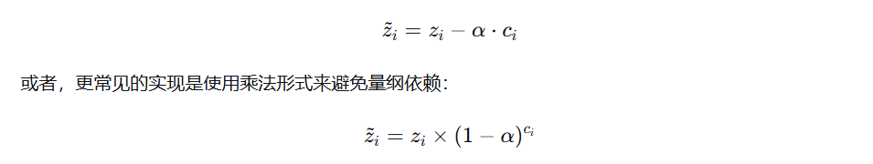
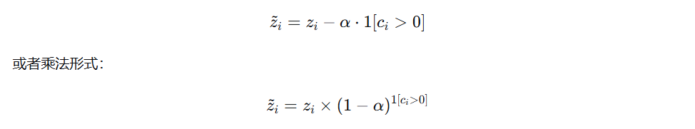
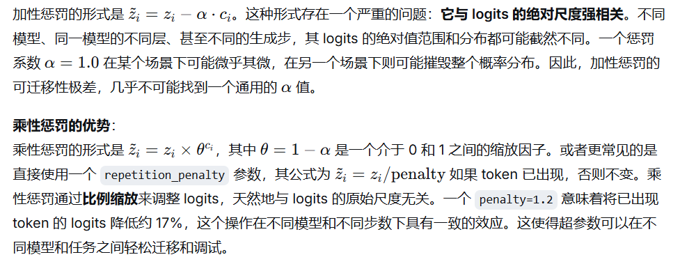
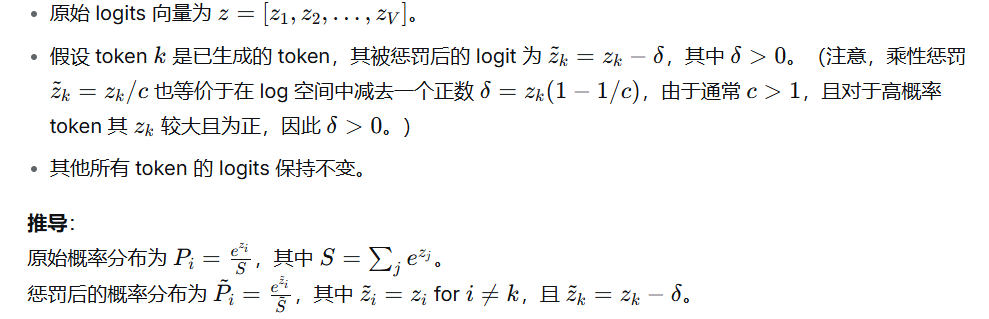
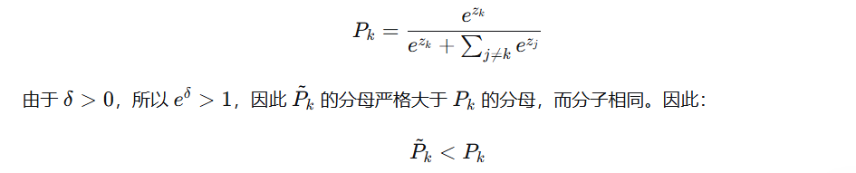
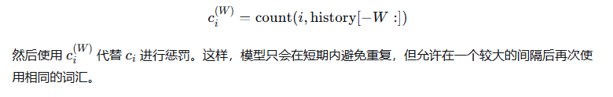
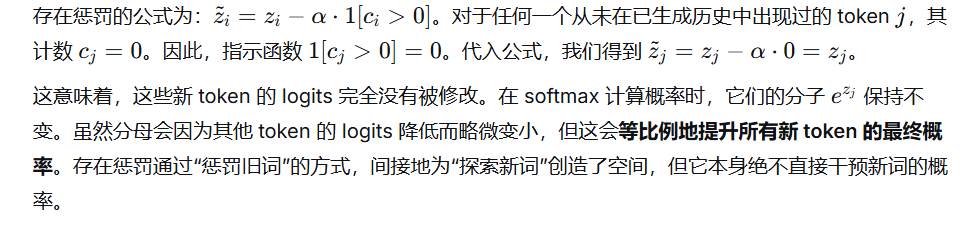
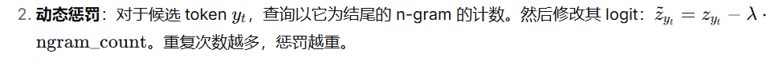

# 60.大模型（LLMs）重复惩罚（频率惩罚、存在惩罚）

#### 重复惩罚的动机是什么？为什么 LLM 倾向于生成重复文本？

重复惩罚的动机：在大语言模型的自回归生成过程中，模型极易陷入一种病态行为——不断重复输出相同的词、短语甚至句子，导致生成的文本冗长、枯燥、缺乏信息量。这种现象被称为“重复循环”或“文本退化”。重复惩罚作为一种解码时的后处理技术，其核心目标就是在不重新训练模型的前提下，通过动态调整每一步的生成概率，强制模型“跳出”这种自我强化的重复模式，从而显著提升生成文本的多样性和流畅性。

为什么 LLM 倾向于生成重复文本？

LLM 产生重复文本的倾向，根植于其训练目标与自回归生成机制的内在特性。

1. 训练目标与统计偏差

语言模型是通过最大化训练数据中文本序列的似然来学习的。训练数据中，某些高频短语、功能词和常见的搭配组合（如“的”、“了”、“是一个”）在绝大多数上下文中都具有极高的条件概率。模型由此学到，在任何不确定的生成时刻，选择这些高频模式总是“安全”且能获得低损失的选择。在自回归解码时，这种对高频模式的偏好会被反复激活，导致模型不断重复使用相同的词汇和句式。

2. 自回归生成的正反馈循环

自回归生成是逐 token 进行的，每个新生成的 token 都会立即成为历史上下文的一部分，并影响后续所有 token 的预测。一旦模型因为某种随机性（或确定性）生成了某个词，这个词就会“污染”其上下文表示。语言模型具有极强的上下文依赖性，它会根据这个刚刚生成的词，提高与它相关的后续词的出现概率。更致命的是，这个刚刚生成的词本身的概率也会因为上下文中的自我出现而异常升高。这就形成了一个危险的正反馈循环：模型生成了词 A -> 词 A 在上下文中的出现提升了词 A 自身的后续概率 -> 模型更倾向于再次生成词 A -> 词 A 的反复出现进一步强化了其概率。

3. 注意力机制的“回声”效应

Transformer 的自注意力机制允许每个 token 直接关注所有历史 token。当模型已经生成了一个短语，注意力头可能会过度聚焦于最近的、与该短语相似的 token 上，形成一种“回声”效应。模型在预测下一个 token 时，不是基于对整个序列语义的深层理解，而是基于对最近几个 token 的简单模仿和重复。

4. 解码策略的放大效应

贪心解码和束搜索等确定性解码策略，会极大地放大上述问题。这些策略倾向于在每一步都选择概率最高的 token，而由于前述原因，“重复”往往就是那个概率最高的选择。因此，它们会忠实地、无情地将模型带入重复循环的深渊。

重复惩罚正是为了打破这种正反馈循环而设计的。它通过在模型预测概率最高、最可能重复的路径上，人为地设置障碍，迫使模型去探索那些概率稍低但可能更合理、更具多样性的生成路径。

---

#### 解释频率惩罚（frequency penalty）和存在惩罚（presence penalty）的数学公式，并说明它们如何修改 logits。

频率惩罚和存在惩罚是两种最主流的、作用于解码阶段的重复抑制技术。它们都是在模型输出 logits 之后、Softmax 计算概率之前，对 logits 进行修改。

设定：

- $z_i$：token $i$ 的原始 logit 值。

- $c_i$：token $i$ 在已生成的序列中出现的次数。

- $α$：惩罚系数，通常为一个小的正数（如 0.1 到 1.0）。

1. 频率惩罚 (Frequency Penalty)

频率惩罚根据一个 token 在已生成文本中出现的总次数来降低其 logits。出现次数越多，惩罚力度越大。

数学公式：

$$
\tilde{z}_i = z_i - \alpha \cdot c_i
$$

或者，更常见的实现是使用乘法形式来避免量纲依赖：

$$
\tilde{z}_i = z_i \times (1 - \alpha)^{c_i}
$$

{.ocr-src}

（注：在工程实践中，频率惩罚和重复惩罚通常通过乘法形式实现，以便与 logits 的尺度解耦。）

如何修改 logits：如果一个 token 已经出现了多次，它的 logits 会被大幅度降低，从而在后续采样中更难被选中。这种方法的惩罚力度与出现频率成正比，对反复出现的“顽固”重复词打击尤其严厉。

2. 存在惩罚 (Presence Penalty)

存在惩罚不关心一个 token 出现了多少次，只要它在已生成文本中出现过至少一次，就对其进行惩罚。

数学公式：

$$
\tilde{z}_i = z_i - \alpha \cdot \mathbf{1}[c_i > 0]
$$

或者乘法形式：

$$
\tilde{z}_i = z_i \times (1 - \alpha)^{\mathbf{1}[c_i > 0]}
$$

{.ocr-src}

其中 1[⋅] 是指示函数，条件为真时取值为 1，否则为 0。

如何修改 logits：一旦某个 token 出现过，它的 logits 就被恒定地减去（或乘以）一个固定值。无论它之后是否再次出现，惩罚力度都不再增加。这种方法的核心是鼓励模型去探索全新的、未出现过的词汇，从而提升整体的词汇多样性。

---

#### 频率惩罚和存在惩罚的核心区别是什么？在何种情况下优先选择其中一个？

核心区别：两者的根本差异在于惩罚力度与 token 出现次数的关系。

- 频率惩罚：惩罚力度与出现频率成正比。出现次数越多，惩罚越重。它是一种“累积式”的惩罚，对顽固的重复模式打击尤为精准。

- 存在惩罚：惩罚力度与出现频率无关，只与“是否出现过”有关。它是一种“一次性”的惩罚，对所有已出现的 token 一视同仁。其核心目标是最大化词汇的全局多样性，鼓励模型不断使用新词。

选择指南：

| 场景 | 优先选择 | 原因 |
| --- | --- | --- |
| 需要严格防止长文本中的持续重复 | 频率惩罚 | 当模型陷入循环，不断重复同一个短语时，频率惩罚会迅速将该短语的概率压至极低，强制模型跳出循环。它的“累积打击”特性非常适合处理这种顽固的局部重复。 |
| 需要提升整体词汇的多样性和丰富度 | 存在惩罚 | 在创意写作、头脑风暴等场景中，我们希望模型能不断引入新概念、新词汇，而不是反复使用同一个词。存在惩罚通过“用过即罚”的机制，鼓励模型进行更广泛的词汇探索。 |
| 生成包含合理重复结构的文本 | 存在惩罚 | 诗词、歌词中常常需要一些关键的叠句或重复结构。频率惩罚会因这些关键结构的多次出现而将其概率过度压低，破坏文本的结构美。存在惩罚在首次使用后给予恒定惩罚，允许有限度的、必要的重复，更为温和可控。 |

---

#### 重复惩罚通常以累加还是乘积形式作用于 logits？为什么常见的实现使用乘性惩罚？

常见的实现使用乘性惩罚 (Multiplicative Penalty)，而不是加性惩罚 (Additive Penalty)。

加性惩罚的缺陷：

加性惩罚的形式是 $\tilde{z}_i = z_i - \alpha \cdot c_i$。这种形式存在一个严重的问题：**它与 logits 的绝对尺度强相关**。不同模型、同一模型的不同层、甚至不同的生成步，其 logits 的绝对值范围和分布都可能截然不同。一个惩罚系数 $\alpha = 1.0$ 在某个场景下可能微乎其微，在另一个场景下则可能摧毁整个概率分布。因此，加性惩罚的可迁移性极差，几乎不可能找到一个通用的 $\alpha$ 值。

**乘性惩罚的优势**：\
乘性惩罚的形式是 $\tilde{z}_i = z_i \times \theta^{c_i}$，其中 $\theta = 1 - \alpha$ 是一个介于 0 和 1 之间的缩放因子。或者更常见的是直接使用一个 `repetition_penalty` 参数，其公式为 $\tilde{z}_i = z_i / \text{penalty}$ 如果 token 已出现，否则不变。乘性惩罚通过**比例缩放**来调整 logits，天然地与 logits 的原始尺度无关。一个 `penalty=1.2` 意味着将已出现 token 的 logits 降低约 17%，这个操作在不同模型和不同步数下具有一致的效应。这使得超参数可以在不同模型和任务之间轻松迁移和调试。

{.ocr-src}

因此，从加性到乘性的转变，是将惩罚操作从绝对值空间迁移到了相对值（比例）空间，极大地提升了算法的鲁棒性和泛化能力。这也是 LLaMA、Falcon 等几乎所有现代开源模型采用乘性重复惩罚的根本原因。

---

#### 推导重复惩罚对 softmax 后概率分布的影响：是否总是减少已生成 token 的概率？

结论：是的，在标准的乘性重复惩罚下，已生成 token 的 softmax 概率总是会减少。 以下给出严格的数学证明。

设定：

- 原始 logits 向量为 $z = [z_1, z_2, \ldots, z_V]$。
- 假设 token $k$ 是已生成的 token，其被惩罚后的 logit 为 $\tilde{z}_k = z_k - \delta$，其中 $\delta > 0$。（注意，乘性惩罚 $\tilde{z}_k = z_k / c$ 也等价于在 log 空间中减去一个正数 $\delta = z_k(1 - 1/c)$，由于通常 $c > 1$，且对于高概率 token 其 $z_k$ 较大且为正，因此 $\delta > 0$。）
- 其他所有 token 的 logits 保持不变。

**推导**：\
原始概率分布为 $P_i = \frac{e^{z_i}}{S}$，其中 $S = \sum_j e^{z_j}$。\
惩罚后的概率分布为 $\tilde{P}_i = \frac{e^{\tilde{z}_i}}{\tilde{S}}$，其中 $\tilde{z}_i = z_i$ for $i \neq k$，且 $\tilde{z}_k = z_k - \delta$。

{.ocr-src}

对于已生成的 token $k$，其惩罚后的概率为：

$$
\tilde{P}_k = \frac{e^{z_k - \delta}}{e^{z_k - \delta} + \sum_{j \neq k} e^{z_j}} = \frac{e^{z_k}}{e^{z_k} + e^{\delta} \sum_{j \neq k} e^{z_j}}
$$

{.ocr-src}

而原始概率为：

$$
P_k = \frac{e^{z_k}}{e^{z_k} + \sum_{j \neq k} e^{z_j}}
$$

由于 $\delta > 0$，所以 $e^{\delta} > 1$，因此 $\tilde{P}_k$ 的分母严格大于 $P_k$ 的分母，而分子相同。因此：

$$
\tilde{P}_k < P_k
$$

{.ocr-src}

结论：在标准操作下（即惩罚只降低已出现 token 的 logits，不影响其他 token），已生成 token 的 softmax 概率必然严格减少。

---

#### 频率惩罚的参数范围通常是多少？过大的惩罚系数会导致什么后果？

参数范围：\
对于乘性重复惩罚，最常见的参数名是 `repetition_penalty`，其典型取值范围在 1.0 到 1.5 之间。1.0 表示不施加惩罚。对于频率惩罚和存在惩罚，如果是加性实现，系数通常在 0.0 到 2.0 之间。

过大的惩罚系数的后果：

施加过度的重复惩罚，相当于在模型的“语言本能”上施加了过强的暴力约束，会导致生成质量的严重下降。

1. 语法错乱与语言崩溃：模型对已出现词汇的过度回避，会迫使它去选择那些概率极低、语法上完全不合适的 token。当所有“正常”的词汇都被惩罚殆尽后，模型可能被逼到绝境，开始输出标点符号、无意义字符甚至乱码，导致整个生成过程崩溃。

2. 语义断裂与逻辑混乱：在正常的文本中，一些关键的实体名称、主题词或逻辑连接词（如“因为”、“所以”、“因此”）需要在后续文本中被反复提及，以维持语义的连贯性。过度的惩罚会不分青红皂白地压制这些必要的词汇，导致生成的内容前言不搭后语，逻辑完全断裂。

3. “死亡螺旋”与生成中断：如果惩罚系数过大，模型可能在生成一个关键概念后，由于该概念在后续无法被再次引用，导致模型无法完成一个完整的句子，输出变得支离破碎，甚至提前生成 `[EOS]` 结束符，草草中断生成过程。

调试建议：\
通常从 `repetition_penalty=1.0` 开始，以 `0.05` 或 `0.1` 为步长逐步增加。当发现模型开始出现不自然的用词、语法错误或逻辑混乱时，就说明惩罚已经过重，需要适当回调。

---

#### 如何对重复惩罚添加“容忍窗口”，即允许一定距离内的 token 不惩罚？

在某些情况下，我们希望对重复惩罚增加一个“容忍窗口”，即允许在最近生成的 $N$ 个 token 内出现重复词时，不施加惩罚或降低惩罚力度。这可以防止模型在生成长文本时，为了避免重复而使用过于生僻的词汇。

方法一：基于时间步的滑动窗口\
定义一个窗口大小 $W$。在计算惩罚时，只统计当前 token 之前的 $W$ 个 token 范围内的出现次数。超出这个窗口的历史 token 将不被纳入惩罚计算。

$$
c_i^{(W)} = \text{count}(i, \text{history}[-W:])
$$

然后使用 $c_i^{(W)}$ 代替 $c_i$ 进行惩罚。这样，模型只会在短期内避免重复，但允许在一个较大的间隔后再次使用相同的词汇。

{.ocr-src}

方法二：基于距离的衰减惩罚

不是硬性地忽略窗口外的 token，而是根据 token 与当前位置的距离，施加一个衰减权重。距离越远的 token，其重复的惩罚权重越低。例如，使用指数衰减：

$$
\text{effective\_c}_i = \sum_{j:\,\text{history}[j]=i} \exp(-\lambda(t - j))
$$

{.ocr-src}

其中 $t$ 是当前步，$j$ 是历史步，$λ$ 是衰减系数。这种方法更平滑，允许模型在“遗忘”旧信息后自然地复用词汇。

方法三：结构感知的例外规则\
在特定任务中，可以设置硬性的例外规则。例如，在生成代码时，对编程语言的关键字（如 `def`, `return`, `class`）完全不施加惩罚，因为它们本身就是高度重复的。在生成诗歌时，对特定的韵脚或叠句结构设置豁免。这种方法需要领域知识，但效果最好。

---

#### 如果模型需要生成一首诗或包含重复结构的代码，重复惩罚会带来负面影响吗？如何解决？

是的，重复惩罚会对需要合理重复结构的生成任务产生严重的负面影响。 这在代码生成和诗歌创作中尤为明显。

负面影响的具体表现：

1. 代码生成：编程语言中充斥着大量的高频重复关键字和标识符。例如，一个函数中可能多次出现 `self.`、`return`、以及相同的变量名。重复惩罚会压低这些必要的重复元素的 logits，导致模型生成不合法、语法错误的代码。例如，模型可能为了避免再次使用 `return`，而错误地使用一个不存在的函数来结束一个代码块。

2. 诗歌/歌词创作：诗歌、歌词等文学形式，高度依赖于重复的韵律、叠句、对仗和平行结构。重复惩罚会破坏这种结构美。例如，一首四言绝句的韵脚可能会因为惩罚而变得不工整，或者一个关键的叠句因为其中词汇的反复出现而被压制，导致整首诗失去其固有的节奏感。

解决方案：结构感知的重复惩罚豁免

1. 词表级别的豁免列表：创建一个全局的“白名单”，包含那些在任何上下文中都应允许重复的词，如编程语言的关键字、标点符号、常见的功能词（“的”、“是”、“the”、“a”）等。在计算惩罚时，直接跳过这些 token。

2. 任务感知的动态豁免：根据生成任务的类型，动态调整豁免规则。
  - 代码模式：当检测到当前上下文属于代码块（例如，在 Markdown 代码块内部）时，自动将重复惩罚系数 $α$ 降低到一个极小的值，或直接设为 0。
  - 诗歌模式：可以设计一种更智能的惩罚，它能够识别出结构性的重复（如押韵、对仗），并减少或豁免对这些结构必要重复的惩罚。这通常需要在提示词中明确告知模型生成任务的格式要求，并依靠模型强大的指令遵循能力来避免过度的随机性，同时搭配一个很小的重复惩罚系数。

实践中的最佳做法：对于代码和诗歌等任务，首选存在惩罚而非频率惩罚，因为它允许有限度的必要重复，惩罚力度更温和。同时，重复惩罚系数应设得比通用对话任务更低，通常 `repetition_penalty=1.05` 或 `1.1` 是一个不错的起点。

---

#### 重复惩罚是作用在输出 token 的所有历史，还是仅限当前序列？是否跨 batch 共享？

重复惩罚的作用范围严格限制在当前序列的生成历史内，绝不跨 batch 共享。

- 作用范围：仅限当前正在生成的这一个完整序列的历史。即从用户输入的提示词之后的第一个生成 token 开始，到当前生成步之前的所有 token。这个序列历史是自回归生成中唯一可用的上下文。提示词部分（输入）通常不参与惩罚，因为那是用户给定的内容，模型的输出不能去刻意“回避”用户输入中的词。

- 跨 batch 共享：绝不可能跨 batch 共享。 批量推理中的不同序列是相互独立的，拥有各自独立的生成历史和上下文。如果让重复惩罚跨 batch 共享，会导致一个 batch 中某个序列生成的词，影响到另一个完全不同主题的序列的生成，这完全违背了独立性原则。因此，任何对重复 token 的统计和惩罚计算，都严格隔离在每个序列的独立上下文中。

---

#### 在多轮对话中，是否需要将历史对话中的 token 也纳入重复惩罚？为什么？

是的，强烈推荐将历史对话中的 token 也纳入重复惩罚的范围，但需要进行精细的、基于角色的控制。

为什么需要纳入历史对话？

如果不将历史对话纳入惩罚，模型在多轮交互中极易出现“健忘式重复”——它会不断重复之前轮次中已经明确回答过的信息，或者在每一轮的开头都使用相同的、冗长的客套话。这会严重破坏用户体验，显得模型极其不智能和敷衍。将历史对话纳入惩罚，可以迫使模型在每一轮中都生成更具针对性和信息增量的回复。

如何进行精细控制？

这是一个平衡的艺术，需要区分对话中不同角色的 token。

1. 推荐做法：对历史中助手（assistant）的回复施加完全惩罚，对用户（user）的提问施加弱惩罚或不惩罚。
  - 为何惩罚助手的历史：助手自己已经说过的话，如果不加控制，模型会倾向于在新一轮的回复中再次重复相同或高度相似的内容。这属于需要重点抑制的“自我重复”。
  - 为何不惩罚（或弱惩罚）用户的历史：用户的提问往往包含了本次对话的核心主题和关键实体。如果模型在生成回复时，刻意回避用户刚刚提到的这些关键词，就会导致回答偏离主题、答非所问。模型需要用这些词来维持对话的连贯性。因此，对用户输入中的 token 进行强惩罚是极其有害的。

2. 实现方式：在计算重复惩罚的 token 统计时，为历史对话中的每个 token 打上角色标签。对于 `assistant` 角色的历史 token，给予全权重；对于 `user` 角色的历史 token，可以给予一个较低的权重（如 0.2），或者干脆设为 0（不惩罚）。这种角色感知的精细化惩罚策略，可以在维持对话连贯性和避免自我重复之间，找到最佳平衡点。

---

#### 存在惩罚对从未出现过的 token 有影响吗？为什么？

没有影响。存在惩罚的设计初衷和数学公式保证了它只对“已存在”的 token 起作用，对“未存在”的 token 是完全中立的。

- 数学上的严格证明

存在惩罚的公式为：$\tilde{z}_i = z_i - \alpha \cdot \mathbf{1}[c_i > 0]$。对于任何一个从未在已生成历史中出现过的 token $j$，其计数 $c_j = 0$。因此，指示函数 $\mathbf{1}[c_j > 0] = 0$。代入公式，我们得到 $\tilde{z}_j = z_j - \alpha \cdot 0 = z_j$。

这意味着，这些新 token 的 logits 完全没有被修改。在 softmax 计算概率时，它们的分子 $e^{z_j}$ 保持不变。虽然分母会因为其他 token 的 logits 降低而略微变小，但这会**等比例地提升所有新 token 的最终概率**。存在惩罚通过“惩罚旧词”的方式，间接地为“探索新词”创造了空间，但它本身绝不直接干预新词的概率。

{.ocr-src}

- 设计动机\
  这种设计是存在惩罚与频率惩罚最根本的区别之一。存在惩罚的目标是提升词汇的全局多样性。它不关心一个词被重复了多少次，只关心“这个词有没有被用过”。一旦用过，它就对这个词施加一个固定的、不再累加的惩罚，然后就将“探索新词”的接力棒完全交给那些未被惩罚过的、概率为新生的 token。这种机制非常适合创意写作等需要不断引入新概念的场景。

---

#### 如何实现基于 n‑gram 的重复惩罚（禁止同一 n‑gram 重复出现）？

基于 n-gram 的重复惩罚是一种比 token 级别惩罚更结构化的抑制策略。它不再是惩罚单个词，而是惩罚一个连续的词组（如 bigram, trigram）的重复出现。其实现方式通常是一个硬约束或一个强软约束。

实现方法一：硬约束（Hard Constraint）

这是最严格的实现，直接禁止同一 n-gram 再次出现。

1. 维护历史：在生成过程中，维护一个集合 `generated_ngrams`，用于存储所有已经生成过的、长度为 $N$ 的 n-gram。

2. 实时查询：在当前生成步 $t$，对于束搜索或采样中的每个候选 token $y_t$，构造出以 $y_t$ 结尾的、长度为 $N$ 的 n-gram。

3. 硬性屏蔽：如果这个新构造的 n-gram 已经存在于 `generated_ngrams` 集合中，则将该候选 token $y_t$ 的概率强制设为 0（logit 设为 −∞），从而绝对禁止选择它会导致的重复。

4. 更新：当一个 token 被最终选定并加入序列后，更新 `generated_ngrams` 集合。

实现方法二：软约束（Soft Constraint）\
这种方法不绝对禁止，而是通过一个可调节的惩罚系数 $λ$，大幅降低重复 n-gram 中最后一个 token 的 logits。

1. 维护历史：同上，维护一个字典 `ngram_counts`，记录每个 n-gram 出现的次数。

2. **动态惩罚**：对于候选 token $y_t$，查询以它为结尾的 n-gram 的计数。然后修改其 logit：$\tilde{z}_{y_t} = z_{y_t} - \lambda \cdot \text{ngram\_count}$。重复次数越多，惩罚越重。

{.ocr-src}

工程实现技巧（高效查询）：\
为了在海量的 n-gram 历史中进行快速查询，可以使用哈希表（字典）来存储 n-gram。键是 n-gram 的元组（或哈希值），值是出现次数。在每一步，只需查询以当前序列最后 $N$−1 个 token 为前缀、以候选 token 为后缀的 n-gram 是否存在于字典中。查询复杂度为 O(1)，非常高效。

---

#### 对比重复惩罚与禁止生成特定 n‑gram 的 hard constraint 方法，各自的适用场景。

| 特性 | 重复惩罚 | 禁止生成特定 n-gram |
| --- | --- | --- |
| 机制 | 软约束：降低 logits，允许极小概率出现 | 硬约束：强制将 logits 设为 −∞，绝对禁止 |
| 控制粒度 | Token 级别（单个词）或 n-gram 级别 | n-gram 级别 |
| 适用场景 | 1. 通用文本生成，提升多样性 2. 允许一定的合理重复 | 1. 任务对格式有严格要求，如生成诗歌的严格押韵规则 2. 防止模型输出特定的、已明确过的危险或违规内容 |
| 灵活性 | 高，通过惩罚系数调节强度 | 低，是“一刀切”的绝对规则 |
| 副作用风险 | 惩罚过重时，会破坏语言的流畅性和逻辑性 | 规则过多时，可能极大限制模型的生成空间，导致生成中断或质量骤降 |

选择指南：

- 优先选择重复惩罚：对于绝大多数提升文本质量的场景，它是一个灵活、可控的首选工具。

- 选择硬约束：当你的应用有一个明确的、必须遵守的、不允许任何例外的规则时（如“绝不能在生成的推文中包含‘#’号”），硬约束是唯一的选择。

---

#### 重复惩罚与温度参数有何相互作用？高温度下还需要重复惩罚吗？

它们之间存在强烈的相互作用，且在高温度下，重复惩罚仍然是必要的。

相互作用机制：

- 低温度 (< 1.0)：此时模型的输出概率分布非常尖锐，几乎集中在少数最高概率的 token 上。这些最高概率 token 正是最容易引发自我强化的“安全”重复词。此时，重复惩罚是绝对必要的，它需要精确地攻击这些位于概率金字塔顶端的 token，迫使模型打破确定性循环。

- 高温度 (> 1.0)：温度本身通过拉平概率分布，已经削弱了高概率 token 的绝对优势，从而在一定程度上降低了重复的概率。但是，高温度并没有消除模型对某些 token 的内在偏好。模型在高温下可能不是简单地重复同一个词，而是开始重复同一种抽象的句式结构或高频词组。此外，极端的随机性也可能让模型碰巧多次采样到同一个词。因此，在高温度下，一个强度较低的重复惩罚（如 1.05 而非 1.2）依然是有效的，它可以作为一道“安全网”，防止随机性导致的偶然重复或结构性重复，同时不影响高温带来的多样性探索。

结论：温度和重复惩罚是两个独立维度的控制旋钮。温度控制全局的“随机性程度”，而重复惩罚则针对性打击“重复模式”。它们需要协同工作，温度越高，所需重复惩罚的强度可以适当降低，但完全不使用重复惩罚，即使在高温度下也容易导致生成质量的波动。

---

#### 在 API 实现中，重复惩罚如何高效地通过滑动窗口或缓存来更新 logits？

在需要高吞吐的在线 API 服务中，重复惩罚的实现必须极致高效，不能成为延迟瓶颈。其核心优化是使用固定大小的滑动窗口缓存。

滑动窗口缓存的设计：

1. 数据结构：维护一个固定大小（如 $W$=512）的环形缓冲区（ring buffer），存储最近生成的 $W$ 个 token 的 ID。

2. 频率统计：基于这个滑动窗口，动态维护一个词表大小 $V$ 的频率向量 `freq`。每次生成一个新 token，就更新环形缓冲区，并相应增加新 token 的计数，减少被淘汰的旧 token 的计数。

3. 即时惩罚计算：在计算下一个 token 的 logits 时，从 `freq` 向量中获取当前上下文的 token 频率，并根据公式计算惩罚后的 logits。整个过程无需重新扫描整个生成历史，计算复杂度从 O(T)$O$($T$) 降至 O(1)$O$(1)。

进一步加速的优化（缓存）：\
对于同一个用户的多轮对话，可以将其整个对话历史（或摘要）作为一个“预上下文”进行预处理。计算出该预上下文的初始 `freq` 向量并缓存。在新一轮对话开始时，直接加载这个缓存好的初始频率，然后在此基础上进行增量更新。这避免了为每一轮对话都重新扫描漫长历史，极大地提升了效率。

---

#### 为什么有些实现将重复惩罚作用在 token 的生成计数上（而非二值标记）？

这直接对应了频率惩罚和存在惩罚的设计哲学差异。

- 作用在生成计数上（频率惩罚）：其目标是精确、强力地打击顽固的局部重复模式。当一个词已经出现 5 次，模型还试图生成第 6 次时，基于计数的惩罚会施加极强的负向压力。这对于防止模型陷入“鬼打墙”式的文本循环，效果显著。

- 作用在二值标记上（存在惩罚）：其目标是全局性地鼓励词汇探索，但容忍有限度的必要重复。它不关心词重复了多少次，只关心“是否用过”。这种机制更温和，更适合那些需要一定重复结构的任务，如诗歌的押韵、代码的关键字复用等。

结论：这两种实现方式的选择，本质上是在权衡“打击力度”和“宽容度”。

---

#### 在流式输出时，重复惩罚是否会因为上下文不断变长而衰减？

是的，这是一个常见的、需要工程化处理的问题。 对于频率惩罚，随着上下文 $T$ 的增长，一个 token 的计数 $c_i$ 会持续累积。固定系数的惩罚在极长文本下会变得过于严厉，导致生成退化。这种“衰减”不是惩罚本身减弱了，而是惩罚的总量过大了。

解决方案：

1. 滑动窗口限制：这是最根本的解决方案。如前所述，只统计最近 $W$ 个 token 的频率。这保证了惩罚力度始终与局部的、近期的重复模式相关，而不受遥远历史的永久影响。

2. 距离衰减加权：对历史 token 根据其距离当前位置的远近赋予权重。距离越远，对 `c_i` 的贡献越小。例如，使用指数衰减：$c_i = \sum_{j: \text{history}[j]=i} \exp(-\lambda (t - j))$。这比滑动窗口更平滑，但计算开销稍高。

---

#### 如何通过实验量化重复惩罚对文本多样性的影响？

量化实验是评估超参数效果的科学方法。以下是一套标准评估框架：

1. 评估指标：

- Distinct-N：计算生成文本中不重复的 N-gram 数量占总 N-gram 数量的比例。Distinct-1/2 是最常用的指标，值越高，词汇多样性越好。

- Self-BLEU：将一个模型对同一提示生成的多条文本，两两计算 BLEU 分数。Self-BLEU 分数越低，表示生成的多个样本彼此之间越不相似，多样性越高。

- 重复序列统计：统计生成文本中，长度超过某个阈值（如 5）的重复子串的出现次数和总长度。这直接量化了“文本退化”的程度。

2. 实验设计：

- 控制变量：使用完全相同的基座模型、提示词数据集和温度参数（如 T=0.8, Top-p=0.95）。

- 实验组：改变 `repetition_penalty` 的值（如 1.0, 1.1, 1.2, 1.3）。

- 数据采集：对每个提示词，使用不同配置生成多条完整的回复。

3. 结果分析：

- 绘制 `Distinct-2` 和 `Self-BLEU` 随 `repetition_penalty` 变化的曲线。

- 理想曲线：随着惩罚系数从 1.0 增加，`Distinct-2` 显著上升，`Self-BLEU` 显著下降。到达某个点后，曲线趋于平缓（找到最优值）。

- 过度惩罚信号：如果惩罚系数进一步增加，虽然指标可能继续变好，但人工抽检发现语法错误或逻辑混乱增多，则说明惩罚已过度。

---

#### 重复惩罚是否会增加模型输出不符合语法或逻辑的风险？

是的，这是一个必须正视的、与收益并存的风险。 重复惩罚本质上是在扭曲模型基于海量数据学到的、最自然的概率分布。它的核心风险在于“误伤友军”。

风险场景：

1. 语法错乱：当惩罚过强时，模型为了回避重复，可能被迫去选择那些概率极低、语法上完全不合适的词。例如，在“我昨天去了”后面，模型本应选择“超市”，但“超市”在历史中出现过，被惩罚了；模型可能被迫选择一个奇怪的动词如“飞翔”，导致“我昨天去了飞翔”这种严重语法错误的句子。

2. 逻辑断裂：正常的逻辑推理需要反复提及核心论元和关键概念。例如，一段关于“人工智能”的论述，必须反复使用“人工智能”、“模型”、“算法”等词来维持主题。如果这些关键词被过度惩罚，模型就会开始东拉西扯，导致论述逻辑完全断裂。

如何平衡：关键在于找到一个合适的惩罚强度，使其足以抑制无意义的、破坏性的重复，同时又不至于干扰正常的、必要的语言复用。通常，在大多数基准测试中，一个适中的惩罚系数（如 1.1~1.2）对模型的语言流畅度影响极小，但对多样性的提升却非常显著。

---

#### 是否存在一种“自适应重复惩罚”，根据话题变化动态调整惩罚强度？

这是一个前沿且极具价值的研究方向。 静态的惩罚系数无法区分“有害的机械重复”和“有益的、维持连贯性的必要重复”。

可能的实现方案：

1. 基于话题分割的动态调整：实时监测生成文本的话题变化。当模型开启一个新话题时，可以将重复惩罚的历史状态“重置”，或者将惩罚系数 $α$ 降低。因为一个新话题的开启，意味着之前的词汇被重新使用的概率大大增加，这是合理的。当模型在同一个话题内持续生成时，再逐步恢复或提高惩罚系数。

2. 基于重复类型的智能识别：通过分析重复片段的语义功能，来区分“结构性重复”和“病理性重复”。例如，如果重复的是“因为”、“所以”等逻辑连接词，这可能是病态的；如果重复的是一个专有名词或核心主题词，则可能是合理的。可以利用一个轻量级的分类器来实时判断，并动态调整惩罚。

3. 模型自适应学习：训练一个极小的“控制器”网络，它的输入是当前的生成状态和模型隐层表示，输出是一个自适应的惩罚系数 $α_t$。这个控制器可以被训练来最大化最终生成的综合质量评分。

---

#### 重复惩罚能否替代或减少对解码策略（如 Top‑p）的依赖？

不能完全替代，但确实可以减少对它们的依赖，它们是互补关系。

- 本质区别：解码策略（如 Top-p）和重复惩罚解决的是不同层面的问题。
  - Top‑p 采样：在“候选集质量”层面工作。它的核心任务是剔除概率分布尾部的纯噪声 token，确保采样池是由“合理”的候选词组成的。它回答的问题是“哪些词是当前语境下可以考虑的？”
  - 重复惩罚：在“候选集排序”层面工作。它的核心任务是动态调整采样池内各 token 的相对优势。它回答的问题是“在那些可以考虑的词中，我们应该倾向于选择新词还是旧词？”

- 协同作用：假设不进行任何重复惩罚，仅使用一个精心调制的 Top-p。模型生成的每一个 token 都是“合理”的，但它仍然可能陷入一种“合理的重复”——它总是选择采样池中最安全、最常见的搭配，导致文本虽然流畅但非常单调。此时，加入轻度的重复惩罚，就能在保证候选集质量的前提下，推动模型去探索更多的可能性，提升多样性。

- 互补关系：因此，一个完整的生成方案通常是：用 Top-p 划定一个优质的候选集范围，然后用温度控制整体的随机风格，最后用重复惩罚在候选集内进行偏好调节。这三者各司其职，共同协作，才能稳定地产生高质量、高多样性的文本。重复惩罚不能取代 Top-p，因为它无法过滤掉低概率噪声；Top-p 也不能取代重复惩罚，因为它对合理的、但单调的重复无能为力。

