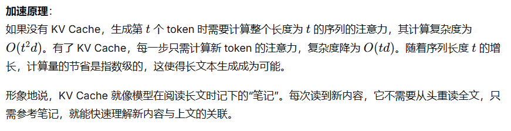
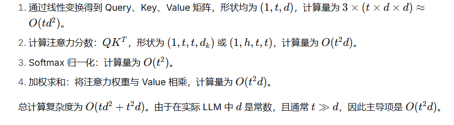
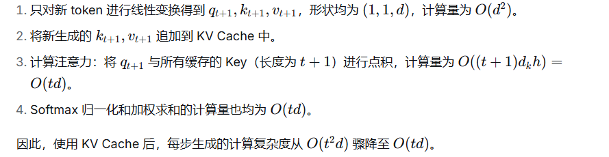
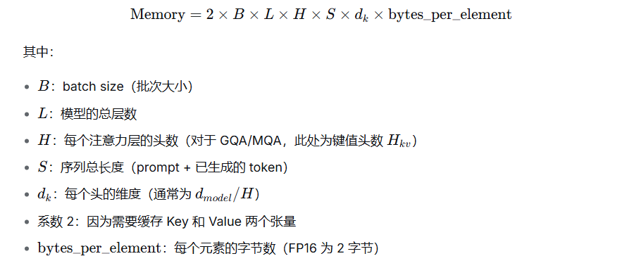
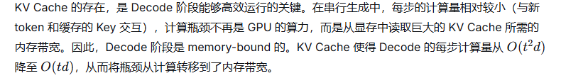
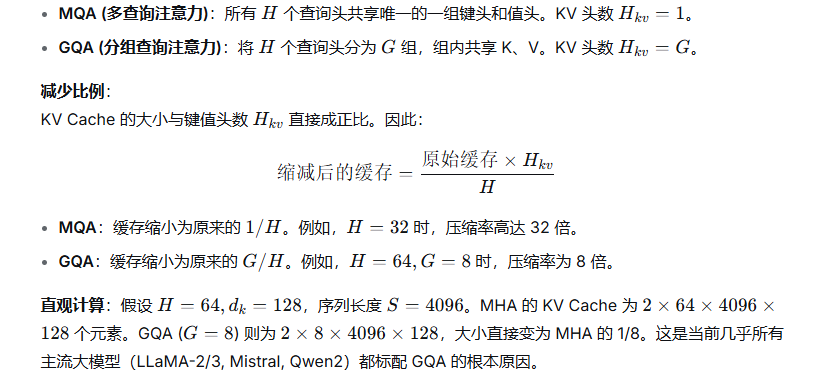
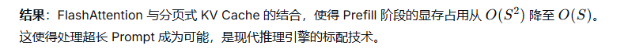

# 61.大模型（LLMs）KV Cache

#### 解释 KV Cache 在自回归推理中的作用及其加速原理。

在标准的自回归生成中，模型需要逐个 token 地生成输出序列。每生成一个新 token，都需要将它拼接到已有序列的末尾，然后将整个序列重新输入模型，计算下一个 token 的概率分布。在这个过程中，自注意力层的计算量巨大，且存在严重的重复计算。

KV Cache 的核心思想，就是用显存空间换取计算时间。 它在模型推理时，将每一层、每一个注意力头已经计算过的历史 token 的 Key 和 Value 张量缓存下来。当生成第 $t$+1 个 token 时，只需计算这个新 token 的 Query、Key 和 Value，然后让它的 Query 去与所有缓存的 Key 进行注意力分数计算，再对缓存的 Value 进行加权求和。历史 token 的 Key 和 Value 无需重复计算。

**加速原理**：\
如果没有 KV Cache，生成第 $t$ 个 token 时需要计算整个长度为 $t$ 的序列的注意力，其计算复杂度为 $O(t^2 d)$。有了 KV Cache，每一步只需计算新 token 的注意力，复杂度降为 $O(td)$。随着序列长度 $t$ 的增长，计算量的节省是指数级的，这使得长文本生成成为可能。

形象地说，KV Cache 就像模型在阅读长文时记下的“笔记”。每次读到新内容，它不需要从头重读全文，只需参考笔记，就能快速理解新内容与上文的关联。

{.ocr-src}

---

#### 推导不使用 KV Cache 和使用 KV Cache 时，生成阶段自注意力的计算复杂度差异。

假设当前已生成的序列长度为 $t$，隐藏维度为 d，注意力头数为 $h$，每个头的维度为 dk=d/h。

不使用 KV Cache 时：\
对于长度为 t 的完整序列，自注意力的计算过程为：

1. 通过线性变换得到 Query、Key、Value 矩阵，形状均为 $(1, t, d)$，计算量为 $3 \times (t \times d \times d) \approx O(td^2)$。
2. 计算注意力分数：$QK^T$，形状为 $(1, t, t, d_k)$ 或 $(1, h, t, t)$，计算量为 $O(t^2 d)$。
3. Softmax 归一化：计算量为 $O(t^2)$。
4. 加权求和：将注意力权重与 Value 相乘，计算量为 $O(t^2 d)$。

总计算复杂度为 $O(td^2 + t^2 d)$。由于在实际 LLM 中 $d$ 是常数，且通常 $t \gg d$，因此主导项是 $O(t^2 d)$。

{.ocr-src}

使用 KV Cache 时：\
在第 $t$+1 步（假设已有长度为 $t$ 的 KV Cache），计算新 token 的注意力：

1. 只对新 token 进行线性变换得到 $q_{t+1}, k_{t+1}, v_{t+1}$，形状均为 $(1, 1, d)$，计算量为 $O(d^2)$。
2. 将新生成的 $k_{t+1}, v_{t+1}$ 追加到 KV Cache 中。
3. 计算注意力：将 $q_{t+1}$ 与所有缓存的 Key（长度为 $t+1$）进行点积，计算量为 $O((t+1)d_k h) = O(td)$。
4. Softmax 归一化和加权求和的计算量也均为 $O(td)$。

因此，使用 KV Cache 后，每步生成的计算复杂度从 $O(t^2 d)$ 骤降至 $O(td)$。

{.ocr-src}

复杂度差异的直观感受：生成第 1000 个 token 时，无 Cache 需要计算约 1,000,000 个 token 对的注意力，而有 Cache 只需计算约 1000 个。这个差距随着序列增长而飞速扩大，这正是 KV Cache 能够带来巨大加速的根本原因。

---

#### KV Cache 占用显存的公式是什么？它如何随 batch size、序列长度、层数和头维度变化？

KV Cache 的显存占用公式为：

$$
\text{Memory} = 2 \times B \times L \times H \times S \times d_k \times \text{bytes\_per\_element}
$$

其中：

- $B$：batch size（批次大小）
- $L$：模型的总层数
- $H$：每个注意力层的头数（对于 GQA/MQA，此处为键值头数 $H_{kv}$）
- $S$：序列总长度（prompt + 已生成的 token）
- $d_k$：每个头的维度（通常为 $d_{model}/H$）
- 系数 2：因为需要缓存 Key 和 Value 两个张量
- bytes_per_element：每个元素的字节数（FP16 为 2 字节）

{.ocr-src}

各参数变化对显存的影响：

- Batch Size $B$：显存与 $B$ 成正比。批量越大，缓存越多，这是提高吞吐量时的主要瓶颈。

- 序列长度 $S$：显存与 $S$ 成正比。这是长文本推理时最核心的瓶颈。当 $S$ 达到 128K 甚至 1M 时，KV Cache 的显存占用可能远超模型权重本身。

- 层数 $L$：显存与 $L$ 成正比。深层模型（如 100+ 层）的 KV Cache 压力极大。

- 头维度 $d_k$ 和头数 $H$：显存与 $H$×$d_k$=*d model* 成正比。GQA 和 MQA 通过减少键值头数 *H kv* 来直接压缩缓存，是目前最有效的优化手段之一。

举个例子：对于一个 7B 模型，$L$=32, $H$=32, $d_k$=128, $S$=2048, $B$=1, FP16。其单层单头的 KV Cache 为 2×32×2048×128×2 bytes=32 MB。整个模型为 32×32 MB=1 GB。当 $S$=128K 时，这个数字会膨胀到约 64 GB，远超模型权重本身。

---

#### 为什么在训练时不需要 KV Cache，而在推理时需要？训练时因果掩码与 KV Cache 的关系。

训练时不需要 KV Cache 的原因：

在训练阶段，模型是并行计算的。我们拥有完整的目标序列，可以一次性将整个序列输入模型。通过因果掩码，模型可以同时计算所有位置的预测输出，而不违反“只看过去”的约束。

具体来说，训练时，输入是一个完整的序列 $x_1$:$T$。模型在计算自注意力时，会一次性算出 $Q$,$K$,$V$ 矩阵，然后通过一个上三角为 −∞ 的掩码矩阵，确保位置 $t$ 只能关注到位置 1…$t$。由于所有 token 的 Key 和 Value 是同时产生的，不存在“重新计算”的问题，因此不需要缓存。

推理时需要 KV Cache 的原因：\
推理是串行生成的。我们无法提前知道未来的 token，必须逐个生成。每生成一个新 token，如果重新计算整个序列的 $K$ 和 $V$，会造成巨大的重复计算。因此，必须将已计算好的历史 Key 和 Value 缓存起来，避免重复计算。

训练时因果掩码与 KV Cache 的关系：\
两者是“异曲同工”的关系。训练时的因果掩码通过一个 $T$×$T$ 的掩码矩阵，一次性实现了“每个位置只看过去”的约束，从而可以并行计算。推理时的 KV Cache 则是通过“保存过去、追加现在”的方式，在串行生成中实现了同样的约束，并极大地节省了计算量。KV Cache 本质上是对自回归生成过程的增量式注意力计算。

---

#### 画出推理阶段使用 KV Cache 的逐步过程：prefill 阶段和 decode 阶段的区别。

使用 KV Cache 的推理过程被清晰地分为两个阶段：Prefill 阶段和 Decode 阶段。

Prefill 阶段（预填充/编码阶段）

- 输入：用户的完整 Prompt（例如，“请翻译：Hello world”）。

- 过程：模型一次性处理整个 Prompt。因为 Prompt 的所有 token 都是已知的，可以并行计算。模型会计算 Prompt 中每个 token 的 Key 和 Value，并将它们缓存下来。

- 输出：生成第一个新 token（例如，“你好”）。此阶段的计算是 compute-bound（计算密集型），因为需要一次性处理整个 Prompt 的注意力。

Decode 阶段（解码/生成阶段）

- 输入：Prefill 阶段生成的最后一个 token（或用户 Prompt 的最后一个 token）作为当前的输入。

- 过程：
  1. 只对新输入的这一个 token 计算其 $Q$,$K$,$V$。
  2. 将新计算的 $K$,$V$ 追加到 KV Cache 中。
  3. 用新的 Q 去与所有缓存的 Key 进行注意力计算，再对缓存的 Value 加权求和。
  4. 输出下一个 token。
  5. 重复步骤 1-4，直到生成结束符。

- 特点：此阶段是 memory-bound（内存带宽密集型），因为每一步都需要从显存中读取整个庞大的 KV Cache。

Prefill 和 Decode 的核心区别：Prefill 是一次性并行处理所有 Prompt，Decode 是逐 token 串行生成。KV Cache 是在 Prefill 时初始化，在 Decode 时追加和复用的。

---

#### 在多轮对话中，KV Cache 如何复用？如何区分系统提示、历史对话和当前轮次？

多轮对话是 KV Cache 复用的绝佳场景。其核心思想是：对话的公共前缀（如系统提示和早期历史）的 KV Cache 只需计算一次，后续轮次直接复用。

复用过程：

1. 第一轮对话：系统提示 + 用户提问1。Prefill 阶段计算并缓存完整的 KV Cache。Decode 阶段生成回复1，其 KV 也被追加。

2. 第二轮对话：用户提问2。模型的输入 = 第一轮的完整序列 + 用户提问2。此时，第一轮序列的 KV Cache 已经存在，Prefill 阶段只需计算新增的“用户提问2”部分，其注意力计算可以自然关注到所有缓存的 Key。这样，系统提示和历史对话的 KV 被完美复用，极大地降低了 Prefill 延迟。

区分各部分：

现代推理引擎（如 vLLM, SGLang）通过前缀匹配（Prefix Matching）机制来自动识别和复用 KV Cache。引擎会将系统提示词（通常是固定的）和早期对话历史（在多轮中是共享的）的 KV 缓存标记为一个“公共前缀”。当新请求到来时，引擎会检测其 Prompt 的哪些部分与已缓存的前缀重合，然后直接复用重合部分的 KV Cache，只计算剩余部分。

这种机制不仅节省了计算，还节省了显存。它就像对话的“记忆”，每次新问题都基于之前的完整记忆进行，而不需要从头回忆。

---

#### KV Cache 的存储形式：key 和 value 张量的形状是怎样的？是如何存储每层每个头的？

在自注意力机制中，每个 token 经过线性变换后，会得到 $H$ 个头的 Key 和 Value 向量。KV Cache 需要为模型的每一层、每一个头、每一个 token 保存这些向量。

张量形状：

- Key 张量：`[batch_size, num_heads, seq_len, head_dim]`

- Value 张量：`[batch_size, num_heads, seq_len, head_dim]`

例如，对于 batch=1, heads=32, seq_len=2048, head_dim=128，Key 张量占据的显存为 1×32×2048×128×2 bytes=16 MB。Value 同理。每一层都需要保存这样一对张量。

存储形式：

KV Cache 通常以层（layer）为单位进行组织。每个 Transformer 层维护一个独立的 Key Cache 和 Value Cache。这是因为每一层的 Key 和 Value 是完全不同的，不能跨层共享。

在物理存储上，为了高效的内存访问和 I/O，KV Cache 可以以多种形式存储：

- 连续张量：每层的 K、V 分别存储为一个大张量，形状为 `[batch, heads, max_seq_len, head_dim]`。随着序列增长，新 token 的 K、V 被追加到序列维度的末尾。

- 分页式存储（PagedAttention）：将 KV Cache 切分成固定大小的“页”（page），每一页存储固定数量 token 的 K 和 V。页之间可以不连续，通过页表进行管理。这种方法可以极大地减少显存碎片，提高显存利用率。

---

#### 为什么 prefill 阶段计算可以并行，而 decode 阶段是串行的？与 KV Cache 有何关系？

Prefill 阶段可以并行，是因为我们拥有完整的 Prompt。Prompt 的所有 token 都是已知的，它们之间不存在时间依赖。因此，可以利用因果掩码一次性输入整个 Prompt，模型并行地计算所有位置的 Key、Value 和注意力。这是典型的 compute-bound 任务，GPU 的计算单元被充分利用。

Decode 阶段必须串行，是因为自回归生成的本质：下一个 token 的生成依赖于之前生成的所有 token。我们必须先生成 $y_t$−1，才能用它去预测 $y_t$。这个依赖链无法被打破。因此，Decode 是一个迭代的、串行的过程。

与 KV Cache 的关系：

KV Cache 的存在，是 Decode 阶段能够高效运行的关键。在串行生成中，每步的计算量相对较小（与新 token 和缓存的 Key 交互），计算瓶颈不再是 GPU 的算力，而是从显存中读取巨大的 KV Cache 所需的内存带宽。因此，Decode 阶段是 memory-bound 的。KV Cache 使得 Decode 的每步计算量从 $O(t^2 d)$ 降至 $O(td)$，从而将瓶颈从计算转移到了内存带宽。

{.ocr-src}

---

#### 长序列推理中 KV Cache 带来的显存瓶颈如何解决？列举至少三种优化方法。

长序列推理中，KV Cache 的显存占用随序列长度线性增长，成为最大的瓶颈。以下是最主流的几种优化方法：

1. 分组查询注意力 (GQA) 和多查询注意力 (MQA)\
   这是从模型架构层面压缩 KV Cache 的方法。通过减少独立的键值头数 *H kv*，将 KV Cache 的大小直接缩小数倍（例如，LLaMA-2 70B 使用 GQA，将 KV 头数从 64 降至 8，压缩了 8 倍）。这是目前最有效、应用最广的方法。

2. KV Cache 量化 (KV Cache Quantization)

对 KV Cache 本身进行低精度量化，例如将 FP16 的 Key 和 Value 量化为 INT8 甚至 INT4。这可以在几乎不损失生成质量的前提下，将 KV Cache 的显存占用直接减半或更多。这是一种纯工程层面的优化，可以与 GQA 叠加使用。

3. 滑动窗口注意力 (Sliding Window Attention)\
   一种架构层面的优化。限制每个 token 只能关注其前 $W$ 个 token（例如 Mistral 7B 使用 4096 的窗口）。KV Cache 只需保留最近 W 个 token，超出窗口的历史 token 的 Key 和 Value 可以被直接丢弃。这使得 KV Cache 的显存占用从一个随序列长度线性增长的变量，变为一个固定大小的常数 O(W)，从而可以处理理论上无限长的序列。

4. PagedAttention

一种系统层面的显存管理技术。它解决了 KV Cache 由于预分配连续大块显存而导致的碎片和浪费问题。通过将 KV Cache 切分为固定大小的页，并按需分配，显存利用率大幅提升。

5. 多头潜在注意力 (MLA)

一种更极端的压缩方法，由 DeepSeek 提出。通过低秩分解，将 KV Cache 的维度压缩到一个极小的潜在空间，在推理时仅缓存这个潜在向量，从而将 KV Cache 压缩数十倍。这是目前最前沿的技术之一。

---

#### 解释 PagedAttention 如何管理 KV Cache，以解决显存碎片和浪费问题。

在传统实现中，KV Cache 通常被预先分配为一个巨大的连续张量。这会导致三个严重问题：

1. 显存浪费：为了应对最大序列长度，必须预留巨大空间，而实际使用中很多请求可能很短，预留的空间被白白浪费。

2. 显存碎片：当多个不同长度的请求并发执行，频繁分配和释放大小不一的 KV Cache 块，会产生大量外部碎片。

3. 无法内存共享：不同请求即使有相同的前缀，其 KV Cache 也无法共享。

PagedAttention 的核心思想：将 KV Cache 切分成固定大小的、连续的“页”（Page），每个页可以存储固定数量 token（例如 16 个）的 Key 和 Value。请求的 KV Cache 不再要求连续的显存，而是由一系列不连续的页组成，通过一个“页表”进行索引。这完全借鉴了操作系统中的虚拟内存和分页机制。

PagedAttention 如何解决问题：

- 解决浪费：按需分配页，无需预留巨大空间。如果一个请求只生成了 10 个 token，它只占用 1 个页，而不是一个巨大的预留块。

- 解决碎片：所有页大小相同，分配和回收时不会产生外部碎片。小块的显存可以被高效地循环利用。

- 实现共享：当多个请求共享相同的前缀（如系统提示）时，它们可以物理地共享存储该前缀的页，而不是各自存储一份拷贝。这极大地节省了显存，并加速了 Prefill 阶段。

PagedAttention 是 vLLM 等高性能推理引擎的核心技术，它将 LLM 推理的显存利用率从传统方法的不足 50% 提升至接近 100%，并支持极高的并发量。

---

#### 如何对 KV Cache 进行量化（如 INT8/FP8）？对推理精度和速度的影响？

对 KV Cache 进行量化是解决长序列推理显存瓶颈的关键技术。其核心思想是将原本以 FP16/BF16 精度存储的 Key 和 Value 张量，压缩为 INT8 甚至 FP8 格式，从而将 KV Cache 的显存占用减少一半或更多。

量化实现方式：

1. 逐张量（Per-Tensor）量化：对整个 Key 或 Value 张量使用一个统一的缩放因子。方法简单，但精度损失可能较大。

2. 逐通道（Per-Channel）或逐头（Per-Head）量化：为每个注意力头或每个通道独立计算一个缩放因子。这能更好地适应不同头之间数值范围的差异，精度更高，是当前的主流方法。

3. 分组量化（Group Quantization）：将张量分成更小的组（例如每 64 或 128 个元素一组），每组共享一个缩放因子。灵活性最高，精度损失最小，但元数据开销也更大。

对推理精度的影响：

实践证明，KV Cache 对低精度量化具有极高的鲁棒性。这主要是因为注意力机制中的 Softmax 操作对输入噪声具有一定的平滑作用。使用 FP8 或 INT8 量化 KV Cache，通常只会带来极其微小的精度损失（困惑度增加 < 0.1），对下游任务的生成质量几乎没有可察觉的影响。这是业界广泛使用该技术的信心来源。

对推理速度的影响：

速度的提升主要来自于内存带宽压力的缓解，而不是计算量的减少。在 Decode 阶段，瓶颈是从 HBM（高带宽显存）读取 KV Cache。量化后，需要读取的数据量直接减半，这能有效加速 memory-bound 的 Decode 过程。但对于 compute-bound 的 Prefill 阶段，速度提升不明显。因此，KV Cache 量化是一项用微小的精度代价，换取巨大显存节省和速度提升的高效工程优化。

---

#### 滑动窗口注意力下的 KV Cache 如何管理？可以丢弃超出窗口的 token 缓存。

滑动窗口注意力（Sliding Window Attention）是一种从算法层面限制注意力范围的机制，它强制每个 token 只能关注其前 $W$ 个 token。这使得 KV Cache 的管理可以变得极其高效。

管理机制：

1. 固定大小缓存：KV Cache 只需要为每个 token 保留一个固定大小（$W$）的窗口，而不是像标准注意力那样随序列长度不断增长。这从根本上解决了长序列的显存瓶颈。

2. 滚动窗口缓存：实现时，通常采用循环缓冲区或固定大小的滚动窗口。当生成一个新 token 时，其 Key 和 Value 被写入缓存。如果缓存已满，旧的、超出窗口范围的 token 的 Key 和 Value 会被直接覆盖或丢弃。这种操作是轻量级的。

丢弃缓存的影响：

- 可以丢弃：因为模型在训练时就是基于固定窗口进行学习的，它在推理时也只依赖窗口内的信息。丢弃窗口外的旧 token 不会影响模型当前和未来的预测。

- 优势：这使得 KV Cache 的显存占用成为一个常数 O(W)，与生成的总序列长度无关。模型因此可以处理理论上无限长的文本流。

- 局限性：模型因此丧失了直接访问遥远历史的能力。虽然通过多层传递，信息可以间接传播，但对于需要精确回溯极远距离信息的任务（如大海捞针），完全丢弃窗口外的信息可能存在风险。

---

#### 在 TP/PP 并行推理时，KV Cache 分布在哪些设备上？通信成本如何？

在大规模分布式推理中，KV Cache 的分布与模型并行策略紧密相关。

- 张量并行 (Tensor Parallelism, TP)：
  - 分布：TP 将每层的参数矩阵切分到多个 GPU 上。对于自注意力层，一种常见的做法是沿“头”维度切分（Column-wise）。因此，每张 GPU 只负责一部分注意力头的计算，也相应地只存储这部分头的 KV Cache。不同 GPU 上的 KV Cache 是互不相交的。
  - 通信成本：TP 的通信发生在每层注意力的前向传播中。例如，在计算注意力输出时，需要进行 All-Reduce 操作来聚合各 GPU 的部分和。KV Cache 本身不需要在 TP 组内进行通信，各 GPU 只管理自己分片内的缓存。

- 流水线并行 (Pipeline Parallelism, PP)：
  - 分布：PP 将模型的不同层放置在不同的 GPU 上。每个 GPU 只负责其拥有的层的计算和状态维护，因此也只存储这些层的 KV Cache。
  - 通信成本：PP 的通信只在相邻的流水线 Stage 之间，传递中间激活和梯度。KV Cache 不需要在 PP 的 Stage 之间传递，因为每一层的 Key 和 Value 仅由该层自己使用。

结论：在 TP/PP 混合并行中，整个模型的 KV Cache 被“分片”到所有参与并行的设备上。每个设备只存储它所负责的层（PP）和头（TP）的 KV Cache 片段。这种分布天然地不存在 KV Cache 的跨设备通信开销，因为注意力的局部性决定了 Key 和 Value 不需要被其他设备访问。

---

#### 在模型切换到新对话时，如何高效地清空或重置 KV Cache？

在多轮对话服务中，当一个对话 Session 结束，切换到全新的对话时，必须清空或重置 KV Cache，以防止旧对话的上下文对新对话产生干扰。

高效清空/重置方法：

- 逻辑重置（零拷贝）：这是最高效的方法。不实际将 KV Cache 的显存空间清零，而是维护一个指针或计数器，记录“当前有效的 KV Cache 长度”。当一个新对话开始时，直接将有效长度指针重置为 0 或 Prompt 的长度。在后续生成中，只从这个逻辑位置开始追加新的 Key 和 Value。旧的数据虽然物理上还在显存中，但逻辑上已不可达，后续会被自然覆盖。

- 显式清空：对于分页式 KV Cache（PagedAttention），可以通过释放或回收该 Session 占用的所有物理页来彻底清空。这些页被归还到空闲页池中，供其他请求使用。

- 内存池复用：预先分配一个大块显存作为 KV Cache 内存池。每个新对话 Session 从池中按需分配页。Session 结束时，页被快速回收。这种方式避免了频繁的 `cudaFree` 和 `cudaMalloc`，效率最高。

无论哪种方法，关键都在于避免物理上的内存清零操作，这是一个极其耗时的 I/O 操作。通过逻辑重置或内存池管理，可以在微秒级内完成对话切换。

---

#### 讨论 Prefix Caching：如何通过共享相同前缀来复用 KV Cache？

Prefix Caching 是服务化 LLM 提高吞吐量、降低延迟的杀手锏。它的核心思想是：对于大量请求中高度重复的“公共前缀”，只计算一次其 KV Cache，然后在所有后续请求中复用。

工作原理：

1. 识别公共前缀：推理引擎会分析传入的 Prompt。通常，系统提示词（System Prompt）和少样本示例（Few-shot Examples）是固定的、在所有请求中相同的公共前缀。

2. 缓存与匹配：当第一个请求的 Prefill 阶段计算完公共前缀后，引擎将前缀对应的 KV Cache 存储在一个全局的、共享的缓存池中。

3. 复用：当后续请求到达时，引擎会自动检测其 Prompt 的开头部分是否匹配已缓存的前缀。如果匹配，则直接复用匹配部分的 KV Cache，Prefill 阶段只需要计算剩余的不匹配部分。

实现数据结构：

高效的前缀匹配通常基于 Trie（字典树） 或 Radix Tree（基数树）。树的每个节点代表一个 Token 序列。节点中存储着该序列对应的 KV Cache 块的引用（如 PagedAttention 的页）。当一个新序列到来，引擎可以沿着树的路径快速查找，定位到最长匹配前缀，并直接获取其所有 KV Cache 块。

Prefix Caching 的最大优势在于，它将大量 Prompt 的 Prefill 时间从几秒降低到了几乎可以忽略不计的毫秒级，并能节省大量用于存储重复前缀的显存。

---

#### 为什么 V 缓存有时可以被压缩或丢弃，而 K 缓存通常必须保留？从注意力公式解释。

这可以从自注意力机制中 Key 和 Value 的不同功能来理解：

注意力公式：

1. `Scores = Softmax(Q * K^T / sqrt(d_k))`

2. `Output = Scores * V`

- Key 的作用是“索引”：Key 用于计算注意力分数矩阵 $S$。这个矩阵决定了模型应该“关注”历史中的哪些位置。为了准确计算当前 token 与所有历史 token 的关联度，我们需要访问完整的、未被扭曲的 Key 序列。因此，K 缓存对精度至关重要，通常保留其完整形式或使用高精度量化。

- Value 的作用是“内容”：Value 是最终被加权求和以形成输出表示的信息。我们发现，Value 矩阵中不同 token 的表示往往存在大量冗余和相似性。因此，V 缓存可以被更激进地处理：
  - 丢弃：在滑动窗口注意力中，超出窗口的 V 可以直接丢弃，因为注意力分数已为 0。
  - 压缩：有研究指出，可以对 V 缓存进行低秩压缩或更激进的量化（如 INT4），而对最终输出的影响很小。这是因为 Softmax 后的注意力权重会进一步平滑 V 中的信息，微小的误差能够被有效稀释。

结论：K 负责“定位”，精度要求高；V 负责“供给”，具有一定的冗余性，可以被压缩或丢弃。这种不对称性是很多 KV Cache 优化技术的理论基础。

---

#### 如何实现基于 RadixTree 或 Trie 的 KV Cache 自动匹配和复用？

这是一种高效的前缀缓存实现方案，尤其适用于多轮对话和批量处理。

Trie (字典树) 实现：

- 树中每个节点代表一个 Token。

- 每条从根节点到当前节点的路径，代表一个序列。

- 存储：在每个节点上，存储该 Token 在当前序列位置对应的 KV Cache 块引用。

- 匹配：当新序列到来，引擎沿着 Trie 的路径，逐个 Token 进行匹配。一旦匹配失败（Token 不一致或到达树的分支末端），就找到了“最长匹配前缀”。

- 复用：直接取走该节点中保存的 KV Cache 块引用，作为当前序列的初始 KV Cache。然后为剩余的不匹配 Token 部分构建新的 Trie 节点和 KV Cache。

Radix Tree (基数树) 优化：

Trie 会为每个 Token 创建节点，空间效率低。Radix Tree 进行优化，将连续的、无分支的 Token 序列合并为一个节点，节点内容是一个 Token 子序列。这大大减少了树的深度和节点数量，提高了匹配和存储的效率。

工程优势：这种数据结构天然支持多路并发访问，查询复杂度与序列长度成正比，且能高效地管理共享内存，是 vLLM、SGLang 等高性能推理引擎中 Prefix Caching 的标准实现方式。

---

#### KV Cache 的连续性要求：为什么很多实现要求 key 和 value 在内存中连续排列？

连续性要求是指将 Key 和 Value 张量在物理内存中相邻、线性地存储。这是为了最大化 GPU 内存带宽的利用率。

核心原因：内存访问的局部性与合并访问

- GPU 的显存带宽是一个宝贵的资源。当 GPU 的一个线程束（Warp）发起内存读取请求时，如果这些请求访问的内存地址是连续的，硬件就可以将这些请求合并（Coalesce） 为一次或少数几次大块数据传输，从而高效利用带宽。这就像一辆装满货的卡车一次送完，而不是派多辆小车零散运输。

- 在 Decode 阶段，模型每步都需要读取当前 token 的 Key 和 Value，它们是沿序列维度相邻的。如果 K 和 V 在内存中都是连续存储的，这些读取操作就能被硬件高度并行地合并处理，极大地减少读取延迟。

相反，非连续的、碎片化的存储会导致多次、小数据量的内存访问，严重降低有效带宽，使得推理速度受限于带宽瓶颈。

PagedAttention 虽然将逻辑上连续的 KV Cache 切分为物理上可能不连续的页，但它在每个页内部，仍然是连续存储的。这是它在解决碎片化问题的同时，仍然能保持高内存效率的关键。

---

#### 在使用 GQA/MQA 时，KV Cache 的大小如何变化？写出减少比例。

GQA 和 MQA 通过减少独立的键值头数量来压缩 KV Cache，这是目前架构层面最有效的优化。

- MHA (标准多头注意力)：有 $H$ 个查询头，就有 $H$ 个独立的键头（K head）和值头（V head）。KV Cache 总大小与 $H$ 成正比。

- **MQA (多查询注意力)**：所有 $H$ 个查询头共享唯一的一组键头和值头。KV 头数 $H_{kv}=1$。
- **GQA (分组查询注意力)**：将 $H$ 个查询头分为 $G$ 组，组内共享 K、V。KV 头数 $H_{kv}=G$。

**减少比例**：

KV Cache 的大小与键值头数 $H_{kv}$ 直接成正比。因此：

$$
\text{缩减后的缓存}=\frac{\text{原始缓存}\times H_{kv}}{H}
$$

- **MQA**：缓存缩小为原来的 $1/H$。例如，$H=32$ 时，压缩率高达 32 倍。
- **GQA**：缓存缩小为原来的 $G/H$。例如，$H=64, G=8$ 时，压缩率为 8 倍。

**直观计算**：假设 $H=64$，$d_k=128$，序列长度 $S=4096$。MHA 的 KV Cache 为 $2\times64\times4096\times128$ 个元素。GQA ($G=8$) 则为 $2\times8\times4096\times128$，大小直接变为 MHA 的 1/8。这是当前几乎所有主流大模型（LLaMA-2/3, Mistral, Qwen2）都标配 GQA 的根本原因。

{.ocr-src}

---

#### 在推测解码中，如何使用目标模型的 KV Cache 来加速草稿模型的验证？

推测解码（Speculative Decoding）是一种无损加速推理的技术，它使用一个小模型（草稿模型）快速生成候选 token，再由大模型（目标模型）并行验证。在这个过程中，目标模型的 KV Cache 可以被复用来加速草稿模型的验证。

工作原理：

1. 草稿模型生成：草稿模型自回归地生成 $K$ 个候选 token。这个过程很快，但不保证完全正确。

2. 目标模型验证：将 Prompt 和这 $K$ 个候选 token 一起，一次性输入到目标模型中进行并行验证。目标模型通过一次前向传播，就能计算出对这 $K$ 个 token 的预测概率分布。

3. KV Cache 的复用：
  - 在验证开始前，目标模型已经保存了 Prompt 部分的完整 KV Cache。
  - 验证时，引擎可以以这个缓存为起点，快速计算出 $K$ 个候选 token 对应的 KV Cache。
  - 更关键的是，在验证过程中，我们实际上已经提前计算好了未来几步的 KV Cache。如果草稿模型的某些 token 被目标模型接受，这些提前计算好的 KV Cache 就可以直接被原地保留，作为下一步生成的上下文。这使得整个验证过程极为紧凑和高效，避免了重复计算历史信息。

加速效果：通过这种机制，推测解码相当于用目标模型的一次代价稍高的并行前向传播，代替了多次昂贵的串行前向传播。如果在复用时进一步利用“树状注意力”（Tree Attention），目标模型甚至可以同时验证多条不同的生成路径，进一步放大加速比。

---

#### 为什么有些推理框架支持“分离式”KV Cache（KV cache offloading）？

“分离式”KV Cache 或称为“KV Cache 卸载”，是一种以时间换空间的极致优化技术。它的核心思想是将 KV Cache 从昂贵的 GPU 显存（HBM）中，转移到更廉价、容量更大的 CPU 内存（RAM）甚至 NVMe SSD 中，然后在需要时再预取回显存。

为什么需要分离/卸载：

- 突破 GPU 显存墙：当处理超长序列（如 1M token）或极大 batch size 时，KV Cache 的显存占用可能远超 GPU 显存容量。卸载是唯一能继续运行的技术选择。

- 成本控制：显存是稀缺资源。将暂时不用的、旧的 KV Cache 层移到 CPU 内存，可以让 GPU 专注于当前正在计算的部分，提高 GPU 利用率和吞吐量。

- 异步流水线：现代推理引擎（如 vLLM, FlexGen）能够将卸载操作与 GPU 计算流水线化。当 GPU 正在忙于计算时，CPU 在后台异步地将未来需要的 KV Cache 块从 CPU 预取到 GPU，并将未来不需要的块从 GPU 卸载到 CPU。这种“预取”机制能极大程度地隐藏数据传输的延迟。

典型实现：FlexGen 和 DeepSpeed ZeRO-Inference 是这类技术的代表。它们允许在单张消费级显卡上运行需要数百 GB 显存的超大模型和超长序列任务，虽然速度会因 PCIe 带宽瓶颈而变慢，但至少让“不可能”变为“可能”。

---

#### 分析 prefill 阶段的 KV Cache 构建如何与 FlashAttention 结合，减少显存峰值。

Prefill 阶段需要一次性处理整个 Prompt，并构建完整的 KV Cache。如果不加优化，这个过程会产生一个巨大的、尺寸为 $S$×$S$ 的注意力分数矩阵，导致显存峰值极高。FlashAttention 与 Prefill 结合，就是为了解决这个显存峰值问题。

FlashAttention 的核心机制：

FlashAttention 通过分块（Tiling）和重计算（Recomputation） 来避免存储完整的注意力矩阵。它将 Q、K、V 切分成小块，每次只加载一个小块到高速的 SRAM 中进行计算，并将中间结果（如局部 softmax 统计量）在 SRAM 内累积和更新，最终只将输出写回 HBM。注意力的中间大矩阵（分数和权重）完全不会驻留在显存中。

Prefill 阶段的优化过程：

1. 分块编码：将 Prompt 的 Q、K、V 切分为大小合适的块。

2. 增量式输出与 KV 缓存构建：对于每个块，FlashAttention 在 SRAM 内完成局部注意力计算，并输出该块的注意力输出。同时，该块的 Key 和 Value 被直接增量式地、顺序地写入为 KV Cache 预分配的分页式显存中。

3. 显存峰值的避免：整个 Prefill 过程中，显存中只驻留最终输出的 KV Cache，那个最大的 $S$×$S$ 注意力矩阵从未被整体存储，因此显存峰值被极大地控制。

**结果**：FlashAttention 与分页式 KV Cache 的结合，使得 Prefill 阶段的显存占用从 $O(S^2)$ 降至 $O(S)$。这使得处理超长 Prompt 成为可能，是现代推理引擎的标配技术。

{.ocr-src}

