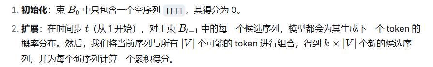
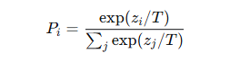
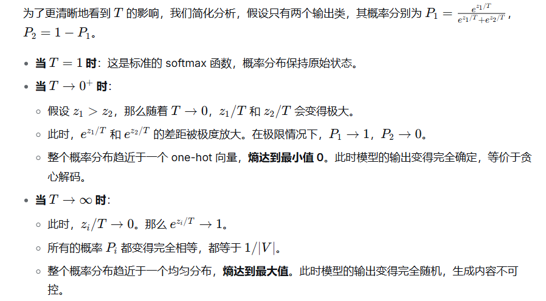
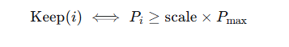

# 61.大模型（LLMs）解码策略（贪心搜索、束搜索、Top-k、Top-p、温度采样）

#### 写出贪心解码的步骤，并说明为什么贪心解码容易导致文本退化。

贪心解码 是一种最简单、最直接的自回归文本生成策略。在每一个生成步骤中，模型都会从词汇表里选择概率最高的那个token，作为当前时刻的输出。

具体步骤：

1. **输入**：给定一个初始的提示词序列 $x=(x_1,\ldots,x_n)$。
2. **迭代生成**：对于自回归生成的第 $t$ 步（从 $n+1$ 开始）：
   - 将当前已生成的序列 $y_{<t}$ 输入模型，模型输出 logits 向量 $z_t$。
   - 计算下一个 token 的条件概率分布：$P(y_t|y_{<t})=\mathrm{softmax}(z_t)$。
   - 选择具有最高概率的 token：$y_t=\arg\max_{v\in V}P(v|y_{<t})$。

{.ocr-src}

3. 终止：将 $y_t$ 拼接到序列末尾。重复此过程，直到生成结束符 `[EOS]` 或达到最大长度限制。

为什么贪心解码容易导致文本退化（退化现象）：

贪心解码的本质是局部最优的确定性选择。它在每一步都做出当前看来最好的决策，但从全局来看，这种方法会导致严重的文本退化。其背后的数学原理和深层原因如下：

1. 高概率“陷阱”与安全词汇的循环

在语言模型中，某些高频、通用的“安全”词汇（如“的”、“了”、“是”、“一个”）在大多数上下文中的条件概率都非常高。贪心解码会反复选择这些高概率的、无信息量的词汇。一旦选择了这类词，由于其概率极高，下一步的上下文又会诱导模型继续选择类似的高频词，从而陷入一个无法逃脱的“安全词汇”循环。这导致生成的文本中充满了重复的、通用的短语，缺乏实际内容。

2. “一步错，步步错”的不可逆错误累积\
   贪心解码在时间步 t 的选择是硬性且不可撤销的。如果在某个早期时间步，模型由于噪声或训练数据的偏差，选择了一个虽概率最高但并不恰当的 token，这个错误就会被当作“正确”的历史上下文，输入到后续的所有生成步骤中。模型会根据这个错误的前提，去推断和生成后续内容，导致错误像雪崩一样累积。最终，生成序列会越来越偏离人类语言的真实分布，陷入无意义的重复或逻辑混乱，即文本退化。

3. 忽略了人类语言的内在多样性

人类的语言表达是丰富多样的，一个给定的上下文通常有多个合理的延续。这些合理的延续往往集中在概率分布的“头部”，但它们之间的概率差异可能非常微小。贪心解码完全不考虑这一点，它只选取其中概率最高的那个，将其它同样合理、甚至更具创造性的选择完全排除在外。这使得生成的文本显得单调、刻板，缺乏创造力和多样性。

---

#### 束搜索（Beam Search）在每一步如何选择和保留候选序列？束宽 k 如何影响结果？

束搜索 是一种在贪心解码（短视）和穷举搜索（计算量不可承受）之间取得平衡的解码策略。它旨在生成一个整体概率更高的序列，而不是像贪心解码那样只追求每一步的局部最优。

选择和保留候选序列的步骤：\
束搜索在每一步 $t$ 都维护一个包含 k 个候选序列的“束”。这 $k$ 个序列是截至当前步，模型认为全局概率最高的序列。

1. **初始化**：束 $B_0$ 中只包含一个空序列 `[[]]`，其得分为 0。
2. **扩展**：在时间步 $t$（从 1 开始），对于束 $B_{t-1}$ 中的每一个候选序列，模型都会为其生成下一个 token 的概率分布。然后，我们将当前序列与所有 $|V|$ 个可能的 token 进行组合，得到 $k\times|V|$ 个新的候选序列，并为每个新序列计算一个累积得分。

{.ocr-src}

3. **剪枝与更新：**在这 k×∣V∣个新的候选序列中，根据累积得分（通常是累积对数概率的总和）进行排序，只保留得分最高的前 $k$ 个序列，丢弃其余所有序列。这 k 个胜出的序列就构成了新的束 $B_t$。

4. **循环与终止：**重复步骤 2 和 3，直到束中的某个序列生成了 `[EOS]` 结束符，或达到最大长度。最终，我们通常选择束中累积得分最高的那个完整序列作为最终输出。

束宽 $k$ 如何影响结果：

- $k$=1：退化为贪心解码，选择每一步概率最高的 token，是最极端的短视策略，容易导致文本退化。

- K 较小：束搜索仍然在较窄的范围内搜索，计算效率高，但全局最优性有限，可能错过那些早期概率不高但后期概率极高的优秀序列。

- $k$ 较大：束搜索会探索更多可能的生成路径，找到全局更优序列的概率越大。但同时，计算成本（时间和显存）会随 $k$ 线性增长。当 *k *过大时，束中会包含大量高度相似的候选序列（如同一句话的不同表述），导致生成的多样性下降，文本变得千篇一律。

---

#### 为什么在开放式文本生成中，束搜索往往产生重复或枯燥的文本？请从数学上解释。

这个问题的根源在于，束搜索的目标函数（最大化序列的对数似然）与人类对优质开放式文本的评价标准（多样性、创意性）之间存在根本性的错位。

数学解释：

束搜索的目标是找到整个序列 $y_{1:T}$ 使得其全局对数似然最大化：

$$
\max_{y_{1:T}}\log P(y_{1:T}|x)=\max_{y_{1:T}}\sum_{t=1}^{T}\log P(y_t|y_{<t},x)
$$

{.ocr-src}

然而，在语言模型中，这个看似合理的数学目标却与人类对优质文本的判断背道而驰：

1. “安全”序列的高概率陷阱\
   人类语言中，一些高频的、通用的和重复性的短语，在所有上下文中的条件概率都异常地高。例如，“我不知道”、“让我想想”、“这是一个很好的问题”这类“水词”。从数学上看，选择这些词汇能立竿见影地提高 `\log P(y_t | y_{<t})` 的值，因为它们的概率极高。束搜索为了最大化全局似然，会被这种“短视”的高奖励所吸引，陷入这些“安全”模式中，从而生成大量重复、空洞的文本。

2. 语言模型对重复序列的偏好

有大量研究表明，语言模型本身存在“回声”或“重复”的倾向。一旦模型生成了某个词组，它再次生成该词组的概率会异常地高。这被称为模型的内部频率偏差。在束搜索的累积得分机制下，这种重复会被进一步强化：一个重复的短语在每一步都能获得不错的分数，经过多步累积，其总得分就会超过一个更具原创性但概率相对较低的短语组合。因此，束搜索会“主动”选择重复自己的文本，以获得更高的总分。

结论：在需要创意的开放式生成任务中，人类期望模型能“跳出舒适区”，去尝试那些概率并非最高但合理的词汇。而束搜索的数学目标恰恰是“待在舒适区”，这导致了它在开放式生成中效果不佳。

---

#### Top‑k 采样的原理是什么？如何选择 k 的值？过小或过大的 k 会带来什么问题？

Top‑k 采样 是一种引入了随机性的解码策略，它旨在解决贪心和束搜索导致的文本退化与多样性不足问题。其核心思想是：在每一步生成时，不查看整个词表，而是只保留概率最高的 k 个 token 作为候选集合，然后在这个被“修剪”过的集合上重新进行概率归一化，最后从新的分布中随机采样出下一个 token。

原理：

1. 模型输出 logits，计算概率分布 P(yt∣y<t)。

2. 对这个分布按概率从高到低排序。

3. 只保留概率最高的前 $k$ 个 token，其余 token 的概率被强制设为 0。

4. 在这 $k$ 个 token 上重新归一化，得到一个新的、总和为 1 的概率分布 P′(yt∣y<t)。

5. 从 P′ 中随机采样一个 token 作为当前步的输出。

如何选择 k 的值：\
选择 $k$ 是一个需要权衡的超参数，没有完美的固定值，它取决于模型的置信度分布和任务的多样性需求。通常，$k$ 的取值范围在 10 到 50 之间，但最理想的选择是动态的。可以根据模型当前输出分布的熵来自适应地调整 k：熵大（模型不确定）时，使用较大的 k；熵小（模型确定）时，使用较小的 $k$。

- k 过小（例如 <10）：
  - 问题：会过度限制模型的“视野”。对于很多概率分布平坦的上下文，合理的候选 token 远不止几个。过小的 $k$ 会强制模型在一个极小的、可能是次优的集合中选择，导致生成的文本非常保守、重复，缺乏多样性。本质上，它变得接近于贪心解码。

- $k$ 过大（例如 >1000，甚至接近词表大小）：
  - 问题：会引入过多“噪声”。大量概率极低的、不符合语法或语义的 token 也被纳入候选集，模型有概率采样到这些“劣质”token，导致生成内容出现语法错误、逻辑混乱或完全不相关的内容，严重破坏生成质量。

---

#### Top‑p（Nucleus）采样如何动态调整候选 token 集合？与 Top‑k 相比优势在哪里？

Top‑p（Nucleus）采样 是一种更加智能和自适应的动态候选集调整策略。它不再像 Top‑k 那样固定候选 token 的数量，而是固定一个累积概率阈值 $p$，并根据这个阈值动态地调整每一步的候选 token 数量。

动态调整机制：

1. 模型输出 logits，计算概率分布 P(yt∣y<t)。

2. 将所有的 token 按概率从高到低排序。

3. 从最高概率的 token 开始，逐个累加它们的概率。当累积概率之和达到或首次超过设定的阈值 $p$ 时，就停止加入新的 token。这些被选中的 token 的集合，就称为“核心”（Nucleus）。

4. 将所有未被选中的 token 的概率强制设为 0，然后在“核心”集合内重新归一化概率，得到 P′(yt∣y<t)。

5. 从 P′ 中随机采样下一个 token。

与 Top‑k 相比的优势：

Top‑p 的核心优势在于其对模型“自信程度”的自适应能力。

- 当模型非常“确定”时（即概率分布非常尖锐，少数几个 token 的预测概率之和就超过了 $p$）：Top‑p 会自动缩小候选集，只关注那几个高概率 token，避免了采样到低概率的噪声。此时它的行为类似一个带有随机性的小 Top‑k。

- 当模型非常“不确定”时（即概率分布非常平坦，大量 token 的概率都很低，需要很多个 token 才能累积到 $p$）：Top‑p 会自动扩大候选集，允许模型从更广泛的词汇中进行探索，从而产生更多样化的输出。

结论：Top‑k 是一种“粗放式”的硬性截断，而 Top‑p 是一种“精细化”的自适应过滤。Top‑p 能够根据模型的实时状态，在“确定”和“探索”之间动态切换，通常能产生比 Top‑k 更自然、更丰富的文本。它是目前最主流的采样策略之一。

---

#### 写出 Top‑p 采样中从 logits 到最终 token 的完整步骤。

以下是从 logits 到最终生成 token 的完整、可操作步骤，用于实现 Top‑p (Nucleus) 采样。

输入：模型输出的原始 logits 向量 `logits`，形状为 `(batch_size, vocab_size)`。\
输出：一个标量，代表采样出的 token id。

```python
def sample_token_top_p(logits, p=0.9, temperature=1.0, min_tokens_to_keep=1):
    """
    执行 Top-p (Nucleus) 采样
    Args:
        logits: 模型原始输出 logits
        p: 累积概率阈值
        temperature: 温度参数，默认为 1.0 (无缩放)
        min_tokens_to_keep: 最少保留的 token 数量，防止极端情况
    Returns:
        sampled_token_id: 采样出的 token id
    """
    # 1. 应用温度参数 T，控制概率分布的“软硬”程度
    if temperature != 1.0:
        logits = logits / temperature

    # 2. 对 logits 进行 softmax，得到初始概率分布
    probs = torch.softmax(logits, dim=-1)

    # 3. 将概率进行降序排序
    probs_sort, probs_idx = torch.sort(probs, dim=-1, descending=True)

    # 4. 计算排序后概率的累积和
    probs_cumsum = torch.cumsum(probs_sort, dim=-1)

    # 5. 创建过滤掩码：累积概率和超过 p 的，且排序位置在 min_tokens_to_keep 之后的 token 被移除
    #    即：保留那些累积概率和 <= p 的，以及排在最前面的 min_tokens_to_keep 个
    cutoff_mask = (probs_cumsum - probs_sort) > p  # 一个巧妙的技巧：如果某个token的概率远超p，此掩码会从它之后开始生效
    # 更通用的掩码逻辑：
    # mask = (probs_cumsum <= p) | (torch.arange(len(probs_sort)) < min_tokens_to_keep)
    # 这里使用更精确的掩码:
    mask = torch.zeros_like(probs_sort, dtype=torch.bool)
    mask[:, :min_tokens_to_keep] = True
    mask[:, min_tokens_to_keep:] = (probs_cumsum[:, :-min_tokens_to_keep] <= p)

    # 6. 将掩码外的 token 概率设为 0，并重新归一化
    probs_sort[~mask] = 0.0
    probs_sort = probs_sort / probs_sort.sum(dim=-1, keepdim=True)

    # 7. 从新的多项式分布中随机采样一个 token
    sampled_token_idx_in_sorted = torch.multinomial(probs_sort, num_samples=1)

    # 8. 获取原始词表中的 token id
    sampled_token_id = torch.gather(probs_idx, dim=-1, index=sampled_token_idx_in_sorted)

    return sampled_token_id.squeeze(-1)
```

步骤总结：温度缩放 -> Softmax -> 概率排序 -> 累积和计算 -> 动态掩码过滤 -> 重归一化 -> 多项式采样。

---

#### 温度参数 T 如何作用于 logits？推导温度对概率分布熵的影响。

温度参数 $T$ 是一个非常直观和有效的控制生成随机性的超参数。它不直接改变词表，而是通过对 logits 进行缩放来影响最终的概率分布。

作用机制：\
温度 $T$ 作用于 softmax 函数的输入层：

$$
P_i=\frac{\exp(z_i/T)}{\sum_j\exp(z_j/T)}
$$

{.ocr-src}

其中 $z_i$ 是原始 logits。

推导温度对概率分布熵的影响（以二分类为例）：

为了更清晰地看到 $T$ 的影响，我们简化分析，假设只有两个输出类，其概率分别为 $P_1=\frac{e^{z_1/T}}{e^{z_1/T}+e^{z_2/T}}$，$P_2=1-P_1$。

- **当 $T=1$ 时**：这是标准的 softmax 函数，概率分布保持原始状态。
- **当 $T\to0^+$ 时**：
  - 假设 $z_1>z_2$，那么随着 $T\to0$，$z_1/T$ 和 $z_2/T$ 会变得极大。
  - 此时，$e^{z_1/T}$ 和 $e^{z_2/T}$ 的差距被极度放大。在极限情况下，$P_1\to1$，$P_2\to0$。
  - 整个概率分布趋近于一个 one-hot 向量，**熵达到最小值 0**。此时模型的输出变得完全确定，等价于贪心解码。
- **当 $T\to\infty$ 时**：
  - 此时，$z_i/T\to0$。那么 $e^{z_i/T}\to1$。
  - 所有的概率 $P_i$ 都变得完全相等，都等于 $1/|V|$。
  - 整个概率分布趋近于一个均匀分布，**熵达到最大值**。此时模型的输出变得完全随机，生成内容不可控。

{.ocr-src}

结论：温度 $T$ 与概率分布的熵成反比。$T$ 越小，分布越尖锐（熵越低），输出越确定；$T$ 越大，分布越平坦（熵越高），输出越随机。

---

#### 为什么较高的温度会增加输出多样性，而较低的温度会使输出更确定？从 softmax 公式分析。

这个问题实际上是第7题中熵变化的应用解释，我们可以直接从 softmax 公式入手分析其内部机理。

分析：Softmax 函数的核心是 exp⁡(zi)，这是一个指数函数。指数函数有一个关键特性：它对输入的变化不是线性放大的，而是对大数值有极强的放大效应。

低温（$T$<1，如 $T$=0.5）如何使输出更确定：

- 当 $T$<1 时，$z_i$/$T$ 会比原始的 $z_i$ 更大。这相当于放大了原始 logits 的绝对值。

- 原始 logits 中最高的那个 zmax，经过低温放大后，变得比其他 $z_i$ 远远大得多。

- 在经过指数函数 exp⁡(⋅) 的计算后，这个巨大的差距被进一步极速放大。exp⁡(zmax/T) 会是一个天文数字，而 exp⁡(zother/T)则相对极小。

- 最终，这个最大的 exp⁡(zmax/T) 将几乎“吞噬”整个概率质量，使得它的最终概率接近 1，而其他所有 token 的概率都趋近于 0。模型几乎只会选择这一个 token，输出变得高度确定。

高温（T>1，如 $T$=2.0）如何增加多样性：

- 当 T>1 时，zi/T 会比原始的 $z_i$ 更小。这相当于压缩了原始 logits 之间的差异。

- 原本概率很高的 token，经过高温压缩后，其优势被削弱；原本概率很低的 token，其劣势也被减小。

- 在经过指数函数 exp⁡(⋅) 的计算后，这种差异的缩小被保留了下来。各个 token 的最终概率变得更加接近。

- 结果，模型不再只关注那个唯一的最高概率 token，而是开始将一部分概率“分配”给那些原本概率较低的、更具探索性的 token。当进行随机采样时，这些低概率 token 被选中的机会大大增加，从而显著提升了输出的多样性。

---

#### 同时使用 Top‑k 和 Top‑p 以及温度时，这些操作的先后顺序是什么？不同的顺序会带来什么差异？

在实际工程应用中，这三者通常会同时使用，以获得最佳的生成效果。操作的先后顺序至关重要，而且只有一种顺序是正确的。

标准且正确的操作顺序：

1. 温度缩放：`logits = logits / T`

2. Top‑p 过滤：基于缩放后的概率分布，动态确定“核心”候选集，将低概率尾部直接丢弃。

3. Top‑k 过滤：在 Top‑p 过滤后的候选集上，再进行一次硬性的 Top‑k 过滤。如果 Top‑p 选出的 token 数量已经小于 $k$，则这一步实际上无效。因此，Top‑k 的作用是作为一个绝对的数量上限，防止 Top‑p 在分布极度平坦时选出过多候选 token。

4. 重归一化：对经过双重过滤后的候选 token 的概率进行重新归一化，使其总和为 1。

5. 随机采样：从最终的分布中采样下一个 token。

为什么必须是这个顺序？

这个顺序的逻辑是层层递进、逐步收紧的。

- 温度是第一道“调味料”，它在不丢失任何 token 的前提下，全局性地调整了整个分布的“口感”，决定了生成的基本风格是保守还是冒险。

- Top‑p 是第二道“智能筛”，它根据温度调整后的分布，智能化地排除掉那些“不合理”的低概率噪声，保证了生成内容的底线质量。

- Top‑k 是最后一道“安全阀”，它在 Top‑p 的基础上，强行设定一个数量上限，防止在极端平坦的分布下，候选集过大导致采样效率低下或引入过多冷门噪声。

不同的顺序会带来什么差异？

如果将顺序打乱，会得到完全不同且通常是错误的结果。

- 先 Top‑k 再 Top‑p：这是最常见的一种“错误尝试”。这会导致 Top‑p 的动态调整机制完全失效。例如，当模型非常确定时，其有效候选 token 可能只有几个，但先执行的 Top‑k 可能会强制截取 40 个 token，其中包含了大量低概率噪声。后续的 Top‑p 只能在这 40 个已经被“污染”的候选集中执行，完全违背了其自适应过滤的初衷。

- 先过滤再温度：效果会大打折扣。温度的目的是通过缩放 logits 来改变分布的平坦度。如果先执行 Top‑k/Top‑p，这些操作是基于原始 logits 的分布进行的，无法利用温度带来的信息增益。正确的做法是先用温度调制分布，再基于这个调制后的分布进行智能过滤。

因此，温度 -> Top‑p -> Top‑k 是经过大量实践检验的黄金顺序。

---

#### 在对话系统或 API 中，如何根据任务需求动态调整解码参数？举例说明。

在一个成熟的 LLM 应用中，动态调整解码参数是平衡用户体验、任务精度和计算成本的关键。这通常由应用层的“意图识别”或“任务分类”模块驱动，根据用户请求的类型和复杂度，实时地向推理引擎注入最优的解码配置。

动态调整的决策逻辑与实例：

1. 任务类型分类：
  - 事实性问答：如“法国的首都是哪里？”。
    - 目标：极高的确定性和准确性，零容忍幻觉。
    - 参数配置：温度=0.0（贪心解码），Top-p=不适用，频率惩罚=0.0。直接选择最高概率的 token，确保输出最准确的事实。
  - 创意写作：如“写一首关于星空的诗”。
    - 目标：高多样性、审美价值、丰富的词汇和比喻。
    - 参数配置：温度=0.9，Top-p=0.95，频率惩罚=0.3，存在惩罚=0.3。高温度和多惩罚项的组合能有效激发模型的“创造性”，避免陷入重复的常见句式。
  - 代码生成：如“写一个 Python 函数来快速排序一个列表”。
    - 目标：逻辑严密、语法正确、执行效率高。
    - 参数配置：温度=0.2，Top-p=0.9。较低的温度保证了代码结构的确定性，少量的随机性则允许在变量命名等非关键细节上有微小变化。

2. 基于用户意图的细化：
  - 意图：解释/教学：当用户问“请解释一下什么是量子纠缠？”，模型应给出清晰、有条理、专业的解释。
    - 参数配置：温度=0.3，Top-p=0.9，频率惩罚=0.5。较低的温度保证解释的准确性，较高的频率惩罚则强制模型避免重复使用相同的术语，使解释更丰富、更清晰。
  - 意图：聊天/角色扮演：当用户说“今天工作好累啊。”，模型需要提供情绪价值和共情。
    - 参数配置：温度=0.8，Top-p=0.95，存在惩罚=0.2。高温度和 Top-p 让回复更自然、多样、有“人味”，避免显得像一台机器。

在 API 中的实现：API 请求体通常包含一个 `parameters` 对象，允许用户覆盖服务端的默认值。服务端也可以根据系统负载和业务规则，动态地、静默地调整这些参数。

---

#### 对比贪心搜索、束搜索和采样方法在机器翻译与创意写作中的适用性。

机器翻译和创意写作代表了两种极端的生成需求：一个追求“信达雅”中的精确与忠实，另一个追求无限的想象力与多样性。因此，解码策略的选型也截然不同。

| 任务 | 贪心搜索 | 束搜索 | 采样方法 (Top-p/Top-k) |
| --- | --- | --- | --- |
| 机器翻译 | 不适用。过于短视，会陷入局部最优，导致翻译结果生硬、不符合目标语言习惯或完全错误。 | 适用。这是机器翻译的“黄金标准”。它在多个可能的翻译路径中找到全局概率最高的序列，能更好地处理长距离依赖和语序调整，生成更流畅和准确的翻译。束宽通常为 4~8。 | 不太适用。采样的随机性容易引入错误的词汇或不稳定的语序，破坏翻译的准确性，尤其对于需要精确术语的场景。 |
| 创意写作 | 完全不适用。生成的文本会极度枯燥、重复、缺乏任何创意，是“文本退化”现象的教科书级案例。 | 不适用。束搜索会强制选择“最安全”的通用表达，扼杀了创意的可能性。生成的文本往往是千篇一律的、模板化的，不符合人类对文学创作的要求。 | 非常适用。采样方法（尤其是 Top-p）通过有控制的随机性，允许模型探索那些概率不是最高但极具表现力的词汇，从而产生出人意料、风格多样、充满创造力的文本。这是当前 LLM 进行创意生成的标准方案。 |

本质原因：机器翻译是一个有明确“标准答案”的收敛性问题，解码器的目标是找到与那个答案最匹配的路径。而创意写作是一个没有标准答案的发散性问题，解码器的目标是探索人类语言表达的无限可能性。

---

#### 什么是“重复循环”问题？解码策略如何与重复惩罚协同工作来缓解它？

“重复循环”问题是指语言模型在自回归生成时，陷入一种病态模式，开始不断重复同一个词、词组或句子，无法继续产生有意义的后续内容。这本质上是模型的确定性和内部频率偏差共同作用的结果。

- 原因：模型在生成一个词后，由于训练数据的共现模式，这个新生成的词会在其上下文中极大地提升它自己再次出现的概率。一旦模型因为贪心策略或随机波动生成了某个词，它就可能陷入一个自我强化的正反馈循环中。

解码策略与重复惩罚的协同工作：

重复惩罚（Repetition Penalty）是一种解码时应用的后处理技术，专门用于打破这种循环。它不改变模型内部的任何参数，而是直接修改下一步的 logits 值。其原理是：在计算 softmax 之前，降低那些已经在已生成的历史序列中出现过的 token 的 logits 值。

协同机制：

1. 贪心/束搜索 + 重复惩罚：这是最典型的组合。当束搜索试图选择那些高概率的、但会导致重复的“安全”词汇时，重复惩罚会大幅压低这些词的 logits，迫使模型去选择其他概率次高但更合理的词，从而跳出循环。

2. 采样 + 重复惩罚：即使是采样，模型在高温下也可能恰好反复采样到同一个词。重复惩罚降低了这些已出现词汇的采样概率，作为一种“软性”的强制约束，引导采样过程走向更丰富、更多样化的区域。

重复惩罚的变体：

- 频率惩罚 (Frequency Penalty)：根据一个 token 在已生成文本中出现的总次数，按比例降低其 logits。

- 存在惩罚 (Presence Penalty)：只要一个 token 在已生成文本中出现过至少一次，就降低其 logits，无论出现多少次。

通过这种协同，模型的行为从“允许重复”变为“主动避免重复”，极大地提升了长文本生成的质量。

---

#### 为什么束搜索在 LLM 中计算开销巨大？如何优化束搜索的效率？

束搜索的计算开销主要来自两个方面：自回归生成过程中的重复计算和成倍增长的模型前向传播次数。

开销来源分析：

1. 成倍的计算量：在标准束搜索中，束宽 $k$=4 意味着在每一个生成步骤，模型需要对 4 个不同的候选序列（各自拥有不同的上下文历史）进行独立的前向传播。这导致每一步的计算量直接变为原先的 4 倍。

2. 巨大的显存占用：每个候选序列都需要维护自己独立的 Key-Value（KV）缓存，以实现高效推理。$k$ 个束意味着 KV 缓存的大小也会是原来的 k 倍。对于长序列生成，这将导致显存占用的急剧膨胀。

3. 自回归的本质：与所有自回归方法一样，束搜索的生成也是逐 token 串行的，无法像训练时那样并行处理整个序列。

效率优化方法：

- KV 缓存的智能管理：这是最核心的优化。对于束中多个候选序列高度共享的前缀，它们的 KV 缓存可以被共享，避免重复计算。当束中序列发生分叉时，才需要复制和更新各自独立的 KV 缓存。现代推理引擎（如 vLLM 的 PagedAttention）通过精细的内存管理，可以对这种高度结构化的缓存进行高效复用，最大程度减少显存碎片和重复计算。

- 动态束宽（Adaptive Beam Width）：在生成初期，使用较大的束宽来探索不同的可能性。一旦生成路径已经比较明确，束中序列的差异性变小时，可以动态缩减束宽，将计算资源集中到最有希望的少数几个序列上。

- 假设验证（Hypothesis Verification）：这是一个更前沿的思路。先使用一个极小的模型（草案模型）快速地、低成本地探索多个生成方向，然后让大模型并行地对这些候选方向进行验证和重排序。

---

#### 怎样从理论上解释 Top‑p 采样中的核大小与文本质量的关系？

Top‑p 采样的核大小（即动态选出的候选 token 数量 *N *nucleus）与文本质量之间存在一种非线性的“倒 U 型”关系。这个关系可以通过信息论和统计决策理论的视角来理解。

我们可以将文本生成看作一个在约束条件下的信息传输过程。

1. 核太小（信息瓶颈）：当 $p$ 值设得过小，*N *nucleus 会非常小。这相当于在概率分布上强制设置了一个极窄的信息瓶颈。模型被剥夺了从“可能但不那么常见”的词汇中采样的机会，只能在一个极其局限的、高度确定的候选池里选择。生成的文本虽然局部流畅，但全局来看会丧失多样性，陷入重复和模板化，表现为信息熵过低。

2. 核大小适中（最优传输）：存在一个最优的 $p$ 值范围，使得信息瓶颈的宽度恰到好处。此时，候选集         *N *nucleus 既能排除掉分布尾部的纯噪声（概率极低、不合理的选择），又能保留一个足够大的核心集合，这个集合包含了几乎所有语义合理、风格恰当的词汇。在这个范围内进行随机采样，生成的文本能在流畅性（信号）和多样性（信息量）之间达到最优平衡。

3. 核太大（噪声引入）：当 $p$ 值过大甚至为 1 时，*N *nucleus 会非常大，甚至接近整个词表。这相当于没有施加有效的约束，大量概率极低的“噪声” token 被纳入候选池。模型一旦采样到这些噪声 token，就会在文本中引入语法错误、逻辑断裂或完全不相关的内容，严重破坏生成质量。这相当于在信道上引入了过高的噪声，使得有效信息传输率下降。

结论：Top‑p 采样的成功，在于它通过累积概率分布，智能地寻找到一个数据驱动的、自适应的“最优信息瓶颈”宽度。这个宽度在每一步都是不同的，但它总能精确地剔除噪声，同时保留足够的有效信息。

---

#### 解码时如何保证生成的文本包含指定关键词或遵循约束？有哪些约束解码（Constrained Decoding）方法？

在某些应用中，我们需要对模型的输出进行硬性的、严格的控制。这已超出了采样策略的“软引导”范畴，进入约束解码的领域。约束解码通过操纵模型的输出分布，强制生成完全符合特定规则或模式的文本。

常用方法：

1. 基于正则表达式的引导：
  - 原理：在每一步生成后，拼接上当前已生成的文本。然后检查它可以匹配哪些预定义的正则表达式的部分路径。构建一个有限状态自动机（FSM）来跟踪匹配状态。在下一步采样时，只允许那些能使自动机向合法状态转移的 token 被选中，其他所有 token 的 logits 被强制设为 −∞。
  - 应用：生成符合特定格式（如邮箱、电话号码、JSON Schema）的输出。这是 `outlines` 等库的核心思想。

2. 基于语法的指导：
  - 原理：这是正则表达式引导的更高级形式。使用一个给定的上下文无关文法（CFG） 来构建一个词汇级别的有限状态自动机。该自动机定义了所有符合该语法的合法 token 序列。在每一步采样时，同样只允许那些能使自动机状态合法转移的 token。
  - 应用：强制模型输出合法的 JSON、合法的 Python 代码（无语法错误）或遵守某个严格的 DSL（领域特定语言）。

3. 基于前缀树的引导：
  - 原理：给定一个固定的合法词汇列表（例如，所有有效的 API 函数名、所有可用的实体名称），用这些词构建一个字典树。在生成时，一旦模型进入一个需要从该列表中选择的“状态”（例如，一个特殊标记 `[API_CALL]` 之后），解码器就只允许沿着这棵字典树的合法路径前进。
  - 应用：在工具调用场景中，强制模型只生成预定义的、可执行的 API 调用，避免产生“幻觉 API”。

这些技术通过将外部知识（正则、文法、词汇表）编译成一个不可违抗的硬性约束器，并将其注入到解码循环中，从根本上确保了生成内容的合规性。

---

#### 比较 min‑p 采样与 Top‑p 采样：min‑p 的设计动机与优势。

Min‑p 采样是一种更晚提出的采样策略，旨在以一种更简洁、更符合概率直觉的方式解决 Top‑p 的一个理论局限。

- 设计动机（Top‑p 的局限）：Top‑p 基于累积概率进行筛选。这在大多数情况下有效，但它可能会保留一些极端低概率的 token（例如，概率远低于 0.1%），只要它们足够多，累积起来能进入 $p$ 的范围。从信息论角度看，这些超低概率 token 本质是噪声，不应该在任何上下文中被考虑。

- Min‑p 的原理：Min‑p 的筛选规则非常直接。它首先找到整个概率分布中的最大概率 *P *max。然后，它设定一个阈值，即 *P *max 的某个比例（例如 `scale=0.1`）。只有那些概率大于 $scale * P_{\text{max}}$ 的 token 才会被保留下来：

$$
\mathrm{Keep}(i)\iff P_i\ge\mathrm{scale}\times P_{\max}
$$

{.ocr-src}

- 优势：
  1. 更彻底的噪声过滤：Min‑p 天然地、高效地排除了所有“绝对低概率”的噪声 token。无论分布的尾部有多长，只要一个 token 的概率达不到最高概率的一定比例，它就会被立刻排除。这在模型极为不确定的分布上是更稳健的过滤。
  2. 计算更简单：它的实现只需要找到最大值并进行一次比较，逻辑比计算累积和更简单、效率略高。
  3. 参数更具解释性：`scale=0.1` 意味着“只保留概率至少是头号候选 10% 的词汇”，这个解释非常直观易懂，而 Top‑p 的 $p$=0.9 的含义是“覆盖 90% 的概率质量”，后者对非专业人士而言不那么直观。

---

#### 在批量推理时，不同样本可能使用不同的解码策略，如何高效实现混合解码？

在面向多用户的 API 服务中，高效处理混合解码请求是一个核心工程挑战。关键在于将核心计算（模型前向传播）与轻量级的后处理（解码逻辑）解耦。

高效实现方案：

1. 统一 Logits 处理器框架：这是现代推理引擎（如 vLLM, TensorRT-LLM）的标准做法。整个推理 pipeline 被设计为：
  - 阶段一：模型前向传播。在一个 batch 中，无论这些请求后续的解码策略如何，它们的前向传播计算是完全相同的。因此，我们可以将它们毫无区别地打包进一个 batch，送入 GPU 进行高效的并行矩阵乘法。这一步产出的是每个样本的原始 logits 向量。
  - 阶段二：自定义 Logits 处理器。在得到 logits 之后，每个样本可以根据其预先注册的解码配置，独立地、并行地调用一个轻量级的 logits 处理器序列。这个序列在 GPU 的 CUDA 内核或高速 CPU 上执行，依次应用温度缩放、Top‑p 过滤、Top‑k 过滤、重复惩罚等操作。

2. 请求级元数据绑定：每个推理请求在进入引擎时，都会被绑定一个唯一的 ID 和它的解码配置（如 `{"temp": 0.8, "top_p": 0.95}`）。在 logits 处理器阶段，引擎会根据这个配置，为每个样本动态地调用其专属的处理逻辑。

3. 采样内核的并行化：最后一步，对于需要随机采样的请求，使用优化过的、支持不同随机种子的 GPU 采样内核，一次性完成整个 batch 内所有样本的 token 采样。

通过这种“统一模型计算 + 差异化后处理”的架构，我们可以在不影响 GPU 核心计算效率的前提下，灵活地支持各种解码策略的混合使用。

---

#### 描述一种基于 logits 处理器的框架，将温度、Top‑k、Top‑p 统一抽象。

将温度、Top‑k、Top‑p 等解码策略抽象为一个统一的、可插拔的 `LogitsProcessor` 框架，是实现灵活、可维护的推理引擎的关键设计模式。

框架设计：

定义一个通用的接口 `LogitsProcessor`，它接收一个包含输入上下文和当前 logits 的 `GenerationContext` 对象，并返回修改后的 logits。

```python
class GenerationContext:
    def __init__(self):
        self.input_ids: List[int] = []      # 原始输入 token IDs
        self.current_logits: torch.Tensor = None # 当前步的 logits
        self.generation_history: List[int] = [] # 已生成的 token IDs
        self.vocab_size: int = 0

class LogitsProcessor(ABC):
    @abstractmethod
    def __call__(self, context: GenerationContext) -> GenerationContext:
        pass
```

具体处理器实现：

1. `TemperatureProcessor`：
  - 功能：读取 `context.temperature`，执行 `context.current_logits /= temperature`。

2. `TopKProcessor`：
  - 功能：读取 `context.top_k`。对 `context.current_logits` 进行 softmax，排序，将第 $k$ 个之后的概率置零，重归一化。

3. `TopPProcessor`：
  - 功能：读取 `context.top_p`。对 `context.current_logits` 进行 softmax，排序，计算累积和，将超出阈值 $p$ 的 token 的概率置零，重归一化。

4. `RepetitionPenaltyProcessor`：
  - 功能：读取 `context.repetition_penalty`。遍历 `context.generation_history` 中的每个 token ID $i$。如果 $i$ 存在，则在 `context.current_logits` 中，根据是频率惩罚还是存在惩罚，降低 logits[i]。

完整的处理链：\
在推理时，我们将这些处理器实例串联成一个列表 `pipeline = [TemperatureProcessor(), TopPProcessor(), TopKProcessor(), RepetitionPenaltyProcessor()]`。对于每一步生成，我们创建一个新的 `GenerationContext` 对象，然后依次调用 `pipeline` 中的每个处理器。最终，使用处理后的 `context.current_logits` 进行 softmax 和采样。

这个框架的好处是：

- 解耦与可扩展：可以随时添加新的解码策略（如 `MinPProcessor`），而无需修改核心生成逻辑。

- 顺序可控：处理器的执行顺序非常明确，便于调试和优化。

- 配置驱动：整个生成过程可以通过一个配置字典来灵活定义和调整。

*本回答由 AI 生成，内容仅供参考，请仔细甄别*

