# 62.大模型（LLMs）MQA/GQA 与 KV Cache 压缩

#### 什么是多头注意力（MHA）？它如何导致 KV Cache 过大？

多头注意力（Multi-Head Attention, MHA） 是 Transformer 模型的核心机制。它将输入序列的每个 token 通过线性变换投影到多个不同的“表示子空间”，并行计算注意力，最后拼接结果再进行一次线性变换。

具体流程如下：

- 输入序列长度为 $n$，嵌入维度为 $d_{\text{model}}$。
- 设有 $h$ 个注意力头，每个头的维度为 $d_k=d_{\text{model}}/h$。
- 对于每个头 $i$，通过权重矩阵 $W_Q^i,W_K^i,W_V^i\in\mathbb{R}^{d_{\text{model}}\times d_k}$ 生成查询（Query）、键（Key）、值（Value）：

$$
Q_i=XW_Q^i,\quad K_i=XW_K^i,\quad V_i=XW_V^i
$$

- 每个头独立计算缩放点积注意力：

$$
\mathrm{Head}_i=\mathrm{softmax}\left(\frac{Q_iK_i^T}{\sqrt{d_k}}\right)V_i
$$

- 所有头的输出沿最后一维拼接，再用 $W_O\in\mathbb{R}^{hd_k\times d_{\text{model}}}$ 映射回 $d_{\text{model}}$。

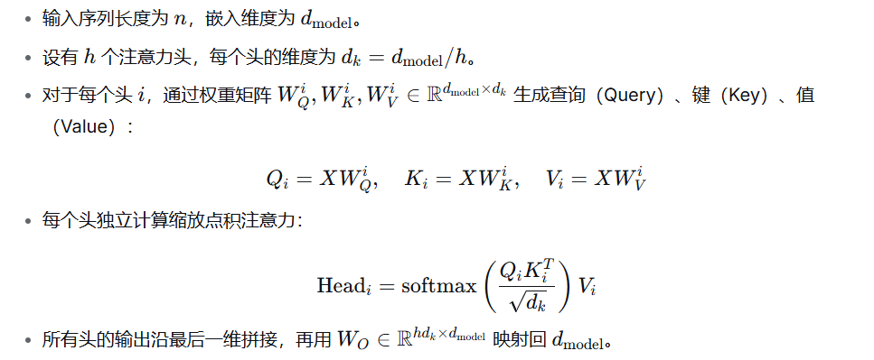{.ocr-src}

在自回归生成（如 GPT）中，每生成一个新 token，模型都需要对所有历史 token 计算注意力。如果每次都重新计算所有历史 token 的 $K$ 和 $V$，计算量会随序列长度平方增长。KV Cache 正是为了缓解这个问题：在推理时，把之前所有 token 在每一层的 $K$ 和 $V$ 向量存储起来，新 token 生成时只需计算自身的 $Q$,$K$,$V$，然后把新 $K$,$V$ 追加到缓存中，$Q$ 与缓存的全部 $K$ 做注意力运算。这避免了历史 token 的重复前向计算。

KV Cache 过大的根源就来自 MHA 的设计：

- 每个注意力头都需要独立的、完整的 $K$ 和 $V$ 序列。

- 对于一个单层，KV Cache 的总元素量为：

$$
\mathrm{Memory}=2\times h\times d_k\times n=2\times d_{\text{model}}\times n
$$

{.ocr-src}

- 其中 $n$ 为已生成的 token 数（序列长度）。

- 考虑全部 $L$ 层 Transformer、batch size 为 $b$，以及浮点数字节数（如 FP16 为 2 字节），总显存消耗为：

$$
\text{Total KV Cache Size}=b\times L\times2\times d_{\text{model}}\times n\times\mathrm{sizeof(dtype)}
$$

{.ocr-src}

- 这意味着 KV Cache 随序列长度和 batch size 线性增长。当处理长序列（如 32k、128k token）或高并发服务（大 batch）时，KV Cache 会迅速挤爆 GPU 显存。例如，一个 70B 模型（$L$=80,*d *model=8192）在 FP16 下处理一条 2048 token 的序列，单层 KV Cache 约 32MB，全部 80 层就超过 2.5GB。若 batch=32，便需要 80GB 以上，这还未计模型权重本身。因此，减少每个头、每层的 KV Cache 尺寸成为推理优化的关键，而 MHA 中多头重复存储同一序列的 $K$,$V$ 是冗余的一大源头。

---

#### MQA（多查询注意力）相比 MHA，KV 缓存减少了多少？写出节省比例公式。

多查询注意力（Multi-Query Attention, MQA） 极度共享 KV 对：所有的查询头 $Q$ 共享同一个 $K$ 头和同一个 $V$ 头。也就是说，无论有多少个查询头，$K$ 和 $V$ 在每一层都只有 1 个头，维度为 $d_k$（通常保持与单头相同，或为 

*d *model 以保持性能）。

在 MHA 中，KV 缓存大小为 $2\times h\times d_k\times n$（每层）。在 MQA 中，仅需存储 1 个 $K$ 头和 1 个 $V$ 头，即 $2\times1\times d_k\times n$（若 $d_k$ 不变）。**注意**：有时 MQA 会增大 $d_k$ 以补偿容量，但常见实践中保持 $d_k$ 与 MHA 单头相同。假设 MHA 和 MQA 的 $d_k$ 一致，则 KV 缓存量之比为 $1:h$。

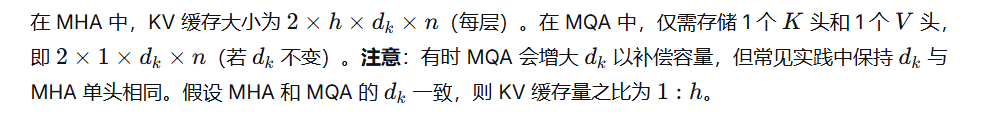{.ocr-src}

绝对减少量（每层每序列）：

$$
\Delta\mathrm{Memory}=2(h-1)d_kn
$$

{.ocr-src}

节省比例（相对于 MHA 的 KV 缓存总量）：

$$
\text{节省比例}=\frac{\text{MHA KV}-\text{MQA KV}}{\text{MHA KV}}=\frac{2hd_kn-2\cdot1\cdot d_kn}{2hd_kn}=\frac{h-1}{h}=1-\frac{1}{h}
$$

若用 $h$ 表示查询头数，公式为 $\left(1-\frac{1}{h}\right)\times100\%$。例如，当 $h=32$ 时，节省了约 96.875% 的 KV 缓存；当 $h=8$ 时，节省 87.5%。这极大地缓解了显存压力，使长序列和大 batch 推理成为可能。节省比例公式清晰地表明，头数越多，MQA 的相对收益越大。

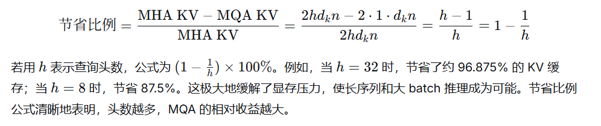{.ocr-src}

---

#### GQA（分组查询注意力）是如何在 MHA 和 MQA 之间折中的？分组数 $g$ 的含义。

分组查询注意力（Grouped-Query Attention, GQA） 将全部 $h$ 个查询头分成 $g$ 个组，组内共享同一个 $K$ 头和一个 $V$ 头。因此，$K$ 和 $V$ 的头数等于组数 $g$，而 $Q$ 的头数仍然保持为 $h$。每组内包含 $h$/$g$ 个查询头，它们都与该组唯一的 $K$,$V$ 进行注意力计算。

- 当 $g$=1 时，GQA 退化为 MQA（所有查询头共享一对 KV）。

- 当 $g$=$h$ 时，GQA 退化为 MHA（每个查询头有自己独立的 KV）。

分组数 $g$ 的含义就是KV 头的数量，它直接控制了表示能力与推理效率之间的权衡。$g$ 越大，KV 头越多，模型越接近 MHA，表达能力越强，但 KV Cache 也越大；$g$ 越小，越接近 MQA，缓存越少，推理越快，但可能损失一些精度。

GQA 的直觉在于：注意力头之间往往存在冗余，许多头学到相似的模式。通过让一组查询头共用同一个 KV 对，可以在几乎不损伤模型质量的前提下大幅压缩 KV Cache。LLaMA 2 70B 使用 $h$=64，$g$=8，即每 8 个查询头共享一对 KV，从而在模型容量和显存带宽之间找到了一个极佳的平衡点。总结：$g$ 是 KV 头数，是 MHA（$g$=$h$）和 MQA（$g$=1）之间的插值因子。

---

#### 给定 32 个查询头，若使用 GQA 且 KV 头数为 8，请计算 KV Cache 相比 MHA 的压缩比。

已知：查询头数 $h=32$，GQA 的 KV 头数 $g=8$。这意味着有 8 个分组，每组包含 $32/8=4$ 个查询头，每个组共享一对 $K,V$。假设单头维度 $d_k$ 在两种结构中相同，序列长度为 $n$。

- MHA 的 KV Cache 大小（每层）：$\mathrm{MHA}_{kv}=2\times h\times d_k\times n=2\times32\times d_k\times n=64d_kn$
- GQA 的 KV Cache 大小（每层）：$\mathrm{GQA}_{kv}=2\times g\times d_k\times n=2\times8\times d_k\times n=16d_kn$

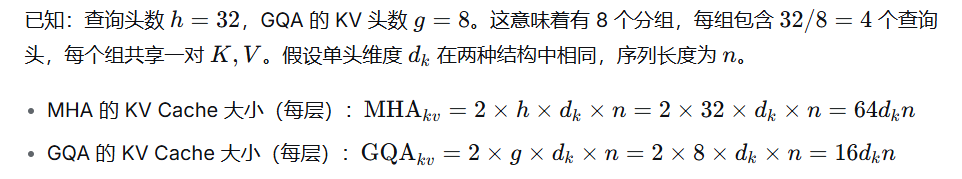{.ocr-src}

压缩比（Compression Ratio）通常定义为压缩后的尺寸与原始尺寸之比，即：

$$
\text{压缩比}=\frac{\mathrm{GQA}_{kv}}{\mathrm{MHA}_{kv}}=\frac{2gd_kn}{2hd_kn}=\frac{g}{h}=\frac{8}{32}=\frac{1}{4}
$$

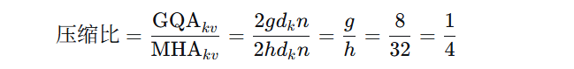{.ocr-src}

因此 KV Cache 被压缩到了原来的 25%，即节省了 75%。也可以反过来说压缩倍数为 4 倍（MHA 大小是 GQA 的 4 倍）。所以答案：

$$
\text{压缩比}=\frac{g}{h}=0.25\quad\text{或}\quad\text{节省比例}=1-\frac{g}{h}=0.75
$$

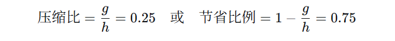{.ocr-src}

这表明使用 8 个 KV 头的 GQA 相比 32 头的 MHA，显存占用量仅为四分之一，极大降低了长文本推理的内存瓶颈。

---

#### MQA/GQA 对模型容量和性能有什么影响？为什么 GQA 被 LLaMA 2/3 等广泛采用？

对模型容量和性能的影响：

- MQA：将所有查询头耦合到同一对 $K$,$V$ 上，强力减少了 KV Cache，但也大幅限制了注意力机制的灵活性。实验表明，MQA 在训练初期会带来一定的性能损失，尤其在需要细粒度注意力交互的任务（如长上下文理解、精确检索）中，模型质量可能下降。不过经过充分训练，MQA 仍能达到接近 MHA 基线的效果，但往往需要更大的模型或更多的训练 token 来弥补容量损失。

- GQA：通过分组共享，在容量和效率之间取得了平滑的折中。分组数 $g$ 越大，越逼近 MHA 的表示能力，损失越小。论文《GQA: Training Generalized Multi-Query Transformer Models from Multi-Head Checkpoints》显示，GQA 在 $g$ 适中时（如 8 组）性能几乎与 MHA 持平，显著优于 MQA，同时 KV Cache 减少为原来的 $g$/$h$。此外，GQA 在推理时因减少了 KV 的访存量，还能提升 decoder 的迭代速度（受限于内存带宽的小 batch 场景更为明显）。

为什么 GQA 被 LLaMA 2/3 等广泛采用：

1. 近乎无损的质量：以 LLaMA 2 70B 为例，$h$=64,$g$=8，相比 MHA，在下游任务上的 perplexity 和零样本准确率几乎没有下降，有时甚至因正则化效应略有提升。

2. 推理效率革命：KV Cache 缩减为 1/8，使得在相同显存下可以支持 8 倍的 batch size 或 8 倍的序列长度。这对部署高吞吐量推理服务（如聊天机器人）至关重要。

3. 工程友好：GQA 可以通过权重平均从已有的 MHA 模型转换而来，无需完全重新训练（见下一题），降低了迁移成本。并且在 FlashAttention、vLLM 等框架中已有原生支持。

4. 扩展性：随着模型头数越来越多（如 64、96、128），MQA 可能过于极端，而 GQA 允许开发者根据硬件预算灵活选择 $g$，在内存带宽和计算之间调优。LLaMA 3 继续沿用 GQA，证明了其在工业级大模型中的普适性。

因此，GQA 凭借“性能几乎无损 + 显存显著节省 + 实现简洁”的优势，已成为现代大语言模型的标准配置。

---

#### 从训练角度看，将 MHA 模型转换为 GQA 模型需要重新训练吗？是否可以通过权重平均（mean pooling）近似转换？

不需要完全重新训练。将 MHA 模型转换为 GQA 模型，可以利用原始 MHA 的预训练权重，通过权重平均（mean pooling）来构造 GQA 的初始权重，然后进行极少量的微调（或甚至不微调）。这就是 GQA 论文中提出的 upprobing 方案。

权重平均方法如下：

MHA 为每个头 $i$ 都有独立的 $W_K^i,W_V^i$（形状 $[d_{\text{model}},d_k]$）。若要将它们转换为 GQA 的 $g$ 个 KV 头，需要把原始的 $h$ 个 KV 头划分为 $g$ 组，每组包含 $h/g$ 个原始的 KV 头。对于第 $j$ 组，其对应的 GQA 权重就是组内所有原始权重的均值：

$$
W_K^{\mathrm{GQA}(j)}=\frac{1}{h/g}\sum_{i\in\mathrm{Group}_j}W_K^{\mathrm{MHA}(i)},\quad W_V^{\mathrm{GQA}(j)}=\frac{1}{h/g}\sum_{i\in\mathrm{Group}_j}W_V^{\mathrm{MHA}(i)}
$$

查询权重 $W_Q^i$ 保持不变，因为 GQA 仍然保持原有的 $h$ 个查询头。输出投影 $W_O$ 也原样保留。

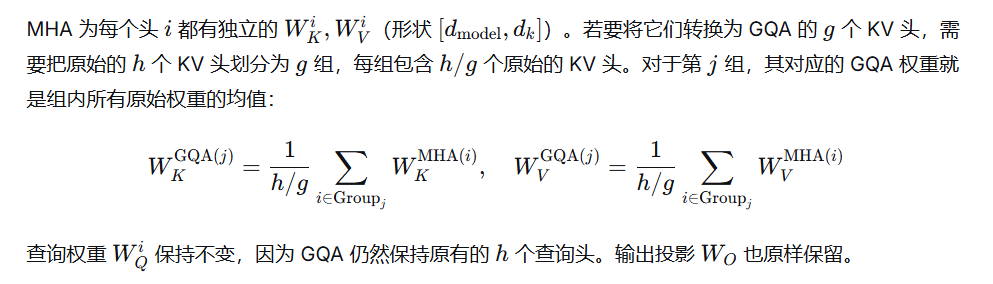{.ocr-src}

为什么均值有效？ 多头注意力的训练过程中，不同的头可能会收敛到相似的功能，但并非完全相同。直接平均相当于一种模型集成，利用冗余性构造出新的共享头。实验表明，这样得到的 GQA 模型在不经任何训练的情况下，其困惑度只会略微上升（例如从 MHA 的 9.0 升到 9.2），经过极少量（如原训练步骤的 1%~5%）的继续训练/微调，就能迅速恢复到原模型的水平，甚至超越。这证明权重平均是一种极低成本的知识迁移方式。

是否必须微调？ 不强制。如果对性能要求苛刻，可进行少量适应性训练；如果只是需要一个快速可用的推理模型，权重平均后的 GQA 即可直接部署，性价比极高。

---

#### MQA 中的 key-value 头是如何与多个 query 头共享的？写出注意力计算的矩阵分块。

在 MQA 中，所有查询头共享同一个 $K$ 和同一个 $V$。设批次大小为 $b$，序列长度分别为 $s_q$（查询）和 $s_{kv}$（键值），查询头数 $h$，每个头的维度 $d$。输入张量：

- $Q\in\mathbb{R}^{b\times s_q\times h\times d}$
- $K\in\mathbb{R}^{b\times s_{kv}\times1\times d}$（单头）
- $V\in\mathbb{R}^{b\times s_{kv}\times1\times d}$

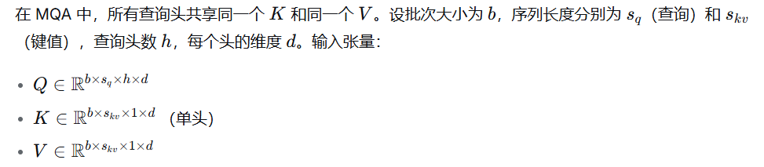{.ocr-src}

注意力计算流程与分块：

我们可以将 $Q$ 按头切分为 $h$ 个块，每个块为 $Q_i\in\mathbb{R}^{b\times s_q\times d}$。对于所有 $i=1\ldots h$，它们与同一个 $K$（去掉头维度为 $b\times s_{kv}\times d$）和 $V$ 进行计算。

1. **计算注意力分数**：每个头独立计算 $\mathrm{Score}_i=Q_iK^T/\sqrt{d}$，得到形状 $[b,s_q,s_{kv}]$。由于 $K$ 对所有 $i$ 相同，我们可以通过矩阵运算一次性完成：将 $Q$ 重塑为 $[b,s_q,h,d]$，$K$ 扩展为 $[b,s_{kv},h,d]$（或者利用广播），计算 `einsum('bqhd,bkhd->bhqk', Q, K)` 或直接利用 PyTorch 的广播机制：`scores = torch.matmul(Q, K.transpose(-2, -1))`，其中 Q 为 [b, h, s_q, d]，K 为 [b, 1, s_{kv}, d]，广播后自动匹配。

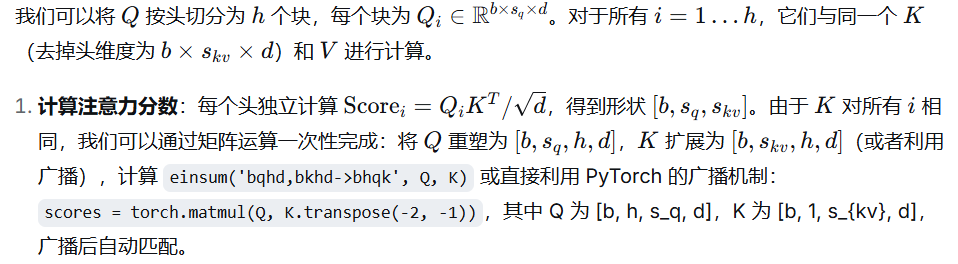{.ocr-src}

2. 注意力权重：`attn_weights = softmax(scores, dim=-1)`（形状 [b, h, s_q, s_{kv}]）。

3. 加权求和：$output_i = attn_weights_i \cdot V$。同样，V 形状 [b, 1, s_{kv}, d] 广播至所有头，`output = torch.matmul(attn_weights, V)`，得到 [b, h, s_q, d]。

4. 合并输出：将所有头的输出拼接或直接重组为 [b, s_q, h*d]。

矩阵分块表示（直观分块乘法）：

将 $Q$ 按头写为块矩阵 $[Q_1;Q_2;\ldots;Q_h]$（沿头维度堆叠）。$K,V$ 分别为单个矩阵 $K,V\in\mathbb{R}^{s_{kv}\times d}$。注意力输出：

$$
\mathrm{Output}=\begin{bmatrix}\mathrm{softmax}\left(\frac{Q_1K^T}{\sqrt{d}}\right)V\\\mathrm{softmax}\left(\frac{Q_2K^T}{\sqrt{d}}\right)V\\\vdots\\\mathrm{softmax}\left(\frac{Q_hK^T}{\sqrt{d}}\right)V\end{bmatrix}
$$

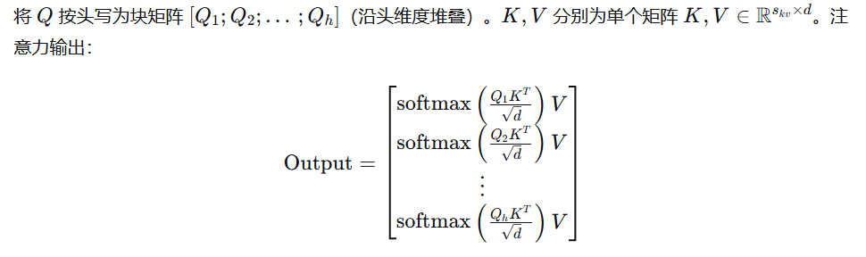{.ocr-src}

每一行对应一个查询头的结果。这种共享方式在计算时，$K$ 和 $V$ 在内存中只读一次，然后广播给所有 $Q$ 头。相比 MHA 每个头都需要读写独立的 $K_i$,$V_i$，显著减少了显存访存和缓存占用。

---

#### 当使用 GQA 时，FlashAttention 的实现需要做哪些适配？

FlashAttention 通过分块（tiling）和重计算来减少 HBM 读写，核心是将 Q, K, V 分成小块，在 SRAM 中完成 softmax 缩放和累积。原生 FlashAttention 假定 Q 与 KV 的头数相同（MHA）。适配 GQA 需要处理KV 头数小于 Q 头数的情况，即 $g$<$h$。

主要适配点：

1. 引入分组广播（Group Expand）：\
   FlashAttention 内核需要知道哪些 Q 头对应哪个 KV 头。输入时将 K, V 的张量形状维持为 $[b, s_{kv}, g, d]$，而 Q 为 `[b, s_q, h, d]`。在循环分块时，每个线程块处理的 Q 头索引需要映射到对应的 KV 头。实现上可以在 CUDA kernel 中根据 Q 头的组索引 `group_idx = head_idx * g / h` 来加载对应的 K, V 块。例如，当 Q 头索引 i 属于组 j 时，K, V 取第 j 个头的数据。

2. K, V 的加载与复用：\
   由于多个 Q 头共享同一 K, V，在 SRAM 中可以一次加载 K, V 块，然后依次与属于该组的所有 Q 头进行计算，从而最大化数据复用，减少对 HBM 的访问。FlashAttention-2 中，通过在外层循环按 KV 块迭代，内层循环遍历共享该 KV 的所有 Q 头，即可自然适配 GQA。

3. 索引与步幅调整：\
   在核函数中，张量的步幅（stride）需要根据 GQA 重新计算。例如 K 的头部步幅仅为 `g` 个头的内存跨度，而 Q 为 `h` 个头。在 softmax 归一化和输出累加时，需要正确处理不同 Q 头对应的不同 `m, l`（softmax 统计量），因为它们共享同一份 K, V 但仍需独立计算 softmax。

4. 软件层面的接口适配：\
   像 PyTorch 的 `scaled_dot_product_attention` 或 `flash_attn` 库，直接提供了 `num_heads_kv` 参数。用户传入 `q, k, v`，其中 k, v 的头部维度可能小于 q 的头部维度，内部实现通过 `repeat_kv` 之类的函数在需要时逻辑扩展，但真正的 FlashAttention 内核在 CUDA 层级会避免物理扩展，直接根据组映射计算。

具体实现逻辑（以 FlashAttention-2 为例）：

- 内核按照 KV 头数进行调度，对于每个 KV 头，分配一组线程块处理其对应的所有 Q 头。在 inner loop 中，逐块加载 K, V，然后循环处理组内的每个 Q 头，执行点积、softmax 更新、乘累加。

- 这种适配不仅正确，而且高效，因为 KV 的 SRAM 驻留可以被组内所有 Q 头重复利用，减少了 HBM 读取 KV 的次数，恰好利用了 GQA 的带宽优势。

因此，适配的核心是在分块策略中引入“组”的概念，让 KV 块在组内多个 Q 头间共享，从而无需显式扩展 KV 张量。

---

#### 在推理框架中，如何充分利用 GQA 带来的 KV Cache 减少来增大最大 batch size？

KV Cache 是推理显存的主要消耗者。GQA 将每个 token 的 KV 缓存量压缩至 MHA 的 $g$/$h$。推理框架（如 vLLM、TensorRT-LLM）通过以下方式将节省的显存转化为更大的 batch size：

直接按比例扩大实例数：\
设显存预算固定为 $M$，模型权重占用 $W$，其余可用作 KV Cache。最大 batch size $B$ 与每个序列的 KV 缓存大小

*C *per_seq 成反比：

$$
B_{\max}=\frac{M-W}{C_{\mathrm{per\_seq}}+\mathrm{other}}
$$

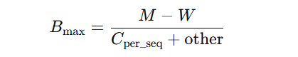{.ocr-src}

1. 由于 *C *per_seq∝$g$，当 $g$ 从 $h$ 降至 $g$′ 时，理论 batch size 可提升约 $h$/$g$′ 倍。框架直接根据剩余显存动态分配更多的请求。

2. PagedAttention 的高效利用：\
   vLLM 将 KV Cache 组织成固定大小的虚拟块（block），通过内存池管理。KV 缓存压缩后，每个 token 占用的块数减少，相同数量的物理块可以服务更多序列。块映射表的内存开销也相应降低。系统调度器可以在不 OOM 的前提下，将并发请求数设置得更高。

3. 增大 batch 打破内存带宽瓶颈：\
   小 batch 解码时，每个 token 的计算受限于 GPU 显存带宽读取 KV Cache。GQA 减少了需要读取的 KV 数据量，使得内存带宽压力降低，原本带宽受限的 batch 区间可以容纳更大的 batch 而延迟不增。因此，框架可以在满足延迟 SLO 的条件下，将 batch size 推到更高，提升吞吐量。

4. 连续批处理（Continuous Batching）：\
   使用 GQA 后，KV Cache 压力变小，推理系统可以更积极地在一个批次中混合多个不同长度的请求，而不必担心某个长序列耗尽显存。动态调整时，有更大空间拼接新请求。

5. 并行策略的重优化：\
   在张量并行（TP）中，KV Cache 被分配到多个 GPU 上，GQA 使得单个 GPU 上的缓存减小，从而可以在同样数量的 GPU 下支持更大的总 batch，或者减少 TP 数，释放 GPU 用于增加数据并行路数，进一步提高 batch 和吞吐。

总之，框架通过显存感知的调度器，将 GQA 节省的每字节显存都转化为可并发处理的请求数，实现系统吞吐量的近似线性扩展。

---

#### 解释“KV 缓存压缩”除了 MQA/GQA 外的其他方法：如基于 Token 重要性的剪枝（H2O, StreamingLLM）。

除了结构上的 MQA/GQA，还有大量不改变模型架构、通过选择性丢弃不重要的 KV 对来压缩缓存的方法，统称为 KV Cache 稀疏化/淘汰。核心思想是：并非所有历史 token 对未来的生成同等重要，可以仅保留一部分关键 token 的 KV。

1. H2O (Heavy-Hitter Oracle)

- 原理：观察到注意力分数的分布呈现长尾特性，少数 token 累积了大部分注意力权重，这些 token 称为“重击者”（Heavy Hitters）。H2O 在每个注意力头中动态跟踪所有历史 token 的累积注意力分数，保留累积得分最高的 top-k 个 token 的 KV，同时总是保留最近的几个 token（局部上下文）。淘汰策略基于贪心算法，移除分数最低的 token。

- 特点：无需额外训练，在长文本生成中几乎不损失质量，显著降低 KV 缓存占用至原来的 20%~30%，适合长文档摘要、对话等。

2. StreamingLLM

- 原理：发现即使在无限长输入下，只要保留开头的几个“沉没 token”（Attention Sinks，通常是 BOS 或初始 token）加上最近的一个滑动窗口的 token，模型就能生成连贯的文本，而不会发生困惑度爆炸。注意力沉没 token 吸收了多余的注意力，保持 softmax 稳定。StreamingLLM 固定保留前 *n *sink 个 token 和最新的 *n *local 个 token，中间的长历史全部丢弃。

- 特点：极其简单，内存占用恒定（不随序列长度增长），可实现无限长度流式输入，适合多轮对话和流媒体应用。轻微损失但稳定性极佳。

3. 其他重要方法：

- FastGen：为每个注意力头学习一个二值掩码策略，裁剪掉对该头不重要的 token，策略多样化（如特殊标点、低频位置等）。

- Token Merging (ToMe)：不直接丢弃，而是通过相似度聚类将若干冗余 token 的 KV 合并为一个，减少 token 数量。

- CacheGen：将 KV Cache 量化、编码后存储，使用时通过解码恢复近似 KV，属于有损压缩。

- 滑动窗口注意力 + 全局注意力（如 Mistral）：通过固定窗口大小强制压缩缓存，同时保留部分全局 token，是一种结构设计与缓存压缩的结合。

- Low-Rank 压缩：将 KV 对分解为低秩矩阵，仅存储较小的核心张量，牺牲一定精度换取空间。

这些方法与 MQA/GQA 正交，可以叠加使用，进一步将 KV Cache 压缩数倍，让大模型在有限显存下处理更长的上下文、支撑更高的并发。

---

#### H2O 算法如何通过“注意力分数”动态淘汰 KV Cache 中的不重要的 token？

H2O (Heavy-Hitter Oracle) 是一种基于累积注意力分数的 KV Cache 淘汰策略。其核心洞察是：自回归生成过程中，注意力权重的分布呈现明显的长尾效应和重击者（Heavy Hitters）现象——少数 token 持续占据绝大部分注意力质量，而大量 token 的注意力权重接近于零。H2O 通过动态跟踪每个 token 的累积注意力得分，来辨别这些重击者并保护它们不被淘汰，同时丢弃那些长期获得极低注意力的“冷”token。

H2O 的具体工作流程：

1. **累积注意力分数的维护（逐头）**

对于每一个注意力头，维护一个与当前序列长度 $t$ 同步增长的累积分数向量 $\mathbf{a}\in\mathbb{R}^t$，初始化为全零。每一步（每生成一个新 token），当前查询 $Q$ 与所有历史键 $K$ 计算得到原始注意力权重 $\alpha\in\mathbb{R}^t$（softmax 之后）。将 $\alpha$ 直接累加到历史累积分数上：

$$
\mathbf{a}\leftarrow\mathbf{a}+\alpha
$$

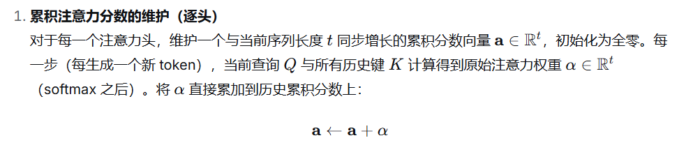{.ocr-src}

（实际实现中，可能会对每一步的 $α$ 做移动平均或加权，以给予近期行为更多权重，但基本思想是长期累积。）这样一来，一个 token 如果在很多生成步中都被大量“关注”，其累积分数就会很高；反之，只是偶尔被关注的 token 分数则很低。

2. 重击者识别与淘汰策略\
   设定一个 KV Cache 的预算大小 $B$（例如最多保留 $k$ 个 token 的 KV 对）。当缓存中的 token 数超过 $B$ 时，触发淘汰。H2O 的保留策略由两部分组成：
  - 重击者 (Heavy Hitters)：根据累积分数 **a** 进行排序，挑选出累积分数最高的 $k_{heavy}$ 个 token，它们被认为是对未来生成最重要的长程依赖源。
  - 最近 token (Recent Tokens)：始终保留最近的 $k_{recent}$ 个 token，以保证模型对局部上下文的建模能力，避免因完全丢弃近期 token 而导致流畅度崩溃。总的保留数 $k=k_{heavy}+k_{recent}$，其中重击者集合和最近集合可以重叠，重叠部分自然不会重复占用缓存。

淘汰时，凡是既不在重击者集合、也不在最近集合的 token，其对应的 K 和 V 向量就被从缓存中彻底移除，释放显存。这一步通常在每个生成步或每隔若干步执行一次，以实现动态自适应。

3. 头特定性与工程简化\
   理想情况下，每个注意力头对“重要性”的认知不同，因此应为每个头单独维护累积分数，并各自独立地保留不同的重击者集合。这会导致不同头保留的 token 集合不一致，KV 缓存变得不规则（稀疏且不同索引），实现高效 CUDA kernel 非常复杂。\
   因此，许多工程实现采取头共享的近似：将所有头的累积注意力分数取平均值（或最大值、求和），得到一个全局 token 重要性分数，然后基于该全局分数进行统一淘汰。这样所有头保留相同的 token 索引，KV 缓存可以保持密集矩阵，可以直接利用标准 FlashAttention 等高效算子。虽然舍弃了一定灵活性，但实践证明仍然能保留绝大部分性能。

为什么该方法有效？

注意力分数是 token 间相关性最直接的反馈信号。一个 token 如果持续被查询头关注，说明它蕴含了对当前上下文至关重要的信息（如主语、关键实体、指令标记）。H2O 相当于让模型在生成过程中自发地给历史 token “投票”，累积票数低的被认为可丢弃。这一机制完全无需训练，不依赖外部知识，且能随序列增长自适应地调整保留集。

---

#### 如何评估 KV Cache 压缩方法的性能：哪些指标最重要？

评估 KV Cache 压缩方法需要从模型质量、压缩效率、系统性能、实际可用性四个维度综合考量。以下指标按重要性排序并详细说明。

1. 模型质量指标（首要）

- 困惑度 (Perplexity, PPL)：最核心的指标，衡量模型对测试语料的预测能力。压缩方法应在不同序列长度下保持与原模型接近的 PPL。通常绘制 “PPL vs. 缓存预算” 曲线，观察在同等压缩比下的 PPL 退化幅度。

- 下游任务准确率：在零样本/少样本基准（如 HellaSwag, PIQA, ARC, MMLU）上的分数，以及与长文本相关的专用基准（如 LongBench, L-Eval, Needle-in-a-Haystack 测试）的得分。这些指标直接反映压缩是否损害了实际应用能力。

- 生成质量：ROUGE-L、BLEU、人类偏好评估等，用于需要文本生成的场景。稳定性也非常重要——在超长上下文下是否出现突然的输出崩塌（困惑度爆炸）。

2. 压缩效率指标

- 压缩比 (Compression Ratio)：原始 KV Cache 尺寸与压缩后尺寸的比值，或节省比例。需要区分“峰值压缩比”和“平均压缩比”，因为部分方法（如淘汰策略）可能在短序列时不压缩，长序列时才显著。

- 内存占用绝对减少量：以 GB/token 或 GB/sequence 表示，这是部署时最直接的约束。

- 是否与序列长度解耦：最优的方法能实现恒定缓存大小（如 StreamingLLM、滑动窗口），此时压缩比随序列长度线性增长，而内存消耗不增长，这是长上下文推理的关键特性。

3. 系统性能指标

- 吞吐量 (Throughput)：每秒生成的 token 数。需要测试在不同 batch size 下的表现。压缩减少了 HBM 读取量，应显著提升 decode 阶段的内存带宽受限场景的吞吐。

- 延迟 (Latency)：首 token 延迟（TTFT）和每 token 生成延迟（TPOT）。淘汰类方法可能因为额外计算（排序、掩码生成）而增加延迟，因此必须控制开销。

- 计算与访存开销 (Overhead)：压缩算法本身引入了多少 FLOPs 和额外的 HBM 访问。例如 H2O 需要计算累积分数、排序、构建淘汰掩码，这些开销必须远小于节省的访存收益。

4. 通用性与工程可用性

- 是否依赖架构修改：能否直接应用于预训练模型（如 MQA/GQA 需要改变结构，而 H2O、量化可即插即用）。

- 与现有框架的兼容性：能否与 FlashAttention、PagedAttention、张量并行、量化等无缝集成。

- 适用场景：对 batch size 是否敏感，对输入长度分布是否有假设，以及是否支持多轮对话的连续缓存管理等。

综合来看，PPL vs. 内存预算的帕累托前沿是学术界的金标准，而在工业界部署时，吞吐量提升倍数 + 任务准确率不降是决定性因素。

---

#### 使用 RoPE 时，MQA 的 key 位置编码是否对多个查询头都有效？为什么？

完全有效。 MQA 与 RoPE 的组合在 PaLM、Gemini 等大模型中被广泛采用，并得到了理论和实验双重验证。RoPE 的有效性与 K 是否在多个查询头间共享无关。

原理分析：

RoPE 通过旋转变换将绝对位置编码为向量方向，并使查询和键的内积仅依赖于它们的相对位置：

$$
(R_mq)^T(R_nk)=q^TR_{n-m}k
$$

其中 $R_m,R_n$ 分别是应用在位置 $m,n$ 上的旋转矩阵，$q$ 是查询向量，$k$ 是键向量。这一性质保证了注意力权重能够天然地捕获相对距离。

在 MQA 中，所有的查询头共享同一个 $k$ 向量。当我们对该共享的 $k$ 应用 RoPE 时，它获得了其所在位置 $n$ 的位置编码。然后，对于每一个查询头 $i$，它的 $q_i$ 在位置 $m$ 通过 $R_m$ 施加位置编码。二者做内积：

$$
(R_mq_i)^T(R_nk)=q_i^T(R_m^TR_n)k=q_i^TR_{n-m}k
$$

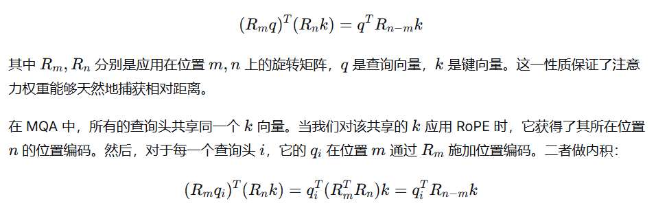{.ocr-src}

因为 k 是共享的，但每个查询头 $q_i$ 的投影矩阵不同，导致 $q_i$ 具有不同的内容表示。旋转矩阵 $R_n$−$m$ 与 $k$ 的作用结果依然能让每个头感知到相对位置 $n$−$m$，因为对于特定的 $q_i$，最终的点积值会同时依赖于该头的内容亲和度和相对位置。不同头可以学习利用这一相对位置信号的不同方面，就像在标准 MHA 中一样。

若使用绝对位置编码（如可学习的位置嵌入直接加到 K 上），只要该位置嵌入也被所有头共享，MQA 同样有效，因为位置信号是直接附加到共享表示中的。

因此，MQA 只压缩了键值对的“内容维度”的容量，并没有削弱位置编码的功能。RoPE 施加在共享的 K 上，能毫无障碍地让所有头都获得必要的位置感知能力，这也是为什么 MQA 在长文本任务上依然能工作良好的原因之一。

---

#### 如果已经使用了 GQA，再结合 KV 量化，KV Cache 能缩小到什么程度？给出数量级估算。

GQA 和 KV 量化分别从头数和位宽两个正交维度压缩 KV Cache，它们的压缩效果是乘法叠加的。我们可以通过一个典型大模型配置来估算总压缩倍数。

假设配置：

- 模型：LLaMA 2-70B 风格，层数 $L$=80，嵌入维度 *d *model=8192，查询头数 $h$=64，使用 GQA 且 KV 头数 $g$=8。

- 原始 MHA 采用 FP16 存储（每元素 16 bits = 2 bytes）。

- 量化方案：将 KV Cache 量化为 INT4（4 bits = 0.5 bytes），或更激进地采用 2-bit 量化。

1. 原始 MHA (FP16) 每 token 的 KV 缓存量：

每个 token 每层需要存储的 Key 和 Value 元素数为：

$$
\mathrm{MHA}_{kv}=2\times d_{\text{model}}=2\times8192=16384\ \text{个元素}
$$

FP16 下字节数为：

$$
16384\times2=32768\ \text{bytes}\approx32\ \text{KB/token/layer}
$$

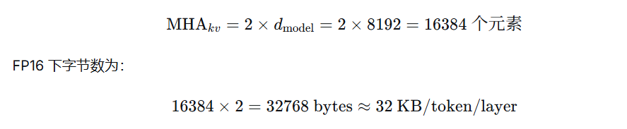{.ocr-src}

80 层总计：80×32 KB=2.56 MB/token。

2. 使用 GQA (g=8) 后，每 token 缓存元素数：

$$
\mathrm{GQA}_{kv}=2\times g\times\frac{d_{\text{model}}}{h}=2\times8\times\frac{8192}{64}=2\times8\times128=2048\ \text{个元素}
$$

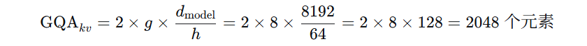{.ocr-src}

相比 MHA 的元素压缩比为 g/h=8/64=1/8，字节数（FP16）为 2048×2=4096 bytes≈4 KB/token/layer。80 层：320 KB/token。

3. 结合 INT4 量化：

将 FP16（16 bits）量化为 INT4（4 bits），存储量再减少为原来的 1/4。此时每 token 每层：

$$
2048\ \text{元素}\times0.5\ \text{byte}=1024\ \text{bytes}=1\ \text{KB/token/layer}
$$

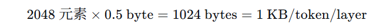{.ocr-src}

80 层：80 KB/token。

4. 总压缩倍数估算：

相对于 MHA FP16 的 2.56 MB/token，GQA + INT4 的 80 KB/token 缩小了：

$$
\frac{2.56\times1024\ \text{KB}}{80\ \text{KB}}=\frac{2621.44}{80}\approx32.8\ \text{倍}
$$

{.ocr-src}

即压缩约 33 倍。如果量化到 2-bit，则再缩小 2 倍，达到 ~66 倍。

现实意义：

一块 80 GB 显存的 GPU，若仅用 MHA FP16，只能存储约 31k token 的 KV Cache（80 GB / 2.56 MB ≈ 31250）。改用 GQA + INT4 后，可存储超过 100 万 token（80 GB / 80 KB = 1,000,000）。这为 100K+ 超长上下文和极高并发 batch 推理铺平了道路，且目前已在生产环境中广泛实践（如 TensorRT-LLM 的 INT8/INT4 KV Cache 支持）。

---

#### 对比 MQA 和标准 MHA 在推理吞吐上的实际提升，除了缓存大小还有什么因素？

除了显存占用减少带来的最大 batch size 扩增外，MQA 在推理吞吐上的提升还源于以下几个常被低估的维度：

1. 内存带宽瓶颈的极大缓解

自回归解码的每一轮迭代中，最耗时的操作往往不是矩阵乘法本身，而是从 HBM 读取巨大的 KV Cache。MHA 需要读取 $2\times h\times d_k$ 维的 K 和 V 向量（每 token），MQA 则只需读取 $2\times1\times d_k$。在给定的硬件内存带宽 $B_{\text{mem}}$ 下，理论最大 token 生成速率由 **Roofline 模型** 的带宽受限区域决定：

$$
\text{Max tokens/s}\propto\frac{B_{\text{mem}}}{\text{Bytes per token per iteration}}
$$

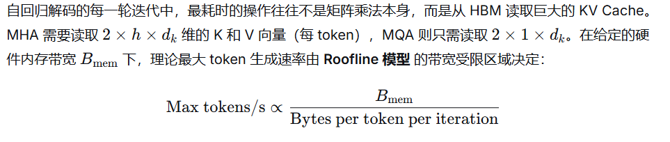{.ocr-src}

当 batch size 较小（decode 阶段的典型情况），每 token 所需的 KV 读取字节数直接限制了速度。MQA 将此字节数减小了 $h$ 倍，因此在带宽受限区间可以实现接近 $h$ 倍的每步延迟降低，从而大幅提升单请求生成速度。

2. 计算量的轻微减少与计算强度提升\
   虽然 Q 头数不变，但 K 和 V 的线性投影只需要计算 1 个头，而不是 $h$ 个头。这少量减少了每层的前向 FLOPs。更重要的是，由于 KV 数据量变小，计算强度（FLOP/Byte）显著上升，使 GPU 更容易从带宽受限转向计算受限，从而更充分地利用 Tensor Core，进一步提升吞吐。

3. 更高效的注意力计算内核

在 FlashAttention 等优化实现中，K 和 V 块需要从 HBM 加载到 SRAM。MQA 下，K 块只需要加载一次，就可以与所有 Q 头进行计算（广播），减少了 HBM 读取次数，并提高了 SRAM 数据复用率。这与 GQA 的分组共享类似，只是更极端。因此，MQA 的注意力 kernel 执行时间也会更短。

4. 减少通信开销（分布式推理）

在张量并行 (TP) 中，若采用复制 KV 头的策略，MQA 的 KV 缓存是所有头共享的，每个 GPU 要么保存完整的一份（极小的显存增量），要么根本不需要按头划分 KV 通信。相比 MHA 可能需要针对 KV 进行 all-gather 或按头切分缓存，MQA 简化了并行策略，减少了通信延迟。

综合影响示例：

在 batch=1 的延迟敏感场景，MQA 可以将每 token 生成时间缩短为原来的约 1/5 甚至更低。在高吞吐服务场景，小缓存允许将 batch size 扩大数倍，且解码速度更快，最终系统吞吐（token/s）可能实现 3~10 倍的提升，远超仅凭缓存容量计算出的 1:1 扩展比例。

---

#### 在长上下文场景中，GQA 是否足够？还需要搭配哪些压缩技术？

GQA 是长上下文推理的基础，但单独使用通常不足够。 GQA 通过减少头数将 KV 缓存的常量因子缩小了 $g$/$h$，然而缓存大小仍然与序列长度 n 成 $O$($n$) 线性关系。当上下文扩展至数十万甚至百万 token 时，即便是 1/8 的缓存仍然可能触及显存天花板。

为什么不够：

以 LLaMA 2 70B (g=8) 为例，每个 token 的缓存约 320 KB (FP16)。对于 128k token 的序列，单条序列就需要约 40 GB 显存。如果 batch=8，则需要 320 GB，远超单 GPU（如 H100 80GB）的容量。因此，仅靠 GQA 无法在消费级/服务器级硬件上实现超长上下文的批量推理。

需要搭配的压缩技术组合：

1. KV 量化：将 KV 缓存量化为 INT4 甚至 2-bit，与 GQA 乘法叠加，可将百万 token 缓存压缩至几十 GB 以内（见第 14 题）。这是最直接且最普适的增强。

2. 基于 Token 重要性的淘汰 (H2O, FastGen 等)：通过动态保留重击者和最近窗口，让缓存大小与序列长度解耦，固定为一个最大预算 $B$。在超长文本中，即使生成了 500k token，内存占用仍保持恒定，只是牺牲了极少的长尾信息。

3. 滑动窗口注意力 (Sliding Window)：如 Mistral 的固定窗口大小 $W$，仅保留最近 $W$ 个 token 的 KV，长程依赖通过分层结构或全局 token 补偿。这直接将缓存复杂度降为 $O$(1)，非常适合流式无限长输入。

4. 注意力沉没 (Attention Sinks) + 窗口 (StreamingLLM)：保留开头几个 token 作为“注意力沉没点”以稳定 softmax，再加一个滑动窗口，实现恒定缓存且困惑度不爆炸，是多轮对话的理想选择。

5. 检索增强/记忆增强：对于超越直接上下文窗口长度的依赖，可以将旧上下文压缩为摘要或向量索引，需要时检索，从而打破显存限制。

因此，一个成熟的长上下文推理系统通常采用分层压缩策略：先利用 GQA 降低基础开销，再叠加量化进一步压缩，最后引入自适应淘汰或窗口机制来保证亚线性增长。这也正是许多前沿生产系统（如 NVIDIA TensorRT-LLM、vLLM）所推荐的方案。

---

#### 解释 Ada-KV 或动态 KV 缓存分配的思想。

动态 KV 缓存分配（Adaptive KV Caching） 的核心思想是：并非模型中的所有层和所有注意力头都需要相等的历史上下文窗口。 它们对远距离依赖的需求是不同的，因此应该根据各自的重要性动态地、非均匀地分配有限的 KV 缓存预算，从而在总显存约束下最大化模型质量。

动机：

- 研究表明，浅层倾向于捕获局部语法和简单模式，深层则更需要全局语义。某些注意力头可能专门负责短程交互，另一些则对长距离依赖敏感。

- 统一分配（所有头保留相同数量的 token）会导致“预算浪费”：不需要长上下文的头被迫存储冗余 token，而需要长上下文的头却可能因预算不足而丢失关键信息。

Ada-KV 的工作方式（以代表性方法为例）：

1. 重要性离线测量或在线评估：可以使用一小组校准数据，计算每个头、每层在注意力计算时对不同距离 token 的“依赖度”（例如，注意力权重的距离分布、梯度的敏感度）。或者在线，根据实际运行时的注意力分数统计动态调整。

2. **预算分配策略**：给定一个总 KV 缓存预算（即所有头总共能存储的 token 总数 $B_{\text{total}}$），求解一个优化问题：为每个头 $i$ 分配一个保留长度 $k_i$，使得 $\sum k_i\le B_{\text{total}}$，同时最小化预期性能损失。这通常可通过贪心分配或基于重要性的比例分配实现。例如，对全局型头分配 80% 的序列长度，对局部型头只分配 10%。
3. **运行时实现**：对于每个头，维护各自的淘汰策略。比如，局部型头只保留最近 $k_i$ 个 token（滑动窗口），全局型头则使用 H2O 等保留其重击者。由于不同头的保留集可能不同，KV 缓存将变为**不规则稀疏结构**，需要特殊的 GPU kernel 支持（如 Block Sparse Attention 或 PagedAttention 的灵活块映射）才能高效计算。

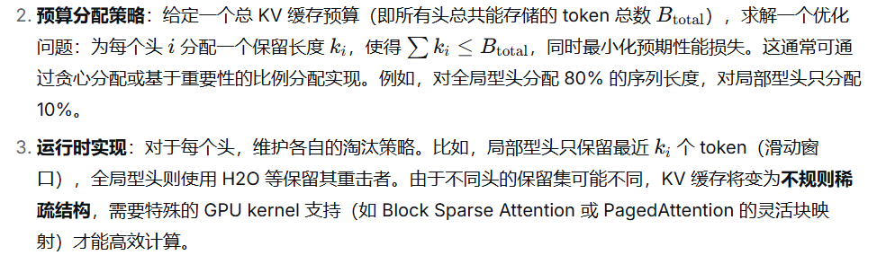{.ocr-src}

好处：

相比统一分配，动态分配可以在相同总显存下显著降低 PPL、提高长文本任务得分，实现“好钢用在刀刃上”的效果。例如，某研究发现通过动态分配，可以用 40% 的总缓存预算实现与全缓存相当的质量，而统一淘汰则需要 60%~70% 的预算。

此类方法代表了 KV 缓存优化的精细化管理方向，与 MQA/GQA 等结构压缩完全正交，未来可能融合进标准推理框架。

---

#### 如何通过微调让一个预训练 MHA 模型适应 GQA 架构？

将预训练的 MHA 模型转换为 GQA，并只需极低成本微调即可恢复全部性能，这是 GQA 论文的核心贡献之一。具体步骤如下：

步骤 1：权重平均初始化 (Upprobing)

假设原 MHA 有 $h$ 个查询头，对应的 $h$ 个键权重 $W_K^{\mathrm{MHA}(1)},\ldots,W_K^{\mathrm{MHA}(h)}$ 和值权重 $W_V^{\mathrm{MHA}(1)},\ldots,W_V^{\mathrm{MHA}(h)}$，每个形状 $\mathbb{R}^{d_{\text{model}}\times d_k}$。选择目标分组数 $g$，并将 $h$ 个头划分为 $g$ 组，每组 $h/g$ 个头（通常采用简单的顺序分组，因为头间没有内在顺序，平均效果良好）。对于第 $j$ 组，组内包含索引集合 $\mathcal{S}_j$，初始化 GQA 的键和值权重为组内均值：

$$
W_K^{\mathrm{GQA}(j)}=\frac{1}{|\mathcal{S}_j|}\sum_{i\in\mathcal{S}_j}W_K^{\mathrm{MHA}(i)},\quad W_V^{\mathrm{GQA}(j)}=\frac{1}{|\mathcal{S}_j|}\sum_{i\in\mathcal{S}_j}W_V^{\mathrm{MHA}(i)}
$$

查询权重 $W_Q$ 和输出投影 $W_O$ 完全保留原样。这样我们就得到了一个可以直接运行的 GQA 模型，此时它的困惑度通常仅有轻微上升（例如在 C4 上从 9.0 升到 9.2）。

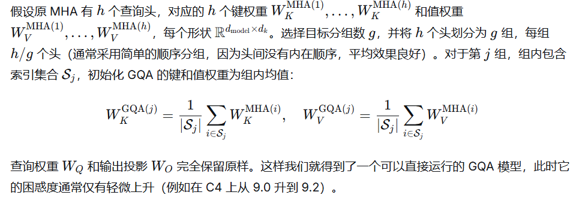{.ocr-src}

骤 2：继续预训练/微调

为了完全恢复原模型性能，使用与原预训练相同或类似的语料（或下游任务数据）对转换后的 GQA 模型进行少量步数的训练。原论文指出，仅需约 5% 的原始训练步数（有时甚至 1% 就可以）即可使 PPL 回落至与原 MHA 相当甚至更优的水平。训练时可选择：

- 全参数微调：所有参数均可训练，学习率设为原始训练的 10%~20% 左右，搭配 cosine 衰减。

- **仅微调 KV 投影**：实验表明，只微调 $W_K,W_V$ 以及 $W_O$ 往往就足够了，$W_Q$ 和其他 FFN 权重可以冻结，进一步节省算力。

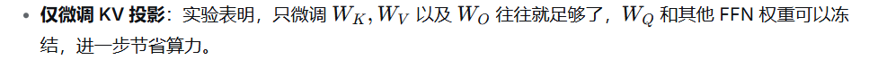{.ocr-src}

步骤 3：可选的知识蒸馏

若追求极致质量，可以在微调时引入原 MHA 模型作为教师，对 GQA 模型施加蒸馏损失（如对注意力分布或隐藏状态施加 KL 散度/MSE）。这能进一步稳定训练，减少微调所需数据量。

为什么有效？

权重平均为模型提供了所有原始头的“平均知识”，相当于一种集成；后续微调则允许模型调整，让组内的查询头学会与共享的 KV 更好地协作，重新分配注意力模式。整个过程将原本昂贵的完整预训练成本压缩到了几乎可忽略的规模，使 GQA 架构的部署门槛极低。

---

#### 在分布式推理中，GQA 的 KV 缓存切片是否需要复制 KV 头？如何分布？

在分布式推理（特别是张量并行，TP）中，GQA 的 KV 头数量 $g$ 通常小于查询头数 $h$，这带来了切片策略的选择问题。

策略一：按查询头切片 + 复制 KV 头（最常用）

- 做法：将 $h$ 个查询头均匀分配到 $N$ 个 GPU 上（每个 GPU 拥有 $h$/$N$ 个查询头），而所有 $g$ 个 KV 头被完整复制到每个 GPU 上。每个 GPU 独立持有完整的 KV Cache。

- 计算：每个 GPU 使用本地的部分 Q 头和全部的 K、V 计算注意力，产生部分输出，最后通过 all-reduce 汇总结果。

- 优点：实现简单，完美兼容现有 MHA 的 TP 代码；KV 缓存虽然冗余，但因 GQA 已大幅减少缓存体积，$N$ 路复制带来的额外显存开销在可接受范围内（例如 g=8, N=4，冗余因子 4，总缓存相当于没有 GQA 的 MHA 的 4×(8/h) 倍，若 h=32 则为 1 倍，刚好打平）。

- 缺点：KV 缓存没有切分，每个 GPU 显存消耗会随 TP 数线性增长，不适合非常大的 TP 度（如 8 以上）或本身内存极受限的场景。

策略二：按 KV 头切片 + 对应查询头分组

- 做法：将 $g$ 个 KV 头均匀分配给 $N$ 个 GPU（要求 $g$ 能被 $N$ 整除，如 g=8, N=2 则每个 4 个 KV 头）。同时，将每个查询头根据它所属的 KV 组分配至对应的 GPU。即保证 GPU i 拥有其分配到的 KV 头以及属于这些 KV 头的所有查询头。

- 计算：每个 GPU 只持有部分 KV 头及其对应的局部 KV Cache，注意力计算是局部的，无需 all-reduce 前向通信（仅需在输入和输出时保持张量并行一致）。

- 优点：KV 缓存被真正切分，无冗余，实现线性显存节省，适合大规模 TP。

- 缺点：查询头数可能无法均匀分配到每个 GPU（除非 h/g 也是整数且整除），可能导致负载不均衡；且代码改造较大，需维护组映射关系。

实际应用：目前主流框架（如 Megatron-LM, TensorRT-LLM）默认采用策略一的变体——因为 KV 缓存因 GQA 已经较小，复制开销可控，且简化通信模式，对吞吐影响不大。当 TP 过大导致内存压力时，可切换策略二或混合使用流水线并行。

---

#### 当使用张量并行时，GQA 的 KV 头划分与查询头划分有什么关系？

这道题深入上一问的划分逻辑。张量并行 (TP) 需要将注意力头的计算分配到多个设备。GQA 的 $g$ 与 $h$ 不相等，使得划分产生耦合关系。

关系表述：\
假设 TP 度为 $N$。理想情况下，我们希望将全部计算和存储均分，且最小化通信。有两种约束：

- 查询头均分：每个设备应拥有 $h$/$N$ 个查询头，以平衡计算负载。

- KV 头均分（可选）：若要切分 KV 缓存，每个设备应拥有 $g$/$N$ 个 KV 头，并且该设备上的查询头必须是这些 KV 头所在的组的成员，即查询头分配必须与 KV 头分配在分组上对齐。

**对齐要求**：如果采用 KV 头切分策略，每个设备分配的 KV 头索引集合为 $\mathcal{K}_i$，那么该设备上的查询头集合必须是所有满足 `group(q) \in \mathcal{K}_i` 的查询头。因为每组固定有 $h/g$ 个查询头，设备 i 的查询头数目 $=|\mathcal{K}_i|\times(h/g)$。要使每个设备查询头数相等（$=h/N$），必须有 $|\mathcal{K}_i|=g/N$，即 $g$ 必须能被 $N$ 整除，并且所有设备的 $|\mathcal{K}_i|$ 都等于 $g/N$。此时每个设备上的查询头数目 $=(g/N)\times(h/g)=h/N$，恰好满足负载均衡。因此，**只有当 $g$ 能被 $N$ 整除时，才能完美实现无冗余的 KV 切分与查询头均匀分配。** 否则将出现负载不均衡。

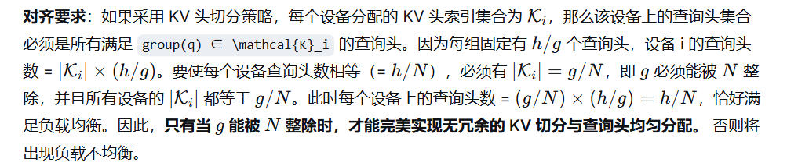{.ocr-src}

若采用 KV 复制策略，则查询头划分完全独立于 KV 头：每个设备获得 $h$/$N$ 个查询头，并拥有完整 $g$ 个 KV 头。这时 KV 头划分不存在，但 KV 缓存存在 $N$ 倍冗余。

总结：

- 无冗余切分：要求 $g \bmod N=0$，且查询头按分组聚拢分配，实现“本地 KV 缓存”。

- 有冗余切分：不要求整除，查询头可任意划分，KV 全复制，实现简单但占用 $N$ 份缓存。

- 在实践中，大型模型 $g$ 通常选 8 或 4，TP 常为 2,4,8，往往满足整除条件，因此可以灵活选择。但为了通用性，许多系统默认复制 KV 以避免复杂的分组逻辑。

---

#### 比较 MQA/GQA 与稀疏注意力模式（如 Longformer, BigBird）在 KV 管理上的区别。

虽然两者都旨在降低长序列带来的计算和内存压力，但它们属于截然不同的优化维度，在 KV 管理上有着本质区别。

| 对比维度 | MQA / GQA | 稀疏注意力模式 (Longformer, BigBird) |
| --- | --- | --- |
| 优化目标 | 减少每个 token 存储 KV 的维度/容量，从而降低整体 KV Cache 的常数因子。 | 减少每个 token 需要计算注意力的 token 数量（交互边），从而降低计算复杂度。 |
| KV 缓存行为 | 密集型缓存：仍然存储所有历史 token 的完整 KV 对（只是每个 token 的 K、V 头数变少）。缓存大小 O(g×n)。 | 可导致稀疏缓存：通常只需为后续计算存储特定模式所涉及的 token 的 KV。例如滑动窗口只需存储最近 W 个 token，旧 token 可直接丢弃，缓存大小恒定为 O(W)。 |
| 注意力计算模式 | 全连接注意力：每个查询头与其对应的所有 KV token 计算注意力（所有 token 均参与）。 | 稀疏注意力：每个查询 token 只与预先定义好的局部窗口、膨胀窗口、全局 token 或随机 token 子集进行计算。 |
| 架构依赖性 | 需要修改模型注意力头的投影结构（将 K、V 投影头数减少），因此必须通过训练或权重平均转换来获得模型。 | 可以在不改变模型基本结构（头数不变）的情况下，通过修改注意力掩码实现，部分模式可直接用于已训好的密集模型微调或推理。 |
| 典型代表 | LLaMA 2/3, Mixtral (GQA)； PaLM, Gemini (MQA) | Longformer (局部+全局), BigBird (随机+局部+全局), Reformer (LSH) |
| 对长序列的扩展性 | 缓存随序列长度线性增长，单独使用不能支持无限长度，必须结合淘汰。 | 设计良好的模式（如纯滑动窗口）可实现 O(1) 缓存，天然支持任意长度流式输入。 |
| 实现复杂度与效率 | 与 FlashAttention 等密集计算内核完美结合，硬件效率高。 | 稀疏模式需要专门的高效稀疏 kernel，在 GPU 上实现不规则访问较困难，效率常低于理论峰值。 |
| 相互组合 | 可以被稀疏注意力或淘汰策略叠加利用。例如 LLaMA 3 使用 GQA 的密集缓存，同时在生产部署时采用窗口限制来节省内存。 | 同样也可与 GQA 组合：在 GQA 架构中使用滑动窗口掩码，减少计算和缓存。 |

总结要点：

- MQA/GQA 是减少缓存宽度（channel/head 方向），而稀疏/淘汰是减少缓存高度（sequence 方向）。

- MQA/GQA 解决了内存带宽瓶颈，但缓存仍随长度增长；稀疏注意力从根本上限制了长度增长，但可能损害长程依赖。

- 现代最佳实践是两者结合：采用 GQA 减少基础开销，再应用淘汰/窗口使缓存亚线性增长，同时利用量化，以实现在有限硬件上的超长上下文推理。

这正是当前大模型推理系统发展的主流趋势——多维压缩协同设计。

