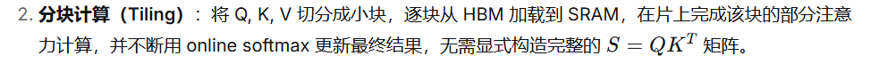
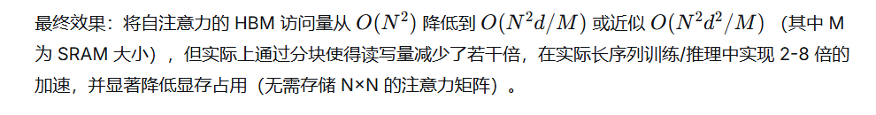
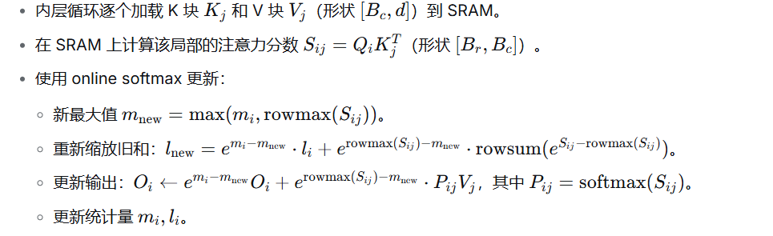
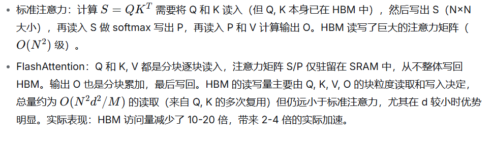
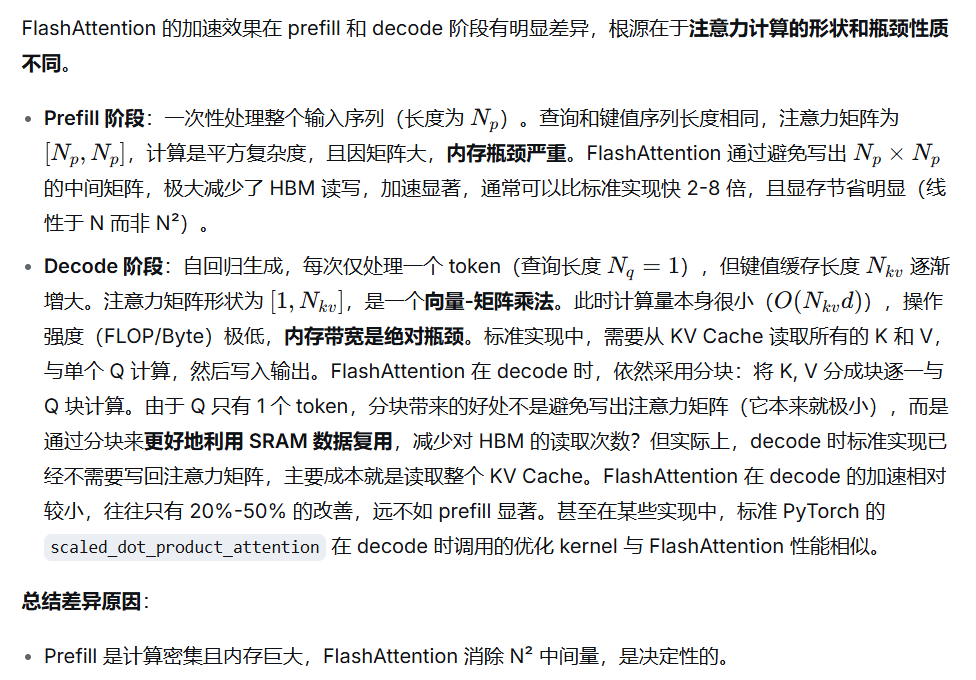
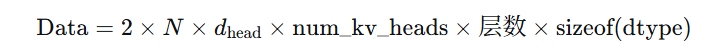
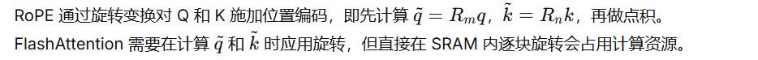
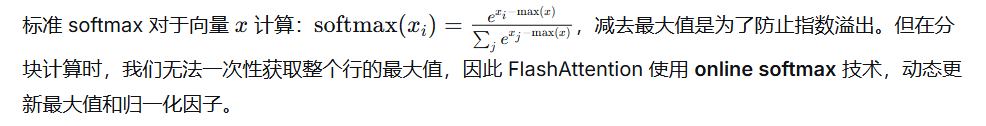
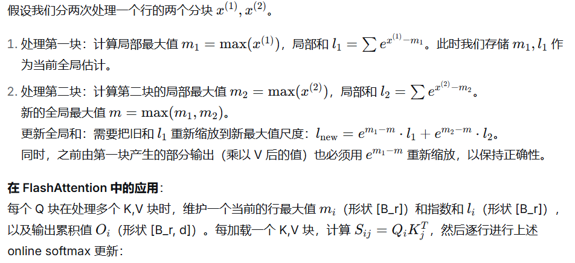
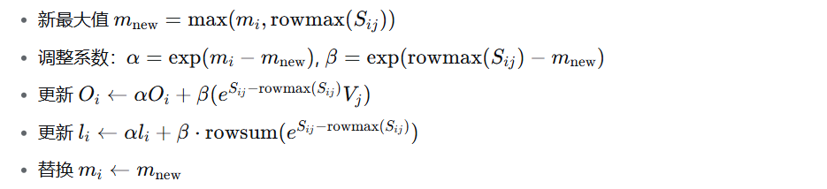

# 63.大模型（LLMs）FlashAttention（推理加速）

#### FlashAttention 通过什么方式加速自注意力计算？其核心优化点是什么？

FlashAttention 是一种 IO-aware 的精确注意力算法，它不改变注意力计算的数学结果，而是通过减少 GPU 高带宽内存（HBM）的读写次数来加速。自注意力计算在长序列下是内存密集型操作，标准实现将中间矩阵（S, P）全部写入 HBM 再读出，造成巨大带宽浪费。FlashAttention 的核心思想是：利用 GPU 片上高速 SRAM，通过分块（tiling）和重计算（recomputation），在 SRAM 内完成 softmax 的增量计算，避免将大型注意力矩阵写回 HBM。

核心优化点：

1. IO-awareness：感知 GPU 存储层次（HBM 大而慢，SRAM 小而快），设计算法使绝大多数数据搬移发生在 SRAM 内，最小化 HBM 读写。

2. **分块计算（Tiling）**：将 Q, K, V 切分成小块，逐块从 HBM 加载到 SRAM，在片上完成该块的部分注意力计算，并不断用 online softmax 更新最终结果，无需显式构造完整的 $S=QK^T$ 矩阵。

{.ocr-src}

3. 重计算（Recomputation）：在反向传播时，不存储庞大的注意力矩阵 P，而是通过前向中已有的 Q, K, V 块和 softmax 归一化因子重新计算梯度所需的中间值。这同样大幅减少了 HBM 读写。

4. Online Softmax：标准 softmax 需全行读取求最大值和指数和，分块计算时采用动态更新最大值和累加和的方式，保证数值稳定性，同时支持增量计算。

最终效果：将自注意力的 HBM 访问量从 $O(N^2)$ 降低到 $O(N^2d/M)$ 或近似 $O(N^2d^2/M)$（其中 M 为 SRAM 大小），但实际上通过分块使得读写量减少了若干倍，在实际长序列训练/推理中实现 2-8 倍的加速，并显著降低显存占用（无需存储 N×N 的注意力矩阵）。

{.ocr-src}

---

#### 解释 FlashAttention 中的分块（tiling）计算策略，以及如何减少 HBM 读写。

分块策略将 Q, K, V 矩阵沿序列长度维度切分成块。设序列长度为 N，头维度为 d，SRAM 容量有限。FlashAttention 将 Q 划分为 $T_r$ 个块，每个块包含 $B_r$ 个查询向量；K, V 划分为 $T_c$ 个块，每个块包含 $B_c$ 个键值向量。外层循环遍历 Q 块，内层循环遍历 K, V 块。

计算流程（前向）：

- 对于每个 Q 块 $Q_i$（形状 [Br,d]），初始化输出 $O_i$ 为零，softmax 统计量 $l_i$（和）和 $m_i$（最大值）为 −∞ 和 0。

- 内层循环逐个加载 K 块 $K_j$ 和 V 块 $V_j$（形状 $[B_c,d]$）到 SRAM。
- 在 SRAM 上计算该局部的注意力分数 $S_{ij}=Q_iK_j^T$（形状 $[B_r,B_c]$）。
- 使用 online softmax 更新：
  - 新最大值 $m_{\text{new}}=\max(m_i,\mathrm{rowmax}(S_{ij}))$。
  - 重新缩放旧和：$l_{\text{new}}=e^{m_i-m_{\text{new}}}\cdot l_i+e^{\mathrm{rowmax}(S_{ij})-m_{\text{new}}}\cdot\mathrm{rowsum}(e^{S_{ij}-\mathrm{rowmax}(S_{ij})})$。
  - 更新输出：$O_i\leftarrow e^{m_i-m_{\text{new}}}O_i+e^{\mathrm{rowmax}(S_{ij})-m_{\text{new}}}\cdot P_{ij}V_j$，其中 $P_{ij}=\mathrm{softmax}(S_{ij})$。
  - 更新统计量 $m_i,l_i$。

{.ocr-src}

- 内层循环结束，最终输出 Oi=Oi/li（实际实现中已逐步除以和，最后再做一次缩放）。

- 将 $O_i$ 写回 HBM。

为何减少 HBM 读写？

- 标准注意力：计算 $S=QK^T$ 需要将 Q 和 K 读入（但 Q, K 本身已在 HBM 中），然后写出 S（N×N 大小），再读入 S 做 softmax 写出 P，再读入 P 和 V 计算输出 O。HBM 读写了巨大的注意力矩阵（$O(N^2)$ 级）。
- FlashAttention：Q 和 K, V 都是分块逐块读入，注意力矩阵 S/P 仅驻留在 SRAM 中，从不整体写回 HBM。输出 O 也是分块累加，最后写回。HBM 的读写量主要由 Q, K, V, O 的块粒度读取和写入决定，总量约为 $O(N^2d^2/M)$ 的读取（来自 Q, K 的多次复用）但仍远小于标准注意力，尤其在 d 较小时优势明显。实际表现：HBM 访问量减少了 10-20 倍，带来 2-4 倍的实际加速。

{.ocr-src}

---

#### FlashAttention 在推理阶段（特别是 decode）的加速效果与 prefill 阶段有何不同？为什么？

FlashAttention 的加速效果在 prefill 和 decode 阶段有明显差异，根源在于注意力计算的形状和瓶颈性质不同。

FlashAttention 的加速效果在 prefill 和 decode 阶段有明显差异，根源在于**注意力计算的形状和瓶颈性质不同。**

- **Prefill 阶段**：一次性处理整个输入序列（长度为 $N_p$）。查询和键值序列长度相同，注意力矩阵为 $[N_p,N_p]$，计算是平方复杂度，且因矩阵大，**内存瓶颈严重**。FlashAttention 通过避免写出 $N_p\times N_p$ 的中间矩阵，极大减少了 HBM 读写，加速显著，通常可以比标准实现快 2-8 倍，且显存节省明显（线性于 N 而非 N²）。
- **Decode 阶段**：自回归生成，每次仅处理一个 token（查询长度 $N_q=1$），但键值缓存长度 $N_{kv}$ 逐渐增大。注意力矩阵形状为 $[1,N_{kv}]$，是一个**向量-矩阵乘法**。此时计算量本身很小（$O(N_{kv}d)$），操作强度（FLOP/Byte）极低，**内存带宽是绝对瓶颈**。标准实现中，需要从 KV Cache 读取所有的 K 和 V，与单个 Q 计算，然后写入输出。FlashAttention 在 decode 时，依然采用分块：将 K, V 分成块逐一与 Q 块计算。由于 Q 只有 1 个 token，分块带来的好处不是避免写出注意力矩阵（它本来就极小），而是通过分块来**更好地利用 SRAM 数据复用**，减少对 HBM 的读取次数？但实际上，decode 时标准实现已经不需要写回注意力矩阵，主要成本就是读取整个 KV Cache。FlashAttention 在 decode 的加速相对较小，往往只有 20%-50% 的改善，远不如 prefill 显著。甚至在某些实现中，标准 PyTorch 的 `scaled_dot_product_attention` 在 decode 时调用的优化 kernel 与 FlashAttention 性能相似。

**总结差异原因**：

- Prefill 是计算密集且内存巨大，FlashAttention 消除 N² 中间量，是决定性的。

{.ocr-src}

- Decode 是纯粹的内存带宽受限，标准实现已经接近硬件带宽极限，FlashAttention 只能通过更好的块调度和指令优化小幅度提升，核心瓶颈仍是读取 KV Cache 的带宽。因此 FlashAttention 对于长文本生成的主要贡献在于支持更大的 batch 和更长的上下文（通过降低显存占用），而非 decode 单步延迟的成倍降低。

---

#### 在 decode 阶段（batch size 1, 逐个 token），FlashAttention 比标准注意力快多少？主要瓶颈是计算还是内存？

在 batch size=1 的 decode 阶段，内存带宽是绝对瓶颈，计算资源大部分闲置。

定量分析：假设一个典型的 7B 模型（头维度 d=128，N=2048 的 KV 缓存）。每生成一个 token，注意力需要读取的 KV Cache 数据量为：

$$
\mathrm{Data}=2\times N\times d_{\text{head}}\times\mathrm{num\_kv\_heads}\times\text{层数}\times\mathrm{sizeof(dtype)}
$$

{.ocr-src}

使用 GQA 时 KV 头数较少，但量级仍不小。在 A100 GPU 上，HBM 带宽约 2 TB/s。标准注意力实现（如使用 cuBLAS 的 batched GEMM）在此阶段已相当优化：它将 Q 与 K 的乘法实现为 GEMV（矩阵向量乘），然后 softmax，再与 V 做 GEMV。这个过程的算术强度（FLOP/Byte）极低，主要是多次从 HBM 读取整个 KV Cache。FlashAttention 在 decode 时也做分块，但因为 Q 只有一个 token，分块主要是为了循环加载 K、V 块，避免一次性占用太多 SRAM，性能与手写的高性能 GEMV kernel 非常接近。实际测试中，FlashAttention decode 的延迟可能仅比标准实现快 10%~30% 左右，有时甚至持平，因为两者都受限于从 HBM 读取 KV Cache 的带宽。

主要瓶颈：100% 是内存带宽。计算单元（Tensor Cores）利用率极低（<5%）。因此，优化 decode 的关键不在于减少 FLOP，而在于减少数据搬运——这正是 MQA/GQA、KV 量化、多头共享等技术的价值所在。FlashAttention 在 decode 的主要价值是简化代码、提供统一的优化接口，并与 PagedAttention 等配合，而非像 prefill 那样带来数量级加速。

---

#### FlashAttention‑2 相比 v1 有哪些改进？对推理吞吐的影响。

FlashAttention-2 在算法和工程上做了多项改进，将注意力计算的效率推至硬件极限，尤其对 prefill 阶段吞吐提升显著。

主要改进：

1. 减少非 matmul FLOP 和重整调度：v1 中 softmax 的统计量更新使用了较多 scalar 操作，v2 将这些操作融合，并优化了线程块在 SM 上的调度。更重要的是，v2 让外层循环遍历 K,V 块，内层循环遍历 Q 块（与 v1 相反），这样更有利于在序列维度上实现连续的线程块处理，减少 warp 调度开销。

2. 更好的序列长度并行化：v2 将 Q 的序列维并行化，而不是在 batch 和 head 维度并行。这使得在长序列时能更充分地利用 GPU 的并行性，提升了 prefill 的吞吐。

3. 减少 shared memory 访问和指令数：通过更精细地组织数据布局（如 K,V 在 shared memory 中转置），减少了 bank conflict。并且 v2 利用 Tensor Core 的矩阵乘法指令 (mma) 来加速 QK^T 和 PV 计算，而 v1 中可能用了更通用的指令。

4. 更好的分块大小选择：v2 根据头维度和序列长度自动调优分块参数，以最大化 SRAM 利用率和 TLP（线程级并行）。

5. 前向加速显著：FlashAttention-2 在训练和 prefill 上比 v1 大约快 2 倍，达到了理论最大吞吐的 70% 以上。

对推理吞吐的影响：

- Prefill 吞吐大幅提升：对于长提示词的一次性处理，v2 使得 TTFT（首 token 延迟）显著降低，同时可支持更大的 batch 进行 prefill，提高系统吞吐。

- Decode 影响有限：因为 decode 本身就是带宽受限，且序列长度虽大但 Q 只有 1。v2 的改进主要利于长序列 prefill，对 decode 的延迟改进不大（可能在 10% 以内）。因此整体推理吞吐的增益主要来源于更快的 prefill 阶段。

---

#### FlashAttention 是否与 KV Cache 兼容？如何结合？画出内存布局。

完全兼容。KV Cache 是推理时存储在 HBM 中的历史 K 和 V 张量，FlashAttention 在计算当前 token 的注意力时，需要读取这些缓存的 K 和 V。FlashAttention 不修改 KV Cache 的结构，只是改变计算方式。两者结合是当前所有高性能推理框架的标准做法。

结合方式：

- 在 decode 阶段，模型输入为当前 token 的 query 向量（或 batch 的 queries），以及从 KV Cache 中取出的完整历史 K 和 V。通常 K 和 V 在缓存中的布局为 `[batch, num_kv_heads, seq_len, head_dim]` 且序列长度维度是动态追加的。

- FlashAttention kernel 接受 Q（`[batch, num_q_heads, 1, head_dim]`）、K（`[batch, num_kv_heads, seq_len, head_dim]`）、V 作为输入。

- Kernel 内部将 K 和 V 沿 seq_len 维度分块加载到 SRAM，与 Q 块进行计算，完全无需改变 KV Cache 的存储格式。

内存布局示意（以 PagedAttention 为例，常用）：

```plain text
HBM 内存布局（逻辑视图）:
KV Cache 按层和头组织，每个头存储为一个连续块？不，实际是分页的。

以 vLLM 为例，KV Cache 被组织为块表：
| Block 0 | Block 1 | ... | Block M |
每个块包含 [num_heads, block_size, head_dim] 的 K 和 V。

FlashAttention 内核被修改为支持分页：在加载 K,V 块时，根据块表索引从不同物理地址读取，但对计算逻辑透明。

更简单的连续缓存布局（如 HuggingFace）:
K: [batch, num_kv_heads, total_seq_len, head_dim] 连续存储，每次新增 token 时在 seq_len 维追加。
FlashAttention 将整个 K 和 V 传入，内部自动分块。

FlashAttention 通过参数接收 K 和 V 的指针，读入 SRAM 时可以是任意分散的页，这是 FlashAttention-2 和 FlashInfer 等框架已经支持的。
```

因此，FlashAttention 与 KV Cache 是天然协同的：KV Cache 节省了重复计算历史 K,V 的成本，FlashAttention 则高效地执行基于这些缓存的注意力计算，并最小化内存带宽消耗。

---

#### 为什么 FlashAttention 要求输入张量在内存中连续？不连续时如何处理？

FlashAttention 的 CUDA 实现为了达到极致性能，假设 Q, K, V 的最后两维（序列长度和头维度）是紧密连续的，并且通常要求步长（stride）符合特定格式。这是因为：

1. 向量化内存访问：高效的内存读取需要合并访问（coalesced access），即相邻线程读取连续的内存地址。如果张量不是连续的，GPU L1/纹理缓存和 DRAM 的吞吐会大幅下降。

2. 块加载指令：FlashAttention 使用 `cp.async` 或向量化加载指令，直接从全局内存复制连续数据到共享内存。如果数据有间隙或非连续步长，这些指令无法直接使用，需要复杂的索引或额外的 gather 操作，严重拖慢速度。

3. 分块计算假设：kernel 根据预定义的 block 尺寸直接计算内存偏移，若步长非标准，偏移计算会变得复杂且低效。

不连续时的处理：

- 如果输入张量因切片或转置而不连续（如 `K[:, :, :seq_len, :]` 可能是连续的，但如果做了 `permute` 或 `slice` 且不在最内层，可能不连续），最直接的方案是调用 `.contiguous()` 方法，将数据复制为连续布局。这会增加额外的显存和复制开销，但确保了 kernel 的高效。

- 更优方案：在框架级别保证传递给 FlashAttention 的 Q,K,V 本身就以最优内存格式分配。例如，在推理框架中，KV Cache 从一开始就以连续块分配；或者使用支持任意步长的 FlashAttention 变体（如 FlashInfer 的部分 kernel 支持通过索引间接查找，但这有性能代价）。

- PagedAttention 场景：vLLM 等使用非连续物理页存储 KV Cache，FlashAttention kernel 必须能够处理非连续的 KV 块。这时，它们不能直接使用标准的连续 FlashAttention，而是采用专门支持块表索引的 kernel（如 vLLM 的 `flash_attn_with_kvcache`），这类 kernel 内部会根据块表多次加载不同的物理块，并对每个块使用连续的向量化读取（块内连续），从而在非连续存储下依然保持高效。

因此，连续性是高性能的保证；不连续时，要么拷贝为连续，要么使用专门设计的 scatter/gather kernel。

---

#### 使用 FlashAttention 时，如何与 ALiBi、RoPE 等位置编码结合？实现时注意点。

FlashAttention 支持将位置编码融合进注意力核内部，避免额外显存和带宽开销。

与 ALiBi 结合：\
ALiBi 在注意力分数上加一个与距离成线性关系的偏置（bias），且每个头有不同的斜率。这个偏置可以在计算 $QKT$ 之后、softmax 之前应用。FlashAttention kernel 在分块计算时，可以为每个 Q-K 对计算出对应的偏置（基于 Q 和 K 的绝对位置索引差），并将该偏置加到注意力分数上。实现要点：

- 需要在 kernel 中传入每个头的斜率数组，以及 Q 和 K 的序列位置索引（通常 Q 块和 K 块的起始位置）。

- 偏置矩阵与分数矩阵形状相同，在 SRAM 中生成偏置时可以使用简单的算术计算（`bias = slope * distance`），与分块循环同步。

- 注意性能：偏置计算引入少量额外 FLOP，但可以融合，几乎无开销。许多 FlashAttention 实现（如 `flash_attn` 库）已经内置了 ALiBi 支持，通过传入 `alibi_slopes` 参数。

与 RoPE 结合：

RoPE 通过旋转变换对 Q 和 K 施加位置编码，即先计算 $\tilde{q}=R_mq,\ \tilde{k}=R_nk$，再做点积。FlashAttention 需要在计算 $\tilde{q}$ 和 $\tilde{k}$ 时应用旋转，但直接在 SRAM 内逐块旋转会占用计算资源。

{.ocr-src}

实现方式：

1. Pre-rotate：在将 Q 和 K 送入 FlashAttention 之前，先执行 RoPE 操作，得到旋转后的 Q 和 K。这需要额外的显存带宽来写出旋转后的结果，但可以复用 FlashAttention 的无损加速。这是最常见的方式，FlashAttention-2 官方示例通常采用这种模式。

2. 融合旋转 kernel：编写一个定制化的 FlashAttention，在加载 Q 和 K 块到 SRAM 后，立即应用 RoPE，然后再做矩阵乘法。这可以节省一次 HBM 读写，但增加了内核复杂度。目前 FlashInfer 等库已提供融合了 RoPE 的注意力核，尤其适用于 decode 阶段（Q 只有 1 token，旋转开销极低）。

3. 注意事项：RoPE 常与 KV Cache 结合。通常的做法是，在将新 token 的 K 追加到缓存之前，先对其应用 RoPE，缓存的 K 已经是位置编码后的。因此 prefill 时，可先对整个 K 做 RoPE 再缓存；decode 时，新 K 旋转后插入缓存，Q 每次旋转后计算。FlashAttention 只需要处理旋转后的 Q,K。

注意点：位置编码的融合必须保持数值精度，并且需要与分块策略对齐（如 Q 块和 K 块的位置索引正确对应）。此外，如果使用了 PagedAttention 非连续缓存，RoPE 旋转必须在写缓存前完成，而不能在注意力核内部基于不连续页地址计算旋转（会增加复杂度）。

---

#### FlashAttention 对 softmax 的数值稳定性是如何保证的？简述 online softmax 技巧。

标准 softmax 对于向量 $x$ 计算：$\mathrm{softmax}(x_i)=\frac{e^{x_i-\max(x)}}{\sum_je^{x_j-\max(x)}}$，减去最大值是为了防止指数溢出。但在分块计算时，我们无法一次性获取整个行的最大值，因此 FlashAttention 使用 **online softmax** 技术，动态更新最大值和归一化因子。

{.ocr-src}

**Online Softmax 原理：**

假设我们分两次处理一个行的两个分块 $x^{(1)},x^{(2)}$。

1. 处理第一块：计算局部最大值 $m_1=\max(x^{(1)})$，局部和 $l_1=\sum e^{x^{(1)}-m_1}$。此时我们存储 $m_1,l_1$ 作为当前全局估计。
2. 处理第二块：计算第二块的局部最大值 $m_2=\max(x^{(2)})$，局部和 $l_2=\sum e^{x^{(2)}-m_2}$。新的全局最大值 $m=\max(m_1,m_2)$。更新全局和：需要把旧和 $l_1$ 重新缩放到新最大值尺度：$l_{\text{new}}=e^{m_1-m}\cdot l_1+e^{m_2-m}\cdot l_2$。同时，之前由第一块产生的部分输出（乘以 V 后的值）也必须用 $e^{m_1-m}$ 重新缩放，以保持正确性。

**在 FlashAttention 中的应用**：

每个 Q 块在处理多个 K,V 块时，维护一个当前的行最大值 $m_i$（形状 [B_r]）和指数和 $l_i$（形状 [B_r]），以及输出累积值 $O_i$（形状 [B_r, d]）。每加载一个 K,V 块，计算 $S_{ij}=Q_iK_j^T$，然后逐行进行上述 online softmax 更新：

{.ocr-src}

- 新最大值 $m_{\text{new}}=\max(m_i,\mathrm{rowmax}(S_{ij}))$
- 调整系数：$\alpha=\exp(m_i-m_{\text{new}}),\ \beta=\exp(\mathrm{rowmax}(S_{ij})-m_{\text{new}})$
- 更新 $O_i\leftarrow\alpha O_i+\beta(e^{S_{ij}-\mathrm{rowmax}(S_{ij})}V_j)$
- 更新 $l_i\leftarrow\alpha l_i+\beta\cdot\mathrm{rowsum}(e^{S_{ij}-\mathrm{rowmax}(S_{ij})})$
- 替换 $m_i\leftarrow m_{\text{new}}$

{.ocr-src}

当所有块处理完毕，最终的注意力输出为 $O_i$/$l_i$（逐元素除以归一化因子）。整个过程严格等价于全行 softmax，且保证了数值稳定性，从未产生超出范围的指数。

通过这种 online 更新，FlashAttention 在只有 SRAM 的小容量下，依然能够逐块计算完整的精确 softmax，这是它实现 IO 节省的数学基础。

---

#### 比较 FlashAttention 与 PagedAttention：两者在推理优化上的定位有何不同？

FlashAttention 和 PagedAttention 是推理优化的两大支柱，它们解决不同层面的问题，且在实践中相互结合。

| 对比维度 | FlashAttention | PagedAttention |
| --- | --- | --- |
| 定位 | 精确注意力计算的高性能算子，优化单次注意力计算的速度和显存占用 | KV Cache 的内存管理系统，解决缓存碎片化和内存浪费问题 |
| 核心问题 | 注意力矩阵构造带来的 HBM 带宽瓶颈和 O(N²) 显存占用（训练和 prefill 尤甚） | 推理服务中，由于各序列长度不同，预分配的最大长度连续缓存导致严重内存浪费和碎片，限制了并发批处理大小 |
| 技术手段 | IO-aware 分块 + online softmax，在 SRAM 内完成计算，避免读写完整注意力矩阵 | 将 KV Cache 划分为固定大小的虚拟页和物理块，通过页表映射，实现内存的动态分配、共享和零碎回收 |
| 对推理的影响 | 加速 prefill 阶段，降低单次前向的延迟和显存峰值；decode 阶段主要起统一接口作用 | 将批处理的总吞吐量提升数倍，因为可容纳的序列数不再受限于连续内存，可实现近零浪费的内存利用率 |
| 是否改变计算 | 不改变注意力数学结果，纯算法优化 | 不改变模型计算，纯存储管理层优化；需要修改注意力 kernel 以支持分页读取（如 flash_attn_with_kvcache） |
| 相互依赖 | 可以独立使用，但若要配合 PagedAttention，必须改造 kernel 以根据页表索引加载非连续 KV 块 | 必须依赖高效的注意力 kernel 来实现分页读取；通常集成 FlashAttention 或 FlashInfer 作为后端 |

协同方式：

在 vLLM 等推理框架中，PagedAttention 管理 KV Cache 的物理存储（操作系统级别的虚拟内存），而 FlashAttention（或其修改版）负责执行基于这些物理页的注意力计算。Kernel 在每次计算时，根据逻辑 token 位置和页表找到对应的物理块，将其从 HBM 加载到 SRAM，完成分块注意力。两者结合使得大语言模型推理在长文本、高并发下能同时获得高速和超高内存利用率，将最大 batch size 和吞吐量推到极致。

总结：FlashAttention 是“怎样算得更快更省”，PagedAttention 是“怎样存得更巧更密”。它们是推理系统中正交且互补的黄金组合。

---

#### 在 vLLM 或 TensorRT-LLM 中，FlashAttention 扮演什么角色？是默认后端吗？

FlashAttention 在 vLLM 和 TensorRT-LLM 中扮演着核心注意力算子后端的角色，负责高效执行注意力计算，是系统达到高性能的基石。它不是唯一的后端，但在绝大多数场景下是默认且不可替代的。

在 vLLM 中：

vLLM 的核心是 PagedAttention，它需要专门的注意力 kernel 支持分页的 KV Cache。vLLM 实现了多种注意力后端，并默认优先使用 FlashAttention-2（或社区支持的 FlashInfer）。具体来说：

- vLLM 有一个 `AttentionBackend` 抽象，可以根据模型和硬件自动选择。

- 默认后端是 `FlashAttentionBackend`，它对支持 FlashAttention 的 GPU 直接调用官方 `flash_attn` 库（或 vLLM 自己的优化分支）。这适用于 NVIDIA Ampere 及更新架构（A100, H100 等），支持分页 KV 缓存、GQA/MQA 等。

- 当 FlashAttention 不可用时（如旧架构 V100，或编译环境问题），vLLM 可以回退到 XFormers（SDPA 后端）或 Torch SDPA（PyTorch 原生 `scaled_dot_product_attention`），但这些后端的性能通常不如 FlashAttention。

- FlashAttention 在 vLLM 中不仅是加速 prefill，还通过融合分页读取来处理 decode 的批处理请求，达到高吞吐。

在 TensorRT-LLM 中：

TensorRT-LLM 是 NVIDIA 官方推理框架，其注意力实现深度集成在 kernel 生成中。它提供了多种注意力插件（plugins），其中 FlashAttention-2 和 FlashDecoding 是核心：

- 默认情况下，TensorRT-LLM 对 prefill 和 decode 分别使用高度优化的 kernel：prefill 使用基于 FlashAttention-2 的 kernel，decode 使用 FlashDecoding 或自己的专用 GQA/MQA kernel。

- 用户可以通过 `context_fmha`、`use_fp8_context_fmha` 等标志来控制是否启用 FlashAttention 加速。

- TensorRT-LLM 还提供 XQA（eXtreme Query Attention） 等针对不同头数比的优化，本质是 FlashAttention 的工程演进。

角色总结：

FlashAttention 在这两个框架中是 IO-aware 注意力计算的标准化实现，被用来：

- 加速长上下文的 prefill（极大降低首 token 延迟）。

- 在 decode 阶段结合分页/连续缓存实现高带宽利用率。

- 作为构建块，被进一步定制为支持 GQA、融合 RoPE、INT8/FP8 等。\
  默认地位明确：只要 GPU 支持，它就是首选，否则系统性能和最大吞吐会大幅下降。

---

#### 当模型使用 GQA/MQA 时，FlashAttention 的实现有什么特殊之处？

FlashAttention 的原生实现假设查询头数 `h` 和键值头数 `h_kv` 相等（标准 MHA）。在 GQA/MQA 中，`h_kv < h`，这要求对 kernel 进行分组广播适配。

实现特殊之处：

1. 索引映射与组广播：\
   在分块循环中，Q 头需要对应到它所属的 KV 头。假设 GQA 有 `g` 个 KV 头，每个 KV 头供 `h/g` 个 Q 头使用。Kernel 必须知道这个映射关系。
  - 物理输入：K 和 V 的形状为 `[batch, s_kv, g, d]`，Q 为 `[batch, s_q, h, d]`。
  - 计算时：对于 Q 的第 `i` 个头（`0 ≤ i < h`），它对应的 KV 头索引为 `kv_idx = i // (h // g)`（或等效映射）。
  - 在逐块加载 K, V 时，若采用外层循环 K,V 块、内层循环 Q 块的设计，则对于每个 K,V 块，kernel 只加载该块所属的 KV 头的 K,V 数据。然后在内层循环遍历属于该 KV 头的所有 Q 头，进行计算。这样就自然实现了一次 K,V 加载，供多个 Q 头复用，无需显式复制 K,V。

2. 共享 K,V 的加载优化：\
   标准 MHA 下，K 和 V 每个头的数据量是 `s_kv * d`，GQA 下整体 K,V 数据量减少。FlashAttention 在 SRAM 中仅需缓存一个 KV 头的数据块，就可以与所有对应的 Q 头完成矩阵乘法。这极大地提升了 SRAM 的数据复用率，减少了 HBM 读取次数，使得 GQA 的带宽优势完全发挥。

3. FlashAttention-2 官方 API 支持：\
   `flash_attn_varlen_func` 等函数直接提供了 `num_heads_kv` 参数（默认为 `num_heads_q`）。用户传入真实的 `num_heads_kv`，库内部便自动按照组映射执行上述逻辑，对调用者透明。

4. 与 FlashDecoding 结合：\
   在 decode 时，Q 为 `[batch, 1, h, d]`。FlashDecoding 等专用 kernel 会充分利用 GQA 特性，将 K,V 沿序列维度分割到多个线程块，每个线程块独立处理一段序列，并与所有或部分 Q 头计算。这时，需要让每个线程块知道它处理的 K,V 段属于哪个 KV 头，并正确映射到对应的 Q 头组。实现时通过 `kv_head_idx` 和 `q_head_idx` 的偏移映射，保证每个块只处理它负责的 Q 头与对应的 K,V。

特殊之处总结：内部通过 `head_mapping` 函数而非显式 `repeat_kv` 来实现多查询头共享，避免了显存和带宽浪费。性能上，GQA 使得 FlashAttention 在 SRAM 中的数据复用率更高，对带宽受限的 decode 阶段特别有利。

---

#### FlashAttention 是否支持 FP8 或 INT8 注意力计算？当前限制是什么？

当前状态：FlashAttention-2 官方版本主要支持 FP16/BF16，不支持 INT8 或 FP8 的注意力矩阵乘法。但经过社区和框架的扩展，FP8 注意力（特别是 K,V 缓存使用 FP8）已经开始落地；INT8 注意力较少直接用于矩阵乘法，更多是存储压缩。

FP8 注意力的进展：

- NVIDIA Hopper 架构 (H100) 原生支持 FP8 Tensor Core 运算（`mma` 指令）。FlashAttention-2 社区已有利用 FP8 的 W8A8 GEMM 来加速 QK^T 和 PV 乘法的实验性实现（如微软的 DeepSpeed、NVIDIA 的 cuDNN FMHA）。

- TensorRT-LLM 支持 `use_fp8_context_fmha`，可以在 prefill 阶段使用 FP8 FlashAttention，极大加速长上下文处理。其原理是在 QK^T 时，动态将 Q 和 K 量化为 FP8，在 Tensor Core 上完成乘加，输出常为 FP32/BF16 累加，以保持精度。

- KV Cache 的 FP8 存储：推理时，常将 K 和 V 以 FP8 格式存储在 HBM 中（不直接用于计算，需反量化到 BF16 再计算）。但更新的趋势是直接使用 FP8 计算，以减少带宽。FlashAttention 适配时需在加载 K,V 块后立即转换为 BF16/FP32 做 softmax，或直接在低精度下完成点积和部分累加。实践显示，FP8 注意力需要配合 per-tensor/per-head 的动态缩放因子来维持精度。

INT8 注意力：

- INT8 矩阵乘法虽被 Tensor Core 支持，但用于注意力时面临严峻的精度挑战：注意力分数的动态范围极大，且 softmax 对极端值敏感。直接 INT8 计算往往导致严重精度损失。因此，业界多采用 INT8 仅用于 KV Cache 存储，计算时反量化为 FP16/BF16。

- 少数研究使用 INT8 的 QK^T 和 PV 计算，但需精心设计量化粒度和缩放因子动态调整，尚未成为主流。

当前限制：

1. 精度鲁棒性：FP8 的可表示范围较小（e4m3），注意力分数可能溢出或下溢，需要仔细的缩放策略和混合精度策略（如 log-sum-exp 使用 FP32）。

2. 硬件依赖性：要求 Hopper 或更新架构（SM90+），Ampere 不支持 FP8 Tensor Core，V100 无原生支持。

3. 实现复杂度：融合量化、反量化、缩放因子管理的 kernel 远比纯 FP16 复杂，目前仍处于工程优化和验证阶段。

4. 业界趋势：随着 H100 普及，FP8 训练和推理成为大模型标配，FlashAttention-3 已原生更好地支持 FP8，将会成为标准。

---

#### 在训练中 FlashAttention 可节省激活内存，但在推理中有类似好处吗？

在推理中，FlashAttention 节省激活内存的好处不如训练中突出，但仍然存在且重要。 这需要区分 Prefill 和 Decode 阶段来分析。

训练时的显存节省：

- 训练需要存储大量中间激活用于反向传播。标准注意力会产生形状为 `[batch, h, N, N]` 的注意力矩阵 P，以及可能存储 S 等，需占据 O(N²) 内存。

- FlashAttention 在反向传播时不存储 P，而是通过保存 softmax 的归一化因子（L 和 m）以及 Q, K, V 的块信息进行重计算。这直接将注意力部分的激活内存从 O(N²) 降至 O(N)，极大降低训练峰值显存，使得大 batch、长序列训练成为可能。

推理时的显存节省：

1. Prefill 阶段：prefill 一次性处理输入序列，长度可能很大（如 128k）。此时，前向计算仍会产生中间张量，但推理不需要反向传播，因此不需要存储任何激活用于梯度计算。标准实现在 prefill 时，可能仍会在 kernel launch 中显式分配 S 或 P，造成显存峰值飙升（尽管可即时释放）。FlashAttention 的块算法将中间结果完全限制在 SRAM 内，无需为 N×N 的 P 矩阵分配任何 HBM 显存。在超长 prefill 时，这可以防止因创建巨大注意力矩阵而 OOM，是长上下文推理的关键使能技术。

2. Decode 阶段：此时 Q 长度为 1，注意力矩阵 P 的形状仅为 `[batch, h, 1, N]`，本身就极小。因此，FlashAttention 在 decode 时几乎没有节约激活内存的额外收益——因为标准实现也不会为这么小的矩阵浪费显存。它的主要收益在于带宽优化。

总结区别：

- 训练：FlashAttention 同时大幅节约激活内存（N²→N）并加速。

- 推理 (Prefill)：节约激活内存（避免分配 N² 矩阵）很重要，直接决定能否处理极长提示词。

- 推理 (Decode)：激活内存节约微不足道，核心收益是内存带宽优化。

- 另外，推理中最大的显存占用是 KV Cache 而非激活，FlashAttention 对此没有直接压缩效果（需配合 MQA/GQA/量化），因此其“节省显存”在推理上下文不如训练震撼，但在 prefill 仍不可忽视。

---

#### 分析 FlashAttention 对长序列推理（如 128k）的时间复杂度实际降低效果。

需要从时间复杂度和实际延迟/吞吐两个层面回答，因为 O(N²) 的计算复杂度并未改变，但常数因子和内存瓶颈得到根本改善。

1. 时间复杂度理论上没有变化：

FlashAttention 计算的精确注意力，计算量仍然是 O(N²d)（d 为头维度）。其发明并未降低算法的数学复杂度，FLOP 数与标准实现一致。

2. 实际延迟的降低源于内存访问优化（常数因子巨大）：

标准注意力在长序列下的主要瓶颈是HBM 带宽，而 FlashAttention 将 HBM 访问量从 O(N²) 降低到 O(N²d²/M) 但实际更直接的理解是：它完全避免了 N×N 注意力矩阵的读写。

- 标准实现：QK^T 结果（N×N）写入 HBM 再读出，softmax 再写出 N×N，再读取与 V 乘。每步都需要 O(N²) 字节传输。

- FlashAttention：只有 Q, K, V 块和输出 O 被写入/读取 HBM，中间 N×N 矩阵从未进入 HBM。因此，实际执行时间从受限于 HBM 带宽的“内存墙”转变为更平衡的计算，可获得数倍的加速。

3. 长序列下的加速比估算：\
   当 N=128k，d=128（典型值），标准注意力仅 S 矩阵（FP16）的大小就达到 `128k × 128k × 2 bytes ≈ 32 GB`！单个注意力矩阵就超出大多数 GPU 的显存，完全不可能直接运行。FlashAttention 将显存占用从 O(N²) 降至 O(N)，使得128k 序列的注意力计算成为可能（仅需存储 Q, K, V, O，总大小线性）。此时，FlashAttention 的实际加速比接近无穷（从不可执行到可执行）。对于可执行的 N（如 8k~32k），加速比通常在 2~8 倍。

4. Prefill vs Decode 的时间降低效果：

- Prefill：如前述，效果巨大，是长文本推理的首 token 延迟（TTFT）从不可行到可行的根本原因。

- Decode：128k decode 时，Q 为 1 token，注意力为向量-矩阵乘。标准实现已经是线性内存访问，但一次性读取整个 KV Cache（128k × d × 2 头数 × 字节）仍非常巨大。FlashAttention 在 decode 并不会降低必须读取的总量，但通过分块能更好地掩盖延迟。实际 decode 延迟主要受内存带宽和 KV 缓存大小决定，FlashAttention 本身不能将 decode 的复杂度从 O(N) 降低，必须结合 MQA/GQA、淘汰等压缩技术来真正降低 N 的影响。

结论： FlashAttention 使 128k 推理的 prefill 从不可能变为可能，并极大缩短 TTFT；对 decode，它保证了统一的、较优的带宽利用，但延迟降低幅度远不如 prefill，必须叠加 KV 缓存压缩技术。

---

#### 如果在不支持 FlashAttention 的硬件上部署，如何实现类似的块计算优化？

在不支持 FlashAttention 的硬件上（如 V100、部分 AMD GPU、移动端 NPU），无法直接使用高度优化的 CUDA kernel，但依然可以通过算法层面仿照块计算 + 手工内存管理实现类似优化，只是性能可能无法完全匹配。

实现方案：

1. 使用 PyTorch 的 `scaled_dot_product_attention` 配合自定义后端：\
   PyTorch 的 SDPA 支持多种后端（如 `MATH`, `EFFICIENT_ATTENTION`, `CUDNN_ATTENTION`）。在不支持 Flash 的硬件上，PyTorch 通常会调用 Memory-Efficient Attention（基于 xformers 的 `memory_efficient_attention` 原理），这也是一种分块、不保存 N×N 矩阵的算法，许多 GPU 都能运行（包括 V100）。可以成为首选替代。

2. 手写块计算 Loop（tiling attention）：\
   用 Python/PyTorch 写出分块循环，利用 `torch.nn.functional.softmax` 的 `online` 更新逻辑或手动实现 online softmax。伪代码：

```python
O = torch.zeros_like(Q)
l = torch.zeros(batch, heads, N_q, 1)
m = torch.full((batch, heads, N_q, 1), -float('inf'))
for i in range(0, N_kv, block_size):
    K_block = K[:, :, i:i+block_size]
    V_block = V[:, :, i:i+block_size]
    S_block = torch.matmul(Q, K_block.transpose(-2, -1))
    m_new = torch.maximum(m, S_block.max(dim=-1, keepdim=True).values)
    l_new = torch.exp(m - m_new) * l + torch.exp(S_block - m_new).sum(dim=-1, keepdim=True)
    O = torch.exp(m - m_new) * O + torch.matmul(torch.exp(S_block - m_new), V_block)
    m = m_new; l = l_new
O = O / l
```

虽然用 Python 循环会慢，但通过 `torch.jit.script` 或 `torch.compile` 可以加速，并避免 O(N²) 内存分配。这在小规模或 CPU 推理上可用。

3. 利用 XFormers 库：\
   XFormers 提供了 `memory_efficient_attention` 算子，支持 Ampere 之前的 GPU（如 V100），并且同样采用分块和 online softmax。XFormers 对旧硬件的兼容性更好，可以作为 FlashAttention 的直接替代。

4. 针对特定硬件的定制化 kernel：\
   如果是 AMD GPU，可使用 ROCm 的 composable_kernel（ck）库或基于 MIGraphX 的注意力融合。对于 CPU，可以使用 Intel 的 Transformers 优化（如 flash attention for CPU）或 ONNX Runtime 的融合算子。

5. 重计算与手动释放中间量：\
   即使没有自定义 kernel，在编写注意力代码时，手动切断计算图、及时 `del` 中间变量、使用 `torch.empty()` 重用显存，都能减轻显存压力，虽然不加速，但可模仿内存节省效果。

关键挑战：无法获得 hand-tuned CUDA 级别的极致效率，但通过近似算法和框架内置的内存高效实现，仍能获得显著优于朴素实现的性能。

---

#### 如何在 PyTorch 或 TensorFlow 中使用 FlashAttention？需要替换哪些模块？

在 PyTorch 中使用：

1. 通过 `torch.nn.functional.scaled_dot_product_attention` (推荐)\
   PyTorch 2.0+ 内置了 `torch.nn.functional.scaled_dot_product_attention`，它会根据输入设备和硬件自动选择最优后端（包括 FlashAttention）。用户只需：

```python
from torch.nn.functional import scaled_dot_product_attention
attn_output = scaled_dot_product_attention(query, key, value, attn_mask=mask, is_causal=True)
```

- 当 GPU 为 SM80+ (A100, H100)，且 CUDA/cuDNN 版本合适时，PyTorch 自动使用 FlashAttention kernel。

- 强制使用或禁用：`with torch.backends.cuda.sdp_kernel(enable_flash=True/False):` 控制。

- 替换模块：在自定义 Transformer 中，将手动实现的 `Q*K^T -> softmax -> *V` 替换为该函数即可。对于 HuggingFace `transformers`，很多模型已在内部调用 SDPA，设置 `model.config._attn_implementation = "sdpa"` 即可启用。

2. 直接使用 `flash_attn` 库 (更显式)\
   安装 `flash-attn` 包（`pip install flash-attn --no-build-isolation`），然后替换注意力层：

- 需要保证输入是 `[batch, seq, heads, dim]` 连续内存布局，dtype 为 fp16/bf16。

- 替换模块：在 HuggingFace 中可设置 `model.config._attn_implementation = "flash_attention_2"`，让内部调用 FlashAttention-2。

在 TensorFlow 中使用：

TensorFlow 官方对 FlashAttention 的支持较晚，主要通过 JAX 或 TF-TRT 方式：

- JAX：`jax.nn.dot_product_attention` 或 flax 的 `nn.attention` 可自动使用 FlashAttention 后端（需安装 `jax-triton`）。

- TensorFlow 本身体：可以通过 `tf.keras.layers.MultiHeadAttention` 并使用 `use_flash_attention` 参数（自 TF 2.13 起支持实验性 FlashAttention），或使用 `tensorflow-text` 的自定义 ops。

- 更可行方案：将模型转为 TensorRT-LLM 进行推理部署，内部已集成 FlashAttention。

需要替换的模块：手写的注意力计算逻辑（通常是一个 `MultiHeadAttention` 类）的核心前向方法。如果用 HuggingFace，仅需更改配置即可，无需手动改代码。

---

#### 推理时，FlashAttention 的反向传播被跳过了，这对实现有什么简化？

在推理时，仅执行前向传播，FlashAttention kernel 的反向部分完全不被调用，这带来了以下简化和额外优化机会：

1. 无需存储重计算所需的状态：\
   训练时，FlashAttention 的反向需要前向过程中保存的 Q, K, V 块、softmax 的归一化因子（L 和 m）以及随机数种子（如有 dropout）。推理时，这些状态无需写入 HBM，可直接丢弃，减少了显存占用和内存写入带宽。

2. kernel 简化与寄存器压力降低：\
   反向 kernel 非常复杂，需要重新加载前向状态并计算梯度。去除反向路径后，前向 kernel 可以更激进地使用寄存器，不需要为反向保存中间值，编译器可能生成更优的指令调度，潜在提升前向吞吐。

3. Dropout 掩码无需生成/存储：\
   训练时注意力 dropout 需要 mask，并可能要在反向复用。推理时通常无 dropout（或仅为 eval 模式 0 概率），kernel 可以完全省略这一分支，减少计算和内存操作。

4. 推理专用 kernel 可以进一步定制：\
   既然明确只做前向，工程师可以编写“推理专用”的 FlashAttention 版本，例如 TensorRT-LLM 中的 `fmha` kernel，专门优化前向，融合了 KV 缓存读取、RoPE、GQA 分组等，而不考虑任何反向兼容。这通常比同一套代码同时支持前反向的更轻量、更快。

5. 结合 KV Cache 的持久化：\
   推理时，K 和 V 是逐轮累积的缓存。FlashAttention 的前向实现可以直接写入/读取 KV Cache 缓冲区，并利用缓存不变的部分（历史 token）直接从 HBM 块读入，逻辑上比训练简洁。

总结：反向传播的移除，使得 FlashAttention 在推理中实现更纯粹、更能针对吞吐优化，省去了大量状态管理和内存操作，是推理框架（如 FlashInfer）能够专门针对 decode/prefill 打造极致 kernel 的基础。

---

#### 什么是“FlashDecoding”？它如何优化 decode 阶段的并行性？

FlashDecoding 是专门针对自回归解码（decode）阶段优化的注意力算法，基于 FlashAttention 的分块思想，但重新设计了并行策略，以克服长序列 decode 时并行度不足的瓶颈。它由 FlashAttention 团队和社区提出，并被集成到 FlashInfer、TensorRT-LLM 等框架中。

Decode 阶段的并行困境：

- 在 decode 时，查询 Q 长度通常为 1（或很小的 batch）。传统注意力（含 FlashAttention）将 Q 的序列维和头维作为并行维度，分配线程块。当 Q 序列长度为 1 时，可并行的维度只有 batch 和 heads。假设 heads=32，batch=1，则仅有 32 个线程块可用，每个线程块需要顺序处理整个 KV 序列（可能是 128k）。这种有限的并行性使 GPU 大量 SM 闲置，计算时间受单个线程块处理长 K,V 的延迟限制。

- FlashAttention 在 prefill 时表现优异，因为 N_q 很大，有充足的并行度。但在 decode 时，其并行策略不够理想。

FlashDecoding 的解决方案：

FlashDecoding 将 KV 序列沿着长度维度分割，实现序列级别的并行，同时保持分块计算和 online softmax 数值稳定性。具体步骤分为两个阶段：

1. Split-KV 分块计算（第一阶段）：\
   将 KV 序列切分为多个块，每个线程块负责一个 KV 块，并处理所有 Q 头（或部分 Q 头）。每个块独立计算局部的 QK^T、softmax 分子和分母（指数和），并输出部分结果：一个加权的 V 累积项和 softmax 分母（l）。这样，即使 Q 长度为 1，也可以利用成百上千个线程块并行处理不同的 KV 段，极大提升并行度。

2. Reduce 合并（第二阶段）：\
   对同一 Q 头的所有 KV 块产生的结果进行归约，合并局部 softmax 统计量，最终得到正确的注意力输出。这可以通过一个高效的 all-reduce 或专门的 kernel 完成。

优化效果：

- 对超长序列（如 128k）的 decode，FlashDecoding 可以实现比原 FlashAttention 高数倍的吞吐，因为 GPU 的 SM 得到了充分利用。

- 与 GQA/MQA 结合时，进一步降低每个 KV 块需要处理的 Q 头数量，提升效率。

与 FlashAttention 的关系：

FlashDecoding 可以视作 FlashAttention 在 序列维度并行 上的扩展，它解决了 decode 阶段并行度不足的痛点，成为大模型长文本推理服务的标准 decode 算子之一。

---

#### 在 V100（不支持 Ampere 以上架构）上能否使用 FlashAttention？为什么？

标准 FlashAttention-2 官方实现不支持 V100，但可以使用功能类似的替代品，如 XFormers 的 Memory-Efficient Attention 或 PyTorch 的 SDPA 后端。

原因分析：

1. 硬件指令依赖：FlashAttention-2 的官方 CUDA kernel 强依赖于 Ampere 及更新架构（SM80+）的硬件特性，主要有：
  - `cp.async` 异步拷贝指令：用于将数据从 HBM 异步加载到共享内存，掩盖内存延迟，这是 FlashAttention-2 高带宽利用率的关键。
  - Tensor Core 的特定矩阵乘法指令 (`mma.sync`)：FlashAttention-2 利用 Ampere 的 Tensor Core 指令执行 QK^T 和 PV 乘，其指令格式和精度（如 FP16/BF16）在 V100 (Volta, SM70) 上不完全兼容。
  - 更大的共享内存：A100 的每个 SM 有 164 KB 的可配置共享内存，V100 最多只有 96 KB。FlashAttention 的分块大小高度依赖 SRAM 容量，较小的共享内存会极大限制块尺寸，增加 HBM 访问次数，失去性能优势。

2. V100 的 Tensor Core 是初代，对 FP16 矩阵乘法支持良好，但缺少高效的异步拷贝和数据预取机制，导致即使实现分块算法，也难以达到在 Ampere 上的加速比。

在 V100 上的替代方案：

- XFormers 提供了 `memory_efficient_attention`，它采用与 FlashAttention 类似的分块和 online softmax 算法，但使用更通用的 CUDA 指令（如普通的 `__ldg` 和 `wmma` 指令），可以在 V100 上良好运行，并实现内存节省和一定加速（通常 1.2-2x）。

- PyTorch 的 SDPA 在 V100 上通常选择 `EFFICIENT_ATTENTION` 后端（来自 xformers），因此通过 `scaled_dot_product_attention` 也能获得内存高效的好处。

- 上限：V100 缺乏异步拷贝和高性能 Tensor Core 指令，因此无法享受到 FlashAttention-2 的 2-4 倍加速，但内存节省依然有效，可支持更大 batch 或更长序列。

总结： V100 不能使用官方的 FlashAttention-2，但可以通过 XFormers 或 PyTorch SDPA 获得近似 IO-aware 效益，只是绝对性能不及 Ampere+ 硬件。

---

#### 如何验证推理引擎是否真正使用了 FlashAttention？给出检查方法。

在生产环境中，确保推理引擎确实使用了 FlashAttention kernel 对性能至关重要。可以通过以下几种方法验证：

1. 环境变量和日志输出

- PyTorch SDPA：设置 `torch.backends.cuda.sdp_kernel` 的 debug 或通过 `torch._C._get_flash_attention_enabled()` 查询。也可设置 `torch._C._set_sdp_use_flash(True)` 并添加 `TORCH_SHOW_SDP_DEBUG=1` 环境变量，会在日志中打印实际选择的后端。

- HuggingFace Transformers：模型加载时会记录 attention 实现。如果使用 `model.config._attn_implementation = "flash_attention_2"`，在初始化时会提示 `Using Flash Attention 2.0`，否则会降级并输出警告。检查日志即可确认。

- vLLM：启动服务器时，日志会明确显示 `Using FlashAttention backend`，或 `Using XFormers backend`。也可在代码中 `import vllm.attention.ops.flash_attn` 检查。

2. 运行时 Profiling 工具

- Nsight Systems / Nsight Compute：用 Nsight Systems 捕获推理时间线，查看内核名称。FlashAttention-2 的内核名通常包含 `flash_fwd` 或 `fmha` 字样。如果是默认的 PyTorch 实现，会看到 `aten::scaled_dot_product_attention` 调用了 `flash_attn::forward` 或类似命名空间。如果内核名为 `xformers::memory_efficient_attention` 或 `at::_scaled_dot_product_attention_math`，则未使用 FlashAttention。

- PyTorch Profiler：使用 `torch.profiler.profile` 配合 `activities=[torch.profiler.ProfilerActivity.CUDA]`，查看 kernel 名称列表，识别 Flash 相关 kernel。

3. 性能指标间接判断

- 显存占用：使用 FlashAttention 时，prefill 阶段不会分配 O(N²) 的临时张量。可以在 `torch.cuda.max_memory_allocated()` 前后对比，若长序列 prefill 时显存峰值远小于序列长度平方乘位宽，则说明未分配完整注意力矩阵。

- 执行时间：使用 `time.time()` 或 CUDA Events 测量注意力层延迟。在与 XFormers 或 Math backend 进行 A/B 比较，若 Flash 后端在长序列下速度快 2 倍以上，则可区分。

4. 强制 Fallback 测试\
   修改代码强制禁用 FlashAttention（如设置 `enable_flash=False` 或卸载 `flash-attn` 库），重新运行推理。对比延迟和显存，如果性能大幅下降，则证明原本使用了 FlashAttention。

5. 库函数检查\
   对于自定义部署，可以直接在代码中插入 `assert flash_attn.version` 并检查调用路径。例如，直接调用 `flash_attn_func` 并检查返回，或在包装函数中打印调用确认。

通过这些方法组合，可以从环境、内核层、性能层多维度确证 FlashAttention 的真实部署状态，避免因环境配置错误导致的性能退化。

