# 64.大模型（LLMs）量化（PTQ、GPTQ、AWQ、GGUF）

#### 量化在 LLM 推理中的主要目标是什么？会带来哪些优势与代价？

量化在 LLM 推理中的核心目标，是通过降低模型权重和/或激活的数值精度，来大幅减少推理过程的算力需求、内存占用和带宽消耗，从而让大模型能在资源受限的硬件上高效运行，或成倍提升服务吞吐。

主要优势：

1. 显存占用大幅下降\
   将 FP16（16-bit）权重量化为 INT4（4-bit），模型体积直接压缩至约 1/4；量化到 INT8 则为 1/2。例如，一个 70B 参数的模型，FP16 需约 140 GB 显存，INT4 仅需 ~35 GB，使其能在单张消费级 GPU（如 3090/4090 24GB）上部署可能，或大幅减少多卡集群成本。

2. 推理延迟降低\
   低精度整数运算（INT8/INT4）在 GPU 的 Tensor Core、CPU 的 SIMD 指令集上吞吐显著高于浮点，且更少的数据搬运减轻了内存带宽瓶颈。特别在 decode 阶段这种内存带宽受限的场景，权重的低比特读取可线速提升解码速度。

3. 能耗与成本优化\
   更小的模型和更少的带宽需求直接降低数据中心功耗，提高硬件利用率，能以更低单位成本服务更多请求。

4. 增大最大 batch size / 支持更长上下文\
   释放出的显存可用于扩展 KV Cache 容量，使长序列推理或大并发批处理成为可能。

主要代价：

1. 精度损失\
   量化本质是有损压缩，会引入舍入误差和截断误差，导致模型输出质量下降（困惑度升高、任务准确率降低）。尤其在低比特（4-bit 及以下）时，简单的逐层量化可能造成严重性能崩塌。

2. 离群值（Outlier）敏感\
   大模型权重与激活中存在少数极端值，它们对量化误差极为敏感，若不加保护会破坏预测，通常需要特殊处理（如混合精度、分组量化等）。

3. 工程复杂度\
   需要专门的量化算法（GPTQ、AWQ 等）、定制推理内核及格式转换，且不同硬件（GPU/CPU/NPU）的指令支持差异大，部署流程复杂。

4. 微调代价（有时需要）\
   某些量化方法需要少量校准数据或微调来恢复精度，增加离线处理成本。

---

#### 解释对称量化与非对称量化的公式，为什么对称量化更常用于权重？

对称量化（Symmetric Quantization）：以 0 为中心，量化的范围对称。将浮点张量 $X$ 映射到 $b$-bit 整数 $X_q$ 时：

$$
X_q=\mathrm{clamp}\left(\mathrm{round}\left(\frac{X}{s}\right),-2^{b-1},2^{b-1}-1\right)
$$

反量化：

$$
X\approx s\cdot X_q
$$

其中缩放因子 $s=\frac{\max(|X|)}{2^{b-1}-1}$，零点固定为 0。

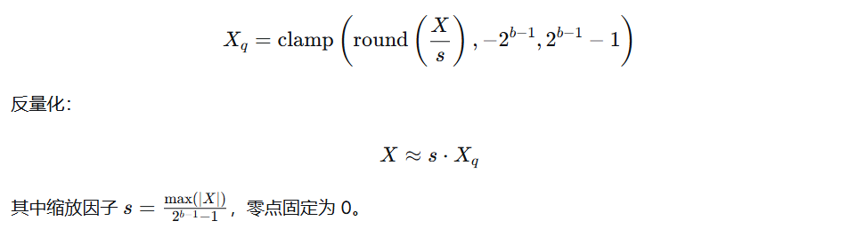{.ocr-src}

非对称量化（Asymmetric Quantization）：允许零点偏移，映射到无符号或整数范围：

$$
X_q=\mathrm{clamp}\left(\mathrm{round}\left(\frac{X}{s}\right)+z,0,2^b-1\right)
$$

反量化：

$$
X\approx s\cdot(X_q-z)
$$

其中 $s=\frac{\max(X)-\min(X)}{2^b-1}$，$z=-\frac{\min(X)}{s}$（四舍五入）。

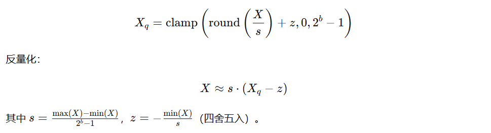{.ocr-src}

为什么对称量化更常用于权重？

1. 权重的分布通常近似零均值对称：LLM 权重在训练后多呈以零为中心的高斯或拉普拉斯分布，使用对称量化能充分利用量化区间，零点附近高概率密度区域分辨率最高，且无需额外存储/计算零点偏移。

2. **计算效率**：对称量化的零点为 0，使得卷积/矩阵乘操作简化为纯整数乘法与累加，无需在每次乘加时减去零点，减少指令和寄存器占用。非对称乘法需要更多操作：$W_q\cdot X_q-z_W\sum X_q-z_X\sum W_q+z_Wz_X$，在推理中明显增加额外计算与功耗。

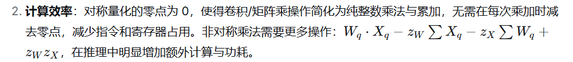{.ocr-src}

3. 硬件亲和：多数 GPU/NPU 的低精度矩阵乘（如 INT8 Tensor Core）原生支持对称量化（或通过简单的符号处理），而对非对称的支持较弱，往往需要软件补偿，效率更低。

4. 实现简化：对称量化仅需存储缩放因子，内存开销减半，也更适合分组量化时的元数据压缩。

当然，对于分布严重偏斜的激活值（如 ReLU 输出），非对称量化有时能更好保留信息；但在权重量化中，对称量化凭借分布匹配和硬件高效成为绝对主流。

---

#### 什么是 PTQ（Post‑Training Quantization）？与 QAT 的主要区别是什么？

PTQ（训练后量化） 是在模型预训练完成后，不进行任何重新训练或微调（或仅用极少量校准数据决定量化参数），直接将浮点权重和/或激活转换为低比特整数的方法。典型代表：GPTQ、AWQ、GGUF 量化、SmoothQuant 等。PTQ 流程极快，通常几分钟到几小时即可完成大型模型的量化，且不需要原始训练数据和昂贵算力。

QAT（量化感知训练） 则是在训练/微调过程中就模拟量化的舍入误差，让模型在优化阶段主动适应低精度表示，从而在目标比特下实现更低的精度损失。QAT 在训练前向使用伪量化节点（fake quantization），反向梯度通过直通估计器（STE）传播。QAT 需要完整的训练流程和数据，计算成本高，但往往精度更优，尤其在极低比特（≤4-bit）或对精度敏感的任务中。

主要区别：

| 维度 | PTQ | QAT |
| --- | --- | --- |
| 训练需求 | 无需训练，或仅需少量校准数据 | 需要完整训练/微调流程，需训练数据 |
| 计算成本 | 很低，通常单卡几分钟至几小时 | 很高，与原始预训练/微调相当 |
| 精度恢复 | 依赖量化算法质量，中等比特（8-bit）几乎无损，低比特（4-bit）需要精心设计 | 通常可在 4-bit 及以下仍保持接近全精度水平 |
| 灵活性 | 可快速适配不同目标比特和硬件 | 每种配置需单独训练，部署迭代慢 |
| 典型应用 | 大模型推理部署主流选择，如 GPTQ、AWQ | 对精度要求极端的场景或极低比特量化 |

现状：在 LLM 领域，由于 PTQ 算法（如 AWQ、GPTQ）已能在 4-bit 下做到近乎无损，且成本极低，工业界多使用 PTQ。QAT 仅在边缘设备或极致低比特（如 2-bit）下有少量应用。

---

#### 为什么直接对 LLM 做 INT8 权重量化可能仍然有较高精度损失？如何解决离群值问题？

虽然 INT8 量化理论上精度损失很小，但 LLM 中存在极端的激活离群值（Activation Outliers），导致直接的 INT8 权重量化（甚至 INT8 全激活量化）产生显著性能下降。

原因：\
大规模 Transformer 训练后的某些特征维度中，激活张量会出现幅度极大的离群值（往往是固定 token 或通道持续很大）。例如，OPT、LLaMA 等模型中，某些序列位置或通道的激活值比中位数大 10-100 倍。这些离群值出现在注意力投影和 FFN 的部分列/行上。当进行矩阵乘法 $Y$=$X_W$ 时：

- 如果 $X$ 的某些列具有极大值，它们对应的权重行会对输出产生不成比例的影响。

- 若对所有激活通道使用统一的量化缩放因子（per-tensor），极端值会撑大量化区间，使绝大部分正常值被量化到极少数 bin 内，导致信息严重损失。

- 如果对权重也使用统一缩放因子，同样面临覆盖范围过大或截断问题。

因此，离群值的根源在于激活，但破坏了权重量化的有效性，因为权重和激活必须协同进行低精度乘法，任何一方的信息损失都会放大误差。

解决方法（离群值处理技术）：

1. 混合精度/精细量化粒度
  - 逐通道量化（Per-channel）：对权重的每个输出通道单独使用缩放因子，可以部分缓解激活离群值造成的动态范围不匹配。但早期 GPU 对逐通道量化的矩阵乘支持不佳，需转换为逐组或使用特定 kernel。
  - 分组量化（Group-wise）：如 GPTQ 将通道组内统一缩放，平衡精度与性能。

2. SmoothQuant（平滑量化）\
   核心思想：通过数学等价变换，将激活的离群值难度转移给权重。引入一个平滑因子 $s$，将 $Y$=$X_W$ 重写为：

$$
Y=(X\cdot\mathrm{diag}(s)^{-1})\cdot(\mathrm{diag}(s)\cdot W)=\hat{X}\hat{W}
$$

通过选择合适的 $s$（如 $s_j=\max(|X_j|)^\alpha/\max(|W_j|)^{1-\alpha}$），将激活的离群值“平滑”到更均衡的分布，而权重相应被放大，二者相乘结果不变。平滑后 $X$ 和 $W$ 均更易于量化。这是目前解决激活离群值的最有效方案之一，被集成到多个推理框架中。

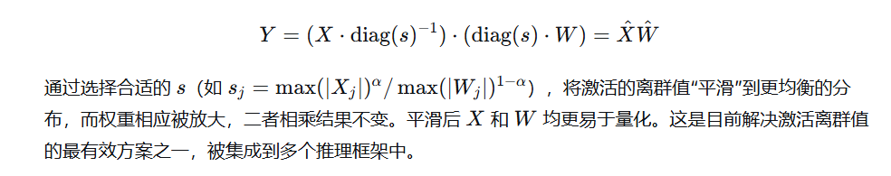{.ocr-src}

3. 动态量化 / 混合精度分配\
   对包含离群值的少数层或通道保留 FP16，其余量化（如 LLM.int8() 方法）。LLM.int8() 对每个矩阵乘检测含离群值的特征，用 FP16 专门计算这些部分的乘积，其余用 INT8，实现了全零精度损失。

4. 旋转矩阵 (Rotation)\
   如 QuaRot 等方法，通过对权重和激活施加正交旋转矩阵，打散离群值的集中分布，使得整个张量的数值范围一致化，从而不用特殊处理即可直接量化。这种方法实现了端到端 4-bit 量化而精度损失极小。

结论：INT8 权重量化本身没问题，但须配合激活离群值的针对性处理，否则直接量化将导致灾难性性能崩塌。这已催生了一整套离群值抑制技术，使 4-bit PTQ 成为可能。

---

#### GPTQ 的核心思想是什么？其逐层量化与最优脑外科（Optimal Brain Surgeon）的联系。

GPTQ 的核心思想：基于最优脑外科（OBS）的权重剪枝理论，将其推广到量化——在逐层量化的每一步，对剩余权重的补偿式更新，以最小化该层的输出误差。它一次性处理一层的所有权重，通过大规模海森矩阵信息，在对某个权重进行量化（舍入）后，即时更新同一层中其余未量化的权重，从而抵消该步量化引入的均方误差。最终整层的输出重构误差被控制在极小范围。

与最优脑外科（OBS）的联系：

OBS 是经典的网络剪枝算法，用于移除权重（置零）时对输出损失的影响最小化。其推导基于损失函数关于权重的泰勒展开（二阶）：\
移除权重 $w_q$ 带来的损失增量为：

$$
\delta L\approx\frac{1}{2}\delta w_q^2\cdot[H^{-1}]_{qq}^{-1}
$$

其中 $H$ 是损失对权重的海森矩阵。为保持输出不变，OBS 会在剪枝后对剩余权重执行更新：

$$
\delta w_{\text{remain}}=-\frac{w_q}{[H^{-1}]_{qq}}\cdot H_{:,q}^{-1}
$$

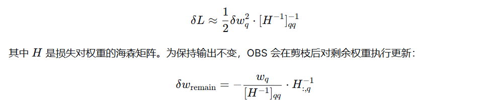{.ocr-src}

这里的核心逻辑是：利用海森矩阵的逆，将移除权重的影响重新分配到其他权重上。

GPTQ 的转化：\
GPTQ 将量化视为对权重施加一个扰动 δw=quant(w)−w（舍入误差）。它逐层优化，以最小化该层输出激活的均方误差，而非最终损失。对于每一层，目标变为最小化：

$$
E=\|WX-\hat{W}X\|_F^2
$$

{.ocr-src}

等价于对权重矩阵每行独立进行 OBS 式的贪婪补偿：

- 按一定顺序逐列（或逐块）量化权重。

- 量化一个权重 $w_i$，计算其舍入误差，并根据**该层输入特征的近似海森矩阵** $H=2XX^T$（对该层输出平方误差而言）来更新该行中其余未量化的权重，补偿公式与 OBS 一致，只是海森矩阵是 $XX^T$ 而非全局损失海森。

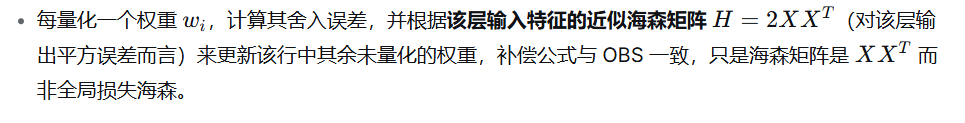{.ocr-src}

因此，GPTQ 是OBS 在逐层输出重构最小化框架下的直接应用，并将权重扰动由置零推广到量化舍入。这使其具有坚实的理论根基，能够在仅需少量校准数据的情况下，将权重量化到 4-bit 甚至 3/2-bit 并维持低误差。

---

#### GPTQ 中的“海森矩阵的逆”是如何近似计算并用于权重更新的？写出主要步骤。

在 GPTQ 中，目标是最小化单层输出重构误差：$\|WX-\hat{W}X\|_F^2$。对权重矩阵的每一行独立处理，海森矩阵 $H=2XX^T\in\mathbb{R}^{d_{\text{in}}\times d_{\text{in}}}$（$X$ 为校准输入，形状 $[d_{\text{in}},N]$，$N$ 为校准样本数）。

**主要步骤（针对一行权重 $w\in\mathbb{R}^{d_{\text{in}}}$）：**

1. **收集海森矩阵**

使用校准数据集，逐层运行前向传播，累积输入 $X$。计算 $H=2XX^T$。实际中为了防止数值不稳定和不可逆，会加上阻尼项：$H=2XX^T+\lambda I$。

2. **计算海森矩阵的逆 $H^{-1}$**

直接求逆代价 O(d³)，在 $d$ 达数千时巨大。GPTQ 利用**分块/贪婪方式避免全局求逆**，转而使用递推的 Cholesky 分解或通过对权重施加固定量化顺序，并动态更新逆矩阵。

具体：若按顺序依次量化权重索引 1 到 $d_{\text{in}}$，在每一步量化 $w_i$ 后，用 OBS 公式更新剩余未量化权重：

$$
w_{\text{remain}}\leftarrow w_{\text{remain}}-\frac{w_i-\mathrm{quant}(w_i)}{[H^{-1}]_{ii}}\cdot(H^{-1})_{:,i}
$$

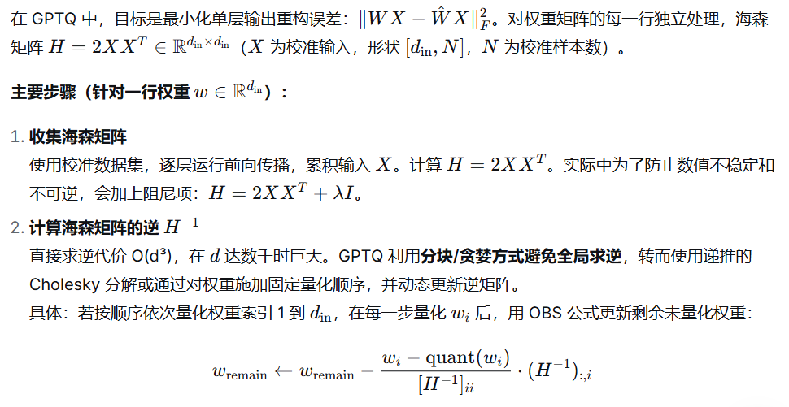{.ocr-src}

并更新 $H^{-1}$（删除已处理维度，或继续使用全矩阵但利用 Sherman-Morrison 公式等）。但 GPTQ 实际采用了**相同的固定顺序的批量处理**，先对所有权重计算 $H^{-1}$，然后一次性扫描，并利用 $H^{-1}$ 的列进行更新，同时更新 $H^{-1}$。

实际操作：GPTQ 一次性计算完 $H^{-1}$，然后循环处理每个列块（block），对块内执行 OBS 式的贪婪量化与剩余权重更新。因为块的列数很小，可以利用 $H^{-1}$ 的子块和 Cholesky 分解。

3. **权重更新公式执行（列级操作）**

对于权重列索引 $i$，量化误差 $e_i=\mathrm{quant}(w_i)-w_i$，对剩余权重（列 $j>i$）的更新为：

$$
w_j\leftarrow w_j+\frac{e_i}{[H^{-1}]_{ii}}\cdot[H^{-1}]_{ji}
$$

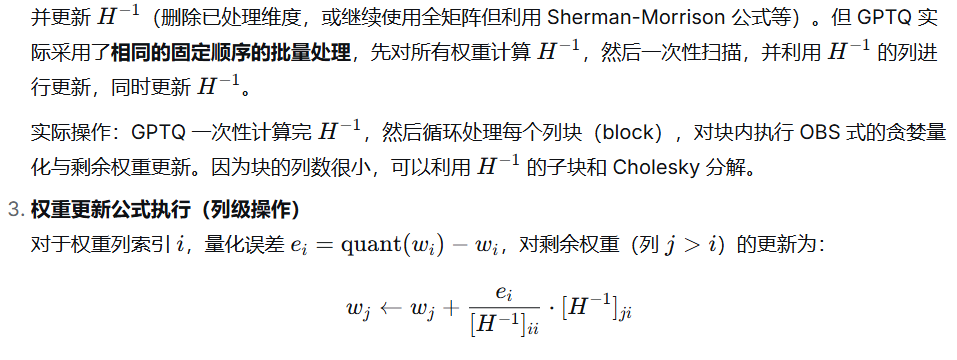{.ocr-src}

1. 这也等价于使用了海森逆矩阵中列 i 的值来补偿。通过这种方式，误差被重新分配，保持输出 $w_X$ 整体最小化。

2. 块处理与重排序\
   为保持数值稳定并减少误差累积，GPTQ 可以按海森对角线大小对权重列进行重排序（先量化更“确定”的维度），并在块内一次性更新。

**简化理解**：GPTQ 利用校准数据的二阶统计量 $H^{-1}$，在每次量化一个权值时，看它对输出的影响有多大（由 $[H^{-1}]_{ii}$ 反映），然后将误差按比例分摊给其他尚未量化的权重，使总输出误差极小。这种方法完美继承了最优脑外科在剪枝中的思想，实现了高保真的一次性 PTQ。

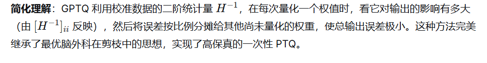{.ocr-src}

---

#### AWQ（Activation‑aware Weight Quantization）的动机是什么？它如何利用激活分布来保护重要权重？

动机：

大语言模型中的权重重要性并非均匀分布。研究发现，只有约 1% 的显著权重对模型性能起决定性作用，而这些显著权重往往对应于激活幅度很大的通道。在直接量化时，这些重要通道的权重若被同等对待，会因为量化误差而严重损害模型。然而，简单保留这部分为 FP16（混合精度）虽然有效，但破坏了硬件的规则计算模式，导致推理效率低下。

AWQ 的核心洞察是：我们可以在量化前，通过对权重进行等效数学变换（缩放），放大这些显著通道的权重，使其更易被量化保留，同时相应缩小对应的激活，不改变前向结果，但让量化误差向非重要通道倾斜。

工作原理：\
AWQ 寻找一个逐通道的缩放因子 s（尺度向量），应用于权重矩阵的输入通道维度：

$$
Y=XW=(X\cdot\mathrm{diag}(s)^{-1})\cdot(\mathrm{diag}(s)W)=\hat{X}\hat{W}
$$

这里 $s$ 的选择基于激活分布：在激活幅度大的通道，$s$ 应使得缩放后的激活 $\hat{X}$ 幅度变小（易于量化），而对应权重 $W$ 被放大（其量化相对误差减小）。极端值得到抑制，重要权重得到保护。同时，由于 $s$ 被吸收进权重和激活，运算结果不变。

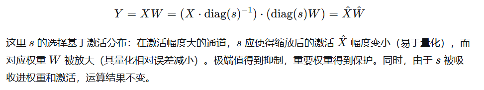{.ocr-src}

AWQ 通过少量校准数据，优化如下目标来搜索最优的 s：

$$
s^*=\arg\min_s\mathcal{L}(\mathrm{quant}(W\cdot\mathrm{diag}(s)),X\cdot\mathrm{diag}(s)^{-1})
$$

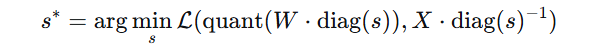{.ocr-src}

通常使用基于梯度或启发式的搜索（如根据激活幅度的 $α$ 次幂确定 $s$），不需重新训练。

效果：

- 避免使用混合精度（无 FP16 计算块），实现硬件友好的均匀低比特（如 INT4）运算。

- 极小的校准成本（与 GPTQ 相当），在 4-bit 下精度几乎无损，甚至优于 GPTQ。

- 已成为 vLLM、TensorRT-LLM 等主流框架推荐的 4-bit 量化方案。

---

#### 解释 AWQ 中的“逐通道缩放”或“逐组缩放”，以及如何通过搜索找到缩放因子。

逐通道缩放（Per-channel Scaling）：\
AWQ 对权重的每个输入通道（即权重矩阵的一行，若权重形状为 [dout,din]，则每个输出神经元对应的权重向量）计算一个独立的缩放因子 $s_i$。转换形式为：

$$
\tilde{W}_{i,:}=s_i\cdot W_{i,:},\quad\tilde{X}_{:,i}=X_{:,i}/s_i
$$

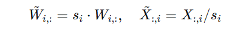{.ocr-src}

这样每个输出通道的权重被放大或缩小，对应激活通道被反向调整。通过适当选择 $s_i$（通道级），让重要通道的权重量化误差减小。

逐组缩放（Per-group Scaling）：\
当计算 kernel 需要更粗粒度的缩放以减少元数据开销时（或为了硬件效率），可将多个通道分为一组共享同一缩放因子。例如，每 128 个通道为一组，使用相同的 $s$。在实现上更友好，同时保持大部分精度收益。

搜索缩放因子的过程：

1. **收集激活统计数据**：在少量校准数据上运行 FP16 模型，记录每一层激活 $X$ 各通道的平均幅度或最大值。
2. **定义缩放因子的参数化形式**：通常设定 $s=\mathrm{mean}(|X|)^\alpha$，其中 $\alpha\in[0,1]$ 是一个超参数。$\alpha=1$ 直接使用平均激活幅度，$\alpha=0.5$ 则相当于平滑。AWQ 会搜索最优的 $\alpha$。
3. **网格搜索或启发式搜索**：在 $[0,1]$ 区间内，按一定步长（如 0.1）选择 $\alpha$，执行量化并评估在验证集上的困惑度（或其他指标），选择最优 $\alpha$。由于仅需单次量化后评估，搜索代价极低。
4. **更细粒度的逐层/逐组搜索**：有些实现会对不同层或不同组采用不同的 $\alpha$，进一步提高精度。此时可使用更高效的搜索算法（如进化算法）或基于梯度的可微搜索。
5. **应用缩放因子进行量化**：找到最佳 $s$ 后，对 $W$ 和 $X$ 执行等效缩放，然后对 $\tilde{W}$ 做标准对称量化，推理时使用调整后的激活计算。

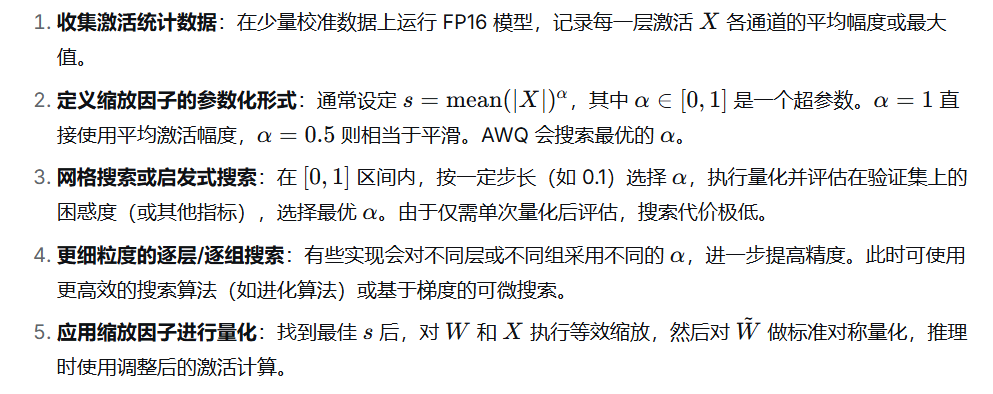{.ocr-src}

这种缩放本质是一种等价变换 + 误差重分布，不改变算术结果，但让量化误差向不重要的激活通道转移，从而保持整体模型质量。

---

#### GGUF 是一种什么样的格式？它主要为哪个推理引擎设计？支持哪些量化精度？

GGUF（GPT-Generated Unified Format） 是一种专为大型语言模型推理设计的文件格式，用于存储模型权重、超参数、分词器信息等全部所需数据于单一文件中，方便分发和运行。它是 GGML 格式的继任者，由 llama.cpp 作者开发，旨在解决老格式扩展性差、向后不兼容等问题。

主要特征：

- 统一的二进制格式：包含版本号、张量列表、元数据（键值对）和实际权重数据，支持快速加载。

- 可扩展元数据：存储模型架构、量化类型、上下文长度、BOS/EOS token ID 等关键信息，无须额外配置文件。

- 内存映射（mmap）支持：允许零拷贝加载，极速初始化。

- 多种量化精度：支持从 2-bit 到 8-bit 的广泛量化级别，且有众多子变体，如 Q4_0, Q4_K_M, Q5_1, Q8_0 等，以平衡质量/大小。

主要服务的推理引擎：llama.cpp

GGUF 格式原生为 llama.cpp 设计，这是一个用 C/C++ 编写的高性能 LLM 推理引擎，专注在 CPU 和边缘设备上高效运行模型。凭借 llama.cpp，GGUF 模型可在：

- 消费级 CPU（支持 AVX/AVX2/AVX512）

- Apple Silicon（Metal 加速）

- GPU（CUDA、OpenCL、Vulkan 后端）\
  上获得优秀的推理速度。

支持的量化精度举例（部分）：

- 2-bit：IQ2_XXS, Q2_K_S（极致压缩，精度损失较大）

- 3-bit：Q3_K_S, Q3_K_M, IQ3_XXS

- 4-bit：Q4_0, Q4_1, Q4_K_S, Q4_K_M（最常用，平衡性能与大小）

- 5-bit：Q5_0, Q5_1, Q5_K_S, Q5_K_M

- 6-bit：Q6_K（接近无损，适合高精度需求）

- 8-bit：Q8_0（几乎与 FP16 无差别）\
  每种类型末尾的字母表示不同的量化策略（如 K-quant 采用不同的重要值保护机制）。GGUF 已成为社区分发本地大模型的事实标准，特别是面向个人用户和边缘部署。

---

#### 比较 GPTQ、AWQ 和 GGUF 在量化粒度、精度保持和适用场景上的不同。

| 维度 | GPTQ | AWQ | GGUF |
| --- | --- | --- | --- |
| 量化粒度 | 通常为 per-row 或 group-wise（组内共享缩放因子），组大小典型为 128。支持可变组大小 | 通常为 per-channel 或 per-group，结合激活感知的等效缩放，组大小可配置 | K-quant 等策略，采用块状量化并混合多种粒度（如超级块包含子块），部分变体也支持 per-channel |
| 精度保持 | 4-bit 下几乎无损，需要校准数据集（几十～几百条样本）。利用海森补偿机制，PPL 上升极小。在长尾/困难任务上略逊于 AWQ | 4-bit 下精度优于 GPTQ，更少的校准样本（甚至只需几例），且对离群值天然不敏感。通过缩放保护显著权重，PPL 常常低于 GPTQ | 提供从 2-bit 到 8-bit 的广泛选择，Q4_K_M 等平衡型在 4-bit 下质量接近 GPTQ/AWQ，但 4-bit 以下损失较明显。依赖手工优化的混精度量化表 |
| 推理硬件/后端 | 主要为 NVIDIA GPU，依赖定制 CUDA kernel（如 GPTQ-for-LLaMA, AutoGPTQ, ExLlama），也支持 CPU 但优化较少 | 支持 GPU 为核心，vLLM, TensorRT-LLM 等现代推理框架内置 AWQ kernel；也支持通用 CPU 但效率不如 GGUF | CPU 优先，尤其是通过 llama.cpp 在 Intel/AMD x86 和 Apple Silicon 上极致优化；也有 Metal、CUDA 等后端，但最突出的是非 GPU 场景 |
| 格式与部署 | 通常以 PyTorch checkpoint + 量化配置方式使用，或导出为自定义格式（如 .safetensors），兼容 HuggingFace | 与 GPTQ 类似，多在 HuggingFace 模型仓库中以 awq 标识提供，或集成为后端 kernel | 采用 GGUF 单一文件，一切自包含，分发极方便，专为 llama.cpp 打造，拖拽即可运行 |
| 适用场景 | 服务端 GPU 推理，追求高吞吐且希望快速量化现有模型。适合云服务厂商、企业内部部署 | 服务端 GPU 推理，特别是对精度要求更高、需支持超长上下文或微调后模型的部署。逐渐成为 4-bit 服务首选 | 本地/边缘设备部署、个人电脑、笔记本、手机（通过 llama.cpp）。典型场景是个人用户离线聊天、隐私敏感应用、无 GPU 环境 |

总结：

- GPTQ：基于严谨理论，速度与精度均衡的 GPU 量化，是早期 4-bit 部署的标配。

- AWQ：激活感知，精度更优，工程适配成熟，是现代 GPU 推理服务的推荐方案。

- GGUF：CPU 与边缘部署之王，格式统一，生态丰富，让大模型真正飞入寻常百姓家。

三者并非完全排斥，可根据部署硬件和精度要求灵活选择，例如使用 AWQ 在服务器 GPU 上提供在线服务，同时将同一模型转为 GGUF 供用户在本地笔记本上运行。

---

#### 为什么 GPTQ 量化后的模型在推理时需要快速反量化并计算，而 GGUF 文件通常在加载时反量化？

这本质上是两种不同的部署哲学和底层 kernel 设计所导致的。

GPTQ 的运行时反量化（在线反量化）

GPTQ 量化后的权重以 INT4（或更低比特）格式存储在显存中。在实际推理的矩阵乘法时，kernel 会动态地将小块权重从 INT4 反量化回 FP16/BF16，然后立即送入 Tensor Core 或 SIMD 单元进行浮点乘加运算。

- 原因 1：硬件计算单元要求。NVIDIA GPU 的 Tensor Core 在处理 FP16 矩阵乘法时，需要操作数为 FP16。虽然 Hopper 架构支持 FP8 Tensor Core，但主流推理硬件的峰值算力仍密集依赖 FP16/BF16 路径。因此，必须在计算前恢复为浮点。

- 原因 2：内存带宽节省。权重以 4-bit 存储在 HBM 中，相比 FP16 节省了 4 倍显存和 4 倍的读取带宽。尽管需要反量化，但增加的 ALU 操作相对内存带宽瓶颈而言开销极小，整体可实现接近 4 倍的带宽节省，从而大幅加速推理。

- 具体 kernel 实现（如 ExLlama、AutoGPTQ）：从 HBM 加载 INT4 打包块到共享内存/寄存器 → 使用查找表或整数运算展开为 FP16 → 与 FP16 激活进行矩阵乘。这种“加载-解包-计算”流水线充分隐藏了反量化延迟。

GGUF 的加载时反量化（离线反量化/半在线）

GGUF 模型常用在 CPU 推理（llama.cpp）。它的量化格式（如 Q4_K_M）在模型加载到内存时，就将权重反量化为更易计算的格式，或者使用一种“量化-计算融合”的混合策略。

- 更准确的说法：llama.cpp 等 CPU 引擎并不是完全在加载时全反量化为 FP16（那样会失去内存节省）。而是采用了运行时在寄存器级别进行解包和计算的融合 kernel，但与 GPU 不同的是，CPU 的 SIMD 指令集（如 AVX2/AVX-512/NEON）对整数运算有极佳支持。许多 GGUF 量化类型（如 Q4_0）的乘法 kernel 会使用整数点积指令（`_mm256_maddubs_epi16` 等），直接进行“量化”的整数乘加，仅在最后累加和输出时转换到浮点。这实际上没有“显式的反量化”步骤，而是将量化和计算彻底融合。

- 为什么看起来像是“加载时反量化”：有些旧的 GGML 格式或者某些后端确实会在加载时将部分权重转换为 FP16 存储在内存中以简化计算，但现代 GGUF 和 llama.cpp 已普遍使用融合量化计算 kernel，权重数据始终以压缩格式驻留内存，仅在 CPU 寄存器内临时解包。因此其“反量化”是完全透明且零额外内存开销的。

总结本质区别：

- GPTQ (GPU)：存储低比特 → 读取 → 在线反量化 → FP16 矩阵乘（因硬件算力单元要求）。

- GGUF (CPU)：存储低比特 → 读取 → 整数融合乘加 → 累加转浮点（因 CPU 整数 SIMD 强且内存极缺）。\
  这一差异源于底层硬件计算范式的根本不同。

---

#### 动态量化（如 INT8 activation）在 LLM 推理中是否常用？为什么？

动态量化（Dynamic Quantization） 通常指推理时动态地计算激活的量化参数（缩放因子、零点），即每次前向传播根据实际输入张量的数值范围即时量化激活，然后执行低精度矩阵乘，最后反量化输出。与之相对的是静态量化（Static Quantization），它使用校准数据预先固定激活的量化参数。

在 LLM 推理中，动态激活量化并不常用，主要受限于精度、延迟和硬件生态。

原因分析：

1. 精度剧烈波动\
   LLM 的激活分布会随输入、序列位置、甚至 token 的变化而剧烈波动。动态量化的缩放因子完全由当前 batch 的实际数据决定，这虽然使量化区间尽量贴合，但会导致严重的跨步不一致性。在自回归解码中，每步激活范围不同，导致量化误差模式不断变化，累积放大，造成输出质量显著下降。SmoothQuant 等工作的出现，正是因为直接量化激活很困难。

2. 额外的计算开销\
   动态量化需要在每次矩阵乘法前扫描整个激活张量以计算 min/max（reduction 操作），这引入了额外 kernel launch 和延迟，对于 decode 阶段这种极度内存带宽受限的场景，这点计算也可能成为瓶颈。且为了获得缩放因子，往往需要同步等待，破坏流水线。

3. 硬件 kernel 支持有限\
   GPU Tensor Core 的 INT8 矩阵乘法（IMMA）通常要求预先校准的静态缩放因子，并期望权重和激活的量化参数保持不变或按固定策略变化。动态量化需要将每一层的量化参数作为输入传入 kernel，且要求 kernel 能处理按 token/per-tensor 变化的缩放因子。虽然 cuDNN 和 CUTLASS 支持部分动态模式，但性能优化不如静态量化成熟，且并非所有推理引擎都深度集成。

4. 预填充与解码行为差异\
   即使强行使用动态量化，prefill 阶段激活张量大，统计量稳定，可能可行；但 decode 阶段每次只有一个 token，激活向量极小，动态计算的缩放因子噪声极大，几乎不可用。

所以，主流做法是：

- 权重量化为静态（INT4/INT8）。

- 激活保持 FP16/BF16（W4A16），即不量化激活。这完全规避了激活量化的痛苦。

- 若必须量化激活以进一步加速（如 W8A8），则使用 SmoothQuant 等离线方法将激活难度转移给权重，再实施静态量化激活。

- 动态量化仅在一些 CPU 推理场景（如 PyTorch 的 `torch.ao.quantization` 默认动态量化）用于简单模型，LLM 极少采用。

结论：动态 INT8 激活量化在 LLM 推理中极不常用，激活要么保持 FP16，要么经 SmoothQuant 处理后进行静态量化。

---

#### 量化到 4‑bit 时，分组量化（group‑wise）为何重要？组大小对模型精度和吞吐的影响。

分组量化（Group-wise Quantization） 是指将权重矩阵的输入通道（或输出通道）分成多个组，每组独立拥有自己的缩放因子（和零点）。与之相对的是 per-tensor（整个矩阵一个缩放因子）和 per-channel（每个输出通道一个缩放因子）。

为何在 4-bit 时分组量化极其重要？

在 4-bit 下，整个矩阵仅用 16 个整数表示，表达空间极度受限。如果使用 per-tensor 量化，一个缩放因子必须覆盖所有权重的数值范围。LLM 的权重分布在不同通道间差异巨大：某些通道方差大，某些方差小。单因子会导致：

- 大方差通道的大量权重因超出范围被截断（clipping error）。

- 小方差通道的权重则只占用少数几个 bin，量化分辨率极低（rounding error dominant）。\
  结果就是严重的信息丢失和模型崩溃。

Per-channel 量化 为每个输出通道分配独立缩放因子，显著缓解了通道间差异，是 8-bit 量化的标配。但在 4-bit 时，即使 per-channel，一个通道内的权重（沿输入维度）仍可能存在内部方差，特别是输入维度（d_in）在 LLM 中常达 4096~8192。这一长向量内的值域变化仍会导致舍入误差累积。

分组量化 将每个通道再按输入维度切分为更小的组（如 `group_size=128`），每组独立量化。这使得：

- 量化粒度极细，极大减小了组内值域范围，舍入误差和截断误差均被抑制。

- 在仅增加少量元数据（每组存储一个 FP16 缩放因子）的代价下，实现了接近全精度的信息保留。

- GPTQ、AWQ 等 4-bit 方法无一例外使用分组量化（或等价的激活缩放），组大小 128 已成为事实标准。

组大小对精度和吞吐的影响：

- 精度：组越小，量化粒度越细，精度越高。从 128 减到 64 或 32，PPL 通常进一步下降，但收益递减。当组大小等于 1 时退化为无量化。所以需要在精度和效率间权衡。

- 吞吐（速度）：组大小越小，缩放因子的元数据量越大。例如，group_size=128 时，每个权重元素额外负担 `2 bytes / 128 = 0.015625 bytes`，可忽略。但更关键的是，kernel 在计算时，需要频繁切换缩放因子并进行反量化。组太小会破坏向量化读取和数据复用，增加指令开销，降低 Tensor Core 利用率。实验表明，组大小 128 在现代 GPU 上是吞吐与精度的最佳甜点区；再小（如 32）会带来约 10-20% 的吞吐下降，而精度提升微弱。

因此，分组量化是 4-bit 量化的关键技术，使得这种极低比特部署成为现实。

---

#### 什么是“离群值特征”（outlier features）？为什么它们在量化中特别麻烦？如何缓解？

离群值特征（Outlier Features） 指在大语言模型的隐藏层激活中，某些特征维度（通道）的数值幅度系统性、持续性地远大于其他通道。这些特征通常占据总通道数的极小比例（如 0.1%~1%），但其幅度可以达到中位数的几十甚至上百倍。它们往往集中在特定 token（如分隔符、标点、起始 token）或固定通道上，且不同输入样本间这些离群值位置保持高度一致。

为什么在量化中特别麻烦？

量化需要将浮点数值映射到有限整数区间，其缩放因子由张量的最大绝对值（对称量化）或 min/max（非对称）决定。离群值的存在会引发灾难性的“动态范围撑大”效应：

- 为了不截断这些少数极端值，缩放因子必须非常大，这使得绝大部分正常值的量化区间被高度压缩，它们只能占据极少数几个量化 bin，导致严重舍入误差，信息几乎完全丢失。

- 如果为了照顾大多数值而直接截断裂群值，则这些关键的高幅值特征被硬剪裁，而研究表明它们对模型输出（尤其是注意力机制和 FFN 的门控）有不成比例的重要影响，直接截断会瞬间摧毁模型性能。

这种困境在激活量化时尤为致命，因为离群值出现在激活侧；即使仅量化权重，若进行 W8A8 全量化，激活离群值也会与量化权重交互，放大误差。在权重量化中，若非采用分组量化，per-channel 权重量化也会间接受害。

缓解方法：

1. 混合精度保留（LLM.int8() 的思路）：将包含离群值的特征维度从矩阵乘法中分离出来，用 FP16 计算，其余 99% 用 INT8。这是最彻底但硬件不友好的方法，因为引入了非规则的计算模式。

2. 数学等价变换——SmoothQuant：通过 per-channel 的平滑因子 s，将激活的量化难度转移给权重：`X' = X diag(s)^{-1}, W' = diag(s) W`。合理选择 s（如根据激活和权重的动态范围平衡），可使激活的离群值被有效抑制，权重相对平滑，便于双方都进行 INT8 量化。

3. 旋转矩阵打散（QuaRot, SpinQuant 等）：利用正交矩阵对权重和激活进行旋转，将集中的离群值“涂抹”到所有通道，使激活和权重的分布都趋于均匀高斯。这样可直接套用常规的对称逐通道/逐组量化，无需特殊处理。

4. 更细粒度的量化：如对激活使用 per-token 量化（每个 token 独立缩放因子），可以部分缓解离群 token 撑大整个批次缩放的问题，但对固定通道离群值作用有限。

结论：离群值特征是 LLM 激活量化的头号公敌，也是推动 SmoothQuant、LLM.int8() 等一系列核心量化技术的根本动因。解决它，才能真正实现高效的全整数量化推理。

---

#### SmoothQuant 是如何通过平滑因子将激活的量化难度转移到权重上的？

**SmoothQuant 的核心思想**：利用矩阵乘法的线性等价变换，引入 per-channel 的平滑因子 $s\in\mathbb{R}^{d_{in}}$（$d_{in}$ 为输入通道数），重写线性层：

$$
Y=X\cdot W=(X\cdot\mathrm{diag}(s)^{-1})\cdot(\mathrm{diag}(s)\cdot W)=\hat{X}\cdot\hat{W}
$$

通过巧妙选择 $s$，可以**平滑激活 X 的离群值，同时将额外负担转嫁给更容易量化的权重 W**，最终使 $\hat{X}$ 和 $\hat{W}$ 都易于 INT8 量化。

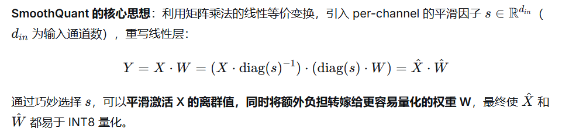{.ocr-src}

“难度转移”的机制与平滑因子计算：

假设某个输入通道 $j$ 的激活 X:,j具有大量离群值（幅度巨大），使得该通道的量化极难。SmoothQuant 为该通道选择一个平滑因子 $s_j$>1（通常），这样：

- 激活变为 $\hat{X}_{:,j}=X_{:,j}/s_j$，其幅度被**大幅缩小**，离群值被抑制，动态范围变得温和，易于量化。
- 对应权重的第 $j$ 行（若 W 形状为 $[d_{in},d_{out}]$）被放大：$\hat{W}_{j,:}=s_j\cdot W_{j,:}$。原本 LLM 权重通常呈零均值小方差，放大后该行权重的幅度增大，可能变得稍微难量化一些。

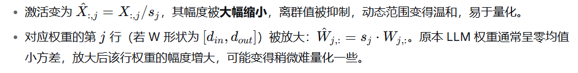{.ocr-src}

然而，权重的分布更集中、稳定，且权重量化可以使用 per-channel 或 group-wise，放大带来的额外量化误差远小于激活量化的收益。因此，总体的量化误差大幅降低。

平滑因子 $s$ 的选择公式：\
SmoothQuant 论文提供了基于迁移强度的公式。设校准数据的激活平均幅度为 $A_j$=mean(∣$X$:,$j$∣)，权重对应行的最大幅度为 $B_j$=max(∣$W_j$,:∣)。则：

$$
s_j=\max(|X_{:,j}|)^\alpha/\max(|W_{j,:}|)^{(1-\alpha)}
$$

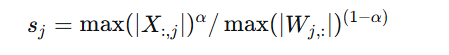{.ocr-src}

其中 $α$ 是迁移强度超参数。当 $α$=0.5 时，激活和权重被同等平滑化；当 $α$ 更大，更多负担转移给权重（激活量化更容易）。通常选 0.5 或通过 grid search 微调。

**整体效果**：

平滑后，$\hat{X}$ 的离群值被显著削弱，可直接进行 per-token 或 per-tensor 静态量化；$\hat{W}$ 的分布依然规整，使用 per-channel 量化几乎无额外损失。整个过程仅需少量校准数据，无需训练，完美保留了前向结果（数值上等价）。SmoothQuant 使得 W8A8 量化真正可行，在多数大模型上达到了与 FP16 相当的精度，同时享有 INT8 的计算加速。

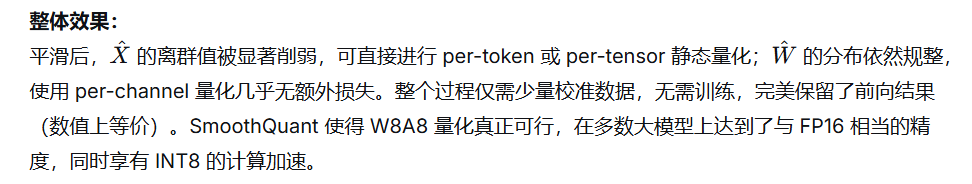{.ocr-src}

---

#### LLM.int8() 采用混合精度分解：对离群值用 FP16，其余用 INT8，阐述其动机和实现。

动机：

如 14 题所述，LLM 的隐藏层激活中存在极少量（<0.1%）但幅度极大的系统性离群值特征。这些离群值对量化是灾难性的——若强行 INT8 量化，会撑大缩放因子，导致其他 99.9% 的正常特征量化误差爆炸。然而，离群值仅分布在非常狭窄的通道中。LLM.int8() 观察到了这一现象，并提出：为何不将这些麻烦的离群值通道单独挑出来用 FP16 精确计算，而让剩下的绝大部分通道安全地享受 INT8 的效率？

实现步骤（以单个线性层 Y = XW 为例）：

1. **离群值检测**：对 FP16 输入激活 $X\in\mathbb{R}^{s\times d_{in}}$（s 为 token 数），按特征维度（列）计算绝对值，若某列存在值超过阈值（通常为 6.0）则认为该列为离群值特征。记录下离群值列的索引集合 $O$，以及非离群值列集合 $R$。
2. **矩阵拆分**：
   - 将权重矩阵 $W\in\mathbb{R}^{d_{in}\times d_{out}}$ 按行拆分：$W_O$（离群值对应的行）和 $W_R$（正常行）。
   - 将输入 $X$ 按列拆分：$X_O$ 和 $X_R$。
3. **混合精度计算**：
   - **正常部分**：对 $X_R$ 和 $W_R$ 进行标准 INT8 量化（per-token 对 X，per-channel 对 W），使用 INT8 Tensor Core 进行矩阵乘，结果反量化为 FP16。
   - **离群值部分**：对 $X_O$ 和 $W_O$ 保留 FP16，直接调用 FP16 GEMM。
   - **最终输出**：`Y = INT8_MatMul(X_R, W_R) + FP16_MatMul(X_O, W_O)`。

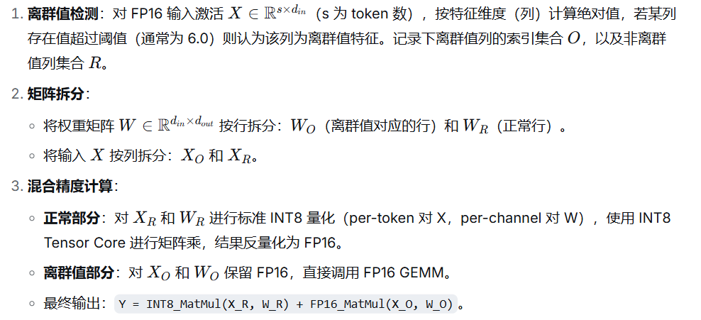{.ocr-src}

4. 工程挑战与解决：
  - 不规则形状：离群值列索引在每次迭代可能略有变化，导致矩阵被切分成非连续内存。LLM.int8() 使用高效的 CUDA kernel 进行 gather/scatter 操作 或事先将权重按离群值列静态重排。
  - 性能损失：混合精度引入了额外的两个 GEMM 调用和数据搬运。但因为离群值比例极小（如 0.1%），FP16 部分计算量几乎可忽略，整体性能仍接近纯 INT8 的加速（约 2 倍于 FP16）。
  - 静态分析：作者发现离群值特征在多数 Transformer 层中是系统性的、固定的（固定通道索引），因此可以在模型加载时一次性确定离群值模式，对权重进行永久性重排，消除每次的动态检测开销。

意义：LLM.int8() 首次证明了 8-bit 量化在 175B 参数模型上可做到零精度损失，且性能提升显著，开启了 LLM 低精度推理的大门。其混合精度思想为后续很多量化方案提供了重要启发。

---

#### 量化模型的困惑度（perplexity）可以接受的范围是什么？在哪些任务上量化损失较大？

可接受的困惑度（PPL）范围：

量化质量的评判基准是相对于原 FP16/BF16 模型的 PPL 上升幅度。

- 理想（几乎无损）：PPL 上升 < 0.1 或几乎持平（在测试集如 WikiText-2, C4 上）。例如，AWQ 4-bit 在 LLaMA-2 7B 上通常只上升 0.05~0.1 的 PPL，被认为优秀。

- 可接受（轻度损失）：PPL 上升在 0.2~0.5 之间，多数实际生成质量未明显退化，可部署服务。

- 尚可用（中度损失）：PPL 上升 0.5~1.5，模型在某些任务上可能表现变弱，但仍能产生连贯文本。

- 不可接受（严重损失）：PPL 上升 >2.0，模型通常输出质量显著下降，流畅度、事实性、推理能力都受破坏。

量化损失较大的任务类型：

1. 知识密集型与事实回忆任务（如 TriviaQA, NQ）\
   量化引入的误差会干扰权重中存储的事实性知识。特别是实体相关的信息在多层中分布，细微的权值扰动可能导致回忆失败，准确率下降明显。

2. 复杂推理任务（如 GSM8K 数学推理, 逻辑推理链）\
   多步推理需精确的概率传播，累积的量化噪声会破坏中间推理步骤的逻辑一致性，导致最终答案错误率急升。

3. 长上下文理解与检索（如 Needle-in-a-Haystack, LongBench）\
   长序列依赖于注意力机制和位置编码的精细交互。量化误差可能弱化模型对远距离依赖的捕捉能力，或使注意力分数失真，从而在“大海捞针”测试中失败。

4. 生成多样性/创意性任务（如故事生成）\
   低比特量化可能使输出趋向于“平均化”或重复，因为部分概率质量被磨平。虽 PPL 可能尚可，但人类评估可能发觉单调乏味。

5. 少量本（few-shot）设置\
   量化误差会干扰上下文学习能力，因为 prompt 中的示例与查询的交互被噪声淹没，few-shot 准确率下降往往比 zero-shot 更严重。

相反，损失较小的任务：涉及简单的语法连贯性、情感分析、主题分类等结构化较强的任务通常较鲁棒。因此评估量化模型不能只看 PPL，必须在与实际应用相关的多维度基准上测试。

---

#### 为什么 W4A16（4-bit 权重，16-bit 激活）在推理中非常流行？

W4A16 是目前 LLM 推理部署的最主流量化配置，它兼具了极致的内存节省、良好的精度保持和高吞吐。

流行原因分解：

1. 内存瓶颈是推理的第一约束\
   LLM 推理（特别是 decode 阶段）的瓶颈在于从显存读取权重和 KV Cache 的带宽。将权重从 FP16 压缩到 INT4，模型体积缩小到 1/4，一方面可在更小的 GPU 上运行大模型（如 13B 模型运行在 6GB 显存），另一方面大幅减少权重读取量，直接突破内存带宽墙，提升生成速度。

2. 激活量化极端困难，保持 FP16 是明智选择\
   前文已详述，LLM 的激活存在离群值、分布剧烈波动等问题，直接量化激活（如 INT8）需要复杂的 SmoothQuant 等技巧，且仍可能损害精度。而保持激活 FP16 则完全避开了这些坑：不需要任何激活校准或复杂 kernel，精度几乎无损失，同时现代 GPU 对 FP16 乘法有原生极致优化。

3. 计算模式简洁高效\
   W4A16 kernel 实现为：加载 INT4 权重 → 在线反量化为 FP16 → 与 FP16 激活进行矩阵乘。这相比 W8A8（需 INT8 Tensor Core 并处理双向量化）在工程上更统一、普适性好。而且权重反量化引入的 ALU 远小于节省的带宽，整体性能接近理论 roofline。

4. PTQ 方法成熟，精度极高\
   AWQ 和 GPTQ 等算法已经使 4-bit 权重量化的精度损失微乎其微，甚至在某些任务上出现“正则化效应”使得 PPL 更低。这消除了用户对精度崩坏的担忧。

5. 支持超长上下文和大 batch\
   节省出的显存可直接转化为更大的 KV Cache，支撑 128k 长上下文推理，或者显著增大并发 batch，提升服务吞吐，这对 LLM 作为服务的成本控制至关重要。

因此，W4A16 凭借近乎无损、实现简单、加速显著的铁三角优势，成为目前工业界推理部署的黄金标准。

---

#### 在推理引擎中，量化模型如何实现批量矩阵乘法？需要怎样的 kernel 支持？

在推理引擎（如 vLLM、TensorRT-LLM、llama.cpp）中，量化模型执行的批量矩阵乘法（GEMM/GEMV）必须使用特制的量化 kernel，而非标准的 FP16 GEMM。

实现流程（以 W4A16 为例）：

1. 权重布局转换：量化后的权重以打包格式存储。例如，对于 4-bit 权重，每两个 4-bit 元素拼成一个 `uint8`。此外，分组缩放因子、零点等元数据按特定 layout 排列，以保证合并访问。

2. Kernel 选择：
  - Prefill 阶段（大矩阵乘，计算密集）：调用针对 W4A16 优化的 GEMM kernel，如 CUTLASS 的 `cutlass::gemm` 混合精度实例，或 TensorRT-LLM 中高度手写的 `w4a16_gemm` 内核。这些 kernel 遵循分块策略，从 HBM 加载权重块到共享内存，解包为 FP16，从 HBM 加载激活块，然后调用 `mma.sync`（Tensor Core 指令）执行 FP16 矩阵乘加。
  - Decode 阶段（向量-矩阵乘，内存带宽密集）：调用专门的 GEMV kernel。因为 Q 只有 1 token，权重矩阵的解包和与单个向量的乘法极度受限于带宽。这时会采用更激进的预取、向量化加载、以及可能的权重复用（在 batch>1 时）。TensorRT-LLM 的 XQA kernel 或 llama.cpp 的 `dequantize_mul_mat_vec` 就是此类。

3. 反量化融合：\
   在 kernel 的内循环中，加载的 `uint8` 权重块需要即时解包。对于 group-wise，kernel 会顺序加载每个组的缩放因子，并对该组内的每个 INT4 元素进行 `fp16_weight = int4_val * scale + zero`（若对称量化则无 zero），然后与对应的激活元素相乘并累加。这些操作完全融合在一个 kernel 中，无中间写出。

4. 硬件指令利用：
  - 在 NVIDIA GPU 上，使用 `mma.sp.sync` 进行稀疏/低比特的 Tensor Core 操作（Ampere 支持 INT4 Tensor Core 吗？其实 Ampere 原生不支持 INT4 MMA，但可通过 b1 或特殊指令组合模拟，或转换为 INT8）。实际上，多数 W4A16 kernel 是将 INT4 权重先反量化为 FP16，然后用 FP16 Tensor Core。这正是 GPTQ/AWQ kernel 的做法。
  - 在 CPU 上，使用 AVX2/AVX-512 的整数乘加指令直接处理量化数据。

5. 流水线与双缓冲：\
   使用 CUDA 的 `cp.async` 将下一块权重量化数据异步预取到共享内存，同时当前块在 Tensor Core 上计算，隐藏内存延迟。

因此，推理引擎必须拥有一整套量化感知的线性代数库，能够根据不同的比特宽度、组大小、批大小动态调度最优 kernel，这对引擎开发提出了极高的要求。

---

#### 对于 MoE 模型，量化时需要考虑专家权重的不同分布吗？

需要，且必须考虑。Mixture-of-Experts (MoE) 模型由多个专家（通常是 FFN 层）和一个路由网络组成。每个专家是独立的权重矩阵，它们在训练后可能呈现出不同的数值分布，原因包括：

- 路由不均衡：某些专家被训练得更多（通过负载均衡损失尽量缓解，但仍存在偏好），其权重更新更频繁，分布可能更集中或更发散。

- 专家功能分化：不同专家可能学到完全不同类型的模式（语法、事实、推理等），导致其权重的幅值分布和离群值模式大相径庭。

- 参数量巨大：每个专家本身就是大型矩阵，若统一使用一个全局量化配置，某些专家可能被严重误量化。

量化时需要的考量与策略：

1. 独立校准与量化：为每个专家独立收集校准数据的激活统计量，并独立计算各自的量化参数（缩放因子、零点、甚至分组粒度）。绝不能跨专家共享量化参数。GPTQ 和 AWQ 在 MoE 上的扩展均对每个专家矩阵单独运行量化算法。

2. 离群值处理的差异化：不同专家的离群值特征可能位于不同通道。SmoothQuant 或旋转量化的迁移强度可能需要按专家单独搜索或设置。简单的统一策略可能导致某些专家性能骤降。

3. 混合精度与预算分配：由于量化误差影响不同，可对“重要”专家（被频繁调用的）分配更保守的量化策略（如 8-bit 或更大 group size），对“冷门”专家可更激进（4-bit 甚至 3-bit）。需要一套评估机制来判定专家重要性。

4. 路由网络的量化：路由网络通常较小但非常重要，其输出直接决定 token 分配。通常保留 FP16 或使用 8-bit 量化，不宜用 4-bit 以防路由决策错误引发灾难性级联影响。

5. 推理 kernel 支持：MoE 推理时，每个 token 仅激活少数专家（top-k）。量化 kernel 需要支持动态地根据 token 的专家索引，从不同内存位置加载对应专家的量化权重进行计算，且须高效处理批量 token 分散到不同专家的情况。

总结：在 MoE 量化中，专家独立量化是基本原则，且需辅以重要性感知的混合比特分配和精细化的路由保护。这是 MoE 大模型在低比特部署时保持性能的关键。

---

#### 如何评估一个量化方案的优劣？列出自评估流程和关键指标。

评估量化方案优劣需系统化进行，覆盖质量、性能和工程可行性三方面。

##### 自评估流程：

1. 准备阶段
  - 选定基座模型 (FP16/BF16) 和代表性测试集（困惑度基准、下游任务）。
  - 准备校准数据集（PTQ 需 128~1024 个样本，通常来自训练集或通用语料，如 C4）。
  - 确定目标比特和目标硬件。

2. 量化执行
  - 执行量化算法（GPTQ/AWQ/GGUF 等），记录量化时间、校准数据量、额外超参数。

3. 自动指标评估
  - 在困惑度测试集（WikiText-2, PTB, C4 validation）上计算 PPL，对比原模型。
  - 在多个零样本/少样本任务基准上评估（如 HellaSwag, PIQA, ARC-easy/challenge, MMLU, GSM8K 等）。

4. 组件级分析
  - 逐层输出误差分析（layer-wise MSE）或逐模块误差，定位量化损失高的层/专家。

5. 生成质量人工/自动评估
  - 针对对话、摘要等应用场景进行端到端生成，用 MT-Bench, AlpacaEval 或人工 A/B 测试评价流畅度、准确性。

6. 性能剖析
  - 在真实推理引擎中测量延迟（TTFT, TPOT）、吞吐（token/s）和峰值显存，与原模型及不同量化配置对比。记录 kernel 执行时间、HBM 带宽利用率等。

7. 压力测试
  - 测试长序列（32k, 128k）、大 batch 下的稳定性和显存 OOM 边界。验证极端输入（重复 token、非英语）的输出质量。

##### 关键评估指标：

质量指标：

- PPL 绝对增加值 (ΔPPL)：核心指标，越小越好。通常 <0.2 为优秀。

- 零样本准确率变化：多个任务的平均分数变化或胜率。

- 长文本任务得分（如 LongBench 各项）的变化。

- 生成重复率/多样性：`rep_n-gram`、熵等。

性能指标：

- 吞吐量 (tokens/s)：在目标并发下的生成速度。

- 延迟：首 token 延迟 (TTFT) 和每输出 token 延迟 (TPOT)。

- 显存占用：模型权重 + KV Cache 峰值。

- 最大支持上下文长度：在显存限制下可运行的 max context。

工程指标：

- 量化耗时：完成 PTQ 所需的时间和 GPU 资源。

- 压缩比：模型体积缩小倍数。

- kernel 兼容性：对 FlashAttention、PagedAttention、张量并行的支持。

- 易用性：与主流框架集成难度，是否需大量自定义。

综合以上，绘制“精度-速度”帕累托曲线，选择在满足业务精度要求下吞吐最高的方案。

---

#### 量化对 KV Cache 同样有效，如何对 KV Cache 做静态量化或动态量化？

KV Cache 存储着每层的键和值张量，形状为 `[batch, num_kv_heads, seq_len, head_dim]`。它在自回归解码中持续增长，很快成为显存主角。对 KV Cache 进行量化（KV8/KV4）是长上下文推理的关键技术。

方法主要分为静态量化（离线）和动态量化（在线）：

##### 静态量化（Static KV Cache Quantization）

在推理开始前或每次 prefill 后，采用固定的量化参数压缩 K 和 V，并存储量化后的低比特张量和缩放因子。后续 decode 中直接使用压缩的 KV Cache。

- 校准方式：使用校准数据集，统计 K 和 V 的数值范围，按 head 或 per-channel/per-token 粒度确定缩放因子（和零点）。对于 K 和 V，通常是 per-token 或 per-head 对称量化。由于 K/V 分布较为稳定，静态缩放因子可以很好地泛化。

- 实现：
  - Prefill 后量化：prefill 阶段以 FP16 计算 K/V，然后立刻按预定义缩放因子量化为 INT8/INT4，存入 KV Cache。后续 decode 时每次读取需反量化回 FP16 参与注意力计算（或直接使用低精度 attention）。
  - 全离线：缩放因子提前 baked in，推理时完全不计算统计量。

- 代表：TensorRT-LLM 的 `INT8_KV_CACHE` 配置，vLLM 的 FP8 KV Cache 支持（配合量化 kernel）。

##### 动态量化（Dynamic KV Cache Quantization）

每次追加新的 K/V 时，根据当前实际数值范围在线计算缩放因子，量化后存储。

- 动机：K/V 的分布可能随序列增长和上下文变化而漂移（特别是长文本中），动态量化能更好地适应分布变化，减少截断误差。

- 挑战：每次追加 token 都需要对新的 K/V 向量（或块）执行 min/max 计算，引入额外开销，且在 decode 时这些新增向量长度极短，统计量噪声大。

- 实现：通常配合缓存分页，以页（block）为单位进行动态量化。当一个物理页被填满（例如 16 个 token），对该页内的 K/V 进行量化并存储缩放因子在页元数据中。这样既利用了动态的适应性，又分摊了计算成本。

- 代表：FlexGen、一些研究中的动态 KV 缓存压缩方案。

与注意力 kernel 的结合：

量化后的 KV Cache 在计算注意力时，需由 FlashAttention 等 kernel 加载。这些 kernel 必须支持在加载 K/V 块时，根据缩放因子即时反量化到 FP16/BF16，再参与 QK^T 和 PV 计算（例如 Q*K^T 时，将反量化与乘加融合）。FP8 KV Cache 因得到 Hopper 架构原生支持，可直接使用 FP8 Tensor Core 加速注意力计算，前景广阔。

量化粒度的选择：

- Per-tensor：整个 K 或 V 一个缩放因子，最简单但精度损失大。

- Per-head：每个注意力头独立缩放，平衡精度与开销。

- Per-token：每个 token 的 K/V 向量独立缩放，精度高，但存储缩放因子开销较大（不过相比 token 数仍小）。

- Per-group/per-channel：进一步细粒度，较少用于 KV 缓存（元数据比例过高）。

结论：KV Cache 量化是长上下文 LLM 服务的必要条件，静态 per-head/token INT8/FP8 量化是目前产业界的主流，动态量化多用于离线吞吐优化。其与 FlashAttention 的配合已逐渐成熟，推动了 100K+ 超长序列的可行部署。

