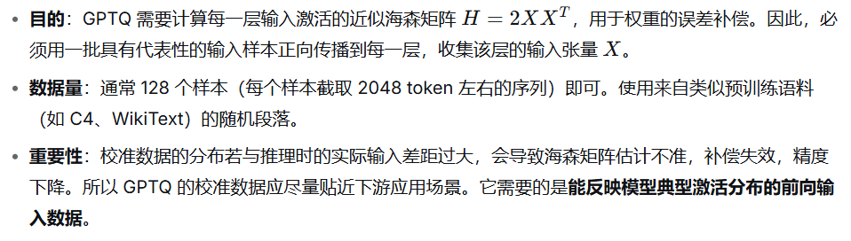

# 65.大模型（LLMs）GGUF 与 GPTQ 对比

#### GGUF 和 GPTQ 分别代表哪类量化方案？从文件格式、量化方法和运行后端角度对比。

GGUF 和 GPTQ 常被并列讨论，但它们本质上是不同层面的技术：GGUF 是一种模型存储与分发格式，配套多种启发式量化算法，主要服务于 CPU/边缘推理；GPTQ 则是一套基于精确误差补偿的权重量化算法，通常结合 GPU 专用 kernel 使用。可以从三个维度来对比。

文件格式

- GGUF：全称 GPT-Generated Unified Format，是 llama.cpp 推出的统一二进制格式，旨在替代 GGML。它将模型架构、超参数、分词器、权重张量以及量化参数全部打包到一个单一文件中，支持内存映射 (mmap)，可实现极快的零拷贝加载。权重以压缩的低比特形式（如 4-bit 打包成 uint8）直接存储在文件里，推理时无需解压整个模型。

- GPTQ：GPTQ 本身是一种算法，它不规定文件格式。实践中，GPTQ 量化后的模型通常保存为 PyTorch 的 checkpoint（`.pt` 或 `.safetensors`），配合一个 `config.json` 描述量化配置（如 bits, group_size）。也常用 HuggingFace 的 `safetensors` 格式存储量化的权重和缩放因子。不具备单一文件的自包含特性，需依赖模型目录结构。

量化方法

- GGUF：采用无校准或极轻量校准的启发式量化。典型代表如 K-quant 系列（Q4_K_M、Q5_K_M 等），通过分块、重要度加权、混合精度等手段，在不需要校准数据集的情况下，直接将原始 FP16 权重转换为低比特。量化过程简单快速，但缺乏严格的误差最小化理论，精度依靠巧妙的工程设计。

- GPTQ：基于最优脑外科 (OBS) 框架的训练后量化。它使用约 128 个样本的校准数据集，逐层计算权重海森矩阵的逆，然后在量化每个权重时，利用该逆矩阵对剩余的未量化权重进行补偿更新，从而使该层的输出重构误差最小化。这种方法有坚实的二阶优化理论支撑，在 4-bit 下几乎无损。

运行后端

- GGUF：主要为 llama.cpp 打造，因此极致优化 CPU 推理（x86 AVX/AVX2/AVX512、ARM NEON），并支持 Apple Silicon (Metal)、NVIDIA CUDA、Vulkan 等多种后端，但在非 CPU 平台上的优化深度不如 CPU。

- GPTQ：几乎专属 NVIDIA GPU。依赖定制 CUDA kernel（如 AutoGPTQ、ExLlama、GPTQ-for-LLaMA），利用 Tensor Core 进行在线反量化的 FP16 矩阵乘法，在 GPU 上达到极高吞吐。CPU 支持非常有限。

总结：GGUF 是“一文件走天下”的通用压缩格式，倾向于免校准、CPU 优先；GPTQ 是“GPU 专用高精度压缩算法”，需要校准但精度有理论保证。

---

#### 为什么 GGUF 模型文件通常可以包含多种量化类型（如 Q4_K_M、Q5_K_M）？这种设计的优势。

这个问题可以从两个层面理解：一是社区生态层面，一个模型会提供多个不同量化级别的 GGUF 文件，每个文件采用一种量化类型；二是技术层面，同一个 GGUF 文件内部，K-quant 策略本身就混合了多种量化精度。

技术层面：K-quant 的内部混合精度\
以 `Q4_K_M` 为例，这并非整个模型严格使用 4-bit 量化。K-quant 采用 superblock 结构，将权重矩阵分成大小为 256 的块（superblock），每个 superblock 内又分为 16 个子块（各 16 个权重）。该结构内包含了不同精度的元数据和量化值：

- 每个 superblock 有一个 FP16 的绝对缩放因子。

- 每个子块有一个 6-bit 的局部缩放因子（量化粒度更细，保护重要子块）。

- 子块内的权重主体被量化为 4-bit。

- 还有一部分模型（如注意力层的部分权重）可能使用更高精度（如 6-bit）的 K-quant 变体。

因此，一个 `Q4_K_M` 文件内部，实际上是一个混合精度量化方案：主要用 4-bit 节省空间，但对关键的缩放信息和重要权重块保留了更高的精度（6-bit 缩放因子、部分权重可能用 5/6-bit）。其他类型如 `Q5_K_M` 则主体用 5-bit，内部同样包含多级精度。

社区分发层面：多文件满足不同需求\
开发者通常会为一个模型提供一组 GGUF 文件：`Q2_K`、`Q3_K_S`、`Q4_K_M`、`Q5_K_M`、`Q8_0` 等。用户根据硬件内存和精度要求自由选择，文件之间独立，但格式统一，由同一套 llama.cpp 后端支持，非常灵活。

设计的优势：

1. 精度-大小最优平衡：混合精度让重要权重获得更高比特，避免“短板效应”，在同等平均比特下获得远优于均匀量化的质量。

2. 分级供给，适配广泛硬件：从 2-bit 到 8-bit 的完整序列，使同一个模型可在 4GB 树莓派到 128GB 服务器的各种设备上运行。

3. 加载与计算零开销切换：由于元数据都在文件内，推理引擎自动识别，用户无需手动干预。

---

#### GPTQ 量化后的模型能否直接转换为 GGUF 格式？需要什么步骤？

不能直接无损转换，因为两者的量化参数、存储布局和底层假设完全不同。但可以通过“反量化 → 重新量化”的路径间接转换，且会引入额外精度损失。

步骤概述：

1. 加载 GPTQ 模型并反量化为 FP16\
   使用 AutoGPTQ 或 ExLlama 加载 GPTQ 模型，因为 GPTQ 权重以 INT4 打包存储并附带分组缩放因子。通过其提供的接口，可以将模型还原为 FP16 精度（实际是在推理时动态反量化，但我们可以将每一层的权重显式地重建为 FP16 矩阵）。需要注意，GPTQ 的量化误差已经固化，重建出的 FP16 权重是“带量化噪声的原始权重”。

2. 保存为 FP16 的 HuggingFace 格式\
   将上一步得到的 FP16 权重保存为标准 PyTorch 或 safetensors 检查点，配齐配置文件，构成一个普通的 FP16 模型。

3. 使用 llama.cpp 的转换脚本和量化工具
  - 运行 `convert-hf-to-gguf.py`，将上述 FP16 模型转换为未量化的 GGUF 格式（F16 或 F32）。
  - 然后使用 `llama-quantize` 工具，指定目标量化类型（如 `Q4_K_M`），将 FP16 GGUF 文件量化为最终的 GGUF 文件。这个过程会重新应用 K-quant 等启发式量化，产生新的量化误差。

重要注意点：

- 精度损失会累积：GPTQ 量化已引入一轮误差，反量化再重量化时，第二轮误差叠加，最终 GGUF 模型的 PPL 通常高于直接从原始 FP16 做 GGUF 量化的结果。

- 分组信息丢失：GPTQ 的精细分组补偿信息在转为 FP16 后完全丢失，GGUF 量化不会利用这些。

- 更好的做法：如果源模型有公开的原始 FP16 权重，直接从原始权重生成 GGUF 文件，避免经过 GPTQ 中间格式。GPTQ 与 GGUF 适用于不同的部署场景，一般没必要互相转换。

因此，技术上可行，但实践中不推荐。直接从原始模型出发各取所需才是保持精度的最优解。

---

#### 在 GPU 上，为什么 GPTQ 通常提供比 GGUF 更高的推理吞吐？

尽管 GGUF 也有 CUDA 后端，但在 GPU 上的推理吞吐通常不及专门的 GPTQ kernel，主要原因如下：

1. Kernel 优化深度不同
  - GPTQ kernel（如 ExLlama、AutoGPTQ）是专门针对 NVIDIA GPU 架构（Ampere 及以上）手写优化的 CUDA 内核。它们使用了 `mma.sp.sync` Tensor Core 指令、`cp.async` 异步拷贝、高度调优的 block 大小和 warp 调度，能够将权重反量化与 FP16 矩阵乘完美流水线化，达到极高的硬件利用率。
  - GGUF 的 CUDA kernel（llama.cpp 的 CUDA 后端）更通用，要兼顾多种量化类型和较老的 GPU，优化深度不足。其反量化通常使用 CUDA 核心（而非 Tensor Core）完成，再调用标准 FP16 GEMM，或者使用不够高效的整数计算，导致内存带宽和计算单元的利用率低于专用 kernel。

2. 内存布局和访问模式
  - GPTQ kernel 要求权重以特定的交错布局（如 `packed_row`）存储，使得在加载时能合并访问并直接送入 Tensor Core。组缩放因子也被预加载到 shared memory 中，与计算重叠。
  - GGUF 格式设计优先考虑 CPU 的连续读取和 mmap，其在 GPU 上的数据布局可能不是最优的，产生非合并的内存事务，浪费带宽。

3. 计算方式的根本差异
  - GPTQ 采用 W4A16 模式：权重 INT4，激活 FP16。Kernel 在 shared memory 中将权重解包为 FP16，然后使用 FP16 Tensor Core 执行矩阵乘。这充分利用了 GPU 的主力算力单元。
  - GGUF 在 GPU 上可能退化为使用 CUDA 核心的整数乘加，或者虽然也转为 FP16，但解包效率低。最新 llama.cpp 正在改进，但历史积累使得其 GPU 性能一直落后于 GPTQ 专用 kernel。

4. 对分组量化支持的高效性
  - GPTQ 的 group-wise 量化通常在 kernel 内以精细的方式处理缩放因子，每一小批权重完成解包后立刻使用对应的缩放因子，数据复用率高。
  - GGUF 在 GPU 上处理 K-quant 的多级缩放时，需要更多索引计算和分支，降低了执行效率。

总结：GPTQ kernel 是“GPU 原生”的极致优化，而 GGUF 的 GPU 后端是“CPU 优先”的扩展，因此前者的推理吞吐、显存带宽利用率和计算效率在 GPU 上明显占优。

---

#### llama.cpp 主要使用哪种格式？它如何利用 CPU 的 SIMD 指令加速 GGUF 推理？

llama.cpp 主要使用 GGUF 格式。它是 GGUF 的原生引擎，二者深度绑定。llama.cpp 在 CPU 上实现高性能推理的关键，在于直接利用 SIMD 指令集对量化权重进行融合乘加运算，避免显式反量化。

SIMD 加速的具体方式：

1. 权重的量化存储与加载\
   GGUF 中，Q4_0 等量化类型的权重被连续打包，例如每两个 4-bit 权重拼成一个 `uint8`，并且附有 block-wise 的 FP16 缩放因子。模型加载时通过 mmap 直接映射到内存，数据就处于这种压缩形式。

2. 整数点积指令的运用\
   以 x86 AVX2 为例，核心指令是 `_mm256_maddubs_epi16`（Multiply and Add Packed Signed and Unsigned Bytes）。它可一次性处理 32 个 8-bit 整数：
  - 将一块打包的 uint8 权重解包为带符号的 8-bit 整数（利用 `_mm256_sign_epi8` 等处理符号）。
  - 将对应激活（通常也会动态量化为 uint8，或保持在 FP16 但用其他方式）加载到向量寄存器。
  - 使用 `_mm256_maddubs_epi16` 得到 16-bit 的部分积，再用 `_mm256_madd_epi16` 将部分积与 16-bit 缩放因子结合，累加到 32-bit 整数累加器。\
    整个过程完全在寄存器内完成，不写入中间反量化的 FP16 矩阵，避免了高昂的内存开销。

3. 权重与缩放因子的融合处理\
   K-quant 的 superblock 包含多级缩放因子。llama.cpp 的 kernel 会顺序加载 superblock 的全局缩放因子（FP16），然后对于每个子块，加载其子缩放因子（6-bit 量化的），在寄存器内实时计算出每个权重的最终浮点值，再与激活相乘累加。这些操作被展开成紧凑的 SIMD 指令序列，利用了 CPU 强大的整数吞吐和向量宽度。

4. 多线程并行\
   llama.cpp 将矩阵乘按行切分，使用 OpenMP 或其他线程池分配到多个 CPU 核，每个核独立处理一段权重，配合 SIMD，在内存带宽允许下达到近线性的多核加速。

结果：这种融合设计使得在支持 AVX2 的现代 CPU 上，运行 7B 量化的 GGUF 模型可以达到 20~40 tokens/s 的生成速度，足以支持实时对话，且内存占用极低。

---

#### 解释 GGUF 中的 K‑quant 策略（如 Q4_K_M）如何对权重进行分块和重要度保护。

K‑quant 是 GGUF 中的高级量化系列（以 `_K` 结尾），它不同于简单的 Q4_0 均匀量化，而是采用了多级分块、混合精度和重要度保护，在低比特下显著提升精度。以 `Q4_K_M` 为例剖析其策略。

Superblock 分块结构

每个权重矩阵被划分为大小为 256 个元素的 superblock（注：具体大小可能因变体而异，但典型为 256）。每个 superblock 独立处理，是量化和存储的基本单元。

多级缩放因子设计

- Superblock 级：每个 superblock 拥有一个 FP16 (16-bit) 的绝对缩放因子 `d`，代表该块的整体幅度。这是最大的尺度。

- Sub-block 级：superblock 内进一步切分为 16 个子块（每个子块 16 个权重）。每个子块获得一个 6-bit 量化的小缩放因子 `m`（存储时打包）。它捕捉了子块相对于 superblock 整体的微小波动。最终子块的权重实际缩放为 `d * m`。

重要度保护（混合精度）

K‑quant 的核心在于对关键信息分配更多比特：

- 那个 6-bit 的子块缩放因子 `m`，正是对重要权重的精细保护。由于缩放因子本身也用了 6-bit，它能够以较高分辨率表达该子块权重的幅度变化。相比用一个统一的缩放因子，这相当于根据子块的重要性（即幅度）给予自适应的量化步长。

- 对于权重本身：在 `Q4_K_M` 中，绝大多数权重（如 256 个中的大部分）被量化为 4-bit，但某些变体会对 superblock 中的极小部分（如第 0 个子块）使用更高精度（如 6-bit）——即 `M` 代表混合（Mixed）。这样关键的头/尾权重或中心权重得到更好的保留。

- 此外，还有一些超级重要的层或注意力头可能整体使用不同的 K-quant 级别，这由量化工具内部决定。

量化与解包流程\
量化时，对每个子块计算局部最优的 `m`（通过最小化量化误差），然后与全局 `d` 一起存储。推理时，CPU SIMD kernel 在寄存器中执行：`weight_val = d * (m * (int4_val - zero))` 或类似融合计算，无缝利用多级缩放。

优势总结：通过 superblock 和子块的分级缩放，K‑quant 实现了接近 per-channel 或更细粒度的动态范围适配，同时用极少的额外存储（6-bit/子块）换取了巨大的精度提升，是 GGUF 在 4~5 比特区间达到优异困惑度的关键。

---

#### GPTQ 的量化过程是否需要校准数据集？GGUF 呢？二者所需的校准数据有何不同？

GPTQ 必须依赖校准数据集，且其校准数据的质量和数量对最终精度至关重要。GGUF 的 K-quant 等常见方法通常不需要校准数据集，属于无校准（calibration-free）或仅需极少统计的量化。

GPTQ 的校准数据需求：

- **目的**：GPTQ 需要计算每一层输入激活的近似海森矩阵 $H=2XX^T$，用于权重的误差补偿。因此，必须用一批具有代表性的输入样本正向传播到每一层，收集该层的输入张量 $X$。
- **数据量**：通常 128 个样本（每个样本截取 2048 token 左右的序列）即可。使用来自类似预训练语料（如 C4、WikiText）的随机段落。
- **重要性**：校准数据的分布若与推理时的实际输入差距过大，会导致海森矩阵估计不准，补偿失效，精度下降。所以 GPTQ 的校准数据应尽量贴近下游应用场景。它需要的是**能反映模型典型激活分布的前向输入数据**。

{.ocr-src}

GGUF 的校准数据需求（以 llama.cpp 的常用流程为例）：

- 主要方式：无校准。`llama-quantize` 工具在量化时，仅读取权重本身的数值分布。它采用分块、计算每个块的 min/max 或基于均方误差的缩放因子，完全基于权重张量内部统计，不需要任何输入样本。这种量化属于“权重量化”，不涉及激活。

- 少数情况：重要性矩阵引导。llama.cpp 也支持用少量校准数据计算“importance matrix”（如通过 `--imatrix` 选项）。此时，它会用一些文本运行模型，记录每个权重的激活重要性（类似于 AWQ 的激活感知），然后引导量化（如 IQ 系列量化）。但这在 GGUF 生态中并非必需，大多 K-quant 文件是直接通过无校准方式生成的。

- 所需数据：如果需要 importance matrix，仅需少量（如 10~50 条）与任务相关的文本，用于统计权重的重要性分数，其校准成本远低于 GPTQ 的逐层海森计算。

总结区别：

- GPTQ 的校准数据是强必需，用于二阶误差补偿，直接影响量化质量。

- GGUF 的常用流程（K-quant）天然无校准，简化了量化流程，具有更好的普适性，代价是精度略低于经过精心校准的 GPTQ/AWQ 方案。

---

#### 为什么 GGUF 在 CPU 推理时表现出色，但在 GPU 上不如 GPTQ 或 AWQ？

这源于 GGUF 格式与 llama.cpp 的设计哲学是为 CPU 而生，其优化点和硬件假设在 GPU 上不再适用，甚至成为瓶颈。

CPU 上表现出色的原因：

- 融合整数 SIMD 计算：CPU 的 SIMD 指令（AVX2/AVX-512）对整数操作极其强大，且延迟低。GGUF kernel 利用 `_mm256_maddubs_epi16` 等指令直接处理打包的 INT4/INT8 权重，并与激活的量化值进行整数乘加，只在最终累加时转为浮点。这完美匹配了 CPU 高整数吞吐、低浮点算力的特性。

- 内存连续与 mmap：权重以紧凑、连续的方式存储在文件中，通过 mmap 直接映射到进程地址空间，无需加载时解压。CPU 有巨大内存（可扩展到 TB 级）且支持按需分页，大模型启动几乎瞬间完成，且系统页缓存能高效复用。

- 无 GPU 启动开销：省去了 CUDA kernel 启动、显存分配和数据传输的延迟，极低延迟，适合单 token 解码的带宽受限场景。

GPU 上不如 GPTQ/AWQ 的原因：

- 无法高效利用 Tensor Core：现代 GPU (A100/H100) 的主力算力来自 Tensor Core，它们专为 FP16/BF16/INT8 矩阵乘优化，且需要特定的数据布局和指令。GPTQ/AWQ kernel 正是将 INT4 权重在 shared memory 中解包为 FP16，然后通过 `mma.sync` 用 FP16 Tensor Core 计算，达到极高吞吐。GGUF kernel 在 GPU 上往往退化使用 CUDA 核心的整数运算或低效的 FP16 转换路径，无法发挥 Tensor Core 的算力，算力利用率极低。

- 内存带宽利用不充分：GPU 的 HBM 带宽巨大，但要求合并访问（coalesced access）才能达到峰值。GGUF 的权重排布和 K-quant 的多级索引可能导致非合并访问，且缩放因子的读取模式不够 cache 友好。专用 GPTQ kernel 则精心设计了权重交错存储，确保线程束访问连续对齐，最大化带宽利用。

- 并行粒度不适配：CPU 是少核心、强单线程；GPU 是数千线程同时运行。GGUF kernel 原本为 CPU 设计的细粒度子块循环，在 GPU 上可能造成线程束内的分支分歧（divergence）或共享内存 bank conflict，无法充分占满 GPU 的 SM。

- 生态优化投入差异：GPTQ 和 AWQ 有大量开发者专注于 GPU kernel 优化，而 llama.cpp 的 GPU 后端长期是辅助角色，优化力度和人力投入远不及 CPU 端。

因此，GGUF 在 CPU 上是精雕细琢的利器，在 GPU 上则是能用但非最优的通用工具。若追求极致的 GPU 推理吞吐，GPTQ/AWQ 是更专门的选择。

---

#### 对比 GGUF 和 GPTQ 在模型加载时间上的差异：分别需要进行哪些预处理？

模型加载时间直接影响服务启动速度和冷启动延迟，GGUF 在这方面具有天然的巨大优势。

GGUF 的加载过程（极快）

1. 内存映射 (mmap)：llama.cpp 通过 mmap 将整个 GGUF 文件直接映射到进程的虚拟地址空间。此时数据并未真正读入物理内存，仅仅是建立了映射关系。

2. 按需分页加载：当推理内核首次访问某部分权重时，操作系统产生缺页中断，自动将该部分文件内容读入内存。由于推理是按层顺序进行，只有正在使用的层权重才会被加载，而且可以流式进行。

3. 无解压步骤：权重在文件内以最终量化格式存储，与推理时内存中的格式完全一致，无需任何批量解压或重排。唯一可能的是对文件头进行极简的解析（读取模型配置、张量偏移等），耗时可以忽略不计。

4. 实际时间：加载一个几十 GB 的 GGUF 模型，因为 lazy loading，感知时间几乎是瞬间（毫秒级）。首次推理时可能有预热性的少量缺页延迟，但总体远小于全量加载。

GPTQ 的加载过程（较慢）

1. 读取完整的权重文件：GPTQ 模型通常保存为多个 `.safetensors` 分片。加载时，需要将这些分片从磁盘完整读入内存（CPU RAM），并解析张量。

2. 量化参数重建与校验：需要读取并整理每个权重矩阵对应的分组缩放因子、零点、以及打包的 INT 权重。这些元数据在 Python 环境中被包装为特定对象。

3. 显存拷贝与格式转换：对于 GPU 推理，还需将权重张量从 CPU 内存拷贝到 GPU 显存。如果引擎需要特定的权重布局（如 ExLlama 的重排格式），则会进行额外的内存转换和重排，这涉及大量的显存 I/O 和计算。

4. Kernel 编译/初始化（JIT 相关）：首次加载时，如使用 AutoGPTQ，可能涉及 CUDA kernel 的即时编译或加载动态库，增加初次启动时间。

5. 实际时间：对于 7B~13B 模型，GPTQ 加载可能需要 数秒到十几秒；70B 模型可能需要半分钟甚至更久，其中大部分时间消耗在磁盘 I/O 和 CPU→GPU 数据传输上。

对比总结：

- GGUF：mmap + 零解压 + 零拷贝，几乎零等待，特别适合需要快速切换模型或频繁重启的边缘场景。

- GPTQ：全量读取 + 显存拷贝 + 可能的重排，有秒级的冷启动成本，但在服务端长时间运行后，此开销可摊薄。

GGUF 这种极速加载能力，是 llama.cpp 在本地消费级应用中广受欢迎的核心竞争力之一。

---

#### 在相同的 4‑bit 量化精度下，GGUF 和 GPTQ 的模型大小和运行内存是否相等？为什么？

不相等，二者在模型大小和运行内存上均有差异。 即使同为 4‑bit，由于元数据开销、存储布局及运行时处理的差异，最终占用的磁盘与物理内存并不同。

模型文件大小：

- GPTQ：通常存储为多个 `.safetensors` 分片，包含打包的 INT4 权重和分组缩放因子。以 group_size=128 为例，每个权重额外需要 `2 bytes / 128 = 0.015625 bytes` 的 FP16 缩放因子。4‑bit 权重打包后每权重占用 0.5 bytes，总约 0.5156 bytes/weight。另外还有配置文件等，总体体积约为 FP16 的 26% 左右。

- GGUF：以 Q4_K_M 为例，采用 superblock 结构，每个 256 元素的 superblock 配备 1 个 FP16 绝对缩放因子 (2 bytes) 和 16 个 6‑bit 子缩放因子 (共 12 bytes)，所以每权重额外开销为 `(2+12)/256 ≈ 0.0547 bytes`。4‑bit 权重占 0.5 bytes，总计约 0.5547 bytes/weight。因此 GGUF 文件的体积通常比同等 4‑bit 的 GPTQ 文件稍大（约 7-10%）。

运行时内存：

- GPTQ (GPU)：权重以打包格式驻留在 GPU 显存中，与文件大小相当。推理时 kernel 动态反量化，不产生永久性 FP16 副本。运行时内存约等于模型文件大小加上中间激活、KV Cache 等。

- GGUF (CPU)：通过 mmap 映射，文件中的压缩数据直接作为内存中的权重表示。由于使用了整数 SIMD 融合计算，一般不需要显式反量化到 FP16 缓冲区，因此内存占用也与文件大小相近。但某些后端（如 GPU 推理时）可能会将权重解包为更容易处理的格式，占用更多内存。

为何不相等？ 因为二者量化结构不同：GPTQ 是按组量化，元数据是 FP16 缩放因子；GGUF 的 K‑quant 使用两级缩放，元数据更复杂，占用稍多。另外，GPTQ 有时采用对称量化，无需零点，而部分 GGUF 类型会保留零点，也会增加体积。

因此，即使同为 4‑bit，GGUF 通常比 GPTQ 稍大，但在实际部署中，这个差异相对于整体压缩率来说很小，不影响选择；更应关注精度和推理速度。

---

#### 一个模型经过 GPTQ 量化后，还可以用 bitsandbytes 加载吗？与 GGUF 的关系。

GPTQ 量化后的模型通常不能直接使用 bitsandbytes 加载，因为二者的量化格式、存储方式和底层 kernel 不兼容。

原因详述：

- bitsandbytes 主要实现动态量化（8‑bit 权重）和 4‑bit 的 NF4 量化。它的 4‑bit 加载方式是将 FP16 权重在加载时压缩为 bitsandbytes 自定义的 4‑bit 块状结构，并调用其专用的 CUDA kernel 进行计算。输入的模型必须是 FP16/BF16 的原始权重。

- GPTQ 模型的权重已经是提前量化为 INT4 的打包格式，伴随分组缩放因子，存储为特殊的 `g_idx`, `qweight`, `qzeros`, `scales` 等张量。bitsandbytes 不认识这种结构，无法解析，即使强逼也会报错。

如果确实想混用： 必须先将 GPTQ 模型反量化回 FP16（如前所述），然后再用 bitsandbytes 加载该 FP16 模型并实时量化为其自身格式。这既增加了步骤，又叠加了两重量化误差，极不推荐。

与 GGUF 的关系：

GGUF 同样是一种量化格式，bitsandbytes 也不支持 GGUF。三者是各自独立的生态系统：

- GPTQ → GPU 专用，校准量化，需 AutoGPTQ/ExLlama 等加载。

- GGUF → CPU/边缘优先，启发式量化，需 llama.cpp 加载。

- bitsandbytes → 通用 GPU 动态量化，集成在 HuggingFace transformers 中，使用便捷但精度和速度一般。

因此，三者无直接转换关系，需根据部署环境选择合适的格式。

---

#### 如何在 vLLM 中使用 GPTQ 量化模型？GGUF 模型能被 vLLM 加载吗？

在 vLLM 中使用 GPTQ 量化模型：

vLLM 官方支持 GPTQ 模型，且提供专门的量化后端。步骤如下：

1. 安装依赖：确保安装 `auto-gptq` 和 `vllm`。

2. 下载模型：从 HuggingFace 下载 GPTQ 格式的模型（目录下包含 `config.json` 中 `quantization_config` 字段，指定 `quant_method: "gptq"`）。

3. 启动服务或离线推理：
  - 使用 `LLM` 类：`llm = LLM(model="TheBloke/Llama-2-7B-GPTQ", quantization="gptq")`。vLLM 自动识别并加载 GPTQ 专用 kernel。
  - 或者启动 API 服务器：`python -m vllm.entrypoints.openai.api_server --model ... --quantization gptq`。

4. vLLM 内部机制：它调用 `vllm.model_executor.layers.quantized_gptq` 中实现的 GPTQ 算子，将分组权重解包并与激活进行计算，完美融合分页注意力（PagedAttention），实现高吞吐。

GGUF 模型能被 vLLM 加载吗？

官方不支持。 vLLM 设计面向服务端 GPU 推理，其核心依赖是定制的 CUDA kernel 和 PagedAttention，对模型的加载格式有严格要求。GGUF 是 llama.cpp 的专用格式，vLLM 没有内置 GGUF 解析器和对应的计算 kernel。

- 如果必须使用 GGUF，通常需要通过 llama-cpp-python 或其服务器绑定来启动 API，而非 vLLM。

- 社区有尝试将 GGUF 模型转换为 vLLM 可读的格式，但无官方方案。

总结：vLLM 是 GPTQ/AWQ 等 GPU 量化格式的天然宿主，GGUF 则不属于其生态。

---

#### 分析 GGUF 的 offloading 能力：能否将部分层卸载到 GPU，其余在 CPU？

GGUF 具有灵活的层卸载能力（Layer Offloading），这是其核心竞争力之一。 通过 llama.cpp 的 GPU 后端，可以将模型的任意前 N 个层放置在 GPU 上加速，剩余的层留在 CPU 上运行，实现 CPU+GPU 混合推理。

实现机制：

- llama.cpp 在加载模型时，根据 `--n-gpu-layers` 参数（或其他 API 调用）决定将多少层 Transformer 的权重张量拷贝到 GPU 显存。

- 对于卸载到 GPU 的层，计算在该层的 CUDA kernel 上执行；对于 CPU 上的层，使用高度优化的 CPU SIMD kernel。中间激活在 GPU 与 CPU 之间传输（通常通过 PCIe）。

- 用户可以细粒度调节，例如将大部分层放在 GPU，仅少量溢出层放在 CPU，以适应显存小于模型大小的硬件。

优势：

- 打破了“必须完整加载到显存”的限制，让显存较小的 GPU（如 4~8GB）也能运行大模型，只是速度会受 PCIe 带宽影响。

- 结合 mmap，启动速度仍然极快，卸载层可以在推理过程中按需加载。

与 GPTQ 对比：

GPTQ 模型通常要求完整加载到 GPU 显存，因为其 kernel 是为纯 GPU 执行设计的。虽然理论上可以在 CPU 上运行 GPTQ 模型（通过 AutoGPTQ 的 CPU 后端），但速度极慢，也不支持层级别的混合卸载。因此，GGUF 在混合硬件环境下的弹性远胜于 GPTQ。

结论：GGUF 通过 llama.cpp 实现了极佳的 offloading 能力，非常适合个人用户利用集显+独显或小显存运行大模型。

---

#### 用 GGUF 做多 GPU 推理是否可行？与 GPTQ 的多 GPU 部署对比。

GGUF 做多 GPU 推理是可行的，但实现方式和效果与 GPTQ 不同。

GGUF 多 GPU（llama.cpp）：

- llama.cpp 支持通过 `--tensor-split` 参数将模型的张量按比例分配至多块 GPU（如 `--tensor-split 10,14` 将模型权重按大小切分到两块 GPU 上）。这是模型并行（tensor parallelism 的一种简单形式：将层放置在多个设备上）。

- 推理时，计算跨 GPU 顺序执行，不同层之间通过 PCIe 或 NVLink 传输中间激活。由于 llama.cpp 并非真正的张量并行（未在单层内切分矩阵乘），当单层无法放入一块 GPU 时，该方法受限。

- 此外，llama.cpp 的 CUDA 后端对多 GPU 的优化较初步，通信开销大，不适合需要极高吞吐的服务场景。

GPTQ 多 GPU 部署：

- 主流框架（如 vLLM、TensorRT-LLM）支持张量并行 (Tensor Parallelism)，可以将单个注意力头和 FFN 矩阵切分到多个 GPU 上，并利用 NCCL 进行 all-reduce 通信。GPTQ 模型可无缝接入这些并行策略。

- 另外 GPTQ 也可以配合流水线并行 (Pipeline Parallelism)，将不同层放在不同 GPU。由于有成熟的 GPU 集群推理框架支持，多卡扩展线性度好，吞吐高。

对比总结：

- GGUF 多 GPU 属于“能跑”，适合个人用户手上有几块旧 GPU，想把玩大模型，但性能和扩展性有限。

- GPTQ 多 GPU 是生产级方案，依托专业框架，可实现高吞吐、低延迟的大规模部署。

---

#### 在边缘设备（如树莓派）上，你更倾向于用 GGUF 还是 GPTQ？为什么？

毫无疑问，必须选择 GGUF。GPTQ 在树莓派上完全不切实际。

理由如下：

1. 硬件匹配度：树莓派是 ARM CPU，无 NVIDIA GPU。GPTQ 依赖 CUDA 和特定 GPU kernel，无法运行；即使有 CPU 后端（如 GPTQ-for-LLaMA 的 CPU 版本），速度也慢到无法使用，且缺乏 ARM NEON 优化。GGUF 则专为 CPU 设计，llama.cpp 对 ARM NEON 指令集有深度优化，能在树莓派上实现虽慢但可用的生成速度。

2. 内存效率：树莓派内存小（4GB 或 8GB）。GGUF 的 mmap 加载方式让模型仅在访问时占用物理内存，且可开大量 swap。GPTQ 加载则需要将整个模型读入内存并可能额外分配缓冲区，极易 OOM。

3. 生态支持：llama.cpp 可在树莓派上直接编译运行，社区大量成功案例。GPTQ 则基本无缘此类设备。

4. 量化灵活性：GGUF 提供了从 2-bit 到 8-bit 的丰富类型，可以针对树莓派选极低比特（如 Q2_K）以减小模型和内存；GPTQ 的 4-bit 或许可，但无法运行。

因此，边缘 ARM 设备上 GGUF 是唯一现实选择。

---

#### 量化精度损失方面，GGUF 与 GPTQ 通常谁的表现更好？在什么任务上会有差异？

整体上，GPTQ 的 4‑bit 量化精度通常略优于 GGUF 的 4‑bit 类型（如 Q4_K_M），尤其是在知识密集型任务和复杂推理上。但差异较小，且 GGUF 在较高比特（Q5_K_M、Q6_K）时能反超。

原因分析：

- GPTQ 利用校准数据进行逐层误差补偿，理论上能使输出激活的重构误差最小化，对权重中的精细信息保留更佳，特别是在那些对权值扰动敏感的层。

- GGUF 的 K‑quant 虽有多级缩放和重要度保护，但本质上仍是启发式、基于权重自身统计的量化，缺乏对激活分布的感知，难以补偿跨通道的误差。

任务差异体现：

- 事实性问答 / 知识回忆：GPTQ 常占优，因为事实性知识以较脆弱的权重模式存储，GPTQ 的误差补偿能更好保留。

- 数学推理 / 代码生成：对精确性要求高，GPTQ 通常困惑度更低，正确率更高。

- 语言连贯性与文本摘要：二者差距很小，GGUF 完全可用，有时主观感受甚至更好（因为 GGUF 在训练时未引入额外偏差）。

- 长上下文任务：GGUF 有时因为元数据开销较大，在长序列时 KV Cache 压力略大，但精度差异不显著。

注意：GGUF 的 Q5_K_M（5‑bit）在许多基准上可达到与 GPTQ 4‑bit 相当甚至更优的质量，而 Q6_K 几乎无损失，因此在 CPU 环境通过稍高比特可完全追平精度差距。

---

#### 如果希望量化一个微调后的 LoRA 适配器，GGUF 和 GPTQ 分别如何支持？

对 LoRA 适配器的量化支持，二者路径完全不同。

GPTQ 的处理方式：

- GPTQ 量化通常针对完整的合并后模型。流程是：先将 LoRA 适配器与基座模型合并（使用 PEFT 库的 `merge_and_unload()`），得到一个完整的 FP16 模型，然后对这个合并后的模型执行 GPTQ 量化。量化后的模型不再包含独立的 LoRA 权重。

- 也可以尝试只量化基座模型，然后在推理时动态加载 FP16 的 LoRA 适配器，但这样需要在计算时进行反量化后的混合精度加法，支持较少（AutoGPTQ 有实验性 LoRA 支持，通过 `--use-lora` 加载独立的 LoRA 权重并在 kernel 中融合）。

GGUF 的支持方式（llama.cpp）：

- llama.cpp 本身不支持动态 LoRA，但有一个重要特性：可将 LoRA 适配器预先融合并导出为 GGUF 格式。具体流程：
  1. 使用 `convert-lora-to-ggml.py` 等脚本，将 LoRA 权重与基座模型 GGUF 文件合并（或者先合并 FP16 再转为 GGUF）。
  2. 产生一个包含 LoRA 能力的完整 GGUF 模型文件。

- 从 2024 年开始，llama.cpp 也引入了动态 LoRA 加载（实验性）：可以在加载基础 GGUF 模型后，通过 `--lora` 参数指定一个独立的 LoRA 适配器文件（也是 GGUF 格式），推理时在线融合。这需要重新实现 LoRA 的矩阵乘，对量化权重进行反量化、加 LoRA、再量化的操作，性能有额外开销，但实现了不改变基座模型的多适配器切换。

对比总结：

- GPTQ 生态通常需要合并后量化，适合固定适配器的部署。

- GGUF 支持合并导出，也可尝试动态 LoRA，在边缘端提供了一定的灵活性。

---

#### 为什么 transformer 库原生不支持 GGUF，而需要额外的 llama-cpp-python？GPTQ 的支持如何？

Transformers 库原生不支持 GGUF 的原因：

- 设计哲学不同：Transformers 主要面向 PyTorch 生态，模型加载为标准的 `state_dict` 张量。GGUF 是二进制文件格式，包含自描述元数据和特殊的打包量化权重，与 PyTorch 的模型加载管道不兼容。

- 社区与维护责任：GGUF 由 llama.cpp 社区独立发展，变化快，合并到 Transformers 主库会引入巨大的维护负担，且 Transformers 作者团队不倾向纳入此格式。

- 依赖问题：支持 GGUF 需要引入 llama.cpp 的 C++ 解析和计算后端，这会让纯 Python 的 Transformers 变得臃肿。

llama-cpp-python 的角色：\
它是 llama.cpp 的 Python 绑定，提供了兼容 OpenAI API 的接口，并能够通过 `LlamaCpp` 类加载 GGUF 模型，提供与 Transformers 类似的体验。用户如果需要 GGUF，在 Python 中就用此库。

GPTQ 在 Transformers 的支持：

- Transformers 从 4.30 版本开始通过 `optimum` 集成 GPTQ。使用 `GPTQConfig` 和 `AutoModelForCausalLM.from_pretrained` 可直接加载 GPTQ 模型，内部调用 AutoGPTQ 或 optimum 的 GPTQ kernel。因此，GPTQ 模型在 Transformers 中是一等公民，可直接加载和推理，体验丝滑。

- 同时，vLLM、TGI 等框架也支持 GPTQ，所以 GPTQ 的生态覆盖远比 GGUF 广泛。

总结：GGUF 需要外部 Python 绑定，而 GPTQ 已被 Transformers 官方接纳，这是两者在开发者便利性上的显著差距。

---

#### 从开发者体验看，使用 GGUF 和 GPTQ 的便利性、文档和生态对比。

便利性：

- GPTQ：在 HuggingFace 生态中几乎无感集成。只需 `from_pretrained` 时指定 `device_map="auto"` 和 `quantization_config` 即可，代码改动极小。配合 vLLM 部署也简单。

- GGUF：需要安装 `llama-cpp-python`，使用不同的 API 类（`LlamaCpp`），且模型文件需单独下载，不能直接从 HuggingFace 的 `snapshot_download` 无缝使用。对熟悉 Transformers 的开发者有一定学习成本。

文档与社区：

- GPTQ 有大量官方和社区教程，AutoGPTQ、vLLM、TRL 等均有详尽的文档和示例。

- GGUF 文档主要集中在 llama.cpp 的 GitHub 仓库和 TheBloke 等模型发布者的说明中，相对零散，但胜在实操案例多。

生态丰富度：

- 几乎所有主流 GPU 推理框架都支持 GPTQ（vLLM, TensorRT-LLM, TGI, optimum 等）。模型分发平台如 HuggingFace 上有大量 GPTQ 量化模型。

- GGUF 模型主要存在于 HuggingFace 上由社区上传的额外文件，主流框架均不支持，但在本地/边缘部署领域拥有强大生态（ollama, LM Studio, llama.cpp 等）。

结论：服务端 GPU 开发者优先 GPTQ；本地/跨平台开发者更偏爱 GGUF 的便捷分发和极速加载。

---

#### 在连续批处理场景中，GGUF 后端是否支持？如果不能，如何解决？

连续批处理（Continuous Batching） 是现代 LLM 推理服务的关键技术，允许在已进入的请求尚未完成时动态插入新请求，极大提升吞吐。目前 GGUF 的官方 llama.cpp 服务器不完全支持这一特性。

llama.cpp 服务器的现状：

- llama.cpp 提供了 `server` 示例，它使用一个静态批处理模式：要么等到当前批次所有请求完成才处理下一批，要么只能进行简单的 slot 级别的并发。它缺少 fine-grained 的 token 级调度，无法实现真正的 continuous batching。

- 主要原因是其设计仍以单用户/低并发为主，调度器和内存管理未针对高吞吐服务做深度优化。

解决方案：

1. 使用 llama.cpp 的 `parallel` 模式：新版本的 llama.cpp 支持在单个上下文中并行处理多个序列（如 beam search 或多请求合并），但这不是真正的 continuous batching。

2. 采用第三方封装：如 llama-cpp-python 的 `LlamaCpp` 服务器尚未实现 continuous batching。但社区有项目试图结合 llama.cpp 与调度器（如 `aphrodite-engine` 的 GGUF 支持），不过未成主流。

3. 转为使用 GPTQ/AWQ + vLLM：如果需要 continuous batching 的生产级服务，应放弃 GGUF，将模型转为 GPTQ 或 AWQ 格式，部署到 vLLM 或 TensorRT-LLM，它们原生支持 PagedAttention 和 continuous batching，可达到数千 token/s 的并发吞吐。

4. GGUF 结合服务框架的探索：一些新兴项目如 Ollama 虽然底层用 llama.cpp，但通过请求队列和上下文切换模拟了一定的并发，不过其调度粒度较粗，未达到 continuous batching 的极致效率。

总结：GGUF 在连续批处理方面是明显短板。对于需要高并发服务的场景，应当换用 GPTQ/AWQ 等 GPU 专用格式。GGUF 更适合单用户或低并发场景。

