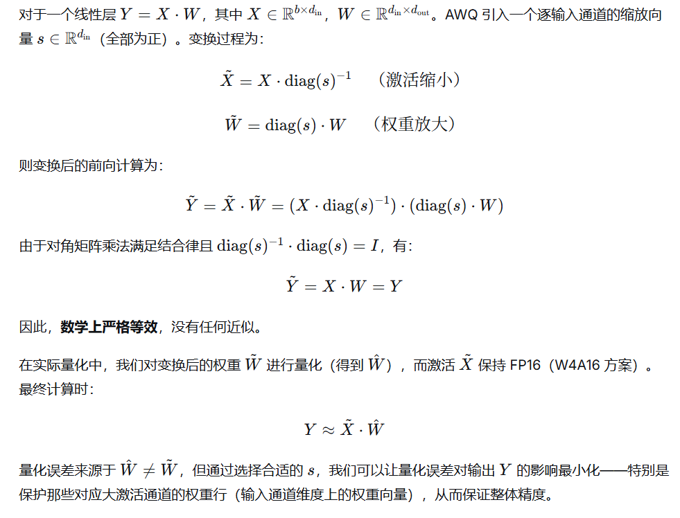
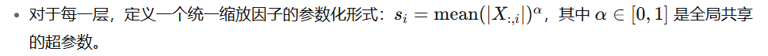
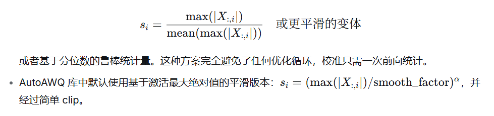
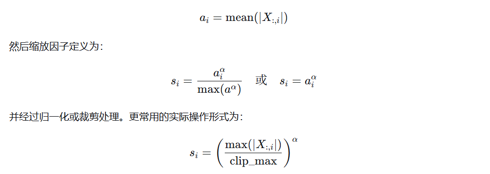
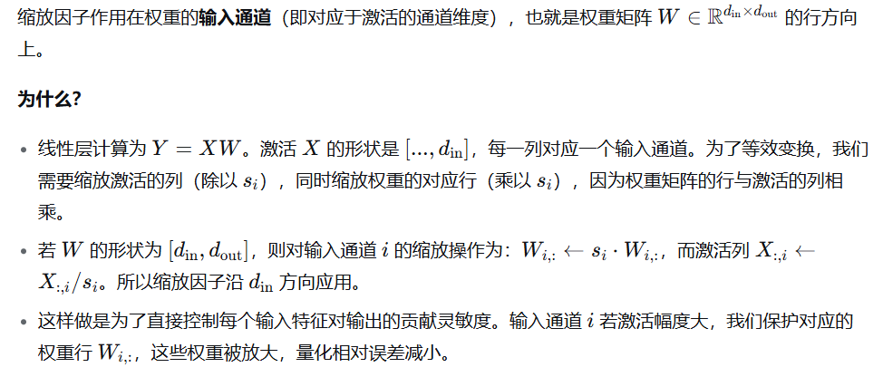
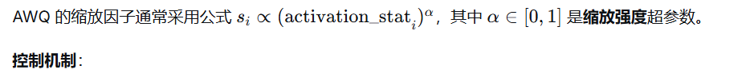
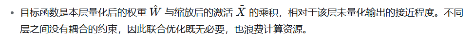
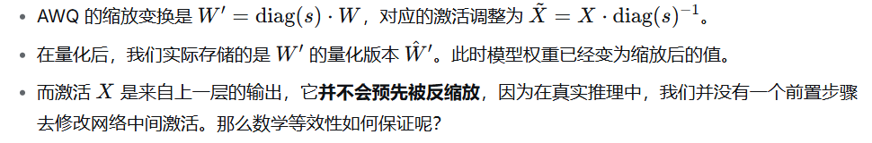
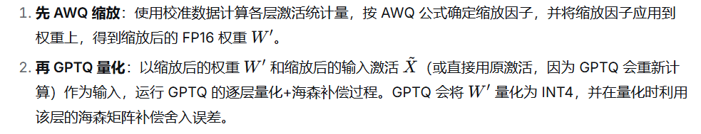

# 66.大模型（LLMs）AWQ 的缩放系数查找

#### AWQ 的核心观察是什么：为什么对显著权重进行缩放后再量化能减少误差？

AWQ 的核心观察是：大语言模型中，只有约 1% 的权重是“显著权重”（salient weights），它们对模型输出有不成比例的巨大影响。这些显著权重往往对应于激活幅度较大的通道。如果直接对所有权重进行均匀量化，这些重要权重所承受的量化误差会被极度放大，导致模型性能严重下降。 然而，简单地以混合精度保留这些显著权重（如部分 FP16）会破坏硬件的规则计算模式，降低推理效率。

AWQ 的解决思路：通过一个等效的数学变换——在量化前对权重矩阵逐通道乘以一个缩放因子 $s$（放大重要通道的权重），同时对应地缩小激活，使得：

- 显著权重的相对量化误差大幅减小：因为权重值被放大，量化步长相对其值变得更精细，舍入误差占比下降，重要信息得以保留。

- 激活的离群值被抑制：原本幅度大的激活通道被缩小，变得更平缓，更易于量化（若后续也量化激活），且在前向计算中不会引入任何数值误差。

这种缩放是无损的等效变换，因为权重乘以 $s$ 且激活除以 $s$，矩阵乘法结果不变。通过将量化误差从重要通道转移到不重要的通道，AWQ 在 4-bit 均匀量化下几乎达到了 FP16 的精度，且无需混合精度计算，硬件友好。

---

#### 写出 AWQ 中在权重上乘以缩放因子 $s$，并相应调整激活的数学过程，如何保证等效。

对于一个线性层 $Y=X\cdot W$，其中 $X\in\mathbb{R}^{b\times d_{\text{in}}}$，$W\in\mathbb{R}^{d_{\text{in}}\times d_{\text{out}}}$。AWQ 引入一个逐输入通道的缩放向量 $s\in\mathbb{R}^{d_{\text{in}}}$（全部为正）。变换过程为：

$$
\tilde{X}=X\cdot\mathrm{diag}(s)^{-1}\quad\text{（激活缩小）}
$$

$$
\tilde{W}=\mathrm{diag}(s)\cdot W\quad\text{（权重放大）}
$$

则变换后的前向计算为：

$$
\tilde{Y}=\tilde{X}\cdot\tilde{W}=(X\cdot\mathrm{diag}(s)^{-1})\cdot(\mathrm{diag}(s)\cdot W)
$$

由于对角矩阵乘法满足结合律且 $\mathrm{diag}(s)^{-1}\cdot\mathrm{diag}(s)=I$，有：

$$
\tilde{Y}=X\cdot W=Y
$$

因此，**数学上严格等效**，没有任何近似。

在实际量化中，我们对变换后的权重 $\tilde{W}$ 进行量化（得到 $\hat{W}$），而激活 $\tilde{X}$ 保持 FP16（W4A16 方案）。最终计算时：

$$
Y\approx\tilde{X}\cdot\hat{W}
$$

量化误差来源于 $\hat{W}\ne\tilde{W}$，但通过选择合适的 $s$，我们可以让量化误差对输出 $Y$ 的影响最小化——特别是保护那些对应大激活通道的权重行（输入通道维度上的权重向量），从而保证整体精度。

{.ocr-src}

---

#### AWQ 的缩放因子是如何搜索得到的？使用网格搜索还是基于梯度的优化？

AWQ 的缩放因子搜索不依赖昂贵的梯度下降或迭代优化，而是通过极轻量的启发式规则或小规模网格搜索。原文提出了两种实际方案，目前工程实现多采用基于激活统计的启发式公式。

方案一：网格搜索（早期或细粒度调优）

- 对于每一层，定义一个统一缩放因子的参数化形式：$s_i=\mathrm{mean}(|X_{:,i}|)^\alpha$，其中 $\alpha\in[0,1]$ 是全局共享的超参数。

{.ocr-src}

- 在少量校准数据（如 128 个样本）上，以一定的步长（如 0.05）在 [0, 1] 区间搜索最优的 $α$，使得量化后模型的困惑度（PPL）最低。这本质上是一维网格搜索，开销极小。

- 也可以对每层独立搜索不同的 $α$，此时搜索空间稍大，但仍可控，且可离线完成。

方案二：启发式公式（默认推荐）

- 直接根据激活分布计算缩放因子，无需搜索。典型公式为：

$$
s_i=\frac{\max(|X_{:,i}|)}{\mathrm{mean}(\max(|X_{:,i}|))}\quad\text{或更平滑的变体}
$$

或者基于分位数的鲁棒统计量。这种方案完全避免了任何优化循环，校准只需一次前向统计。

- AutoAWQ 库中默认使用基于激活最大绝对值的平滑版本：$s_i=(\max(|X_{:,i}|)/\mathrm{smooth\_factor})^\alpha$，并经过简单 clip。

{.ocr-src}

为什么无需昂贵优化？

AWQ 的等效缩放本质上是在重新分配量化误差的容忍度。由于权重和激活的分布特性明显，显著通道的比例极小且稳定，简单的启发式规则足以捕获重要通道并赋予合适的缩放，额外的细粒度优化收益甚微。这也是 AWQ 能以极低成本超越 GPTQ 等需要海森计算的算法的原因。

---

#### 为什么 AWQ 可以通过分析激活分布（如最大值或分位数）来确定每个通道的缩放系数，而不需要昂贵的最优化？

这源于 AWQ 洞察的本质：显著权重的识别及其所需的保护力度，直接反映在激活分布的幅度上。具体原因如下：

1. 显著权重与激活幅度高度相关\
   在 LLM 中，那些被频繁激活且幅度极大的特征通道，其对应的权重行对最终输出的贡献巨大。一旦这些权重被量化误差污染，损失会被大激活值成倍放大。因此，激活幅度本身就是权重重要性的天然代理，无需通过海森矩阵或梯度来间接衡量。

2. 缩放目标的直观性\
   AWQ 的目标是让量化后的权重在重要通道上的相对误差最小。通过令缩放因子 $s_i$ 正比于激活幅度，可以使该通道的权重被放大，从而量化网格相对于权重的分辨率提高。这个关系直观且单调：激活越大 → 缩放因子越大 → 权重被放大 → 相对量化误差减小。因此，只需激活幅度的统计量（如最大值、分位数、均值）即可确定缩放因子的理想大小。

3. 大模型的通道间方差极大\
   LLM 激活中离群值特征与其他正常特征差异可达百倍，分布呈现极度长尾。在这种悬殊下，基于粗粒度统计（如最大值）的简单规则便足以将通道明确分为“重要”和“不重要”两类，精细优化带来的边际改进极小。

4. 变换的平滑性\
   缩放因子 $s$ 被吸收到权重和激活中，整个过程是连续、平滑的，误差函数关于 $s$ 没有大量局部极值。因此，基于激活统计的启发式 $s$ 往往已经落在全局最优附近，无需复杂的最优化求解器。

综上，AWQ 利用激活分布直接计算缩放因子，是理论与工程结合的典范：用几乎零成本获得了接近最优的精度保护。

---

#### 描述 AWQ 论文中基于“激活分布”的启发式缩放因子公式。

AWQ 论文给出了一个简单而有效的启发式公式，利用校准数据的激活统计量来确定逐通道的缩放因子。

基本形式：\
设对于某一线性层，校准数据集上收集的输入激活为 $X$，对每个输入通道 $i$，计算其平均绝对幅度（或其他统计量）：

$$
a_i=\mathrm{mean}(|X_{:,i}|)
$$

然后缩放因子定义为：

$$
s_i=\frac{a_i^\alpha}{\max(a^\alpha)}\quad\text{或}\quad s_i=a_i^\alpha
$$

并经过归一化或裁剪处理。更常用的实际操作形式为：

$$
s_i=\left(\frac{\max(|X_{:,i}|)}{\mathrm{clip\_max}}\right)^\alpha
$$

{.ocr-src}

其中 $α$∈[0,1] 是控制缩放强度的超参数。当 $α$=0 时，所有 $s_i$=1，退化为无缩放；$α$=1 时，缩放因子完全正比于激活幅度，迁移最激进。

AutoAWQ 中的具体实现（默认）：

- 对每个通道，取激活的绝对最大值平滑版本：`act_max = max(|X_{:,i}|)`

- 应用平滑因子和缩放强度：`s_i = (act_max / smooth_factor) ^ alpha`，其中 `smooth_factor` 常设为全局 `act_max` 的均值或某个百分位数，防止极端值。

- 最后通常 clip 到 `[1e-5, 1e5]`，并保证缩放因子在合适的数值范围内，避免反量化时溢出。

效果：此公式使大激活通道获得大的 $s_i$，显著放大对应权重，从而减小其量化相对误差；小激活通道的权重则可能被相对缩小，但其对输出的影响本就微弱，额外误差可忽略。

---

#### 在实现 AWQ 时，缩放因子是作用在权重的输入通道还是输出通道？为什么？

缩放因子作用在权重的**输入通道**（即对应于激活的通道维度），也就是权重矩阵 $W\in\mathbb{R}^{d_{\text{in}}\times d_{\text{out}}}$ 的行方向上。

**为什么？**

- 线性层计算为 $Y=XW$。激活 $X$ 的形状是 $[\ldots,d_{\text{in}}]$，每一列对应一个输入通道。为了等效变换，我们需要缩放激活的列（除以 $s_i$），同时缩放权重的对应行（乘以 $s_i$），因为权重矩阵的行与激活的列相乘。
- 若 $W$ 的形状为 $[d_{\text{in}},d_{\text{out}}]$，则对输入通道 $i$ 的缩放操作为：$W_{i,:}\leftarrow s_i\cdot W_{i,:}$，而激活列 $X_{:,i}\leftarrow X_{:,i}/s_i$。所以缩放因子沿 $d_{\text{in}}$ 方向应用。
- 这样做是为了直接控制每个输入特征对输出的贡献灵敏度。输入通道 $i$ 若激活幅度大，我们保护对应的权重行 $W_{i,:}$，这些权重被放大，量化相对误差减小。

{.ocr-src}

常见误解澄清：有时会提到“逐输出通道缩放”（对 W 的每一列），但这通常是权重量化中 per-channel scaling 的概念，与 AWQ 的激活感知缩放不同。AWQ 的缩放是在激活-权重等效变换中，作用在输入通道上。两者可叠加使用。

---

#### AWQ 如何通过一个超参数 $α$ 来控制缩放强度？$α$ 过大或过小会有什么影响？

AWQ 的缩放因子通常采用公式 $s_i\propto(\text{activation\_stat}_i)^\alpha$，其中 $\alpha\in[0,1]$ 是**缩放强度**超参数。

**控制机制**：

{.ocr-src}

- $α$=0：所有 $s_i$=1，不进行任何缩放，退化为标准均匀量化。此时显著权重毫无保护，精度损失最大。

- $α$=1：缩放因子完全正比于激活统计量，重要通道的权重被最强力地放大，保护最激进。但同时可能过度放大某些极端通道的权重，导致该通道权重的动态范围过大，在量化时反而引入截断误差；且其他通道的权重被相对缩小，可能增加它们的量化误差。

- α 在 0 到 1 之间：提供一个平滑的权衡，既能保护显著权重，又避免过度扭曲权重分布。

$α$ 过大的影响：

- 权重矩阵的部分行数值变得极大，量化时可能因超出范围被截断，反而增加误差。

- 激活对应列变得极小，若后续层也需量化激活，可能造成下溢。

- 整体精度不升反降，PPL 曲线呈 U 型。

$α$ 过小的影响：

- 显著权重保护不足，量化误差集中在关键通道，模型性能显著下滑，尤其知识密集型任务。

实践中的选择：最优 $α$ 通常在 0.5 左右，或通过小范围网格搜索确定（如 0.3~0.7）。AutoAWQ 默认 $α$=0.5，在绝大多数模型和任务上取得了近乎最优的结果。

---

#### 为什么 AWQ 通常不需要微调（或仅需很少的校准数据）就能达到很好的精度？

AWQ 达到高精度的关键在于等效缩放的巧妙性，将量化误差从致命的显著权重转移到无伤大雅的非显著权重上，本质上是在一个连续、可微的变换空间中，通过极轻量的统计找到了近乎最优的误差分布方案。具体原因：

1. 缩放是等价变换，不破坏原始模型信息：在数学上，缩放前后的模型输出完全一致，所有原始知识完整保留，只是权重的数值分布被重新塑形，使其更适应均匀量化器的分辨率特性。

2. 启发式缩放因子的高效性：LLM 的激活离群值模式极其稳定且鲜明，基于简单统计量（如最大值）的缩放因子已经能够精准识别并保护显著权重，无需通过梯度反传来微调权重值。

3. 误差重分布而非抵消：GPTQ 依赖海森补偿，需要精确计算误差并更新其他权重来“抵消”损伤，这需要准确的校准统计量。而 AWQ 的缩放是一种“预防性”措施——在量化前就让重要权重变得更鲁棒，误差自然变小，不依赖于误差补偿的准确性。因此它对校准数据量的需求极低（通常 32~128 条样本仅用于计算激活统计量，而非用于误差补偿）。

4. 均匀量化的友好性：通过缩放，权重矩阵的重要部分被映射到量化范围的高分辨率区域，均匀量化器在此能提供更小的舍入误差。整个流程无需非均匀量化或混合精度，进一步降低了对精细调优的依赖。

因此，AWQ 凭借等效缩放这一优雅的思想，将量化变为一个几乎“免调试”的过程，仅需少量校准样本统计激活范围，即可实现 4-bit 无损压缩。

---

#### 解释 AWQ 与 SmoothQuant 在缩放思想上的异同。

相同点：

两者都利用了等效缩放变换来缓解量化难度，且都是通过数学上无损的方式将量化困难从激活转移到权重（或反之）：

- 都引入 per-channel 缩放因子 $s$，执行 X←X/s，$W$←$W$⋅$s$。

- 都基于“激活存在离群值，导致量化困难”的观察。

- 最终目标都是让量化后的模型精度尽可能接近 FP16。

不同点（核心差异）：

| 维度 | AWQ | SmoothQuant |  |  |  |  |
| --- | --- | --- | --- | --- | --- | --- |
| 主要优化对象 | 权重量化（W4A16 或 W4A8） | 激活量化（W8A8，实现真正的全整数量化） |  |  |  |  |
| 缩放方向 | 缩放因子作用于权重以保护显著权重，即放大重要权重，缩小对应激活。 | 缩放因子将激活的量化难度转移给权重，即缩小激活（抑制离群值），放大权重。 |  |  |  |  |
| 缩放因子选择 | 基于激活分布（最大值、分位数）的启发式规则，倾向于大激活通道对应大 $s$。 | 根据激活和权重的动态范围共同决定，通过公式 (s_j = \max( | X_j | )^{\alpha} / \max( | W_j | )^{1-\alpha})，追求激活与权重量化难度平衡。 |
| 最终计算精度 | 激活保持 FP16，权重 INT4，反量化后 FP16 乘法。 | 激活和权重均量化为 INT8，使用 INT8 Tensor Core 加速。 |  |  |  |  |
| 迁移强度控制 | 超参数 $\alpha$ 控制缩放强度，通常较小（0.3~0.7），因为只需保护权重。 | 超参数 $\alpha$ 常取 0.5，以实现激活和权重难度的均衡迁移。 |  |  |  |  |
| 应用场景 | 成为 4-bit 权重量化的标准，用于显存约束型 GPU 推理。 | 用于需要极致计算加速的 W8A8 全整数推理，尤其数据中心高吞吐场景。 |  |  |  |  |

总结：AWQ 是“重权轻激活”的缩放，意在用 FP16 激活吸收权重的量化误差；SmoothQuant 是“权激平衡”的缩放，意在让激活和权重都易于 INT8 量化。两者思想同源，但针对的量化设置和部署目标不同。

---

#### 如何在代码中使用 AutoAWQ 库为一个 LLaMA 模型搜索最佳缩放因子并量化？

使用 AutoAWQ 库进行量化的典型流程包含：加载模型、收集校准数据统计、搜索最优 $α$（可选）、应用缩放并量化、保存模型。以下是具体步骤和代码示例。

1. 安装 AutoAWQ

```bash
pip install autoawq
```

2. 加载原始 FP16 模型

```python
from awq import AutoAWQForCausalLM
from transformers import AutoTokenizer

model_path = "meta-llama/Llama-2-7b-hf"
model = AutoAWQForCausalLM.from_pretrained(model_path)
tokenizer = AutoTokenizer.from_pretrained(model_path)
```

3. 准备校准数据集

使用少量代表性文本（如来自 C4 或 WikiText 的 128 个样本）：

```python
from datasets import load_dataset

def get_calib_data(tokenizer, n_samples=128, seq_len=512):
    dataset = load_dataset("allenai/c4", split="train", streaming=True)
    samples = []
    for i, example in enumerate(dataset):
        if i >= n_samples: break
        tokens = tokenizer(example["text"], truncation=True, max_length=seq_len, return_tensors="pt")
        samples.append(tokens.input_ids)
    return samples

calib_data = get_calib_data(tokenizer)
```

4. 搜索最佳缩放因子（可选 $α$ 网格搜索）\
   AutoAWQ 提供自动化搜索：

```python
from awq.quantize import apply_awq

# 这里的 apply_awq 会进行缩放因子搜索，可指定搜索范围
apply_awq(model, calib_data, n_bits=4, group_size=128, alpha=None) # alpha=None 时会自动搜索
```

如果手动指定 $α$，可设置 `alpha=0.5`。AutoAWQ 内部会逐层统计激活的绝对最大值，按公式生成缩放因子，并将缩放因子融合进权重，完成等效变换。

5. 执行权重量化（INT4）

```python
from awq.quantize import quantize

quantize(model, n_bits=4, group_size=128)
```

这一步将已缩放的权重实际转换为 INT4 打包格式，并生成对应的缩放因子（per-group）。

6. 保存量化模型

```python
model.save_quantized("llama-2-7b-awq")
tokenizer.save_pretrained("llama-2-7b-awq")
```

7. 加载并使用量化模型进行推理

```python
from awq import AutoAWQForCausalLM

model = AutoAWQForCausalLM.from_quantized("llama-2-7b-awq", fuse_layers=True)
# 推理...
```

搜索最佳 $α$ 的细节：\
如果调用 `apply_awq` 时不指定 `alpha`，AutoAWQ 会在一定范围内（如 [0.2, 0.8]）对每个层或全局进行快速评估，选择使验证集 PPL 最低的 $α$。这个过程仅在少量校准数据上运行，通常几分钟即可完成，是 AWQ 极低成本优势的体现。

通过上述流程，开发者可以轻松将任何 HuggingFace 格式的 LLaMA 模型量化为高性能的 AWQ 4-bit 模型，并在 vLLM、TensorRT-LLM 等框架中部署。

---

#### 缩放因子搜索过程中，校准数据集的选择重要吗？如何选择？

校准数据集的选择非常重要，因为它直接影响激活统计量的代表性，进而决定缩放因子能否准确识别和保护显著权重。尽管 AWQ 对校准数据的需求远低于 GPTQ（后者需要二阶海森信息），但完全不合理的校准集仍会导致缩放偏差。

影响机理：

- 缩放因子 $s_i$ 通常基于激活的幅度统计（如绝对最大值、均值或分位数）来计算。若校准数据与推理实际分布差异巨大，激活的通道重要性排序可能错乱。

- 例如，校准数据全是短句，而实际应用是长文档，某些处理长距离依赖的通道可能在校准时未被充分激活，导致其对应的权重未被有效保护，长文本性能下降。

如何选择校准数据：

1. 与下游任务对齐：尽可能使用与实际推理输入分布相似的文本。如通用对话用 ShareGPT 或 OpenChat 对话集；代码生成用 The Stack；长文本用书籍或长文档。

2. 多样性与覆盖面：选取涵盖不同主题、风格、语言的样本，确保各类特征都被激活。通用场景下，C4 或 WikiText 的随机切片通常足够。

3. 样本数量：AWQ 对数量不敏感，通常 32~128 个样本即可稳定估计激活统计量。过多无额外收益，过少可能统计噪声大。

4. 序列长度：校准数据的序列长度应接近或略长于典型推理长度，以充分暴露位置编码和长程依赖对应的激活模式。

5. 简单性：若实在无明确下游，使用 Pile 或 RedPajama 等通用大语料的随机抽取段落即可。关键要保证多样性，而非数据的“质量”或“干净度”。

总结：AWQ 对校准数据的容错性较强，但为获得最佳精度，应选择与部署任务分布匹配、多样且长度适中的少量文本。切勿使用完全领域外的数据（如医学问答校准通用聊天），否则可能导致精度不升反降。

---

#### AWQ 的缩放因子是否可以在层间独立搜索，还是需要全局优化？

AWQ 的缩放因子完全可以在层间独立搜索，且这正是其巨大优势之一。 论文和实践中均采用逐层（layer-wise）的独立优化，无需进行昂贵的全局联合优化。

原因分析：

- AWQ 的缩放变换是逐层的等价变换：每一层的缩放仅影响该层自身的权重和输入激活，与前后层无关。因为缩放因子被完全吸收到该层的权重和该层的输入激活中，对上层输出的改变在数学上为零（即该层的输入激活已被预先反缩放）。所以每一层可以独立地最小化该层输出重构误差的代理损失。

- 目标函数是本层量化后的权重 $\hat{W}$ 与缩放后的激活 $\tilde{X}$ 的乘积，相对于该层未量化输出的接近程度。不同层之间没有耦合的约束，因此联合优化既无必要，也浪费计算资源。

{.ocr-src}

实际做法：

- 逐层执行：先用少量样本跑一遍 FP16 模型，记录每一层的输入激活 X（只需在层与层之间 hook 保存）。

- 然后按顺序逐层处理：对第 $l$ 层，利用已记录的 $X_l$ 统计量，计算该层的缩放因子 s(l)（或搜索该层最优 $α$），应用缩放并量化该层权重。然后将量化后的权重替换原 FP16 权重，继续用该量化版本计算下一层的输入激活？
  - 注意：AutoAWQ 为了效率和避免量化误差积累，通常在原始 FP16 模型上一次性收集所有层的激活统计，然后再逐层应用缩放和量化，而不是使用已量化层的输出去统计下一层。这被称为“校准时的前向传播一次性完成，量化时无再前向”。由于缩放本身是等价的，这样做没有任何精度损失。

- 因此，每层的缩放因子独立决定，无需跨层协调，效率极高。

结论：AWQ 天然支持层间独立搜索和优化，这是其轻量和快速的根本原因之一。

---

#### 量化到 4‑bit 时，AWQ 的缩放因子是否也需要量化？如何处理？

在推理时，AWQ 的缩放因子通常不需要被量化为低比特，而是以 FP16 存储和处理，因为它们的数据量极小，量化收益微乎其微，反而可能引入额外精度损失。

为什么缩放因子不量化？

- AWQ 的缩放因子是逐通道（per-channel）或逐输入通道的标量，总数量等于 *d *in（如 4096），相比权重矩阵的数百万参数可忽略不计。在 W4A16 推理中，权重的组缩放因子（group-wise scales）可能更多（如 group_size=128 时每 128 个权重一个 FP16 缩放因子），但其总数据量仍然只占权重量化数据的很小比例（约 3%）。强行量化这些缩放因子为 INT8 或 FP8 节省的显存和带宽极少，但可能破坏精心平衡的缩放关系。

- 缩放因子用于反量化权重为 FP16，必须与 FP16 激活进行矩阵乘。若缩放因子也被量化，反量化时就需要串联两个量化步骤，误差叠加，且硬件 kernel 实现复杂。

如何处理缩放因子？

- 存储：缩放因子以 FP16（或 BF16）格式存储在权重旁，与量化权重打包在一起。例如，AutoAWQ 的 `scales` 张量形状为 `[d_out, d_in // group_size]`，dtype 为 `torch.float16`。

- 推理时使用：GPU kernel（如 AWQ 的 CUDA kernel）在从 HBM 加载打包的 INT4 权重时，同时加载对应的 FP16 缩放因子到共享内存或寄存器，然后对权重解包并乘以缩放因子得到 FP16 权重，最后与 FP16 激活进行乘加。整个流程中缩放因子始终保持 FP16，不进行额外量化。

- 极少数情况：若需进一步压缩模型文件大小，可在存储离线文件时对缩放因子做无损压缩或简单的舍入，但运行时仍恢复为 FP16。

因此，AWQ 的缩放因子是享受“免费保护”的小型浮点数组，量化它得不偿失。

---

#### 讨论 AWQ 对 QKV 投影矩阵的不同缩放策略：是否所有注意力投影都同等缩放？

在 Transformer 的自注意力中，Q、K、V 投影通常是三个独立的线性层（或合并为一个大矩阵后切分）。AWQ 可以对它们分别应用独立的缩放策略，而不是强制使用相同的缩放因子，因为 Q、K、V 的激活分布和重要程度可能不同。

分析不同投影的特性：

- Q 和 K 投影：它们的输出参与点积形成注意力分数，对相对大小和方向敏感。Q 和 K 的缩放若不合理，可能扭曲注意力分布。然而，AWQ 的缩放作用在权重输入通道，即对原始隐藏状态的维度进行重标定。由于 Q、K、V 共享相同的输入（层归一化后的隐藏状态），它们的缩放因子实际上都基于同一个激活统计量。但是否需要三个相同的缩放因子呢？

- 共享输入的挑战：如果 Q、K、V 从同一个输入 $X$ 投影，且 AWQ 的缩放是对 $X$ 的列除以 $s$，然后对应权重行乘以 $s$。这意味着若对 Q、K、V 分别选取不同的缩放因子，我们就需要对同一个输入 $X$ 应用三种不同的反缩放，这在计算上是矛盾的，因为输入只有一个。因此，对于共享输入的 QKV 投影，通常需要共享同一个缩放向量 $s$。

- 实现中的变通：如果 Q、K、V 是独立的矩阵（非合并），它们仍读取相同的输入激活。AWQ 的等效变换要求缩放因子与输入通道绑定，因此该层的缩放因子 $s$ 必须统一。但可以根据 Q、K、V 的整体重要性微调 $s$ 的计算方式，例如取 Q、K、V 激活幅度的平均或加权平均来决定 $s$。

- V 和输出投影：V 的量化误差直接影响注意力输出；输出投影 $W_O$ 则是另一个独立的线性层，有自己独立的输入（注意力拼接结果），因此可以完全独立地缩放。

实际做法：

- AutoAWQ 默认对每一层的所有线性层（包括 QKV 各自拆分或合并）使用独立基于其自身输入激活统计的缩放因子。但对于共享输入的 QKV，会确保它们得到相同的缩放因子吗？在 HuggingFace 模型中，QKV 常合并为一个大权重（如形状 `[hidden, 3*head_dim*num_heads]`），此时 AWQ 视其为一个整体矩阵，输入通道维度的缩放因子自然是共享的。若模型是分开的三个矩阵，AutoAWQ 会分别为它们计算输入激活统计量，但因为输入相同，统计量完全一样，所以缩放因子也会完全一样，从而自动保持一致。

- 结论：所有从同一输入出发的投影（如 Q、K、V）应当且实际上使用了相同的缩放因子，因为它们共享相同的输入通道。而 V 和输出投影、FFN 层等则可以有不同的缩放因子。这种设计既保证了数学等效性，又不会降低精度。

---

#### 如果将 AWQ 应用于 MoE 的每个专家网络，有什么特殊考虑？

将 AWQ 应用于 Mixture-of-Experts (MoE) 模型时，由于专家的独立性和路由机制，需要特别考虑以下几点：

1. 专家独立缩放与量化\
   每个专家本质上是一个独立的 FFN 模块。AWQ 必须对每个专家单独收集激活统计并计算缩放因子。这是因为：
  - 不同专家的输入激活分布可能不同（尽管它们都接收相同的隐藏状态，但经过路由选择后，专家看到的 token 子集有偏，某些专家可能专门处理特定模式）。
  - 专家权重本身差异巨大，重要程度和分布各异。
  - 共享缩放因子将导致某些专家精度崩溃。

2. 校准数据收集的挑战\
   在校准阶段，需要确保每个专家都能得到足够多的 token 进行统计。如果某些专家路由频率极低（冷门专家），校准数据中它们可能几乎不被激活，导致统计量不足。解决方案：
  - 增大校准数据量，或使用过采样（重复含有冷门模式的样本）来强制激活冷门专家。
  - 对于统计量仍不足的专家，可使用所有专家的平均统计量作为回退，或对该专家采取更保守的量化（如 8-bit）。

3. 路由网络的处理\
   路由网络（门控）本身是一个小的线性层，输出决定 top-k 专家。它的权重极度重要，直接决定 token 分配。量化路由网络可能导致错误路由，产生灾难性级联效应。因此通常保留 FP16 或采用 8-bit 量化，不宜用 4-bit AWQ 压缩。

4. 共享专家与独立专家的不同策略\
   一些 MoE 架构（如 DeepSeek-MoE）有共享专家（所有 token 必经）和独立专家。共享专家与常规 FFN 类似，可常规 AWQ；独立专家需按前述独立处理，且要配合负载均衡统计。

5. 推理 kernel 支持\
   AWQ 量化后的 MoE 需要推理引擎支持专家级的量化权重加载。例如，vLLM 对 MoE 的 AWQ 支持需要能根据每个 token 的专家索引，从不同内存位置读取不同专家的 INT4 权重及其缩放因子。这比密集模型复杂，需要定制的 grouped GEMM kernel。

总结：MoE 的 AWQ 核心是专家独立量化 + 路由保护 + 校准数据充足性。正确实施后，仍能大幅压缩模型体积。

---

#### 在 AWQ 量化后，推理时是否需要在每次前向传播中应用缩放因子的逆操作？如何高效实现？

推理时不需要，也绝对不能应用缩放因子的逆操作！ AWQ 的缩放因子已经被完全吸收到权重的量化表示中，成为模型参数的一部分。推理时只是加载量化权重并执行常规计算。

原理解释：

- AWQ 的缩放变换是 $W'=\mathrm{diag}(s)\cdot W$，对应的激活调整为 $\tilde{X}=X\cdot\mathrm{diag}(s)^{-1}$。
- 在量化后，我们实际存储的是 $W'$ 的量化版本 $\hat{W}'$。此时模型权重已经变为缩放后的值。
- 而激活 $X$ 是来自上一层的输出，它**并不会预先被反缩放**，因为在真实推理中，我们并没有一个前置步骤去修改网络中间激活。那么数学等效性如何保证呢？

{.ocr-src}

- 关键点：缩放因子也被融合到了上一层的权重中！ AWQ 是逐层应用缩放变换的。在处理第 $l$ 层时，我们对该层的输入激活 $X_l$ 应用了反缩放，但这需要前一层的输出已经做了相应调整。实际上，AWQ 通过重新参数化整个模型来实现：对于第 l 层的权重缩放，会在处理前一层（第 l−1 层）时，将第 l 层需要的缩放因子融合到第 $l$−1 层的输出投影权重中。也就是说，第 l 层的输入激活缩放是由第 $l$−1 层的权重量化吸收的。

- 因此，在完成整个模型的 AWQ 量化后，所有缩放因子都永久嵌入到各层的权重里了。推理时的数据流是标准的：输入 → 量化后的权重计算 → 输出，无需任何额外逆操作。这保证了零额外开销。

高效实现正是如此：AutoAWQ 在量化过程中，通过 `apply_awq` 将缩放因子物理地乘入权重并保存。推理 kernel 直接使用这些已缩放且量化的权重，配合 FP16 激活，执行标准 W4A16 矩阵乘。无需任何运行时缩放逆操作。

---

#### 如何验证搜索到的缩放因子是有效的？除了困惑度，可以分析哪些指标？

#### 如何验证搜索到的缩放因子是有效的？除了困惑度，可以分析哪些指标？

验证 AWQ 缩放因子有效性需从宏观性能、层间误差和权重分布等多维度评估。困惑度是核心但非唯一指标。

1. 困惑度（PPL）及下游任务准确率

在通用基准（WikiText-2, C4）和特定任务（HellaSwag, MMLU, GSM8K 等）上比较 FP16 和 AWQ 模型的得分。PPL 上升 < 0.1 通常认为缩放因子近乎最优。

2. 逐层输出重构误差（Layer-wise MSE）

比较每一层 FP16 输出与 AWQ 量化后输出的均方误差。有效的缩放应使得各层误差较低且均匀，无明显误差剧增的层。如果某层误差突出，说明该层缩放可能不足或过度。

3. 权重相对量化误差的分布

计算量化前后权重的逐元素相对误差。对于重要通道（根据激活排序），其相对误差应显著小于非重要通道。可绘制通道重要性 vs. 量化误差的散点图，验证缩放是否将误差从重要通道转移。

4. 激活幅度的变化（在量化后的模型上）

运行量化模型，收集各层激活，观察原本离群值通道的幅度是否被有效抑制。若缩放无效，离群值依然突出，且可能导致后层误差累积。

5. 注意力分布一致性

比较 FP16 模型和 AWQ 模型在相同输入下的注意力权重分布（使用 KL 散度或余弦相似度）。有效的缩放应保持注意力模式高度一致，无异常聚焦。

6. 长文本生成稳定性

在超长序列（如 32k）上测试困惑度崩塌点，以及“大海捞针”（Needle-in-a-Haystack）测试。好的缩放应使长文本性能与 FP16 持平。

7. 缩放因子的数值特性\
   分析缩放因子 $s$ 的分布。合理的 $s$ 应与激活幅度呈正相关，且无极端值（过大导致权重截断）。若出现大量极端缩放因子（如 > 100 或 < 0.01），可能意味着超参数 $α$ 不当。

通过以上多角度验证，可以确定缩放因子是否真正实现了误差重分布，而不仅仅是让 PPL 数字好看。

---

#### AWQ 能否与 GPTQ 结合？例如先缩放再 GPTQ 二次优化，效果如何？

AWQ 和 GPTQ 完全可以结合，且确实能带来额外微小的精度提升，但边际收益通常有限。 这种结合被称为“AWQ + GPTQ 混合优化”。

结合方式：

1. **先 AWQ 缩放**：使用校准数据计算各层激活统计量，按 AWQ 公式确定缩放因子，并将缩放因子应用到权重上，得到缩放后的 FP16 权重 $W'$。
2. **再 GPTQ 量化**：以缩放后的权重 $W'$ 和缩放后的输入激活 $\tilde{X}$（或直接用原激活，因为 GPTQ 会重新计算）作为输入，运行 GPTQ 的逐层量化+海森补偿过程。GPTQ 会将 $W'$ 量化为 INT4，并在量化时利用该层的海森矩阵补偿舍入误差。

{.ocr-src}

3. 结果：GPTQ 的补偿进一步减少了缩放后仍存在的量化误差，尤其是在分组量化中组内残差的补偿。

效果分析：

- 理论上，AWQ 已通过缩放将显著权重的量化敏感度大幅降低，为 GPTQ 提供了一个更“容易量化”的权重分布。GPTQ 可以在 AWQ 的基础上进行精细的误差修正。

- 实际测试中，AWQ+GPTQ 的困惑度通常优于单独 AWQ 或单独 GPTQ，但差异非常小（PPL 再降 0.01~0.03）。因为 AWQ 本身已经非常接近无损，GPTQ 的额外补偿空间有限。

- 代价是增加了校准复杂度和时间（需要同时跑 AWQ 统计和 GPTQ 海森计算）。因此，在极端追求精度的场景（如 3-bit 量化）下，组合使用更有价值；对于常规 4-bit 量化，单独 AWQ 已足够。

注意：如果先 GPTQ 再 AWQ 则不合理，因为 GPTQ 量化后的权重已经带有补偿，再缩放会破坏补偿效果。正确顺序必须是先缩放后 GPTQ 量化。

---

#### 对于非 Transformer 架构（如 SSM），AWQ 的缩放因子查找是否仍然有效？

AWQ 的思想可以推广，但有效性取决于具体架构的线性层特性和激活分布。 对于状态空间模型（SSM），如 Mamba，其核心层并非传统的线性投影，而是包含输入相关的参数化矩阵，因此直接应用 AWQ 需要进行适配。

SSM（以 Mamba 为例）的挑战：

- Mamba 块中有多个线性投影：输入投影 Wx，状态投影 WB,WC，以及输出投影 $W_{out}$。这些是标准的线性层，AWQ 可以直接应用，方法与 Transformer 相同。

- 但是，Mamba 的核心是 SSM 扫描，其中包含了输入依赖的 Δ,B,C等参数，它们通常由小的线性层生成，还有一些可训练参数 **A**。此外，SSM 的循环/卷积计算中，权重与输入的交互不是简单的矩阵乘，而是包含了结构化矩阵和逐元素运算。缩放变换可能无法简单等价地融合。

AWQ 可用的部分：

- 对于 Mamba 中的标准 nn.Linear 层（如输入/输出投影、门控投影等），AWQ 完全可以照搬，因为这些层是典型的 $y$=$x_W$ 形式，缩放等效性成立。

- 对于参数化产生的 B,C 等，如果它们是由线性层生成，那么对该线性层仍然可用 AWQ。

局限性：

- 对于 SSM 内部的状态转移计算（例如 HiPPO 矩阵相关运算），AWQ 的等效缩放可能不适用，因为这些运算不是简单的矩阵乘，或者权重和激活以复杂方式交互。若强行量化这些部分，需要其他专有技术（如直接量化状态转移矩阵，或使用低精度卷积）。

结论：对于非 Transformer 架构中的标准线性投影部分，AWQ 同样有效；但对于其特有的非矩阵乘核心算子，需要重新设计量化方案，AWQ 的缩放查找本身的概念（根据激活分布保护权重）可以指导我们设计类似机制，但具体公式和实现必须定制。

---

#### 分析 AWQ 的缩放因子对 outlier 通道的保护机制，与 LLM.int8() 的混合精度有何联系。

共同目标：两者都致力于解决 LLM 激活离群值导致的量化灾难，但采取了完全不同的技术路径，保护机制有本质区别。

LLM.int8() 的混合精度：

- 机制：检测激活中哪些列（特征）包含离群值（绝对值 > 阈值），然后将矩阵乘法分解为两部分：离群值特征列和对应权重行用 FP16 精确计算；其余 99.9% 的特征用 INT8 量化计算，最后结果相加。

- 保护方式：物理分离——对离群值通道完全不量化，保留全精度，从而彻底消除这些通道的量化误差。这是“硬隔离”。

- 代价：计算图不规整，需要 gather/scatter 操作，kernel 实现复杂，硬件效率受到影响。

AWQ 的缩放保护：

- 机制：通过对权重和激活进行等效缩放，将离群值通道的激活幅度缩小（抑制离群值），同时放大对应的权重。这使该通道的权重量化相对误差大幅降低，即使仍为 4-bit 量化，重要信息也被精细保留。

- 保护方式：误差重分布——离群值通道的权重因被放大而获得更细的量化分辨率，相对误差变小；非离群值通道的权重可能被相对缩小，量化相对误差稍增，但因其不重要，对输出影响甚微。这是“软转移”，所有通道仍保持低比特，计算规整。

- 代价：需要预先计算缩放因子，但推理时无额外不规则操作，硬件效率极高。

二者的联系与互补：

- 联系：都是基于“离群值特征对量化敏感”这一核心观察；都利用了激活分布的先验知识；都需要少量校准数据。

- 思想对比：LLM.int8() 是“打不过就躲”——不让离群值参与量化；AWQ 是“打不过就改造”——重塑数值分布让离群值变得可量化。

- 互补性：从历史上看，LLM.int8() 最早证明了 8-bit 无损推理的可能，其混合精度思想启发了后续研究。AWQ 则进一步实现了无需混合精度的极致低比特量化。可以认为 AWQ 通过等效变换达到了混合精度类似的效果，但硬件更友好。二者可结合：例如在 MoE 模型中，对极少数极端专家保留 FP16（LLM.int8 思路），其余专家用 AWQ 量化，是一种实用策略。

总结：LLM.int8() 是“选择性不量化”，AWQ 是“通过变换让一切可安全量化”。后者是前者理念的进化和升华，实现了精度与硬件的完美折中。

