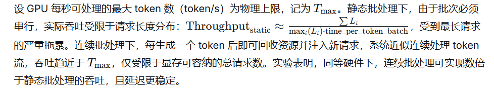

# 67.大模型（LLMs）连续批处理（Continuous Batching）

#### 什么是连续批处理？与静态批处理相比，它解决了推理服务的什么问题？

连续批处理（Continuous Batching），又称迭代级调度（Iteration-level Scheduling），是一种针对自回归大语言模型推理的服务调度策略。它允许在同一批次（batch）中同时处理处于不同生成阶段的请求，并在每个生成迭代（每生成一个 token）之后，动态地加入新请求或移除已完成的请求，而无需等待整个批次中所有请求都完成。

静态批处理（Static Batching） 的做法是：服务端将若干请求组成一个 batch，然后一次性为所有请求生成所有 token（或直到遇到 EOS/最大长度）。在此期间，即使某个请求早已生成结束，也必须等待批次内其他请求完成，才能一起返回结果；同时，新到达的请求必须等待当前批次彻底结束才能被接纳。

连续批处理解决的核心问题：

- 队头阻塞（Head-of-Line Blocking）：静态批处理中，短请求被长请求拖累，延迟极高，资源空转。连续批处理允许已完成的请求即时退出，释放资源给新请求，消除了等待。

- GPU 利用率低下：静态批处理中，批次内请求长度不一，先结束的请求的槽位在剩余时间里闲置，GPU 算力和显存带宽被浪费。连续批处理每步可调整 batch 组成，始终保持高饱和度。

- 响应延迟不可预测且长尾：静态批处理下请求延迟取决于同批次中最长的请求；连续批处理通过细粒度调度，使短请求能快速完成并返回，显著降低平均延迟和尾部延迟。

- 吞吐受限：由于不能并行处理处于不同进度的请求，系统最大吞吐受限于批次中最大长度，而非 GPU 的物理极限。连续批处理将生成过程视作流水线，每秒可服务的 token 总数大幅提升。

简言之，连续批处理将 LLM 推理服务从“批次同步”转变为“token 流式流水线”，从而实现高吞吐、低延迟和高资源利用率，已成为 vLLM、TensorRT-LLM、TGI 等主流框架的标配。

---

#### 解释连续批处理中请求的“加入”和“退出”机制，如何在不中断其他请求的情况下进行调度。

连续批处理的核心是迭代级调度：推理循环以生成单个 token 的迭代为单位。在每次迭代结束后，调度器有机会改变运行中的请求集合。

退出机制：

- 在每一轮迭代中，模型为 batch 内所有活跃请求各生成一个 token。

- 生成后，立即检查每个请求的最新 token 是否为结束标志（EOS token）或是否已达到用户设定的最大生成长度。

- 若某请求完成，则将其从活跃运行集中移除，释放其占用的各类资源（最主要的是 KV Cache 的物理块）。其完整的生成序列被返回给客户端。

- 该退出操作是即时且无阻塞的——因为下一个迭代的 batch 可以完全不包含该请求，新的 batch 大小自然减少。

加入机制：

- 调度器维护一个等待队列（waiting queue），新到达的请求首先进行 prefill 阶段（或排队等待 prefill）。

- 在每次迭代结束时（或在某些策略下，迭代开始前），调度器检查是否有空闲资源（主要是显存中的 KV Cache 块可用量），以及当前 batch 是否已达到硬件能承受的最大 batch size（或用户设定的上限）。

- 如果有资源，调度器从等待队列中取出一个或多个请求，为其执行 prefill（即一次性处理整个 prompt，生成第一个 token），并将该请求的初始 KV Cache 分配好。此后，该请求进入活跃运行集，在下一个 decode 迭代中加入 batch。

- 更精细的实现允许 prefill 和 decode 混合批处理（见第 8 题），此时加入的新请求可能以 prefill 操作与现有 decode 请求一同计算，进一步减少调度延迟。

如何不中断其他请求：

由于每次迭代的 batch 是动态构建的，模型前向计算只依赖于当前批次的输入 token 和各自对应的 KV Cache 块。改变 batch 组成只需在 host 端重新组织输入张量、更新块表（block table），然后发起新的 kernel 调用。整个过程无需暂停或重启 GPU 计算流，仅是一次迭代与下一次迭代之间的逻辑切换。通过分页的 KV Cache 机制，不同请求的缓存物理块独立，增加或移除请求零数据搬迁，真正实现了无缝的弹性伸缩。

---

#### 为什么连续批处理能显著提高 GPU 利用率和系统吞吐？请分析其原理。

GPU 利用率提高的原理：

1. 消除“空泡”：自回归解码是内存带宽密集型的，GPU 的计算单元在单个 token 生成时远未饱和，但多个请求的 decode 步骤可以合并为更大的矩阵乘法，摊薄 kernel 启动开销并提升 Tensor Core 利用率。静态批处理中，随着短请求完成，batch 逐渐缩小，后期 GPU 利用率骤降；连续批处理通过随时补充新请求，使 batch 大小维持在较高水平，GPU 始终饱满运行。

2. 批量并行度最大化：连续批处理将整个服务视为 token 级别的流水线。任何时候，只要等待队列非空且有显存，就可将新请求的 prefill 或 decode 插入当前批次，立即利用闲置的算力与带宽。相比静态批处理的“批次串行”，它实现了“请求并行”，即不同请求的不同生成步在时间上交叠，等效于提高了 GPU 的并行执行时间占比。

3. 计算与内存带宽的重叠利用：prefill 阶段计算密集，decode 阶段内存密集。连续批处理允许将 prefill 与 decode 混合在一个 batch 中（见第 8 题），使 GPU 的计算资源和带宽资源同时被不同性质的负载填充，减少单一资源的空闲等待。

系统吞吐提升的分析：

设 GPU 每秒可处理的最大 token 数（token/s）为物理上限，记为 $T_{\max}$。静态批处理下，由于批次必须串行，实际吞吐受限于请求长度分布：$\mathrm{Throughput}_{\text{static}}\approx\frac{\sum L_i}{\max_i(L_i)\cdot\text{time\_per\_token\_batch}}$，受到最长请求的严重拖累。连续批处理下，每生成一个 token 后即可回收资源并注入新请求，系统近似连续处理 token 流，吞吐趋近于 $T_{\max}$，仅受限于显存可容纳的总请求数。实验表明，同等硬件下，连续批处理可实现数倍于静态批处理的吞吐，且延迟更稳定。

{.ocr-src}

---

#### 在迭代级调度中，一次推理步长是如何定义的？这个步长通常对应什么操作？

一次推理步长（Iteration Step） 定义为：对所有当前活跃请求，各自生成一个 token 所需的一次完整模型前向传播。

具体而言，步长包含以下操作序列：

1. 输入准备：对于 batch 中每个请求，将其前一时刻生成的 token（或 prefill 时整个 prompt）作为本轮输入，构造输入张量（形状 `[batch_size, 1]` 或变长序列的拼接，对于 decode 阶段通常为每个请求一个新 token）。

2. 前向传播：将输入送入模型，执行全部 Transformer 层。在每一层，使用请求各自的 KV Cache 块表，通过注意力 kernel（如 PagedAttention）读取历史 K、V，计算注意力，并追加当前 token 的新 K、V 到缓存块中。

3. Logits 生成与采样：从模型输出 logits 中获取最后一个 token 的预测分布，对每个请求独立进行采样（贪心、温度采样、top-p 等），产生各自的新 token。

4. 状态更新与调度决策：将新 token 追加到请求的序列中，检查是否遇到 EOS 或超长；若是，标记完成并释放资源。同时，调度器检查等待队列，决定是否在下一轮迭代中加入新请求。

因此，一个迭代步长等于“一次自回归解码循环”，是连续批处理调度的原子单位。所有批处理决策（加入、退出、抢占）都发生在步长之间，确保 model 前向过程不受干扰。

---

#### 实现连续批处理时，如何处理不同请求的序列长度差异？如何组织 batch 的输入和 KV Cache？

序列长度差异处理：

在 decode 阶段，每个请求每步只生成 1 个 token，因此输入部分长度统一为 1。长度差异主要影响 KV Cache 的大小：不同请求的已生成序列长度不同，KV Cache 的占用长度各异。通过 PagedAttention，每个请求的 KV Cache 由不定数量的物理块组成，长度不同只占用不同数量的块，管理上完全解耦。

在 prefill 阶段，不同请求的 prompt 长度不同。连续批处理通过 变长序列批处理 来高效处理：

- 将 batch 内所有请求的 prompt token 拼接成一维数组，并记录每个请求的累积长度，构成 ragged tensor。

- 使用支持变长的注意力 kernel（如 FlashAttention 的 varlen 接口）一次性计算所有请求的注意力，屏蔽跨请求的注意力（通过 cu_seqlens 和 max_seqlen 参数）。

- 或者将短 prompt 填充到等长，但利用 kernel 的变长支持可以避免计算浪费。

batch 输入的组织：

- Decode 批：输入张量形状为 `[B, 1]` 或 `[B]`，直接传入。每个请求的位置 ID 不同（其当前序列长度）。

- 混合 Prefill+Decode 批：输入是变长序列的拼接。通常用两个张量：`input_ids`（拼接所有 token），`cu_seqlens`（每个序列的起始位置），传递给 FlashAttention 等 kernel。同时，对于 decode 请求（长度=1），它们在变长 batch 中仍作为长度为 1 的序列参与。

KV Cache 组织：

每个请求维护独立的块表（Block Table），记录其逻辑块到物理块的映射。在每层计算注意力时，kernel 根据请求索引、块表和当前序列长度，从物理块中读取相应的 K、V。由于物理块可以在多个请求间共享（如 beam search）或动态分配，长度不同的请求互不影响，且无需显式填充。

---

#### 写出一个简单的连续批处理调度器的主要数据结构（如运行队列、等待队列）及其状态转换。

一个基本的连续批处理调度器可包含以下核心数据结构：

```python
class Request:
    id: str
    prompt: List[int]            # 原始 prompt token IDs
    generated: List[int]         # 已生成的 token 序列
    max_tokens: int              # 最大生成数
    status: Enum("waiting", "prefill", "running", "finished", "preempted")
    block_table: List[int]       # KV Cache 物理块索引
    num_blocks: int              # 占用的块数
    # 位置等元信息

class Scheduler:
    waiting_queue: List[Request]   # 等待 prefill 的请求
    running_set: List[Request]     # 正在参与 decode 的请求
    prefill_set: List[Request]     # 当前步正在 prefill 的请求（可选）
    free_blocks: int               # 空闲物理块数量
    max_batch_size: int
    block_size: int
    # 其他显存管理
```

状态转换流程：

1. 新请求到达 → 状态 `waiting`，进入 `waiting_queue`。

2. 调度加入：每轮迭代结束，调度器检查 `free_blocks` 和当前 running 数量。若条件满足，从 `waiting_queue` 取出请求，状态变为 `prefill`，执行 prefill 操作：分配所需的初始物理块，处理 prompt，产生第一个 token。prefill 完成后，请求状态变为 `running`，移入 `running_set`。

3. Decode 迭代：对 `running_set` 中所有请求执行一步解码，生成新 token，并追加到各请求的 `generated` 列表。如果新 token 是 EOS 或达到 `max_tokens`，请求状态变为 `finished`，释放其占用的块，从 `running_set` 移除。

4. 抢占（若显存不足）：当需要加入新请求但 `free_blocks` 不够时，可挑选部分 `running` 请求（如低优先级或最不活跃），将其 KV Cache 块换出到 CPU 内存，状态变为 `preempted`，释放的块给新请求。待有空闲时，再将被抢占的请求换入恢复为 `running`。

上述数据结构与状态机即可支撑基本的连续批处理。

---

#### 比较 vLLM 的 continuous batching 和传统静态 batching 在延迟和吞吐上的性能差异。

vLLM 采用迭代级连续批处理配合 PagedAttention，与静态批处理相比，性能差异显著：

吞吐量：

- 静态批处理：吞吐受批次内最长序列限制。例如 batch 中包含 1 个长请求和多个短请求，短请求完成后，GPU 在剩余时间只服务长请求，batch 利用率低。实验数据表明，静态批处理在混合长度场景下，吞吐可能仅为硬件极限的 30%~50%。

- vLLM 连续批处理：短请求完成后立即退出，新请求马上加入，使得 batch 中始终有尽可能多的活跃请求。在请求到达率足够时，吞吐可达静态批处理的 2~4 倍，接近 GPU 的物理 token/s 上限。

延迟：

- 平均延迟：vLLM 显著低于静态批处理，因为短请求不必等待长请求。对于正常分布的用户请求，平均 TTFT（首 token 延迟）和 TPOT（每 token 延迟）可降低 50% 以上。

- 尾部延迟（P99）：静态批处理尾部延迟极高（受 max 序列长度支配），vLLM 的尾部延迟主要由最大独立请求长度和显存容量决定，较静态改善 5~10 倍。

- 长请求不恶化短请求：连续批处理具有请求隔离性，一个超长请求不会阻塞其他请求，而静态批处理造成“连坐”。

基准测试示例：在 ShareGPT 数据集上，使用 LLaMA-13B，vLLM 相比静态批处理（HuggingFace pipeline）的吞吐提升 8.5 倍（官方数据），且 P50 延迟降低数倍。

---

#### 在连续批处理中，prefill 请求和 decode 请求能否混合在同一 batch 中？为什么？如何处理？

可以，并且应该混合，这是提升效率和降低延迟的关键优化。 这种技术称为 Chunked Prefill 或混合批处理（Mixed Batch）。

原因：

- Prefill 是计算密集（大矩阵乘），Decode 是内存带宽密集（大 KV Cache 读取，小矩阵乘）。将二者混合可以同时利用 GPU 的计算资源和内存带宽，提高整体硬件利用率。

- 如果严格串行（先 prefill 再 decode），新的请求必须等待一个完整的 prefill batch 结束才能进入 decode，增加了首 token 延迟。混合允许 prefill 与已有 decode 请求并行，新请求可以更快地产生第一个 token。

如何处理（典型方案）：

1. 将 prefill 请求的 prompt 切分为 chunks（例如，每次只处理 prompt 中的 512 个 token）。这个 chunk 的 prefill 操作被当作一个变长序列，与当前 decode 请求的单个 token 拼接成一个变长 batch。

2. 使用 FlashAttention 的 varlen 接口或 PagedAttention kernel，同时处理不同长度的序列：
  - Decode 请求序列长度为 1（新 token）。
  - Prefill chunk 序列长度为 chunk_size（例如 512）。
  - 将这些序列拼接，传入统一的注意力 kernel，根据各自的 cu_seqlens 和块表计算注意力并更新 KV Cache。

3. 调度策略：调度器选择一个或多个等待请求，为它们分配物理块，然后将其 prompt 的第一个 chunk 放入当前 batch 中进行 prefill。如果 prompt 很长，剩余的 chunk 将在后续迭代中逐步处理（每个迭代一个 chunk），直到整个 prompt 处理完毕。这种“分块预填充”保证了每个迭代的计算量可控，不会因为一个极长 prompt 而导致单步延迟暴增。

优势：chunked prefill + mixed batch 实现了“细粒度的时间片轮转”，让系统对任意长度 prompt 都有平稳的延迟表现，是 vLLM、TensorRT-LLM 等框架的核心竞争力。

---

#### 什么是“抢占式”（preemption）调度？在显存不足时，如何将某些请求换出换入？

抢占式调度（Preemptive Scheduling） 是指当推理服务的显存资源紧张（如 KV Cache 的物理块即将耗尽）时，主动将一部分正在运行的请求暂时挂起并换出到 CPU 内存（或磁盘），释放其占用的 GPU 显存，以满足新请求或更高优先级请求的需求。当资源再次充足时，再将这些被抢占的请求换入 GPU 显存，恢复执行。

换出换入的常见策略：

1. 基于 KV Cache 的换出 (Swap-out)：
  - 选择被抢占的请求（例如，最长时间未生成 token 的低优先级请求，或者占用块最多的大请求）。
  - 将该请求在 GPU 上的所有物理块中的 K、V 张量拷贝到 CPU 内存的缓冲区（换出）。同时，在块表中标记这些 GPU 物理块为“空闲”或“被换出”。
  - 释放的物理块可以立即分配给新请求。
  - 当需要换入时，将 CPU 缓冲区的 K、V 数据复制回新分配的 GPU 物理块，更新块表，请求继续从断点解码。

2. 基于重计算的抢占 (Recomputation)：
  - 放弃被抢占请求的 KV Cache，直接将其状态重置为 prefill 完成时的状态（或仅保留 prompt 和少量生成 token）。
  - 当恢复时，利用原始 prompt 和已生成的 token 重新执行一次 prefill 和部分解码，重构 KV Cache。这个方法省去了换出的 CPU 内存开销和拷贝时间，但恢复时有重计算成本。适合显存极度紧张且 CPU 内存也不足的场景。

3. 混合策略：优先换出长请求的 KV Cache 到 CPU，短请求可直接重计算以节省 CPU 内存。

实现要点：

- 调度器持续监控空闲物理块数量。当低于阈值时触发抢占。

- 被抢占请求的生成序列保留，只是 KV Cache 被换出。当重新换入后，从下一个未生成的 token 继续解码，用户无感知中断，仅增加少量延迟。

- 与 PagedAttention 结合，换出换入以物理页为单位，无需处理碎片，效率极高。

抢占式调度让系统可以超配显存，服务更多并发请求，是应对突发流量和保障服务稳定性的关键机制。

---

#### 连续批处理如何与 PagedAttention 协同工作？KV Cache 的物理块分配如何支持弹性 batch。

PagedAttention 是一种受操作系统虚拟内存启发，将 KV Cache 划分为固定大小的物理块（如每块 16 个 token），并通过块表将逻辑 KV 序列映射到非连续的物理块上的技术。它彻底解决了静态连续缓存导致的碎片化和内存浪费。

与连续批处理的协同：

1. 动态 batch 大小的基础\
   连续批处理要求随时加入或移除请求。传统连续的 KV Cache 需要为每个请求预分配最大长度的连续显存，不仅浪费巨大，而且释放后留下无法利用的碎片，无法灵活调整 batch。PagedAttention 将 KV Cache 打散成小块，使得请求长度的增长只需追加块，请求退出时整块回收，完全无碎片。这样，调度器可以在任何时候安全地增减运行请求数，无需担心显存布局。

2. 零拷贝的请求换入换出\
   新请求进入时，调度器从空闲块池中分配若干物理块给该请求，建立初始块表。请求退出时，其所有物理块直接回收到空闲池。这些操作仅涉及指针/索引的修改，无数据移动。抢占式调度中，换出一个请求就是将其物理块的内容拷贝到 CPU 并将块标记空闲；换入时分配新块并拷回数据。PagedAttention 的块式存储让换入换出无比简洁。

3. 注意力 kernel 的无缝支持\
   PagedAttention 专用的 CUDA kernel（如 vLLM 的 `flash_attn_with_kvcache`）可直接根据每个请求的块表，动态加载对应的 K、V 块进行计算。无论 batch 内请求的序列长度如何不同、块分配如何零散，kernel 都能高效处理。这保证了连续批处理下，异构请求的注意力计算不会退化为低效的循环，始终保持高吞吐。

4. 内存共享与复杂调度\
   例如在 beam search 中，多个候选序列可以共享相同的物理块（写时复制）。PagedAttention 的块表映射让这种共享天然实现，而连续批处理调度器可以利用这一点节省显存，容纳更多请求。

弹性 batch 的具体实现：\
调度器在每轮迭代后，查看空闲块数 $F$。对于等待队列中的请求，估算其所需块数（prompt 长度 + 预留生成长度）。如果 $F$ 足够，就分配块、执行 prefill（分块）、将该请求加入运行集。通过物理块的动态分配与回收，batch 的组成与大小弹性变化，显存利用率可达 90% 以上，而静态方案往往不足 50%。

总结：连续批处理负责“什么时候改变 batch”，PagedAttention 负责“怎样在显存中高效组织数据以支持改变”。两者结合，实现了 LLM 推理服务在吞吐、延迟和资源利用率上的代际飞跃。

---

#### 批处理中的 padding 问题在连续批处理下是否完全消除？还有什么残余开销？

在连续批处理中，尤其是纯 decode 阶段，padding 问题几乎被完全消除，但并未绝对消失。在混合 prefill 与 decode 的场景下，仍存在一些残余开销。

被消除的 padding：

- 在自回归 decode 阶段，每个请求每次只生成一个 token，因此输入张量形状为 `[batch_size, 1]`，自然对齐，无需填充。

- prefill 阶段可采用变长序列批处理（如通过 FlashAttention 的 varlen 接口），将所有 prompt token 拼接为一维数组，通过 `cu_seqlens` 区分请求边界，完全避免了补零的计算和内存浪费。

残余开销：

1. 硬件对齐与内存访问：GPU kernel 常要求输入对齐到 8 或 16 字节，或是 Tensor Core 的 tile 尺寸。如果 batch 中序列长度差异极大，某些内核可能仍需对最小块进行零填充以适配指令，尤其是在使用不完善的 kernel 时。但现代 varlen 实现已大量规避此问题。

2. 负载不均：即使没有显式 padding，不同请求的序列长度不同，导致每个请求在注意力计算时实际工作量差异大。在 prefill 的变长批处理中，一个长 prompt 可能占用大部分计算时间，短 prompt 的线程块早早完成而等待，形成“隐式气泡”，降低 SM 利用率。

3. KV Cache 的分页碎片：虽然 PagedAttention 解决了外部碎片，但内部碎片依然存在。每个物理块固定大小（如 16 个 token），若某请求的序列长度不是块大小的整数倍，最后一个块会部分闲置，形成内部碎片，这部分浪费的显存相当于隐式 padding。

4. 调度元数据开销：每个请求都需要维护块表、序列长度、位置编码等元数据，且每次迭代需重新组织这些信息，成为计算之外的额外 CPU 和通信开销，特别是在数千请求并发时，调度器本身的处理延迟不可忽略。

因此，连续批处理通过变长数据和分页管理最大限度地消除了 padding，但硬件对齐、负载不均和内部碎片等残余开销依然存在，仍然是系统优化的方向之一。

---

#### 在连续批处理中，如何确保不同请求的解码参数（温度、重复惩罚）互不干扰？

在连续批处理中，每个请求拥有独立的采样参数集合，推理引擎通过批量采样 + 参数隔离来保证互不干扰。

机制：

1. 独立参数存储：每个请求对象携带自己的采样配置，如 `temperature`、`top_p`、`top_k`、`repetition_penalty`、`presence_penalty` 等。调度器只负责将它们与请求绑定，不关心具体值。

2. Logits 后处理与采样分离：模型前向传播为整个 batch 输出统一的 logits 张量 `[batch_size, vocab_size]`。随后，引擎对每个请求（即每一行 logits）单独应用各自的解码参数：
  - 对于温度缩放：`logits[i] /= temperature_i`
  - 重复惩罚：根据该请求已生成的 token 序列，降低对应 token 的 logits。
  - 过滤：应用 `top_p`、`top_k` 等屏蔽。
  - 采样：从处理后的分布中抽取一个 token。

3. 批量化实现：这些操作在 GPU 上可以通过自定义 CUDA kernel 或高级库（如 PyTorch 的 `torch.multinomial` 配合先前的 logits 修改）实现并行。例如，为每个请求准备一个 `temperatures` 向量，使用 `logits / temperatures.view(-1, 1)` 一次性完成缩放。重复惩罚通常需要读取每个请求的历史 token 集合，可借助 PyTorch 的 `scatter_` 或排序操作高效完成，但更常见的是在 GPU 上为每个请求独立运行轻量级 kernel，因为采样本身计算量远小于模型推理，可以接受一定程度的串行化。

4. CPU 辅助采样：许多框架（如 vLLM）将采样步骤移至 CPU 执行，因为此时 logits 数据量小，GPU 并行优势不大。CPU 端可以为每个请求单独调用采样函数，自然隔离参数，且更易于实现复杂逻辑。额外传输 logits 的 PCIe 开销在合理的 batch 下可忽略。

因此，通过将采样与模型解耦，并以请求为单位单独处理，连续批处理可确保解码参数的完全隔离，不会互相干扰。

---

#### 对于流式输出，连续批处理如何管理连接和发送 token？

连续批处理与流式输出天然契合。推理引擎每生成一个 token，就立刻将其推送给对应的客户端，实现逐 token 的实时反馈。

管理机制：

1. 连接管理：每个请求到达时，服务端分配唯一的请求 ID，并与客户端的异步连接（如 WebSocket、HTTP SSE、gRPC stream）绑定。该连接对象被存储在请求的上下文中。

2. 生成与推送的衔接：
  - 在一次迭代完成后，引擎获得了 batch 中每个请求新生成的 token。
  - 对于每个活跃请求，引擎调用其绑定的回调函数或异步事件，立即将新 token 发送给客户端。
  - 如果采用异步框架（如 vLLM 的 `AsyncLLMEngine`），生成 token 的协程会 `yield` 该 token，由 Web 框架层封装为 SSE 事件或 WebSocket 消息推送给客户端。

3. 终止处理：当请求生成 EOS 或达到最大长度，引擎发送结束信号（如 SSE `[DONE]`），然后关闭连接或标记流结束，同时释放该请求的所有资源（KV Cache 块等）。客户端收到完整序列后断开。

4. 错误处理：如果生成过程中发生异常（如显存不足导致抢占失败），引擎可以通过连接向客户端发送错误信息，并中断该请求的流。

优势：连续批处理每步只生成一个 token，使得流式输出延迟极低（每 token 延迟即为解码延迟），用户体验流畅。同时，即使请求处于流式输出过程中，调度器也可以随时将其切换出运行集（抢占），待资源恢复后继续推送后续 token，客户端几乎无感知，仅感受到些许间隔。

---

#### 当新请求的 prefill 计算量较大时，如何分割 prefill 成多个 chunk 以避免延迟抖动？

若一次性处理整个长 prompt 的 prefill，会导致单次迭代耗时剧增，使其他正在 decode 的请求等待时间过长（延迟抖动）。分块预填充（Chunked Prefill） 解决了这一问题。

实现方法：

1. 固定 chunk 大小：设定一个最大 chunk 大小（如 512 个 token）。对于新请求的 prompt，若非空且未处理完，则每次迭代只取前 `min(max_chunk_size, remaining_length)` 个 token 作为一个 prefill chunk。

2. 状态维护：每个请求维护一个 `prefill_progress` 指针，标记已处理的 prompt token 数。初始为 0。

3. 混合调度：在每次迭代中，调度器将 decode 请求的单个 token 与若干个 prefill chunk 合并为一个变长 batch。例如，batch 中有 5 个 decode 请求，外加 1 个 prefill chunk（长度 512），总序列数 6，通过 varlen 注意力一起计算。

4. 逐步分配 KV Cache：当处理第一个 chunk 时，为该请求分配若干物理块用于存储该 chunk 的 K、V。后续 chunk 继续追加分配。直到整个 prompt 处理完毕，请求进入纯 decode 阶段。

5. 避免抖动：由于每个 chunk 计算量被限制，单次迭代的延迟上限得以保证。最长迭代时间由最大 chunk 大小和当前 decode 请求数量共同决定，可通过调整 `max_chunk_size` 控制 tail latency。

附加优化：对于极长 prompt，还可通过多步 chunked prefill 在多个迭代中完成，同时系统可在此期间继续服务其他请求的 decode，实现了 prompt 处理与 token 生成的 pipeline 并行，整体吞吐进一步优化。

因此，分块预填充是连续批处理维持低延迟平稳性的核心手段。

---

#### 实现连续批处理时，如何设置最大 batch size？动态 batch size 的调整策略。

最大 batch size 的设置受限于两个主要因素：

- 显存约束：KV Cache 物理块总数固定。每个请求占据若干块，最大并发请求数 *B *max 需满足 `sum(blocks_per_req) <= total_free_blocks`。调度器通常设定一个硬上限 `max_num_seqs`，即使有空闲块，也不再增加请求，防止意外 OOM 或留给系统余量。

- 计算效率约束：过大的 batch 可能导致单次迭代延迟超出目标（如 TTFT 或 TPOT SLO），因为 decode 的矩阵乘计算量线性增长。可根据 GPU 算力和带宽计算满足延迟要求的上限。例如，A100 上 batch size 256 可能仍能保持 TPOT 在 50ms 内，但 512 则超时。

动态 batch size 调整策略：

1. 水位线策略：设定空闲块数量低水位和高水位。当空闲块高于高水位时，积极从等待队列拉取请求；低于低水位时，停止拉取，甚至考虑抢占。

2. 基于延迟反馈：监测最近几次迭代的实际延迟，若超过阈值，则减小下一轮允许加入的 prefill chunk 大小或 decode 请求数。

3. 优先级与公平性：不单纯追求最大 batch，还要考虑长请求不饿死。例如，vLLM 允许为等待请求设置最小保证调度，即便资源紧张也会轮流服务。

4. 分层调度：将 prefill 和 decode 分开限制，例如 `max_num_batched_tokens` 限制一次迭代中处理的总 token 数（包括 prefill chunk 和 decode），从而间接限制 batch size。

因此，最大 batch size 是动态变化的，由显存余量、延迟目标和公平性策略综合决策，实现弹性并发。

---

#### 在分布式推理（张量并行/流水线并行）下，连续批处理的实现复杂在哪里？

分布式推理下，连续批处理的每个请求加入/退出需要跨设备协调，带来显著复杂性。

张量并行 (TP) 下的复杂度：

- KV Cache 一致性：每个 TP rank 持有部分 KV 头。当调度器决定加入新请求并分配物理块时，必须在所有 ranks 上同步分配相同的物理块索引，以保证块表一致。这需要广播或集中调度。

- batch 组成同步：每个 rank 的输入序列必须相同，新请求的 prompt token 需要广播或通过 NCCL 同步。在变长批处理中，`cu_seqlens` 等元数据也需各 rank 一致，否则注意力计算会错位。

- 采样同步：TP 下模型最后输出的是部分 logits，需经 all-reduce 得到完整 logits。采样通常在 all-reduce 之后，但最终采样的 token 必须广播至所有 rank，以便下一步作为输入。连续批处理中请求退出时，各 rank 必须同时移除该请求，保证后续迭代 batch 一致。

- 抢占同步：若需要换出某请求的 KV Cache，所有 TP rank 必须同步换出/换入，避免死锁。

流水线并行 (PP) 下的额外复杂度：

- 微批次调度：PP 通常采用微批次流水。连续批处理意味着微批次的组成可能随时变化。不同 stage 的设备需要协调新请求的插入时机，可能打断流水线气泡优化。

- 交叉注意力或 encoder 依赖：若为 encoder-decoder 模型，decoder 的交叉注意力依赖 encoder 输出，encoder 的 KV 缓存也需要分布管理，增加调度复杂度。

解决思路：通常采用单调度器 + 广播模型。一个 master 进程做出调度决策，然后将决策和新的输入、块表等广播给所有 worker。TP 中的张量通信（all-reduce）与调度分离。现代框架如 vLLM 支持 TP，已经将上述同步融合进引擎循环中，通过集体操作实现强一致性。

---

#### 为什么在连续批处理中，某些请求可能因为长度过长而导致其他请求延迟增加？如何缓解？

原因：

1. 显存占用挤压并发度：长请求占据大量 KV Cache 物理块，导致系统能同时服务的总请求数（batch size）减少。batch 越小，GPU 的算力和带宽利用越不充分，每个 decode 步骤的延迟增加，吞吐下降。本来可并行 32 个短请求，可能因一个超长请求的存在只能并行 8 个，其他请求被迫在等待队列中，延迟倍增。

2. decode 迭代中内存带宽争抢：长序列的 KV Cache 体积大，每次 decode 都需要从 HBM 读取更多的 K、V 数据，增加了访存总量，可能使得内存带宽成为瓶颈，拖慢同一 batch 内所有请求的生成速度。

3. 调度公平性缺失：如果简单采用 FCFS 且不抢占，长请求可能持续运行数分钟，其间新到达的短请求无法插队，导致平均延迟和尾部延迟恶化。

缓解措施：

- 抢占式调度：当资源紧张时，将部分长请求的 KV Cache 换出到 CPU，让出资源给短请求。待短请求完成后再换入恢复。

- 优先级调度与短作业优先：给予短请求（或预计剩余 token 少的请求）更高的调度优先级，降低它们等待时间。

- 分离运行集：限制单个请求的最大生成长度，或将超长请求放入专门的低并发队列处理。

- KV Cache 压缩：通过 GQA、KV8 量化等减少长序列的缓存占用，使同样显存可容纳更多请求，缓解挤压效应。

- 分块预填充与公平时间片：在 prefill 阶段也采用分块，防止长 prompt 一次占用过长时间。

因此，通过显存管理和调度策略结合，可以有效控制长请求带来的延迟影响。

---

#### 讨论“排队论”如何指导连续批处理的并发配置。

排队论为连续批处理系统的容量规划和调度设计提供了理论基石。可将推理服务建模为排队系统，分析其延迟与吞吐特性。

模型抽象：

- 单服务器模型：整个 GPU 推理引擎视为一个服务台，连续批处理使其能同时处理多个请求（相当于批量服务）。但由于 batch 内请求共享单次迭代，可建模为 `M^X/M/1` 或 `G/G/1` 批量服务队列。

- 服务时间：一个请求的服务时间取决于其所需生成的总 token 数。在连续批处理下，token 以迭代速率（tokens/s）生成，故请求服务时间 = (生成 token 数) / (有效 token 生成速率)。

- 到达过程：请求到达间隔通常服从泊松分布。

指导并发配置：

1. 最大并发数：根据显存容量 M 和每个请求的平均缓存占用 $c$，得到理论最大并发数 Nmax⁡=M/c。排队论可估计在给定到达率 $λ$ 和平均服务率 $μ$ 下，需要的并发数，以避免系统过载。若请求平均长度长，则必须提高并发数以维持吞吐。

2. 延迟 SLO 保障：利用 M/G/1 或批量服务模型的公式，可以计算在不同到达率下，请求的平均等待时间和尾部等待时间。若要求 P99 延迟 < 某值，可通过排队论反推最大可承受的负载 $\lambda_{max}$，从而设置接入控制。

3. 优先级与调度策略：排队论证明，最短剩余处理时间优先（SRPT） 能最小化平均等待时间。连续批处理可以近似实现 SRPT：优先调度预计剩余 token 少的请求，或是通过抢占长请求来降低平均延迟。这为 vLLM 类引擎的调度算法提供了理论依据。

4. 容量规划：给定目标吞吐和延迟，排队论可以帮助确定所需的 GPU 数量、batch size 上限以及显存配置。例如，若到达率为 10 req/s，每个请求平均生成 100 token，引擎吞吐 2000 token/s，则恰好平衡；若引擎 token/s 不足，排队将无限增长，此时需增加 GPU 或降低并发。

应用局限：现实系统远比理论模型复杂（序列长度分布、prefill 与 decode 混合、抢占开销），但排队论提供了基本的分析框架，用于早期设计和容量预估。

---

#### 连续批处理是否适用于 encoder‑decoder 模型？与纯 decoder 模型的区别。

连续批处理可以适用于 encoder-decoder 模型，但实现更复杂，因为需要处理 encoder 和 decoder 的双重缓存。

与纯 decoder 模型的区别：

1. Encoder 阶段：
  - 纯 decoder 模型无独立的 encoder。encoder-decoder 模型（如 T5、BART）的 encoder 接收完整 input 序列，并生成一组 encoder hidden states（及/或 key/value）供 decoder 交叉注意力使用。这些 encoder 输出需要被缓存（类似于 decoder 的 KV Cache，但它是静态的，不会随解码步变化）。
  - 不同请求的 encoder 输入长度不同，因此 encoder 输出的长度也不同。连续批处理需管理这些变长的 encoder cache。

2. Decoder 交叉注意力：
  - 每个 decoder 层包含交叉注意力，其 Q 来自 decoder，K、V 来自 encoder 输出。在每次 decode 迭代，都需要读取 encoder cache。不同请求的 encoder cache 长度各异。
  - 连续批处理在组织 batch 时，不仅要考虑 decoder 的自注意力 KV Cache，还要正确索引每个请求的 encoder cache，并在交叉注意力计算时传入相应的 K、V 块。

3. 调度与内存：
  - 显存中除了 decoder 的 KV Cache，还有 encoder cache。长 encoder 序列会占用大量显存，限制并发。可采用分块 prefill 和 encoder cache 量化等方法缓解。
  - 调度器需要决定何时对 encoder 进行 prefill，通常在一次性的 encoder forward 中完成，或者分块处理。新请求加入时，需要先完成 encoder prefill 才能进入 decoder 循环，这增加了调度粒度。

4. 兼容性：主流框架如 vLLM 已初步支持 encoder-decoder 模型的连续批处理，但优化程度不如纯 decoder。例如，将 encoder cache 也纳入 PagedAttention 体系，实现对 encoder 状态的分页管理，从而弹性调度。

结论：连续批处理可以用于 encoder-decoder 模型，但需要同时管理两种缓存，调度逻辑更复杂，但原理相通。随着 PagedAttention 扩展，该能力正在成熟。

---

#### 分析 vLLM 的调度策略（如先到先服务 vs 最短剩余时间优先）对平均延迟的影响。

vLLM 默认采用先到先服务（FCFS），但结合抢占和显存管理，实际上形成了一种混合策略。对比最短剩余时间优先（SRTF），其对平均延迟影响如下：

FCFS（vLLM 基础策略）：

- 请求按到达顺序进入运行集。只要资源允许，就立即服务；资源不足时进入等待队列，直到有请求退出释放资源。这种方式公平，但长请求会阻塞后续短请求，导致平均等待时间增加。极端情况下，一个超长请求可能让许多短请求排队，系统平均延迟被拉高，同时队列长度增加，引入不必要的尾部延迟。

- vLLM 通过 preemption 缓解：当等待队列有请求且空闲块不足时，会抢占部分长请求，让短请求先运行。这实际上向 SRTF 靠拢。

SRTF（最短剩余时间优先）：

- 总是优先服务预计剩余生成 token 最少的请求。理论上，这最小化平均等待时间（排队论最优）。在连续批处理中，可以很容易估计剩余长度（基于已生成 token 和平均生成长度）。优先调度短请求，使其快速完成，释放资源，从而减少整体请求的排队时间，显著降低平均延迟。

- 缺点：长请求可能“饥饿”，需要结合老化机制或保证最低服务量。

vLLM 的实际影响：

- vLLM 尚未实现纯 SRTF，但其 优先级调度 和 抢占 设计允许用户设定优先级，间接实现类似效果。例如，将短请求或交互式请求设为高优先级，长文本处理设为低优先级，可以改善交互式用户的平均延迟。

- 测试表明，在混合长度负载下，引入基于剩余长度的优先级调度，相比纯 FCFS，平均延迟可降低 20%~40%，P50 尤其显著。

结论：SRTF 风格调度能有效降低平均延迟，但需要平衡公平性。vLLM 的抢占机制已为此提供了基础，未来可能成为默认智能调度的一部分。

---

#### 如何通过异步 API 和回调机制实现高效的 continuous batching 服务端？

高效的 continuous batching 服务端通常采用异步事件循环 + 推理引擎线程的架构，以最大化连接并发和 GPU 利用率。

核心设计模式：

1. 推理引擎分离：将 LLM 推理引擎（如 vLLM 的 `AsyncLLMEngine`）运行在独立的线程或进程中，负责模型前向和采样。它提供异步接口（如 `add_request` 和 `step_async`），或内部自行循环。

2. 异步 Web 框架：使用 FastAPI（基于 Starlette 和 asyncio）处理 HTTP/WebSocket 连接。每个客户端连接对应一个协程。

3. 请求提交流程：
  - 客户端发起请求，服务端创建一个 `asyncio.Queue` 或使用 `async_generator` 作为 token 管道。
  - 调用 `engine.add_request(request_id, prompt, params, callback)`，其中 `callback` 可以是接受 token 的异步回调函数，或者将 token 放入该请求的队列。
  - 推理引擎在生成新 token 时，调用回调或向队列推送，客户端的协程从队列中取出 token 并通过 SSE/WS 发送。

4. 引擎调度循环：
  - 引擎内部不断执行 `step()`，完成一次前向和采样。然后根据结果调用注册的回调，将 token 发送出去。
  - 为了不阻塞事件循环，引擎的 `step()` 可以在专用线程中运行，并通过 `asyncio.run_coroutine_threadsafe` 安全地调用回调。

5. 流式响应：服务端利用 Python 的异步生成器，`yield` 每个 token，FastAPI 的 `StreamingResponse` 自动将 yield 的内容转换为 SSE 字节流发送给客户端。无需手动管理连接，框架层处理断开重连等。

6. 连接关闭与清理：当请求结束时，引擎回调发送结束信号，协程退出，异步生成器关闭，Web 框架自动断开连接。引擎内部的请求状态被清理，释放 KV Cache 块。

vLLM 实现示例：`AsyncLLMEngine` 提供 `generate()` 方法，它返回一个 `AsyncIterator[RequestOutput]`。服务层可以用 `async for` 循环获取每个 token 的生成结果，并 `yield` 给客户端。引擎内部使用调度器 step 循环，通过 `asyncio` 确保高效并发。

优势：此架构下，单个服务进程可同时维持数百个连接，而 GPU 专用于批量推理。回调与异步队列实现了解耦，引擎专注吞吐，Web 层专注 I/O，实现了高效且可扩展的 continuous batching 在线服务。

