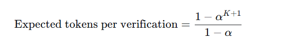
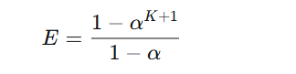
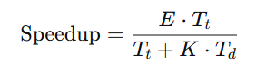

# 69.大模型（LLMs）推测解码（Speculative Decoding）

#### 解释推测解码（Speculative Decoding）的“草稿-验证”两阶段流程。

推测解码是一种针对自回归大模型的推理加速技术，它利用一个轻量级的草稿模型（Draft Model） 快速生成多个候选 token，然后由目标模型（Target Model） 一次性并行验证这些 token 的正确性。其核心流程分为两个阶段：

阶段一：草稿生成（Drafting）

- 给定当前上下文前缀 `prefix`，草稿模型以自回归方式连续生成 `K` 个草稿 token（例如 `K=5`），形成候选序列 `x_1, x_2, ..., x_K`。

- 这一步骤是串行的，但草稿模型参数量小、推理速度快，其单步解码延迟远低于目标模型。同时，草稿模型会记录每个位置生成的 token 的概率 `q(x_t | prefix, x_{<t})`。

阶段二：目标模型验证（Verification）

- 目标模型接收 `prefix` 以及完整的草稿序列 `[x_1, ..., x_K]`，执行一次并行前向传播，一次性地计算出这 `K` 个位置的目标概率分布 `p(x_t | prefix, x_{<t})`（每个位置的条件概率基于之前正确的 token）。

- 然后，逐个位置进行检查：对于位置 `t`（从 1 到 `K`），比较目标模型概率 `p_t` 与草稿模型概率 `q_t`。通过一种无损的拒绝采样（rejection sampling） 算法，决定是接受该草稿 token `x_t`，还是拒绝并从目标模型分布中重新采样。

- 具体规则：生成一个随机数 `r ∈ [0, 1)`，若 `r < min(1, p_t(x_t) / q_t(x_t))`，则接受 `x_t`；否则拒绝，并根据修正分布 `norm(max(0, p_t - q_t))` 重新采样一个 token 作为该位置的输出，并丢弃后续所有草稿 token，结束本轮验证。

- 无论接受多少 token，目标模型只进行了一次前向传播，却可能生成了多个有效 token，从而打破了自回归的串行瓶颈。

总结：草稿模型“猜测”多个 token，目标模型一次性“批改”，接受正确的部分，拒绝并修正错误处，保证最终输出分布与纯目标模型一致，同时实现推理加速。

---

#### 为什么推测解码能在不损失生成质量的前提下加速自回归推理？

推测解码不损失生成质量的基石在于验证阶段采用的无损拒绝采样算法，它保证了推测解码生成的 token 序列的联合分布与直接使用目标模型进行自回归采样的分布严格一致。

质量不损失的原因：

- 验证过程对每个草稿 token `x` 进行接受/拒绝判断，其接受概率为 `min(1, p(x)/q(x))`，这正是从提议分布 `q` 中采样并按照目标分布 `p` 进行拒绝采样的标准方法。拒绝采样的数学性质保证了无论草稿模型质量如何，最终输出的每个 token 都是从目标模型的条件分布 `p(x_t | prefix, x_{<t})` 中正确采样的。

- 当草稿 token 被拒绝时，修正分布 `norm(max(0, p_t - q_t))` 确保了重新采样的 token 分布与目标分布一致，完全消除了草稿模型偏差。

- 因此，推测解码只是改变了自回归生成的执行方式（并行验证 vs 串行生成），而没有改变生成结果的概率分布。其输出可以做到与目标模型逐 token 采样位级相同（如果随机种子一致），或至少分布上完全等价。

加速原理：

- 标准自回归每生成一个 token 需要一次目标模型前向传播（高延迟）。

- 推测解码用草稿模型快速生成 `K` 个 token（延迟低），然后目标模型一次性验证 `K` 个 token（一次前向传播）。若平均接受率为 `α`，则每次验证平均产生 $(1 + α + α^2 + ... + α^{K}) ≈ 1/(1-α)$ 个 token（对于足够大的 K），因此每秒生成的 token 数可提升数倍。

- 加速完全来自于减少目标模型的调用次数，且无需任何微调或量化，不损失模型原有能力。

因此，推测解码通过拒绝采样保持分布一致性，同时利用并行验证提高硬件利用率和吞吐，实现了无损加速。

---

#### 草稿模型通常需要满足哪些条件？它可以是不同架构或同样架构的小模型吗？

草稿模型的选择对推测解码的加速比至关重要，通常需要满足以下条件：

1. 与目标模型共享相同的词汇表（Tokenizer）

- 草稿模型和目标模型必须使用完全相同的 tokenizer，否则生成的 token ID 无法对齐，验证阶段无法正确比对概率分布。这是硬性要求。

2. 生成分布尽量接近目标模型（高接受率）

- 接受率决定了加速比。草稿模型的预测越准，接受率越高，平均每次验证生成的 token 数越多。理想情况是草稿模型与目标模型分布几乎一致，但推理速度极快。

- 实践中，常使用相同架构但参数更少的同系列模型（如 LLaMA-7B 作为 70B 的草稿模型），或通过蒸馏、共享 embedding 层、甚至直接从目标模型的部分层截取得到的小模型。

3. 推理速度远快于目标模型

- 草稿模型必须在单步延迟或吞吐上显著优于目标模型，否则其生成 `K` 个 token 的时间可能抵消并行验证节省的时间。通常草稿模型的参数量是目标模型的 1/10~1/20，或使用非 Transformer 的极轻量结构。

4. 架构可以不同

- 草稿模型不必与目标模型架构完全一致。例如，可以用 LSTM、RNN、甚至 n-gram 模型作为草稿模型，只要 tokenizer 相同即可。但实际中，为了最大化接受率和易于部署，使用相同家族的小模型最为常见，因为它们天然具有相似的输出分布。

- 也有工作使用独立训练的超小模型（如 Medusa 的头，或专门的 draft head），但需要额外训练；还可以用目标模型自身的部分层作为草稿模型（如 SpecInfer 中的 staged predictors）。

总结：草稿模型的核心要求是同词表、高相似度、极快速度。同架构小模型是最直接有效的选择，但跨架构或基于目标模型自身的轻量预测也是可行方向。

---

#### 在验证阶段，如何高效地并行验证草稿模型生成的多个 token？写出主要的验证逻辑。

验证阶段的高效并行化是推测解码加速的关键。目标模型通过一次前向传播计算出所有 `K` 个位置的条件概率，然后执行逐 token 的串行验证（仅在逻辑上串行，计算量极小）。以下是验证逻辑的伪代码和说明。

输入：

- `prefix`: 上下文序列

- `draft_tokens`: 草稿模型生成的候选 token 列表 `[x_1, ..., x_K]`

- `draft_probs`: 草稿模型记录的每个位置生成该 token 的概率 `[q_1(x_1), ..., q_K(x_K)]`

步骤 1: 目标模型并行前向

```python
# 将 prefix + draft_tokens 拼接，一次性送入目标模型
inputs = concat(prefix, draft_tokens)
logits = target_model.forward(inputs)  # 形状 [K, vocab_size]
target_probs = [softmax(logits[t]) for t in range(K)]  # 每个位置的条件概率分布
```

步骤 2: 逐 token 验证与修正

```python
generated = []  # 最终输出的 token 序列
for t in range(K):
    p = target_probs[t]  # 目标模型对位置 t 的概率分布
    q_val = draft_probs[t]  # 草稿模型在该位置生成 x_t 的概率
    x = draft_tokens[t]
    
    # 计算接受概率
    accept_prob = min(1.0, p[x] / q_val) if q_val > 0 else 1.0  # 简略处理 q=0
    
    # 生成随机数决定接受与否
    if random() < accept_prob:
        # 接受草稿 token
        generated.append(x)
    else:
        # 拒绝：从修正分布中采样新 token
        corrected_dist = norm(max(0, p - draft_probs_full[t]))  # draft_probs_full 是草稿模型的完整分布
        new_token = sample(corrected_dist)
        generated.append(new_token)
        break  # 一旦拒绝，丢弃后续所有草稿 token

# 如果 K 个 token 全部被接受，则可能需要继续生成（或者本轮验证结束，进入下一轮草稿-验证）
```

关键点：

- 目标模型只需一次前向，得到所有位置的分布。验证循环计算量极小（几次比较和采样），几乎不占时间。

- 修正分布 `max(0, p - q)` 保证了从总分布中去掉已被草稿模型“使用过的”概率质量，使得拒绝后重新采样的结果符合目标分布。

- 使用 GPU 时，logits 处理可以部分并行化，例如批量计算接受概率或使用预生成的随机数。对于严格的拒绝采样，逐 token 循环无法完全并行，但开销可忽略。

---

#### 推测解码中的“接受率”（acceptance rate）是如何定义的？为什么它直接影响加速比？

接受率（Acceptance Rate, α） 定义为：在验证阶段，草稿模型生成的 token 被目标模型接受的比例的期望值。更精确地，对于单个位置，接受率 α 是目标分布与草稿分布之间相似度的一种度量：`α = E[min(1, p(x)/q(x))]`，其中 x ~ q。它等于两个分布的重叠概率质量。

为何直接影响加速比：

推测解码每次验证至多产生 K 个草稿 token。若每步平均接受率为 α，则在一次验证中，期望生成的 token 数为（考虑几何分布）：

$$
\text{Expected tokens per verification}=\frac{1-\alpha^{K+1}}{1-\alpha}
$$

{.ocr-src}

当 K 较大时，近似于 `1 / (1 - α)`。因此，平均每调用一次目标模型，就生成了 `1/(1-α)` 个 token。

加速比公式（简化的 Amdahl 模型）：\
设目标模型单次前向耗时 `T_target`，草稿模型单次前向耗时 `T_draft`。每轮推测解码包含：草稿模型自回归生成 K 个 token（耗时 `K * T_draft`），目标模型一次验证（耗时 `T_target`）。该轮生成的期望 token 数为 $E = (1 - α^{K+1})/(1 - α)$。则加速比为：

$$
\mathrm{Speedup}=\frac{E\cdot T_{\text{target}}}{T_{\text{target}}+K\cdot T_{\text{draft}}}
$$

{.ocr-src}

若目标模型极慢，草稿模型极快，`T_draft ≈ 0`，则加速比趋近于 `E`，即完全由接受率决定。实际上 `T_draft` 不可忽略，因此 α 越大，E 越大，加速越显著。当 α 从 0.5 提升到 0.8 时，E 从约 2 增长到约 5，潜在加速比近乎翻倍。

结论：接受率 α 是决定推测解码效率的核心因素。它直接关联平均每次验证的产出 token 数，在草稿模型延迟不可忽略时，也影响开销部分。提高草稿模型质量以提升 α 是推测解码优化的首要目标。

---

#### 目标模型与草稿模型输出分布不同时，验证如何保证生成的概率分布与原目标模型完全一致？ 

即使草稿模型分布 `q` 与目标模型分布 `p` 不同，推测解码通过无偏的拒绝采样（Rejection Sampling） 保证最终生成序列的联合分布严格等于纯目标模型自回归采样的分布。

保证机制：\
对于每个验证位置 t，目标模型已给出该位置的条件概率分布 `p(x | context)`。我们有来自草稿模型的提议 token `x ~ q`，以及其概率 `q(x)`。拒绝采样过程为：

1. 以概率 `min(1, p(x)/q(x))` 接受 `x`。

2. 若拒绝，则从残差分布 `p_res(x) = norm(max(0, p(x) - q(x)))` 中重新采样 token。

证明该过程产生的 token 服从分布 p：\
对于任意 token `y`，它被最终输出的概率 = 它被接受的概率 + 它被拒绝后从残差分布采样的概率。

- 当 `y = x`（草稿 token）：\
  输出概率 = `q(y) * min(1, p(y)/q(y))` + `(1 - total_accept) * p_res(y)`（如果 y 也在残差分布中）\
  经过代数化简，该概率恰好等于 `p(y)`。

- 当 `y ≠ x`（非草稿 token）：\
  它只能通过残差分布被采样。残差分布定义为 `norm(max(0, p - q))`，结合全概率公式，最终采样概率也等于 `p(y)`。

详细推导见推测解码原始论文（Leviathan et al. 2023, Chen et al. 2023），但核心结论是：无论 `q` 和 `p` 差异多大，拒绝采样框架总是产生准确的 `p` 分布样本。这就是推测解码能在保持质量无损的同时利用不完美的草稿模型的理论基础。

实践意义：这使得我们可以大胆使用非常轻量甚至粗糙的草稿模型，而不必担心污染目标模型的输出分布，接受率低只会影响加速效果，不会降低生成质量。

---

#### 推导推测解码的加速上限公式，并与实际加速效果对比。

加速上限公式推导：

设：

- `T_t`: 目标模型单次前向耗时

- `T_d`: 草稿模型单次前向耗时

- `K`: 每轮草稿 token 数

- `α`: 平均接受率

每轮推测解码的期望生成 token 数：

$$
E=\frac{1-\alpha^{K+1}}{1-\alpha}
$$

{.ocr-src}

每轮耗时：`Total_time = T_t + K * T_d`（忽略验证循环开销）。

因此推测解码的吞吐加速比（相对于纯目标模型自回归）为：

$$
\mathrm{Speedup}=\frac{E\cdot T_t}{T_t+K\cdot T_d}
$$

{.ocr-src}

理想情况（上限）：\
当草稿模型推理几乎免费（`T_d → 0`），且接受率较高时，加速比趋近于 `E`。若进一步假设 `K → ∞`，则 `E ≈ 1/(1-α)`。所以理论上，加速比上限约为 `1/(1-α)`。例如 α=0.8，上限 5x；α=0.9，上限 10x。

更紧的上限：考虑模型调用次数之比。目标模型每生成 E 个 token 调用 1 次，自回归生成 E 个 token 调用 E 次。故加速比 ≤ `E`。实际中 `T_d` 不可忽略，加速比通常低于 E。

实际加速效果对比：

- 在 LLaMA-70B 用 LLaMA-7B 作为草稿模型（K≈5），实测 α 约 0.7~0.8。`T_t` 是 `T_d` 的 3~5 倍。根据公式，理论加速约 2.5~3.5x，实际报告加速约 **2~3x**，与公式吻合。

- 若使用更小的草稿模型（如 1B），`T_d` 更小，但 α 可能降至 0.6~0.7，加速略降。

- 使用基于 n-gram 或检索的草稿模型，`T_d` 接近 0，α 约 0.5~0.6，加速约 1.5~2x，完全受限于接受率。

- 一些优化（如 tree attention 并行验证多个草稿序列）可进一步提升 α 和 E，使加速比逼近理论值。

因此，加速上限由接受率主导，实际加速受草稿模型开销及并行效率影响，当前典型加速范围为 1.5x~3x，无损且易于部署。

---

#### 草稿模型与目标模型共享 embedding 或部分层时，如何设计统一的推理系统？

当草稿模型是目标模型的子集或共享参数（如共享 embedding、LM head，甚至前几层 Transformer 层），可以设计统一推理系统，避免加载两个独立模型，显著节约显存和带宽。

设计要点：

1. 共享模块的单实例存储：将共享的 embedding、LM head 或前 `M` 层 Transformer 只存储一份。目标模型拥有完整模型，草稿模型复用底层表示。

2. 推理时的分离执行：
  - 草稿阶段：使用共享层 + 草稿模型独有部分（如果有）进行自回归。因为共享层已加载，可直接调用。
  - 验证阶段：目标模型执行完整前向时，同样从共享层开始，再经过自己的高层。因为共享层在一次前向中可以被两个模型复用？注意：在推测解码的一轮中，草稿模型先运行，产生 K 个 token，然后目标模型需要一次性验证。这时输入序列已经包含草稿 token，目标模型需计算完整序列。由于草稿模型刚运行完，其产生的共享层中间激活（如 prefix 部分的 K/V）其实可以被目标模型复用！这称为KV Cache 复用或状态共享。

3. KV Cache 复用优化：
  - 草稿模型在生成时，会为 prefix 计算并存储 KV Cache。如果共享层完全一致，目标模型验证时可以直接复用草稿模型已计算的 prefix 部分 KV，只需计算新增的 K 个 token 的 KV 以及高层独有的 KV，极大减少目标模型的 prefill 计算量。
  - 这需要推理系统支持跨模型的 KV 传递，并确保两个模型共享层的定义完全一致（相同 hidden size、头数等）。

4. 显存与调度：统一系统中，共享权重仅需一份显存，两个模型的独有层分别驻留。推理引擎需同时管理两个“模型”的计算流，但共享层的执行可合并调度，减少 kernel 启动开销。

优势：这种设计可让草稿模型几乎“免费”寄生在目标模型上，不额外占用大量显存，且降低草稿生成延迟，进一步提升加速比。

---

#### 在批量推测解码中，多个请求同时进行草稿+验证，如何调度以充分利用 GPU？

批量推测解码（Batch Speculative Decoding）要求高效调度多个请求的草稿和验证阶段，最大化 GPU 利用率，避免流水线气泡。

调度策略：

1. 阶段分组（Batching by Stage）\
   将当前所有请求按阶段分为两组：草稿组（需要生成 K 个草稿 token）和验证组（已有草稿 token，等待目标模型验证）。调度器动态收集相同阶段的请求，组成 batch 执行。
  - 执行一次草稿 batch（多个请求并行，每个请求草稿模型自回归 K 步），然后这些请求转入验证组。
  - 执行一次验证 batch（所有验证请求的目标模型并行前向），完成后根据结果更新请求状态（接受 token、丢弃等），并决定下一轮草稿。

2. 流水线并行 (Pipelining)\
   草稿模型和目标模型可能是独立的或共享的。如果两者独立，可以让草稿 batch 和目标验证 batch 交替执行，隐藏单一模型的空闲。例如，当目标模型正在验证 batch A 时，草稿模型可以同时为 batch B 生成草稿 token（需要在不同 CUDA stream 上并行或使用多 GPU）。

3. 填充与负载均衡\
   不同请求的草稿 token 数可能不同（有的请求可能在上一轮提前拒绝，剩余草稿 token 少）。为形成规整 batch，可以对草稿 token 数不足的请求进行填充（padding），或使用 tree attention 同时验证多个草稿序列（由单个请求生成多个候选）。

4. 动态调整 K\
   根据当前等待验证的请求数及草稿模型吞吐，动态调整每轮生成的草稿 token 数 K。若等待验证的请求多，可以减小 K 以更快进行验证；反之增大 K 以减少目标模型调用比例。

5. 共享 KV Cache 的优化\
   如前所述，若共享层，草稿阶段产生的 prefix KV 可被目标验证复用，减少验证 batch 的 prefill 计算，进一步提高吞吐。

通过精细的批调度和流水线，批量推测解码可以接近理想加速，同时维持高 GPU 利用率。

---

#### 推测解码对显存的影响：需要同时加载两个模型吗？显存压力如何缓解？

基本显存需求： 朴素推测解码需要同时加载草稿模型和目标模型到 GPU 显存，显存压力显著增加。

缓解策略：

1. 共享参数架构\
   如前所述，使用目标模型的子集作为草稿模型（如共享 embedding 和前几层）。此时，重复的层只需存储一份，草稿模型独有部分极少，额外显存开销可忽略。

2. 草稿模型卸载到 CPU 或辅助 GPU
  - 将草稿模型放在 CPU 或一个低端 GPU 上，通过 PCIe 传输 logits/token。虽然增加了通信延迟，但如果草稿模型很小且验证阶段接受率高，额外延迟可以被并行验证的收益覆盖。
  - 特别适用于单 GPU 显存紧张的场景（如边缘设备），用 CPU 运行草稿模型，GPU 专职运行大模型验证。

3. 使用极小的草稿模型\
   设计参数量极小的草稿模型（如几百万参数），其显存占用相比于数十亿的目标模型几乎可以不计，例如使用轻量级 RNN 或 n-gram 模型。这些模型甚至可以放在寄存器或 L2 cache 中。

4. 复用 KV Cache 减少显存占用\
   如果草稿模型是目标模型的严格前缀（同架构，共享前若干层），则草稿模型生成的 K、V 可以直接作为目标模型对应层的 KV 前缀，无需重复存储，从而减少额外的 KV Cache 分配。

5. 分时加载（非实时服务可接受）\
   在离线批量推理中，可以分阶段执行：先集中用草稿模型处理所有请求生成草稿，保存草稿到 CPU，然后卸载草稿模型，加载目标模型进行验证。但这会引入模型切换开销，不适合在线服务。

总结：通过共享参数、卸载或使用微型草稿模型，可以在几乎不增加显存压力的情况下实现推测解码的加速，使该技术在显存受限的部署中也具备实用性。

---

#### 如果草稿模型的接受率很低，如何动态调整草稿长度？是否有自适应策略？

当接受率较低时，生成太长的草稿序列会导致大量草稿 token 被拒绝，浪费草稿模型计算和显存带宽。因此需要动态调整每轮的草稿长度 `K`。主要的自适应策略包括：

1. 基于移动平均接受率调整\
   维护最近的接受率指数移动平均（EMA）`α_avg`。设定目标期望接受率或期望生成 token 数，根据 `α_avg` 调整 `K`。若 `α_avg` 低，减小 `K`，避免浪费；若高，增大 `K` 以挖掘更多并行潜力。例如：

```python
if α_avg < low_threshold: K = max(K_min, K-1)
elif α_avg > high_threshold: K = min(K_max, K+1)
```

2. 期望收益最大化策略\
   定义每轮推测解码的期望净收益：`G(K) = E[accepted_tokens | K] - cost(K)`。在每轮开始前根据当前估计的接受率分布，选择能最大化期望收益的 `K`。这可以建模为动态规划或简单的查表，因为 `cost(K)` 与草稿模型 `K` 次前向成正比。

3. 概率停止（Early Termination of Drafting）\
   在草稿模型逐 token 生成过程中，使用一个轻量的置信度评估器（甚至草稿模型自身的概率）来决定是否提前停止生成。例如，如果当前 token 的生成概率 `q(x_t)` 低于阈值，或者预测的接受概率 `min(1, p(x_t)/q(x_t))` 近似期望很低，则停止草稿生成，不再继续后续 token。这可以即时切断低质量草稿。

4. 基于令牌类型或上下文的自适应\
   不同上下文（如代码、自由文本）接受率不同。可以训练一个元模型或启发式规则，根据前缀特征动态选择 `K`。一些实现（如 SpecInfer）采用多长度草稿，在多个草稿长度间调度。

总结：自适应调整 `K` 是推测解码实用化的关键，常见于推理框架中，通过实时监测接受率并调整，可避免在低接受率场景下反而变慢，同时在高接受率场景下最大化加速。

---

#### 如何使用 Medusa 等不需要独立草稿模型的投机解码方法？与标准推测解码对比。

Medusa 方法核心思想：在目标模型的最后一层隐藏状态上添加多个额外的预测头（Medusa Heads），每个头负责预测未来第 `k` 个 token。在推理时，目标模型进行一次前向传播，即可通过原有 LM head 生成当前 token，并通过 Medusa heads 同时生成未来多个 token 的候选，形成草稿序列。然后利用目标模型自身进行并行验证（树注意力）。

使用流程：

- 训练阶段：冻结目标模型，仅训练 Medusa heads（通常为简单的全连接层），使用目标模型产生的隐藏状态作为输入，让 heads 预测 `prefix + k` 位置的 token。训练数据可以就用原训练语料，无需额外标注。

- 推理阶段：
  1. 目标模型前向，得到隐藏状态。LM head 产生当前 token 分布；同时，每个 Medusa head 预测各自位置的 token（如 head_1 预测 `t+1` token，head_2 预测 `t+2` token，等等）。
  2. 将预测出的多个 token 构建成树状候选序列（tree），通过树注意力（Tree Attention） 让目标模型一次性验证所有候选序列。验证过程同样基于拒绝采样，保证输出分布与目标模型一致。

与标准推测解码对比：

| 维度 | Medusa | 标准推测解码 (draft-target) |
| --- | --- | --- |
| 草稿模型 | 无需独立模型，直接在目标模型上加小型预测头 | 需要单独的小模型（如 7B 作为 70B 草稿） |
| 训练需求 | 需要训练 Medusa heads（但目标模型权重冻结） | 无需训练，可直接使用现成小模型 |
| 显存占用 | 仅增加极少参数（几个线性头），远小于加载第二个模型 | 需要同时加载两个模型，显存压力大 |
| 草稿质量 | 通常较高，因为基于目标模型深层特征；可通过更多 head 提高接受率 | 取决于小模型的分布匹配度，可能稍低 |
| 推理效率 | 目标模型一次前向即产生多个候选，草稿成本近乎为零 | 草稿模型需要自回归多次前向，有一定开销 |
| 加速效果 | 普遍可达 2~3x，无额外模型加载 | 同样 2~3x，但需管理双模型 |
| 适用场景 | 希望避免双模型部署、有微调能力的场景 | 无法或不愿训练、有合适小模型可用的场景 |

Medusa 已发展为流行的推测解码变体，避免了独立草稿模型的种种负担，同时保持了高加速比。

---

#### 分析推测解码在长序列生成（如故事编写）和短序列（如分类输出）中的效果差异。

长序列生成（高 decode 占比）：

- 生成数百到数千 token，自回归 decode 阶段占据绝对主导。推测解码的加速完全体现在减少 decode 迭代次数上。

- 接受率通常在长文本中较稳定，加速比可接近理论值（如 2~3x）。

- Prefill 开销占比很小，即使推测解码可能略微增加 prefill 复杂度（如构建 tree），整体影响微乎其微。

- 效果显著，是推测解码最佳应用场景。

短序列生成（如分类、简短回答，输出 1~10 token）：

- Decode 阶段极短，端到端延迟主要由 prefill（处理输入）占据。推测解码无法加速 prefill。

- 推测解码的每轮开销（草稿生成 + 验证设置）可能超过直接自回归生成少量 token 的时间。例如，输出仅 3 个 token，若需先草稿 5 个 token 再验证，反而增加了计算量和延迟。

- 接受率影响放大：如果第一个草稿 token 被拒绝，可能本轮只生成 1 个 token，加上草稿开销，反而变慢。

- 效果微弱甚至负优化，需通过自适应策略在短输出场景下关闭推测解码或降至极小 K（如 K=1）。

总结：推测解码适合 decode 密集的长生成任务；对于 prefill 为主或输出极短的场景，收益有限，需谨慎启用或动态跳过。

---

#### 在 API 服务中，使用推测解码对首次 token 延迟（TTFT）和后续延迟有何影响？

首次 token 延迟 (TTFT)：

- 推测解码需要在生成第一个 token 之前，可能先执行草稿模型的若干步自回归（或 Medusa 头的预测）。这增加了从接收请求到输出第一个 token 的处理步骤。

- 若不优化，TTFT 可能轻微上升（增加几到几十毫秒）。但可以通过将预填充（prefill）与草稿生成融合或流水线化来缓解。例如，在 prefill 进行的同时，用草稿模型提前预测，然后立刻验证。

- 对于长 prompt，prefill 本身耗时大，推测解码额外开销占比很小，TTFT 影响不大。对于短 prompt，需注意避免 TTFT 明显恶化。

后续每 token 延迟 (TPOT, Time Per Output Token)：

- 推测解码的核心收益在此。目标模型的每次调用平均生成多个 token，因此连续生成时，每个 token 的平均等待时间显著降低，通常可减少 30%~50% 甚至更多。

- 用户体验上，输出 token 流更密集，响应更流畅。

结论：推测解码对 TPOT 有极大改善，但可能轻微损害 TTFT。对于交互式应用，通常 TPOT 对用户体验更重要，因此整体延迟体验明显提升。工程上可通过流水线或预热草稿模型等方式消除 TTFT 开销。

---

#### 如何将 KV Cache 复用与推测解码结合，例如草稿模型提前计算 KV？

当草稿模型与目标模型共享部分结构（如相同的 embedding 层、前若干 Transformer 层）时，可以实现KV Cache 复用，显著减少冗余计算。

复用机制：

- 草稿阶段：草稿模型在自回归生成草稿 token 的过程中，为共享层计算并存储 KV Cache。这些缓存对应原始 prefix 加上逐 token 生成的新 token。

- 验证阶段：目标模型验证时，对于共享层，直接加载草稿模型已计算好的 KV Cache，无需重新计算。对于目标模型独有的高层，只需计算这些层的 KV（基于共享层的输出或中间表示）。

- 实现要求推理引擎支持 KV Cache 的跨模型传递，并能将共享层的物理块映射到目标模型的对应层。

优势：

- 消除了目标模型在验证时对 prefix 及草稿 token 的共享层重计算，大幅降低验证前向的延迟，进一步放大加速比。

- 结合 PagedAttention，草稿模型生成的 KV 可存储在与目标模型共享的物理块中，通过引用计数和块表实现零拷贝共享。

典型场景：如使用 Medusa 或共享 embedding + 前几层的小草稿模型，KV 复用几乎是“免费”的性能提升，是推测解码系统的重要优化方向。

---

#### 如果目标模型经过量化，草稿模型也需要量化吗？为什么？

草稿模型不强制要求量化，但为了维持高接受率，建议采用与目标模型一致的量化方案或至少分布高度匹配。

原因分析：

- 推测解码的接受率取决于两个模型输出分布的重叠度。量化会改变模型的输出分布（引入量化噪声），如果目标模型量化而草稿模型不量化，两者的分布差异可能比相同量化时更大，导致接受率下降。

- 如果目标模型是 INT4 量化，其分布可能会变得尖锐或有偏。若草稿模型仍是 FP16，则草稿模型产生的 token 概率可能与量化后的目标模型不够匹配，降低接受率。

- 理想情况：对草稿模型应用相同量化方法（如同样用 AWQ 4-bit），使两者的分布处于同一“量化域”，接受率可保持较高。

- 特殊情况：若草稿模型极小（如 Medusa heads），其本身就是目标模型的一部分，目标模型量化时，这些 heads 自然也被量化，无需额外考虑。

实践建议：若部署的是量化目标模型，优先选择可在量化后微调或直接量化的草稿模型，或采用 Medusa 等无需独立草稿模型的方法，从根本上规避分布不匹配问题。

---

#### 解释推测解码与 beam search 的结合：能否在验证阶段维护多条 beam？

可以结合，但实现上需要将 beam search 的并行探索与推测解码的验证机制相融合。

结合方式：

- 草稿阶段：草稿模型为每个活跃的 beam 独立生成 K 个候选 token（共 `beam_width * K` 个草稿 token）。或者更高效地，使用树形分支，从各 beam 生成多个可能的延续，形成一个候选树。

- 验证阶段：目标模型通过 树注意力（Tree Attention） 一次性验证整个候选树中的所有 token。计算每个候选序列的得分（如累积对数概率），然后根据 beam search 规则（如选择得分最高的 `beam_width` 个序列）保留 top beams，并应用拒绝采样来修正分布。

- 接受/拒绝与 beam 更新：对每个 beam 的每个位置，依然执行基于拒绝采样的令牌级验证，确保输出的概率分布正确。如果某个草稿 token 被拒绝，从修正分布中重采样，这可能导致 beam 的分叉。因此，beam 的维护需要与验证步骤紧密配合，可能同时保留多条路径。

挑战：

- 实现复杂度高，需要在内核中支持树形注意力。

- 计算量和显存占用较大，因为要同时验证多 beam 的多个候选。

- 理论加速比可能不如采样模式，因为 beam search 本身就需要保留多条序列，部分并行性已被利用。

实际应用：部分框架（如 TensorRT-LLM）已支持基于树注意力的推测解码与 beam search 结合，适用于对质量要求极高且可接受额外延迟的场景。

---

#### 为什么推测解码在 batch size = 1 时加速效果最显著，而大 batch 下可能效果下降？

根源在于 GPU 计算模式的变化。

Batch size = 1（延迟敏感场景）：

- 目标模型每次前向只处理 1 个请求。模型计算是延迟密集型，GPU 算力大量空闲，但受限于每次迭代必须串行执行。推测解码通过减少模型调用次数，直接降低延迟，几乎能按 `1/(1-α)` 倍降低整体 decode 时间。

- 草稿模型的开销相对目标模型很小，加速比接近理论上限。

大 batch（吞吐导向场景）：

- 在高并发下，GPU 已经被大量请求的并行计算填满，目标模型每次前向可同时为所有请求生成 token，计算效率极高。此时，吞吐已经接近硬件极限。推测解码虽然能减少目标模型调用次数，但每次调用处理的请求数不变，吞吐提升有限。

- 同时，草稿模型需要为 batch 中每个请求生成草稿 token，草稿阶段的计算量随 batch 线性增长，可能成为新的瓶颈。大 batch 下草稿模型的执行时间占比上升，降低了净加速。

- 此外，大 batch 下内存带宽紧张，推测解码额外的 KV Cache 访问可能加剧带宽压力。

定量分析：设大 batch 下目标模型吞吐为 `T_t` tokens/s。推测解码减少了目标模型调用次数，但增加了草稿模型工作。若草稿模型吞吐为 `T_d`，加速比约为 `1 / (1/T_t + K/T_d) * E`，在大 batch 下 `T_t` 和 `T_d` 都可能接近硬件峰值，提升空间小。

因此，推测解码是延迟优化技术，主要提升单用户或低并发下的响应速度；在高吞吐服务中，如果已经充分利用硬件，其增益有限，甚至因草稿模型开销而略降吞吐。

---

#### 在分布式推理下，推测解码时草稿模型和目标模型可以分布在不同的设备上吗？讨论通信开销。

可以分布在不同设备上，例如草稿模型放在一个单独的 GPU 或 CPU，目标模型分布在多个 GPU 上（张量并行/流水线并行）。但通信开销成为关键因素。

分布方案与通信开销：

1. 草稿模型在独立 GPU，目标模型在另一组 GPU：
  - 草稿生成后，需要将草稿 token（及可能需要的 KV Cache）发送给目标模型的首个 GPU 或主控节点。这涉及设备间数据传输（PCIe/NVLink）。
  - 验证完成后，如果需要继续草稿（如需要更新草稿模型的状态），可能需要回传信息。这引入了往返延迟。
  - 如果草稿模型和目标模型距离远（跨节点网络），通信延迟可能侵蚀加速收益。因此通常要求两者在同一节点或高速互联上。

2. 草稿模型在 CPU：
  - 避免占用珍贵 GPU 显存，但每次草稿 token 需要从 CPU 拷贝到 GPU，验证结果可能需回传。PCIe 带宽有限，对于高吞吐场景可能成为瓶颈，但在 batch=1 的延迟敏感场景下，通信量小（每次几个 token），开销可接受。

3. 共享参数下的分布：
  - 若草稿模型是目标模型的前几层，且目标模型本身张量并行，草稿模型可以复制在每个 TP rank 上（或只存在于部分 rank），通过 All-reduce 同步。这样通信模式与目标模型一致，无额外跨设备传输，是最高效的方式。

结论：为最大化加速，通常将草稿模型与目标模型放在同一 GPU 或至少同一节点，尽量利用共享参数减少通信。分离部署仅在显存极度受限时作为折中，且需仔细评估通信开销。

---

#### 是否存在“推测解码”的变体，只使用一个模型，通过分支预测实现？

存在，这类方法通常被称为自推测解码（Self-Speculative Decoding）或并行解码。 它们不引入独立的草稿模型，而是利用目标模型自身的特性实现投机。

主要变体：

1. 早期退出（Early Exiting）或跳层预测
  - 在目标模型的中间某一层添加一个 LM head，让模型在“浅层”就能预测下一个 token，作为草稿 token。然后将完整模型作为验证器。由于浅层计算量小，相当于自带草稿模型。
  - 典型工作：Self-Speculative Decoding（通过早期退出实现），LayerSkip 等。

2. 并行解码（Jacobi Decoding）
  - 利用 Jacobi 迭代求解序列，一次性输入多个假设 token，模型并行输出修正后的 token，反复迭代直到收敛。虽然不完全等同于“推测解码”，但思想类似：一次前向产生多个 token 候选，然后验证/修正。
  - 代表：Blockwise Parallel Decoding，Jacobi Decoding。加速效果依赖序列的可预测性。

3. Prompt Lookup Decoding
  - 利用输入 prompt 中已经出现过的 token 序列作为草稿。例如，如果 prompt 中有“1+1=2”，当解码到“2+2=”时，可以查找 prompt 中匹配的模式，将其后续 token（例如“4”）作为草稿 token。草稿成本几乎为零。
  - 无需任何额外模型，接受率依赖于上下文重复度，在总结、代码生成等任务中有效。

4. 递归自推测（Recurrent Drafting）
  - 使用目标模型已经生成的上一个 token 的隐藏状态直接预测未来多个 token（通过额外的小型预测头，如 Medusa），这也可以视为单模型方案。

优势：无需加载第二个模型，显存友好，部署简单。劣势：通常接受率可能略低于专用草稿模型，或需要额外训练（如 Medusa heads）。但总体上，单模型推测解码是实现推理加速的重要方向，已在多种框架中得到支持。

