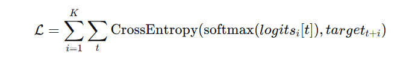

# 70.大模型（LLMs）Medusa

#### Medusa 是如何在不需要独立草稿模型的情况下实现并行生成候选 token 的？

Medusa 的核心思想是在目标大模型的最后隐藏层上附加多个轻量级预测头（Medusa heads），每个头负责预测未来不同步的 token，从而在一次大模型前向传播中同时产生多个候选 token，构成草稿序列，无需额外的独立草稿模型。

具体流程：

- 在正常自回归解码时，大模型处理当前序列，产生最后一层隐藏状态。

- 除了原始的 LM head 预测当前步 token 外，新增的 Medusa heads（例如 4 个头）分别直接预测当前步之后第 1、2、3、4 个位置的 token。

- 这样，一次 forward 就得到了一个由当前 token 和多个未来 token 组成的候选序列。这些候选序列随后通过树注意力由大模型自身并行验证（拒绝采样），保证最终输出分布与原始大模型完全一致。

因为 Medusa heads 非常小（通常为单层全连接或简单残差块），其计算量相比大模型几乎可忽略，因此“草稿生成”成本近乎为零，实现了无独立草稿模型的投机解码。

---

#### 描述 Medusa 中多个预测头的结构：它们如何附加在原始 LLM 上？输出是什么？

Medusa heads 直接附加在目标大模型的最后一层隐藏状态之上。对于 Transformer 架构，就是在最终的 layer norm 之后、原始的 LM head 之前（或与之并行）。

结构：

- 每个 Medusa head `i` 对应预测未来第 `i` 个 token（`i = 1, 2, ..., K`）。

- 最简单的实现是每个 head 为一个单层全连接网络 + 残差连接：

```plain text
h = final_hidden_state  # 形状 [batch, seq_len, d_model]
head_i_out = SiLU(h @ W1_i + b1_i) @ W2_i + b2_i + h @ W_res_i  # 残差
logits_i = head_i_out @ LM_head_weight + LM_head_bias  # 共享输出 embedding
```

- 也可以更轻量：直接 `h @ W_i` 然后乘上共享的 LM head 权重得到 logits，不加激活函数。

- 输出：每个 head 输出一个形状为 `[batch, seq_len, vocab_size]` 的 logits 张量，分别代表对未来各位置的预测分数。这些 logits 通过 softmax 得到候选 token 的概率分布。

关键点：Medusa heads 与原始 LM head 共享最后的输出投影矩阵（unembedding weights），这不仅减少了参数量，还使预测头能利用预训练的语言建模知识，大幅提升候选质量。

---

#### Medusa 的预测头是作用在哪一层？它们如何共享 base model 的隐藏状态？

Medusa heads 作用在基座模型的最后一层隐藏状态上。具体来说，就是经过所有 Transformer 层和最终 LayerNorm 之后得到的 `hidden_states`。

共享方式：

- 基座模型正常前向传播，产出这个最终隐藏状态 `h`。

- 所有 Medusa heads 都接收同一个 `h` 作为输入，独立计算各自的 logits。它们之间没有顺序依赖，可完全并行计算。

- 这种共享极为经济：大模型只需要执行一次前向，就同时获得了当前 token 的预测（通过原始 LM head）和多个未来 token 的候选（通过 Medusa heads），无需多次推理。

为什么有效：大模型的最后一层隐藏状态已经编码了丰富的上下文信息，足以用来推测附近几个位置的 token。Medusa heads 的任务只是将这些信息“映射”到未来 token 的预测上，因此结构简单但预测准确度较高。

---

#### Medusa 的训练过程：如何训练预测头？损失函数是什么？需要何种数据？

Medusa 训练仅更新新增的预测头参数，基座模型权重完全冻结。

训练数据：

- 直接使用基座模型预训练或微调时使用的文本语料即可，无需额外标注。任何自回归文本都可以。

- 数据格式：对于文本序列，将其截成固定长度的片段。在片段中，每个位置 `t` 的未来第 `i` 个 token 就是该 Medusa head `i` 在该位置的监督标签。

训练过程：

1. 将文本输入冻结的基座模型，收集最后一层隐藏状态 `h_t`。

2. 将 `h_t` 送入各个 Medusa head，得到预测 logits `logits_i`。

3. 计算交叉熵损失：对于 head `i`，其目标 token 是序列中 `t+i` 位置的 token。损失为：

$$
\mathcal{L}=\sum_{i=1}^{K}\sum_t\mathrm{CrossEntropy}(\mathrm{softmax}(logits_i[t]),target_{t+i})
$$

{.ocr-src}

实际训练中通常对多个 head 的损失求和或平均。

4. 反向传播只更新 Medusa heads 的参数；基座模型和 LM head 保持冻结。

其他技巧：可以使用更复杂的训练策略，如蒸馏损失，让 head 的预测分布接近目标模型自身在这些未来位置的分布，进一步提高接受率。但简单交叉熵已能取得不错效果。

---

#### Medusa 的树形注意力（Tree Attention）是如何同时验证多个候选序列的？与标准 attention mask 的区别。

在 Medusa 中，验证阶段需要同时验证多个由不同 heads 预测的候选 token 组成的树状序列。标准因果注意力掩码是下三角矩阵，仅支持单条序列；而 Tree Attention 通过精心设计的注意力掩码，让模型在一次前向中处理树形拓扑的多个序列。

树形结构构建：

- 草稿阶段，Medusa heads 可能提出多个候选 token（例如 top-2 采样），形成分支。最终得到一个根节点为当前 prefix，子节点为不同候选的树。

- 树中的节点总数即为验证时需要处理的 token 总数。将这些 token 按某种顺序拼接成一维序列，然后构造一个二维的树注意力掩码。

树注意力掩码：

- 掩码是一个 `[total_tokens, total_tokens]` 的布尔矩阵。若节点 `j` 是节点 `i` 的祖先（包括自身），则允许注意力交互（`mask[i, j] = 0`），否则屏蔽（`mask[i, j] = -inf`）。

- 与标准因果掩码的区别：标准因果掩码是一维链（每个 token 只能看到它之前的所有 token）；树掩码允许一个 token 看到其从根到当前节点的所有祖先，但不能看到分支的其他路径上的节点。这保证了每个节点生成时的条件概率仅依赖其合法前缀。

- 将拼接序列和树掩码送入大模型，就可以并行计算所有树节点的 hidden states 和 logits，实现高效验证。

优势：Tree Attention 使得一次大模型前向可以同时验证多个不同长度的候选序列，极大提高并行性，让 Medusa 能够在不牺牲分布准确性的前提下加速解码。

---

#### 为什么 Medusa 可以视为一种“多头快速解码”，它与推测解码的根本区别是什么？

Medusa 被称为“多头快速解码”是因为它通过多个预测头在一次前向中同时生成多个未来 token，就像多头注意力一样并行工作，从单一隐藏状态出发做出多步预测。

与标准推测解码的根本区别：

| 维度 | 标准推测解码 | Medusa |
| --- | --- | --- |
| 草稿模型 | 独立的小模型（如 7B 为 70B 草稿） | 无独立模型，使用附加预测头 |
| 草稿生成方式 | 草稿模型自回归循环生成 K 个 token | 大模型一次前向，多个 heads 同时预测 K 个 token |
| 额外参数与显存 | 需加载整个草稿模型，显存开销大 | 仅增加极少量参数（几个全连接层），近乎无额外显存 |
| 训练需求 | 无需训练（直接使用现成小模型） | 需要训练预测头（但基座模型冻结，成本低） |
| 草稿质量和接受率 | 依赖小模型与目标模型的分布匹配度 | 基于目标模型自身特征，通常接受率更高 |
| 部署复杂度 | 需管理双模型和可能的 KV 缓存复用 | 单模型部署，头与模型绑定 |

根本区别：推测解码依赖“外部”草稿模型，而 Medusa 将预测能力“内化”为目标模型的一部分，通过自带的轻量级多头实现投机，从而实现单模型投机解码。

---

#### Medusa 的加速比如何？与标准推测解码相比，有什么优势和劣势？

加速比：

- Medusa 在 batch size = 1 的场景下，可实现 2x ~ 3x 的加速，与标准推测解码相当甚至略高。

- 加速主要来源于：大模型一次验证平均接受多个 token（受接受率影响），且草稿生成零成本（与验证共享计算）。

优势：

1. 无需独立草稿模型：节省显存和部署复杂度，特别适合单 GPU 或显存有限的环境。

2. 草稿开销极低：草稿 token 几乎“免费”，使得加速比接近理论上限。

3. 接受率高：因为 Medusa heads 直接利用大模型深层特征，预测准确度通常优于独立小模型。

4. 易于训练：冻结大模型仅训练小头，训练成本极低。

劣势：

1. 需要训练：尽管成本低，但终究需要额外训练步骤和训练数据，无法完全即插即用。

2. 侵入性修改：需要修改模型结构（添加 heads），不适合直接使用现成预训练权重而不允许任何改动的场景。

3. 加速比依赖于头部数量和质量：头部越多，潜在加速越大，但训练和树验证复杂度也增加。

4. 在 batch > 1 时增益下降：与所有投机解码一样，大并发下加速有限，因为 GPU 已被填满，减少调用次数的收益减小。

总结：Medusa 在需要单模型、低显存占用、追求极简部署且可接受微调的推理场景中，优势显著；但在要求零修改、零训练时，标准推测解码（使用现成小模型）更合适。

---

#### Medusa 中的候选长度和头部数量如何设定？对速度和显存的影响。

候选长度（草稿长度）：相当于 Medusa heads 的个数 `K`。每个 head `i` 预测未来第 `i` 个 token，因此树的最大深度为 `K`。

头部数量：`K` 是超参数，通常取 2~5。更大的 `K` 允许一次生成更长的草稿，潜在加速更高。

对速度和显存的影响：

- 显存：每个 Medusa head 增加少量参数（若为单层 FC，参数量 = `d_model * d_model * 2 + d_model` 左右，远小于主模型）。`K` 个 heads 的参数量线性增长，但通常只占主模型的 0.1%~1%，显存开销可忽略。

- 训练显存：仅训练 heads，无需存储主模型梯度，训练显存与推理相当。

- 推理速度：
  - 草稿生成速度：heads 的计算与主模型最后一层并行，几乎不增加延迟。
  - 验证速度：树注意力处理的 token 总数随 `K` 和每步采样宽度呈组合增长。树越大，验证时间越长，可能部分抵消多接受的收益。因此需权衡 `K` 和分支宽度（如 top-2）。实践中 `K=3~5` 且使用贪心或小 top-p 采样时，验证开销可控。

- 接受率：`K` 过大时，远距离预测准确度下降，接受率会随位置衰减，导致边际收益递减。因此 `K` 通常 ≤5。

设定指南：根据目标接受率和延迟容忍度，一般 `K=3` 或 `4` 获得最佳加速；更多头可略微提升吞吐，但树验证开销增大，需实测确定。

---

#### Medusa 预测头的采样策略：是贪心还是带随机性？如何保证生成多样性？

Medusa heads 在生成候选 token 时可采用贪心、top-k 或 top-p 采样，与普通自回归生成类似。为了在保持高接受率的同时提高多样性（从而可能增加树并行度和接受长度），通常使用带随机性的采样。

采样策略：

- 贪心：每个 head 直接选择概率最高的 token，生成单一的候选序列。树只有一条链，验证最简单，加速比稳定但可能较低（因为一旦预测错误就被拒绝）。

- Top-k 采样：每个 head 保留 top-k 个候选 token（如 top-2），形成分支，构造树。这增加了验证阶段的节点数，但提高了至少有一条路径被完全接受的概率，可提升期望接受长度。

- 融合采样：Medusa 论文中常用的做法是从每个 head 的分布中采样一个或多个 token（可用 temperature 控制随机性），并确保和原始模型分布不冲突。由于树验证保证分布一致性，采样不影响最终输出质量。

保证生成多样性：

- 通过调整温度和 top-k 值，可在树中产生多样化的候选，提高接受率。

- 由于最终的验证步骤使用拒绝采样，即使 head 采样很“冒险”，最终输出仍然严格服从目标模型分布，因此可以安全地采用较高随机性来探索，而不会污染生成结果。

总结：Medusa 可以自由选择采样策略，用随机性换取更高的期望接受长度，而不牺牲生成质量。

---

#### 在不更改原始模型权重的情况下，能否通过 Medusa 头实现加速？训练头时基座模型是否冻结？

可以，这正是 Medusa 的设计初衷之一：添加 Medusa heads 不修改基座模型权重，仅新增可训练的轻量级参数，从而在保持基座模型能力完全不变的前提下实现加速。

训练时基座模型冻结：

- 基座模型（包括 Transformer 层、embedding、原始 LM head）全部冻结，不参与梯度更新。

- 仅训练新增的 Medusa heads 参数。通常只需要在训练数据上运行几次 epoch（如 1-2 个 epoch 的通用语料），heads 即可快速收敛。

推理时的部署：

- 训练好的 Medusa heads 可以单独保存（或与基座模型权重打包），推理时将它们加载到模型中。

- 模型前向时，正常计算基座模型得到最终隐藏状态，然后并行通过冻结的 LM head 和新增的 Medusa heads，同时产生当前 token 和多个草稿 token 的分布。随后进入树验证阶段。

- 整个流程对原始模型无任何破坏，可随时移除 Medusa heads 恢复原始单步生成。

结论：Medusa 是一种完全非侵入式的加速方案，通过冻结基座模型仅外挂训练小头，既保证了原始模型的能力完整性，又获得了显著的推理加速，兼具灵活性和高性能。

---

#### Medusa 是否支持连续批处理？与 PagedAttention 结合时可能有哪些冲突？

Medusa 可以支持连续批处理，但需要额外设计以处理树形验证和分页 KV 缓存的交互。它本质上是推测解码的一种单模型变体，因此连续批处理的加入/退出机制同样适用：在每轮验证后，完成的请求退出，新请求可加入。

与 PagedAttention 结合时的潜在冲突：

1. 树注意力与非连续物理块\
   PagedAttention 的 KV 缓存存储在分散的物理块中。Medusa 的验证阶段使用树注意力，需要为一个请求同时验证多个不同长度的候选分支。每个分支的序列长度不同，其 KV 缓存占用的物理块数也不同。在一个请求内同时存在多个分支时，必须管理多个块表（每个候选路径对应一个逻辑块表），这会显著增加块表管理的复杂性。

2. KV 缓存的分配与复制\
   在分支节点，不同分支共享前缀部分的 KV 块，但分叉后需要各自的私有块。当树节点数量较多时，可能需要快速分配许多小的物理块（例如只存 1~2 个 token 的块），导致块分配/释放频率极高，增加调度开销。

3. 连续批处理下树节点的批量处理\
   连续批处理通常将多个请求的 decode 步骤合并为一个大 batch。Medusa 的树验证需要每个请求有不同形状的树（节点数、结构各异），这难以直接拼接成规整的张量。通常的解决方法是将所有请求的所有树节点展平为一个序列，构造全局的树掩码（分块对角），然后一次性进行前向。这要求 PagedAttention 内核能够处理这种高度不规则的批量输入和相应的块表索引。

4. KV 缓存的写回与一致性\
   在验证后，请求只保留被接受的路径，需要释放未被接受分支占用的物理块。这要求内存管理器能够正确地回收那些“临时”分配的树分支块。如果实现不当，可能导致内存泄漏或碎片。

解决方案：通常在实际部署中，对连续批处理和 PagedAttention 结合的 Medusa 会进行简化：例如限制树的分支宽度，或采用贪心采样（单分支），以降低系统复杂度，优先保证吞吐。

---

#### 如何在 Medusa 中应用重复惩罚和 logits 处理器？是对每个预测头分别处理吗？

在 Medusa 中，需要分别对每个预测头（包括原始 LM head 和各 Medusa heads）独立应用重复惩罚和其他 logits 处理器，以确保每个候选 token 的预测都考虑到已生成的 token 历史。

原因与机制：

- 重复惩罚基于已生成的 token 序列，降低这些 token 的 logits。对于原始 LM head，历史序列就是当前请求已生成的全部 token。对于 Medusa head `i`（预测未来第 `i` 个 token），其“历史序列”是当前已生成 token 加上该 head 所在分支之前已接受的草稿 token。因此，不同 head 乃至不同分支节点的历史序列可能不同，需各自独立计算。

- 实现时，在树验证的前向传播之后，获取每个树节点的 logits。然后针对每个节点，收集其唯一的祖先 token 序列，应用重复惩罚、温度缩放、top-p/top-k 过滤等。由于这些操作计算量很小，可以高效地以 batch 形式处理所有节点。

- 在草稿生成阶段（即使用 Medusa heads 预测候选 token 时），如果 Medusa heads 是贪心或采样输出，也需要根据节点当前历史应用重复惩罚（如果该阶段就需要过滤重复 token）。这可以在每个 head 的 logits 输出后立即处理。

总结：是的，重复惩罚等 logits 处理器必须对每个预测头（或树节点）分别应用，以保证每个候选 token 的合法性。实现上可通过向量化或循环处理所有树节点来完成。

---

#### 分析 Medusa 的接受率：预测头的质量如何影响有效加速？

接受率（α） 定义为验证阶段草稿 token 被目标模型接受的比例。在 Medusa 中，接受率由各 Medusa head 的预测准确度决定。

预测头质量对接受率的影响：

- 每个 head `i` 预测未来第 `i` 个 token 的准确度（top-1 accuracy 或分布重叠度）决定了该位置的平均接受概率。head 质量越高，分布与目标模型越接近，接受率越高。

- 因为树验证可以同时提交多个候选，实际接受率可以通过增加分支宽度（如 top-k 采样）来提高，但这依赖于 heads 提供的分布质量：如果 head 的 top-k 列表中包含了目标模型会选中的 token，则有机会被接受。

- 训练良好的 Medusa heads（例如在足够多数据上训练，与基座模型分布匹配）能够达到较高的单 token 接受率（如 0.7~0.9），从而使得期望接受长度 $E = (1 - α^{K+1})/(1 - α)$ 较大。

对有效加速的影响：

- 加速比 ≈ `E * T_target / (T_target + T_draft)`。在 Medusa 中，`T_draft` 几乎为零（heads 计算与主模型并行），所以加速比 ≈ `E`。因此接受率几乎直接决定了加速比。

- 如果 heads 质量差，接受率低，E 接近 1，加速消失。质量过高（接近 1），E 接近 K+1，加速接近 K+1 倍。

- 此外，低接受率导致更多树分支被拒绝，浪费了验证阶段对无效节点的计算。过多的分支还会增加树注意力开销，可能反而慢于原始模型。因此必须保证 heads 有足够质量，才能获得正加速。

结论：预测头质量是 Medusa 的生命线，直接决定接受率和最终加速效果。良好的训练至关重要。

---

#### Medusa 能否与量化后的基座模型协同工作？预测头也需要量化吗？

完全可以协同工作。基座模型可以被量化为 INT4/INT8（如使用 AWQ 或 GPTQ），而 Medusa heads 通常保持 FP16/BF16，或者也可以量化。

基座模型量化：

- 基座模型量化后，其输出隐藏状态会受到量化噪声影响。由于 Medusa heads 是在该隐藏状态上进行预测的，head 的输入分布会发生变化。如果 heads 是在全精度模型上训练的，直接用于量化模型可能导致接受率下降。

- 解决方案：
  1. 在量化后的基座模型上重新训练/微调 Medusa heads。冻结量化后的基座模型，使用相同训练数据微调 heads，使其适应量化后的隐藏状态分布。这是最可靠的方法。
  2. 量化感知训练：在训练 heads 时，引入伪量化模拟基座模型的量化噪声，使 heads 对量化鲁棒。

预测头是否需要量化：

- 不强制。Medusa heads 的参数量极小（通常 < 模型总参数的 0.5%），保持 FP16 对整体显存和带宽的影响微乎其微，而量化 heads 可能降低其预测准确度，损失接受率。因此通常保留 FP16。

- 若在极端边缘设备上需要极致内存压缩，也可以对 heads 应用 INT8 甚至 INT4 量化，但需验证接受率损失是否在可接受范围内。

总结：Medusa 与量化基座模型可以协同，但建议在量化后的模型上微调 heads，并保持 heads 为 FP16 以获得最佳加速。

---

#### 在多轮对话中，Medusa 的预测头是否需要为每个对话历史重新训练？还是通用的？

Medusa 预测头是通用的，不需要为每个对话重新训练。 它们在训练时学习的是基于任意前缀预测未来 token 的能力，与具体的对话历史无关。

原因：

- Medusa heads 的输入是基座模型最后一层的隐藏状态，该隐藏状态已经编码了完整的上下文信息（包括整个对话历史）。heads 学会的是从这种丰富的上下文表示中提取未来 token 的信息。因此，无论对话历史如何，只要上下文窗口内，heads 都能正常工作。

- 训练时使用的通用文本语料已经包含了各种上下文模式，heads 学到的预测能力是可迁移的。

多轮对话中的特殊考虑：

- 对话的分布可能与训练 heads 时使用的通用文本分布略有不同（如更多问答、指令）。如果发现接受率在对话场景中显著低于通用文本，可以使用对话数据对 heads 进行少量微调，进一步提升特定场景下的接受率。但这是优化而非必需。

- 由于对话可能很长，超出基座模型的最大上下文长度，此时会截断历史。heads 的输入隐藏状态因此缺少早期信息，可能影响预测质量。但这与 heads 的通用性无关。

结论：Medusa heads 训练一次即可通用于各种上下文，无需每次对话重新训练。针对特定场景微调是锦上添花。

---

#### 比较 Medusa 与 speculative decoding 在模型修改上的成本（Medusa 需要训练头，推测解码需草稿模型）。

| 成本维度 | Medusa | 标准推测解码 |
| --- | --- | --- |
| 模型架构修改 | 需要修改目标模型，添加多个预测头（轻度侵入） | 无需修改目标模型；草稿模型独立存在（非侵入） |
| 额外参数量 | 极小（heads 参数量 < 1% 主模型） | 需要整个草稿模型（如 7B 模型约 14GB FP16） |
| 训练成本 | 需要训练 heads，但基座冻结；训练数据需求小，通常 1~2 epochs 即可收敛，成本低 | 无训练成本（使用现成小模型）。但若需专门蒸馏或微调草稿模型以提高接受率，则训练成本较高 |
| 部署显存成本 | 几乎不增加显存（仅 heads 参数） | 需同时加载两个模型，显存接近翻倍（除非共享参数或卸载） |
| 维护成本 | heads 与目标模型绑定，随目标模型发布一同分发 | 需维护草稿模型与目标模型的兼容性（词表必须一致） |
| 适用性 | 适合有训练能力且希望单模型部署的场景 | 适合无训练能力、可接受双模型显存的场景，或已有合适小模型 |

综合来看：

- Medusa 的修改成本集中在“一次性训练小头”，训练资源需求极低，换来的显存和部署简化优势显著。

- 推测解码的修改成本为“零训练但高显存”，部署复杂，但无需任何模型改动，对现成模型的即插即用更友好。

---

#### 如何将 Medusa 与动态批处理结合，当 batch 内请求的预测头行为不同时如何处理？

动态批处理（Dynamic Batching）要求同一 batch 内的请求执行相同操作。Medusa 的各个请求可能因树结构不同（不同分支宽度、深度）导致计算图不同。处理方法如下：

1. 统一树结构（静态化）

在每轮迭代中，强制所有请求使用相同的树拓扑（例如相同的分支因子和深度）。这可以通过对每个请求的 heads 输出取固定数量的 top-k 候选来实现，即使某些 head 的 top-k 概率很低，也强制填充到相同数量。这样，所有请求的树节点数相同，可以整齐地批处理。

2. 动态填充（Padding）

允许每个请求有不同的树节点数，但在组织 batch 时，找到最大节点数，将其它请求的树节点序列填充到该长度，并构造相应的块对角树掩码。填充部分的注意力掩码完全屏蔽，计算时额外开销为冗余节点计算。只要节点数差异不大，填充开销可接受。

3. 分组批处理

将请求按树大小分组，相同组内的请求组成子 batch，分别执行验证前向。这增加了 kernel launch 次数，但避免了大量填充。适合请求间树大小差异极大的情况。

4. 贪心解码简化

若所有请求都采用贪心解码（每个 head 只取 top-1），则树退化为单链，所有请求的树结构完全一致（链长相同或相似），可直接作为普通 batch 处理。这是最简单且常见的优化。

结论：通过统一树结构或动态填充，Medusa 可以与动态批处理有效结合。实践中，为了最大化吞吐，常限制树的分支宽度（如 top-2）并统一拓扑。

---

#### 设计一个实验来测量 Medusa 中树形注意力的计算开销与加速收益。

实验目标：量化树注意力相对于简单链式验证的额外计算开销，以及由此获得的加速（接受 token 数增加）。

实验设置：

1. 基座模型：选用一个固定模型（如 Vicuna-7B），已训练好 Medusa heads（K=4）。

2. 测试数据：从通用数据集（如 ShareGPT）中采样 100 条 prompt，生成长度固定为 256 token。

3. 配置对比：
  - 基线：标准自回归解码（无 Medusa）。
  - 链式 Medusa：每个 head 仅取 top-1 候选（树 = 单链，无分支）。
  - 树形 Medusa（top-2）：每个 head 取 top-2 候选，构建完全 2-叉树。
  - 树形 Medusa（top-3）：每个 head 取 top-3 候选。

4. 测量指标：
  - 总推理时间（秒）。
  - 平均接受 token 数（E）。
  - 平均每轮验证时间（`T_verify`）。
  - 平均每 token 延迟（ms/token）。
  - 加速比（相对于基线）。
  - GPU 利用率。

实验步骤：

- 对每条 prompt，分别用四种配置生成 256 token，记录时间线和 token 产出。

- 分解每轮的时间：前向传播（包括基座和 heads）、树构造与掩码生成、采样与验证逻辑。

- 比较链式和树形（top-2）的验证时间差异，即为分支带来的额外计算开销。

- 计算加速比 = (基线总时间) / (Medusa 总时间)。对比接受率提升带来的收益是否超过额外验证开销。

预期结果：

- 链式 Medusa 验证开销最小，接受率最低，加速比约 1.5~2x。

- 树形 top-2 接受率提升，E 增加，验证时间略有增加（树节点数约为链式的 2 倍），但加速比可能提高到 2.5x。

- top-3 树节点数进一步膨胀，验证时间显著增加，边际加速递减，甚至可能低于 top-2。

- 从而确定最优分支宽度。

分析：通过绘制“加速比 vs. 分支宽度”曲线，找到最佳配置点，指导实际部署。

---

#### Medusa 能否与 FlashAttention 兼容？实现时需要注意什么？

可以兼容，但需要 FlashAttention 支持自定义注意力掩码（即树形掩码），因为 Medusa 验证的树形序列需要非标准的因果掩码。

实现注意事项：

1. 树掩码的支持\
   标准 FlashAttention 假设因果掩码（下三角）或全注意力，而树注意力需要每个节点只能看到其祖先节点。这需要将树结构的邻接矩阵转换为 `[total_nodes, total_nodes]` 的掩码，并传递给 FlashAttention kernel。目前，FlashAttention-2 提供了 `attn_mask` 参数支持自定义掩码，但效率可能低于极致的因果优化路径。

2. 节点序列的排列\
   树节点需要按某种顺序（如宽度优先）拼接成一维序列，使得掩码呈现有利于 GPU 计算的分块结构。需要保证同一块内的节点掩码尽可能规整，以便 kernel 仍能利用块内连续访问。

3. 变长序列的处理\
   不同树可能节点数不同，批处理时需使用 varlen 接口。FlashAttention 的 `varlen` 支持传入 `cu_seqlens_q` 和 `cu_seqlens_kv` 来区分序列，但此时还需要额外传入树掩码，实现较复杂。可能需要自定义 CUDA kernel 或在现有 kernel 基础上修改。

4. 性能考量\
   如果树掩码不规则，可能导致 FlashAttention 的分块策略失效，增加 HBM 读写。一些实现选择不使用通用的 FlashAttention，而是为树注意力编写专用的融合 kernel（如 Medusa 原作的 `tree_attention`），以达到最佳效率。

结论：Medusa 可以与 FlashAttention 结合，但需要对 kernel 进行定制或扩展以支持树掩码；否则，将退化为使用标准 PyTorch 注意力（速度较慢）。目前高效的开源实现（如 Medusa 官方）通常提供自定义的 tree attention kernel。

---

#### 如果 Medusa 预测头生成错误候选，验证机制如何确保最终输出分布与原模型一致？

Medusa 的验证机制与标准推测解码完全一致，采用基于拒绝采样的令牌级验证，保证即使预测头给出错误候选，最终生成的 token 序列的概率分布与直接运行目标模型（基座模型）完全一致，没有质量损失。

具体机制：

- 在树验证阶段，目标模型计算所有树节点的 logits，得到每个节点位置的条件概率 `p(x | context)`。

- 对于候选路径上的每个节点 token `x`，使用与标准推测解码相同的拒绝采样规则：
  - 接受概率 = `min(1, p(x) / q(x))`，其中 `q(x)` 是该 Medusa head 预测该 token 的概率。
  - 若接受，则继续验证下一个节点；若拒绝，则从修正分布 `norm(max(0, p - q))` 中重新采样 token，并丢弃该分支之后的所有节点。

- 这一过程严格保证了每个 token 的采样分布等于 `p`，无论 `q` 的准确度如何。错误的候选（`q` 与 `p` 差异大）只会降低接受概率，迫使系统重新从 `p` 中采样，从而输出正确分布的 token。最终序列的联合分布与原模型自回归采样完全相同。

结论：Medusa 通过拒绝采样在数学上保证了输出分布的无偏性，预测头的错误只影响效率（接受率），不影响最终生成质量。

---

#### 解释 Medusa 中的“top‑k 候选筛选”在验证前的作用。

在 Medusa 中，top‑k 候选筛选是指在每个 Medusa head 的预测阶段，选择概率最高的 k 个 token 作为候选，而不是仅取单个 top-1。这些候选 token 被组合成树形结构，送入验证阶段。

作用：

1. 提升接受率与期望接受长度\
   单个 top-1 候选一旦预测错误，该分支就被截断。通过提供多个候选（如 top-2），增加了目标模型选中其中一个候选的概率，从而提高了该位置及后续位置的接受可能。这能显著增加平均每次验证生成的 token 数，提升加速比。

2. 在有限验证开销内探索多条路径\
   树验证的总节点数随分支因子指数增长。top‑k 控制了每个节点的分支数，从而控制树的大小和验证计算量。通过选择适当的 k（如 2 或 3），可在额外开销和提升接受率之间取得平衡。

3. 增加生成多样性（可选）\
   对于需要多样性的应用，top‑k 候选为树提供了多样化的分支，最终验证通过拒绝采样仍保证输出分布正确，所以不会破坏一致性。

4. 匹配目标模型的不确定性\
   目标模型在某个位置可能有一个以上的高概率 token。如果草稿模型只提供一个候选但非目标模型的最可能 token，接受率会降低。top‑k 提高了覆盖目标模型高概率 token 的机会。

总结：top‑k 候选筛选是 Medusa 在草稿质量和验证开销之间的控制阀，通过适当的 k，可以在不大幅增加树节点数的情况下，有效提升接受率和加速效果。

