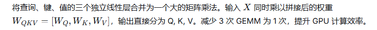
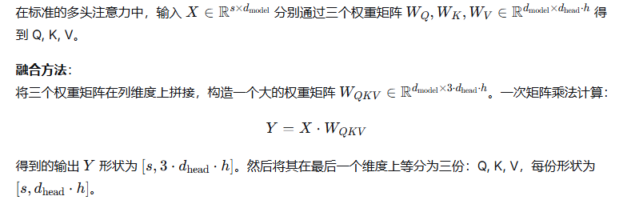
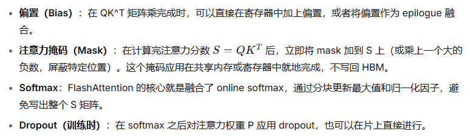
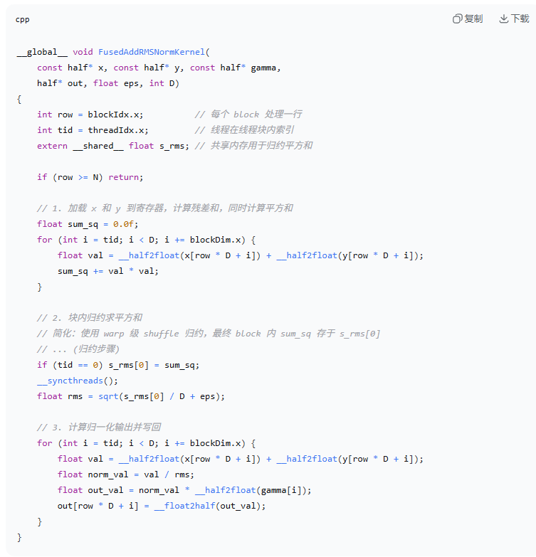

# 71.大模型（LLMs）算子融合

#### 什么是算子融合？在深度学习推理中为什么重要？

算子融合（Operator Fusion） 是指将计算图中的多个连续算子（操作）合并为一个单一的复合算子，在一次 GPU kernel 调用中完成所有这些计算，而不保留中间结果的完整显存写入和读取。

在推理中，算子融合至关重要，原因包括：

- 减少 kernel launch 开销：GPU 每启动一个 kernel 都有固定的调度延迟（数微秒），大量细碎的小操作会产生显著的启动开销。融合后，多次 launch 变为一次，节省 CPU-GPU 同步和调度时间。

- 减少显存带宽消耗：不融合时，每个算子的输出需要写回 HBM，下一算子再从 HBM 读取。融合后，中间数据通过寄存器或共享内存传递，避免了 HBM 往返。由于推理（特别是 decode）常受限于显存带宽，这一节省直接转化为延迟降低。

- 提高 GPU 占用率和数据局部性：融合 kernel 可以在片上完成更多工作，增加计算密度，隐藏内存延迟。同时保持数据在寄存器/SRAM 中，提升缓存命中率。

- 降低峰值显存占用：消除了中间张量的分配，对于长序列等大内存场景尤为关键。

总之，算子融合是推理优化的核心技术，能将模型的执行从“带宽受限的离散操作序列”转化为“计算高效的紧凑内核”，实现显著的吞吐和延迟改善。

---

#### 在 Transformer 推理中，常见的可融合算子组合有哪些？如 QKV 投影融合、残差+层归一化融合。

Transformer 模型中有多处天然适合融合的算子组合：

1. QKV 投影融合

将查询、键、值的三个独立线性层合并为一个大的矩阵乘法。输入 $X$ 同时乘以拼接后的权重 $W_{QKV}=[W_Q,W_K,W_V]$，输出直接分为 Q, K, V。减少 3 次 GEMM 为 1 次，提升 GPU 计算效率。

{.ocr-src}

2. 残差连接 + 层归一化（Add & LayerNorm）\
   将残差相加与后续的 LayerNorm 融合为一个 kernel。在残差相加后立即在寄存器或共享内存中进行均值和方差计算，归一化并写入最终结果，避免中间张量的读写。

3. 激活函数与线性层融合（如 GeLU/ReLU + Linear）\
   将线性层的输出矩阵乘后紧跟的激活函数（如 GeLU）融合。在 GEMM 的 epilogue 中直接对输出应用激活函数，无需单独 kernel。TensorRT 的 `PointWise` 融合就包括此类。

4. Attention 内核中的融合\
   FlashAttention 将 QK^T、softmax、乘以 V 全部融合在一个 kernel 中。更进一步，还可以融合注意力 mask、dropout（训练）、缩放、以及位置编码（如 RoPE 应用在加载 Q、K 时）。

5. MLP 块融合\
   第一个线性层 + 激活 + 第二个线性层可以通过算子融合技术（如把激活融合到第一个 GEMM 的输出）。更激进的融合会将两个线性层和激活全部用一个 kernel 实现。

6. 词嵌入与位置编码的相加融合\
   在输入阶段，将 token embedding 和 position embedding 的加法融合到一个 kernel 中，减少一次显存往返。

7. KV Cache 追加与注意力\
   在 decode 阶段，将当前 token 的新 K、V 追加写入缓存的操作可以与注意力计算融合，直接使用新 K、V 而不必先写回全局内存。

这些融合显著减少了 kernel launch 次数和显存带宽使用，是推理引擎中普遍实现的优化。

---

#### 为什么将多个小核（kernel）合并成一个能提高 GPU 利用率？从 kernel launch overhead 和内存带宽解释。

1. Kernel Launch Overhead 角度

每次在 GPU 上启动一个 kernel，都需要 CPU 线程发起调用、通过 CUDA 驱动程序提交到队列，然后 GPU 调度器分配资源并执行。这个过程存在固定开销（通常在 5~15 微秒）。如果模型由数百个小操作组成，每个操作本身计算时间可能仅几微秒，那么 launch 开销将占据总时间的大部分，GPU 大部分时间处于空闲等待任务。将所有小操作融合为一个 kernel，只需一次 launch，消除了重复的调度延迟，使得 GPU 执行更紧凑，有效计算时间占比大增。

2. 内存带宽角度

GPU 的 HBM 带宽相对于计算能力往往成为瓶颈，尤其在推理中。离散的每个算子都需要从 HBM 读取输入并写回输出。例如，一个 element-wise 加法：读两个张量，写一个张量，操作强度极低，几乎纯带宽消耗。连续多个小算子会造成同一数据反复在 HBM 和计算单元之间搬运。融合后，中间结果通过寄存器或共享内存传递，不经过 HBM，显著减少了对全局内存的读写次数，让宝贵的内存带宽更多地用于加载原始输入和写出最终结果，而非临时张量。

综合效果：融合后的 kernel 有更高的算术强度（FLOP/Byte），更容易从带宽受限转变为计算受限，从而充分利用 GPU 的计算资源，提高整体利用率。

---

#### 说明 Attention 模块中，Q、K、V 的线性变换如何融合为单个矩阵乘法。

在标准的多头注意力中，输入 $X\in\mathbb{R}^{s\times d_{\text{model}}}$ 分别通过三个权重矩阵 $W_Q,W_K,W_V\in\mathbb{R}^{d_{\text{model}}\times d_{\text{head}}\cdot h}$ 得到 Q, K, V。

**融合方法**：

将三个权重矩阵在列维度上拼接，构造一个大的权重矩阵 $W_{QKV}\in\mathbb{R}^{d_{\text{model}}\times3\cdot d_{\text{head}}\cdot h}$。一次矩阵乘法计算：

$$
Y=X\cdot W_{QKV}
$$

得到的输出 $Y$ 形状为 $[s,3\cdot d_{\text{head}}\cdot h]$。然后将其在最后一个维度上等分为三份：Q, K, V，每份形状为 $[s,d_{\text{head}}\cdot h]$。

{.ocr-src}

为什么有效：

- 原本需要 3 次矩阵乘法和 3 次显存读写权重（如果独立计算）。融合后仅需 1 次矩阵乘法，对权重 W QKV 只需读取一次，对输入 $X$ 也只需读取一次。

- 现代 GPU 的矩阵乘法单元（Tensor Core）在大矩阵上效率极高，合并后的 GEMM 维度增大（K 维不变，N 维变成 3 倍），更充分地利用硬件并行能力。

- 不需要三个独立 kernel，一次 launch 即可完成。

在具体实现中，Transformer 模型常将 Q、K、V 定义为单个 `qkv_proj` 层。推理引擎也会自动或手动进行这种融合。

---

#### 残差连接与层归一化（Add & LayerNorm）如何融合？写出可能的内核实现思路。

融合目标：将残差张量 `x` 和子层输出 `y` 相加，然后立即对结果进行 LayerNorm，避免写出中间加法结果。

内核实现思路（CUDA 伪代码）：

假设 `x` 和 `y` 形状均为 `[N, D]`（N 为 token 数，D 为特征维度），LayerNorm 有可学习参数 `gamma` 和 `beta`，epsilon 为小常数。

一个 kernel 完成以下操作：

1. 每个线程块处理一个 token（一行），或使用 warp 级并行。

2. 计算该行的和与平方和（用于均值方差）。首先从全局内存加载 `x[i]` 和 `y[i]` 到寄存器，计算 `sum = x + y`。

3. 进行 warp/block 内的归约（reduction），得到均值 `mean = sum(D) / D`，以及方差 `var = sum((sum - mean)^2) / D`。

4. 根据均值方差和 `gamma`、`beta` 对每个元素计算归一化结果：`out = (sum - mean) / sqrt(var + eps) * gamma + beta`。

5. 将 `out` 写回全局内存。

关键点：

- `x + y` 的中间结果完全保留在寄存器中，不写回 HBM。

- LayerNorm 的统计计算也直接使用这个寄存器值，避免了额外的显存读取。

- 如果 `x` 和 `y` 都是 FP16，计算过程中可能需要提升到 FP32 以保证数值稳定性。

这种融合在 TensorRT、vLLM 等推理引擎中广泛实现，可以将 Add 和 LayerNorm 的延迟降低为接近单一内存操作的时间。

---

#### 解释激活函数（如 GeLU）与矩阵乘法的融合机会。

激活函数通常紧跟在线性层（矩阵乘法）之后，形成 `Activation( X * W + bias )` 模式。融合机会在于将激活函数的计算作为矩阵乘法的尾声（epilogue），在 MMA（矩阵乘累加）完成后，在寄存器或共享内存中直接应用激活函数，然后写出最终结果。

具体融合方式（以 CUTLASS/TensorRT 为例）：

- 矩阵乘法的输出 tiles 在累加器中为 FP32。

- 在 epilogue 阶段，将累加器结果逐元素转换为输出精度（如 FP16），同时应用偏置（如果有），然后立即应用 GeLU 函数。

- GeLU 可以近似为 `x * sigmoid(1.702 * x)` 或使用查表/多项式近似，这些计算都可以在寄存器上快速完成。

- 最终只需一次写出来自矩阵乘法的激活输出，无需单独启动一个 GeLU kernel。

收益：

- 消除了一次额外的 kernel launch 和一次全局内存的读写往返（否则需要先写出线性层输出，再读取作为 GeLU 输入）。

- 计算上，激活函数的计算量相对矩阵乘法极小，融合不会显著增加 kernel 时间，但节省了带宽和启动开销。

几乎所有推理框架都将常见的激活函数（ReLU、GeLU、SiLU 等）与相邻的卷积或全连接层融合。

---

#### 算子融合是否总是有利？什么情况下融合可能导致性能下降或占用更多寄存器？

算子融合并非总是有利，不当的融合可能导致性能下降。主要有以下几种情况：

1. 寄存器溢出（Register Spilling）\
   融合后的 kernel 需要同时处理多个阶段的计算，会占用大量寄存器。如果寄存器用量超过 SM 限制，会导致寄存器溢出到本地内存（L1 cache 或 HBM），性能急剧下降。特别是当融合计算量较大的操作时，需谨慎评估寄存器压力。

2. 并行度降低\
   原来的多个小 kernel 可以分别占用不同的 GPU 资源（如计算单元和内存总线），可能有更好的重叠执行。融合后单一 kernel 可能变成计算密集或带宽密集，导致另一种资源空闲。此外，过大的 kernel 会减少活跃的线程块数量，降低 GPU 的 occupancy。

3. 代码复杂度与维护性\
   过度融合使得 kernel 非常专用且复杂，难以维护和泛化。对于变化频繁的模型结构，不够灵活。

4. 动态形状场景\
   在输入形状变化剧烈时，融合 kernel 可能因为针对特定 shape 优化而在其他 shape 上效率不佳，或需要 JIT 编译多种变体，增加编译开销。

5. 融合后增加了不必要的计算\
   如果融合中的某个部分可以跳过（例如某些条件下不执行激活），融合 kernel 必须包括所有路径，可能造成浪费。

6. 对反向传播不友好\
   训练时需要保存中间激活用于梯度计算，过度融合可能迫使重新计算某些中间值，或者增加反向传播的复杂度，抵消正向的收益。

因此，推理引擎常根据性能模型（Roofline）和实测决定是否融合，优先融合那些操作强度极低、带宽消耗大的 element-wise 操作，避免融合计算密集的大 GEMM。

---

#### 在 LLM 推理中，常见的 pointwise 操作（如偏置、mask、softmax）如何与 attention 内核融合？

Pointwise 操作是指对张量逐元素进行的计算，它们操作强度极低（~0 FLOP/Byte），单独执行几乎纯浪费带宽。在 attention 计算中，这些操作被巧妙融合进 FlashAttention 等内核中：

- **偏置（Bias）**：在 QK^T 矩阵乘完成时，可以直接在寄存器中加上偏置，或者将偏置作为 epilogue 融合。
- **注意力掩码（Mask）**：在计算完注意力分数 $S=QK^T$ 后，立即将 mask 加到 S 上（或乘上一个大的负数，屏蔽特定位置）。这个掩码应用在共享内存或寄存器中就地完成，不写回 HBM。
- **Softmax**：FlashAttention 的核心就是融合了 online softmax，通过分块更新最大值和归一化因子，避免写出整个 S 矩阵。
- **Dropout（训练时）**：在 softmax 之后对注意力权重 P 应用 dropout，也可以在片上直接进行。

{.ocr-src}

融合方式：在 FlashAttention 的迭代内，对于当前 Q 块和 K 块计算出的分数 tile，立即加上偏置、应用 mask，然后计算局部 softmax，更新统计量，最后与 V 块相乘累加到输出。所有这些操作都在 SRAM 中完成，中间矩阵 S 和 P 从未整体出现在 HBM 中，极大节省带宽。

在 decode 阶段，PagedAttention 等内核也融合了 mask、位置编码、甚至 KV Cache 的量化和反量化，实现了极低的访存开销。

---

#### 利用 torch.compile 或 TensorRT 进行自动算子融合，需要用户做什么？对动态 shape 的支持如何？

用户需要做的事：

- torch.compile：通常用户只需在模型或函数上添加 `@torch.compile()` 装饰器，或在调用时使用 `torch.compile(model, mode="reduce-overhead")`。可选的配置包括指定后端（如 `inductor`）、是否动态形状（`dynamic=True`）。无需手动改写模型代码。但为了获得最佳性能，可能需要避免某些不支持的 Python 操作，尽量使用 PyTorch 原生函数，以及提供示例输入或 shape 约束。

- TensorRT：需要先将 PyTorch/TensorFlow 模型转换为 ONNX 或直接使用 TensorRT 的 Python API 定义网络。对于 PyTorch，常用 `torch-tensorrt` 或 `torch2trt` 进行转换，需提供示例输入，可能需指定量化精度（如 FP16/INT8）、最大 batch size 等。对不支持的算子需要自定义插件。

对动态 shape 的支持：

- torch.compile：已支持动态 shape。通过设置 `dynamic=True`，编译时会生成能够处理多种输入形状的泛化 kernel（或针对常见 shape 生成多个特化 kernel）。但由于动态 shape 可能阻止某些图优化，或导致每次 shape 变化都触发重新编译，运行时可能有额外开销。建议尽量使用固定或很少变化的 shape 以获得最佳性能。

- TensorRT：从 6.0 开始支持动态形状。在构建引擎时，可以为每个输入指定一个优化配置文件，包含 `min`, `opt`, `max` 形状。TensorRT 会在这些范围内生成一个统一的引擎，运行时根据实际 shape 调整执行。如果实际 shape 超出配置范围，需要重新构建引擎。对 shape 维度变化频繁的情况，性能可能略低于静态 shape。

总之，两者都大幅简化了算子融合的实施，用户主要需要提供标注或转换，并合理配置动态维度。

---

#### 在 vLLM 中，PagedAttention 内核是否已经包含了算子融合？举例说明。

是的，vLLM 的 PagedAttention 内核高度融合了多个操作，以最大化内存带宽利用率和减少延迟。

融合的操作包括：

1. 分页 KV 加载与注意力计算\
   PagedAttention 内核将非连续的物理块加载（根据块表）与注意力分数计算、softmax 和输出累加完全融合。它在一个 kernel 中完成：遍历逻辑块，通过块表查询物理地址，加载 K、V 块，与 Q 进行点积，执行 online softmax，累加输出。这完全避免了写出任何中间注意力矩阵。

2. RoPE 位置编码的融合\
   vLLM 支持在 PagedAttention kernel 内部应用 RoPE。Q 和 K 在加载后立即旋转，无需事先在外部 kernel 处理。这节省了额外的数据搬运。

3. 缩放因子和反量化\
   当使用量化 KV Cache（如 FP8、INT8）时，vLLM 的 PagedAttention kernel 在加载 K、V 块的同时会进行反量化，将低精度数据转换为 FP16/BF16 进行乘加，融合了反量化操作。

4. 注意力掩码和偏置\
   内核内部支持因果掩码，通过控制读取的逻辑块范围即可实现，无需额外的 mask 张量。如果提供 ALiBi 偏置，也可以在分数上直接加上对应 bias。

5. 多查询共享（GQA/MQA）\
   kernel 支持分组查询注意力，自动将 KV 头映射到多个 Q 头，在块加载后复用，融合了 head mapping 逻辑。

举例：在 vLLM 的 `paged_attention_v1` 或 `v2` kernel 中，单个 CUDA kernel 完成了：（1）查询块表，（2）从分页物理块加载 K，（3）应用 RoPE，（4）计算 Q*K^T，（5）online softmax，（6）从分页块加载 V 并累加输出。所有中间数据驻留于 SRAM/寄存器，将多次 kernel 调用合并为一次，是实现 decode 阶段高性能的基石。

---

#### 如何通过编写 custom CUDA kernel 实现 RMSNorm + 残差融合？写出伪代码流程。

RMSNorm 是一种简化版 LayerNorm，仅使用均方根（RMS）进行归一化，无减去均值的步骤，计算更高效。将残差相加与 RMSNorm 融合可进一步节省带宽。

假设输入：残差 `x` 和子层输出 `y`，形状 `[N, D]`（N 为 token 数，D 为特征维度），可学习参数 `gamma`（形状 `[D]`），epsilon 为小常数。

Custom CUDA Kernel 伪代码流程：

```cpp
__global__ void FusedAddRMSNormKernel(
    const half* x, const half* y, const half* gamma,
    half* out, float eps, int D)
{
    int row = blockIdx.x;          // 每个 block 处理一行
    int tid = threadIdx.x;         // 线程在线程块内索引
    extern __shared__ float s_rms; // 共享内存用于归约平方和

    if (row >= N) return;

    // 1. 加载 x 和 y 到寄存器，计算残差和，同时计算平方和
    float sum_sq = 0.0f;
    for (int i = tid; i < D; i += blockDim.x) {
        float val = __half2float(x[row * D + i]) + __half2float(y[row * D + i]);
        sum_sq += val * val;
    }

    // 2. 块内归约求平方和
    // 简化：使用 warp 级 shuffle 归约，最终 block 内 sum_sq 存于 s_rms[0]
    // ... (归约步骤)
    if (tid == 0) s_rms[0] = sum_sq;
    __syncthreads();
    float rms = sqrt(s_rms[0] / D + eps);

    // 3. 计算归一化输出并写回
    for (int i = tid; i < D; i += blockDim.x) {
        float val = __half2float(x[row * D + i]) + __half2float(y[row * D + i]);
        float norm_val = val / rms;
        float out_val = norm_val * __half2float(gamma[i]);
        out[row * D + i] = __float2half(out_val);
    }
}
```

{.ocr-src}

要点：

- 残差相加直接在寄存器完成，`sum` 不写回全局内存。

- 平方和计算与加法融合，避免单独遍历。

- 用共享内存和 warp shuffle 高效归约。

- 归一化和 gamma 乘法在同一循环完成，整体只需一次读 `x`、`y`、`gamma`，一次写 `out`，极大减少访存。

---

#### 在多 GPU 场景下，算子融合是否影响通信和计算的重叠？

算子融合对多 GPU 通信与计算的重叠具有双重影响，可能改善也可能破坏重叠，需仔细设计。

潜在的负面影响：

- 通信和计算的重叠依赖于将一个大操作拆分为“计算 → 通信 → 计算”的流水线。例如，在张量并行中，通常先做局部矩阵乘，然后 All-Reduce，再做后续操作。如果融合将矩阵乘与后续的激活函数、归一化等合并为一个 kernel，那么整个 kernel 执行完成之前无法发起通信，通信被延迟到融合 kernel 之后，原本可与计算并行的通信现在变成了串行，降低了整体效率。

- 融合 kernel 可能长时间占用 GPU 的 SM，阻塞通信流（如 NCCL）需要的计算资源或内存带宽，导致重叠不足。

积极的方面：

- 若融合 kernel 本身内部包含了通信（如 fused AllReduce kernel），则可在 kernel 内部利用异步拷贝和计算重叠来隐藏通信延迟。例如，将 AllReduce 的结果直接在 kernel 内应用于后续归一化，避免等待。

- 合理的融合可以减少 kernel 数量，从而减少调度和同步点，使得计算流和通信流更容易协调。

最佳实践：在多 GPU 推理中，通常仅在通信边界内进行融合，或者将融合限制为不跨越通信点的操作。例如，在 TP 中，对 QKV 投影的融合是安全的，因为在 AllReduce 之前；而将 AllReduce 后的 Add&LayerNorm 与前面的 GEMM 融合则需谨慎，可能破坏重叠。许多框架提供“融合边界”标记，允许编译器在通信点分割图。

---

#### 比较手动融合（如使用 faster‑transformer）与编译器自动融合（如 XLA）的优劣。

| 维度 | 手动融合（FasterTransformer） | 编译器自动融合（XLA/TorchInductor） |
| --- | --- | --- |
| 性能极致性 | 高度手写优化，可达接近硬件的峰值，特别是针对特定 GPU 架构（如利用内联 PTX、异步拷贝等） | 自动生成的 kernel 通常接近或略低于手写，但随编译器进步差距缩小 |
| 开发成本 | 需要资深 CUDA 工程师，针对每个模型和融合模式编写定制 kernel，代码量大，难以维护 | 用户几乎无需修改代码，只需调用编译 API，开发成本极低 |
| 灵活性 | 适用于固定模型结构，对变种或动态 shape 适应差，需额外特化 | 对动态 shape 和模型变化适应性好，自动生成代码 |
| 优化广度 | 仅覆盖作者实现的特定融合模式 | 能在全图范围搜索融合机会，包括非显而易见的内存优化 |
| 可移植性 | 与硬件绑定，换 GPU 可能需重写 | 通常通过多后端支持不同硬件，可移植性好 |
| 调试和验证 | 需要验证数值正确性，可能出现 subtle bug | 编译器本身经过验证，通常更可靠，但可能引入编译器自身 bug |
| 典型应用 | 极致优化的一线推理服务（如 TensorRT-LLM 内部大量手写融合） | 快速迭代、模型多样性高的场景，以及通用框架的默认优化路径 |

总结：手动融合适合追求极致性能且模型固定的生产环境；编译器自动融合是降低优化门槛、普适性更强的趋势，两者常结合使用（编译器自动融合 + 关键路径手写库）。

---

#### 什么是“垂直融合”和“水平融合”？在 Transformer 中各有什么应用？

垂直融合（Vertical Fusion） 是指将同一个数据流上连续执行的多个算子合并，消除垂直方向上的中间数据读写。典型为 `GEMM -> Bias -> Activation` 的融合。

水平融合（Horizontal Fusion） 是指将作用在相同输入上的多个独立算子合并，让它们共享对输入数据的读取，合并多个输出计算。典型为 Q、K、V 投影融合。

Transformer 中的应用示例：

- 垂直融合：
  - Attention 块：`QK^T -> Scale -> Mask -> Softmax -> Dropout -> x V` 的整体融合（FlashAttention）。
  - MLP 块：`FC1 -> Bias -> GeLU -> FC2 -> Bias`，将 FC1 和 FC2 分别与紧接的 bias 和激活融合。
  - 残差 + LayerNorm：Add 与 LayerNorm 融合。

- 水平融合：
  - QKV 投影的合并：三个独立的矩阵乘法合并为一个大矩阵乘法，共享输入 X，减少权重读取。
  - 多个注意力头的输出投影也可以视作广义水平融合（但通常已自然合并）。
  - 在批量请求中，将同一层的不同序列的相同操作合并（即 batch），可视为水平融合的推广。

垂直融合减少操作间的数据往返，水平融合减少对相同输入的多遍读取，两者结合最大化内存带宽利用率。

---

#### 将 MLP 中的 FC1、激活、FC2 融合是否可行？面临的主要困难是什么？

融合是可行的，且已有实现，但面临诸多挑战。

可行性：

- 可将 FC1、激活（如 GeLU）和 FC2 合并为一个 kernel。输入一次加载，在片上完成 FC1 的矩阵乘、应用激活、再进行 FC2 的矩阵乘，最终写出结果。

- 需要在片上同时容纳 FC1 和 FC2 的部分权重块、中间激活 tile，以及相关累加器，对 SRAM 容量要求高。

主要困难：

1. 片上内存容量限制\
   FC1 和 FC2 的权重块以及中间激活 tile 需要同时驻留在共享内存或寄存器中。若 `d_ff` 很大（如 11008），权重块尺寸可能超出 SRAM 限制，导致必须切分为更细粒度，增加复杂度。

2. 计算与数据流调度复杂\
   需要精心设计分块策略，使得 FC1 的输出 tile 生成后立即被 FC2 作为输入消费，形成“生产者-消费者”流水线。这对 warp 调度和同步要求高。

3. 寄存器压力\
   同时进行两个 GEMM 和激活计算，会消耗大量寄存器，容易导致 occupancy 下降，抵消融合收益。

4. 激活函数的数值特性\
   GeLU 等非线性函数可能需要在 FP32 高精度下计算，而矩阵乘常使用 FP16 Tensor Core，需要精度转换，增加逻辑。

5. 性能收益不确定性\
   如果 FC2 的矩阵乘本身足够大，单独 kernel 已经能近乎饱和带宽，融合节省的中间写入可能微乎其微，却因寄存器溢出变慢。

现状：部分框架（如 TensorRT）在特定配置下将 FC1 + Activation 融合，但将 FC2 也融合较为罕见，常见的是 FC1 + Activation 融合，然后 FC2 单独 kernel，或者通过 CUDA Graph 串联。

---

#### RoPE 的位置编码能否与前面的 Q、K 投影融合？解释可能的融合方式。

可以融合，并且是提升推理性能的重要优化。RoPE 对 Q 和 K 应用旋转变换，传统上需要额外的 kernel 或在投影后单独执行。融合可避免中间 Q、K 写回显存。

融合方式：

- 与 QKV 投影 GEMM 的 epilogue 融合：\
  在 QKV 投影矩阵乘法的输出 epilogue 阶段，对于 Q 和 K 部分，立即应用 RoPE。epilogue 通常能访问每个输出元素，可根据位置索引 `m` 计算 `cos` 和 `sin`，并对相邻维度对进行旋转。CUTLASS 支持自定义 epilogue 函数，可在不写出完整 Q、K 的情况下完成旋转。

- 在 Attention 内核加载时融合：\
  将 RoPE 融合到 FlashAttention 或 PagedAttention 内核中。当从 KV Cache 加载 K 或从寄存器获取 Q 时，直接根据 token 位置动态应用旋转。例如 vLLM 的 PagedAttention kernel 就在加载 K 之后立即在寄存器中应用 RoPE，然后再计算 QK^T。这完全消除了单独处理 RoPE 的 kernel。

实现细节：

- 提前计算好所有位置的 `cos`、`sin` 表（或在 kernel 内通过公式快速计算）。

- 对于 Q 和 K 的每对相邻维度（实部、虚部），执行复数乘法旋转：`(a+ib) * (cos + i sin)`。

- 由于旋转只涉及相邻元素，很容易向量化。

收益：消除一次或两次全局内存的往返（写 Q、K，再读入 RoPE kernel），减少延迟和功耗，是 LLM 推理中常用的融合。

---

#### 在 FlashAttention 内核中，是如何将 softmax 缩放、masking、dropout（推理时可不做）融合进去的？

FlashAttention 通过分块和 online softmax 技术，将 softmax 缩放、masking 和 dropout 全部融合在单个内核中，无中间矩阵写回。

- Softmax 缩放：\
  在计算 `S = QK^T` 后，立即乘以缩放因子 `1/sqrt(d)`（或直接在点积时缩放），这是在线计算的一部分，不额外开销。

- Masking：\
  当加载当前 K、V 块时，知道其位置范围。对于因果 mask，只需正确处理逻辑序列长度，非因果 mask 可直接将对应的 S 元素置为 `-inf` 或非常大的负数，在片上就地修改分数 tile。这只需简单的元素级操作。

- Dropout（训练时）：\
  在 softmax 之后得到注意力权重 P。如果启用 dropout，需要生成随机掩码并缩放。FlashAttention 在 P 上应用 dropout，同时为了反向传播，需要保存随机种子和掩码（或重计算）。推理时 dropout 通常关闭，可省略。

融合流程：

对于每个 Q 块和 K 块：

1. 加载 Q_tile, K_tile，计算 `S = Q*K^T * scale`。

2. 如果提供 mask，按位置进行 `S += mask`（mask 中屏蔽位置为 `-inf`）。

3. 计算局部 softmax（online update）：更新 running max 和 running sum。

4. 如果需要 dropout，生成随机掩码，`P = P * mask`，并重新归一化（复杂，通常用重计算）。

5. 加载 V_tile，`O += P * V`，用 online softmax 统计量调整。

所有中间数据都在 SRAM，不写回 HBM，这是 FlashAttention 高性能的本质。

---

#### 量化推理中，反量化（dequant）与计算（如 INT4 matmul）如何融合？

量化推理采用 W4A16 或 W8A8，权重以 INT4 打包存储，激活为 FP16。反量化与矩阵乘的融合是实现性能的关键。

融合方式：

- 在矩阵乘 kernel（GEMM）的加载阶段，从全局内存加载打包的 INT4 权重和对应的分组缩放因子（FP16）到共享内存。

- 在共享内存或寄存器中，将 INT4 权重即时解包并转换为 FP16（乘以 scale，加零点若有），然后直接与激活块进行 FP16 矩阵乘累加。

- 这个过程是深度流水线化的：当一块权重被解包时，另一块正在参与 MMA（矩阵乘累加）运算。加载、解包、MMA 重叠。

具体实现（以 CUTLASS/TensorRT-LLM 为例）：

- 内核主循环：每次迭代加载一个权重 tile（以 uint8 或 int32 打包的 4-bit 元素）和对应的 scales。

- 在 shared memory 中，通过向量化指令（如 `dp4a` 或自定义解包）将 4-bit 权重提取并转换为 FP16（或直接使用 INT4 Tensor Core 指令，如果硬件支持）。

- 立即将解包后的权重送入 `mma.sync` 与激活进行乘加，累加到 FP32 累加器。

- 最后 epilogue 将累加器转换为输出精度并写回。

优势：避免了先反量化整个权重矩阵写出 HBM，再读取进行 GEMM 的两遍访存。反量化计算与 GEMM 计算在片上流水线执行，几乎不增加额外时间。这是 W4A16 推理能达到接近 FP16 吞吐的基石。

---

#### 使用 CUDA Graph 捕获整个推理步骤是否属于算子融合？有什么异同？

CUDA Graph 不是算子融合，而是一种减少 kernel launch overhead 的机制，但可以达到部分类似效果。

CUDA Graph 原理：

- 将一系列 CUDA kernel 调用及其参数捕获成一个静态图，之后可一次性重放整个图，避免每个 kernel 单独的 CPU 启动开销。

- 它不改变 kernel 内部的代码，不合并计算，所有 kernel 仍独立执行，仍然有中间数据写入 HBM 读回。

与算子融合的异同：

| 维度 | 算子融合 | CUDA Graph |
| --- | --- | --- |
| 是否合并计算 | 是，多个操作合并为一个 kernel | 否，仍为多个独立 kernel |
| 中间数据位置 | 在片上传递，不写回 HBM | 每次 kernel 后写回 HBM |
| 消除 launch 开销 | 是（降为 1 次） | 是（捕获后重放无单次 launch 开销） |
| 内存带宽节省 | 显著节省 | 无额外节省，带宽使用与原来相同 |
| 适用场景 | 有限制，适合连续元素操作 | 几乎任何 CUDA 操作序列，灵活 |
| 动态性支持 | 形状变化时需多个版本 | 参数固定，一旦捕获不能改变形状 |

实践中：CUDA Graph 与算子融合常结合使用。先尽可能进行算子融合减少 kernel 数，再用 CUDA Graph 捕获这些少量 kernel 的调用序列，将 launch 开销几乎降为零，从而逼近硬件的峰值效率。vLLM、TensorRT-LLM 均大量使用 CUDA Graph 加速 decode 循环。

---

#### 在 TensorRT-LLM 中，有哪些典型的算子融合策略？举两个例子。

TensorRT-LLM 融合策略丰富，以下为两个典型：

例1：QKV 投影融合 + 位置编码 + 偏置

- 将 Q、K、V 的权重拼接为一个大的权重矩阵，执行单个 GEMM。

- 在 GEMM 的 epilogue 阶段，对于 Q 和 K 部分输出，立即根据 token 位置应用 RoPE 旋转编码，同时加上偏置项。

- 这样原本的 3 次 GEMM + 2 次 RoPE kernel + bias 合并为一个 kernel，避免了多次显存写入。

例2：MLP 层的融合（FC + Activation + FC）

- 对于 `X -> FC1 -> Bias1 -> GeLU -> FC2 -> Bias2`，TensorRT-LLM 会进行：
  - 将 FC1 的矩阵乘与 Bias1 和 GeLU 激活融合（epilogue 融合）。
  - 如果可行，将 FC2 也与前面的操作融合，使得整个 MLP 部分仅使用 1~2 个 kernel。
  - 同时，结合残差连接，将 MLP 的输入 X 和最终输出进行 Add 操作，直接融合在 FC2 的 epilogue 中。

- 这种深度垂直融合极大减少了带宽和 launch 开销。

TensorRT-LLM 还支持 SwiGLU 的融合、Attention 的 FlashAttention 融合、KV Cache 量化的融合等，通过组合这些策略达到极致推理性能。

---

#### 多查询注意力 (MQA) 下，KV 重复扩展操作能否与后续计算融合？

