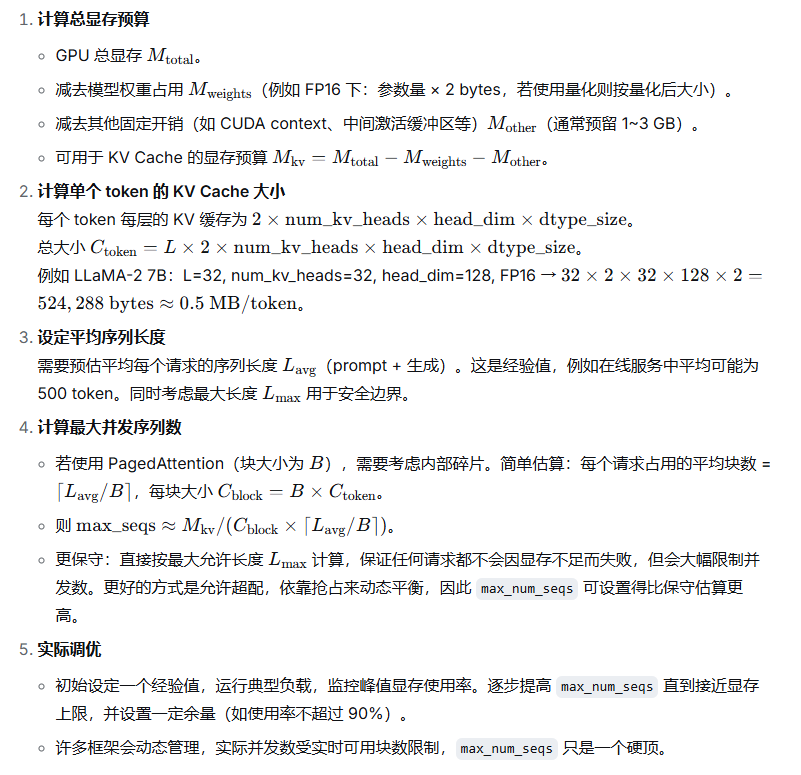

# 75.大模型（LLMs）服务并发与调度策略

#### LLM 推理服务中，有哪些典型的请求调度策略？分别适用于什么目标？

LLM 推理服务中的调度策略主要分为请求级调度（决定哪些请求进入推理引擎）和迭代级调度（在连续批处理中，每步选择哪些请求参与计算）。典型策略包括：

- 先来先服务（FCFS）：按请求到达顺序处理，简单公平。适合负载轻、对延迟无严格要求的场景。

- 最短作业优先（SJF）：优先处理预计生成长度（或剩余长度）最短的请求，最小化平均等待时间。适用于混合长度请求、追求低平均延迟的服务。

- 轮转调度（Round Robin）：在多 GPU/节点间轮流分配请求，实现负载均衡。适用于同构节点的水平扩展。

- 优先级调度：为不同用户或请求类型分配不同优先级，高优先级优先处理，可结合抢占。适用于有 VIP 用户或需要保障关键业务 SLA 的场景。

- 公平分享调度（Fair Sharing）：在多个用户或租户间按权重公平分配推理资源（如 token 吞吐），防止个别用户独占。

- 混合调度（Prefill/Decode 分离）：将 prefill 请求和 decode 请求分开调度，可优先 decode（降低延迟）或优先 prefill（提高吞吐），或者分块混合。

- 自适应批调度：根据当前系统负载、SLO 余量、请求长度分布动态调整 batch 大小和准入策略，目标是在延迟约束下最大化吞吐。

目标对应：

- 最大化吞吐：SJF、自适应批调度、混合 prefill/decode 批处理。

- 最小化平均/尾部延迟：SJF、优先级调度、抢占、公平分享（防止饥饿）。

- 公平性：FCFS（到达公平）、公平分享（资源公平）。

- 负载均衡：轮转、最少连接数调度。

- 服务等级保障（SLA）：优先级+抢占、基于 SLO 的自适应准入。

现代 LLM 推理引擎（如 vLLM、TensorRT-LLM）通常将多种策略组合，形成综合调度器。

---

#### 先来先服务（FCFS）调度在 LLM 服务中有什么缺点？为什么很少单独使用？

FCFS 按照请求到达的先后顺序依次处理，实现简单，但在 LLM 推理中缺点显著：

- 队头阻塞严重：一个极长请求（如生成长篇小说）会长时间占用推理资源，导致后续所有短请求（如简单问答）被阻塞，平均等待时间和尾部延迟急剧上升。这违背了在线服务低延迟的要求。

- 无法区分请求重要性：所有请求一视同仁，VIP 用户或紧急任务无法优先处理。

- GPU 利用率低：在静态批处理中，长请求拖累整个 batch，短请求完成后 GPU 空闲等待；即便在连续批处理中，若只按 FCFS 准入而不考虑长度，也会导致 batch 中充斥着长请求，资源被少数请求垄断。

- 无法满足延迟 SLO：不同请求有不同的延迟要求（如交互式对话需 < 200ms TTFT），FCFS 完全无视这些差异。

因此，FCFS 很少单独使用。实际系统中最多作为等待队列的默认顺序，同时结合抢占、优先级、最短作业优先等机制来弥补其不足。例如 vLLM 基础队列是 FCFS，但通过抢占和连续批处理减轻了队头阻塞的影响。

---

#### 什么是“最短作业优先”（SJF）？在 LLM 推理中如何预估作业长度？

最短作业优先（Shortest Job First, SJF） 是一种优先处理预计执行时间最短的请求的调度策略，可以理论证明它最小化平均等待时间。

在 LLM 推理中，作业长度通常指还需生成的 token 数。但问题在于，生成尚未开始或只进行了一部分时，我们无法确知总长度。预估方法有：

- 基于 prompt 的预测：训练一个轻量级的回归模型（或使用小 LLM），输入 prompt 文本，预测输出长度。可用 prompt 的长度、类型、语义特征作为特征。

- 用户指定最大长度：将 `max_tokens` 参数作为上限，但此上限往往远大于实际长度，导致预估偏大。

- 历史统计：对于特定应用（如客服），维护各类别请求的平均生成长度。

- 在线动态预估：在生成过程中，根据已生成的 token 数和当前解码速度，结合长度预测模型动态修正剩余长度。例如利用模型的置信度、已生成文本的语义判断是否接近结束。

- 保守近似：在没有预测能力时，可以将所有新请求的预估长度设为某个中等值，或依赖连续的动态重调度（如 SRPT：最短剩余处理时间优先）。部分系统支持在生成中途抢占长请求，插入短请求，此时只需相对长度排序，无需绝对预估，通过观察当前序列长度作为剩余长度的粗略指标（序列越长的请求，其剩余可能也越长）。

实现 SRPT：在连续批处理中，每个请求已经生成的 token 数已知，可近似认为已生成 token 数越多，剩余越少（但不总是，有的请求本来就长）。更准确的，可以结合用户设定的 `max_tokens` 和已生成数，计算 `remaining = max_tokens - generated` 作为上限进行排序。

SJF/SRPT 在 LLM 服务中通过优先服务即将完成的请求，能显著降低平均延迟，但需注意长请求饥饿问题，通常配合老化机制（等待时间过长则提升优先级）。

---

#### 讨论“轮转调度”（Round Robin）在多 GPU 推理节点上的负载均衡效果。

轮转调度 将请求依次循环分配给每个 GPU 推理节点（或进程），是一种无状态的简单负载均衡算法。

效果分析：

- 优点：实现极简，无需收集节点实时负载信息，在所有请求计算量完全相同且节点完全同构时，能达到完美的平均负载分布。

- 缺点：
  - 忽略请求长度差异：LLM 请求的生成长度差异巨大（10 token vs 2000 token）。轮转可能导致某些节点恰好连续分到多个长请求，而其他节点全是短请求，造成负载严重不均，部分节点过载，部分空闲。
  - 忽略节点状态：不感知节点当前的队列长度、显存占用、KV Cache 余量。可能将请求发给已满的节点，导致拒绝或排队，而其他节点仍有空闲资源。
  - 连接/会话保持困难：如果多轮对话需要路由到同一节点以复用缓存，轮转无法保证。

改进方案：

- 加权轮转：根据节点计算能力（如 GPU 型号、显存大小）分配不同权重。

- 最少连接数（Least Connections）：将请求发给当前活跃请求数最少的节点，这是更贴合 LLM 服务的负载均衡策略，因为它能感知各节点的并发负载。

- 基于显存/缓存余量的智能路由：网关通过实时监控各推理节点的可用 KV Cache 块数量或空闲显存，将新请求路由到资源最充裕的节点，同时尽量保持同一会话的亲和性。

适用场景：轮转调度在请求长度高度一致、节点完全同构且无状态的批处理作业中可用；对于在线 LLM 推理服务，它通常过于粗糙，需要结合最少连接或资源感知路由才能实现有效负载均衡。

---

#### 在连续批处理中，调度器如何决定哪些请求进入下一个迭代？常见的选择策略是什么？

连续批处理调度器在每个迭代（生成一个 token）后，需从等待队列（新请求）和运行队列（继续生成的请求）中挑选请求组成下一 batch。常见策略：

- 运行请求全部保留（默认）：所有未完成的运行请求默认进入下一迭代，因为它们只需继续生成一个 token，计算成本极低，且丢弃会导致 KV Cache 浪费。除非发生抢占。

- 新请求准入控制：决定从等待队列中拉取多少个新请求（执行 prefill 或分块 prefill）。依据：
  - 可用显存（KV Cache 空闲块数）：计算新请求的 prefill 所需块数（及其后续生成预留），若空闲块足够则准入。
  - 最大 batch token 数：设定一个迭代允许处理的最大 token 数（包括 prefill token 和 decode token），避免单次迭代延迟超标。新请求的 prompt 长度决定了其 prefill token 数。
  - 延迟 SLO：如果当前迭代的预计时间已接近延迟预算，则暂缓加入新请求。

- 分块 prefill 的调度：对于长 prompt，不会一次性 prefill 完，而是将其分成多个 chunk，在多个迭代中逐步处理，与 decode 请求混合。调度器在每个迭代决定每个 prefill 请求处理多少个 chunk token。

- 抢占与换出：当资源紧张时，选择一些低优先级或长运行请求，将其 KV Cache 换出到 CPU 内存，腾出显存给新请求。

选择策略：

- FCFS + 资源驱动：等待队列按 FCFS 排序，只要有资源就顺序拉入。简单公平，但可能让长 prompt 阻塞后续短 prompt（资源被长 prompt 预占）。

- SJF/SRPT：优先拉取预计生成长度最短的请求，以降低平均延迟。

- 优先级队列：等待队列按优先级排序（VIP > 普通），高优先级的先准入。

- 混合策略：例如，vLLM 目前默认采取 FCFS 等待队列，但通过抢占和分块 prefill 来保证长请求不阻塞。社区也支持通过请求优先级进行干预。

调度器的核心是在资源上限和延迟约束下，选择能使吞吐最大或延迟最小的请求子集。

---

#### 为了降低平均延迟，如何结合 “prefill 优先” 或 “decode 优先” 策略？

Prefill 和 decode 对系统的影响不同：

- Prefill：计算密集，一次性处理，完成后释放大量计算资源，且能尽早开始生成第一个 token（降低 TTFT）。

- Decode：内存带宽密集，需要持续迭代，延迟直接影响每个 token 的生成时间（TPOT）。

为降低平均请求延迟（整个请求完成时间 = TTFT + 生成时间），需要平衡二者：

“Prefill 优先”策略：

- 尽快让新请求完成 prefill，进入 decode 状态，这样它们可以尽早开始产出 token，减少用户的等待感知（TTFT）。同时，尽早完成 prefill 能更快释放占用的计算资源。

- 适用：当系统有大量新请求积压，TTFT 成为主要矛盾时。方法：调度器给 prefill 请求分配更多 token 预算，或优先为新请求分配 prefill 资源，甚至暂停部分 decode 迭代。

- 代价：可能增加正在 decode 的请求的 TPOT，因为这些 decode 请求的迭代可能会被延迟（GPU 执行 prefill 耗时较长）。若过度优先 prefill，decode 请求的 token 生成会变慢。

“Decode 优先”策略：

- 尽量减少对正在进行的 decode 请求的打断，保证已生成 token 的请求能平稳、快速地完成。因为 decode 阶段用户正在实时阅读，延迟抖动更敏感。

- 适用：当交互体验、TPOT 稳定性更重要时。方法：将 prefill 分块得非常小，与 decode 混合，或者限制每轮 prefill 的总 token 数，确保 decode 请求在每次迭代中占主体，单次迭代时间短且平稳。

- 代价：新请求的 prefill 可能被拉长（多轮迭代才完成 prefill），TTFT 上升。

最优结合：

- 分块 prefill + 动态预算：将长 prompt 的 prefill 分成多个小块，每次迭代处理一个小块与若干 decode 请求。同时动态调整每个迭代中 prefill token 的预算（如不超过总 token 的 20%），这样既保证 decode 请求的迭代延迟稳定，又逐步推进 prefill，使 TTFT 合理。

- 双队列调度：将 prefill 请求和 decode 请求放入不同优先级队列，使用权重或时间片轮转。例如，每进行 N 次 decode 迭代，强制插入一次 prefill 块；或者根据当前等待 prefill 的请求数量动态调整比例。

- 抢占式优先：当系统检测到某些 decode 请求即将完成，可短暂延迟 prefill，让短请求快速结束。

TensorRT-LLM 和 vLLM 的分块 prefill 本质上就是这种平衡的产物，在保持 TPOT 稳定的同时，尽量压低 TTFT。

---

#### 什么是“公平分享”（Fair Sharing）调度？如何在 token 级别实现比例公平？

公平分享调度 旨在确保多个用户、租户或请求组能够按照预设的权重（或平均地）共享有限的推理资源（GPU 算力/显存），避免某个用户的大量请求饿死其他用户。

token 级别的比例公平实现：

- 将 GPU 的推理吞吐（token/s）视为可分配的资源。为每个用户/组分配一个权重（shares）。

- 虚拟时间调度：类似 Linux CFS（完全公平调度）或 WFQ（加权公平队列）。每个请求或用户组有一个虚拟时间，每次获得服务后虚拟时间增加（增量 = 实际处理时间 / 权重）。调度器总是选择虚拟时间最小的请求，这样长期来看，每个组获得的实际 token 吞吐与其权重成正比。

- Token 级令牌桶/漏桶：为每个用户设置 token 生成速率限制。例如，权重为 2 的用户允许每秒生成最多 2 倍于权重 1 用户的 token 数。调度器在每个迭代选择请求时，检查该用户的 token 预算是否还有余量。

- 分布式队列调度：维护每个用户的独立请求队列。每次迭代，从各队列中按权重轮询选取请求（如加权轮转）。更精细的，可以按 token 数做加权公平排队：每个请求根据其所需生成的 token 数计算成本，调度器优先从成本最小的用户队列选取，保证公平。

具体实现挑战：

- 请求长度不同，一个长请求可能占用大量资源，需要在选择时考虑请求的“成本”。例如，使用 WFQ，每个请求的完成成本（Finish Time）根据预测长度和权重计算，选择最早完成的请求。

- 结合连续批处理：在一个 batch 中同时包含多个用户的请求，那么 GPU 的吞吐自然被共享。要实现比例公平，可以在调度准入环节控制各用户的在跑请求数量，或者调整各用户的 batch 占比。

例子：用户 A 权重 1，用户 B 权重 2。假设 GPU 每秒能生成 100 token。长期稳定下，用户 A 的请求应获得约 33 token/s，用户 B 获得 66 token/s。调度器通过选择虚拟时间最小的请求，自动逼近该比例。

公平分享调度在多租户平台（如 LLM API 服务）中至关重要，防止个别大客户影响其他用户的体验。

---

#### 在服务层，如何利用请求优先级（如 VIP 用户）进行调度？实现抢占吗？

优先级调度 将请求分为不同优先等级（如 high、medium、low），高优先级请求优先获得资源。实现方式包括：

- 等待队列优先级排序：新请求根据用户标签或请求类型分配优先级，插入优先级队列（堆），总是从最高优先级开始准入。

- 运行请求的优先级：在连续批处理中，当资源紧张时，可比较运行中请求的优先级，决定哪些请求继续执行，哪些被抢占。

- 抢占（Preemption）：若高优先级请求到达时资源不足，可以强制暂停（换出）低优先级请求，释放显存给高优先级请求。恢复时，低优先级请求从断点继续（通过 KV Cache 换入或重计算）。
  - 抢占策略需考虑成本：频繁抢占导致 KV Cache 换入换出开销，需设置合理的抢占阈值。
  - 可实现惰性抢占：仅当低优先级请求本迭代已经完成 token 生成，下次选择时将其排除，而不是立即中断当前迭代。

- 分级资源预留：为高优先级请求预留一定比例的显存/KV Cache 块，确保它们总有可用资源。低优先级请求只能使用剩余资源，当资源低于水位线时低优先级暂停准入。

抢占实现细节：

- 在 vLLM 中，可以通过 `--preemption-mode` 参数配置，支持 `swap`（换出到 CPU 内存）和 `recompute`（重计算）模式。调度器检测到高优先级请求需要资源时，选择低优先级序列进行抢占。

- 抢占对象通常选择优先级最低且占用资源较多的请求，以最小化受害请求数量。

注意事项：

- 需避免饥饿（低优先级永远得不到服务），可采用老化提升（等待时间超过一定限度后提升优先级）。

- 监控抢占率，过高意味着资源规划不足。

优先级调度与抢占是保障商业 SLA 的关键手段，常见于提供分级服务的 LLM 平台。

---

#### 动态 batching 中，如何平衡最大 batch size 与延迟 SLO？是否有自适应算法？

动态 batching 需在吞吐和延迟间权衡：batch size 越大，每次迭代计算量越大，每 token 延迟（TPOT） 可能增加；但 batch size 大也能摊薄 kernel 启动开销，提高总吞吐。需确保 TPOT 不超过 SLO（如 50ms）。

平衡方法：

- 静态上限：通过离线基准测试，确定在目标 GPU 上，满足 SLO 的最大 batch size，并固定该值为上限。简单但无法适应负载和序列长度动态变化。

- Token 预算（Token Budget）：不是限制请求数量，而是限制一次迭代中处理的总 token 数（包括 decode token 和 prefill token）。因为单次迭代的延迟主要正比于 `num_tokens * model_FLOPs_per_token`。设定最大 tokens/iteration，可更精准地控制延迟。例如，限制每步最多处理 4096 个 token，则无论请求数多少，只要总 token 数不超过，延迟就可控。

- 自适应算法：
  - 反馈控制：实时监测最近几次迭代的实际延迟。若 P95 延迟接近或超过 SLO，则降低允许的最大 batch size 或 token 预算；若延迟远低于 SLO，则增加预算以提升吞吐。类似 TCP 拥塞控制的自适应窗口。
  - 预测模型：根据当前 batch 中请求的序列长度分布（影响注意力计算量）和 FFN 计算量，用轻量级模型预测单次迭代延迟，并据此选择恰好满足 SLO 的最大 batch。
  - 分层准入：设定软硬两个限制。软限制是可立即响应的目标；硬限制是绝对不能超的底线。在软限制下正常调度，如果延迟趋近硬限制，则开始拒绝新 decode 请求或限制 prefill。

- Chunked Prefill 的影响：通过将 prefill 分成小 chunk，可将 prefill 对延迟的冲击均摊，避免突然出现大延迟。此时 batch size 可以更大，因为单步计算量被 token 预算所约束。

示例：vLLM 的 `--max-num-batched-tokens` 参数就是 token 预算的一种实现，限制一次迭代中最多处理的 token 数，从而间接限制延迟。

这种自适应平衡是现代推理引擎保持高吞吐且满足 SLO 的核心能力。

---

#### 解释背压（backpressure）机制，当服务过载时，如何拒绝或排队请求？

背压 是一种流量控制机制，当服务端处理能力达到上限，无法承载更多请求时，通过某种信号通知上游放缓或停止发送，避免系统被压垮。

LLM 推理服务的背压实现：

- 队列长度限制：等待队列设置最大长度。当队列满时，新到达的请求立即收到 HTTP 429 Too Many Requests 或 503 Service Unavailable，要求客户端稍后重试。这是最简单直接的背压。

- 显存/资源驱动的准入控制：推理引擎实时监控 KV Cache 空闲块数量或空闲显存。若低于阈值，则对新请求执行排队或拒绝，并在响应中携带 `Retry-After` 头。对于已在队列中的请求，可返回“服务器繁忙”错误，或让其继续排队但增加客户端感知延迟。

- 渐进式降低服务质量：在高负载时，可以采取降级策略：
  - 拒绝低优先级请求。
  - 缩短最大生成长度（忽略用户 `max_tokens` 部分要求，强制限制）。
  - 暂停接受新的长 prompt 请求，仅接受短 prompt。
  - 启用更激进的缓存（如语义缓存）来短路部分请求。

- HTTP/2 或 gRPC 流控：利用协议的流控窗口，当服务端处理慢时，TCP 接收窗口或 HTTP/2 流控自动减小，上游发送速率自然降低，实现TCP层面的背压。

- 排队 + 公平丢弃：采用加权公平队列（WFQ）等算法，当队列满时，按照一定策略丢弃（如丢弃低优先级、或队尾丢弃）。可对 VIP 用户预留队列份额，确保高优请求不被丢弃。

- 客户端配合：服务端在响应中返回 `retry_after` 建议，或使用指数退避算法让客户端重试。也可通过 API 设计（如返回一个 job_id，客户端轮询结果）将异步压力转移到轮询请求上，但轮询过频同样造成压力，需限制轮询频率。

最佳实践：

- 在推理引擎前部署 API 网关或负载均衡器，统一实施限流（rate limiting）和背压。

- 监控请求排队深度、拒绝率、P95 延迟，动态调整限流阈值。

- 结合优先级和抢占，过载时优先保护高价值请求。

背压机制确保了 LLM 服务在流量洪峰下的稳定性，是生产系统不可或缺的一环。

---

#### 在多模型部署场景，如何调度请求到不同的模型实例（如大小模型分流）？

在多模型部署中（例如同时运行一个 70B 大模型和一个 7B 小模型），调度器需要根据请求特征、负载状况和成本目标，将请求路由到最合适的模型实例，以实现成本与质量的平衡、延迟优化和资源最大化利用。

常见调度方法：

1. 基于请求复杂度的路由
  - 使用一个轻量级的复杂度分类器（可训练的小模型或启发式规则），在收到 prompt 时快速评估任务难度。例如，简单问候、事实性问答路由到小模型；复杂推理、代码生成路由到大模型。
  - 复杂度特征可包括 prompt 长度、是否包含“解释”“推理”等关键词、嵌入向量与已知困难任务的相似度等。
  - 好处：简单任务用小模型，延迟低、成本低；困难任务保证质量。

2. 基于预期生成长度的路由
  - 如果请求的 `max_tokens` 较大或系统预测生成长度较长，可路由到大模型以确保连贯性；短输出可以走小模型。但这不完全可靠，因为长输出也可能简单（如列举）。
  - 可结合复杂度判断。

3. 基于用户分级/套餐
  - VIP 用户或付费套餐路由到大模型，免费用户路由到小模型。
  - 也可在用户无感知下默认用小模型，当小模型输出置信度低时自动升级到大模型（fallback）。

4. 负载驱动的动态分流
  - 实时监测各模型实例的队列深度、可用显存、当前延迟。当大模型实例繁忙、排队严重时，将部分可降级请求路由到小模型，以保障整体可用性和响应速度。
  - 可通过 PID 控制器或简单的阈值策略：大模型队列长度 > N 时，将新请求的 `complexity_score < threshold` 的分流至小模型。

5. 基于语义缓存的短路
  - 如果语义缓存命中，可直接返回缓存答案，无需调用任何模型。这不属于大小模型分流，但能减轻模型负载。

6. A/B 测试和影子流量
  - 将少量流量路由到实验性模型，与主模型对比，用于评估新模型性能。

实现架构：通常在 API 网关或推理服务前置一个智能路由器。路由器接收请求，调用复杂度分类服务，查询各模型实例的实时状态（通过监控接口），综合决策后转发请求。

关键点：

- 路由器本身必须极低延迟（毫秒级），不能成为瓶颈。

- 需要保持会话粘性：多轮对话的相同会话应路由到同一模型实例，否则可能因模型差异导致回复风格突变。

- 成本核算：统计大小模型的调用次数和 token 量，用于成本优化。

这种多模型分流策略能够在几乎不损害用户体验的前提下，大幅降低推理成本，是云服务商和大规模 LLM 平台的常用架构。

---

#### 分析 vLLM 的调度器如何决定每次迭代的 batch 组成，使用了何种排队策略？

vLLM 的调度器是实现其高吞吐的核心，它采用迭代级连续批处理，在每个推理步动态决定 batch 组成。其策略融合了FCFS 等待队列 + 资源感知准入 + 抢占。

运行机制：

1. 等待队列：新到达的请求进入一个 FCFS 等待队列（`waiting_queue`）。默认情况下没有复杂的优先级重排，但支持通过 API 为请求指定优先级（社区版本已有相关 PR）。

2. 运行队列（活跃请求）：正在参与 decode 的请求构成 `running` 集合。每个生成步，这些请求默认全部继续参与下一迭代（因为它们只是生成一个 token，抛弃会浪费 KV Cache）。

3. 准入决策（每步后）：
  - 调度器检查当前空闲物理块数量。如果足够，从 `waiting_queue` 的头部取出请求，为其分配 KV Cache 块并执行 prefill（或分块 prefill），然后将其加入 `running`。
  - 如果空闲块不足，则不会添加新请求，或触发抢占：从 `running` 中选择一些请求，将其 KV 块换出到 CPU 内存（swap），释放显存后准入新请求。抢占选择策略通常基于优先级和序列长度（长请求或低优先级的被换出）。

4. Prefill 的分块处理：当 prompt 很长时，vLLM 采用 Chunked Prefill，将 prompt 分割为多个 chunk，与 decode 请求混合。每个迭代只处理 prompt 的一部分 token（受 `max_num_batched_tokens` 限制），避免了长 prompt 造成的大延迟。

5. 最大 token 预算：通过 `--max-num-batched-tokens` 参数限制一个迭代中处理的总 token 数（prefill token + decode token），从而间接限制单步延迟。

使用的排队策略总结：

- 等待队列：默认 FCFS，无 SJF。社区有 PR 支持基于请求优先级的队列（类似于优先级队列）。

- 运行集维持：所有活跃请求均保留，除非完成或抢占。这可以视为一种“最短剩余时间优先”的近似吗？实际上它没有主动排序运行请求，而是全部保留，通过抢占来给新请求让路。当抢占时，选择低优先级长请求换出，相当于让短请求或高优请求更容易进来。

- 本质上，vLLM 调度器是一种“FCFS + 资源驱动 + 抢占”策略，而非基于作业长度的精细化 SJF。 但是，因为连续批处理允许短请求在完成后立即退出，短请求的自然周转很快，客观上起到了降低平均延迟的效果，无需显式 SJF。

- 更高级的调度算法（如基于虚拟时间的公平分享）可以通过定制调度器实现，vLLM 的设计允许扩展调度逻辑。

因此，vLLM 调度器的核心是资源感知的连续批处理调度，在保持实现简单的同时，通过抢占和分块 prefill 解决了长请求阻塞问题，获得了优秀的平均延迟和吞吐。

---

#### 如何设定并发限制（max concurrent sequences）来防止显存溢出？这个值如何根据模型和硬件推算？

为了防止显存溢出（OOM），必须限制同时活跃的请求序列数量，即 `max_concurrent_sequences`（vLLM 中为 `--max-num-seqs`）。这直接决定 KV Cache 能分配的最大序列数。

推算方法：

1. **计算总显存预算**
   - GPU 总显存 $M_{\text{total}}$。
   - 减去模型权重占用 $M_{\text{weights}}$（例如 FP16 下：参数量 × 2 bytes，若使用量化则按量化后大小）。
   - 减去其他固定开销（如 CUDA context、中间激活缓冲区等）$M_{\text{other}}$（通常预留 1~3 GB）。
   - 可用于 KV Cache 的显存预算 $M_{\text{kv}}=M_{\text{total}}-M_{\text{weights}}-M_{\text{other}}$。
2. **计算单个 token 的 KV Cache 大小**

每个 token 每层的 KV 缓存为 $2\times\text{num\_kv\_heads}\times\text{head\_dim}\times\text{dtype\_size}$。

总大小 $C_{\text{token}}=L\times2\times\text{num\_kv\_heads}\times\text{head\_dim}\times\text{dtype\_size}$。

例如 LLaMA-2 7B：L=32, num_kv_heads=32, head_dim=128, FP16 → $32\times2\times32\times128\times2=524,288$ bytes $\approx0.5$ MB/token。
3. **设定平均序列长度**

需要预估平均每个请求的序列长度 $L_{\text{avg}}$（prompt + 生成）。这是经验值，例如在线服务中平均可能为 500 token。同时考虑最大长度 $L_{\max}$ 用于安全边界。
4. **计算最大并发序列数**
   - 若使用 PagedAttention（块大小为 $B$），需要考虑内部碎片。简单估算：每个请求占用的平均块数 $=\lceil L_{\text{avg}}/B\rceil$，每块大小 $C_{\text{block}}=B\times C_{\text{token}}$。
   - 则 $\text{max\_seqs}\approx M_{\text{kv}}/(C_{\text{block}}\times\lceil L_{\text{avg}}/B\rceil)$。
   - 更保守：直接按最大允许长度 $L_{\max}$ 计算，保证任何请求都不会因显存不足而失败，但会大幅限制并发数。更好的方式是允许超配，依靠抢占来动态平衡，因此 `max_num_seqs` 可设置得比保守估算更高。
5. **实际调优**
   - 初始设定一个经验值，运行典型负载，监控峰值显存使用率。逐步提高 `max_num_seqs` 直到接近显存上限，并设置一定余量（如使用率不超过 90%）。
   - 许多框架会动态管理，实际并发数受实时可用块数限制，`max_num_seqs` 只是一个硬顶。

{.ocr-src}

示例推算：\
GPU 显存 80 GB，模型权重 26 GB (13B FP16)，其他开销 4 GB，KV Cache 预算 50 GB。\
每 token 约 0.8 MB (13B 模型)。\
平均序列长度 800 token → 每请求平均 640 MB。\
保守并发 = 50 GB / 0.64 GB ≈ 78。\
考虑到分布和内部碎片，设置 `max_num_seqs = 64~80` 较为合理。

通过上述推算，可为不同模型和硬件确定合理的并发上限，避免 OOM 同时最大化吞吐。

---

#### 为了实现低延迟，可否将部分请求路由到更小的模型？如何构建这种路由逻辑？

可以，这正是“大小模型分流”或“级联推理”的典型应用。通过将简单或延迟敏感的请求路由到小模型，可以显著降低响应延迟和成本，同时保留大模型处理复杂请求的能力。

路由逻辑构建步骤：

1. 定义路由特征
  - 复杂度评估：利用小模型或基于规则（如 prompt 长度、关键词、语义嵌入与已知简单/困难任务的距离）为每个请求打分。
  - 延迟要求：如果请求标明了低延迟需求（如实时对话），优先小模型。
  - 用户等级：免费用户默认用小模型，付费用户用大模型。

2. 部署大小模型实例
  - 大模型（如 70B）部署在高端 GPU，小模型（如 7B）可部署在同一或低端 GPU。
  - 两者共享相同的 API 网关。

3. 智能路由器实现
  - 路由器接收请求 → 提取特征 → 调用复杂度分类器 → 若判定为“简单”或置信度高，则路由到小模型；否则到大模型。
  - 可以采用级联回退：先用小模型生成，然后用大模型或验证模型判断生成质量（如 logprob 均值、NLI 一致性），若不满足则再请求大模型。
  - 路由器需访问模型实例的实时负载，避免将请求发送给过载实例。

4. 会话粘性处理
  - 同一会话的请求应路由到同一模型，否则可能产生风格不一致。可用会话 ID 哈希或存储路由决策。

5. 在线学习优化
  - 收集小模型输出结果的用户反馈（点赞/踩），作为训练信号，持续优化复杂度分类器，提高分流准确率。

示例架构：

```plain text
Client --> API Gateway --> Router
                              |
                       Complexity Scorer
                              |
                   +----------+-----------+
                   |                      |
              Small Model           Large Model
```

注意事项：

- 路由器延迟必须极低（< 10ms），因此分类器需轻量。

- 若小模型无法处理（如生成错乱），应有快速回退到大模型的机制。

- 评估分流带来的总体延迟降低和成本节省，以验证效果。

这种大小模型协作的架构在工业界已广泛应用，如 ChatGPT 可能根据对话复杂度动态选择模型，显著优化了响应速度和运营成本。

---

#### 在服务多轮对话时，如何为每个会话分配计算和内存配额？

多轮对话中，每个会话随着历史增长，其 KV Cache 不断膨胀，会占用越来越多的显存资源。若不加以限制，可能导致某些会话耗尽资源，影响其他用户。需设计配额管理机制。

配额分配方法：

1. 最大上下文长度限制\
   设置每个会话的最大 token 数（如 4096）。当历史超过限制，采用滑动窗口丢弃最早的消息，或通过摘要压缩历史。这直接限制了单个会话的最大 KV Cache 占用。
  - 实现：在 tokenizer 后截断最早的 token，并释放对应的 KV 物理块（需引擎支持部分释放，或通过重计算）。

2. 每个会话的 KV Cache 块配额\
   为每个会话设定最多可分配的物理块数（`max_blocks_per_seq`）。一旦达到上限，新 token 的 KV 无法存储，可采取：
  - 阻止生成并返回错误；
  - 自动触发历史压缩或摘要；
  - 换出最老的部分到 CPU（层级存储），需要时再加载（复杂）。

3. 基于并发会话数的动态配额\
   采用公平分享思想：当系统负载低时，允许单个会话占用更多资源；当并发高时，收紧配额以容纳更多会话。调度器可动态调整每个会话的 `max_blocks` 或 `max_length`。

4. 用户/租户级别的资源保证\
   为付费用户预留最小 KV Cache 块数，确保其会话不会被饿死。这需要在物理块池中划分预留区域，或通过调度权重实现。

5. 生成 token 配额（Token Quota）\
   除了内存，还可限制每个会话的总生成 token 数（如每日限额），防止单一会话无限生成消耗算力。

工程实现：

- 在 PagedAttention 框架中，物理块分配由中央块管理器负责。当请求需要新块时，检查该会话已占用块数是否超过阈值，超过则拒绝分配并采取相应动作（截断、换出、错误）。

- 监控每个会话的资源占用，调度器可根据配额决定是否将该会话的请求换出或降低优先级。

通过多级配额管理，既能提供流畅的长对话体验，又能防止资源被少数超长对话垄断，保障整体服务稳定性。

---

#### 如何利用“预留实例”或“弹性伸缩”应对突发流量？结合 K8s 的调度策略。

推理服务的流量具有波动性，利用预留实例保证基础容量，结合弹性伸缩应对突发，是生产系统的标准做法。在 Kubernetes 环境中，可通过 HPA、KEDA 等实现自动伸缩。

预留实例：

- 维持一组常驻的推理 Pod（如 4 个 GPU 节点），确保低负载时的即时可用性和最低延迟。这些 Pod 一直加载模型，能立即处理请求。

- 预留实例数量根据历史流量的基线（如 P50 流量）设定。

弹性伸缩：

- 当流量上升（如请求排队深度 > 阈值、GPU 利用率持续 > 70%、或自定义指标如 `inflight_requests` 过高），自动增加推理 Pod 数量（水平伸缩）。

- 新增 Pod 需要经历模型加载时间（冷启动），可能长达数分钟。为了缩短冷启动：
  - 使用快速模型加载（如内存映射、Triton 的模型预热）。
  - 预热节点池：让部分节点处于“热待机”状态，已下载模型但未启动服务。
  - 利用容器镜像预拉取和本地 SSD 缓存模型文件。

- 流量下降后，自动缩容，释放 GPU 节点以节省成本。

K8s 调度策略结合：

- 节点亲和性/反亲和性：将推理 Pod 调度到有足够 GPU 的特定节点（如 GPU 节点池）。使用 `nodeSelector` 或 `nodeAffinity`。

- 拓扑分布约束（Topology Spread Constraints）：确保 Pod 均匀分布在可用区/节点，避免单点故障。

- 资源请求与限制：为每个推理 Pod 准确设置 `resources.requests` 和 `limits`（如 [nvidia.com/gpu](https://nvidia.com/gpu): 1），使调度器能正确管理资源。

- Pod 优先级与抢占：为推理服务设置高优先级，确保在资源紧张时关键推理 Pod 不被驱逐，甚至可抢占低优先级批处理任务。

- KEDA 或 HPA：
  - HPA 基于 CPU/内存使用率；但对于推理服务，更有意义的是基于请求队列长度或并发请求数的自定义指标伸缩。
  - 可以使用 KEDA 的 Prometheus scaler，根据 `vllm:num_requests_waiting` 指标动态伸缩。

弹性伸缩策略示例：

- 当等待请求数 > 10 时，增加 2 个 Pod；当 < 2 时，减少 1 个 Pod，缩容冷却时间 300 秒。

- 使用集群自动扩缩器（Cluster Autoscaler） 在节点资源不足时自动增加 GPU 节点。

通过预留实例保证基准性能，弹性伸缩吸收突发，同时利用 K8s 的精细调度和自动扩缩能力，能构建高可用、高性价比的 LLM 推理服务平台。

---

#### 在分布式推理集群中，中央调度器和去中心化调度的优劣。

分布式推理集群中，多个推理节点（GPU 服务器）共同服务请求，调度架构有中央调度器和去中心化两种。

中央调度器（Centralized Scheduler）：

- 结构：一个全局的调度进程（或网关）负责接收所有请求，维护全局队列，根据各节点的负载、资源、亲和性等决策将请求分配给哪个节点。

- 优点：
  - 全局视角，能做最优调度决策（如全局负载均衡、避免某些节点过热、实现全局优先级和公平分享）。
  - 易于实施全局策略（如资源配额、流量管制）。
  - 单点管理，监控和调试简单。

- 缺点：
  - 单点故障风险（需高可用保障）。
  - 可能成为性能瓶颈（需高并发设计，通常用高性能网关如 Envoy、Nginx 或自研轻量调度器）。
  - 额外一跳延迟（网关转发）。

去中心化调度（Decentralized）：

- 结构：客户端直接或通过简单负载均衡（如 DNS 轮询、K8s Service）连接到任意推理节点，节点内部独立调度，或节点间通过 gossip 协议交换负载信息进行协作。

- 优点：
  - 无单点故障，天然高可用。
  - 无中央瓶颈，扩展性极好。
  - 延迟更低（客户端直连）。

- 缺点：
  - 缺乏全局视角，可能导致负载不均（某些节点过载而其他空闲）。
  - 实施全局策略（如跨节点公平分享、全局优先级）困难。
  - 会话粘性需要额外处理（如一致性哈希）。

混合方案：

- 使用分布式负载均衡网关集群（如 Envoy + 全局控制面），控制面维护全局状态，数据面转发，兼顾性能和可靠性。

- 中央调度器负责“准入控制”和“路由决策”，而各节点自主进行本地批调度（连续批处理）。这是目前主流方案，如 vLLM 集群前挂载一个轻量路由器。

- 采用一致性哈希实现会话粘性到特定节点，同时配合全局调度。

适用场景：

- 中小规模集群：中央调度器简单有效。

- 超大规模、多租户平台：去中心化或混合架构配合强大的控制面，以实现线性扩展。

选择取决于规模、容错需求及团队工程能力。

---

#### 设计一个考虑用户经验分级的调度方案，如新用户高优先级。

为新用户提供高优先级（或更好的体验）可以促进留存，同时需兼顾老用户公平性。下面设计一个分级调度方案。

用户分级定义：

- 新用户（等级 N）：注册 7 天内，给予最高优先级，享受快速响应和专属资源池。

- 普通活跃用户（等级 A）：标准优先级。

- 沉默用户/低频用户（等级 B）：正常优先级，但在资源紧张时可能被降级。

- VIP 付费用户（等级 V）：最高优先级，可抢占普通用户资源。

调度机制：

1. 多级等待队列\
   每个优先级一个等待队列（如 `prio_n`, `prio_a`, `prio_b`）。调度器严格按优先级顺序从队列中拉取请求：先取空 V，再 N，再 A，最后 B。\
   为防止低优先级饥饿，引入老化机制：如果请求在队列中等待超过一定时间（例如 A 级 5 秒，B 级 10 秒），临时提升其优先级到较高级别。

2. 资源预留与抢占
  - 为 V 和 N 级预留一定比例的 KV Cache 块（例如共 30%），确保新用户和 VIP 总有资源可用。
  - 当资源不足且 V/N 队列有请求时，可抢占 A/B 级运行中请求，将其换出，释放显存。
  - 新用户的高优先级仅在一定额度内有效（如每天前 10 次请求高优），防止滥用。

3. 并发配额\
   新用户设有最大并发请求数（如 3），防止单个新用户占用过多资源。\
   监控各等级资源的实际消耗，动态调整预留比例。

4. 延迟目标区分\
   在自适应批调度中，为新用户和 VIP 设置更低的延迟 SLO，调度器会更积极地为他们的请求分配 token 预算，减少等待时间。

5. 反馈闭环\
   收集新用户的互动数据（如是否变成活跃用户），用于衡量策略效果，并动态调整优先级和资源分配。

实现要点：

- 在 API 网关或调度器中，解析用户 token 获取用户等级，打标签后放入对应队列。

- 调度器逻辑需高效实现多级队列和老化，可用时间轮或堆。

- 监控各等级请求的延迟分布、饥饿率，及时调整参数。

这种方案能够在资源有限的情况下，为高价值用户（包括潜在高价值的新用户）提供明显更好的体验，同时通过老化机制避免老用户被无限期阻塞。

---

#### 如何通过请求的预期输出长度（如用户指定 max_tokens）来优化调度决策？

预期输出长度（`max_tokens`）是调度的重要信号，可用于资源预估、准入控制和延迟优化。

优化调度决策的方法：

1. 更准确的资源预留\
   在分配 KV Cache 物理块时，不仅考虑当前 prompt 长度，还根据 `max_tokens` 预先“锁定”未来所需的块数，或至少检查是否有足够空闲块满足该请求的最大可能需求。若不足，可直接拒绝（而非生成一半才 OOM），或触发抢占。
  - 这避免了接受一个超长请求后，因后续显存不足而导致其他请求被换出或失败。

2. 优先级排序和准入
  - 在等待队列中，可将 `max_tokens` 作为预估作业长度的依据（越小则预计作业越短），结合 SJF 策略优先调度短请求，降低平均延迟。
  - 设定一个阈值，如果 `max_tokens` 过大（如 > 2048），即使当前有资源，也暂缓准入，等待其他短请求完成，或放入低优先级批量队列。

3. 自适应限制与降级
  - 当系统负载高时，自动降低 `max_tokens` 的上限（忽略用户设定，强制截断，并通知用户），以保证服务可用性。这属于背压策略的一部分。
  - 可以分阶段：负载 > 80% 时限制 `max_tokens` 为 1024；负载 > 95% 时限制为 512。

4. 延迟预估与 SLO 保障
  - 利用 `max_tokens` 和当前 batch 状态，预估该请求的总完成时间。如果预计完成时间将超过 SLO，可以考虑提高其优先级，或者暂不接纳。
  - 对于超长生成请求，可以将其标记为“后台任务”，使用较低的优先级，以避免影响交互式短请求。

5. 路由决策
  - 将 `max_tokens` 较大的请求路由到负载较轻的实例或专门的大容量节点，实现负载隔离。

实现注意事项：

- 用户指定的 `max_tokens` 往往比实际生成长度大得多，用作资源预留时需乘以一个经验折扣系数（如 0.6），否则预留过多浪费。

- 可以结合实时预测模型（根据 prompt 和已生成部分预测最终长度）替代 `max_tokens`，更精准。

通过有效利用预期输出长度，调度器能够做出更智能的决策，减少 OOM 风险，降低延迟，提升系统鲁棒性。

---

#### 讨论“推测解码”下的调度：草稿模型的负载应如何与主模型协调？

推测解码引入了草稿模型与目标模型的协同，调度器需要管理双模型的推理节奏和资源分配。

草稿模型与主模型的负载特点：

- 草稿模型：通常很小，自回归生成 K 个草稿 token，延迟低但需串行 K 步。在 batch=1 时负载低，但在高并发 batch 下，每个请求都需要草稿阶段，总负载与 batch 大小成正比。

- 目标模型：一次并行验证 K 个 token，计算量大，但调用频率降低（每 E 个 token 调用一次）。

协调策略：

1. 分离的草稿与验证线程/流\
   将草稿模型和目标模型放在不同 CUDA Stream 或不同 GPU 上执行，实现流水线并行。当目标模型验证 batch A 时，草稿模型同时为 batch B 生成下一轮草稿。调度器需管理双路 batch 的调度顺序。
  - 挑战：草稿模型和目标模型可能共享部分权重，或者需要访问同一 KV Cache，需要精细同步避免冲突。

2. 统一调度 + 分阶段迭代\
   在一个调度循环中，先为所有请求执行草稿（batch 草稿），收集草稿 token，然后执行目标模型验证（batch 验证）。可以动态决定哪些请求参与本轮草稿（例如，刚完成验证的请求立即开始新草稿，而新请求需先 prefill）。
  - 若草稿模型负载过高（batch 太大导致草稿延迟上升），可减少同时草稿的请求数，或限制草稿长度 K。

3. 草稿模型与目标模型的资源比例分配\
   如果两个模型共享同一 GPU，需为草稿模型分配一定的 SM 资源和显存（如通过 CUDA MPS 或简单的串行执行）。由于草稿模型小，可分配较少资源保证主模型的算力。
  - 优先级：目标模型验证通常优先级高于草稿，因为它产出最终 token；草稿可被推迟或缩短。

4. 自适应草稿长度与并发\
   调度器监测草稿阶段耗时与验证耗时的比例，如果草稿成为瓶颈（例如当并发很高时，草稿模型的小 batch 优势不再），则：
  - 降低每轮的草稿长度 K，减少草稿开销。
  - 限制同时进行草稿的请求数量，多余的请求跳过草稿直接由目标模型单步解码（回退）。
  - 使用推测解码的变体（如 Medusa）避免独立草稿模型，减少协调复杂度。

5. KV Cache 同步\
   草稿模型产生的 K、V 如果可被目标模型复用，需要在验证时传递。调度器要确保目标模型验证前，对应 KV 块已就绪。

结论：推测解码的调度实质上是双模型流水线调度问题，需通过异步执行、负载感知的自适应调整和资源隔离，最大化整体加速比，同时避免草稿模型成为新瓶颈。

---

#### 在异步推理服务中，如何实现“完成通知”或回调机制，避免客户端轮询？

异步推理服务接收请求后立即返回（如返回 `request_id`），后台处理完成后主动通知客户端，从而避免客户端持续轮询，节省资源并降低延迟。

常见实现方案：

1. Webhook 回调
  - 客户端在请求中提供一个 `callback_url`。服务端在推理完成后，向该 URL 发送 HTTP POST 请求，携带生成结果。
  - 适用于服务器到服务器的通信。
  - 安全性：需验证回调 URL 合法性，使用签名防篡改；支持重试机制（指数退避），确保最终送达。

2. WebSocket 长连接推送
  - 客户端与服务端建立 WebSocket 连接，提交请求后保持连接。服务端生成完结果或流式 token 时，直接通过该连接推送，并在最后发送完成帧。
  - 适合交互式应用，可同时支持流式输出和完成通知，无需额外的轮询或 webhook。

3. 消息队列/事件流
  - 服务端将推理结果发布到消息队列（如 Kafka、RabbitMQ、Redis Pub/Sub），客户端订阅自己的结果主题（通常以 `request_id` 为 key）。
  - 适合大规模异步任务分发，解耦极好，但客户端需集成消息队列。

4. 服务器推送事件（SSE）长连接
  - 与流式输出结合，客户端发起请求后保持 SSE 连接，服务端在生成 token 时推送，并在结束时发送特殊事件（如 `event: done`）。本质还是客户端保持连接，不算完全异步，但避免了轮询。

5. gRPC 双向流或异步回调
  - 定义 gRPC 服务，客户端调用异步推理方法，服务端返回 `stream` 响应，或使用 gRPC 的 callback 机制在完成后调用客户端的指定方法。

实现完成通知的关键点：

- 幂等和重试：通知可能丢失，服务端需支持幂等查询（用 `request_id` 查询最终结果），客户端在超时未收到通知时可查询一次作为兜底。

- 状态持久化：服务端需存储推理结果一段时间（如 24 小时），以备客户端查询。

- 安全性：Webhook 需鉴权（如 HMAC 签名）、限流。

- 配置简便：许多 LLM 推理服务默认不提供 webhook，需在网关层或业务逻辑层实现。可基于 vLLM 的异步引擎编写回调逻辑。

示例架构：

```plain text
Client --> POST /v1/chat (callback_url) --> Gateway --> vLLM Async
                                                     |
                          (完成后) HTTP POST /callback_url
```

这种异步回调机制显著提升了系统吞吐和客户端体验，避免轮询带来的延迟和资源浪费，是企业级推理 API 的必备特性。

